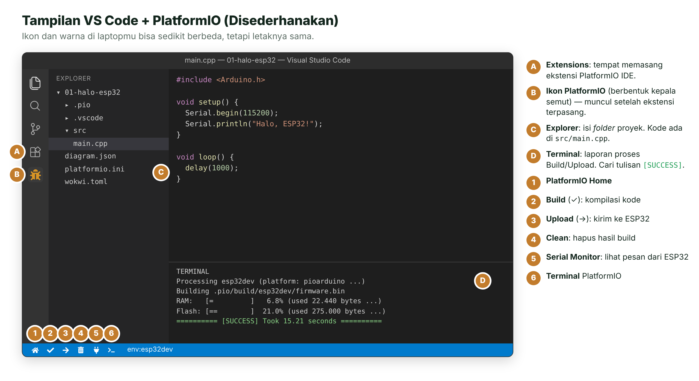
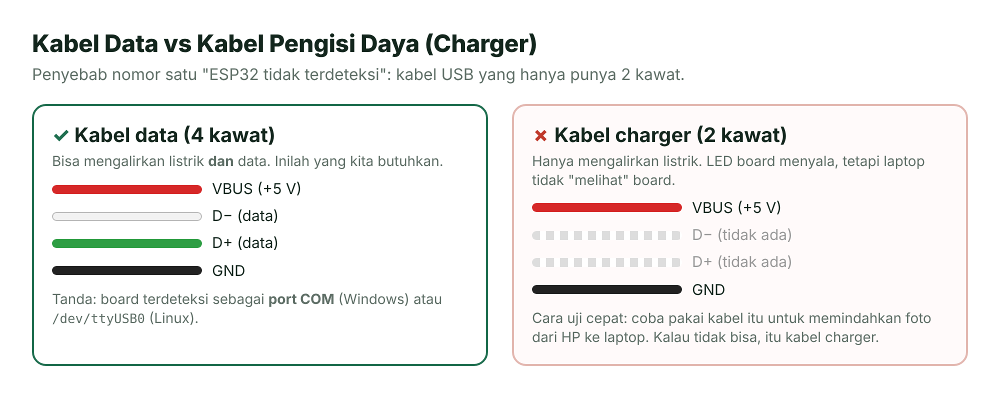
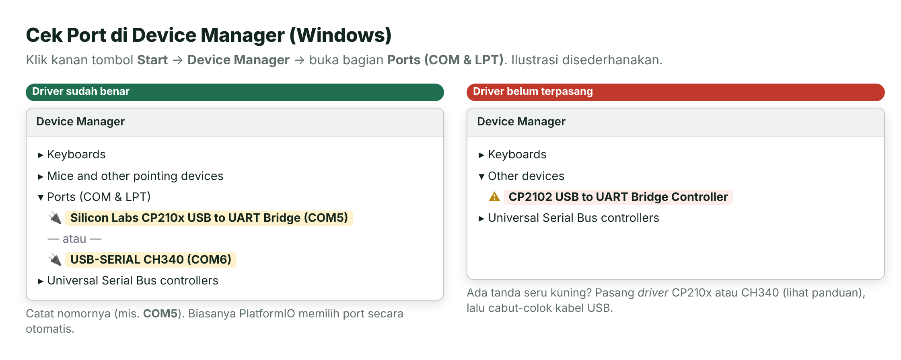

# Panduan Instalasi Alat Kerja

> Ikuti panduan ini **sebelum Pertemuan 1**. Proses pertama kali butuh unduhan cukup besar, jadi lebih nyaman dikerjakan di rumah atau di tempat dengan internet stabil.

**Daftar isi**

1. [Apa Saja yang Dipasang dan Kenapa?](#1-apa-saja-yang-dipasang-dan-kenapa)
2. [Cek Spesifikasi Laptop](#2-cek-spesifikasi-laptop)
3. [Langkah 1 — Pasang Visual Studio Code](#3-langkah-1--pasang-visual-studio-code)
4. [Langkah 2 — Pasang Git](#4-langkah-2--pasang-git)
5. [Langkah 3 — Pasang Ekstensi PlatformIO IDE](#5-langkah-3--pasang-ekstensi-platformio-ide)
6. [Langkah 4 — Unduh Materi Kuliah](#6-langkah-4--unduh-materi-kuliah)
7. [Langkah 5 — Buka Proyek Pertama dan Build](#7-langkah-5--buka-proyek-pertama-dan-build)
8. [Langkah 6 — Sambungkan Board dan Pasang Driver USB](#8-langkah-6--sambungkan-board-dan-pasang-driver-usb)
9. [Langkah 7 — Upload dan Buka Serial Monitor](#9-langkah-7--upload-dan-buka-serial-monitor)
10. [Catatan untuk macOS dan Linux](#10-catatan-untuk-macos-dan-linux)
11. [Daftar Periksa Akhir](#11-daftar-periksa-akhir)

---

## 1. Apa Saja yang Dipasang dan Kenapa?

| Alat | Fungsinya | Wajib? |
| --- | --- | --- |
| **Visual Studio Code** (VS Code) | Editor tempat kamu menulis kode. | Ya |
| **PlatformIO IDE** (ekstensi VS Code) | Mengompilasi kode (*build*), mengunggah ke ESP32 (*upload*), dan membuka Serial Monitor. | Ya |
| **Git** | Mengunduh materi dari GitHub. PlatformIO juga memakainya untuk mengunduh beberapa paket. | Sangat disarankan |
| ***Driver* USB-UART** (CP210x atau CH340) | Supaya laptop mengenali board ESP32 sebagai *port* COM. | Ya, jika memakai board asli |
| **Wokwi** | Simulator ESP32 di peramban. **Tidak perlu dipasang.** | Opsional (cadangan tanpa board) |

> [!TIP]
> **Belum punya board ESP32?** Tetap pasang VS Code dan PlatformIO, karena nanti kamu tetap butuh untuk proyek akhir. Sambil menunggu, semua praktikum bisa kamu jalankan di [Wokwi](03-simulasi-wokwi.md).

## 2. Cek Spesifikasi Laptop

- Sistem operasi: Windows 10/11 64-bit, macOS 12 ke atas, atau Linux 64-bit (Ubuntu/Debian/Fedora).
- RAM minimal 4 GB (8 GB lebih nyaman).
- **Ruang disk kosong minimal 8 GB.** Paket ESP32 yang diunduh PlatformIO memakan sekitar 5–6 GB setelah diekstrak.
- Internet: unduhan pertama sekitar **600 MB–1 GB**. Kalau internet kampus memakai *proxy*, sebaiknya instal di rumah.

## 3. Langkah 1 — Pasang Visual Studio Code

1. Buka <https://code.visualstudio.com> lalu klik tombol **Download** sesuai sistem operasimu.
2. Jalankan berkas pemasangnya. Pada Windows, centang pilihan **Add to PATH** dan **Add "Open with Code" action** (opsional, tetapi memudahkan).
3. Klik **Next** sampai selesai, lalu buka VS Code.

## 4. Langkah 2 — Pasang Git

1. Unduh dari <https://git-scm.com/downloads>.
2. Jalankan pemasangnya. Untuk pemula, **semua pilihan bawaan sudah aman**: cukup klik **Next** sampai **Install**.
3. Cek berhasil atau tidak: buka *Command Prompt* (Windows) atau *Terminal* (macOS/Linux), ketik perintah berikut, lalu tekan Enter.

   ```bash
   git --version
   ```

   Jika muncul tulisan seperti `git version 2.xx.x`, berarti Git sudah terpasang.

## 5. Langkah 3 — Pasang Ekstensi PlatformIO IDE

1. Di VS Code, klik ikon **Extensions** di bilah kiri (ikon empat kotak, ditandai **A** pada gambar di bawah), atau tekan `Ctrl+Shift+X`.
2. Ketik `platformio ide` di kotak pencarian.
3. Pilih **PlatformIO IDE** (penerbit: PlatformIO) lalu klik **Install**.
4. Tunggu sampai selesai. Di pojok kanan bawah akan muncul pesan proses pemasangan *PlatformIO Core*. Bisa memakan waktu beberapa menit.
5. Jika diminta, klik **Reload Now** atau tutup lalu buka lagi VS Code.
6. Berhasil jika muncul ikon PlatformIO (berbentuk kepala semut, ditandai **B**) di bilah kiri dan deretan tombol kecil di bilah status bawah (ditandai **1–6**).



*Gambar P.1 — Bagian-bagian penting VS Code + PlatformIO. Sumber: ilustrasi dibuat untuk materi ini.*

> [!NOTE]
> **Perlu memasang Python sendiri?** Biasanya tidak. PlatformIO IDE memakai Python portabel bawaannya. Jika muncul pesan bahwa Python tidak ditemukan, pasang Python 3 dari <https://www.python.org/downloads/> (pada Windows centang **Add python.exe to PATH**), lalu buka ulang VS Code.

## 6. Langkah 4 — Unduh Materi Kuliah

Pilih salah satu cara berikut.

**Cara A — Unduh ZIP (paling mudah)**

1. Buka repositori materi: <https://github.com/antonprafanto/embeddedsystem>.
2. Klik tombol hijau **Code** → **Download ZIP**.
3. Ekstrak berkas ZIP ke *folder* yang mudah ditemukan, misalnya `D:\Kuliah\embeddedsystem`.

> [!WARNING]
> **Hindari *folder* dengan spasi atau karakter aneh** pada jalurnya (misalnya `C:\Users\Nama Saya\Desktop\Tugas (1)`). Beberapa alat kompilasi kadang bermasalah dengan jalur seperti itu. Jalur pendek seperti `D:\Kuliah\embeddedsystem` lebih aman.

**Cara B — Pakai Git (disarankan, karena mudah diperbarui)**

```powershell
cd D:\Kuliah
git clone https://github.com/antonprafanto/embeddedsystem.git
```

Untuk mengambil materi terbaru di minggu berikutnya, masuk ke *folder* tersebut lalu jalankan `git pull`.

## 7. Langkah 5 — Buka Proyek Pertama dan Build

Setiap praktikum adalah **satu proyek PlatformIO** dalam *folder* tersendiri (berisi berkas `platformio.ini`).

1. Di VS Code, klik menu **File** → **Open Folder...**
2. Pilih *folder* `pertemuan-01-pengenalan/kode/01-halo-esp32`, lalu klik **Select Folder**.
3. Jika muncul pertanyaan *Do you trust the authors of the files in this folder?*, klik **Yes, I trust the authors**.
4. Klik tombol **Build** (ikon centang ✓) di bilah status bawah.
5. **Build pertama akan lama** (bisa 10–30 menit) karena PlatformIO mengunduh *platform* ESP32, kompilator, dan *library* inti. Biarkan sampai selesai; pantau prosesnya di jendela **Terminal**.
6. Berhasil jika di akhir terminal muncul tulisan `[SUCCESS]`. Build berikutnya hanya butuh belasan detik.

> [!IMPORTANT]
> **Buka *folder* proyeknya, bukan *folder* induk repositori.** PlatformIO baru mengenali proyek jika berkas `platformio.ini` berada langsung di *folder* yang kamu buka. Jika tombol-tombol PlatformIO tidak muncul di bilah status, biasanya inilah penyebabnya.

> [!NOTE]
> **Kenapa ada alamat GitHub di baris `platform` pada `platformio.ini`?** Materi ini memakai Arduino-ESP32 versi 3.3 melalui *platform* komunitas **pioarduino**. *Platform* bawaan PlatformIO masih memakai versi lama (2.0.17) yang beberapa fungsinya berbeda. Jadi, **jangan ubah baris tersebut**.

## 8. Langkah 6 — Sambungkan Board dan Pasang Driver USB

Lewati langkah ini jika kamu belum punya board (pakai Wokwi dulu).

1. Colokkan ESP32 ke laptop memakai **kabel USB data**. LED merah di board akan menyala.

   

   *Gambar P.2 — Kabel charger tidak bisa dipakai untuk mengunggah program. Sumber: ilustrasi dibuat untuk materi ini.*

2. Cek apakah board dikenali. Pada Windows: klik kanan tombol **Start** → **Device Manager** → buka **Ports (COM & LPT)**.

   

   *Gambar P.3 — Board yang sudah dikenali muncul sebagai port COM. Sumber: ilustrasi dibuat untuk materi ini.*

3. Jika board belum muncul atau ada tanda seru kuning, pasang *driver* sesuai cip USB-UART di board-mu (lihat tulisan pada cip kecil di dekat port USB):

   | Tulisan di cip | Unduh *driver* dari |
   | --- | --- |
   | CP2102 / CP210x | <https://www.silabs.com/developers/usb-to-uart-bridge-vcp-drivers> → pilih **CP210x Windows VCP Driver** |
   | CH340 / CH341 / CH9102 | <https://www.wch-ic.com/downloads/CH341SER_EXE.html> (sering sudah terpasang otomatis lewat Windows Update) |

4. Setelah *driver* dipasang, cabut lalu colok kembali kabel USB dan cek lagi Device Manager.

## 9. Langkah 7 — Upload dan Buka Serial Monitor

1. Klik tombol **Upload** (ikon panah →). PlatformIO akan mencari *port* ESP32 secara otomatis.
2. Tunggu sampai muncul `[SUCCESS]`. Selama proses, terminal menampilkan persentase tulisan seperti `Writing at 0x00010000... (25 %)`.
3. Klik tombol **Serial Monitor** (ikon colokan). Kamu akan melihat sapaan dari ESP32.
4. Jika layar Serial Monitor kosong, tekan tombol **EN** pada board sekali untuk mengulang program dari awal.

> [!TIP]
> **Upload gagal dengan pesan `Failed to connect to ESP32`?** Tekan dan tahan tombol **BOOT** di board saat terminal menampilkan `Connecting....`, lalu lepas setelah persentase penulisan muncul. Solusi masalah lain ada di [Panduan Mengatasi Masalah](06-mengatasi-masalah.md).

## 10. Catatan untuk macOS dan Linux

**macOS**

- *Driver* CP210x dan CH34x versi macOS tersedia di situs yang sama dengan tautan di atas. Setelah dipasang, buka **System Settings → Privacy & Security** dan izinkan *driver* tersebut jika diminta.
- *Port* board biasanya bernama `/dev/cu.usbserial-xxxx` atau `/dev/cu.SLAB_USBtoUART`.

**Linux (Ubuntu/Debian)**

1. Pasang paket `python3-venv`:

   ```bash
   sudo apt install python3-venv
   ```

2. Pasang aturan *udev* PlatformIO supaya *port* USB bisa diakses tanpa `sudo`:

   ```bash
   curl -fsSL https://raw.githubusercontent.com/platformio/platformio-core/develop/platformio/assets/system/99-platformio-udev.rules | sudo tee /etc/udev/rules.d/99-platformio-udev.rules
   sudo udevadm control --reload-rules
   sudo udevadm trigger
   ```

3. Tambahkan akunmu ke grup `dialout`, lalu *logout* dan *login* kembali:

   ```bash
   sudo usermod -a -G dialout $USER
   ```

## 11. Daftar Periksa Akhir

Centang semua sebelum Pertemuan 1:

- [ ] VS Code terpasang dan bisa dibuka.
- [ ] Ikon PlatformIO muncul di bilah kiri VS Code.
- [ ] `git --version` menampilkan nomor versi.
- [ ] Materi kuliah sudah diunduh (ZIP atau `git clone`).
- [ ] Proyek `pertemuan-01-pengenalan/kode/01-halo-esp32` berhasil di-*build* (`[SUCCESS]`).
- [ ] (Jika punya board) Board muncul sebagai *port* COM dan program berhasil diunggah.
- [ ] (Cadangan) Kamu sudah mencoba membuka <https://wokwi.com/projects/new/esp32>.

---

## Referensi

1. Microsoft. (2026). *Visual Studio Code documentation*. <https://code.visualstudio.com/docs>
2. PlatformIO Labs. (2026). *PlatformIO IDE for VSCode*. <https://docs.platformio.org/en/latest/integration/ide/vscode.html>
3. PlatformIO Labs. (2026). *99-platformio-udev.rules*. <https://docs.platformio.org/en/latest/core/installation/udev-rules.html>
4. pioarduino. (2026). *pioarduino — platform-espressif32* (rilis 55.03.312). <https://github.com/pioarduino/platform-espressif32>
5. Silicon Labs. (2026). *CP210x USB to UART Bridge VCP Drivers*. <https://www.silabs.com/developers/usb-to-uart-bridge-vcp-drivers>

---

[⬅️ Mulai di Sini](01-mulai-di-sini.md) · [🏠 Beranda](../README.md) · [Simulasi Wokwi ➡️](03-simulasi-wokwi.md)
