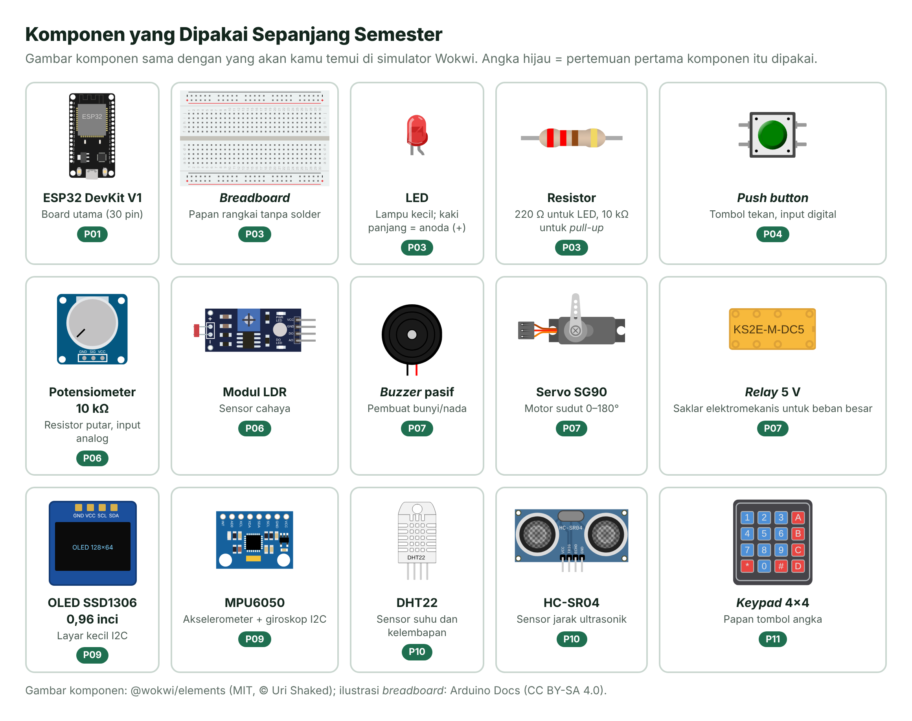

# Daftar Komponen dan Alat

> Daftar ini disusun agar satu kit bisa dipakai dari Pertemuan 1 sampai proyek akhir. Semua komponen tersedia di toko elektronika daring maupun luring. Jika belum lengkap, kamu tetap bisa berlatih di [simulator Wokwi](03-simulasi-wokwi.md).

*Gambar K.1 — Komponen utama dan pertemuan pertama komponen tersebut dipakai. Sumber: @wokwi/elements (MIT, © Uri Shaked); ilustrasi breadboard: Arduino Docs (CC BY-SA 4.0).*

## 1. Kit Wajib (per Mahasiswa atau per Kelompok)

| No | Komponen | Jumlah | Dipakai mulai | Catatan saat membeli |
| --- | --- | --- | --- | --- |
| 1 | ESP32 DevKit V1 (30 pin) | 1 | P01 | Modul ESP32-WROOM-32/32E. Cip USB CP2102 atau CH340 sama-sama bisa. Board 38 pin juga boleh, nomor GPIO-nya sama. |
| 2 | Kabel USB **data** | 1 | P01 | Sesuaikan port board (micro-USB atau USB-C). Pastikan bukan kabel *charger* saja. |
| 3 | *Breadboard* 830 lubang | 1 | P03 | Satu board ESP32 DevKit V1 sudah memakan banyak lubang; ukuran 830 lubang lebih lega. |
| 4 | Kabel *jumper* male–male dan male–female | 20 + 10 | P03 | Pilih yang ujungnya kokoh. |
| 5 | LED 5 mm (merah, kuning, hijau, biru) | 2 per warna | P03 | |
| 6 | Resistor 220 Ω | 10 | P03 | Untuk membatasi arus LED. 330 Ω juga boleh. |
| 7 | Resistor 10 kΩ | 5 | P04 | Untuk *pull-up*/*pull-down* dan pembagi tegangan. |
| 8 | *Push button* 6×6 mm | 4 | P04 | |
| 9 | Potensiometer 10 kΩ | 1 | P06 | Jenis yang bisa ditancap ke *breadboard*. |
| 10 | Modul LDR (sensor cahaya) | 1 | P06 | Atau LDR + resistor 10 kΩ. |
| 11 | Termistor NTC 10 kΩ (β 3950) atau modul sensor suhu NTC | 1 | P06 | Termistor dipasang bersama resistor 10 kΩ sebagai pembagi tegangan. |
| 12 | *Buzzer* pasif | 1 | P07 | **Pasif**, supaya bisa memainkan nada. |
| 13 | Servo SG90 | 1 | P07 | |
| 14 | Transistor NPN 2N2222 atau BC547 | 2 | P07 | Untuk menggerakkan beban yang lebih besar dari kemampuan pin. |
| 15 | Dioda 1N4007 | 2 | P07 | Dioda pengaman (*flyback*) untuk beban induktif. |
| 16 | Modul *relay* 1 kanal 5 V | 1 | P07 | |
| 17 | OLED SSD1306 0,96 inci I2C (4 pin) | 1 | P09 | Pin: GND, VCC, SCL, SDA. |
| 18 | MPU6050 (akselerometer + giroskop) | 1 | P09 | |
| 19 | DHT22 (suhu + kelembapan) | 1 | P10 | DHT11 lebih murah tetapi kurang akurat. |
| 20 | HC-SR04 (sensor jarak ultrasonik) | 1 | P10 | Bekerja di 5 V; butuh pembagi tegangan pada pin ECHO (dibahas di P10). |
| 21 | *Keypad* membran 4×4 | 1 | P11 | |

## 2. Alat Ukur dan Perlengkapan

| Alat | Fungsi |
| --- | --- |
| Multimeter digital | Mengukur tegangan, arus, hambatan, dan mengecek sambungan (mode *continuity*). |
| Tang potong dan pengupas kabel | Merapikan kaki komponen dan kabel. |
| Kotak penyimpanan komponen | Supaya komponen kecil tidak hilang. |
| (Opsional) Penganalisis logika USB 8 kanal 24 MHz | Melihat sinyal UART/I2C/SPI di Pertemuan 9. Wokwi juga punya versi virtualnya. |

## 3. Tips Belanja dan Perawatan

- **Cek ulasan pembeli** tentang board ESP32: pilih toko yang menyebutkan jenis cip USB (CP2102/CH340) dan memberi garansi tukar.
- Untuk pemula, **beli komponen cadangan** (LED, resistor, kabel *jumper*). Harganya murah, dan salah pasang adalah bagian dari belajar.
- Simpan board di kotak antistatis atau busa hitam. Jangan meletakkan board di atas permukaan logam saat menyala, karena pin-pinnya bisa terhubung singkat.

> [!CAUTION]
> **Pin ESP32 bekerja pada 3,3 V, bukan 5 V.** Jangan menghubungkan sinyal 5 V (misalnya dari sensor 5 V) langsung ke pin GPIO tanpa penurun tegangan. Penjelasan lengkap ada di [Lembar Saku Pinout ESP32](05-pinout-esp32.md).

---

[⬅️ Simulasi Wokwi](03-simulasi-wokwi.md) · [🏠 Beranda](../README.md) · [Pinout ESP32 ➡️](05-pinout-esp32.md)
