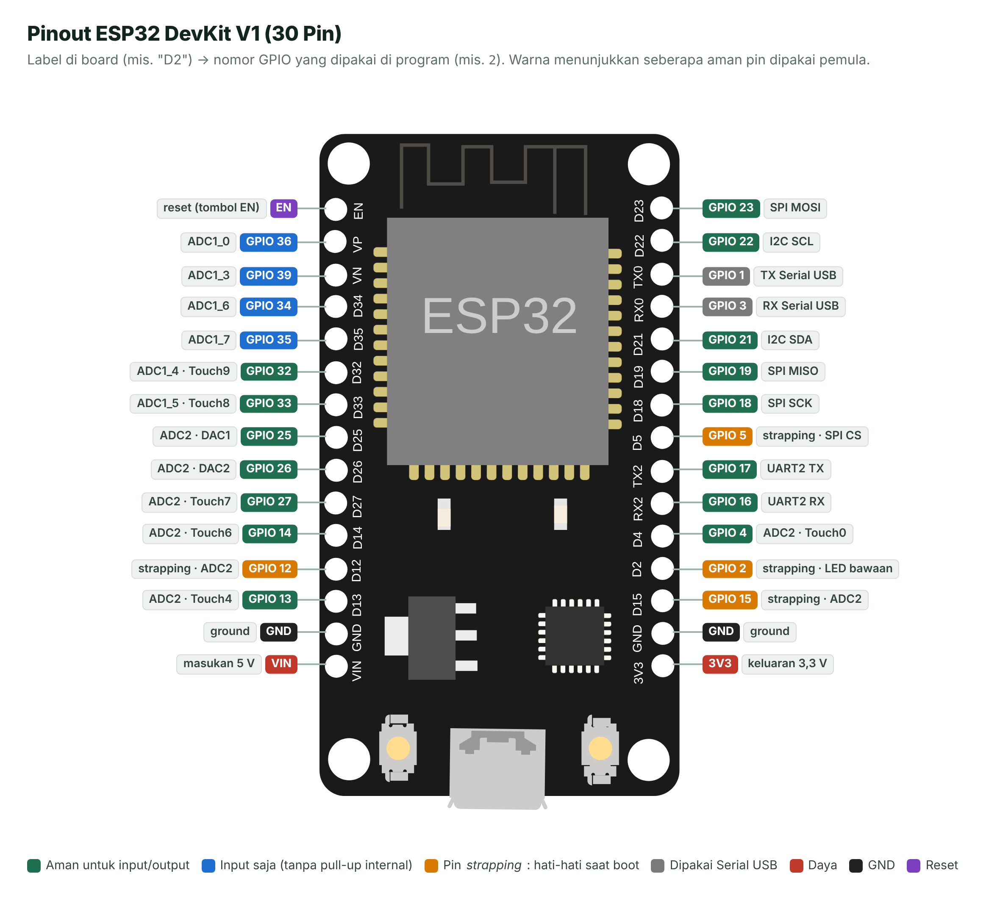

# Lembar Saku Pinout ESP32 DevKit V1

> Simpan (atau cetak) halaman ini. Hampir semua masalah "kode benar tapi alat tidak jalan" di minggu-minggu awal berasal dari **salah pilih pin**.

*Gambar S.1 — Pinout ESP32 DevKit V1. Gambar board: @wokwi/elements (MIT, © Uri Shaked); label dan kode warna dibuat untuk materi ini berdasarkan* ESP32 Series Datasheet *(Espressif).*

## 1. Cara Membaca Label Pin

Label yang tercetak di board **tidak selalu sama** dengan nomor yang ditulis di program:

| Label di board | Nomor di program | Contoh kode |
| --- | --- | --- |
| `D2` | `2` | `pinMode(2, OUTPUT);` |
| `D23` | `23` | `digitalWrite(23, HIGH);` |
| `TX2` / `RX2` | `17` / `16` | `Serial2.begin(9600, SERIAL_8N1, 16, 17);` |
| `VP` / `VN` | `36` / `39` | `analogRead(36);` |
| `TX0` / `RX0` | `1` / `3` | Dipakai Serial ke laptop — **jangan dipakai** |

## 2. Kategori Pin

| Kategori | GPIO | Aturan |
| --- | --- | --- |
| ✅ **Aman** untuk input/output | 4, 13, 14, 16, 17, 18, 19, 21, 22, 23, 25, 26, 27, 32, 33 | Pilihan utama untuk LED, tombol, sensor, modul. |
| 🔵 **Input saja** | 34, 35, 36 (VP), 39 (VN) | Tidak bisa jadi output dan **tidak punya resistor *pull-up/pull-down* internal**. Cocok untuk sensor analog. |
| 🟠 **Pin *strapping*** | 0, 2, 5, 12, 15 | Level tegangannya dibaca saat *boot* untuk menentukan mode. Boleh dipakai, tetapi jangan ditarik paksa HIGH/LOW saat board dinyalakan. GPIO 12 yang HIGH saat *boot* bisa membuat board gagal menyala. |
| ⚪ **Serial USB** | 1 (TX0), 3 (RX0) | Dipakai untuk unggah program dan Serial Monitor. |
| ⛔ **Terlarang** | 6, 7, 8, 9, 10, 11 | Terhubung ke memori *flash* di dalam modul. Pada board 30 pin pin ini tidak dikeluarkan; pada board 38 pin (berlabel CLK, SD0–SD3, CMD) **jangan disambung apa pun**. |

> [!TIP]
> **Pin favorit pemula:** LED dan tombol di GPIO **4, 13, 14, 16–19, 21–23, 25–27**; sensor analog di GPIO **32–39**.

## 3. ADC1 vs ADC2: Jebakan Saat Wi-Fi Aktif

ESP32 punya dua ADC (pengubah analog ke digital):

- **ADC1** — GPIO 32, 33, 34, 35, 36, 39 (yang keluar di board 30 pin).
- **ADC2** — GPIO 0, 2, 4, 12, 13, 14, 15, 25, 26, 27.

ADC2 dipakai bersama oleh *driver* Wi-Fi. **Saat Wi-Fi menyala, pembacaan analog di pin ADC2 tidak bisa diandalkan.** Biasakan memasang sensor analog di pin **ADC1** sejak awal, supaya program tidak perlu diubah ketika proyekmu nanti tersambung ke internet.

## 4. Pin Bawaan untuk Bus Komunikasi

| Bus | Pin bawaan (Arduino-ESP32) |
| --- | --- |
| I2C (`Wire`) | SDA = GPIO 21, SCL = GPIO 22 |
| SPI (VSPI) | SCK = GPIO 18, MISO = GPIO 19, MOSI = GPIO 23, CS = GPIO 5 |
| UART2 (`Serial2`) | RX = GPIO 16, TX = GPIO 17 |
| DAC | DAC1 = GPIO 25, DAC2 = GPIO 26 |

Berkat *GPIO matrix*, sebagian besar fungsi ini sebenarnya bisa dipindah ke pin lain, tetapi memakai pin bawaan mengurangi kebingungan.

## 5. Batas Kelistrikan yang Wajib Diingat

| Besaran | Nilai | Artinya bagimu |
| --- | --- | --- |
| Tegangan logika | 3,3 V | HIGH = ±3,3 V, LOW = ±0 V. |
| Tegangan maksimum di pin | 3,6 V (peringkat maksimum mutlak catu) | **Pin ESP32 tidak toleran 5 V.** Sinyal 5 V harus diturunkan (pembagi tegangan atau *level shifter*). |
| Ambang input HIGH / LOW | ≥ 0,75 × VDD / ≤ 0,25 × VDD | Pada 3,3 V: HIGH ≥ ±2,5 V, LOW ≤ ±0,8 V. |
| Arus keluaran per pin | tipikal 40 mA (sumber) / 28 mA (*sink*) pada kekuatan *drive* maksimum | Itu batas kemampuan, bukan target. Rancang **≤ 10–12 mA per pin**; LED cukup 5–10 mA. |
| Resistor *pull-up/pull-down* internal | ±45 kΩ | Cukup untuk tombol, tidak ada di GPIO 34–39. |
| Pin `VIN` | masukan 5 V | Dari USB atau catu luar 5 V. |
| Pin `3V3` | keluaran 3,3 V dari regulator | Untuk sensor/modul 3,3 V berdaya kecil. |

> [!CAUTION]
> **Gunakan satu sumber daya saja.** Jangan mencatu board dari USB **dan** dari pin VIN/3V3 sekaligus dengan sumber lain, karena bisa merusak board atau sumber dayanya.

> [!CAUTION]
> **Motor, *relay*, dan beban besar tidak boleh langsung ke pin GPIO.** Gunakan transistor atau modul *driver* (dibahas di Pertemuan 7).

---

## Referensi

1. Espressif Systems. (2025). *ESP32 Series Datasheet* (v5.x) — bagian *Pin Overview*, *Strapping Pins*, *ADC*. <https://documentation.espressif.com/esp32_datasheet_en.pdf>
2. Espressif Systems. (2025). *ESP32-WROOM-32E & ESP32-WROOM-32UE Datasheet* — Tabel *DC Characteristics*. <https://documentation.espressif.com/esp32-wroom-32e_esp32-wroom-32ue_datasheet_en.pdf>
3. Espressif Systems. (2026). *ESP-IDF Programming Guide — GPIO & RTC GPIO*. <https://docs.espressif.com/projects/esp-idf/en/stable/esp32/api-reference/peripherals/gpio.html>
4. Espressif Systems. (2026). *ESP32-DevKitC V4 User Guide*. <https://docs.espressif.com/projects/esp-dev-kits/en/latest/esp32/esp32-devkitc/user_guide.html>

---

[⬅️ Daftar Komponen](04-daftar-komponen.md) · [🏠 Beranda](../README.md) · [Mengatasi Masalah ➡️](06-mengatasi-masalah.md)
