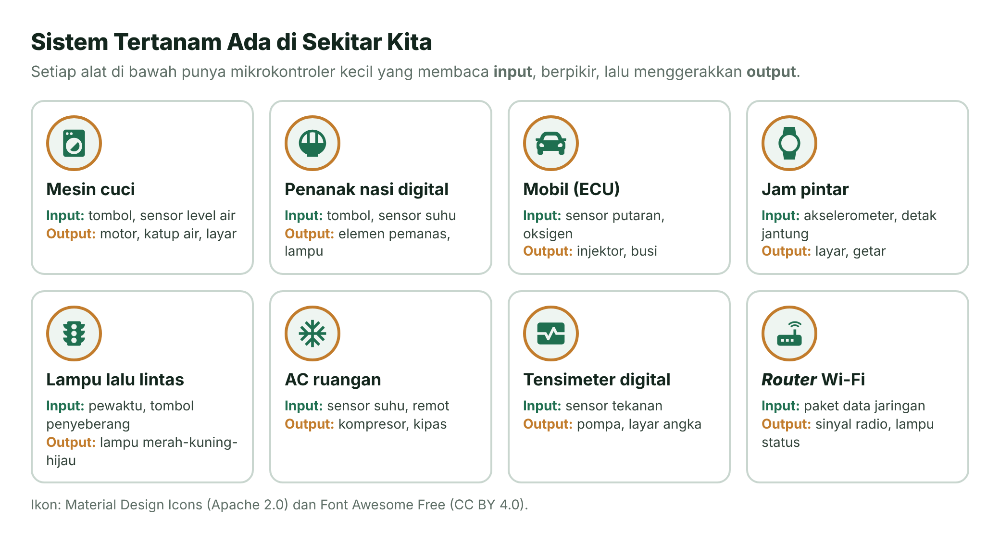
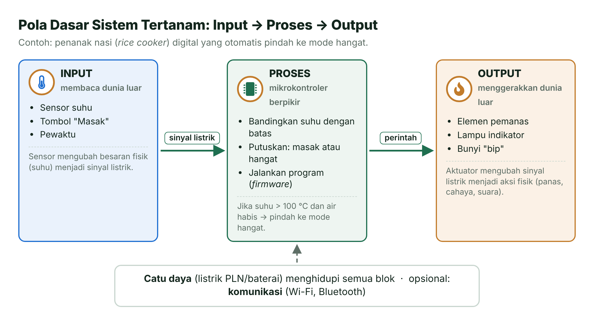
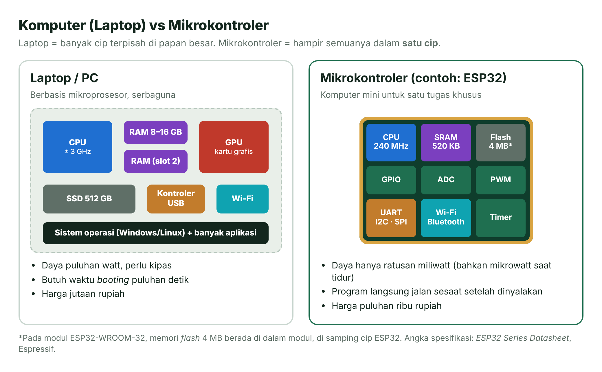
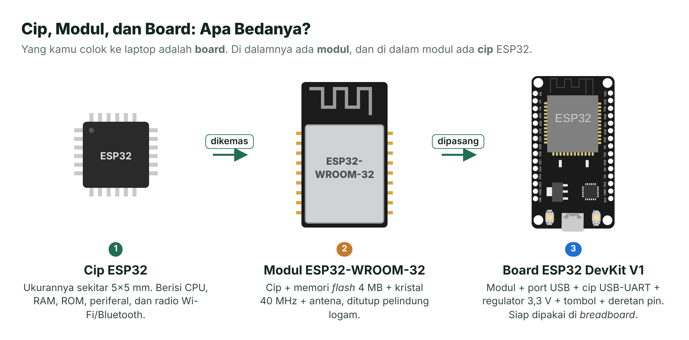
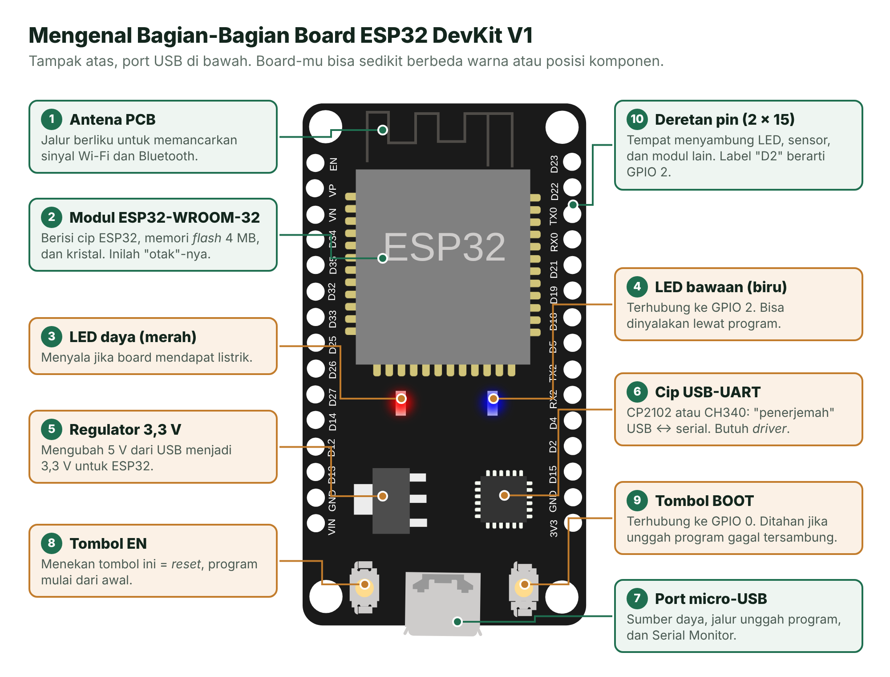
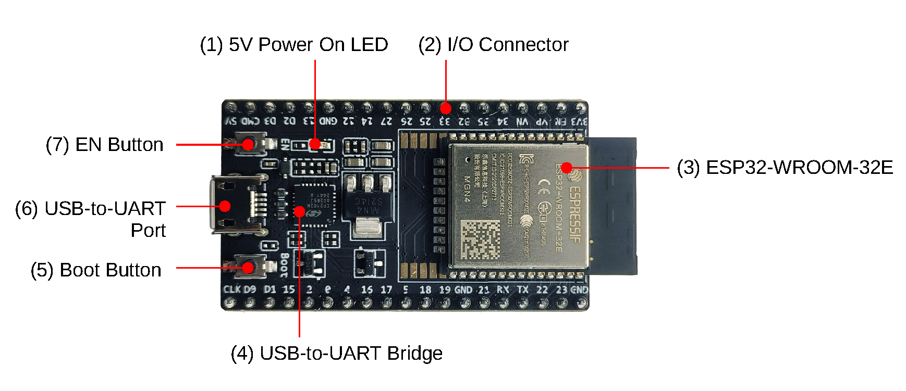
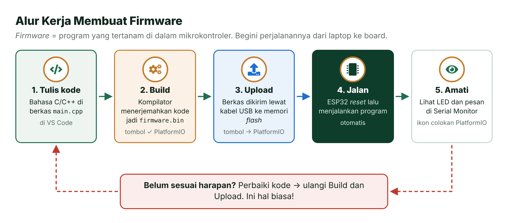
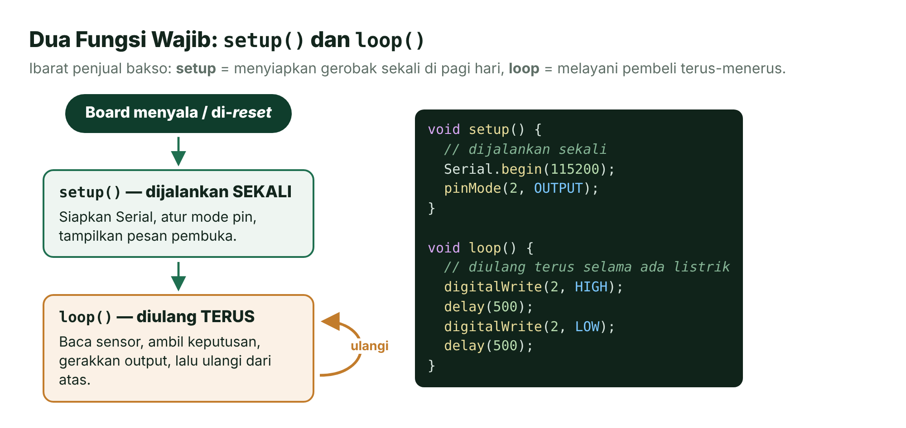
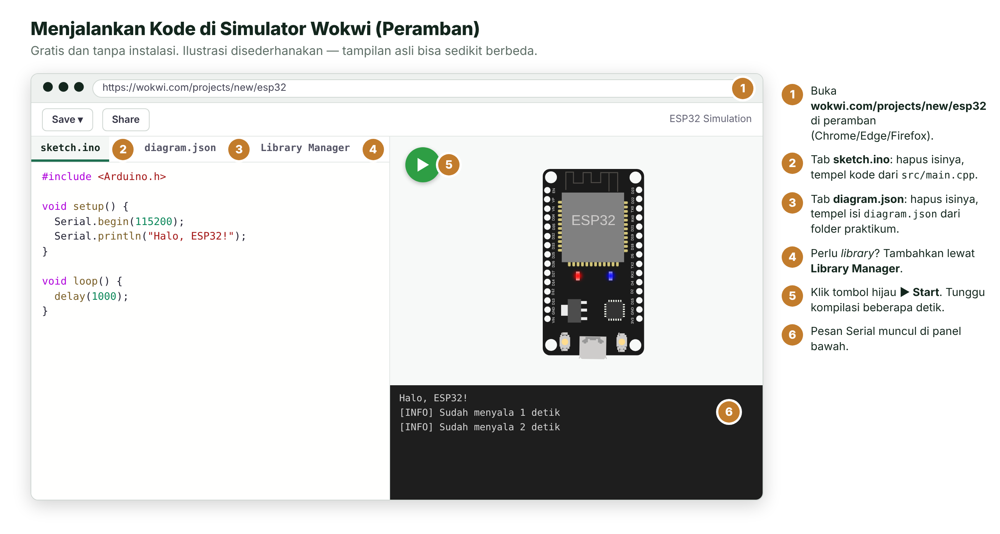

# Pertemuan 01 — Mengenal Sistem Tertanam, ESP32, dan Alat Kerja

> Hari ini kamu berkenalan dengan dunia sistem tertanam, mengenal board ESP32, lalu menjalankan dua program pertamamu: ESP32 yang menyapa lewat Serial Monitor dan LED yang berkedip.

| | |
| --- | --- |
| ⏱️ **Durasi** | 2 × 50 menit teori + 3 × 50 menit praktikum |
| 📋 **Prasyarat** | Tidak ada. Cukup bisa mengoperasikan komputer |
| 🧰 **Alat** | Laptop + internet; opsional: ESP32 DevKit V1 + kabel USB data |
| 📥 **Slide** | 👁️ [Lihat di peramban](https://view.officeapps.live.com/op/view.aspx?src=https%3A%2F%2Fraw.githubusercontent.com%2Fantonprafanto%2Fembeddedsystem%2Fmain%2Fslide%2Fpptx%2FP01-Pengenalan-Sistem-Tertanam.pptx) · ⬇️ [Unduh PDF](https://raw.githubusercontent.com/antonprafanto/embeddedsystem/main/slide/pdf/P01-Pengenalan-Sistem-Tertanam.pdf) · ⬇️ [Unduh PPTX](https://raw.githubusercontent.com/antonprafanto/embeddedsystem/main/slide/pptx/P01-Pengenalan-Sistem-Tertanam.pptx) |
| 📄 **Modul PDF** | ⬇️ [Unduh modul ini dalam PDF](https://raw.githubusercontent.com/antonprafanto/embeddedsystem/main/modul-pdf/Modul-P01-Pengenalan-Sistem-Tertanam.pdf) — untuk dibaca luring atau dicetak |

## Daftar Isi

- [🎯 Tujuan Pembelajaran](#-tujuan-pembelajaran)
- [🧰 Yang Perlu Disiapkan](#-yang-perlu-disiapkan)
- [1. Apa Itu Sistem Tertanam?](#1-apa-itu-sistem-tertanam)
- [2. Pola Dasar: Input → Proses → Output](#2-pola-dasar-input--proses--output)
- [3. Komputer, Mikroprosesor, dan Mikrokontroler](#3-komputer-mikroprosesor-dan-mikrokontroler)
- [4. Kenalan dengan ESP32](#4-kenalan-dengan-esp32)
- [5. Alur Kerja Membuat Firmware](#5-alur-kerja-membuat-firmware)
- [6. Struktur Program: setup() dan loop()](#6-struktur-program-setup-dan-loop)
- [🧪 Praktikum](#-praktikum)
- [🏋️ Latihan & Tantangan](#️-latihan--tantangan)
- [✅ Cek Pemahaman](#-cek-pemahaman)
- [📌 Rangkuman](#-rangkuman)
- [📚 Referensi](#-referensi)
- [🖼️ Sumber Gambar](#️-sumber-gambar)

---

## 🎯 Tujuan Pembelajaran

Setelah pertemuan ini, kamu bisa:

1. Menjelaskan pengertian sistem tertanam dan memberi contohnya di sekitar kita.
2. Membedakan komputer berbasis mikroprosesor dengan mikrokontroler.
3. Menyebutkan bagian-bagian penting board ESP32 DevKit V1 beserta fungsinya.
4. Menjelaskan alur kerja membuat *firmware*: tulis kode → *build* → *upload* → amati.
5. Menjalankan program pertama di simulator Wokwi dan (jika ada) di board ESP32 asli.

## 🧰 Yang Perlu Disiapkan

| Kebutuhan | Keterangan |
| --- | --- |
| Wajib | Laptop dan internet |
| Sangat disarankan **sebelum kelas** | VS Code + PlatformIO sudah terpasang — ikuti [Panduan Instalasi Alat](../panduan/02-instalasi-alat.md). Unduhan pertamanya besar, jadi jangan dikerjakan mendadak saat kelas. |
| Opsional | Board ESP32 DevKit V1 + kabel USB **data** |
| Cadangan tanpa board | Simulator [Wokwi](../panduan/03-simulasi-wokwi.md) di peramban |

---

## 1. Apa Itu Sistem Tertanam?

Coba ingat **penanak nasi (*rice cooker*) digital** di rumah. Kamu menekan tombol "Masak", lalu alat itu memanaskan beras, mengawasi suhunya, dan otomatis pindah ke mode "Hangat" ketika nasi matang. Siapa yang mengambil keputusan "sudah waktunya pindah ke mode hangat"? Jawabannya: sebuah **komputer kecil** yang tertanam di dalamnya.

**Sistem tertanam** (*embedded system*) adalah sistem pengolah informasi yang **ditanam di dalam sebuah produk** untuk menjalankan **tugas khusus** [1]. Penggunanya biasanya tidak sadar bahwa di dalam produk itu ada komputer. Bandingkan dengan laptop yang dibuat untuk banyak keperluan: mengetik, menonton video, bermain gim, dan lain-lain.



*Gambar 1.1 — Contoh sistem tertanam di sekitar kita. Sumber: dibuat untuk materi ini (ikon Material Design Icons, Apache 2.0, dan Font Awesome Free, CC BY 4.0).*

### Ciri-Ciri Sistem Tertanam

| Ciri | Penjelasan | Contoh |
| --- | --- | --- |
| **Tugas khusus** | Dirancang untuk satu fungsi utama. | Mesin cuci hanya mengatur proses mencuci. |
| **Berinteraksi dengan dunia fisik** | Membaca sensor dan menggerakkan aktuator. | Sensor suhu → elemen pemanas. |
| **Sumber daya terbatas** | Memori, kecepatan, dan daya dibatasi supaya murah dan hemat. | Memori ESP32 hanya ratusan kilobita (KB), bukan gigabita (GB). |
| **Harus tepat waktu (*real-time*)** | Tidak cukup benar; harus benar **dan** tepat waktu. | Kantong udara mobil harus mengembang dalam hitungan milidetik. |
| **Andal dan hemat energi** | Bisa bekerja bertahun-tahun tanpa dimatikan, kadang hanya dengan baterai. | Meteran air digital, jam pintar. |

> [!NOTE]
> **Tahukah kamu?** Salah satu sistem tertanam modern pertama adalah *Apollo Guidance Computer*, komputer pemandu wahana Apollo yang membawa manusia ke Bulan pada 1960-an. Kini sistem tertanam adalah jenis komputer yang paling banyak: pernah diperkirakan sekitar 98% mikroprosesor yang diproduksi dipakai di sistem tertanam, bukan di PC [8].

## 2. Pola Dasar: Input → Proses → Output

Hampir semua sistem tertanam bisa digambarkan dengan pola sederhana berikut.



*Gambar 1.2 — Pola input → proses → output. Sumber: dibuat untuk materi ini.*

- **Input** membaca dunia luar melalui **sensor** (suhu, cahaya, tombol, jarak) dan mengubahnya menjadi sinyal listrik.
- **Proses** dikerjakan oleh **mikrokontroler** yang menjalankan program. Program inilah yang disebut ***firmware***.
- **Output** menggerakkan dunia luar melalui **aktuator** (lampu, motor, pemanas, layar, pengeras suara).

Sepanjang semester, setiap praktikum akan selalu bisa kamu urai dengan pola ini. Biasakan bertanya: *apa input-nya, apa prosesnya, apa output-nya?*

## 3. Komputer, Mikroprosesor, dan Mikrokontroler

Laptop memakai **mikroprosesor**: cip CPU yang sangat cepat, tetapi butuh banyak cip lain di sekitarnya (RAM, penyimpanan, kartu grafis, pengendali USB) dan sistem operasi. **Mikrokontroler** mengemas hampir semuanya ke dalam **satu cip**: CPU, memori program, memori data, serta periferal untuk berhubungan dengan dunia luar.



*Gambar 1.3 — Laptop vs mikrokontroler. Sumber: dibuat untuk materi ini; angka spesifikasi ESP32 dari [3].*

| Aspek | Laptop (mikroprosesor) | Mikrokontroler (ESP32) |
| --- | --- | --- |
| Tujuan | Serbaguna | Tugas khusus |
| Kecepatan CPU | ± 2–5 GHz | hingga 240 MHz |
| Memori data (RAM) | 8–32 GB | 520 KB SRAM |
| Sistem operasi | Windows, macOS, Linux | Tidak ada, atau sistem operasi waktu nyata (RTOS) yang sangat kecil |
| Waktu menyala | Puluhan detik | Sepersekian detik |
| Konsumsi daya | Puluhan watt | Ratusan miliwatt, bahkan mikrowatt saat tidur |
| Akses ke pin listrik | Tidak langsung | Langsung: puluhan pin GPIO |

> [!TIP]
> **Analogi gampangnya:** laptop itu seperti **rumah besar** dengan banyak ruangan terpisah (dapur, kamar, gudang). Mikrokontroler seperti **rumah mungil serba ada**: semua fungsi penting ada dalam satu petak kecil, cukup untuk satu keluarga kecil yang kebutuhannya jelas.

## 4. Kenalan dengan ESP32

**ESP32** adalah mikrokontroler buatan perusahaan Espressif Systems. Di dunia pendidikan dan industri skala kecil, ESP32 sangat populer karena murah, cepat, dan sudah dilengkapi Wi-Fi serta Bluetooth.

### Spesifikasi Penting

| Fitur | ESP32 |
| --- | --- |
| CPU | 2 inti Xtensa® LX6 32-bit, hingga 240 MHz |
| Memori internal | SRAM 520 KB, ROM 448 KB, RTC SRAM 16 KB |
| Memori program | *Flash* eksternal (4 MB pada modul ESP32-WROOM-32) |
| GPIO | 34 pin yang dapat diprogram |
| Analog | 18 kanal ADC 12-bit, 2 kanal DAC 8-bit |
| Komunikasi | 3 UART, 2 I2C, 4 SPI |
| Nirkabel | Wi-Fi 802.11 b/g/n, Bluetooth 4.2 + Bluetooth LE |
| Tegangan kerja | 3,3 V |

*Sumber: ESP32 Series Datasheet [3].*

### Cip, Modul, dan Board

Kata "ESP32" sering dipakai untuk tiga benda berbeda. Supaya tidak bingung, perhatikan gambar berikut.



*Gambar 1.4 — Cip, modul, dan board. Sumber: dibuat untuk materi ini; gambar board dari @wokwi/elements (MIT).*

### Bagian-Bagian Board ESP32 DevKit V1

Di materi ini kita memakai **ESP32 DevKit V1 (30 pin)** karena paling mudah ditemukan di pasaran. Kenali bagian-bagiannya:



*Gambar 1.5 — Bagian-bagian board ESP32 DevKit V1. Sumber: gambar board dari @wokwi/elements (MIT, © Uri Shaked); keterangan dibuat untuk materi ini.*

Espressif sendiri membuat board resmi bernama **ESP32-DevKitC V4** (38 pin). Bagian-bagiannya hampir sama:



*Gambar 1.6 — ESP32-DevKitC V4: (1) LED daya 5 V, (2) konektor pin I/O, (3) modul ESP32-WROOM-32E, (4) cip USB-UART, (5) tombol Boot, (6) port USB, (7) tombol EN. Sumber: Espressif Systems,* ESP32-DevKitC V4 User Guide *[4], lisensi CC BY-SA 4.0, tanpa perubahan.*

> [!IMPORTANT]
> **Board-mu 38 pin atau USB-C?** Tidak masalah. Nomor GPIO di program tetap sama; yang berbeda hanya letak pinnya. Selalu cocokkan dengan label yang tercetak di board-mu dan [lembar saku pinout](../panduan/05-pinout-esp32.md).

## 5. Alur Kerja Membuat Firmware

***Firmware*** adalah program yang tersimpan dan berjalan di dalam mikrokontroler. Perjalanannya dari laptop ke board seperti ini:



*Gambar 1.7 — Alur kerja membuat firmware. Sumber: dibuat untuk materi ini (ikon Font Awesome Free, CC BY 4.0).*

| Langkah | Apa yang terjadi | Alat |
| --- | --- | --- |
| 1. Tulis kode | Kamu menulis program dalam bahasa C/C++ | VS Code |
| 2. *Build* | **Kompilator** menerjemahkan kode menjadi bahasa mesin dalam berkas `firmware.bin` | Tombol **Build** (✓) PlatformIO |
| 3. *Upload* | Berkas `firmware.bin` dikirim lewat kabel USB ke memori *flash* ESP32 | Tombol **Upload** (→) PlatformIO |
| 4. Jalan | ESP32 di-*reset* otomatis dan menjalankan program | — |
| 5. Amati | Kamu melihat LED, motor, atau pesan teks dari ESP32 | **Serial Monitor** PlatformIO |

**Mengapa PlatformIO?** PlatformIO mengatur semua hal teknis (kompilator, *library*, pengaturan board) dalam satu berkas `platformio.ini`. Hasilnya, proyek yang sama bisa dibuka di laptop siapa pun dengan hasil yang sama. Ini kebiasaan baik di dunia industri.

**Serial Monitor** adalah "jendela percakapan" antara kamu dan ESP32. Lewat kabel USB yang sama, ESP32 bisa mengirim teks ke laptop (misalnya nilai sensor atau pesan "LED: NYALA"). Inilah alat bantu utama untuk mengecek apakah program berjalan sesuai harapan.

## 6. Struktur Program: setup() dan loop()

Setiap program Arduino untuk ESP32 wajib punya dua fungsi:



*Gambar 1.8 — Fungsi setup() dan loop(). Sumber: dibuat untuk materi ini.*

```cpp
#include <Arduino.h>      // pustaka dasar Arduino untuk ESP32

void setup() {
  // dijalankan SEKALI saat board menyala atau di-reset
  Serial.begin(115200);   // buka komunikasi serial ke laptop, kecepatan 115200 baud
  Serial.println("Halo!");
}

void loop() {
  // dijalankan BERULANG-ULANG selama board menyala
  delay(1000);            // tunggu 1000 milidetik = 1 detik
}
```

Beberapa istilah pada kode di atas:

- `#include <Arduino.h>` — memanggil pustaka (*library*) dasar yang berisi fungsi seperti `delay()` dan `Serial`.
- `Serial.begin(115200)` — membuka jalur komunikasi dengan kecepatan 115200 ***baud*** (bit per detik). Angka ini harus sama dengan pengaturan Serial Monitor.
- `Serial.println("...")` — mengirim teks ke Serial Monitor, lalu pindah baris.
- `delay(1000)` — menunggu 1.000 milidetik (1 detik). Selama menunggu, program tidak mengerjakan hal lain. (Di Pertemuan 5 kamu akan belajar cara menunggu tanpa "membekukan" program.)
- Setiap perintah diakhiri **titik koma** `;`. Lupa titik koma adalah galat paling umum bagi pemula!

---

## 🧪 Praktikum

### Sebelum Mulai: Alat Mana yang Dibuka Dulu?

Pilih jalur sesuai kondisimu. Kodenya sama persis.

**Jalur A — Simulator Wokwi (tanpa board)**

1. Buka peramban, lalu masuk ke <https://wokwi.com/projects/new/esp32>.
2. Buka *folder* praktikum di GitHub (misalnya [`kode/01-halo-esp32`](kode/01-halo-esp32)), lalu buka berkas `src/main.cpp`.
3. Salin seluruh isinya ke tab **sketch.ino** di Wokwi (hapus isi lama terlebih dahulu).
4. Salin seluruh isi `diagram.json` ke tab **diagram.json** di Wokwi.
5. Klik tombol hijau **▶**. Lihat hasilnya di Serial Monitor bagian bawah.



*Gambar 1.9 — Langkah menjalankan praktikum di Wokwi. Sumber: ilustrasi dibuat untuk materi ini.*

**Jalur B — Board ESP32 asli (VS Code + PlatformIO)**

1. Pastikan [instalasi alat](../panduan/02-instalasi-alat.md) sudah selesai.
2. Colokkan board ke laptop dengan kabel USB **data**. LED merah di board menyala.
3. Buka VS Code → **File** → **Open Folder...** → pilih *folder* `pertemuan-01-pengenalan/kode/01-halo-esp32`.
4. Tunggu sampai tombol PlatformIO muncul di bilah status bawah.
5. Klik **Build** (✓) → tunggu `[SUCCESS]`.
6. Klik **Upload** (→) → tunggu `[SUCCESS]`.
7. Klik **Serial Monitor** (ikon colokan). Jika kosong, tekan tombol **EN** di board.


*Gambar 1.10 — Letak tombol penting VS Code + PlatformIO. Sumber: ilustrasi dibuat untuk materi ini.*

---

### Praktikum 1 — Halo, ESP32!

📁 *Folder*: [`kode/01-halo-esp32`](kode/01-halo-esp32)

**Tujuan:** memastikan seluruh alat bekerja, sekaligus melihat informasi cip ESP32 yang kamu pakai.

**Rangkaian:** tidak perlu komponen tambahan.

**Kode** (`src/main.cpp`, dipotong bagian pentingnya):

```cpp
const char *NAMA_PEMROGRAM = "Nama Kamu (NIM)";   // ← ganti dengan nama dan NIM-mu
unsigned long jumlahDetik = 0;

void setup() {
  Serial.begin(115200);
  delay(1000);                     // beri waktu Serial Monitor siap
  Serial.println("  Halo, ESP32! Saya siap belajar sistem tertanam.");
  Serial.print("  Model cip    : ");
  Serial.println(ESP.getChipModel());        // nama model cip
  Serial.print("  Frekuensi CPU: ");
  Serial.print(ESP.getCpuFreqMHz());         // kecepatan CPU dalam MHz
  Serial.println(" MHz");
  // ... informasi lain: jumlah inti, ukuran memori flash
}

void loop() {
  delay(1000);
  jumlahDetik = jumlahDetik + 1;
  Serial.print("[INFO] Sudah menyala ");
  Serial.print(jumlahDetik);
  Serial.println(" detik");
}
```

**Langkah:**

1. Ganti teks `"Nama Kamu (NIM)"` dengan nama dan NIM-mu. Jangan hapus tanda kutipnya.
2. Jalankan lewat Jalur A (Wokwi) atau Jalur B (board asli).

**Hasil yang diharapkan** di Serial Monitor:

```text
=========================================
  Halo, ESP32! Saya siap belajar sistem tertanam.
  Pemrogram    : Nama Kamu (NIM)
=========================================
  Model cip    : ESP32-D0WDQ6
  Jumlah inti  : 2
  Frekuensi CPU: 240 MHz
  Memori flash : 4 MB
=========================================
[INFO] Sudah menyala 1 detik
[INFO] Sudah menyala 2 detik
[INFO] Sudah menyala 3 detik
```

Nama model cip di board-mu bisa berbeda (misalnya `ESP32-D0WD-V3`). Itu wajar, karena ada beberapa revisi cip ESP32.

**Kalau belum berhasil:**

| Gejala | Coba ini |
| --- | --- |
| Muncul karakter aneh `⸮⸮⸮` | Pastikan `monitor_speed = 115200` di `platformio.ini` sama dengan `Serial.begin(115200)`. |
| Serial Monitor kosong | Tekan tombol **EN** di board setelah Serial Monitor terbuka. |
| Galat `expected ';'` saat Build | Ada titik koma yang terhapus. Periksa baris yang ditunjuk dan baris di atasnya. |
| Upload gagal `Failed to connect` | Tahan tombol **BOOT** saat muncul `Connecting....`. |

**Eksperimen kecil:**

- Ubah `delay(1000)` di `loop()` menjadi `delay(500)`. Apa yang terjadi dengan hitungan detiknya? Mengapa sekarang angkanya tidak lagi sesuai dengan detik sebenarnya?
- Tambahkan satu baris `Serial.println("Belajar ESP32 itu seru!");` di dalam `setup()`. Di mana pesan itu muncul, dan berapa kali?

---

### Praktikum 2 — LED Berkedip (Blink)

📁 *Folder*: [`kode/02-led-berkedip`](kode/02-led-berkedip)

**Tujuan:** mengendalikan dunia fisik untuk pertama kali dengan menyalakan dan memadamkan LED.

**Rangkaian:** tidak perlu komponen tambahan. Board ESP32 DevKit V1 punya **LED biru bawaan** yang terhubung ke **GPIO 2** (lihat nomor 4 pada Gambar 1.5).

**Kode** (`src/main.cpp`):

```cpp
#include <Arduino.h>

const int PIN_LED = 2;        // LED bawaan board ESP32 DevKit V1 ada di GPIO 2
const int JEDA_MS = 500;      // lama nyala dan lama padam, dalam milidetik

void setup() {
  Serial.begin(115200);
  pinMode(PIN_LED, OUTPUT);   // jadikan GPIO 2 sebagai keluaran (output)
  Serial.println("Program LED berkedip dimulai.");
}

void loop() {
  digitalWrite(PIN_LED, HIGH);  // pin bertegangan 3,3 V → LED menyala
  Serial.println("LED: NYALA");
  delay(JEDA_MS);

  digitalWrite(PIN_LED, LOW);   // pin bertegangan 0 V → LED padam
  Serial.println("LED: PADAM");
  delay(JEDA_MS);
}
```

Tiga fungsi baru:

| Fungsi | Arti |
| --- | --- |
| `pinMode(pin, OUTPUT)` | Mengatur pin sebagai **keluaran** (bisa memberi tegangan). Cukup sekali di `setup()`. |
| `digitalWrite(pin, HIGH)` | Memberi tegangan **3,3 V** ke pin → LED menyala. |
| `digitalWrite(pin, LOW)` | Memberi tegangan **0 V** ke pin → LED padam. |

**Hasil yang diharapkan:**

- LED biru di board (atau di Wokwi) menyala 0,5 detik, padam 0,5 detik, terus berulang.
- Serial Monitor menampilkan:

```text
Program LED berkedip dimulai.
LED: NYALA
LED: PADAM
LED: NYALA
LED: PADAM
```

**Kalau belum berhasil:**

| Gejala | Coba ini |
| --- | --- |
| LED tidak berkedip padahal Serial Monitor menampilkan pesan | Sebagian board klon memakai pin LED berbeda atau tidak punya LED biru. Cek lembar data penjual, atau lanjutkan ke Pertemuan 3 dengan LED eksternal. |
| LED menyala terus | Kemungkinan program belum terunggah. Klik **Upload** lagi dan tunggu `[SUCCESS]`. |

**Eksperimen kecil:**

- Ubah `JEDA_MS` menjadi `100`, lalu `2000`. Pada nilai berapa mata kita tidak lagi bisa melihat kedipan?
- Buat LED menyala 0,2 detik dan padam 1 detik (gunakan dua angka jeda yang berbeda).

---

## 🏋️ Latihan & Tantangan

1. **Detak jantung.** Ubah Praktikum 2 agar LED berkedip dua kali cepat (nyala 0,1 detik, padam 0,1 detik, dua kali), lalu diam 0,8 detik. Pola ini mirip detak jantung.
2. **Kode SOS.** Buat LED memancarkan sandi Morse SOS: tiga kedip pendek, tiga kedip panjang, tiga kedip pendek, lalu jeda 2 detik. *Petunjuk:* kedip pendek = 0,2 detik, kedip panjang = 0,6 detik.
3. **Gabungkan.** Gabungkan Praktikum 1 dan 2: setiap kali LED menyala, cetak juga hitungan berapa kali LED sudah menyala sejak board dinyalakan.
4. **Amati sekitarmu.** Pilih tiga alat di rumah yang menurutmu berisi sistem tertanam. Untuk masing-masing, tuliskan input, proses, dan output-nya dalam tabel.

## ✅ Cek Pemahaman

1. Manakah yang **bukan** ciri sistem tertanam?
   - A. Dirancang untuk tugas khusus
   - B. Berinteraksi dengan dunia fisik
   - C. Selalu memakai sistem operasi Windows
   - D. Sumber daya (memori, daya) terbatas

2. Pada penanak nasi digital, sensor suhu termasuk bagian …
   - A. Input
   - B. Proses
   - C. Output
   - D. Catu daya

3. Fungsi `setup()` dijalankan …
   - A. Terus-menerus selama board menyala
   - B. Sekali saat board menyala atau di-*reset*
   - C. Hanya saat tombol BOOT ditekan
   - D. Setiap 1 detik

4. LED bawaan board ESP32 DevKit V1 terhubung ke …
   - A. GPIO 0
   - B. GPIO 2
   - C. GPIO 13
   - D. GPIO 34

5. Mengapa Serial Monitor menampilkan karakter aneh `⸮⸮⸮`?
   - A. ESP32 rusak
   - B. Kabel USB terbalik
   - C. Kecepatan (*baud rate*) di kode dan di Serial Monitor tidak sama
   - D. LED terlalu terang

<details>
<summary><b>Lihat jawaban</b></summary>

1. **C.** Sistem tertanam umumnya tidak memakai sistem operasi desktop; banyak yang tanpa sistem operasi atau memakai RTOS kecil.
2. **A.** Sensor membaca dunia luar, jadi termasuk input.
3. **B.** `setup()` hanya sekali; yang berulang adalah `loop()`.
4. **B.** GPIO 2.
5. **C.** Samakan `Serial.begin(115200)` dengan `monitor_speed = 115200`.

</details>

## 📌 Rangkuman

- **Sistem tertanam** adalah komputer kecil di dalam sebuah produk untuk tugas khusus, berinteraksi dengan dunia fisik, dengan sumber daya terbatas dan sering harus tepat waktu.
- Polanya selalu **input (sensor) → proses (mikrokontroler) → output (aktuator)**.
- **Mikrokontroler** mengemas CPU, memori, dan periferal dalam satu cip; **ESP32** adalah mikrokontroler dua inti 240 MHz dengan Wi-Fi dan Bluetooth.
- Board **ESP32 DevKit V1** berisi modul ESP32-WROOM-32, port USB, cip USB-UART, regulator 3,3 V, tombol EN/BOOT, LED bawaan di GPIO 2, dan 30 pin.
- Alur kerja: **tulis kode → Build → Upload → amati di Serial Monitor → perbaiki**.
- Program Arduino punya `setup()` (sekali) dan `loop()` (berulang).

## 📚 Referensi

1. Marwedel, P. (2021). *Embedded System Design: Embedded Systems Foundations of Cyber-Physical Systems, and the Internet of Things* (4th ed.). Springer. <https://doi.org/10.1007/978-3-030-60910-8>
2. Lee, E. A., & Seshia, S. A. (2017). *Introduction to Embedded Systems: A Cyber-Physical Systems Approach* (2nd ed.). MIT Press. <https://ptolemy.berkeley.edu/books/leeseshia/>
3. Espressif Systems. (2025). *ESP32 Series Datasheet* (v5.x). <https://documentation.espressif.com/esp32_datasheet_en.pdf>
4. Espressif Systems. (2026). *ESP32-DevKitC V4 User Guide*. <https://docs.espressif.com/projects/esp-dev-kits/en/latest/esp32/esp32-devkitc/user_guide.html>
5. Espressif Systems. (2026). *Arduino-ESP32 Documentation*. <https://docs.espressif.com/projects/arduino-esp32/en/latest/>
6. PlatformIO Labs. (2026). *PlatformIO IDE for VSCode*. <https://docs.platformio.org/en/latest/integration/ide/vscode.html>
7. CodeMagic LTD. (2026). *Wokwi Docs — ESP32 Simulation*. <https://docs.wokwi.com/guides/esp32>
8. Wikipedia contributors. (2026). *Embedded system*. Wikipedia. <https://en.wikipedia.org/wiki/Embedded_system>

## 🖼️ Sumber Gambar

| Gambar | Sumber dan lisensi |
| --- | --- |
| 1.1, 1.7 | Dibuat untuk materi ini. Ikon: Material Design Icons (Google, Apache 2.0) dan Font Awesome Free (Fonticons, CC BY 4.0). |
| 1.2, 1.3, 1.8 | Dibuat untuk materi ini. |
| 1.4, 1.5 | Dibuat untuk materi ini; gambar board dari [@wokwi/elements](https://github.com/wokwi/wokwi-elements) (MIT, © 2020 Uri Shaked). |
| 1.6 | Espressif Systems, [esp-dev-kits](https://github.com/espressif/esp-dev-kits) — `esp32-devkitc-v4-functional-overview.png`, lisensi [CC BY-SA 4.0](https://creativecommons.org/licenses/by-sa/4.0/), tanpa perubahan. |
| 1.9, 1.10 | Ilustrasi dibuat untuk materi ini (lihat folder `panduan/gambar`). |

---

[🏠 Beranda](../README.md) · [Pertemuan 02: Dasar Pemrograman C/C++ ➡️](../pertemuan-02-dasar-pemrograman/README.md)
