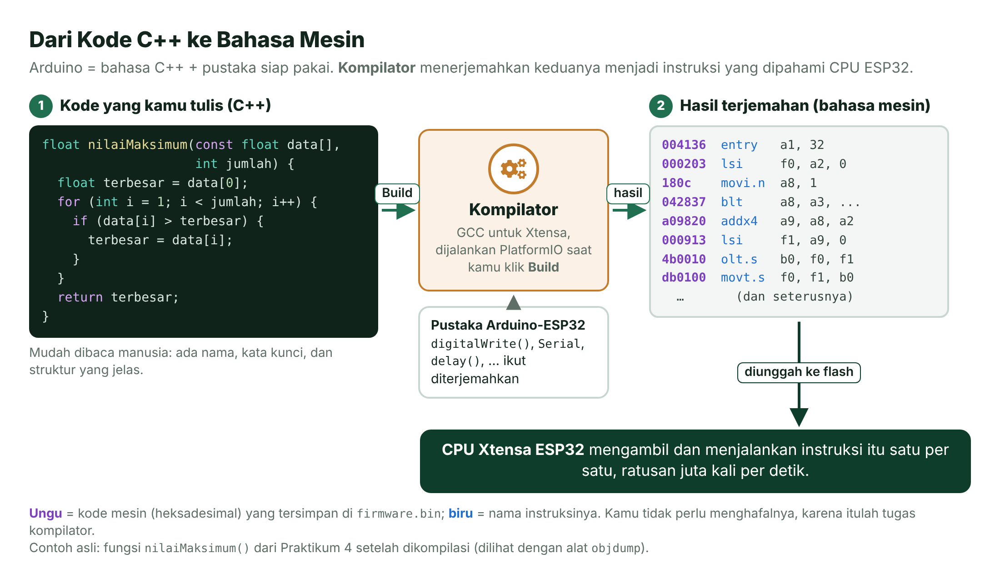
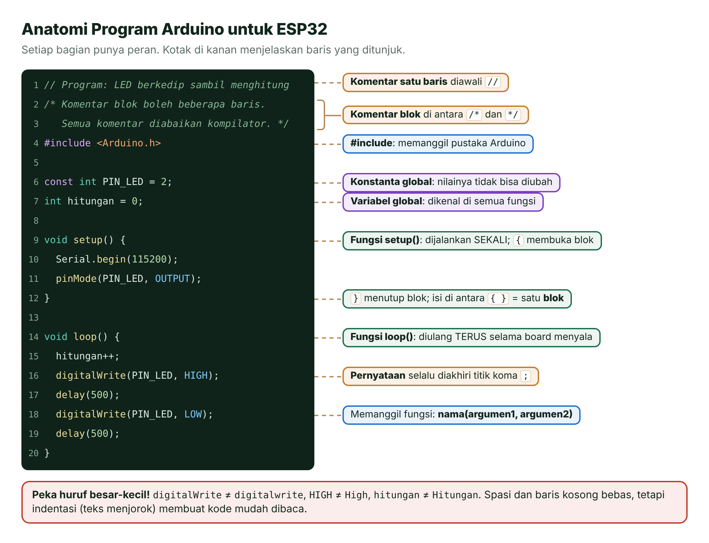
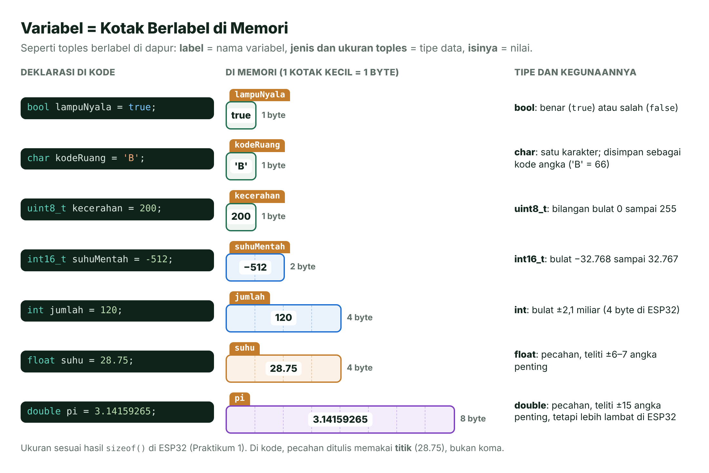
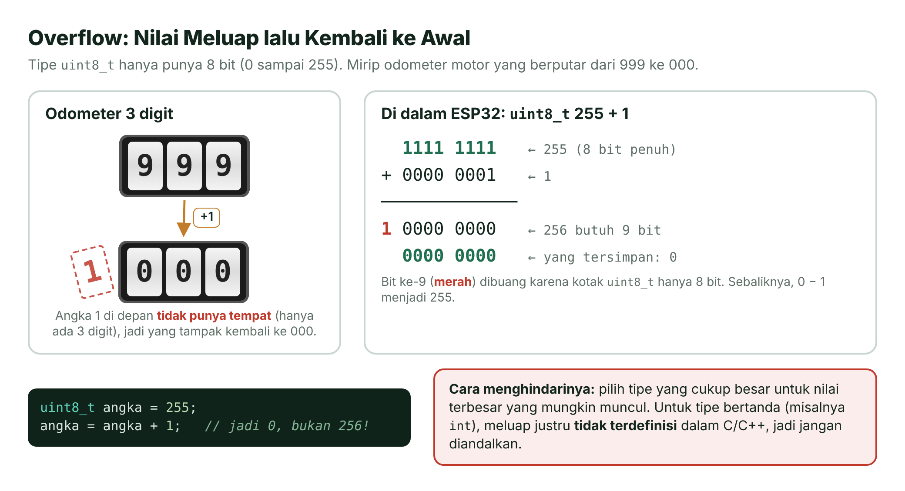
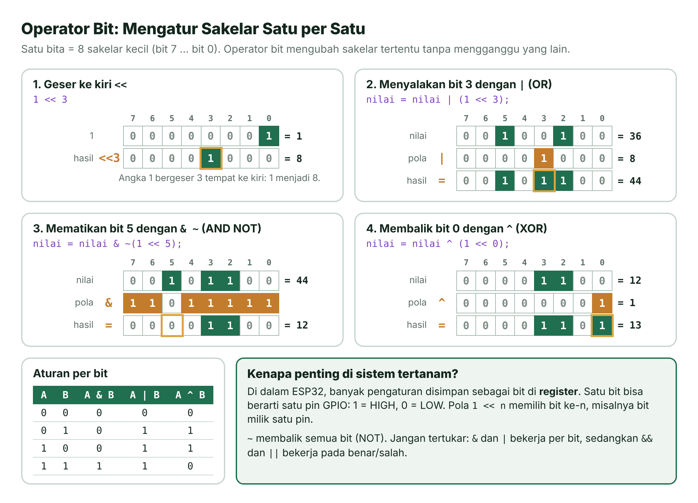
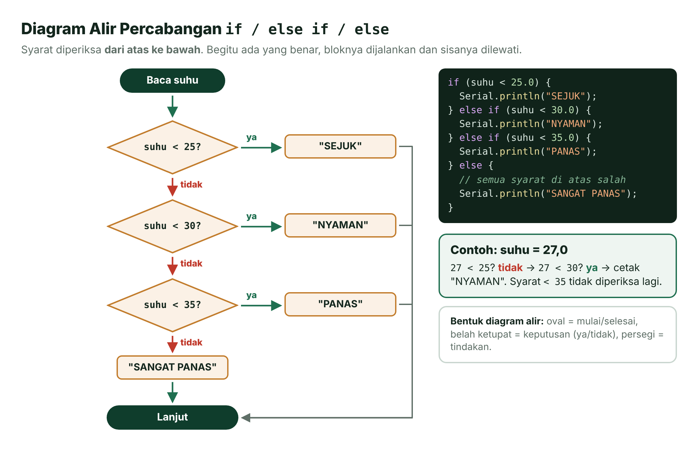
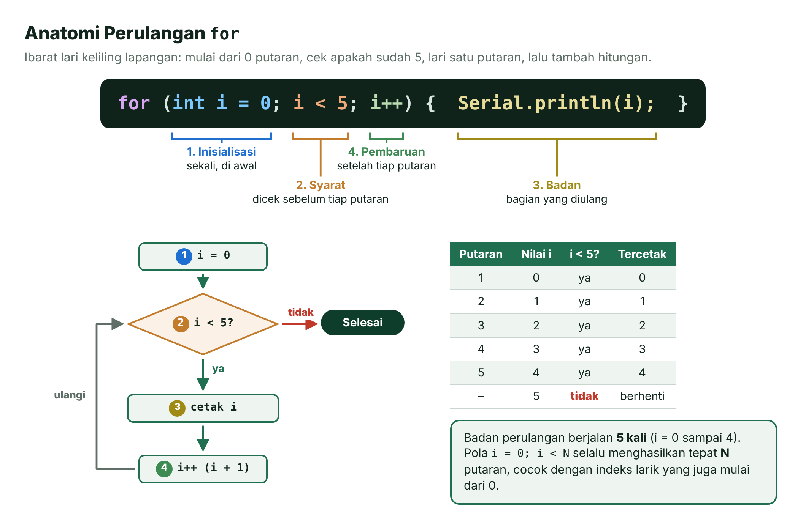
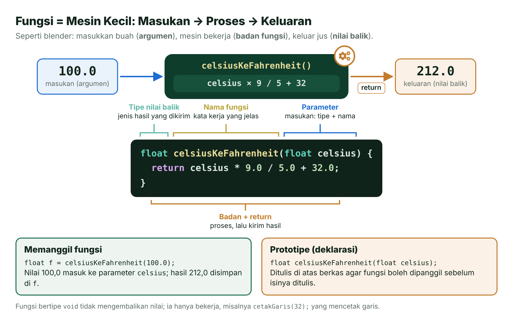
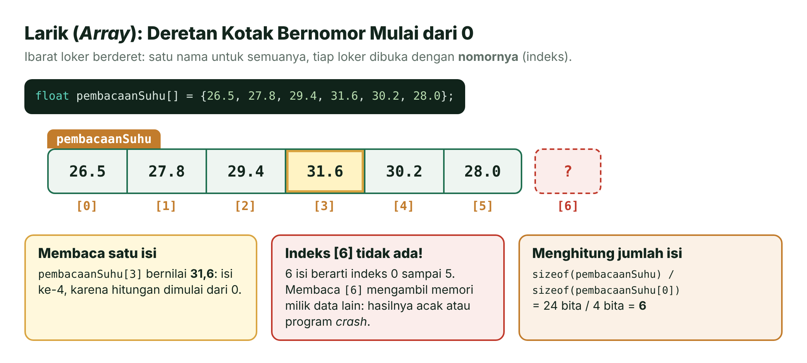
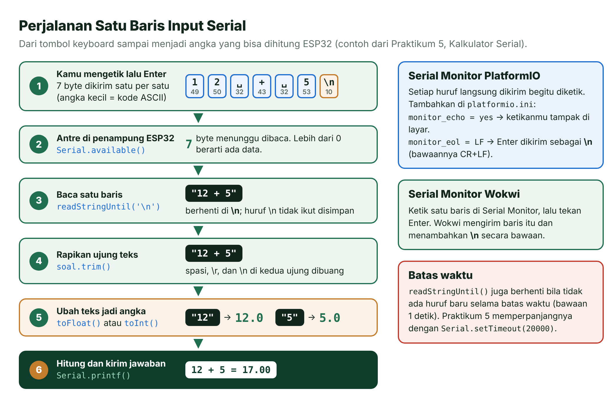

# Pertemuan 02 — Dasar Pemrograman C/C++ untuk Mikrokontroler

> Sebelum mengendalikan LED, tombol, dan sensor, kamu perlu fasih "berbicara" dengan ESP32. Hari ini kita mempelajari tata bahasanya: variabel, operator, percabangan, perulangan, fungsi, larik, dan percakapan lewat Serial Monitor.

| | |
| --- | --- |
| ⏱️ **Durasi** | 2 × 50 menit teori + 3 × 50 menit praktikum |
| 📋 **Prasyarat** | [Pertemuan 01](../pertemuan-01-pengenalan/README.md): sudah bisa menjalankan program di Wokwi atau di *board* ESP32 |
| 🧰 **Alat** | Laptop + internet; opsional: ESP32 DevKit V1 + kabel USB data. Tidak perlu komponen tambahan |
| 📥 **Slide** | 👁️ [Lihat di peramban](https://view.officeapps.live.com/op/view.aspx?src=https%3A%2F%2Fraw.githubusercontent.com%2Fantonprafanto%2Fembeddedsystem%2Fmain%2Fslide%2Fpptx%2FP02-Dasar-Pemrograman-C.pptx) · ⬇️ [Unduh PDF](https://raw.githubusercontent.com/antonprafanto/embeddedsystem/main/slide/pdf/P02-Dasar-Pemrograman-C.pdf) · ⬇️ [Unduh PPTX](https://raw.githubusercontent.com/antonprafanto/embeddedsystem/main/slide/pptx/P02-Dasar-Pemrograman-C.pptx) |
| 📄 **Modul PDF** | ⬇️ [Unduh modul ini dalam PDF](https://raw.githubusercontent.com/antonprafanto/embeddedsystem/main/modul-pdf/Modul-P02-Dasar-Pemrograman-C.pdf) — untuk dibaca luring atau dicetak |

## Daftar Isi

- [🎯 Tujuan Pembelajaran](#-tujuan-pembelajaran)
- [🧰 Yang Perlu Disiapkan](#-yang-perlu-disiapkan)
- [1. Mengapa C/C++ untuk Mikrokontroler?](#1-mengapa-cc-untuk-mikrokontroler)
- [2. Struktur Program: setup(), loop(), dan main()](#2-struktur-program-setup-loop-dan-main)
- [3. Tempat Menguji Kode: Wokwi atau PlatformIO](#3-tempat-menguji-kode-wokwi-atau-platformio)
- [4. Variabel dan Tipe Data](#4-variabel-dan-tipe-data)
- [5. Jebakan Umum Pemula](#5-jebakan-umum-pemula)
- [6. Operator](#6-operator)
- [7. Percabangan: if dan switch](#7-percabangan-if-dan-switch)
- [8. Perulangan: for, while, dan do-while](#8-perulangan-for-while-dan-do-while)
- [9. Fungsi](#9-fungsi)
- [10. Larik dan Teks](#10-larik-dan-teks)
- [11. Serial: Mencetak dan Membaca Data](#11-serial-mencetak-dan-membaca-data)
- [🧪 Praktikum](#-praktikum)
- [🏋️ Latihan & Tantangan](#️-latihan--tantangan)
- [✅ Cek Pemahaman](#-cek-pemahaman)
- [📌 Rangkuman](#-rangkuman)
- [📚 Referensi](#-referensi)
- [🖼️ Sumber Gambar](#️-sumber-gambar)

---

## 🎯 Tujuan Pembelajaran

Setelah pertemuan ini, kamu bisa:

1. Menjelaskan mengapa C/C++ dipakai untuk mikrokontroler dan membaca struktur program Arduino: `setup()`, `loop()`, `#include`, dan prototipe fungsi.
2. Memilih tipe data yang tepat di ESP32 serta menghindari jebakan *overflow*, pembagian bilangan bulat, konversi tipe, dan perbandingan pecahan.
3. Memakai operator aritmetika, perbandingan, logika, dan operator bit untuk menyalakan, memadamkan, dan membalik bit.
4. Menyusun alur program dengan percabangan, perulangan, fungsi, dan larik.
5. Mencetak data dengan `Serial.printf()` dan membaca input dari Serial Monitor.

## 🧰 Yang Perlu Disiapkan

| Kebutuhan | Keterangan |
| --- | --- |
| Wajib | Laptop, internet, dan peramban untuk membuka [Wokwi](../panduan/03-simulasi-wokwi.md) |
| Disarankan | VS Code + PlatformIO yang sudah terpasang sejak Pertemuan 01 ([Panduan Instalasi Alat](../panduan/02-instalasi-alat.md)) |
| Opsional | *Board* ESP32 DevKit V1 + kabel USB **data** |
| Komponen | Tidak ada. Semua praktikum hari ini cukup memakai Serial Monitor |

---

## 1. Mengapa C/C++ untuk Mikrokontroler?

Bayangkan kamu menulis resep dalam bahasa Indonesia untuk juru masak yang hanya mengerti kode isyarat dapur. Perlu ada **penerjemah** di antara kalian. Begitu juga dengan ESP32: CPU-nya hanya mengerti **bahasa mesin**, yaitu deretan angka biner. Kita menulis program dalam bahasa C/C++, lalu **kompilator** (*compiler*, penerjemah) mengubahnya menjadi bahasa mesin saat kamu menekan **Build**.



*Gambar 2.1 — Dari kode C++ ke bahasa mesin. Kode mesin di kanan adalah hasil kompilasi asli fungsi `nilaiMaksimum()` dari Praktikum 4. Sumber: dibuat untuk materi ini (ikon Font Awesome Free, CC BY 4.0).*

Mengapa C/C++, bukan bahasa lain?

- **Dekat dengan perangkat keras.** C/C++ bisa mengatur memori dan bit secara langsung. Kemampuan ini dibutuhkan untuk mengendalikan periferal mikrokontroler.
- **Hemat dan cepat.** Hasil kompilasinya kecil dan efisien, cocok untuk ESP32 yang hanya punya SRAM 520 KB [10].
- **Standar industri.** Kerangka kerja resmi Espressif (ESP-IDF) dan *core* Arduino-ESP32 ditulis dalam C/C++ [6]. Yang kamu pelajari hari ini langsung terpakai di dunia kerja.

"Bahasa Arduino" sebenarnya adalah **C++ biasa ditambah pustaka siap pakai** seperti `digitalWrite()`, `delay()`, dan `Serial` [2]. Jadi semua yang kamu pelajari di sini adalah C/C++ sungguhan.

> [!NOTE]
> **C atau C++?** C++ adalah pengembangan dari bahasa C, dan hampir semua kode C sah di C++. Di mata kuliah ini kita lebih banyak memakai bagian "C"-nya (variabel, fungsi, larik), ditambah sedikit fitur C++ seperti objek `Serial` dan `String`.

## 2. Struktur Program: setup(), loop(), dan main()

Di laptop, program C selalu dimulai dari fungsi `main()` [1]. Program berjalan dari atas ke bawah, lalu **selesai** dan kembali ke sistem operasi:

```c
#include <stdio.h>

int main() {
  printf("Halo!\n");
  return 0;          // program selesai
}
```

Mikrokontroler berbeda: ia harus bekerja **terus-menerus** selama ada listrik, dan tidak ada sistem operasi desktop yang menunggu program selesai. Karena itu Arduino menyembunyikan `main()` dan memberi kita dua fungsi: `setup()` (sekali) dan `loop()` (berulang). Di ESP32, fungsi awal `app_main()` milik ESP-IDF membuat sebuah ***task*** (tugas) bernama `loopTask` yang kira-kira bekerja seperti ini [4]:

```cpp
// Gambaran sederhana di balik layar (tidak perlu kamu tulis)
void loopTask() {
  setup();           // dijalankan sekali
  for (;;) {         // diulang selamanya
    loop();
  }
}
```

Coba perhatikan bagian-bagian program Arduino yang lengkap berikut.



*Gambar 2.2 — Anatomi program Arduino untuk ESP32. Sumber: dibuat untuk materi ini.*

Tiga aturan tata bahasa yang paling sering dilanggar pemula:

- Setiap pernyataan diakhiri **titik koma** `;`.
- Blok kode dibuka dengan `{` dan ditutup dengan `}`; jumlahnya harus berpasangan.
- C/C++ **peka huruf besar-kecil**: `digitalWrite` berbeda dengan `digitalwrite`.

### `sketch.ino` di Wokwi vs `src/main.cpp` di PlatformIO

Arduino IDE dan Wokwi memperlakukan `sketch.ino` sebagai **sketsa Arduino**. Sebelum dikompilasi, sketsa itu diproses dulu: `#include <Arduino.h>` ditambahkan dan prototipe fungsi dibuat secara otomatis [3]. PlatformIO memperlakukan `src/main.cpp` sebagai berkas C++ biasa, sehingga kedua hal itu wajib kamu tulis sendiri [7].

| | `sketch.ino` (Wokwi, Arduino IDE) | `src/main.cpp` (PlatformIO) |
| --- | --- | --- |
| Jenis berkas | Sketsa Arduino | Berkas C++ biasa |
| `#include <Arduino.h>` | Ditambahkan otomatis | **Wajib** ditulis di baris atas |
| Prototipe fungsi | Dibuat otomatis | **Wajib** ditulis sebelum fungsi dipanggil |

**Prototipe** (deklarasi) adalah baris pertama sebuah fungsi yang diakhiri titik koma. Kompilator membaca berkas dari atas ke bawah. Jika `setup()` memanggil fungsi yang isinya baru ditulis di bawah, kompilator belum mengenalnya dan memberi galat `'luasLingkaran' was not declared in this scope`. Prototipe di bagian atas berkas memberi tahu kompilator: "fungsi ini ada, isinya menyusul".

```cpp
#include <Arduino.h>

float luasLingkaran(float r);          // prototipe: perhatikan titik komanya

void setup() {
  Serial.begin(115200);
  Serial.println(luasLingkaran(2.0));  // boleh dipanggil karena sudah dideklarasikan → 12.57
}

void loop() {
}

float luasLingkaran(float r) {         // definisi: isi fungsinya
  return 3.14159 * r * r;
}
```

> [!TIP]
> **Satu kode untuk dua tempat.** Semua kode di modul ini ditulis dengan gaya PlatformIO (`#include <Arduino.h>` + prototipe). Gaya ini tetap sah ketika disalin ke `sketch.ino` di Wokwi.

## 3. Tempat Menguji Kode: Wokwi atau PlatformIO

Belajar tata bahasa paling cepat dengan langsung mencoba. Polanya selalu sama: **ketik → jalankan → lihat Serial Monitor**. Kamu bisa memakai dua tempat:

| | Wokwi (peramban) | PlatformIO + *board* ESP32 |
| --- | --- | --- |
| Perlu instalasi? | Tidak | Ya (VS Code + PlatformIO) |
| Perlu *board*? | Tidak | Ya |
| Kecepatan mencoba | Paling cepat | Lebih lama (kompilasi + unggah) |
| Cocok untuk | Mencoba sintaks dan logika | Menguji di perangkat keras asli |

**Di Wokwi:**

1. Buka <https://wokwi.com/projects/new/esp32>.
2. Hapus isi tab **sketch.ino**, lalu ketik atau tempel kodemu.
3. Klik tombol hijau **▶**.
4. Baca hasilnya di panel Serial Monitor di bawah. Ubah kode, lalu klik **▶** lagi.

**Di PlatformIO:**

1. **File** → **Open Folder...** → pilih *folder* proyek (yang berisi `platformio.ini`).
2. Ubah `src/main.cpp`, lalu simpan dengan **Ctrl+S**.
3. Klik **Upload** (→). PlatformIO otomatis melakukan **Build** lebih dulu.
4. Klik **Serial Monitor** (ikon colokan). Jika pesan awal terlewat, tekan tombol **EN** di *board*.

> [!TIP]
> **Ingin mencoba potongan kode kecil?** Salin *folder* `kode/01-variabel-dan-tipe-data` menjadi *folder* baru, misalnya `coba-coba`, lalu ganti isi `setup()`-nya. Satu *folder* proyek PlatformIO berisi satu program.

## 4. Variabel dan Tipe Data

Coba ingat toples-toples di dapur. Setiap toples punya **label** (gula, garam), **jenis dan ukuran** tertentu (toples kecil untuk garam, besar untuk beras), dan **isi**. **Variabel** bekerja dengan cara yang sama: tempat di memori yang punya **nama**, **tipe data**, dan **nilai**.

```cpp
float suhu = 28.75;     // tipe nama = nilaiAwal;
```



*Gambar 2.3 — Variabel sebagai kotak berlabel di memori. Ukurannya sesuai hasil `sizeof()` di ESP32. Sumber: dibuat untuk materi ini.*

**Tipe data** menentukan jenis nilai yang boleh disimpan dan berapa **bita** (*byte*; 1 bita = 8 bit) memori yang dipakai. Ukuran berikut adalah hasil Praktikum 1 di ESP32:

| Tipe | Ukuran | Rentang atau isi | Contoh pemakaian |
| --- | --- | --- | --- |
| `bool` | 1 bita | `true` atau `false` | Status pintu, lampu |
| `char` | 1 bita | Satu karakter, disimpan sebagai kode ASCII | `'A'`, `'7'` |
| `int` | 4 bita | −2.147.483.648 sampai 2.147.483.647 | Hitungan, nomor pin |
| `long` | 4 bita | Sama dengan `int` di ESP32 | Waktu `millis()` (versi `unsigned long`) |
| `long long` | 8 bita | Sekitar ±9,2 × 10¹⁸ | Waktu mikrodetik dari `esp_timer_get_time()` |
| `float` | 4 bita | Pecahan, teliti ±6–7 angka penting | Suhu, tegangan |
| `double` | 8 bita | Pecahan, teliti ±15 angka penting | Hitungan yang butuh ketelitian tinggi |

Ukuran `int` bisa berbeda di mikrokontroler lain: di Arduino Uno, `int` hanya 2 bita [2]. Supaya ukurannya pasti, gunakan **tipe berukuran pasti** dari pustaka `<stdint.h>` (sudah ikut dengan `Arduino.h`). Huruf `u` berarti *unsigned* (tanpa tanda, tidak bisa negatif), dan angkanya menyatakan jumlah bit.

| Tipe | Ukuran | Rentang |
| --- | --- | --- |
| `uint8_t` / `int8_t` | 1 bita | 0 sampai 255 / −128 sampai 127 |
| `uint16_t` / `int16_t` | 2 bita | 0 sampai 65.535 / −32.768 sampai 32.767 |
| `uint32_t` / `int32_t` | 4 bita | 0 sampai 4.294.967.295 / −2.147.483.648 sampai 2.147.483.647 |

Operator **`sizeof`** memberi tahu ukuran sebuah tipe atau variabel dalam bita, misalnya `sizeof(float)` bernilai 4.

> [!TIP]
> **Memilih tipe:** pakai `int` untuk bilangan bulat biasa, `uint8_t` untuk nilai kecil 0–255 (misalnya kecerahan), dan `float` untuk pecahan. ESP32 punya unit perangkat keras untuk `float`, sedangkan `double` dihitung secara perangkat lunak sehingga jauh lebih lambat [5]. Hindari `double` kecuali benar-benar perlu.

### Konstanta: `const` vs `#define`

Nilai yang tidak boleh berubah, seperti nomor pin, sebaiknya dijadikan **konstanta**. Ada dua cara:

```cpp
#define JUMLAH_SENSOR 4          // pengganti teks: tanpa tipe, tanpa = dan ;
const float BATAS_PANAS = 35.0;  // variabel bertipe yang dikunci
```

`#define` diproses oleh **praprosesor** (*preprocessor*) sebelum kompilasi: setiap teks `JUMLAH_SENSOR` diganti dengan `4`. `const` adalah variabel sungguhan yang punya tipe, sehingga kompilator ikut memeriksa pemakaiannya. Jika kamu mencoba mengubahnya (`BATAS_PANAS = 40;`), kompilator menolak dengan galat. Di mata kuliah ini kita memakai `const` untuk nomor pin dan pengaturan, misalnya `const int PIN_LED = 2;`.

> [!WARNING]
> **Jangan menaruh titik koma setelah `#define`.** `#define JUMLAH_SENSOR 4;` membuat setiap `JUMLAH_SENSOR` berubah menjadi `4;`, sehingga muncul galat aneh di baris lain.

### Cakupan Variabel: Global, Lokal, dan `static`

**Cakupan** (*scope*) menentukan bagian program yang bisa memakai sebuah variabel dan berapa lama nilainya bertahan.

| Jenis | Dibuat di | Dikenal di | Umur nilai |
| --- | --- | --- | --- |
| Global | Luar semua fungsi | Semua fungsi | Selama program berjalan |
| Lokal | Dalam fungsi atau blok `{ }` | Hanya di blok itu | Dibuat ulang setiap blok dijalankan |
| Lokal `static` | Dalam fungsi, diawali `static` | Hanya di fungsi itu | Diingat antarpemanggilan |

```cpp
int totalGlobal = 0;              // global: dikenal di mana-mana

void loop() {
  int lokal = 0;                  // lokal: kembali ke 0 di setiap putaran loop()
  static int putaran = 0;         // static: diisi 0 hanya sekali, lalu diingat
  lokal++;
  putaran++;
  totalGlobal++;
  Serial.printf("lokal = %d, putaran = %d\n", lokal, putaran);  // lokal selalu 1; putaran 1, 2, 3, ...
  delay(1000);
}
```

Biasakan memakai variabel lokal. Variabel global hanya untuk data yang memang dipakai bersama oleh beberapa fungsi, misalnya oleh `setup()` dan `loop()`. Untuk nama, gunakan huruf, angka, dan garis bawah, jangan diawali angka, dan tanpa spasi. Kita memakai gaya `camelCase` untuk variabel (`suhuRuangan`) dan HURUF_BESAR untuk konstanta (`PIN_LED`).

## 5. Jebakan Umum Pemula

Lima jebakan berikut tidak membuat kompilasi gagal. Programnya tetap berjalan, tetapi hasilnya salah. Galat jenis ini paling sulit dicari, jadi kenali sejak awal.

### Jebakan 1: Nilai Meluap (*Overflow*)

Odometer motor tiga digit kembali ke `000` setelah `999`. Tipe data juga begitu: `uint8_t` hanya punya 8 bit, jadi `255 + 1` menjadi `0`, dan `0 − 1` menjadi `255`.



*Gambar 2.4 — Overflow pada `uint8_t`. Sumber: dibuat untuk materi ini.*

Untuk tipe bertanda seperti `int`, *overflow* bahkan **tidak terdefinisi** dalam standar C/C++, sehingga hasilnya tidak boleh diandalkan [11]. Solusinya, pilih tipe yang cukup besar untuk nilai terbesar yang mungkin muncul.

### Jebakan 2: Pembagian Bilangan Bulat

Jika kedua angka bilangan bulat, hasil baginya juga bilangan bulat dan **pecahannya dibuang**, bukan dibulatkan [11]:

```cpp
float a = 7 / 2;          // 3.00! Pembagian bulat terjadi DULU, baru disimpan ke float
float b = 7 / 2.0;        // 3.50: salah satu angka pecahan → hasilnya pecahan
float c = (float)7 / 2;   // 3.50: 7 diubah dulu menjadi float
```

Contoh nyata yang sering terjadi saat menghitung persentase:

```cpp
int nilai = 2048;
int persen = nilai / 4095 * 100;       // 0! karena 2048 / 4095 = 0 (bulat)
int persenBenar = nilai * 100 / 4095;  // 50: kalikan dulu, baru bagi
```

### Jebakan 3: Modulo `%`

Operator `%` memberi **sisa bagi** dan hanya berlaku untuk bilangan bulat: `7 % 2` = 1, `10 % 5` = 0. Kegunaannya banyak:

- Mengecek genap atau ganjil: `if (n % 2 == 0)` berarti `n` genap.
- Melakukan sesuatu setiap N kali: `if (hitungan % 10 == 0)` benar setiap kelipatan 10.
- Membuat indeks berputar: `indeks = (indeks + 1) % 6;` menghasilkan 0, 1, 2, 3, 4, 5, 0, 1, …

### Jebakan 4: Konversi Tipe

Saat pecahan disimpan ke variabel bulat, angka di belakang titik **dipotong**: `int x = 3.99;` menghasilkan 3. Jika ingin dibulatkan, pakai `round()`: `int y = round(3.99);` menghasilkan 4. Menulis `(float)` atau `(int)` di depan sebuah nilai disebut ***casting***, yaitu mengubah tipe secara sengaja.

### Jebakan 5: Membandingkan Pecahan dengan `==`

Komputer menyimpan pecahan dalam bentuk biner. Banyak pecahan desimal, seperti 0,1 atau 36,6, tidak bisa disimpan persis, mirip 1/3 yang tidak bisa ditulis persis dalam desimal (0,333…). Akibatnya, `float suhu = 36.6;` sebenarnya tersimpan sebagai 36,5999984741… Angka `36.6` yang ditulis langsung di kode disimpan sebagai `double` yang lebih teliti, sehingga `suhu == 36.6` bernilai **salah**. Bandingkan selisihnya dengan **toleransi** kecil:

```cpp
float suhu = 36.6;
if (suhu == 36.6) { }               // JANGAN: hasilnya salah
if (fabs(suhu - 36.6) < 0.01) { }   // BENAR: "cukup dekat" dengan 36.6
if (suhu >= 36.5) { }               // perbandingan lebih besar/lebih kecil tidak bermasalah
```

## 6. Operator

**Operator** adalah simbol yang memerintahkan operasi tertentu pada nilai, seperti tanda + dan − dalam matematika.

| Jenis | Operator | Contoh (`a = 7`, `b = 2`) | Hasil |
| --- | --- | --- | --- |
| Aritmetika | `+ - * / %` | `a / b` dan `a % b` | `3` dan `1` |
| Penugasan majemuk | `+= -= *= /= %=` | `a += 3` (sama dengan `a = a + 3`) | `a` menjadi 10 |
| Naik/turun satu | `++ --` | `a++` | `a` menjadi 8 |
| Perbandingan | `== != < > <= >=` | `a != b` | `1` (benar) |
| Logika | `&&` (DAN), `\|\|` (ATAU), `!` (BUKAN) | `a > 5 && b > 5` | `0` (salah) |
| Bit | `& \| ^ ~ << >>` | `a & b` | `2` |

Hasil perbandingan dan logika bertipe `bool`: `true` (dicetak 1) atau `false` (dicetak 0).

> [!WARNING]
> **`=` bukan `==`.** `=` mengisi nilai, `==` membandingkan. `if (suhu = 30)` tidak membandingkan apa pun: ia mengisi `suhu` dengan 30 dan selalu dianggap benar. Kompilator tidak menganggapnya galat, jadi program tetap terunggah.

### Operator Bit: Mengatur Sakelar Satu per Satu

Bayangkan satu bita sebagai **deretan 8 sakelar lampu**, bernomor bit 7 (kiri) sampai bit 0 (kanan). Operator bit mengubah sakelar tertentu tanpa mengganggu sakelar lain.

Mengapa ini penting di sistem tertanam? Pengaturan perangkat keras mikrokontroler disimpan di **register**, yaitu memori khusus yang setiap bitnya punya arti. Satu register bisa menyimpan keadaan banyak pin GPIO sekaligus, satu bit untuk satu pin. Program juga sering menyimpan beberapa status ya/tidak, yang disebut ***flag*** (bendera), dalam satu variabel untuk menghemat memori.



*Gambar 2.5 — Operator bit untuk menggeser, menyalakan, memadamkan, dan membalik bit. Sumber: dibuat untuk materi ini.*

Empat "resep" yang akan sering kamu pakai (n = nomor bit):

```cpp
nilai |=  (1 << n);              // NYALAKAN bit ke-n (set)
nilai &= ~(1 << n);              // PADAMKAN bit ke-n (clear)
nilai ^=  (1 << n);              // BALIK bit ke-n (toggle)
bool menyala = (nilai >> n) & 1; // BACA bit ke-n: 1 atau 0
```

`(1 << n)` artinya angka 1 digeser ke kiri sebanyak n langkah, sehingga hanya bit ke-n yang bernilai 1. Geser kiri satu langkah sama dengan dikali 2, geser kanan satu langkah sama dengan dibagi 2. Bilangan bisa ditulis dalam desimal (`8`), biner dengan awalan `0b` (`0b00001000`), atau heksadesimal dengan awalan `0x` (`0x08`); nilainya sama.

> [!NOTE]
> **`&` bukan `&&`.** `&` dan `|` bekerja pada **setiap bit**, sedangkan `&&` dan `||` bekerja pada nilai benar/salah secara keseluruhan. Contoh: `6 & 3` = 2 (`110 & 011 = 010`), tetapi `6 && 3` = 1 (benar, karena keduanya bukan nol).

## 7. Percabangan: if dan switch

Di persimpangan jalan kamu memutuskan arah berdasarkan keadaan: kalau lampu merah, berhenti; kalau kuning, bersiap; selain itu, jalan. **Percabangan** membuat program mengambil keputusan dengan cara yang sama.



*Gambar 2.6 — Diagram alir `if / else if / else`. Sumber: dibuat untuk materi ini.*

Syarat diperiksa **dari atas ke bawah**. Begitu ada yang benar, bloknya dijalankan dan sisanya dilewati. Blok `else` dijalankan jika semua syarat di atasnya salah.

Jika pilihannya berupa nilai bulat atau karakter yang pasti, `switch` lebih rapi daripada deretan `if`:

```cpp
switch (level) {          // level bertipe int
  case 0:
    Serial.println("SEJUK");
    break;                // keluar dari switch
  case 1:
    Serial.println("NYAMAN");
    break;
  default:                // semua nilai lain
    Serial.println("PANAS");
    break;
}
```

`switch` hanya bisa dipakai untuk bilangan bulat dan karakter, tidak untuk `float` atau `String`. Jangan lupa `break`: tanpa `break`, program "terjun" ke `case` berikutnya. Sifat ini kadang dimanfaatkan dengan sengaja. Di Praktikum 5, `case '*':`, `case 'x':`, dan `case 'X':` berbagi satu blok perkalian.

> [!TIP]
> **Selalu pakai kurung kurawal**, bahkan untuk satu baris: `if (suhu > 30) { kipasNyala(); }`. Kebiasaan ini mencegah galat saat kamu menambah baris di kemudian hari.

## 8. Perulangan: for, while, dan do-while

Pelatih menyuruhmu lari keliling lapangan 5 kali. Kamu mulai dari putaran 0, mengecek apakah sudah 5 putaran, berlari satu putaran, lalu menambah hitungan. Itulah **perulangan** `for`.



*Gambar 2.7 — Anatomi perulangan `for`. Sumber: dibuat untuk materi ini.*

| Bentuk | Kapan dipakai | Kapan syarat dicek |
| --- | --- | --- |
| `for` | Jumlah putaran sudah diketahui | Sebelum setiap putaran |
| `while` | Ulangi **selama** syarat benar; jumlah putaran belum tentu | Sebelum setiap putaran (bisa 0 kali) |
| `do-while` | Badan dijalankan **minimal sekali**, baru dicek | Sesudah setiap putaran |

```cpp
int hitung = 3;
while (hitung > 0) {       // hitung mundur 3, 2, 1
  Serial.println(hitung);
  hitung--;                // tanpa baris ini, perulangan tidak pernah berhenti!
}

int dadu;
do {
  dadu = random(1, 7);     // angka acak 1 sampai 6
} while (dadu == 6);       // ulangi selama dapat 6
```

Dua perintah pengendali perulangan:

- `break` menghentikan perulangan seketika, misalnya saat data yang dicari sudah ketemu.
- `continue` melewati sisa badan perulangan dan langsung lanjut ke putaran berikutnya, misalnya untuk melewati data rusak.

> [!WARNING]
> **Awas perulangan tak berujung.** Jika syarat `while` tidak pernah menjadi salah (misalnya lupa `hitung--`), program terjebak di situ selamanya dan baris di bawahnya tidak pernah dijalankan. *Watchdog* bawaan ESP32 tidak memantau `loop()`, jadi *board* tidak otomatis di-*reset*: program hanya tampak "macet". Ingat, `loop()` sendiri adalah perulangan tak berujung yang **disengaja**.

## 9. Fungsi

Blender di dapur punya tugas jelas: kamu memasukkan buah (**masukan**), mesin bekerja (**proses**), lalu keluar jus (**keluaran**). **Fungsi** adalah "mesin kecil" seperti itu di dalam program: sekumpulan perintah yang diberi nama dan bisa dipanggil berkali-kali.



*Gambar 2.8 — Fungsi sebagai mesin kecil: masukan → proses → keluaran. Sumber: dibuat untuk materi ini (ikon Font Awesome Free, CC BY 4.0).*

```cpp
// tipeNilaiBalik namaFungsi(tipe parameter) { badan; return nilai; }
float celsiusKeFahrenheit(float celsius) {
  return celsius * 9.0 / 5.0 + 32.0;     // return = kirim hasil ke pemanggil
}

void cetakGaris(int panjang) {           // void = tidak mengembalikan nilai
  for (int i = 0; i < panjang; i++) {
    Serial.print('-');
  }
  Serial.println();
}
```

Cara memanggilnya: `float f = celsiusKeFahrenheit(100.0);` (hasilnya 212,0) atau `cetakGaris(32);`. Mengapa repot membuat fungsi?

- **Tidak mengulang kode.** Rumus cukup ditulis sekali, lalu dipakai di banyak tempat.
- **Mudah dibaca.** Nama `celsiusKeFahrenheit()` langsung menjelaskan maksudnya.
- **Mudah diperbaiki.** Galat di rumus cukup diperbaiki di satu tempat.

> [!NOTE]
> **Parameter adalah salinan.** Mengubah parameter di dalam fungsi tidak mengubah variabel milik pemanggil. Pengecualiannya larik: fungsi menerima "alamat" larik, sehingga bisa mengubah isinya. Itu sebabnya fungsi di Praktikum 4 memakai `const float data[]`, tanda bahwa fungsi berjanji tidak mengubah isi larik.

## 10. Larik dan Teks

Di stasiun ada **loker berderet**: satu nama, banyak pintu bernomor. **Larik** (*array*) adalah deretan kotak bertipe sama yang memakai satu nama. Setiap kotak dibuka dengan **indeks** (nomor urut) yang dimulai dari **0**.



*Gambar 2.9 — Larik dan indeksnya. Sumber: dibuat untuk materi ini.*

```cpp
float suhu[] = {26.5, 27.8, 29.4, 31.6, 30.2, 28.0};  // 6 isi: indeks 0 sampai 5
const int JUMLAH = sizeof(suhu) / sizeof(suhu[0]);    // 24 bita / 4 bita = 6

for (int i = 0; i < JUMLAH; i++) {   // i < JUMLAH, BUKAN i <= JUMLAH
  Serial.println(suhu[i]);
}
suhu[0] = 25.0;                       // mengubah isi pertama
```

Tiga hal penting:

- Larik berisi N data punya indeks **0 sampai N − 1**. `suhu[3]` adalah data **keempat**.
- `sizeof(larik) / sizeof(larik[0])` menghitung jumlah isi secara otomatis. Rumus ini hanya berlaku di tempat larik dibuat. Di dalam fungsi yang menerima larik, `sizeof` tidak lagi memberi ukuran larik, sehingga fungsi biasanya menerima jumlah data sebagai parameter tambahan.
- C/C++ **tidak memeriksa batas larik**. Membaca `suhu[6]` mengambil memori milik data lain (nilainya acak), sedangkan menulis ke sana bisa merusak variabel lain atau membuat program *crash*.

### Teks: Larik `char` atau `String`

| | Larik `char` | `String` (Arduino) |
| --- | --- | --- |
| Contoh | `char namaSensor[] = "DHT22";` | `String lokasi = "Lab";` |
| Ukuran | Tetap: 1 bita per huruf + 1 bita penutup `'\0'` | Bisa bertambah: `lokasi += " Elektro";` |
| Kemudahan | Perlu fungsi khusus (`strlen`, `strcpy`) | Banyak fungsi siap pakai: `length()`, `trim()`, `toInt()`, `substring()` |
| Memori | Hemat dan ukurannya pasti | Memakai memori dinamis (*heap*) yang dipesan saat program berjalan |
| Dicetak dengan `%s` | Langsung | Tambahkan `.c_str()` |

Untuk program kecil, `String` membuat pengolahan teks jauh lebih mudah, seperti di Praktikum 5. Untuk program yang berjalan berhari-hari, pakai `String` seperlunya, karena terlalu sering memesan dan melepas memori dinamis bisa membuat memori terpecah-pecah.

## 11. Serial: Mencetak dan Membaca Data

Serial Monitor adalah jendela percakapan dua arah: ESP32 bisa **mengirim** teks ke laptop, dan kamu bisa **mengetik** perintah untuk ESP32.

### Mencetak

| Fungsi | Contoh | Tampil di Serial Monitor |
| --- | --- | --- |
| `Serial.print()` | `Serial.print("Suhu: ");` | `Suhu: ` (tanpa pindah baris) |
| `Serial.println()` | `Serial.println(28.756);` | `28.76` lalu pindah baris |
| `Serial.printf()` | `Serial.printf("%d C\n", 30);` | `30 C` lalu pindah baris (karena `\n`) |

`Serial.println()` mencetak pecahan dengan 2 angka di belakang titik secara bawaan. Argumen kedua mengubahnya: `Serial.println(3.14159, 4)` mencetak `3.1416`, `Serial.println(255, HEX)` mencetak `FF`, dan `Serial.println(5, BIN)` mencetak `101`.

`Serial.printf()` paling praktis untuk menggabungkan teks dan angka. Fungsi ini tersedia di ESP32, tetapi tidak di semua *board* Arduino (misalnya tidak ada di Arduino Uno). Di dalam teksnya, kamu menaruh **kode format** yang nanti diganti dengan nilai:

| Kode format | Untuk tipe | Contoh | Hasil |
| --- | --- | --- | --- |
| `%d` | `int` (bilangan bulat) | `printf("%d", -12)` | `-12` |
| `%u` | Bulat tanpa tanda, hasil `sizeof` | `printf("%u", sizeof(float))` | `4` |
| `%ld`, `%lu` | `long`/`int32_t`, `unsigned long`/`uint32_t` | `printf("%lu", 4294967295UL)` | `4294967295` |
| `%f` | `float`/`double` (6 angka di belakang titik) | `printf("%f", 3.5)` | `3.500000` |
| `%.2f` | Pecahan dengan 2 angka di belakang titik | `printf("%.2f", 28.756)` | `28.76` |
| `%s` | Teks (larik `char`; `String` + `.c_str()`) | `printf("%s", "OK")` | `OK` |
| `%c` | Satu karakter | `printf("%c", 'B')` | `B` |
| `%x`, `%X` | Heksadesimal | `printf("%X", 255)` | `FF` |
| `%%` | Tanda persen | `printf("50%%")` | `50%` |

Pengatur tambahan: `%4d` mencetak selebar 4 karakter rata kanan (cocok untuk tabel), `0x%02X` mencetak 2 digit heksadesimal dengan nol di depan (`0x08`), dan `\n` berarti pindah baris.

> [!WARNING]
> **Kode format harus cocok dengan tipenya.** `Serial.printf("%d", 3.5)` tidak mencetak `3`, melainkan angka yang tidak masuk akal, karena `%d` membaca data pecahan seolah-olah bilangan bulat.

### Membaca Input

ESP32 menampung setiap huruf yang kamu kirim di sebuah **penampung** (*buffer*). Polanya: cek apakah ada data, baca satu baris sampai Enter, rapikan, lalu ubah menjadi angka.



*Gambar 2.10 — Perjalanan satu baris input Serial. Sumber: dibuat untuk materi ini.*

```cpp
void loop() {
  if (Serial.available() > 0) {                  // ada huruf yang masuk?
    String teks = Serial.readStringUntil('\n');  // baca sampai Enter (\n)
    teks.trim();                                 // buang spasi, \r, dan \n di kedua ujung
    int angka = teks.toInt();                    // "21" -> 21
    Serial.printf("%d x 2 = %d\n", angka, angka * 2);
  }
}
```

| Fungsi | Gunanya |
| --- | --- |
| `Serial.available()` | Jumlah bita yang menunggu dibaca; lebih dari 0 berarti ada data |
| `Serial.readStringUntil('\n')` | Membaca sampai bertemu `\n` (Enter) atau sampai batas waktu habis (bawaan 1 detik, diubah dengan `Serial.setTimeout()`) [2] |
| `trim()` | Membuang spasi dan karakter pindah baris (`\r`, `\n`) di kedua ujung teks |
| `toInt()`, `toFloat()` | Mengubah teks menjadi angka; hasilnya 0 jika teks tidak diawali angka |

**Mengetik di Serial Monitor PlatformIO.** Klik jendela terminal Serial Monitor, ketik, lalu tekan Enter. Setiap huruf langsung dikirim begitu diketik. Bawaannya, ketikanmu tidak tampil di layar dan Enter dikirim sebagai CR+LF (`\r\n`) [8]. Karena itu, proyek yang membaca input menambahkan dua baris berikut di `platformio.ini`:

```ini
; Tampilkan huruf yang kamu ketik dan akhiri baris dengan LF saat menekan Enter
monitor_echo = yes
monitor_eol = LF
```

**Mengetik di Serial Monitor Wokwi.** Ketik satu baris di Serial Monitor (bagian bawah layar simulasi), lalu tekan Enter. Wokwi mengirim baris itu ke program dan menambahkan `\n` (LF) secara bawaan [9].

> [!TIP]
> **Mengapa tetap perlu `trim()`?** Jika Serial Monitor mengirim CR+LF, huruf `\r` ikut terbaca di ujung teks, sehingga `"12\r"` tidak sama dengan `"12"`. `trim()` membuangnya, jadi programmu tetap benar apa pun pengaturan Serial Monitor-nya.

---

## 🧪 Praktikum

### Sebelum Mulai

Kelima praktikum hari ini **tidak memakai komponen**; semua hasilnya tampil di Serial Monitor. Kodenya sama persis untuk dua jalur (rinciannya ada di [Pertemuan 01](../pertemuan-01-pengenalan/README.md#sebelum-mulai-alat-mana-yang-dibuka-dulu)):

- **Jalur A — Wokwi:** buka <https://wokwi.com/projects/new/esp32>, salin isi `src/main.cpp` ke tab **sketch.ino** dan isi `diagram.json` ke tab **diagram.json**, lalu klik **▶**.
- **Jalur B — *Board* asli:** buka *folder* praktikum di VS Code (**File** → **Open Folder...**), klik **Upload** (→), lalu buka **Serial Monitor**. Jika baris awal terlewat, tekan tombol **EN**.

Program Praktikum 1–4 mencetak semua hasilnya **sekali** di `setup()`, lalu diam. Itu disengaja agar keluarannya mudah dibaca.

---

### Praktikum 1 — Variabel dan Tipe Data

📁 *Folder*: [`kode/01-variabel-dan-tipe-data`](kode/01-variabel-dan-tipe-data)

**Tujuan:** melihat sendiri ukuran tipe data di ESP32 dan membuktikan jebakan *overflow*, pembagian bulat, konversi tipe, serta perbandingan pecahan.

**Rangkaian:** tidak perlu komponen. **Cara menjalankan:** Jalur A atau Jalur B di [Sebelum Mulai](#sebelum-mulai).

**Kode** (`src/main.cpp`, dipotong bagian pentingnya):

```cpp
#define JUMLAH_SENSOR 4
const float BATAS_PANAS = 35.0;
uint8_t kecerahan = 200;      // bulat 0..255 saja -> uint8_t (1 bita)

void setup() {
  Serial.begin(115200);
  delay(1000);                // beri waktu Serial Monitor siap
  // ...
  Serial.printf("  int       : %u bita\n", sizeof(int));
  // ...
  uint8_t angka = 255;
  angka = angka + 1;          // 256 tidak muat di 8 bit -> kembali ke 0
  Serial.printf("  uint8_t 255 + 1 = %d\n", angka);

  int a = 7;
  int b = 2;
  Serial.printf("  7 / 2        = %d    <- bulat: pecahannya dibuang\n", a / b);

  float suhu = 36.6;
  Serial.printf("  36.6 tersimpan sebagai %.10f\n", suhu);
  Serial.printf("  suhu == 36.6         -> %d  <- 0 artinya salah\n", suhu == 36.6);
}
```

**Hasil yang diharapkan:**

```text
=== Praktikum 1: Variabel dan Tipe Data ===

[1] Isi variabel dan konstanta:
  suhuRuangan     = 28.75
  jumlahPembacaan = 120
  lampuMenyala    = 1 (1 = true, 0 = false)
  kodeRuang       = B (disimpan sebagai angka 66)
  kecerahan       = 200
  BATAS_PANAS     = 35.0 (const)
  JUMLAH_SENSOR   = 4 (#define)

[2] Ukuran tipe data di ESP32 (sizeof):
  bool      : 1 bita
  char      : 1 bita
  uint8_t   : 1 bita
  int16_t   : 2 bita
  int       : 4 bita
  uint32_t  : 4 bita
  long      : 4 bita
  long long : 8 bita
  float     : 4 bita
  double    : 8 bita

[3] Rentang nilai tipe berukuran pasti:
  uint8_t  : 0 sampai 255
  int16_t  : -32768 sampai 32767
  uint32_t : 0 sampai 4294967295
  int32_t  : -2147483648 sampai 2147483647

[4] Overflow (nilai meluap):
  uint8_t 255 + 1 = 0
  uint8_t   0 - 1 = 255

[5] Pembagian dan konversi tipe:
  7 / 2        = 3    <- bulat: pecahannya dibuang
  7 % 2        = 1    <- sisa bagi (modulo)
  7 / 2.0      = 3.50 <- pecahan
  (float)7 / 2 = 3.50 <- a diubah dulu ke float
  (int)3.99    = 3    <- dipotong, bukan dibulatkan

[6] Membandingkan pecahan:
  36.6 tersimpan sebagai 36.5999984741
  suhu == 36.6         -> 0  <- 0 artinya salah
  |suhu - 36.6| < 0.01 -> 1  <- 1 artinya benar

Selesai. Ubah nilai variabel di kode, lalu jalankan ulang!
```

Perhatikan `kodeRuang = B (disimpan sebagai angka 66)`: karakter sebenarnya disimpan sebagai angka kode ASCII. Baris `36.6 tersimpan sebagai 36.5999984741` membuktikan bahwa pecahan tidak selalu tersimpan persis.

**Kalau belum berhasil:**

| Gejala | Coba ini |
| --- | --- |
| Serial Monitor kosong | Tekan **EN** di *board*. Di Wokwi, pastikan simulasi sudah berjalan (tombol **▶** sudah diklik). |
| Galat `'Serial' was not declared in this scope` | Baris `#include <Arduino.h>` terhapus. Kembalikan di paling atas berkas. |
| Muncul karakter aneh `⸮⸮⸮` | Samakan `monitor_speed = 115200` di `platformio.ini` dengan `Serial.begin(115200)`. |

**Eksperimen kecil:**

- Ubah `uint8_t kecerahan = 200;` menjadi `300`. Kompilator memberi peringatan, tetapi program tetap jalan. Berapa nilai yang tercetak, dan mengapa?
- Di bagian [6], ganti ketiga angka `36.6` menjadi `36.5`. Mengapa sekarang `==` bernilai 1? *Petunjuk:* 0,5 = 1/2, pecahan yang bisa ditulis persis dalam biner.

---

### Praktikum 2 — Operator dan Bit

📁 *Folder*: [`kode/02-operator-dan-bit`](kode/02-operator-dan-bit)

**Tujuan:** mencoba operator aritmetika, penugasan majemuk, perbandingan, dan logika, lalu memakai operator bit untuk mengatur 8 "lampu" di dalam satu bita, mirip cara kerja register mikrokontroler.

**Rangkaian:** tidak perlu komponen; lampu hanya disimulasikan sebagai bit. **Cara menjalankan:** Jalur A atau Jalur B di [Sebelum Mulai](#sebelum-mulai).

**Kode** (`src/main.cpp`, dipotong bagian pentingnya):

```cpp
void tampilkanBit(const char *keterangan, uint8_t nilai);   // prototipe

// di dalam setup():
uint8_t lampu = 0b00000000;         // awalan 0b = bilangan biner
lampu |= (1 << 3);                  // OR : nyalakan bit 3, bit lain tetap
tampilkanBit("Nyalakan lampu 3", lampu);
lampu &= ~(1 << 3);                 // AND NOT: padamkan bit 3 saja
lampu ^= (1 << 1);                  // XOR: balik bit 1 (0 jadi 1)
uint8_t kebalikan = ~lampu;         // NOT: balik semua bit sekaligus
Serial.printf("  Lampu 7 menyala? %d\n", (lampu >> 7) & 1);

// Mencetak keterangan, 8 bit (bit 7 di kiri), lalu nilai heksadesimal dan desimal
void tampilkanBit(const char *keterangan, uint8_t nilai) {
  Serial.printf("  %-18s: ", keterangan);           // %-18s = teks rata kiri, lebar 18
  for (int bit = 7; bit >= 0; bit--) {
    Serial.print((nilai >> bit) & 1);                // cetak bit ke-'bit' (0 atau 1)
  }
  Serial.printf("  (0x%02X = %3d)\n", nilai, nilai);  // %02X = heksadesimal 2 digit
}
```

**Hasil yang diharapkan:**

```text
=== Praktikum 2: Operator dan Bit ===

[1] Aritmetika dan penugasan majemuk:
  skor = 10   -> 10
  skor += 5   -> 15
  skor -= 3   -> 12
  skor *= 2   -> 24
  skor /= 5   -> 4
  skor %= 3   -> 1
  skor++      -> 2
  skor--      -> 1

[2] Perbandingan dan logika (1 = benar, 0 = salah):
  suhu = 31, lembap = 75
  suhu > 30                 -> 1
  lembap >= 80              -> 0
  suhu > 30 && lembap >= 80 -> 0  (DAN: keduanya harus benar)
  suhu > 30 || lembap >= 80 -> 1  (ATAU: cukup salah satu)
  !(suhu > 30)              -> 0  (BUKAN: membalik)
  suhu == 31                -> 1  (== membandingkan, = mengisi)

[3] Operator bit: 8 lampu dalam satu bita (bit 7 ... bit 0):
  Awal              : 00000000  (0x00 =   0)
  Nyalakan lampu 3  : 00001000  (0x08 =   8)
  Nyalakan lampu 0  : 00001001  (0x09 =   9)
  Nyalakan lampu 7  : 10001001  (0x89 = 137)
  Padamkan lampu 3  : 10000001  (0x81 = 129)
  Balik lampu 1     : 10000011  (0x83 = 131)
  Balik lampu 1 lagi: 10000001  (0x81 = 129)
  ~lampu (semua)    : 01111110  (0x7E = 126)
  Lampu 7 menyala? 1
  Lampu 3 menyala? 0

[4] Geser bit (shift):
  5 << 1  = 10  (sama dengan 5 x 2)
  5 << 3  = 40  (sama dengan 5 x 8)
  40 >> 2 = 10  (sama dengan 40 / 4)
```

Perhatikan `skor /= 5 -> 4`, bukan 4,8: pembagian bulat lagi! Pada baris `Padamkan lampu 3`, hanya bit 3 yang berubah, sedangkan bit 7 dan bit 0 tetap menyala.

**Kalau belum berhasil:**

| Gejala | Coba ini |
| --- | --- |
| Galat `'tampilkanBit' was not declared in this scope` | Prototipe di atas `setup()` terhapus. Kembalikan baris `void tampilkanBit(const char *keterangan, uint8_t nilai);`. |
| Urutan bit terbalik (bit 0 di kiri) | Perulangan di `tampilkanBit()` harus mulai dari `bit = 7` dan turun ke 0. |

**Eksperimen kecil:**

- Nyalakan lampu 4 dan 5 **sekaligus** dalam satu baris. *Petunjuk:* gabungkan dua pola dengan `|`.
- Simpan hasil `5 << 6` ke variabel `uint8_t`, lalu cetak. Mengapa hasilnya 64, bukan 320?
- Ubah `int suhu = 31;` menjadi `29`. Baris mana saja di bagian [2] yang berubah hasilnya?

---

### Praktikum 3 — Percabangan dan Perulangan

📁 *Folder*: [`kode/03-percabangan-perulangan`](kode/03-percabangan-perulangan)

**Tujuan:** berlatih `if / else if / else`, `switch`, `for`, `while`, `do-while`, `break`, dan `continue` dengan mengelompokkan 8 data suhu sensor (simulasi) dan mencetak tabel perkalian.

**Rangkaian:** tidak perlu komponen; data sensor disimulasikan dalam larik. **Cara menjalankan:** Jalur A atau Jalur B di [Sebelum Mulai](#sebelum-mulai).

**Kode** (`src/main.cpp`, dipotong bagian pentingnya):

```cpp
const float DATA_SUHU[] = {24.5, 27.0, 30.0, -127.0, 33.4, 35.9, 29.9, 22.8};
const float BATAS_BAWAH_SAH = -50.0;  // suhu ruangan di bawah ini = data rusak

// di dalam setup():
for (int i = 0; i < JUMLAH_DATA; i++) {
  float suhu = DATA_SUHU[i];
  if (suhu < BATAS_BAWAH_SAH) {       // pecahan tidak dibandingkan dengan ==
    Serial.printf("  Data ke-%d: [LEWATI] data rusak (%.1f)\n", i, suhu);
    jumlahRusak++;
    continue;                         // langsung lompat ke data berikutnya
  }
  int level;                          // 0 = sejuk, 1 = nyaman, 2 = panas, 3 = sangat panas
  if (suhu < 25.0) {
    level = 0;
    jumlahSejuk++;
  } else if (suhu < 30.0) {
    // ... dan seterusnya sampai else
  }
  Serial.printf("  Data ke-%d: %.1f C -> ", i, suhu);
  switch (level) {
    case 0:
      Serial.println("SEJUK, kipas MATI");
      break;
    // ... case 1, case 2, dan default
  }
}
```

**Hasil yang diharapkan:**

```text
=== Praktikum 3: Percabangan dan Perulangan ===

[1] Klasifikasi 8 data suhu:
  Data ke-0: 24.5 C -> SEJUK, kipas MATI
  Data ke-1: 27.0 C -> NYAMAN, kipas PELAN
  Data ke-2: 30.0 C -> PANAS, kipas SEDANG
  Data ke-3: [LEWATI] data rusak (-127.0)
  Data ke-4: 33.4 C -> PANAS, kipas SEDANG
  Data ke-5: 35.9 C -> SANGAT PANAS, kipas KENCANG
  Data ke-6: 29.9 C -> NYAMAN, kipas PELAN
  Data ke-7: 22.8 C -> SEJUK, kipas MATI
  Ringkasan: sejuk 2, nyaman 2, panas 2, sangat panas 1, rusak 1

[2] Cari suhu pertama yang >= 35.0 C:
  Ketemu di data ke-5 (35.9 C)

[3] Hitung mundur dengan while:
  3... 2... 1... Mulai!

[4] while vs do-while (syarat: n < 3, padahal n = 5):
  do-while: badan perulangan dijalankan sekali

[5] Tabel perkalian 1-5:
   x |   1   2   3   4   5
  ---+--------------------
   1 |   1   2   3   4   5
   2 |   2   4   6   8  10
   3 |   3   6   9  12  15
   4 |   4   8  12  16  20
   5 |   5  10  15  20  25
```

Data ke-3 bernilai −127, kode yang lazim dipakai pustaka sensor suhu untuk menandai "gagal membaca"; `continue` melewatinya. Di bagian [2], `break` menghentikan pencarian di data ke-5, sehingga data ke-6 dan ke-7 tidak diperiksa. Di bagian [4], `while` tidak menjalankan badannya sama sekali, sedangkan `do-while` tetap menjalankannya sekali.

**Kalau belum berhasil:**

| Gejala | Coba ini |
| --- | --- |
| Program "macet" atau angka yang sama tercetak terus | Ada perulangan tak berujung. Pastikan variabel syarat berubah di setiap putaran (misalnya `hitung--`). |
| Semua data masuk satu kelompok | Periksa urutan `if`: syarat yang lebih sempit (`< 25.0`) harus diperiksa lebih dulu. |

**Eksperimen kecil:**

- Hapus baris `hitung--;` di bagian [3], jalankan, lalu amati. Setelah itu kembalikan seperti semula.
- Hapus semua `break;` di dalam `switch`. Apa yang tercetak untuk data bersuhu 24,5 °C? Mengapa?
- Ubah `UKURAN_TABEL` menjadi 9 untuk mencetak tabel perkalian 1–9.

---

### Praktikum 4 — Fungsi dan Larik

📁 *Folder*: [`kode/04-fungsi-dan-larik`](kode/04-fungsi-dan-larik)

**Tujuan:** membuat fungsi sendiri dengan parameter dan nilai balik untuk mengolah larik pembacaan sensor, lalu membandingkan variabel lokal biasa dengan `static` serta larik `char` dengan `String`.

**Rangkaian:** tidak perlu komponen. **Cara menjalankan:** Jalur A atau Jalur B di [Sebelum Mulai](#sebelum-mulai).

**Kode** (`src/main.cpp`, dipotong bagian pentingnya):

```cpp
float pembacaanSuhu[] = {26.5, 27.8, 29.4, 31.6, 30.2, 28.0};
const int JUMLAH_PEMBACAAN = sizeof(pembacaanSuhu) / sizeof(pembacaanSuhu[0]);

float celsiusKeFahrenheit(float celsius);          // prototipe-prototipe
float rataRata(const float data[], int jumlah);
void hitungPanggilan();

// ... setup() memanggil fungsi-fungsi ini ...

float rataRata(const float data[], int jumlah) {
  float total = 0.0;
  for (int i = 0; i < jumlah; i++) {
    total += data[i];               // sama dengan total = total + data[i]
  }
  return total / jumlah;
}

void hitungPanggilan() {
  int lokal = 0;                    // dibuat ulang dari 0 setiap kali fungsi dipanggil
  static int total = 0;             // static: dibuat sekali, nilainya diingat antarpanggilan
  lokal++;
  total++;
  Serial.printf("  Panggilan ke-%d: lokal = %d, static = %d\n", total, lokal, total);
}
```

**Hasil yang diharapkan:**

```text
=== Praktikum 4: Fungsi dan Larik ===

[1] Data suhu dari sensor (6 pembacaan):
  [0] 26.5 C = 79.7 F
  [1] 27.8 C = 82.0 F
  [2] 29.4 C = 84.9 F
  [3] 31.6 C = 88.9 F
  [4] 30.2 C = 86.4 F
  [5] 28.0 C = 82.4 F

[2] Olahan data:
--------------------------------
  Rata-rata : 28.92 C
  Maksimum  : 31.60 C (pembacaan ke-3)
  Air mendidih: 100 C = 212.0 F
--------------------------------

[3] Variabel lokal biasa vs static:
  Panggilan ke-1: lokal = 1, static = 1
  Panggilan ke-2: lokal = 1, static = 2
  Panggilan ke-3: lokal = 1, static = 3

[4] Teks: larik char vs String:
  namaSensor = DHT22 (5 huruf, 6 bita)
  lokasi     = Lab Elektro (11 huruf)
```

Nilai maksimum ada di indeks 3, yaitu pembacaan **keempat**. `lokal` selalu 1 karena dibuat ulang di setiap pemanggilan, sedangkan nilai `static` terus bertambah. `namaSensor` berisi 5 huruf tetapi memakai 6 bita; bita terakhir adalah penutup teks `'\0'`.

**Kalau belum berhasil:**

| Gejala | Coba ini |
| --- | --- |
| Galat `'rataRata' was not declared in this scope` | Prototipe terhapus atau tidak sama persis dengan definisi fungsinya. |
| Rata-rata salah atau muncul angka aneh | Periksa syarat perulangan: `i < jumlah`, bukan `i <= jumlah`. |

**Eksperimen kecil:**

- Tambahkan pembacaan baru `33.1` di akhir larik. Perlukah kamu mengubah `JUMLAH_PEMBACAAN`? Mengapa?
- Hapus kata `static` di `hitungPanggilan()`. Apa yang berubah pada keluarannya?
- Buat fungsi `celsiusKeKelvin()` (K = °C + 273,15) dan cetak hasilnya untuk setiap pembacaan.

---

### Praktikum 5 — Kalkulator Serial

📁 *Folder*: [`kode/05-kalkulator-serial`](kode/05-kalkulator-serial)

**Tujuan:** menggabungkan semua materi hari ini dengan membaca soal hitungan dari Serial Monitor (misalnya `12 + 5`), menghitungnya, lalu mengirim jawabannya. Program menolak pembagian dengan nol dan masukan yang tidak valid.

**Rangkaian:** tidak perlu komponen. `platformio.ini` proyek ini sudah berisi `monitor_echo = yes` dan `monitor_eol = LF` (lihat [Bagian 11](#11-serial-mencetak-dan-membaca-data)).

**Kode** (`src/main.cpp`, dipotong bagian pentingnya):

```cpp
void setup() {
  Serial.begin(115200);
  Serial.setTimeout(20000);   // jeda antarhuruf boleh sampai 20 detik (bawaan 1 detik)
  delay(1000);
  cetakPetunjuk();
}

void loop() {
  if (Serial.available() > 0) {                    // ada huruf yang masuk?
    String soal = Serial.readStringUntil('\n');    // baca sampai Enter (LF)
    soal.trim();                                   // buang spasi, CR, LF di kedua ujung
    if (soal.length() > 0) {
      prosesSoal(soal);
    }
  }
}

// di dalam prosesSoal(): potong teks di posisi operator, ubah menjadi angka, lalu hitung
String teksKiri = soal.substring(0, posisi);       // sebelum operator
String teksKanan = soal.substring(posisi + 1);     // sesudah operator
float angkaKiri = teksKiri.toFloat();              // teks "12" -> angka 12.0
switch (operasi) {
  case '+':
    hasil = angkaKiri + angkaKanan;
    break;
  case '*':
  case 'x':                                        // tiga simbol perkalian
  case 'X':                                        // berbagi satu blok kode
    hasil = angkaKiri * angkaKanan;
    break;
  // ... '-' dan '/' (dengan pemeriksaan bagi nol)
}
Serial.printf("%s = %.2f\n", soal.c_str(), hasil);
```

**Cara menjalankan:**

1. Jalankan lewat Jalur A atau Jalur B, lalu tunggu sampai petunjuk muncul.
2. Ketik soal berikut satu per satu, masing-masing diakhiri Enter: `12 + 5`, `7 / 2`, `-3 x 4`, `2.5 * 4`, `9 / 0`, `halo`, `12 + abc`.
   - Di PlatformIO: klik jendela terminal Serial Monitor, lalu ketik.
   - Di Wokwi: ketik di Serial Monitor bagian bawah, lalu tekan Enter.

**Hasil yang diharapkan:**

```text
=== Praktikum 5: Kalkulator Serial ===
Ketik soal lalu tekan Enter, contoh: 12 + 5
Operator: +  -  * (atau x)  / (atau :)
Pecahan memakai titik, contoh: 2.5

12 + 5 = 17.00
7 / 2 = 3.50
-3 x 4 = -12.00
2.5 * 4 = 10.00
9 / 0 -> [GALAT] tidak bisa membagi dengan nol
halo -> [GALAT] operator tidak ditemukan
12 + abc -> [GALAT] angka tidak valid
```

Di PlatformIO, ketikanmu juga tampil di layar berkat `monitor_echo = yes`, sehingga setiap soal terlihat dua kali: saat kamu mengetik dan di awal jawaban. Perhatikan juga `7 / 2 = 3.50`: kalkulator ini memakai `float`, jadi tidak terkena jebakan pembagian bulat.

**Kalau belum berhasil:**

| Gejala | Coba ini |
| --- | --- |
| Ketikan tidak tampil di Serial Monitor PlatformIO | Pastikan `monitor_echo = yes` ada di `platformio.ini`, lalu tutup dan buka lagi Serial Monitor. |
| Jawaban baru muncul ±20 detik setelah Enter | Serial Monitor mengirim Enter sebagai CR saja, sehingga `\n` tidak pernah datang. Pastikan `monitor_eol = LF`. |
| `2,5 * 4 -> [GALAT] angka tidak valid` | Pecahan ditulis dengan **titik** (`2.5`), bukan koma. |

**Eksperimen kecil:**

- Coba `12+5` tanpa spasi dan `  8 - 3  ` dengan banyak spasi. Mengapa keduanya tetap berhasil?
- Tambahkan operator `%` (sisa bagi) dengan `fmod(angkaKiri, angkaKanan)`. Jangan lupa menambahkannya juga di `cariOperator()`.
- Ubah `%.2f` di baris jawaban menjadi `%.4f`, lalu bandingkan hasil `10 / 3`.

---

## 🏋️ Latihan & Tantangan

1. **Detik ke jam.** Diberikan `unsigned long totalDetik = 100000;`. Cetak dalam format `jam:menit:detik` hanya dengan operator `/` dan `%`. Hasil yang benar: `27:46:40`.
2. **Rapor sensor.** Di Praktikum 4, tambahkan fungsi `nilaiMinimum()` dan `hitungDiAtas(data, jumlah, batas)` yang menghitung banyaknya pembacaan di atas `batas`. Untuk batas 29,0 °C, jawabannya 3 pembacaan.
3. **Panel 8 lampu.** Dari Praktikum 2, buat fungsi `bacaBit()`, `nyalakanBit()`, dan `padamkanBit()`, lalu cetak status kedelapan lampu sebagai `ON` atau `OFF`.
4. **Konversi suhu interaktif.** Ubah Praktikum 5 agar menerima perintah seperti `C 100` (Celsius ke Fahrenheit) dan `F 212` (Fahrenheit ke Celsius). Pakai `charAt(0)`, `substring()`, `trim()`, dan `toFloat()`.
5. **Tantangan: tebak angka.** ESP32 memilih angka acak 1–100 dengan `random(1, 101)`. Pengguna menebak lewat Serial Monitor, lalu ESP32 menjawab "terlalu besar", "terlalu kecil", atau "benar" beserta jumlah tebakannya.

## ✅ Cek Pemahaman

1. Di ESP32, `sizeof(int)` bernilai …
   - A. 1
   - B. 2
   - C. 4
   - D. 8

2. `uint8_t x = 250;` lalu `x = x + 10;`. Berapa nilai `x` sekarang?
   - A. 260
   - B. 4
   - C. 255
   - D. 10

3. Hasil `int h = 7 / 2;` adalah …
   - A. 3,5
   - B. 3
   - C. 4
   - D. 1

4. Perintah untuk **memadamkan** bit ke-2 tanpa mengubah bit lain adalah …
   - A. `x |= (1 << 2);`
   - B. `x &= ~(1 << 2);`
   - C. `x ^= (1 << 2);`
   - D. `x = 0;`

5. Mengapa di `src/main.cpp` kita menulis prototipe fungsi?
   - A. Agar program berjalan lebih cepat
   - B. Karena kompilator membaca dari atas ke bawah dan harus sudah mengenal fungsi sebelum fungsi itu dipanggil
   - C. Agar fungsi hanya bisa dipakai di Wokwi
   - D. Karena `setup()` wajib ditulis paling bawah

6. Larik `int data[5]` memiliki indeks …
   - A. 1 sampai 5
   - B. 0 sampai 5
   - C. 0 sampai 4
   - D. 1 sampai 4

<details>
<summary><b>Lihat jawaban</b></summary>

1. **C.** `int` di ESP32 berukuran 4 bita (hasil Praktikum 1).
2. **B.** 260 tidak muat di 8 bit, sehingga berputar: 260 − 256 = 4.
3. **B.** Bulat dibagi bulat menghasilkan bulat; pecahannya dibuang.
4. **B.** `~(1 << 2)` bernilai 0 hanya di bit 2, sehingga `&` memadamkan bit itu saja.
5. **B.** Prototipe memberi tahu kompilator bahwa fungsi itu ada dan isinya menyusul.
6. **C.** Lima isi berarti indeks 0 sampai 4.

</details>

## 📌 Rangkuman

- C/C++ dipakai karena dekat dengan perangkat keras, hemat, dan menjadi standar industri. "Bahasa Arduino" adalah C++ ditambah pustaka.
- Di balik layar, ESP32 menjalankan `app_main()` yang membuat *task* `loopTask`: `setup()` sekali, lalu `loop()` selamanya.
- Di `src/main.cpp` (PlatformIO), `#include <Arduino.h>` dan prototipe fungsi wajib ditulis; `sketch.ino` (Wokwi) menambahkannya otomatis.
- Ukuran di ESP32: `bool`/`char`/`uint8_t` 1 bita, `int16_t` 2 bita, `int`/`long`/`float` 4 bita, `long long`/`double` 8 bita. Pakai tipe berukuran pasti dan `sizeof`.
- Waspadai *overflow*, pembagian bulat (`7 / 2` = 3), pemotongan saat konversi tipe, dan perbandingan pecahan dengan `==`.
- Operator bit: `|=` menyalakan, `&= ~` memadamkan, `^=` membalik, dan `(x >> n) & 1` membaca bit ke-n.
- Alur program disusun dengan percabangan (`if`, `switch`), perulangan (`for`, `while`, `do-while`), fungsi (parameter, `return`, prototipe), dan larik (indeks 0 sampai N − 1).
- `Serial.printf()` butuh kode format yang cocok dengan tipenya; input dibaca dengan `readStringUntil('\n')` + `trim()` + `toInt()`/`toFloat()`.

## 📚 Referensi

1. Kernighan, B. W., & Ritchie, D. M. (1988). *The C Programming Language* (2nd ed.). Prentice Hall.
2. Arduino. (2026). *Arduino Language Reference*. Arduino Docs. <https://docs.arduino.cc/language-reference/>
3. Arduino. (2026). *Sketch Build Process*. Arduino CLI Documentation. <https://arduino.github.io/arduino-cli/latest/sketch-build-process/>
4. Espressif Systems. (2026). *arduino-esp32: cores/esp32/main.cpp*. GitHub. <https://github.com/espressif/arduino-esp32/blob/master/cores/esp32/main.cpp>
5. Espressif Systems. (2026). *ESP-IDF Programming Guide: Maximizing Execution Speed*. <https://docs.espressif.com/projects/esp-idf/en/stable/esp32/api-guides/performance/speed.html>
6. Espressif Systems. (2026). *Arduino-ESP32 Documentation*. <https://docs.espressif.com/projects/arduino-esp32/en/latest/>
7. PlatformIO Labs. (2026). *Convert Arduino File to C++ Manually*. <https://docs.platformio.org/en/latest/faq/ino-to-cpp.html>
8. PlatformIO Labs. (2026). *pio device monitor*. <https://docs.platformio.org/en/latest/core/userguide/device/cmd_monitor.html>
9. CodeMagic LTD. (2026). *Wokwi Docs — Serial Monitor*. <https://docs.wokwi.com/guides/serial-monitor>
10. Espressif Systems. (2025). *ESP32 Series Datasheet* (v5.x). <https://documentation.espressif.com/esp32_datasheet_en.pdf>
11. cppreference.com. (2026). *Arithmetic Operators*. <https://en.cppreference.com/w/cpp/language/operator_arithmetic>

## 🖼️ Sumber Gambar

| Gambar | Sumber dan lisensi |
| --- | --- |
| 2.1 | Dibuat untuk materi ini. Kode mesin adalah hasil kompilasi asli Praktikum 4 (dibaca dengan `xtensa-esp-elf-objdump`). Ikon: Font Awesome Free (Fonticons, CC BY 4.0). |
| 2.8 | Dibuat untuk materi ini. Ikon: Font Awesome Free (Fonticons, CC BY 4.0). |
| 2.2–2.7, 2.9, 2.10 | Dibuat untuk materi ini. |

---

[⬅️ Pertemuan 01: Mengenal Sistem Tertanam](../pertemuan-01-pengenalan/README.md) · [🏠 Beranda](../README.md) · [Pertemuan 03: GPIO Output ➡️](../pertemuan-03-gpio-output/README.md)
