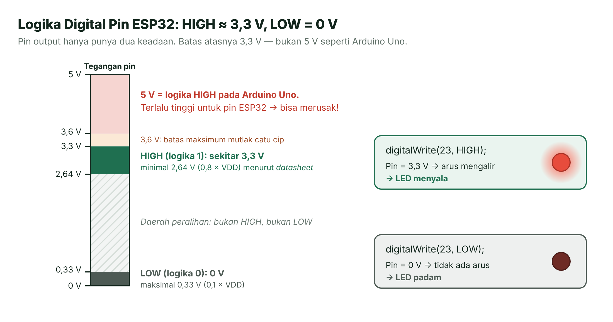
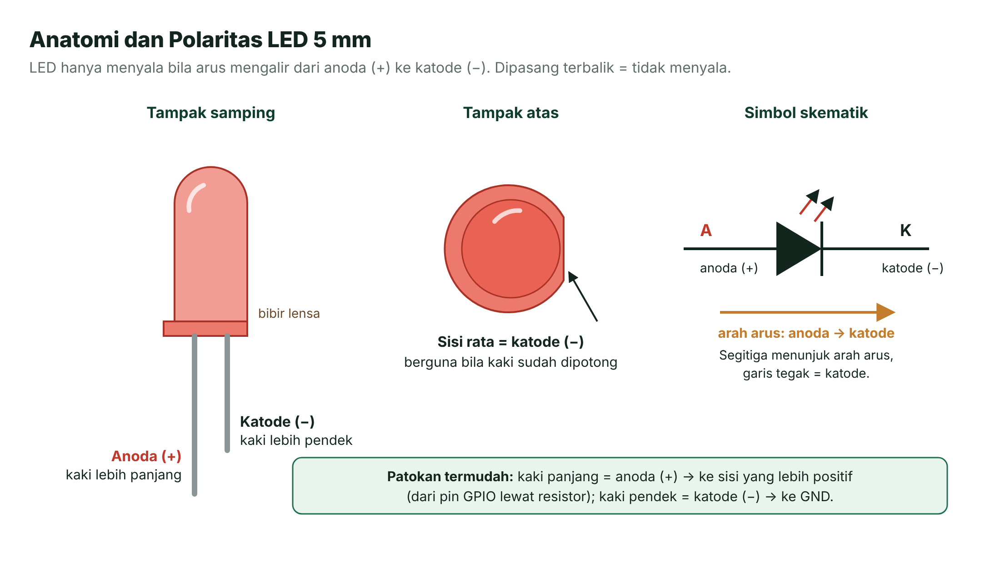
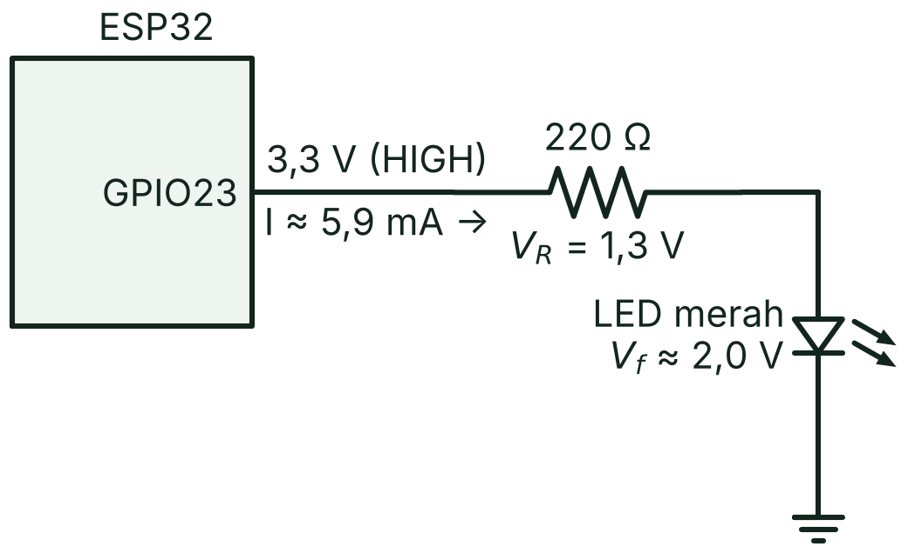
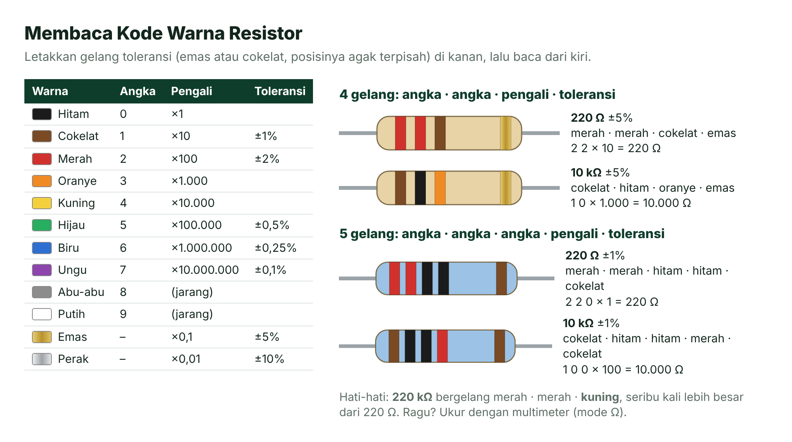
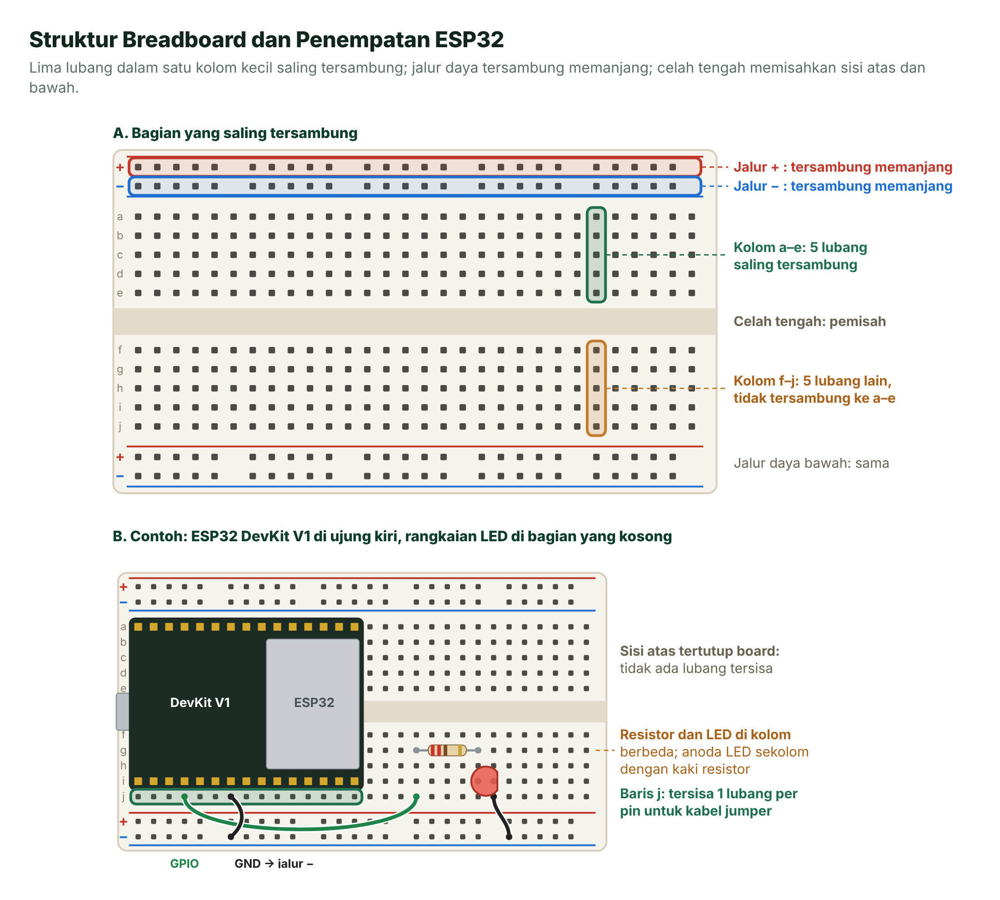
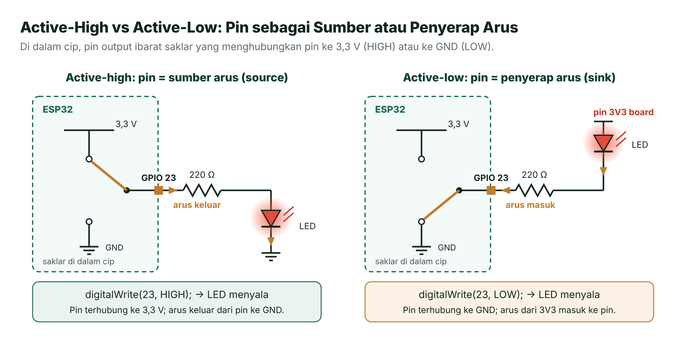
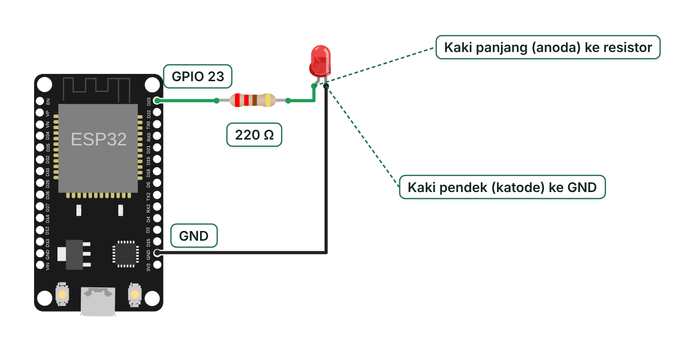
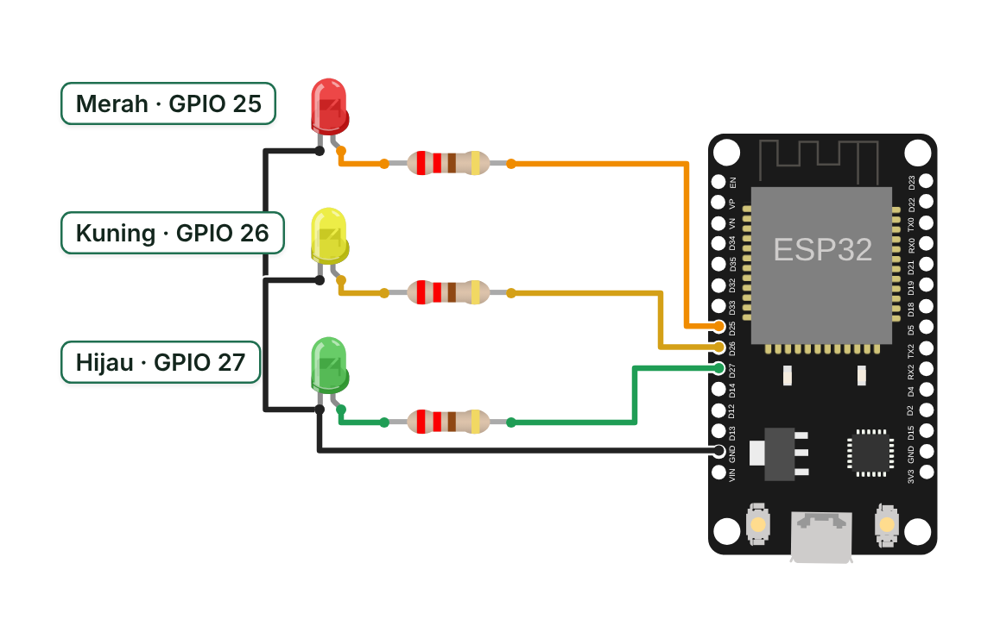
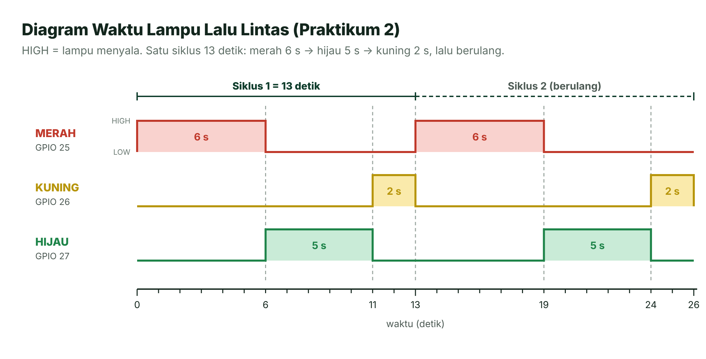
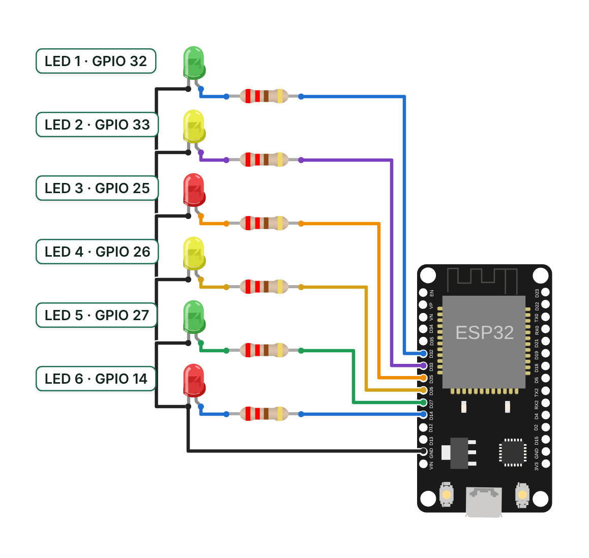

# Pertemuan 03 — GPIO Output: Mengendalikan LED

> Hari ini ESP32 mulai menggerakkan dunia luar: kamu merangkai LED sendiri di *breadboard*, menghitung resistornya, lalu membuat lampu lalu lintas dan LED berjalan.

| | |
| --- | --- |
| ⏱️ **Durasi** | 2 × 50 menit teori + 3 × 50 menit praktikum |
| 📋 **Prasyarat** | [Pertemuan 01](../pertemuan-01-pengenalan/README.md) (alur **Build**–**Upload**, Wokwi) dan [Pertemuan 02](../pertemuan-02-dasar-pemrograman/README.md) (variabel, `if`, `for`, fungsi) |
| 🧰 **Alat** | ESP32 DevKit V1 + kabel USB data, *breadboard*, 6 LED 5 mm (merah, kuning, hijau), 6 resistor 220 Ω, kabel *jumper*; atau Wokwi |
| 📥 **Slide** | [👁️ Lihat di peramban](https://view.officeapps.live.com/op/view.aspx?src=https%3A%2F%2Fraw.githubusercontent.com%2Fantonprafanto%2Fembeddedsystem%2Fmain%2Fslide%2Fpptx%2FP03-GPIO-Output.pptx) · [⬇️ Unduh PDF](https://raw.githubusercontent.com/antonprafanto/embeddedsystem/main/slide/pdf/P03-GPIO-Output.pdf) · [⬇️ Unduh PPTX](https://raw.githubusercontent.com/antonprafanto/embeddedsystem/main/slide/pptx/P03-GPIO-Output.pptx) |
| 📄 **Modul PDF** | [⬇️ Unduh modul ini dalam PDF](https://raw.githubusercontent.com/antonprafanto/embeddedsystem/main/modul-pdf/Modul-P03-GPIO-Output.pdf) — untuk dibaca luring atau dicetak |

## Daftar Isi

- [🎯 Tujuan Pembelajaran](#-tujuan-pembelajaran)
- [🧰 Yang Perlu Disiapkan](#-yang-perlu-disiapkan)
- [1. Apa Itu GPIO?](#1-apa-itu-gpio)
- [2. Mengenal LED](#2-mengenal-led)
- [3. Mengapa LED Wajib Pakai Resistor?](#3-mengapa-led-wajib-pakai-resistor)
- [4. Membaca Kode Warna Resistor](#4-membaca-kode-warna-resistor)
- [5. Breadboard: Merangkai Tanpa Solder](#5-breadboard-merangkai-tanpa-solder)
- [6. Active-High dan Active-Low](#6-active-high-dan-active-low)
- [7. Banyak LED: Larik dan Perulangan](#7-banyak-led-larik-dan-perulangan)
- [8. Aturan Keselamatan GPIO](#8-aturan-keselamatan-gpio)
- [🧪 Praktikum](#-praktikum)
- [🏋️ Latihan & Tantangan](#️-latihan--tantangan)
- [✅ Cek Pemahaman](#-cek-pemahaman)
- [📌 Rangkuman](#-rangkuman)
- [📚 Referensi](#-referensi)
- [🖼️ Sumber Gambar](#️-sumber-gambar)

---

## 🎯 Tujuan Pembelajaran

Setelah pertemuan ini, kamu bisa:

1. Menjelaskan apa itu GPIO dan level logika HIGH/LOW pada ESP32 (≈ 3,3 V dan 0 V), lalu memakai `pinMode()` dan `digitalWrite()`.
2. Mengenali kaki LED dan menghitung nilai resistor pembatas arusnya dengan hukum Ohm.
3. Membaca kode warna resistor dan merangkai LED dengan benar di *breadboard*.
4. Membedakan rangkaian *active-high* dan *active-low*.
5. Mengendalikan banyak LED dengan larik, perulangan `for`, dan fungsi pembantu.

## 🧰 Yang Perlu Disiapkan

| Kebutuhan | Keterangan |
| --- | --- |
| Perangkat lunak | VS Code + PlatformIO (sudah dipasang di Pertemuan 01), atau Wokwi di peramban |
| Board | ESP32 DevKit V1 + kabel USB **data** |
| Komponen | *Breadboard* 830 lubang, 6 LED 5 mm (2 merah, 2 kuning, 2 hijau), 6 resistor 220 Ω, ±15 kabel *jumper* jantan–jantan (*male–male*) |
| Opsional | Multimeter untuk mengecek nilai resistor, tegangan, dan arus |
| Cadangan tanpa board | Simulator Wokwi; setiap praktikum punya `diagram.json` siap pakai |

Daftar lengkap ada di [Daftar Komponen](../panduan/04-daftar-komponen.md); letak pin ada di [Lembar Saku Pinout](../panduan/05-pinout-esp32.md).

---

## 1. Apa Itu GPIO?

Bayangkan **saklar lampu** di kamarmu. Saklar hanya punya dua keadaan: menyala atau padam. Pin output ESP32 bekerja mirip saklar itu, bedanya ia tidak ditekan oleh jari, melainkan oleh program yang kamu tulis.

**GPIO** (*General Purpose Input/Output*, masukan/keluaran serbaguna) adalah pin mikrokontroler yang fungsinya bisa diatur lewat program. Sebagai **output**, GPIO menggerakkan sesuatu (LED, *buzzer*, *relay*). Sebagai **input**, GPIO membaca sesuatu (tombol, sensor). Cip ESP32 punya 34 GPIO [1]. Pertemuan ini membahas output; input dibahas di Pertemuan 04.

### Logika Digital: HIGH dan LOW

Pin output digital hanya punya dua keadaan:

| Keadaan | Nilai logika | Tegangan di pin ESP32 | Perintah |
| --- | --- | --- | --- |
| **HIGH** | 1 | ≈ 3,3 V | `digitalWrite(pin, HIGH)` |
| **LOW** | 0 | ≈ 0 V | `digitalWrite(pin, LOW)` |



*Gambar 3.1 — Level logika keluaran pin ESP32. Sumber: dibuat untuk materi ini; batas tegangan dari [1] dan [2].*

Menurut lembar data (*datasheet*) modul ESP32-WROOM-32E, tegangan keluaran HIGH minimal 0,8 × VDD dan tegangan keluaran LOW maksimal 0,1 × VDD [2]. Dengan VDD = 3,3 V, artinya HIGH minimal 2,64 V dan LOW maksimal 0,33 V. Jadi, "HIGH ≈ 3,3 V" dan "LOW ≈ 0 V" sudah cukup tepat untuk praktik sehari-hari.

> [!WARNING]
> **ESP32 bekerja di 3,3 V, bukan 5 V.** Banyak tutorial di internet ditulis untuk Arduino Uno yang logikanya 5 V. Catu daya cip ESP32 punya batas maksimum mutlak 3,6 V [1], jadi jangan pernah memberi tegangan 5 V langsung ke pin GPIO.

### Dua Fungsi Utama: pinMode() dan digitalWrite()

```cpp
const int PIN_LED = 23;

void setup() {
  pinMode(PIN_LED, OUTPUT);     // jadikan GPIO 23 sebagai output (cukup sekali)
}

void loop() {
  digitalWrite(PIN_LED, HIGH);  // pin = 3,3 V
  delay(500);
  digitalWrite(PIN_LED, LOW);   // pin = 0 V
  delay(500);
}
```

- `pinMode(pin, OUTPUT)` menyiapkan pin sebagai keluaran. Di Arduino-ESP32 3.x, `digitalWrite()` hanya bekerja pada pin yang sudah disiapkan sebagai GPIO. **Lupa `pinMode()` = LED tidak menyala**, meskipun programnya lolos kompilasi.
- `digitalWrite(pin, nilai)` menulis HIGH atau LOW. Keadaan pin bertahan sampai kamu menulis nilai lain.

### Pin Output sebagai Sumber dan Penyerap Arus

Di dalam cip, pin output ibarat saklar dua arah. Saat **HIGH**, pin terhubung ke 3,3 V sehingga bisa **mengeluarkan** arus; pin berperan sebagai **sumber arus** (*source*). Saat **LOW**, pin terhubung ke GND sehingga bisa **menerima** arus; pin berperan sebagai **penyerap arus** (*sink*). Dua peran ini menjadi dasar rangkaian *active-high* dan *active-low* di [Bagian 6](#6-active-high-dan-active-low).

## 2. Mengenal LED

Pernah melewati **pintu putar satu arah** di stasiun? Orang hanya bisa lewat dari satu sisi, dan pintunya baru berputar kalau didorong cukup kuat. LED berperilaku mirip: arus hanya bisa lewat satu arah, dan perlu "dorongan" tegangan minimal agar menyala.

**LED** (*Light Emitting Diode*, dioda pemancar cahaya) adalah dioda yang memancarkan cahaya saat dialiri arus dari **anoda** (+) ke **katode** (−). Jika dipasang terbalik, LED tidak menyala.



*Gambar 3.2 — Anatomi dan polaritas LED 5 mm. Sumber: dibuat untuk materi ini.*

Cara mengenali kaki LED:

- **Kaki lebih panjang = anoda (+).** Hubungkan ke arah yang lebih positif, yaitu pin GPIO (lewat resistor).
- **Kaki lebih pendek = katode (−).** Hubungkan ke GND.
- **Sisi rata pada bibir lensa = katode.** Berguna kalau kedua kaki sudah dipotong sama panjang.

### Tegangan Maju (Vf)

Saat menyala, LED "memakai" tegangan yang hampir tetap. Tegangan ini disebut **tegangan maju** (*forward voltage*, **Vf**). Besarnya bergantung pada bahan semikonduktor, sehingga berbeda untuk tiap warna. Contoh dari *datasheet* LED 5 mm Kingbright seri WP7113:

| Warna (tipe) | Vf tipikal | Vf maksimum | Diukur pada arus | Arus DC maksimum |
| --- | --- | --- | --- | --- |
| Merah (WP7113ID) | 1,9 V | 2,3 V | 10 mA | 30 mA |
| Kuning (WP7113YD) | 1,95 V | 2,4 V | 10 mA | 30 mA |
| Hijau (WP7113GD) | 2,0 V | 2,4 V | 10 mA | 25 mA |
| Biru (WP7113QBC/D) | 3,3 V | 4,0 V | 20 mA | 30 mA |

*Sumber: datasheet Kingbright [5]–[8]. LED merek lain bisa sedikit berbeda, jadi biasakan mengecek datasheet LED yang kamu pakai.*

> [!NOTE]
> **Bagaimana dengan LED biru?** Vf tipikalnya 3,3 V, sama dengan tegangan pin ESP32. Hampir tidak ada sisa tegangan untuk resistor, sehingga arusnya kecil dan sulit diperkirakan; LED biru di pin 3,3 V bisa tampak redup. Karena itu, praktikum hari ini memakai LED merah, kuning, dan hijau.

## 3. Mengapa LED Wajib Pakai Resistor?

Bayangkan **selang air**. Tegangan ibarat tekanan air, arus ibarat banyaknya air yang mengalir, dan resistor ibarat bagian selang yang dipersempit. Tanpa penyempit, air menyembur sekencang-kencangnya.

LED tidak membatasi arusnya sendiri. Begitu tegangan sedikit melewati Vf, arusnya naik sangat cepat. Jika LED dipasang langsung ke pin 3,3 V, yang membatasi arus hanyalah hambatan kecil di dalam pin. Akibatnya, arus bisa jauh melebihi batas aman LED maupun pin: LED cepat rusak dan pin ESP32 ikut terbebani. Karena itu, LED selalu dipasang seri dengan **resistor pembatas arus** (*current-limiting resistor*).

### Menghitung Nilai Resistor

Pada rangkaian GPIO → resistor → LED → GND, tegangan pin 3,3 V terbagi dua. Sebagian dipakai LED (Vf), sisanya jatuh di resistor (V<sub>R</sub>). Dengan hukum Ohm (V = I × R), kita dapat:

**R = (3,3 V − Vf) / I**



*Gambar 3.3 — Skematik Praktikum 1 beserta pembagian tegangannya. Sumber: dibuat untuk materi ini dengan schemdraw.*

Contoh untuk LED merah dengan Vf dibulatkan 2,0 V dan target arus 10 mA:

1. **Tentukan Vf.** Ambil dari *datasheet*. Untuk LED merah, kuning, dan hijau, angka bulat 2,0 V cukup untuk perkiraan.
2. **Tentukan arus target (I).** LED indikator sudah cukup terang pada 5–10 mA. Ambil batas atasnya: 10 mA = 0,010 A.
3. **Hitung R minimum.** R = (3,3 − 2,0) / 0,010 = 1,3 / 0,010 = **130 Ω**.
4. **Pilih nilai standar yang sama atau lebih besar.** Resistor dijual dalam deret nilai standar, misalnya deret E12: 100, 120, 150, 180, **220**, 270, 330 Ω, dan seterusnya. Kita memakai **220 Ω** karena paling umum dan memberi cadangan keamanan. Jangan memilih nilai yang lebih kecil dari hasil hitungan.
5. **Cek ulang arusnya.** I = 1,3 / 220 ≈ 0,0059 A ≈ **5,9 mA**. Aman, dan LED tetap terang.
6. **Cek daya resistor.** P = I² × R = (0,0059)² × 220 ≈ 0,0077 W ≈ **7,7 mW**, jauh di bawah kemampuan resistor ¼ W (250 mW) yang umum dipakai.

Pengaruh nilai resistor terhadap arus LED merah (Vf ≈ 2,0 V):

| Resistor | Arus LED | Keterangan |
| --- | --- | --- |
| 100 Ω | 13 mA | Melebihi batas praktik aman 10–12 mA |
| 150 Ω | 8,7 mA | Terang, masih aman |
| **220 Ω** | **5,9 mA** | **Dipakai di praktikum ini** |
| 330 Ω | 3,9 mA | Sedikit lebih redup, tetap jelas terlihat |
| 1 kΩ | 1,3 mA | Redup |

### Berapa Arus yang Aman untuk Pin ESP32?

*Datasheet* modul ESP32-WROOM-32E mencantumkan arus *source* tipikal 40 mA (turun menjadi sekitar 29 mA bila banyak pin dipakai bersamaan) dan arus *sink* tipikal 28 mA, keduanya diukur pada kekuatan *driver* maksimum [2]. Angka itu adalah **kemampuan**, bukan **target desain**. Praktik yang aman adalah **≤ 10–12 mA per pin**. Arus total semua pin juga ada batasnya (maksimum mutlak 1.200 mA untuk seluruh cip [1]); enam LED kita (±36 mA) masih sangat jauh dari batas itu.

> [!TIP]
> **Hitungan ini perkiraan.** Vf sebenarnya berbeda sedikit antar-LED dan ikut berubah terhadap arus, sedangkan tegangan pin sedikit turun saat dibebani. Dengan Vf antara 1,9 V dan 2,4 V (lihat tabel Vf), arus LED dengan resistor 220 Ω berkisar 4–6 mA. Untuk mengukur arus sesungguhnya, pasang multimeter (mode mA) seri dengan LED.

## 4. Membaca Kode Warna Resistor

Resistor berukuran ¼ W terlalu kecil untuk ditulisi angka. Karena itu, nilainya dikodekan dengan **gelang warna** sesuai standar IEC 60062 [9].



*Gambar 3.4 — Tabel kode warna dan contoh resistor 220 Ω serta 10 kΩ. Sumber: dibuat untuk materi ini berdasarkan [9].*

Cara membaca:

1. Pegang resistor sehingga gelang **toleransi** berada di **kanan**. Gelang ini biasanya emas (±5%) atau cokelat (±1%) dan letaknya agak terpisah dari gelang lain.
2. **Resistor 4 gelang:** gelang 1–2 = angka, gelang 3 = pengali, gelang 4 = toleransi.
3. **Resistor 5 gelang:** gelang 1–3 = angka, gelang 4 = pengali, gelang 5 = toleransi.

| Nilai | 4 gelang (±5%) | 5 gelang (±1%) |
| --- | --- | --- |
| 220 Ω | merah · merah · cokelat · emas → 22 × 10 | merah · merah · hitam · hitam · cokelat → 220 × 1 |
| 10 kΩ | cokelat · hitam · oranye · emas → 10 × 1.000 | cokelat · hitam · hitam · merah · cokelat → 100 × 100 |

Resistor 10 kΩ belum dipakai hari ini. Ia akan menjadi resistor *pull-up*/*pull-down* di Pertemuan 04.

> [!TIP]
> **Cara mudah menghafal.** Urutan angka 0–9 adalah hitam, cokelat, merah, oranye, kuning, hijau, biru, ungu, abu-abu, putih. Perhatikan bahwa merah sampai ungu (angka 2–7) mengikuti urutan warna pelangi "mejikuhibiniu" tanpa nila. Masih ragu? Ukur dengan multimeter pada mode Ω.

## 5. Breadboard: Merangkai Tanpa Solder

***Breadboard*** (papan rangkaian tanpa solder) mirip **stopkontak bersusun**: di balik lubang-lubangnya ada jepitan logam yang menyambungkan beberapa lubang sekaligus. Komponen cukup ditancapkan, sehingga rangkaian mudah dibongkar dan diubah.



*Gambar 3.5 — (A) Bagian breadboard yang saling tersambung; (B) contoh penempatan ESP32 DevKit V1 dan rangkaian LED. Sumber: dibuat untuk materi ini.*

| Bagian | Sambungan di dalamnya |
| --- | --- |
| Kolom pendek a–e (dan f–j) | Lima lubang dalam satu kolom saling tersambung. |
| Celah tengah | Memisahkan a–e dari f–j. Board atau IC dipasang mengangkangi celah ini. |
| Jalur daya (+ merah, − biru) | Tersambung memanjang di sepanjang tepi. Pada sebagian *breadboard* panjang, jalur ini terputus di tengah; cek dengan multimeter bila ragu. |

Kesalahan paling umum pemula adalah **memasang kedua kaki LED (atau resistor) di kolom yang sama**. Kedua kaki itu menjadi terhubung singkat sehingga arus tidak melewati komponennya. Pastikan setiap kaki komponen berada di kolom yang berbeda, seperti Gambar 3.5B.

### Menempatkan ESP32 DevKit V1

Board ESP32 DevKit V1 cukup lebar sehingga hampir menutupi seluruh lebar *breadboard*. Setelah ditancapkan mengangkangi celah tengah, biasanya hanya tersisa satu baris lubang untuk tiap pin, dan pada banyak kombinasi board serta *breadboard*, baris sisa itu hanya ada di **satu sisi** (Gambar 3.5B). Beberapa tips:

- **Pasang board di salah satu ujung** *breadboard*, supaya bagian lain tetap kosong untuk LED dan resistor.
- **Hadapkan sisi pin yang kamu pakai ke baris yang tersisa.** Praktikum 1 memakai pin sisi kanan (GPIO 23 dan GND di dekat 3V3). Praktikum 2 dan 3 memakai pin sisi kiri (GPIO 32, 33, 25, 26, 27, 14, dan GND di dekat VIN).
- **Butuh pin di kedua sisi?** Pakai dua *breadboard* berdampingan, sehingga setiap baris pin board punya lubang sendiri.
- **Alternatif lain:** biarkan board di luar *breadboard* dan sambungkan pinnya dengan kabel *jumper* jantan–betina (*male–female*).

## 6. Active-High dan Active-Low

Air bisa masuk ke bak mandi lewat **keran** (memberi) atau keluar lewat **saluran pembuangan** (menerima). Pin output juga punya dua peran: **memberi** arus (*source*) atau **menerima** arus (*sink*). Dari dua peran ini lahir dua cara menyambungkan LED.



*Gambar 3.6 — Active-high (kiri) dan active-low (kanan). Sumber: dibuat untuk materi ini.*

| | *Active-high* | *Active-low* |
| --- | --- | --- |
| Rangkaian | GPIO → resistor → anoda LED; katode → GND | 3V3 → anoda LED; katode → resistor → GPIO |
| LED menyala saat | `digitalWrite(pin, HIGH)` | `digitalWrite(pin, LOW)` |
| Peran pin | Sumber arus (*source*) | Penyerap arus (*sink*) |
| Contoh | Semua praktikum hari ini; LED biru bawaan board di GPIO 2 | Modul yang masukannya aktif saat LOW; selalu cek *datasheet* modulnya |

Agar program mudah disesuaikan dengan jenis rangkaian, simpan arti "menyala" dalam konstanta:

```cpp
// Untuk rangkaian active-low, cukup tukar isi dua konstanta ini
const int LED_NYALA = HIGH;   // active-high: HIGH = menyala
const int LED_PADAM = LOW;

digitalWrite(PIN_LED, LED_NYALA);
```

> [!IMPORTANT]
> **Logika *active-low* terbalik.** Pada rangkaian *active-low*, `digitalWrite(pin, HIGH)` justru **memadamkan** LED karena kedua ujung rangkaian sama-sama bertegangan 3,3 V. Jika LED-mu menyala dan padam pada saat yang terbalik dari harapan, cek dulu jenis rangkaiannya.

## 7. Banyak LED: Larik dan Perulangan

Di stasiun ada deretan **loker bernomor**. Petugas tidak memberi nama berbeda untuk tiap loker; cukup satu nama "loker" dengan nomor 0, 1, 2, dan seterusnya. **Larik** (*array*) bekerja dengan cara yang sama: satu nama untuk sekumpulan nilai bernomor.

Dengan enam LED, menulis satu baris untuk setiap LED cepat membuat kode panjang dan rawan salah:

```cpp
pinMode(32, OUTPUT);
pinMode(33, OUTPUT);
pinMode(25, OUTPUT);
// ... dan seterusnya, enam kali
```

Simpan nomor pin dalam larik, lalu proses dengan perulangan `for`:

```cpp
const int PIN_LED[] = {32, 33, 25, 26, 27, 14};               // indeks 0..5
const int JUMLAH_LED = sizeof(PIN_LED) / sizeof(PIN_LED[0]);  // = 6

void setup() {
  for (int i = 0; i < JUMLAH_LED; i++) {
    pinMode(PIN_LED[i], OUTPUT);
  }
}
```

- `PIN_LED[0]` bernilai 32 dan `PIN_LED[5]` bernilai 14. **Indeks dimulai dari 0**, sehingga indeks terakhir adalah `JUMLAH_LED - 1`.
- `sizeof(PIN_LED) / sizeof(PIN_LED[0])` berarti ukuran seluruh larik dibagi ukuran satu elemen, yaitu jumlah elemen. Mau menambah LED? Cukup tambah isi larik.
- Susun isi larik sesuai urutan **fisik** LED, sehingga indeks 0 = LED paling atas.

### Fungsi Pembantu

Pekerjaan yang sering diulang sebaiknya dibungkus menjadi **fungsi pembantu** (*helper function*) agar `loop()` tetap mudah dibaca:

```cpp
// Hanya LED nomor 'indeks' yang menyala, sisanya padam
void nyalakanSatu(int indeks) {
  for (int i = 0; i < JUMLAH_LED; i++) {
    digitalWrite(PIN_LED[i], (i == indeks) ? HIGH : LOW);
  }
}
```

Ekspresi `(kondisi) ? HIGH : LOW` dibaca "jika kondisi benar, pilih HIGH; jika salah, pilih LOW". Dengan fungsi tadi, efek "titik cahaya berjalan" cukup ditulis:

```cpp
for (int i = 0; i < JUMLAH_LED; i++) {
  nyalakanSatu(i);
  delay(150);
}
```

### Intip di Balik Layar: digitalWrite() dan Register

> [!NOTE]
> **Intip di balik layar (opsional).** Di dalam ESP32, keadaan pin output disimpan dalam **register**, yaitu sel memori khusus yang tersambung langsung ke perangkat keras. `digitalWrite()` memanggil fungsi ESP-IDF `gpio_set_level()` [3], [4], yang pada akhirnya menulis bit ke register `GPIO_OUT_W1TS_REG` (*write 1 to set*: bit bernilai 1 membuat pin HIGH) atau `GPIO_OUT_W1TC_REG` (*write 1 to clear*: bit bernilai 1 membuat pin LOW) [10]. Kamu bisa menulis register itu secara langsung:
>
> ```cpp
> #include "soc/gpio_reg.h"   // nama-nama register GPIO
>
> // di setup(): pinMode(23, OUTPUT); tetap diperlukan
> REG_WRITE(GPIO_OUT_W1TS_REG, BIT(23));   // GPIO 23 -> HIGH
> REG_WRITE(GPIO_OUT_W1TC_REG, BIT(23));   // GPIO 23 -> LOW
> ```
>
> Cara ini sangat cepat, tetapi kodenya sulit dibaca dan hanya berlaku untuk GPIO 0–31 (GPIO 32–39 memakai register `GPIO_OUT1_W1TS_REG`/`GPIO_OUT1_W1TC_REG`). Untuk kuliah ini, tetap pakai `digitalWrite()`.

## 8. Aturan Keselamatan GPIO

| Aturan | Alasan |
| --- | --- |
| **Selalu pasang resistor seri dengan LED** (220 Ω untuk praktikum ini) | Tanpa resistor, arus hanya dibatasi hambatan kecil di dalam pin; LED dan pin bisa rusak. |
| **Jangan sambungkan pin output langsung ke 3V3 atau GND** | Pin yang HIGH tetapi terhubung ke GND (atau LOW tetapi terhubung ke 3V3) membuat hubung singkat: arus besar mengalir lewat pin. |
| **Jangan beri tegangan lebih dari 3,3 V ke pin** | ESP32 memakai logika 3,3 V; tegangan 5 V dapat merusak cip. |
| **Hindari GPIO 6–11** | Pin ini tersambung ke memori *flash* di dalam modul; memakainya bisa membuat board macet. |
| **Jangan pakai GPIO 34, 35, 36 (VP), dan 39 (VN) untuk LED** | Pin-pin ini hanya bisa menjadi input. |
| **Hati-hati dengan pin *strapping* (0, 2, 5, 12, 15)** | Keadaannya saat board menyala menentukan mode *boot*; misalnya GPIO 12 harus LOW saat *boot*. Pakai pin lain bila ada pilihan. |
| **Biarkan GPIO 1 dan 3** | Keduanya dipakai Serial (USB); memakainya untuk LED mengganggu unggah program dan Serial Monitor. |
| **Rangkai saat USB tercabut** | Mencegah hubung singkat tak sengaja saat memindahkan kabel. |

Pin yang aman untuk LED di kursus ini: GPIO 4, 13, 14, 16, 17, 18, 19, 21, 22, 23, 25, 26, 27, 32, dan 33.

> [!CAUTION]
> **Hubung singkat bisa merusak pin secara permanen.** Sebelum mencolokkan USB, periksa ulang: setiap LED punya resistor, tidak ada kabel dari pin GPIO langsung ke 3V3 atau GND, dan kaki panjang LED mengarah ke resistor.

---

## 🧪 Praktikum

### Sebelum Mulai: Alat Mana yang Dibuka Dulu?

Pilih jalur sesuai kondisimu. Kodenya sama persis.

**Jalur A — Simulator Wokwi (tanpa board)**

1. Buka <https://wokwi.com/projects/new/esp32>.
2. Salin seluruh isi `src/main.cpp` praktikum ke tab **sketch.ino** (hapus isi lamanya).
3. Salin seluruh isi `diagram.json` praktikum ke tab **diagram.json**. Rangkaian LED langsung muncul.
4. Klik tombol hijau **▶**. Amati LED dan Serial Monitor. Langkah lengkap ada di [Panduan Simulasi Wokwi](../panduan/03-simulasi-wokwi.md).

**Jalur B — Board ESP32 asli (VS Code + PlatformIO)**

1. **Cabut kabel USB**, lalu rangkai komponen sesuai gambar dan tabel sambungan.
2. Periksa ulang polaritas LED dan posisi resistor (lihat [Bagian 8](#8-aturan-keselamatan-gpio)).
3. Colokkan USB. Di VS Code, pilih **File** → **Open Folder...** → *folder* praktikum.
4. Klik **Build** (✓), lalu **Upload** (→), lalu **Serial Monitor**.

---

### Praktikum 1 — LED Eksternal di GPIO 23

📁 *Folder*: [`kode/01-led-eksternal`](kode/01-led-eksternal)

**Tujuan:** merangkai LED dan resistor sendiri, menyalakannya dari GPIO 23, dan mencocokkan hitungan arus dengan program.

**Rangkaian** (skematiknya lihat Gambar 3.3):



*Gambar 3.7 — Rangkaian Praktikum 1. Sumber: dibuat untuk materi ini dari `diagram.json`; gambar board dan komponen dari @wokwi/elements (MIT).*

| Dari | Ke | Keterangan |
| --- | --- | --- |
| GPIO 23 (label D23) | Resistor 220 Ω, kaki 1 | Kabel sinyal |
| Resistor 220 Ω, kaki 2 | Anoda LED merah (kaki panjang) | Di kolom *breadboard* yang sama |
| Katode LED (kaki pendek) | GND (sisi kanan, di sebelah 3V3) | Kabel hitam |

**Kode** (`src/main.cpp`, dipotong bagian pentingnya):

```cpp
const int PIN_LED = 23;            // LED eksternal lewat resistor 220 ohm
const float TEGANGAN_PIN = 3.3;    // tegangan pin saat HIGH (volt)
const float VF_LED = 2.0;          // tegangan maju LED merah (volt, perkiraan)
const float RESISTOR_OHM = 220.0;  // nilai resistor (ohm)

void setup() {
  Serial.begin(115200);
  pinMode(PIN_LED, OUTPUT);
  digitalWrite(PIN_LED, LOW);      // mulai dari keadaan padam

  // I = (3,3 V - Vf) / R, lalu dikali 1000 agar satuannya mA
  float arusMiliampere = (TEGANGAN_PIN - VF_LED) / RESISTOR_OHM * 1000.0;
  Serial.print("[INFO] Perkiraan arus LED: ");
  Serial.print(arusMiliampere, 1); // tampilkan 1 angka di belakang titik
  Serial.println(" mA");
}

void loop() {
  digitalWrite(PIN_LED, HIGH);     // pin = 3,3 V → LED menyala
  // ... cetak "[DATA] Kedip ke-N: LED NYALA (GPIO 23 = HIGH)"
  delay(LAMA_NYALA_MS);

  digitalWrite(PIN_LED, LOW);      // pin = 0 V → LED padam
  // ... cetak "[DATA] Kedip ke-N: LED PADAM (GPIO 23 = LOW)"
  delay(LAMA_PADAM_MS);
}
```

**Hasil yang diharapkan:** LED merah menyala 1 detik dan padam 1 detik secara bergantian. Serial Monitor menampilkan:

```text
[INFO] Praktikum 1: LED eksternal di GPIO 23
[INFO] Perkiraan arus LED: 5.9 mA
[DATA] Kedip ke-1: LED NYALA (GPIO 23 = HIGH)
[DATA] Kedip ke-1: LED PADAM (GPIO 23 = LOW)
[DATA] Kedip ke-2: LED NYALA (GPIO 23 = HIGH)
[DATA] Kedip ke-2: LED PADAM (GPIO 23 = LOW)
[DATA] Kedip ke-3: LED NYALA (GPIO 23 = HIGH)
[DATA] Kedip ke-3: LED PADAM (GPIO 23 = LOW)
```

Angka `5.9` memakai titik desimal karena dicetak oleh program, dan hasilnya sama dengan hitungan di [Bagian 3](#3-mengapa-led-wajib-pakai-resistor).

**Kalau belum berhasil:**

| Gejala | Coba ini |
| --- | --- |
| Serial Monitor normal, tetapi LED tidak pernah menyala | LED mungkin terbalik: kaki panjang harus ke resistor. Cek juga apakah kedua kaki LED tertancap di kolom yang sama. |
| LED tetap padam padahal polaritas sudah benar | Pastikan katode benar-benar tersambung ke pin GND board, bukan ke jalur daya yang belum dihubungkan ke GND. |
| LED sangat redup | Cek gelang resistor: 220 kΩ (merah · merah · kuning) membuat arus 1.000 kali lebih kecil. |
| LED menyala terus | Rangkaian mungkin tersambung ke 3V3, bukan ke GPIO 23. Bisa juga program lama masih berjalan; unggah ulang. |
| Di Wokwi tidak ada LED | Salin juga isi `diagram.json`, bukan hanya `sketch.ino`. |

**Eksperimen kecil:**

- Ubah `RESISTOR_OHM` menjadi `330.0`. Berapa perkiraan arus yang tercetak sekarang? Cocokkan dengan tabel di Bagian 3. (Ingat, mengubah angka di kode tidak mengganti resistor di *breadboard*.)
- Ubah rangkaian menjadi *active-low* (3V3 → LED → resistor → GPIO 23). Apa yang harus kamu ubah di kode agar pesan "NYALA" muncul tepat saat LED benar-benar menyala?

---

### Praktikum 2 — Lampu Lalu Lintas

📁 *Folder*: [`kode/02-lampu-lalu-lintas`](kode/02-lampu-lalu-lintas)

**Tujuan:** mengendalikan tiga LED dengan urutan dan durasi seperti lampu lalu lintas, sekaligus merapikan kode dengan fungsi pembantu.

**Rangkaian:** tiga rangkaian seperti Praktikum 1, dipasang di sisi **kiri** board.



*Gambar 3.8 — Rangkaian lampu lalu lintas. Sumber: dibuat untuk materi ini dari `diagram.json`; gambar board dan komponen dari @wokwi/elements (MIT).*

| LED | Pin | Sambungan |
| --- | --- | --- |
| Merah | GPIO 25 (D25) | D25 → 220 Ω → anoda; katode → GND |
| Kuning | GPIO 26 (D26) | D26 → 220 Ω → anoda; katode → GND |
| Hijau | GPIO 27 (D27) | D27 → 220 Ω → anoda; katode → GND |
| GND bersama | GND (sisi kiri, di sebelah VIN) | Ketiga katode bertemu di jalur − *breadboard*, lalu ke GND |

**Urutan dan durasi.** Lampu lalu lintas di Indonesia berurutan merah → hijau → kuning → merah. Di jalan raya, fase merah dan hijau bisa berlangsung puluhan detik. Di sini durasinya dipersingkat agar cepat diamati, tetapi perbandingannya tetap wajar: kuning paling singkat karena hanya peringatan sebelum merah.



*Gambar 3.9 — Diagram waktu lampu lalu lintas, satu siklus 13 detik. Sumber: dibuat untuk materi ini.*

**Kode** (dipotong bagian pentingnya):

```cpp
const unsigned long DURASI_MERAH_MS = 6000;
const unsigned long DURASI_HIJAU_MS = 5000;
const unsigned long DURASI_KUNING_MS = 2000;

void loop() {
  // ... cetak nomor siklus
  //           nama fase                    merah  kuning hijau  durasi
  jalankanFase("MERAH  : berhenti",         true,  false, false, DURASI_MERAH_MS);
  jalankanFase("HIJAU  : jalan",            false, false, true,  DURASI_HIJAU_MS);
  jalankanFase("KUNING : bersiap berhenti", false, true,  false, DURASI_KUNING_MS);
}

void aturLampu(bool merah, bool kuning, bool hijau) {
  digitalWrite(PIN_MERAH, merah ? HIGH : LOW);
  digitalWrite(PIN_KUNING, kuning ? HIGH : LOW);
  digitalWrite(PIN_HIJAU, hijau ? HIGH : LOW);
}
```

Fungsi `jalankanFase()` memanggil `aturLampu()`, mencetak nama fase, lalu menunggu selama durasi fase itu. Dengan cara ini, menambah fase baru cukup satu baris di `loop()`.

> [!NOTE]
> **Mengapa memakai `delay()`?** Supaya alurnya mudah dipahami. Kelemahannya, selama `delay()` program tidak bisa mengerjakan hal lain, misalnya membaca tombol penyeberang jalan. Di Pertemuan 05 kamu belajar menunggu tanpa `delay()`.

**Hasil yang diharapkan:** merah 6 detik → hijau 5 detik → kuning 2 detik, lalu berulang. Serial Monitor menampilkan:

```text
[INFO] Praktikum 2: lampu lalu lintas
[INFO] Urutan: MERAH -> HIJAU -> KUNING -> MERAH ...
--- Siklus 1 ---
[LAMPU] MERAH  : berhenti (6 detik)
[LAMPU] HIJAU  : jalan (5 detik)
[LAMPU] KUNING : bersiap berhenti (2 detik)
```

Setelah 13 detik muncul `--- Siklus 2 ---`, lalu urutan yang sama berulang.

**Kalau belum berhasil:**

| Gejala | Coba ini |
| --- | --- |
| Warna yang menyala tidak sesuai nama fase | Kabel tertukar. Cocokkan dengan tabel sambungan, atau tukar nilai `PIN_MERAH`, `PIN_KUNING`, dan `PIN_HIJAU`. |
| Satu LED tidak pernah menyala | Cek polaritas LED itu dan pastikan katodenya ikut tersambung ke GND. |
| Semua LED padam, Serial Monitor normal | Jalur − *breadboard* belum dihubungkan ke pin GND board. |
| Durasi terasa jauh berbeda | Ingat satuannya milidetik: 6000 ms = 6 detik. |

**Eksperimen kecil:**

- Coba durasi yang lebih panjang, misalnya merah 30 detik dan hijau 25 detik. Apa yang kamu rasakan saat menunggu? Itulah alasan durasi di praktikum dipersingkat.
- Tambahkan fase "semua padam" selama 1 detik sebelum hijau. Fase mana yang perlu ditambah, dan cukup berapa baris?

---

### Praktikum 3 — LED Berjalan

📁 *Folder*: [`kode/03-led-berjalan`](kode/03-led-berjalan)

**Tujuan:** memakai larik, perulangan `for`, dan fungsi pembantu untuk mengendalikan enam LED dengan empat pola.

**Rangkaian:** enam LED di sebelah kiri board, berurutan mengikuti pin di sisi kiri dari atas ke bawah, sehingga kabelnya rapi. Rangkaian Praktikum 2 (GPIO 25, 26, 27) **tidak perlu dibongkar**; cukup tambah tiga LED.



*Gambar 3.10 — Rangkaian LED berjalan. Sumber: dibuat untuk materi ini dari `diagram.json`; gambar board dan komponen dari @wokwi/elements (MIT).*

| LED (indeks larik) | Pin | Warna pada contoh |
| --- | --- | --- |
| LED 1 (`[0]`) | GPIO 32 (D32) | Hijau (tambahan) |
| LED 2 (`[1]`) | GPIO 33 (D33) | Kuning (tambahan) |
| LED 3 (`[2]`) | GPIO 25 (D25) | Merah (dari Praktikum 2) |
| LED 4 (`[3]`) | GPIO 26 (D26) | Kuning (dari Praktikum 2) |
| LED 5 (`[4]`) | GPIO 27 (D27) | Hijau (dari Praktikum 2) |
| LED 6 (`[5]`) | GPIO 14 (D14) | Merah (tambahan) |

Setiap LED tersambung pin → resistor 220 Ω → anoda, dan semua katode bertemu di jalur − lalu ke GND sisi kiri. Warnanya bebas, asalkan bukan biru (lihat [Bagian 2](#2-mengenal-led)).

**Kode** (dipotong bagian pentingnya):

```cpp
const int PIN_LED[] = {32, 33, 25, 26, 27, 14};
const int JUMLAH_LED = sizeof(PIN_LED) / sizeof(PIN_LED[0]);  // = 6
const int JEDA_MS = 150;           // jeda antarlangkah; kecil = cepat
bool nyala[JUMLAH_LED];            // catatan keadaan tiap LED

void loop() {
  polaMaju(2);          // titik cahaya maju, 2 kali
  polaMajuMundur(2);    // ala "Knight Rider", 2 kali
  polaMengisi(1);       // nyalakan satu per satu, lalu padamkan
  polaGenapGanjil(3);   // indeks genap dan ganjil bergantian
}

// Pola 2: maju lalu mundur
void polaMajuMundur(int ulangan) {
  Serial.println("[POLA] Maju-mundur (Knight Rider)");
  for (int u = 0; u < ulangan; u++) {
    for (int i = 0; i < JUMLAH_LED - 1; i++) {   // maju: 0, 1, 2, 3, 4
      nyalakanSatu(i);
      tampilkanLaluTunggu(JEDA_MS);
    }
    for (int i = JUMLAH_LED - 1; i > 0; i--) {   // mundur: 5, 4, 3, 2, 1
      nyalakanSatu(i);
      tampilkanLaluTunggu(JEDA_MS);
    }
  }
}
```

Perhatikan batas kedua perulangan pada pola maju-mundur. Perulangan maju berhenti di indeks 4 dan perulangan mundur berhenti di indeks 1, sehingga LED di kedua ujung tidak menyala dua kali berturut-turut dan gerakannya tampak mulus. Fungsi `tampilkanLaluTunggu()` mencetak keadaan semua LED (`#` = menyala), lalu menunggu. Jadi, tanpa board pun kamu bisa "melihat" polanya di Serial Monitor.

| Pola | Fungsi | Urutan indeks yang menyala |
| --- | --- | --- |
| Maju | `polaMaju()` | 0 → 1 → 2 → 3 → 4 → 5 |
| Maju-mundur | `polaMajuMundur()` | 0 → 1 → … → 5 → 4 → … → 1, lalu berulang |
| Mengisi | `polaMengisi()` | Nyalakan 0 sampai 5 satu per satu, lalu padamkan 5 sampai 0 |
| Genap-ganjil | `polaGenapGanjil()` | {0, 2, 4} dan {1, 3, 5} bergantian |

**Hasil yang diharapkan:** LED membentuk empat pola berurutan; satu putaran `loop()` berlangsung sekitar 8,4 detik. Awal tampilan Serial Monitor:

```text
[INFO] Praktikum 3: LED berjalan, jumlah LED = 6
[POLA] Maju
[LED] #.....
[LED] .#....
[LED] ..#...
[LED] ...#..
[LED] ....#.
[LED] .....#
[LED] #.....
[LED] .#....
[LED] ..#...
[LED] ...#..
[LED] ....#.
[LED] .....#
[POLA] Maju-mundur (Knight Rider)
[LED] #.....
[LED] .#....
[LED] ..#...
[LED] ...#..
[LED] ....#.
[LED] .....#
[LED] ....#.
[LED] ...#..
[LED] ..#...
[LED] .#....
```

Karakter pertama mewakili LED 1 (GPIO 32, paling atas), karakter terakhir mewakili LED 6 (GPIO 14).

**Kalau belum berhasil:**

| Gejala | Coba ini |
| --- | --- |
| Satu LED di tengah deret tidak pernah menyala | Cek LED dan resistor itu, lalu cek nomor pinnya di larik `PIN_LED`. |
| Titik cahaya tampak melompat-lompat | Urutan isi larik tidak sama dengan urutan fisik LED. Susun ulang isi larik. |
| Perilaku aneh setelah kamu mengubah perulangan | Pastikan batasnya `i < JUMLAH_LED`, bukan `i <= JUMLAH_LED`. Indeks terakhir adalah `JUMLAH_LED - 1`. |
| Serial Monitor menampilkan pola, tetapi LED tidak | Cek jalur − *breadboard* ke GND dan polaritas setiap LED. |

**Eksperimen kecil:**

- Ubah `JEDA_MS` menjadi `60`, lalu `400`. Pada nilai berapa efek "Knight Rider" terlihat paling bagus menurutmu?
- Balik urutan isi larik menjadi `{14, 27, 26, 25, 33, 32}`. Apa yang terjadi pada arah pola, padahal tidak ada satu fungsi pun yang kamu ubah?

---

## 🏋️ Latihan & Tantangan

1. **Hitung sendiri.** Untuk LED kuning (Vf 1,95 V) dengan target arus 8 mA dari pin 3,3 V, hitung R minimum, pilih nilai standar dari deret E12, lalu hitung arus sebenarnya dan daya resistornya.
2. **Gaya Inggris.** Ubah Praktikum 2 menjadi urutan merah → merah + kuning → hijau → kuning → merah, seperti di Inggris. *Petunjuk:* cukup tambah satu baris `jalankanFase()`.
3. **Hitung mundur.** Tampilkan hitung mundur di Serial Monitor selama fase hijau (5, 4, 3, 2, 1) memakai perulangan `for` dan `delay(1000)`.
4. **Dari tengah ke tepi.** Buat pola baru di Praktikum 3: LED berindeks 2 dan 3 menyala, lalu 1 dan 4, lalu 0 dan 5. *Petunjuk:* pasangan indeksnya adalah `i` dan `JUMLAH_LED - 1 - i`.
5. **Tantangan: penghitung biner.** Tampilkan angka 0–63 dalam bilangan biner di enam LED, dengan LED 1 sebagai bit paling kiri. *Petunjuk:* `(angka >> b) & 1` mengambil bit ke-`b` dari `angka`.

## ✅ Cek Pemahaman

1. Saat `digitalWrite(23, HIGH)` dijalankan, tegangan di GPIO 23 sekitar …
   - A. 0 V
   - B. 1,65 V
   - C. 3,3 V
   - D. 5 V

2. Kaki LED yang lebih panjang adalah …
   - A. Katode, dihubungkan ke GND
   - B. Anoda, dihubungkan ke arah pin GPIO (lewat resistor)
   - C. Bebas, karena LED tidak berpolaritas
   - D. Kaki khusus untuk resistor

3. LED merah (Vf 2,0 V) di pin 3,3 V dengan target arus 10 mA membutuhkan resistor minimal …
   - A. 13 Ω
   - B. 130 Ω
   - C. 1,3 kΩ
   - D. 13 kΩ

4. Resistor 220 Ω empat gelang memiliki urutan warna …
   - A. Merah · merah · cokelat · emas
   - B. Merah · merah · hitam · emas
   - C. Merah · merah · kuning · emas
   - D. Cokelat · hitam · oranye · emas

5. LED dirangkai 3V3 → LED → resistor → GPIO 23 (*active-low*). LED menyala saat …
   - A. `digitalWrite(23, HIGH)`
   - B. `digitalWrite(23, LOW)`
   - C. Selalu, apa pun perintahnya
   - D. Tidak pernah

6. Pin mana yang **tidak bisa** dipakai untuk menyalakan LED?
   - A. GPIO 23
   - B. GPIO 25
   - C. GPIO 34
   - D. GPIO 14

<details>
<summary><b>Lihat jawaban</b></summary>

1. **C.** HIGH ≈ 3,3 V; ESP32 tidak memakai logika 5 V.
2. **B.** Kaki panjang = anoda (+).
3. **B.** (3,3 − 2,0) / 0,010 = 130 Ω, lalu pilih nilai standar yang sama atau lebih besar.
4. **A.** 2, 2, ×10 = 220 Ω, emas = ±5%. Pilihan B bernilai 22 Ω, C bernilai 220 kΩ, dan D bernilai 10 kΩ.
5. **B.** Saat LOW, pin bertegangan 0 V sehingga arus mengalir dari 3V3 melewati LED masuk ke pin.
6. **C.** GPIO 34 hanya bisa menjadi input.

</details>

## 📌 Rangkuman

- **GPIO** adalah pin serbaguna. Sebagai output, ia menulis **HIGH ≈ 3,3 V** atau **LOW ≈ 0 V** lewat `pinMode()` dan `digitalWrite()`. ESP32 **bukan** perangkat 5 V.
- **LED** berpolaritas: kaki panjang = anoda (+), kaki pendek atau sisi rata = katode (−). Vf LED merah, kuning, dan hijau sekitar 2 V; LED biru sekitar 3,3 V.
- LED **wajib** memakai resistor: **R = (3,3 − Vf) / I**. Dengan 220 Ω, arus LED merah ±5,9 mA, aman karena praktik yang dianjurkan ≤ 10–12 mA per pin.
- Kode warna: 220 Ω = merah · merah · cokelat · emas; 10 kΩ = cokelat · hitam · oranye · emas.
- Di *breadboard*, lima lubang dalam satu kolom tersambung, jalur daya tersambung memanjang, dan kaki-kaki komponen harus berada di kolom berbeda.
- *Active-high*: LED menyala saat HIGH (pin = sumber arus). *Active-low*: LED menyala saat LOW (pin = penyerap arus).
- Banyak LED dikelola dengan **larik + perulangan `for` + fungsi pembantu**.

## 📚 Referensi

1. Espressif Systems. (2025). *ESP32 Series Datasheet* (v5.x). <https://documentation.espressif.com/esp32_datasheet_en.pdf>
2. Espressif Systems. (2025). *ESP32-WROOM-32E & ESP32-WROOM-32UE Datasheet*. <https://documentation.espressif.com/esp32-wroom-32e_esp32-wroom-32ue_datasheet_en.pdf>
3. Espressif Systems. (2026). *Arduino-ESP32 Documentation — GPIO*. <https://docs.espressif.com/projects/arduino-esp32/en/latest/api/gpio.html>
4. Espressif Systems. (2026). *ESP-IDF Programming Guide — GPIO & RTC GPIO (ESP32)*. <https://docs.espressif.com/projects/esp-idf/en/stable/esp32/api-reference/peripherals/gpio.html>
5. Kingbright. (2026). *WP7113ID — T-1 3/4 (5 mm) Solid State Lamp* (Rev. V.14A). <https://www.kingbrightusa.com/images/catalog/SPEC/WP7113ID.pdf>
6. Kingbright. (2026). *WP7113YD — T-1 3/4 (5 mm) Solid State Lamp* (Rev. V.11B). <https://www.kingbrightusa.com/images/catalog/SPEC/WP7113YD.pdf>
7. Kingbright. (2019). *WP7113GD — T-1 3/4 (5 mm) Solid State Lamp* (Rev. V.12B). <https://www.kingbrightusa.com/images/catalog/SPEC/WP7113GD.pdf>
8. Kingbright. (2025). *WP7113QBC/D — T-1 3/4 (5 mm) Solid State Lamp* (Rev. V.18B). <https://www.kingbrightusa.com/images/catalog/SPEC/WP7113QBC-D.pdf>
9. International Electrotechnical Commission. (2016). *IEC 60062:2016 — Marking codes for resistors and capacitors*. IEC Webstore. <https://webstore.iec.ch>
10. Espressif Systems. (2026). *ESP-IDF — `components/soc/esp32/register/soc/gpio_reg.h`*. GitHub. <https://github.com/espressif/esp-idf/blob/master/components/soc/esp32/register/soc/gpio_reg.h>

## 🖼️ Sumber Gambar

| Gambar | Sumber dan lisensi |
| --- | --- |
| 3.1, 3.2, 3.4, 3.5, 3.6, 3.9 | Dibuat untuk materi ini (HTML/SVG). Angka teknis dari [1], [2], [5]–[9]. |
| 3.3 | Dibuat untuk materi ini dengan [schemdraw](https://schemdraw.readthedocs.io) (MIT). |
| 3.7, 3.8, 3.10 | Dibuat untuk materi ini dari `diagram.json` praktikum; gambar board dan komponen dari [@wokwi/elements](https://github.com/wokwi/wokwi-elements) (MIT, © 2020 Uri Shaked). |

---

[⬅️ Pertemuan 02: Dasar Pemrograman C/C++](../pertemuan-02-dasar-pemrograman/README.md) · [🏠 Beranda](../README.md) · [Pertemuan 04: GPIO Input ➡️](../pertemuan-04-gpio-input/README.md)
