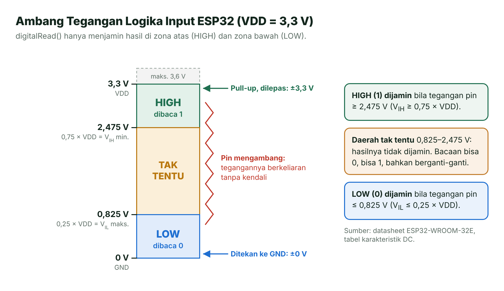
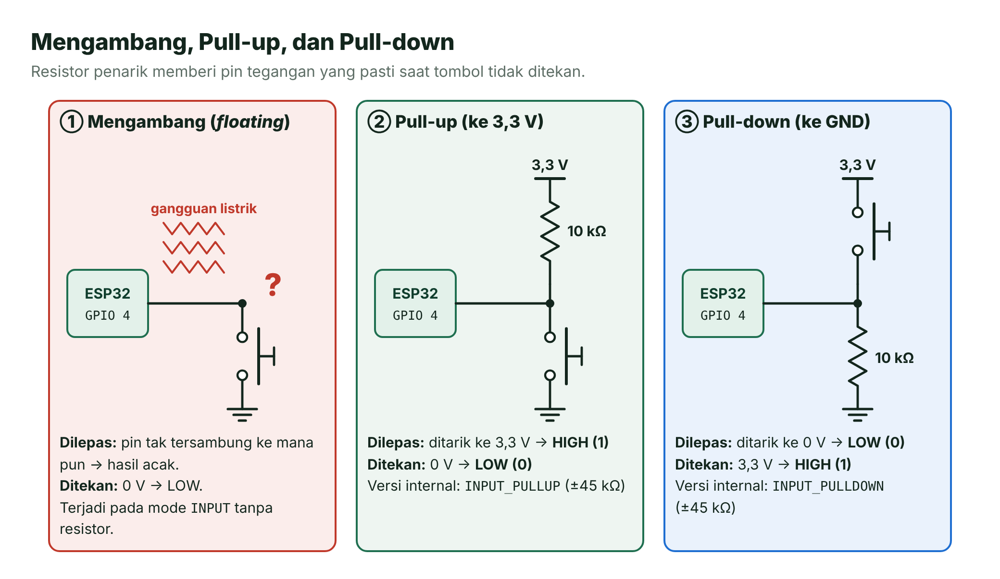
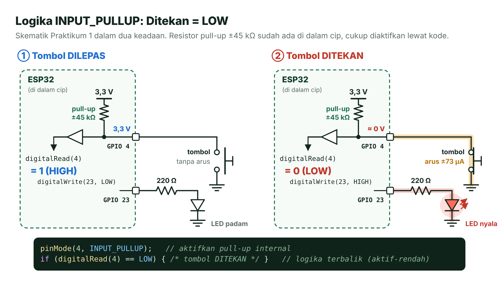
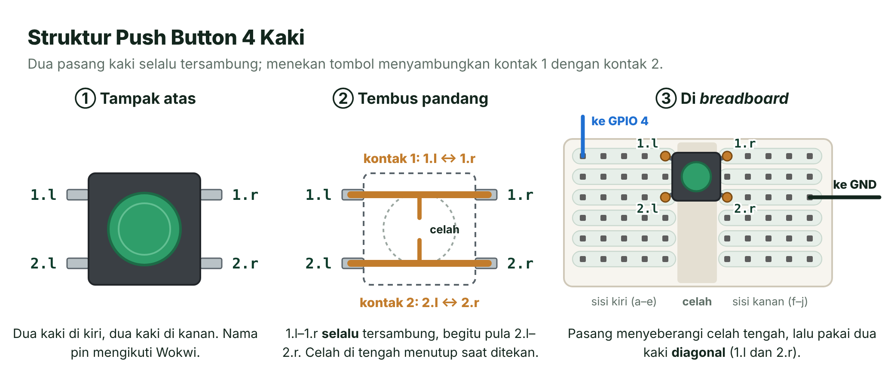
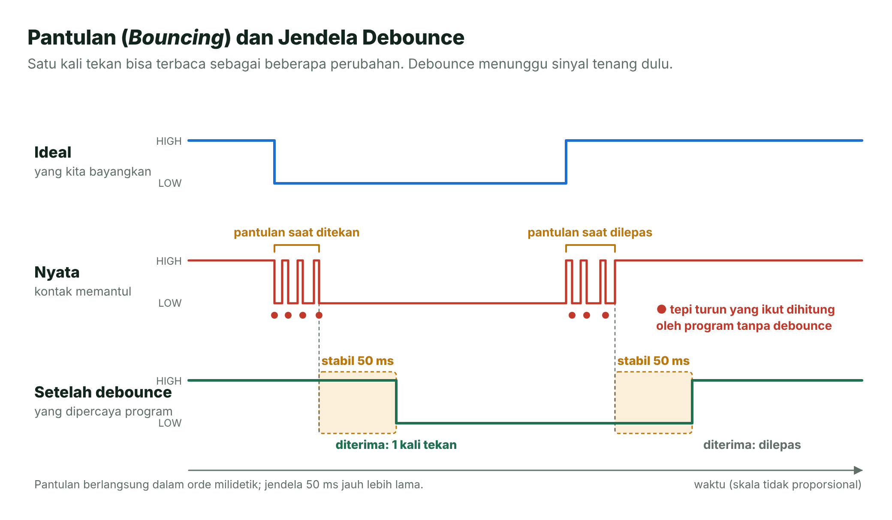
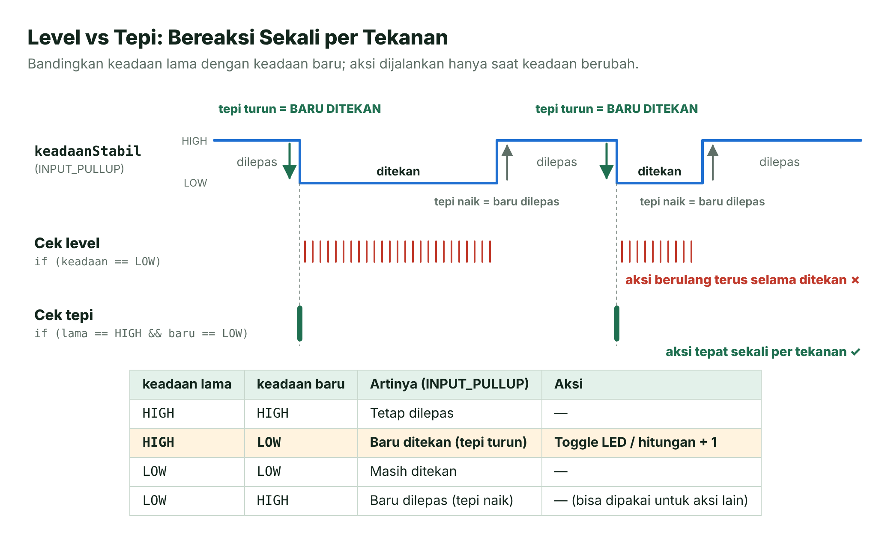
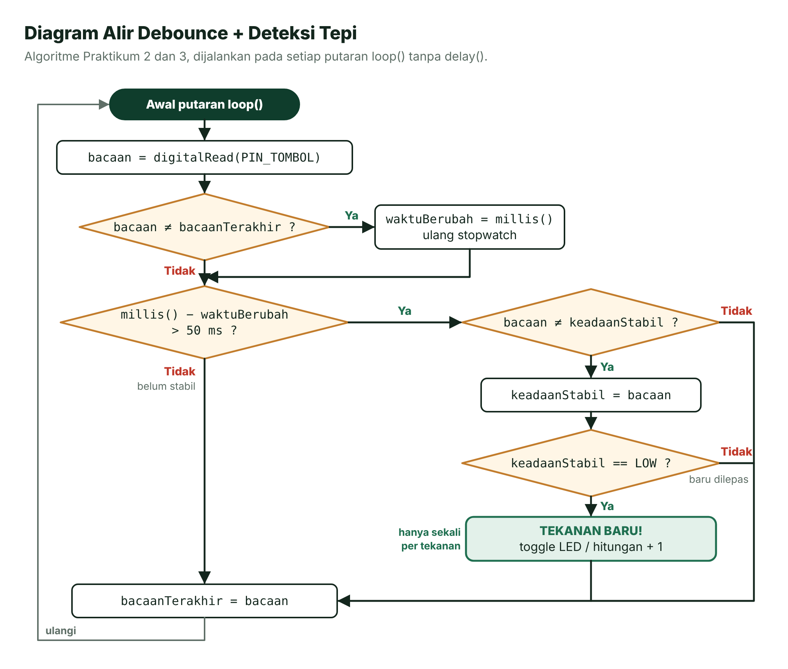
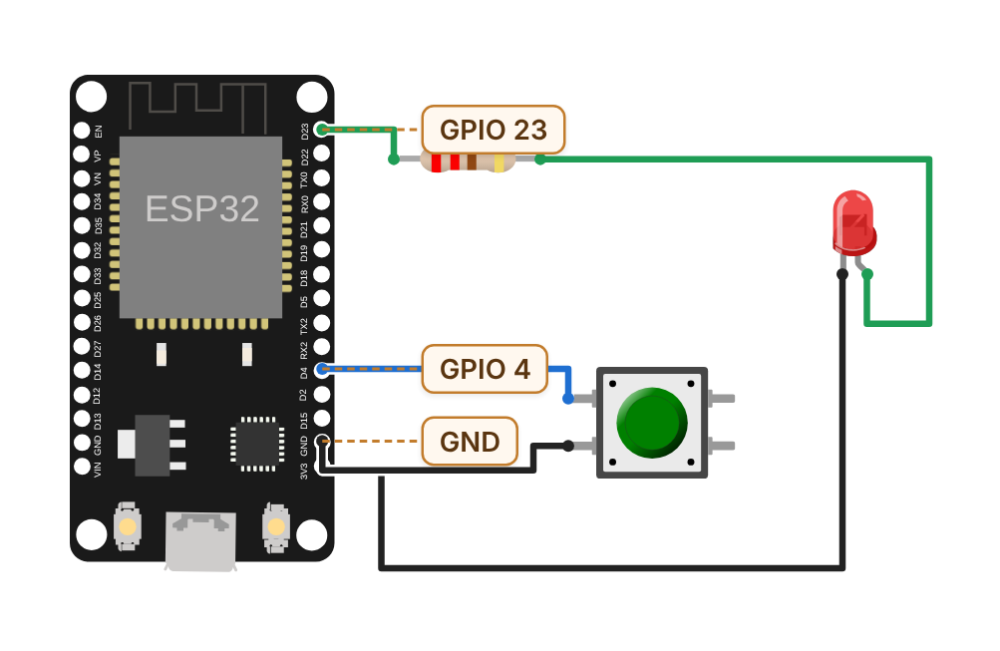
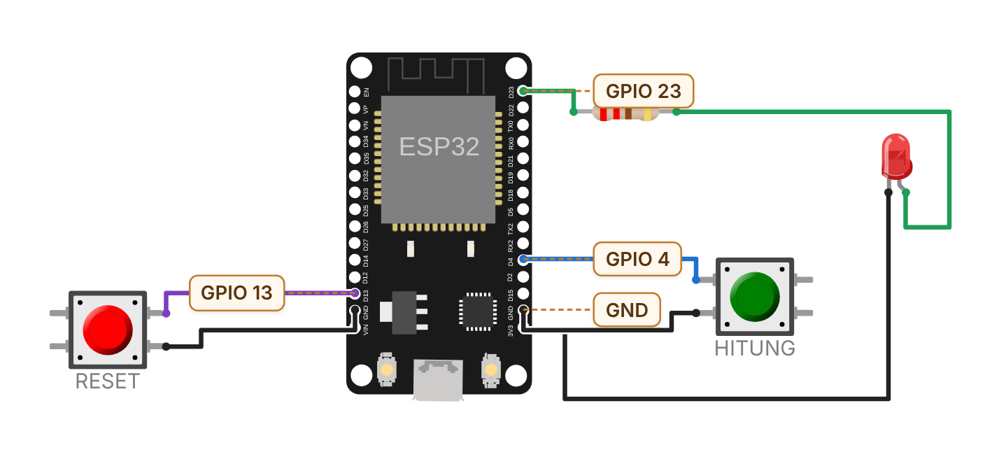

# Pertemuan 04 — GPIO Input: Membaca Tombol

> Di Pertemuan 3 ESP32-mu "berbicara" lewat LED. Hari ini ia belajar "mendengar": membaca tombol dengan benar, tanpa tertipu pin yang mengambang atau kontak yang memantul.

| | |
| --- | --- |
| ⏱️ **Durasi** | 2 × 50 menit teori + 3 × 50 menit praktikum |
| 📋 **Prasyarat** | [Pertemuan 3](../pertemuan-03-gpio-output/README.md): `pinMode()`, `digitalWrite()`, LED + resistor, dan *breadboard* |
| 🧰 **Alat** | Laptop + internet; opsional: ESP32 DevKit V1, *breadboard*, 2 *push button* 4 kaki, 1 LED merah, 1 resistor 220 Ω, kabel *jumper* |
| 📥 **Slide** | [Unduh PDF](../slide/pdf/P04-GPIO-Input.pdf) · [Unduh PPTX](../slide/pptx/P04-GPIO-Input.pptx) |

## Daftar Isi

- [🎯 Tujuan Pembelajaran](#-tujuan-pembelajaran)
- [🧰 Yang Perlu Disiapkan](#-yang-perlu-disiapkan)
- [1. Membaca Input Digital dengan digitalRead()](#1-membaca-input-digital-dengan-digitalread)
- [2. Input Mengambang dan Resistor *Pull-up*/*Pull-down*](#2-input-mengambang-dan-resistor-pull-uppull-down)
- [3. Mengenal *Push Button* 4 Kaki](#3-mengenal-push-button-4-kaki)
- [4. Memilih Pin GPIO untuk Tombol](#4-memilih-pin-gpio-untuk-tombol)
- [5. Pantulan (*Bouncing*): Satu Tekanan, Banyak Sinyal](#5-pantulan-bouncing-satu-tekanan-banyak-sinyal)
- [6. *Debouncing*: Menunggu Sinyal Tenang](#6-debouncing-menunggu-sinyal-tenang)
- [7. Deteksi Tepi: Bereaksi Sekali per Tekanan](#7-deteksi-tepi-bereaksi-sekali-per-tekanan)
- [🧪 Praktikum](#-praktikum)
- [🏋️ Latihan & Tantangan](#️-latihan--tantangan)
- [✅ Cek Pemahaman](#-cek-pemahaman)
- [📌 Rangkuman](#-rangkuman)
- [📚 Referensi](#-referensi)
- [🖼️ Sumber Gambar](#️-sumber-gambar)

---

## 🎯 Tujuan Pembelajaran

Setelah pertemuan ini, kamu bisa:

1. Membaca keadaan tombol dengan `digitalRead()` dan menjelaskan ambang tegangan HIGH/LOW pada ESP32.
2. Menjelaskan bahaya input mengambang serta memilih resistor *pull-up* atau *pull-down*, baik eksternal maupun internal.
3. Merangkai *push button* 4 kaki di *breadboard* dan memilih pin GPIO yang aman untuk input.
4. Menjelaskan pantulan (*bouncing*) dan mengatasinya dengan *debouncing* berbasis `millis()`.
5. Membuat program *toggle* dan penghitung tekanan dengan deteksi tepi.

## 🧰 Yang Perlu Disiapkan

| Kebutuhan | Keterangan |
| --- | --- |
| Perangkat lunak | VS Code + PlatformIO ([panduan instalasi](../panduan/02-instalasi-alat.md)) atau [Wokwi](../panduan/03-simulasi-wokwi.md) di peramban |
| Komponen (*board* asli) | ESP32 DevKit V1, *breadboard*, 2 *push button* 4 kaki (6 × 6 mm), 1 LED merah, 1 resistor 220 Ω, kabel *jumper*. Lihat [daftar komponen](../panduan/04-daftar-komponen.md). |
| Jalur Wokwi | Tidak perlu komponen; semuanya sudah ada di `diagram.json` tiap praktikum |
| Rujukan pin | [Lembar saku pinout ESP32](../panduan/05-pinout-esp32.md) |

---

## 1. Membaca Input Digital dengan `digitalRead()`

Di Pertemuan 3, pin GPIO bekerja sebagai **output**: ESP32 "berbicara" dengan memberi tegangan 3,3 V atau 0 V. Hari ini arahnya dibalik. Sebagai **input**, pin GPIO "mendengar": ESP32 mengukur tegangan yang datang ke pin, lalu menyimpulkannya sebagai **1 (HIGH)** atau **0 (LOW)**.

Dua fungsi yang kamu butuhkan:

```cpp
pinMode(PIN_TOMBOL, INPUT);           // jadikan pin sebagai masukan (input)
int nilai = digitalRead(PIN_TOMBOL);  // baca levelnya: HIGH (1) atau LOW (0)
```

Selain `INPUT`, ada mode `INPUT_PULLUP` dan `INPUT_PULLDOWN` yang akan dibahas di bagian 2.

### Ambang Tegangan: Kapan Disebut HIGH, Kapan LOW?

Bayangkan kamu menilai isi sebuah gelas. Jika terisi tiga perempat atau lebih, semua orang sepakat "penuh". Jika hanya seperempat atau kurang, semua sepakat "kosong". Namun, kalau isinya setengah, jawaban orang bisa berbeda-beda. Pin input ESP32 bekerja serupa: ada batas atas, batas bawah, dan **daerah tak tentu** di antaranya.

Lembar data (*datasheet*) modul ESP32-WROOM-32E menetapkan **V<sub>IH</sub> ≥ 0,75 × VDD**, yaitu tegangan terendah yang dijamin dibaca HIGH, dan **V<sub>IL</sub> ≤ 0,25 × VDD**, yaitu tegangan tertinggi yang dijamin dibaca LOW [2]. Untuk VDD = 3,3 V hasilnya sebagai berikut.

| Besaran | Aturan lembar data | Untuk VDD = 3,3 V | Hasil `digitalRead()` |
| --- | --- | --- | --- |
| V<sub>IH</sub> (batas bawah HIGH) | ≥ 0,75 × VDD | ≥ 0,75 × 3,3 = **2,475 V** | Dijamin `HIGH` (1) |
| V<sub>IL</sub> (batas atas LOW) | ≤ 0,25 × VDD | ≤ 0,25 × 3,3 = **0,825 V** | Dijamin `LOW` (0) |
| Daerah tak tentu | Di antara keduanya | **0,825–2,475 V** | Tidak dijamin: bisa 0, bisa 1 |



*Gambar 4.1 — Ambang tegangan logika input ESP32 pada VDD 3,3 V. Sumber: dibuat untuk materi ini; angka dari [2].*

Pelajaran pentingnya: rangkaian input yang baik harus memastikan tegangan pin **selalu** berada di zona atas atau zona bawah, tidak pernah melayang di tengah. Bagian berikut menunjukkan caranya.

> [!CAUTION]
> **Jangan lebih dari 3,6 V.** Batas atas tegangan input adalah VDD + 0,3 V = 3,6 V [2]. Sinyal 5 V dari modul atau sensor lain tidak boleh disambungkan langsung ke pin ESP32 karena bisa merusak cip.

## 2. Input Mengambang dan Resistor *Pull-up*/*Pull-down*

### Masalah: Pin yang Mengambang

Cara paling sederhana memasang tombol adalah menyambungkan satu kakinya ke GPIO 4 dan kaki lainnya ke GND. Saat ditekan, pin tersambung ke GND sehingga terbaca LOW. Namun, saat tombol **dilepas**, pin tidak tersambung ke mana pun. Keadaan ini disebut **mengambang** (*floating*).

Pin input hampir tidak menarik arus (impedansinya sangat tinggi), sehingga muatan listrik sekecil apa pun mudah menggeser tegangannya. Kabel yang mengambang bertingkah seperti **antena radio kecil**: ia menangkap gangguan listrik dari sekitarnya, mulai dari kabel lain, lampu, sampai jari tanganmu. Tegangan pin pun berkeliaran di daerah tak tentu, dan `digitalRead()` memberi hasil acak yang berganti-ganti [5].

### Solusi: Resistor Penarik

Solusinya adalah resistor yang selalu "menarik" pin ke tegangan tertentu selama tombol tidak ditekan. Bayangkan **pegas pintu**: pintu selalu kembali tertutup dengan sendirinya, kecuali ada tangan yang mendorongnya. Resistor penarik adalah pegas yang lemah, sedangkan tombol adalah tangan yang lebih kuat.

- **Resistor *pull-up*** (penarik ke atas) menghubungkan pin ke 3,3 V, sedangkan tombol menghubungkan pin ke GND. Dilepas → HIGH; ditekan → LOW.
- **Resistor *pull-down*** (penarik ke bawah) menghubungkan pin ke GND, sedangkan tombol menghubungkan pin ke 3,3 V. Dilepas → LOW; ditekan → HIGH.



*Gambar 4.2 — Pin mengambang dibandingkan dengan rangkaian pull-up dan pull-down. Sumber: dibuat untuk materi ini.*

Mengapa harus resistor, bukan kabel biasa? Kalau pin disambungkan ke 3,3 V dengan kabel, menekan tombol akan menyambungkan 3,3 V langsung ke GND: **korsleting**. Resistor membatasi arusnya. Dengan *pull-up* 10 kΩ, arus saat tombol ditekan hanya 3,3 V ÷ 10 kΩ = **0,33 mA**, cukup kecil untuk diabaikan.

### Resistor Internal: `INPUT_PULLUP` dan `INPUT_PULLDOWN`

Kabar baiknya, ESP32 sudah menyimpan resistor *pull-up* dan *pull-down* sekitar **±45 kΩ** di dalam cip [2]. Kamu cukup mengaktifkannya lewat `pinMode()` [4].

| Mode `pinMode()` | Resistor yang aktif | Pasang tombol | Dilepas | Ditekan |
| --- | --- | --- | --- | --- |
| `INPUT` | Tidak ada; wajib resistor eksternal | Sesuai resistor eksternal | — | — |
| `INPUT_PULLUP` | *Pull-up* internal ±45 kΩ ke 3,3 V | Pin ↔ tombol ↔ GND | `HIGH` | `LOW` |
| `INPUT_PULLDOWN` | *Pull-down* internal ±45 kΩ ke GND | Pin ↔ tombol ↔ 3,3 V | `LOW` | `HIGH` |

Dengan *pull-up* internal, arus saat tombol ditekan hanya 3,3 V ÷ 45 kΩ ≈ **73 µA**. Resistor internal ini tergolong "lemah". Untuk kabel tombol yang panjang atau lingkungan yang banyak gangguan, resistor eksternal 10 kΩ menarik lebih kuat sehingga lebih tahan gangguan. Resistor eksternal juga **wajib** untuk GPIO 34–39 yang tidak punya resistor internal (lihat bagian 4).

### Logika Terbalik pada *Pull-up*

Pada `INPUT_PULLUP`, tombol yang **ditekan** justru terbaca **LOW**. Inilah **logika terbalik** atau aktif-rendah (*active-low*): keadaan "aktif" ditandai level rendah. Awalnya memang terasa janggal, tetapi pola ini sangat umum di dunia sistem tertanam.



*Gambar 4.3 — Logika INPUT_PULLUP sekaligus skematik Praktikum 1. Saat dilepas, pin ditarik ke 3,3 V (HIGH); saat ditekan, pin tersambung ke GND (LOW). Sumber: dibuat untuk materi ini.*

Supaya kode mudah dibaca, beri nama pada level "ditekan":

```cpp
const int DITEKAN = LOW;   // pada INPUT_PULLUP, tombol ditekan terbaca LOW

if (digitalRead(PIN_TOMBOL) == DITEKAN) {
  digitalWrite(PIN_LED, HIGH);   // nyalakan LED selama tombol ditekan
}
```

> [!TIP]
> **Mengapa *pull-up* lebih populer?** Tombol cukup disambungkan ke GND yang tersedia di banyak titik, tanpa perlu menarik kabel 3,3 V ke setiap tombol. Resistor tambahan pun tidak perlu karena cukup memakai `INPUT_PULLUP`. Karena itu, kursus ini memakai pola "tombol ke GND, ditekan = LOW".

## 3. Mengenal *Push Button* 4 Kaki

Tombol yang paling sering dipakai praktikum adalah ***push button*** (tombol tekan atau sakelar taktil) berukuran 6 × 6 mm dengan **empat kaki**. Padahal, sebuah sakelar cukup punya dua titik sambungan. Mengapa empat? Karena keempat kaki itu sebenarnya hanya **dua kontak**, masing-masing dengan dua kaki agar tombol berdiri kokoh.



*Gambar 4.4 — Struktur push button 4 kaki: tampak atas, sambungan di dalamnya, dan cara memasangnya di breadboard. Sumber: dibuat untuk materi ini; nama pin mengikuti [8].*

- Wokwi menamai kakinya **1.l** dan **1.r** (kontak 1, kiri/kanan) serta **2.l** dan **2.r** (kontak 2) [8].
- Kaki 1.l dan 1.r **selalu tersambung**, bahkan saat tombol tidak ditekan. Begitu pula 2.l dan 2.r.
- Menekan tombol menyambungkan **kontak 1 dengan kontak 2**. Jadi, pakai satu kaki dari kontak 1 dan satu kaki dari kontak 2.

Di *breadboard*, pasang tombol **menyeberangi celah tengah**: dua kaki di sisi kiri dan dua kaki di sisi kanan. Dengan cara ini, kedua kontak jatuh di baris yang berbeda. Trik paling aman adalah memakai dua kaki yang letaknya **diagonal**, misalnya 1.l dan 2.r. Kaki diagonal pasti berasal dari kontak yang berbeda, ke arah mana pun tombol dipasang.

> [!TIP]
> **Ragu kaki mana yang tersambung?** Ukur dengan multimeter mode kontinuitas (berbunyi "bip"). Pasangan kaki yang berbunyi tanpa ditekan adalah satu kontak. Pasangan yang baru berbunyi saat tombol ditekan berasal dari dua kontak yang berbeda.

> [!WARNING]
> **Tombol yang "selalu ditekan".** Jika tombol terpasang terputar 90° di satu sisi *breadboard*, dua kaki dari kontak berbeda bisa masuk ke strip yang sama. Kedua kontak pun tersambung lewat *breadboard*, dan program membaca tombol seolah ditekan terus.

## 4. Memilih Pin GPIO untuk Tombol

ESP32 punya 34 GPIO, tetapi tidak semuanya cocok untuk tombol [1].

| Kelompok | GPIO | Untuk tombol? |
| --- | --- | --- |
| Aman, punya *pull-up*/*pull-down* internal | 4, 13, 14, 16–19, 21–23, 25–27, 32, 33 | ✅ Pilihan utama. Kursus ini memakai GPIO 4 (tombol utama) dan GPIO 13 (tombol kedua). |
| Input saja, **tanpa** *pull-up*/*pull-down* internal | 34, 35, 36 (VP), 39 (VN) | ⚠️ Boleh, tetapi wajib resistor eksternal (misalnya 10 kΩ) dengan mode `INPUT` [3]. |
| Pin *strapping* | 0, 2, 5, 12, 15 | ⛔ Sebaiknya jangan. |
| Dipakai *flash* internal / Serial USB | 6–11 / 1 dan 3 | ⛔ Jangan dipakai. |

Pada GPIO 34–39, perintah `INPUT_PULLUP` tidak memberi resistor apa pun karena perangkat kerasnya memang tidak ada. Pin tetap mengambang, dan kamu akan bingung mengapa bacaannya acak.

**Pin *strapping*** dibaca cip tepat saat menyala atau di-*reset* untuk menentukan mode kerjanya [1]. Tombol yang kebetulan ditekan saat itu, atau resistor *pull-up*/*pull-down* eksternal di pin tersebut, bisa mengubah mode *boot*. Contohnya, GPIO 12 harus LOW saat *boot*. Jika tertarik ke HIGH, ESP32 bisa gagal menyala dengan benar.

> [!NOTE]
> **Tombol BOOT di *board* juga tombol GPIO.** Tombol BOOT terhubung ke GPIO 0, salah satu pin *strapping*. Jika ditahan saat *board* di-*reset*, ESP32 masuk mode unduh *firmware*, bukan menjalankan programmu. Inilah contoh nyata mengapa pin *strapping* perlu diperlakukan hati-hati.

## 5. Pantulan (*Bouncing*): Satu Tekanan, Banyak Sinyal

Jatuhkan bola pingpong ke meja: "tok-tok-tok-tok", bola memantul beberapa kali sebelum diam. Kontak logam di dalam tombol berperilaku mirip. Saat ditekan, kedua permukaan logam bertumbukan, terpental sedikit, lalu bertumbukan lagi beberapa kali sebelum benar-benar menempel. Peristiwa ini disebut **pantulan** (*bouncing*), dan hal serupa terjadi saat tombol dilepas.

Seberapa lama? Dokumentasi Wokwi mengutip buku *The Art of Electronics* karya Horowitz dan Hill: kontak terpisah dan tersambung kembali **10 hingga 100 kali dalam waktu sekitar 1 ms** [8]. Jack Ganssle mengukur 18 jenis sakelar. Di luar dua sakelar yang ekstrem, rata-rata pantulannya **±1,6 ms** dengan maksimum **6,2 ms**; salah satu sakelar ekstrem bahkan memantul hingga **157 ms** saat dilepas [9]. Jadi, pantulan umumnya berlangsung dalam **orde milidetik**.

Masalahnya, `loop()` tanpa `delay()` berputar jauh lebih cepat daripada itu. Setiap pantulan ikut terbaca sebagai perubahan HIGH ↔ LOW, sehingga program penghitung bisa mencatat tiga, empat, atau lebih tekanan untuk **satu** kali tekan.



*Gambar 4.5 — Sinyal ideal, sinyal nyata yang memantul, dan sinyal setelah debounce. Sumber: dibuat untuk materi ini.*

> [!NOTE]
> **Pantulan di Wokwi.** Wokwi menyimulasikan pantulan tombol secara bawaan, dan atribut `"bounce": "0"` pada `attrs` tombol mematikannya [8]. Kamu akan membandingkan keduanya di Praktikum 2.

## 6. *Debouncing*: Menunggu Sinyal Tenang

Pernah menimbang badan dengan timbangan digital? Angkanya naik-turun sesaat, lalu berhenti. Kamu baru mencatat beratmu setelah angkanya **tidak berubah lagi**. *Debouncing* (peredaman pantulan) memakai gagasan yang sama: keadaan tombol yang baru hanya dipercaya setelah bacaannya **stabil selama beberapa waktu**, misalnya 50 ms.

### `millis()` sebagai *Stopwatch*

Untuk mengukur "sudah stabil berapa lama", kita memakai `millis()`. Fungsi ini mengembalikan jumlah milidetik sejak *board* menyala dengan tipe `unsigned long`. Cara memakainya mirip *stopwatch*: catat waktu mulai, lalu hitung selisihnya.

```cpp
unsigned long waktuMulai = millis();                 // catat "sekarang"
// ... beberapa saat kemudian ...
unsigned long lamaBerlalu = millis() - waktuMulai;   // berapa ms sudah lewat
```

Pembahasan lengkap `millis()` ada di Pertemuan 5, termasuk alasan pengurangan ini tetap aman ketika nilainya kembali ke nol setelah ±49,7 hari.

### Algoritme *Debounce* Berbasis Waktu

```cpp
int bacaan = digitalRead(PIN_TOMBOL);

if (bacaan != bacaanTerakhir) {        // bacaan mentah berubah (mungkin memantul)
  waktuBerubah = millis();             // ulang stopwatch dari nol
}
if (millis() - waktuBerubah > 50) {    // sudah stabil lebih dari 50 ms?
  keadaanStabil = bacaan;              // baru sekarang dipercaya
}
bacaanTerakhir = bacaan;               // simpan untuk putaran berikutnya
```

Kuncinya ada di baris `waktuBerubah = millis()`. Selama tombol memantul, *stopwatch* terus diulang dari nol. Syarat "lebih dari 50 ms" baru terpenuhi 50 ms setelah pantulan terakhir. Perhatikan lagi kotak "stabil 50 ms" pada Gambar 4.5.

Nilai 50 ms dipakai oleh contoh *Debounce* resmi Arduino [6]. Nilai ini sekitar delapan kali pantulan terlama dalam pengukuran Ganssle (6,2 ms), tetapi tetap terasa cepat bagi pengguna. Jika terlalu kecil, pantulan bisa lolos. Jika terlalu besar, tombol terasa lamban dan tekanan yang sangat cepat bisa terlewat.

> [!IMPORTANT]
> **Jangan memakai `delay(50)` sebagai *debounce*.** Menunggu dengan `delay()` setelah tombol terdeteksi memang mengurangi hitungan ganda. Namun, selama `delay()` program tidak bisa mengerjakan hal lain. Teknik `millis()` di atas tidak pernah menunggu: `loop()` tetap berputar, sehingga program bisa mengurus banyak tombol, LED, dan sensor sekaligus.

### *Debouncing* Perangkat Keras (Sekilas)

Pantulan juga bisa diredam dengan komponen, yaitu **kapasitor** (misalnya 100 nF) yang dipasang paralel dengan tombol bersama resistor *pull-up* (misalnya 10 kΩ). Kapasitor ibarat ember yang tidak bisa diisi atau dikuras seketika, sehingga lonjakan singkat akibat pantulan menjadi landai. Kecepatannya ditentukan **konstanta waktu** τ = R × C = 10 kΩ × 100 nF = **1 ms**. Sebagai gambaran, setelah tombol dilepas, tegangan butuh sekitar 1,39 τ ≈ 1,4 ms untuk naik dari 0 V ke 2,475 V (batas HIGH).

Sinyal yang landai biasanya dipertegas oleh gerbang ***Schmitt trigger***, misalnya cip 74HC14. Cara perangkat keras ini membebaskan CPU dan berguna untuk interupsi (Pertemuan 5), tetapi butuh komponen tambahan. Di kursus ini kita memakai *debouncing* perangkat lunak.

## 7. Deteksi Tepi: Bereaksi Sekali per Tekanan

Bayangkan dua cara menghitung orang yang masuk kelas. Cara pertama: tambah satu setiap detik selama pintu terbuka. Cara kedua: tambah satu tepat saat pintu **berubah** dari tertutup menjadi terbuka. Cara pertama jelas kacau, sedangkan cara kedua benar.

Program tombol pun begitu. Kondisi `if (digitalRead(PIN_TOMBOL) == LOW)` adalah **cek level**: bernilai benar **terus-menerus** selama tombol ditahan, sehingga aksinya berulang berkali-kali. Untuk *toggle* atau penghitung, kita butuh **deteksi tepi** (*edge detection*), yaitu membandingkan keadaan lama (pada putaran `loop()` sebelumnya) dengan keadaan baru [7].

- **Tepi turun** (HIGH → LOW): tombol **baru saja ditekan**.
- **Tepi naik** (LOW → HIGH): tombol **baru saja dilepas**.



*Gambar 4.6 — Cek level dibandingkan dengan cek tepi. Sumber: dibuat untuk materi ini.*

Contoh pemakaiannya untuk *toggle* dan penghitung:

```cpp
if (keadaanLama == HIGH && keadaanBaru == LOW) {   // tepi turun: baru ditekan
  ledMenyala = !ledMenyala;                        // toggle: balik keadaan LED
  jumlahTekan++;                                   // penghitung: tambah satu
}
keadaanLama = keadaanBaru;                         // simpan untuk putaran berikutnya
```

Gabungkan deteksi tepi dengan *debounce*, dan kamu mendapat algoritme lengkap yang dipakai di Praktikum 2 dan 3. Di sana, perubahan `keadaanStabil` (yang sudah lolos *debounce*) berperan sebagai tepi.



*Gambar 4.7 — Diagram alir debounce dan deteksi tepi. Sumber: dibuat untuk materi ini.*

### Mengapa `delay()` Membuat Tombol Tidak Responsif

Perhatikan program berikut, yang mencoba membuat LED berkedip sambil membaca tombol:

```cpp
void loop() {
  digitalWrite(PIN_LED, HIGH);
  delay(500);
  digitalWrite(PIN_LED, LOW);
  delay(500);
  if (digitalRead(PIN_TOMBOL) == LOW) {   // hanya dicek sekali tiap ±1 detik!
    Serial.println("Tombol ditekan");
  }
}
```

Tombol hanya diperiksa sekali setiap ±1 detik. Tekanan singkat, misalnya 150 ms, yang terjadi saat program sedang menjalankan `delay()` tidak akan pernah terlihat. Kalaupun terlihat, reaksinya bisa terlambat hampir 1 detik. Praktikum 1 nanti juga memakai `delay(200)` agar Serial Monitor tidak banjir, sehingga LED bisa terlambat hingga 0,2 detik. Praktikum 2 dan 3 sama sekali tidak memakai `delay()`.

> [!IMPORTANT]
> **Bekal untuk Pertemuan 5.** Program yang membaca tombol sebaiknya tidak memakai `delay()` panjang. Di [Pertemuan 5](../pertemuan-05-waktu-interupsi/README.md) kamu akan belajar dua obatnya: pewaktuan tanpa memblokir dengan `millis()` dan **interupsi** yang bereaksi seketika saat level pin berubah.

---

## 🧪 Praktikum

### Sebelum Mulai

Kodenya sama untuk kedua jalur. Langkah lengkapnya ada di [Pertemuan 1](../pertemuan-01-pengenalan/README.md#-praktikum) dan [panduan Wokwi](../panduan/03-simulasi-wokwi.md).

**Jalur A — Wokwi:** buka <https://wokwi.com/projects/new/esp32>, salin `src/main.cpp` ke tab **sketch.ino** dan `diagram.json` ke tab **diagram.json**, lalu klik **▶**. Untuk menekan tombol, klik tombol di layar dengan *mouse*; tahan klik untuk menahan tombol.

**Jalur B — *Board* asli:** rangkai komponen di *breadboard* sesuai tabel sambungan, buka *folder* praktikum di VS Code, lalu klik **Build** (✓), **Upload** (→), dan **Serial Monitor**.

> [!CAUTION]
> **Rangkai saat USB dicabut.** Pasang atau ubah rangkaian hanya ketika kabel USB tidak tersambung. Sebelum mencolokkan USB, periksa sekali lagi bahwa tidak ada kabel yang menghubungkan 3V3 langsung ke GND.

---

### Praktikum 1 — Tombol dan LED

📁 *Folder*: [`kode/01-tombol-dan-led`](kode/01-tombol-dan-led)

**Tujuan:** membaca tombol dengan `INPUT_PULLUP`, menyalakan LED selama tombol ditekan, dan melihat logika terbalik langsung di Serial Monitor.

**Rangkaian:** skematiknya sudah kamu lihat pada Gambar 4.3. Tombol tidak butuh resistor karena kita memakai *pull-up* internal.



*Gambar 4.8 — Rangkaian Praktikum 1 dan 2. Sumber: dibuat untuk materi ini dari `diagram.json`; gambar komponen dari @wokwi/elements (MIT).*

| Dari | Ke | Keterangan |
| --- | --- | --- |
| GPIO 23 (D23) | Resistor 220 Ω | Kaki resistor yang lain ke **anoda** LED (kaki panjang) |
| **Katoda** LED (kaki pendek) | GND | Arus LED sekitar 6 mA bila tegangan maju LED merah ±2 V |
| GPIO 4 (D4) | Kaki tombol 1.l | — |
| Kaki tombol 2.l | GND | Di *breadboard*, boleh juga kaki diagonalnya, yaitu 2.r |

**Kode** (`src/main.cpp`, tanpa blok komentar pembuka):

```cpp
const int PIN_TOMBOL = 4;      // Tombol ke GND, memakai pull-up internal
const int PIN_LED = 23;        // LED eksternal lewat resistor 220 Ω
const int JEDA_BACA_MS = 200;  // Jeda antarbacaan agar Serial Monitor tidak banjir

void setup() {
  Serial.begin(115200);
  pinMode(PIN_TOMBOL, INPUT_PULLUP);  // Aktifkan resistor pull-up internal (±45 kΩ)
  pinMode(PIN_LED, OUTPUT);
  Serial.println("[INFO] Praktikum 1: tombol di GPIO 4, LED di GPIO 23.");
  Serial.println("[INFO] Tekan dan tahan tombol, lalu amati nilai digitalRead.");
}

void loop() {
  int nilai = digitalRead(PIN_TOMBOL);  // Hasilnya 1 (HIGH) atau 0 (LOW)

  Serial.print("[DATA] digitalRead = ");
  Serial.print(nilai);

  // Logika terbalik akibat pull-up: ditekan = LOW, dilepas = HIGH
  if (nilai == LOW) {
    digitalWrite(PIN_LED, HIGH);
    Serial.println(" (LOW)  -> tombol DITEKAN, LED nyala");
  } else {
    digitalWrite(PIN_LED, LOW);
    Serial.println(" (HIGH) -> tombol dilepas, LED padam");
  }

  delay(JEDA_BACA_MS);
}
```

**Cara menjalankan:**

- **A. Wokwi:** salin `src/main.cpp` dan `diagram.json`, klik **▶**, lalu klik dan tahan tombol hijau.
- **B. *Board* asli:** rangkai sesuai tabel, buka *folder* `kode/01-tombol-dan-led`, klik **Build**, **Upload**, lalu **Serial Monitor**. Tekan dan tahan tombol.

**Hasil yang diharapkan:** LED menyala hanya selama tombol ditekan. Serial Monitor menampilkan lima baris per detik. Contoh berikut terjadi bila tombol ditekan sekitar setengah detik:

```text
[INFO] Praktikum 1: tombol di GPIO 4, LED di GPIO 23.
[INFO] Tekan dan tahan tombol, lalu amati nilai digitalRead.
[DATA] digitalRead = 1 (HIGH) -> tombol dilepas, LED padam
[DATA] digitalRead = 1 (HIGH) -> tombol dilepas, LED padam
[DATA] digitalRead = 1 (HIGH) -> tombol dilepas, LED padam
[DATA] digitalRead = 0 (LOW)  -> tombol DITEKAN, LED nyala
[DATA] digitalRead = 0 (LOW)  -> tombol DITEKAN, LED nyala
[DATA] digitalRead = 1 (HIGH) -> tombol dilepas, LED padam
[DATA] digitalRead = 1 (HIGH) -> tombol dilepas, LED padam
```

Jumlah baris HIGH dan LOW bergantung pada lamanya kamu menahan tombol. Perhatikan bahwa angka **0** justru muncul saat tombol **ditekan**.

**Kalau belum berhasil:**

| Gejala | Coba ini |
| --- | --- |
| Selalu `1` walaupun tombol ditekan | Kabel GPIO 4 dan GND mungkin masuk ke kaki dari kontak yang sama (misalnya 1.l dan 1.r). Pindahkan ke dua kaki diagonal. |
| Selalu `0` walaupun tombol dilepas | Tombol terputar 90° sehingga kontaknya tersambung lewat *breadboard*, atau GPIO 4 tersambung langsung ke GND. |
| Nilai berganti-ganti sendiri tanpa disentuh | Mode masih `INPUT` sehingga pin mengambang. Pastikan memakai `INPUT_PULLUP`. |
| Serial menulis `DITEKAN`, tetapi LED tetap padam | LED terbalik (kaki panjang harus mengarah ke resistor dan GPIO 23), atau kabel GPIO 23 belum tersambung. |
| Baris `[INFO]` tidak terlihat | Pesan terkirim sebelum Serial Monitor terbuka. Tekan tombol **EN** di *board*. |

**Eksperimen kecil:**

- Ganti `INPUT_PULLUP` dengan `INPUT`. Di *board* asli, amati nilai saat tombol dilepas sambil mendekatkan jarimu ke kabel GPIO 4. Simulator tidak memodelkan gangguan listrik seperti di dunia nyata, jadi hasil di Wokwi bisa berbeda. Kembalikan ke `INPUT_PULLUP` setelah selesai.
- Ubah mode menjadi `INPUT_PULLDOWN` dan pindahkan kabel tombol dari GND ke **3V3**. Di Wokwi, ganti `"esp:GND.1"` pada sambungan `btn1:2.l` menjadi `"esp:3V3"`. Sekarang nilai saat ditekan adalah 1. Ubah juga kondisi `if` agar LED tetap menyala saat tombol ditekan.
- Ubah `JEDA_BACA_MS` menjadi `1000`, lalu tekan tombol sesingkat mungkin. Apakah setiap tekanan selalu terlihat? Simpan jawabanmu untuk Pertemuan 5.

---

### Praktikum 2 — *Toggle* LED dengan *Debounce*

📁 *Folder*: [`kode/02-toggle-debounce`](kode/02-toggle-debounce)

**Tujuan:** membuat sekali tekan = LED berganti keadaan (*toggle*), melihat sendiri akibat pantulan, lalu mengatasinya dengan *debounce* berbasis `millis()` dan deteksi tepi.

**Rangkaian:** sama persis dengan Praktikum 1 (Gambar 4.8). Berkas `diagram.json`-nya pun identik.

**Kode** (`src/main.cpp`, bagian pentingnya):

```cpp
// Langkah 1: biarkan false. Langkah 2: ubah menjadi true.
const bool PAKAI_DEBOUNCE = false;
const unsigned long WAKTU_DEBOUNCE_MS = 50;  // Bacaan harus stabil lebih dari 50 ms

void loop() {
  int bacaan = digitalRead(PIN_TOMBOL);  // Bacaan mentah, bisa ikut memantul

  if (PAKAI_DEBOUNCE) {
    periksaDenganDebounce(bacaan);
  } else {
    periksaTanpaDebounce(bacaan);
  }

  bacaanTerakhir = bacaan;  // Simpan untuk dibandingkan pada putaran berikutnya
}

// Versi naif: setiap perubahan HIGH → LOW dianggap satu tekanan.
// Pantulan menghasilkan beberapa perubahan sekaligus, jadi hitungan meloncat.
void periksaTanpaDebounce(int bacaan) {
  if (bacaanTerakhir == HIGH && bacaan == LOW) {
    gantiLed();
  }
}

// Versi debounce: perubahan baru dipercaya setelah bacaan stabil > 50 ms.
void periksaDenganDebounce(int bacaan) {
  if (bacaan != bacaanTerakhir) {
    waktuBerubah = millis();  // Masih memantul → stopwatch diulang dari nol
  }

  if (millis() - waktuBerubah > WAKTU_DEBOUNCE_MS) {
    if (bacaan != keadaanStabil) {  // Ada perubahan keadaan yang sah
      keadaanStabil = bacaan;
      if (keadaanStabil == LOW) {   // Tepi turun = tombol baru saja ditekan
        gantiLed();
      }
    }
  }
}
```

Fungsi `gantiLed()` membalik keadaan LED dengan `ledMenyala = !ledMenyala`, menambah hitungan, lalu mencetaknya ke Serial Monitor.

**Langkah 1 — tanpa *debounce*.** Jalankan program apa adanya (`PAKAI_DEBOUNCE = false`), lalu tekan tombol beberapa kali. Contoh keluaran berikut berasal dari **satu kali** tekan dengan pola pantulan buatan:

```text
[INFO] Praktikum 2: toggle LED, debounce NONAKTIF.
[DATA] Tekanan ke-1 -> LED NYALA
[DATA] Tekanan ke-2 -> LED PADAM
[DATA] Tekanan ke-3 -> LED NYALA
[DATA] Tekanan ke-4 -> LED PADAM
[DATA] Tekanan ke-5 -> LED NYALA
```

Angka di layarmu hampir pasti berbeda karena pola pantulan selalu acak. Kadang satu tekanan terhitung sekali, kadang beberapa kali, termasuk saat tombol dilepas. Jika jumlahnya genap, LED tampak tidak berubah sama sekali, seolah tombolnya rusak.

**Langkah 2 — dengan *debounce*.** Ubah baris `const bool PAKAI_DEBOUNCE = false;` menjadi `true`, jalankan ulang, lalu tekan tombol tiga kali.

**Hasil yang diharapkan:**

```text
[INFO] Praktikum 2: toggle LED, debounce AKTIF (50 ms).
[DATA] Tekanan ke-1 -> LED NYALA
[DATA] Tekanan ke-2 -> LED PADAM
[DATA] Tekanan ke-3 -> LED NYALA
```

Sekarang satu tekanan selalu menghasilkan satu hitungan, dan LED berganti keadaan tepat sekali setiap kali tombol ditekan.

**Kalau belum berhasil:**

| Gejala | Coba ini |
| --- | --- |
| Langkah 2 masih meloncat | Pastikan baris pertama Serial Monitor berbunyi `debounce AKTIF (50 ms)`. Jika masih `NONAKTIF`, perubahan `true` belum diunggah atau belum disalin ke Wokwi. |
| LED berganti saat tombol **dilepas** | Kondisi `keadaanStabil == LOW` tertukar menjadi `HIGH`. |
| Tidak ada reaksi sama sekali | Cek rangkaian dengan program Praktikum 1 lebih dulu. |

**Eksperimen kecil:**

- Di Wokwi, ubah `attrs` tombol menjadi `{ "color": "green", "bounce": "0" }`, lalu ulangi Langkah 1. Apakah hitungan masih meloncat? Mengapa program yang lolos uji di simulator tanpa pantulan belum tentu benar di *board* asli?
- Ubah `WAKTU_DEBOUNCE_MS` menjadi `1`, lalu `500`. Tekan tombol berulang-ulang dengan cepat. Apa yang terjadi pada masing-masing nilai?
- Ganti kondisi `keadaanStabil == LOW` menjadi `keadaanStabil == HIGH`. Kapan sekarang LED berganti keadaan?

---

### Praktikum 3 — Penghitung Tekanan

📁 *Folder*: [`kode/03-penghitung-tekanan`](kode/03-penghitung-tekanan)

**Tujuan:** menghitung jumlah tekanan tombol, menampilkannya di Serial Monitor, dan menyetel ulang hitungan dengan tombol kedua.

**Rangkaian:** rangkaian Praktikum 1 ditambah satu tombol RESET di GPIO 13.



*Gambar 4.9 — Rangkaian Praktikum 3. Sumber: dibuat untuk materi ini dari `diagram.json`; gambar komponen dari @wokwi/elements (MIT).*

| Dari | Ke | Keterangan |
| --- | --- | --- |
| GPIO 4 (D4) | Kaki 1.l tombol HITUNG | Kaki 2.l tombol HITUNG ke GND, sama seperti Praktikum 1 |
| GPIO 13 (D13) | Kaki 1.r tombol RESET | D13 ada di deret pin **kiri** *board* |
| Kaki 2.r tombol RESET | GND | Pakai pin GND di deret kiri, tepat di bawah D13 |
| GPIO 23 → 220 Ω → LED | GND | LED menyala selama tombol HITUNG ditekan |

**Kode.** Setiap tombol perlu "ingatan" sendiri: bacaan terakhir, keadaan stabil, dan waktu perubahan. Daripada menyalin kode yang sama dua kali, data itu disimpan dalam **larik** (*array*), lalu satu fungsi `baruDitekan(i)` melayani tombol ke-`i`. Berikut bagian pentingnya:

```cpp
// Data tiap tombol disimpan dalam larik: indeks 0 = HITUNG, indeks 1 = RESET
const int JUMLAH_TOMBOL = 2;
const int TOMBOL_HITUNG = 0;
const int TOMBOL_RESET = 1;
const int PIN_TOMBOL[JUMLAH_TOMBOL] = {PIN_HITUNG, PIN_RESET};
int bacaanTerakhir[JUMLAH_TOMBOL] = {HIGH, HIGH};
int keadaanStabil[JUMLAH_TOMBOL] = {HIGH, HIGH};
unsigned long waktuBerubah[JUMLAH_TOMBOL] = {0, 0};

void loop() {
  if (baruDitekan(TOMBOL_HITUNG)) {
    jumlahTekanan++;
    Serial.print("[DATA] Jumlah tekanan: ");
    Serial.println(jumlahTekanan);
  }

  if (baruDitekan(TOMBOL_RESET)) {
    jumlahTekanan = 0;
    Serial.println("[INFO] Penghitung di-reset ke 0.");
  }

  // LED mengikuti keadaan stabil tombol HITUNG (pull-up: ditekan = LOW)
  digitalWrite(PIN_LED, keadaanStabil[TOMBOL_HITUNG] == LOW ? HIGH : LOW);
}
```

Fungsi `baruDitekan(i)` berisi algoritme pada Gambar 4.7 dan mengembalikan `true` **sekali** untuk setiap tekanan yang sah. Ingin menambah tombol ketiga? Cukup perpanjang lariknya.

**Cara menjalankan:** sama seperti Praktikum 1. Di Wokwi, klik tombol hijau (HITUNG) dan tombol merah (RESET).

**Hasil yang diharapkan** (tekan HITUNG tiga kali, RESET sekali, lalu HITUNG sekali):

```text
[INFO] Praktikum 3: penghitung tekanan tombol.
[INFO] HITUNG = GPIO 4, RESET = GPIO 13.
[DATA] Jumlah tekanan: 1
[DATA] Jumlah tekanan: 2
[DATA] Jumlah tekanan: 3
[INFO] Penghitung di-reset ke 0.
[DATA] Jumlah tekanan: 1
```

**Kalau belum berhasil:**

| Gejala | Coba ini |
| --- | --- |
| Tombol RESET tidak bereaksi | Pastikan kabelnya ke D13 di deret **kiri**, bukan D15 atau D12, dan kaki satunya ke GND. |
| Hitungan bertambah lebih dari satu per tekanan | Periksa `WAKTU_DEBOUNCE_MS` (harus 50) dan pastikan `baruDitekan()` hanya dipanggil sekali per tombol dalam satu putaran `loop()`. |
| Hitungan bertambah saat tombol dilepas | Kondisi `keadaanStabil[i] == LOW` di dalam `baruDitekan()` tertukar. |

**Tantangan opsional — tekan lama.** Buat program mendeteksi tombol HITUNG yang ditahan ≥ 1 detik, lalu mencetak `[INFO] Tekan lama terdeteksi!` **sekali** per penahanan. Petunjuknya:

```cpp
const unsigned long BATAS_TEKAN_LAMA_MS = 1000;
unsigned long waktuMulaiTekan = 0;
bool tekanLamaDilaporkan = false;

// Di dalam if (baruDitekan(TOMBOL_HITUNG)) { ... }, tambahkan:
waktuMulaiTekan = millis();
tekanLamaDilaporkan = false;

// Di dalam loop(), di luar if tersebut:
if (keadaanStabil[TOMBOL_HITUNG] == LOW && !tekanLamaDilaporkan &&
    millis() - waktuMulaiTekan >= BATAS_TEKAN_LAMA_MS) {
  tekanLamaDilaporkan = true;
  Serial.println("[INFO] Tekan lama terdeteksi!");
}
```

Jika tombol ditahan ±1,6 detik, lalu ditekan singkat sekali lagi, keluarannya (setelah dua baris `[INFO]` pembuka) menjadi:

```text
[DATA] Jumlah tekanan: 1
[INFO] Tekan lama terdeteksi!
[DATA] Jumlah tekanan: 2
```

Perhatikan bahwa tekan lama tetap terhitung sebagai satu tekanan. Bagaimana caranya agar tekan lama **tidak** ikut dihitung? *Petunjuk:* hitung tekanan pendek saat tombol **dilepas**, bukan saat ditekan.

---

## 🏋️ Latihan & Tantangan

1. **Dua tombol, satu LED.** Dengan rangkaian Praktikum 3, buat tombol GPIO 4 menyalakan LED dan tombol GPIO 13 memadamkannya. Pakai fungsi `baruDitekan()`.
2. **Tombol di pin input saja.** Pasang tombol di GPIO 34 dengan resistor *pull-down* eksternal 10 kΩ (tombol ke 3V3) dan `pinMode(34, INPUT)`, lalu tampilkan nilainya di Serial Monitor. Jelaskan mengapa `INPUT_PULLUP` tidak bisa dipakai di pin ini.
3. **Klik ganda.** Deteksi dua tekanan dengan selang kurang dari 400 ms, lalu cetak `Klik ganda!`. Satu tekanan biasa tetap dicetak sebagai `Klik tunggal`.
4. **Uji `delay()`.** Tambahkan pola LED berkedip dengan `delay(500)` seperti contoh di bagian 7 ke Praktikum 3. Tekan tombol HITUNG dengan cepat sepuluh kali. Berapa yang terhitung? Tuliskan penjelasanmu; kita akan memperbaikinya di Pertemuan 5.
5. **Kunci kombinasi (menantang).** LED menyala hanya jika urutan tekanan HITUNG, HITUNG, RESET, HITUNG dimasukkan dengan benar, seperti kata sandi.

## ✅ Cek Pemahaman

1. Sebuah tombol dipasang dari GPIO 4 ke GND dengan `pinMode(4, INPUT_PULLUP)`. Saat tombol **ditekan**, `digitalRead(4)` bernilai …
   - A. HIGH (1)
   - B. LOW (0)
   - C. Berubah-ubah secara acak
   - D. Selalu sama dengan keadaan LED

2. Dengan VDD = 3,3 V, tegangan input terendah yang **dijamin** terbaca HIGH oleh ESP32 adalah …
   - A. 0,825 V
   - B. 1,65 V
   - C. 2,475 V
   - D. 3,6 V

3. Kamu ingin memasang tombol di GPIO 35. Apa yang harus dilakukan?
   - A. Cukup `pinMode(35, INPUT_PULLUP)`
   - B. Pasang resistor *pull-up* atau *pull-down* eksternal, lalu `pinMode(35, INPUT)`
   - C. GPIO 35 sama sekali tidak bisa membaca input
   - D. Pakai `pinMode(35, OUTPUT)`

4. Program penghitung tanpa *debounce* kadang menambah tiga sekaligus untuk satu kali tekan. Penyebab utamanya adalah …
   - A. Resistor *pull-up* terlalu kecil
   - B. Kontak tombol memantul sehingga terbaca beberapa kali perubahan
   - C. `Serial.begin()` terlalu lambat
   - D. ESP32 kekurangan memori

5. Pada *debounce* berbasis `millis()`, mengapa `waktuBerubah = millis()` diulang setiap kali bacaan mentah berubah?
   - A. Agar `millis()` tidak meluap
   - B. Agar keadaan baru diterima hanya setelah bacaan stabil selama jendela *debounce*
   - C. Agar LED berkedip
   - D. Agar program berhenti sejenak

6. Kondisi yang tepat untuk mendeteksi tombol yang **baru saja** ditekan pada rangkaian *pull-up* adalah …
   - A. `keadaanBaru == LOW`
   - B. `keadaanLama == LOW && keadaanBaru == HIGH`
   - C. `keadaanLama == HIGH && keadaanBaru == LOW`
   - D. `keadaanLama == keadaanBaru`

<details>
<summary><b>Lihat jawaban</b></summary>

1. **B.** *Pull-up* menarik pin ke 3,3 V saat dilepas; saat ditekan, pin tersambung ke GND sehingga terbaca LOW.
2. **C.** 0,75 × 3,3 V = 2,475 V. Nilai 0,825 V adalah batas atas LOW, sedangkan 3,6 V adalah batas maksimum tegangan input.
3. **B.** GPIO 34–39 hanya bisa menjadi input dan tidak punya *pull-up*/*pull-down* internal, jadi butuh resistor eksternal.
4. **B.** Pantulan kontak menghasilkan beberapa perubahan HIGH ↔ LOW dalam orde milidetik, dan `loop()` membaca semuanya.
5. **B.** Setiap pantulan mengulang *stopwatch*, sehingga keadaan baru diterima setelah sinyal tenang lebih dari 50 ms.
6. **C.** Tepi turun (HIGH → LOW) berarti tombol baru saja ditekan. Pilihan A adalah cek level yang benar terus selama tombol ditahan.

</details>

## 📌 Rangkuman

- `pinMode(pin, INPUT…)` dan `digitalRead(pin)` membaca level **HIGH (1)** atau **LOW (0)**. Pada VDD 3,3 V, ESP32 menjamin HIGH di ≥ 2,475 V dan LOW di ≤ 0,825 V; di antaranya adalah daerah tak tentu.
- Pin yang tidak tersambung ke mana pun **mengambang** dan bacaannya acak. Pasang resistor ***pull-up*** atau ***pull-down***, baik eksternal (10 kΩ) maupun internal (±45 kΩ) lewat `INPUT_PULLUP`/`INPUT_PULLDOWN`.
- Dengan `INPUT_PULLUP` dan tombol ke GND, tombol **ditekan = LOW** (logika terbalik).
- *Push button* 4 kaki hanya punya dua kontak. Pasang menyeberangi celah tengah *breadboard* dan pakai kaki diagonal.
- Pilih GPIO yang aman (kursus ini: 4 dan 13). GPIO 34–39 butuh resistor eksternal; hindari pin *strapping* 0, 2, 5, 12, dan 15.
- Kontak tombol **memantul** dalam orde milidetik. *Debouncing* berbasis `millis()` menerima keadaan baru setelah stabil 50 ms; cara perangkat kerasnya memakai rangkaian RC.
- **Deteksi tepi** membandingkan keadaan lama dan baru sehingga aksi terjadi sekali per tekanan. Hindari `delay()` panjang agar tombol tetap responsif.

## 📚 Referensi

1. Espressif Systems. (2025). *ESP32 Series Datasheet* (v5.x). <https://documentation.espressif.com/esp32_datasheet_en.pdf>
2. Espressif Systems. (2025). *ESP32-WROOM-32E & ESP32-WROOM-32UE Datasheet*. <https://documentation.espressif.com/esp32-wroom-32e_esp32-wroom-32ue_datasheet_en.pdf>
3. Espressif Systems. (2026). *ESP-IDF Programming Guide: GPIO & RTC GPIO (ESP32)*. <https://docs.espressif.com/projects/esp-idf/en/stable/esp32/api-reference/peripherals/gpio.html>
4. Espressif Systems. (2026). *Arduino-ESP32 Documentation: GPIO*. <https://docs.espressif.com/projects/arduino-esp32/en/latest/api/gpio.html>
5. Arduino. (2026). *Digital Pins*. Arduino Documentation. <https://docs.arduino.cc/learn/microcontrollers/digital-pins/>
6. Arduino. (2026). *Debounce on a Pushbutton*. Arduino Documentation. <https://docs.arduino.cc/built-in-examples/digital/Debounce/>
7. Arduino. (2026). *State Change Detection (Edge Detection) for Pushbuttons*. Arduino Documentation. <https://docs.arduino.cc/built-in-examples/digital/StateChangeDetection/>
8. CodeMagic LTD. (2026). *Wokwi Docs: wokwi-pushbutton Reference*. <https://docs.wokwi.com/parts/wokwi-pushbutton>
9. Ganssle, J. (2004, revisi 2014). *A Guide to Debouncing, or, How to Debounce a Contact in Two Easy Pages*. The Ganssle Group. <http://www.ganssle.com/debouncing.htm>

## 🖼️ Sumber Gambar

| Gambar | Sumber dan lisensi |
| --- | --- |
| 4.1–4.7 | Dibuat untuk materi ini (diagram HTML/SVG). Angka pada Gambar 4.1 dari [2]. |
| 4.8, 4.9 | Dibuat untuk materi ini dari `diagram.json` praktikum; gambar *board* dan komponen dari [@wokwi/elements](https://github.com/wokwi/wokwi-elements) (MIT, © 2020 Uri Shaked). |

---

[⬅️ Pertemuan 03: GPIO Output](../pertemuan-03-gpio-output/README.md) · [🏠 Beranda](../README.md) · [Pertemuan 05: Waktu dan Interupsi ➡️](../pertemuan-05-waktu-interupsi/README.md)
