# Pertemuan 05 — Waktu dan Interupsi

> Hari ini kamu membuat ESP32 tetap sigap walau sedang sibuk: meninggalkan `delay()`, mengatur banyak tugas dengan `millis()`, lalu membiarkan perangkat keras "membunyikan bel" lewat interupsi dan *timer*.

| | |
| --- | --- |
| ⏱️ **Durasi** | 2 × 50 menit teori + 3 × 50 menit praktikum |
| 📋 **Prasyarat** | [Pertemuan 03](../pertemuan-03-gpio-output/README.md) (LED dan resistor) dan [Pertemuan 04](../pertemuan-04-gpio-input/README.md) (tombol, `INPUT_PULLUP`, *debounce*) |
| 🧰 **Alat** | Laptop + internet; opsional: ESP32 DevKit V1, LED merah, LED hijau, 2 resistor 220 Ω, 1 tombol tekan, *breadboard*, kabel *jumper* |
| 📥 **Slide** | [Unduh PDF](../slide/pdf/P05-Waktu-dan-Interupsi.pdf) · [Unduh PPTX](../slide/pptx/P05-Waktu-dan-Interupsi.pptx) |

## Daftar Isi

- [🎯 Tujuan Pembelajaran](#-tujuan-pembelajaran)
- [🧰 Yang Perlu Disiapkan](#-yang-perlu-disiapkan)
- [1. Masalah delay(): Program yang "Membeku"](#1-masalah-delay-program-yang-membeku)
- [2. millis() dan micros(): Jam di Dalam ESP32](#2-millis-dan-micros-jam-di-dalam-esp32)
- [3. Luapan millis(): Mengapa Pola Selisih Tetap Benar](#3-luapan-millis-mengapa-pola-selisih-tetap-benar)
- [4. Banyak Tugas Berkala dalam Satu loop()](#4-banyak-tugas-berkala-dalam-satu-loop)
- [5. Polling vs Interupsi](#5-polling-vs-interupsi)
- [6. Memasang Interupsi: Tepi Naik dan Tepi Turun](#6-memasang-interupsi-tepi-naik-dan-tepi-turun)
- [7. Aturan Menulis ISR](#7-aturan-menulis-isr)
- [8. Timer Perangkat Keras ESP32](#8-timer-perangkat-keras-esp32)
- [🧪 Praktikum](#-praktikum)
- [🏋️ Latihan & Tantangan](#️-latihan--tantangan)
- [✅ Cek Pemahaman](#-cek-pemahaman)
- [📌 Rangkuman](#-rangkuman)
- [📚 Referensi](#-referensi)
- [🖼️ Sumber Gambar](#️-sumber-gambar)

---

## 🎯 Tujuan Pembelajaran

Setelah pertemuan ini, kamu bisa:

1. Menjelaskan mengapa `delay()` membuat program tidak tanggap, lalu menggantinya dengan pola `millis()` yang tidak memblokir.
2. Menjalankan beberapa tugas berkala dengan selang berbeda dalam satu `loop()` dan menjelaskan mengapa pola selisih tetap benar saat `millis()` meluap.
3. Membedakan *polling* dengan interupsi, lalu memasang interupsi tombol dengan `attachInterrupt()` dan mode tepi yang tepat.
4. Menulis ISR yang aman: singkat, bertanda `IRAM_ATTR`, memakai variabel `volatile`, bagian kritis, dan *debounce* berbasis waktu.
5. Memakai *timer* perangkat keras ESP32 serta mengukur waktu reaksi dengan `micros()`.

## 🧰 Yang Perlu Disiapkan

| Kebutuhan | Keterangan |
| --- | --- |
| Wajib | Laptop dan internet |
| Perangkat lunak | VS Code + PlatformIO ([Panduan Instalasi Alat](../panduan/02-instalasi-alat.md)) atau simulator [Wokwi](../panduan/03-simulasi-wokwi.md) di peramban |
| Komponen (opsional, untuk *board* asli) | ESP32 DevKit V1, 1 LED merah, 1 LED hijau, 2 resistor 220 Ω, 1 tombol tekan 4 kaki, *breadboard*, kabel *jumper* ([Daftar Komponen](../panduan/04-daftar-komponen.md)) |
| Kabar baik | Keempat praktikum memakai **rangkaian yang sama**. Rakit sekali, lalu cukup ganti programnya. |

---

## 1. Masalah `delay()`: Program yang "Membeku"

Bayangkan kamu memasak mi instan. Kamu menaruh panci berisi air di atas kompor, lalu **berdiri mematung** menatap panci sampai airnya mendidih. Selama itu bel pintu berbunyi, ponsel berdering, dan telur di wajan mulai gosong. Semuanya kamu abaikan karena kamu sedang "menunggu".

Itulah yang terjadi saat program memanggil `delay()`. Selama waktu tunggu, `loop()` berhenti di baris itu dan tidak mengerjakan apa pun. Program seperti ini disebut **memblokir** (*blocking*): satu pekerjaan menahan semua pekerjaan lain.

Perhatikan program berikut. Tugasnya: LED berganti setiap 1 detik dan tombol harus ditanggapi.

```cpp
void loop() {
  ledNyala = !ledNyala;                       // balik status LED
  digitalWrite(PIN_LED, ledNyala ? HIGH : LOW);
  delay(1000);                                // "membeku" 1 detik penuh
  if (digitalRead(PIN_TOMBOL) == LOW) {       // tombol baru dicek di sini,
    Serial.println("Tombol ditekan");         // hanya sekali tiap 1 detik
  }
}
```

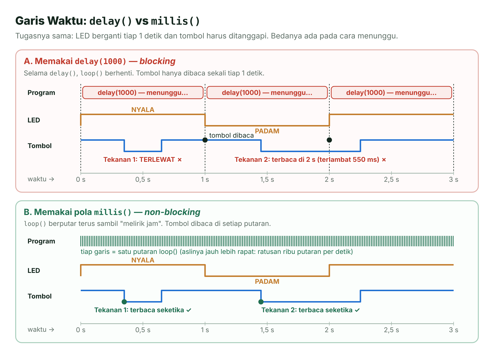

*Gambar 5.1 — Garis waktu `delay()` (memblokir) vs pola `millis()` (tidak memblokir). Sumber: dibuat untuk materi ini.*

Pada bagian A, tekanan tombol yang singkat **terlewat** karena terjadi saat `delay()` berjalan. Tekanan yang lebih lama baru terbaca setelah `delay()` selesai, jadi **terlambat**. Pada bagian B, `loop()` berputar terus sambil "melirik jam", sehingga setiap tekanan langsung terbaca.

Ekspresi `ledNyala ? HIGH : LOW` memakai **operator ternary**, bentuk singkat `if–else`: jika `ledNyala` bernilai benar, hasilnya `HIGH`; jika tidak, hasilnya `LOW`.

> [!NOTE]
> **Di ESP32, `delay()` tidak sepenuhnya diam.** Di balik layar, `delay()` memanggil `vTaskDelay()` milik FreeRTOS, sehingga CPU bisa mengerjakan tugas sistem lain (misalnya Wi-Fi). Namun, `loop()`-mu sendiri tetap berhenti di baris itu. FreeRTOS kita bahas di Pertemuan 12.

## 2. `millis()` dan `micros()`: Jam di Dalam ESP32

Koki yang cekatan tidak menunggui panci. Ia mencatat **jam mulai** merebus, lalu mengerjakan hal lain. Setiap kali lewat kompor, ia **melirik jam**: sudah 5 menit? Belum, lanjut memotong sayur. Sudah, angkat pancinya.

ESP32 punya "jam" serupa. Sejak *board* menyala atau di-*reset*, ia menghitung waktu terus-menerus:

| Fungsi | Mengembalikan | Satuan | Tipe | Kembali ke 0 setelah |
| --- | --- | --- | --- | --- |
| `millis()` | Waktu sejak ESP32 menyala | milidetik (ms) | `unsigned long` | ±49,7 hari |
| `micros()` | Waktu sejak ESP32 menyala | mikrodetik (µs) | `unsigned long` | ±71,6 menit |

Di ESP32, `unsigned long` berukuran 32 bit, jadi nilainya 0 sampai 4.294.967.295. Memanggil `millis()` tidak menghentikan program; fungsi ini hanya "melirik jam" lalu langsung kembali.

### Pola "Sudah Lewat Waktunya?"

```cpp
unsigned long sebelumnya = 0;          // kapan tugas terakhir dikerjakan
const unsigned long INTERVAL = 1000;   // selang 1 detik

void loop() {
  unsigned long sekarang = millis();           // lirik jam
  if (sekarang - sebelumnya >= INTERVAL) {     // sudah lewat waktunya?
    sebelumnya = sekarang;                     // catat waktu pengerjaan
    kerjakanTugas();                           // misalnya balik LED
  }
  bacaTombol();                                // tetap jalan di setiap putaran
}
```

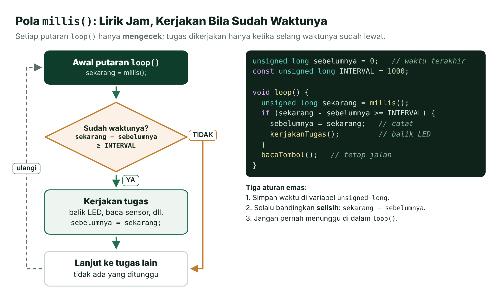

*Gambar 5.2 — Pola `millis()`: lirik jam, kerjakan bila sudah waktunya. Sumber: dibuat untuk materi ini.*

Jika belum waktunya, `if` langsung dilewati dalam hitungan mikrodetik. Akibatnya `loop()` bisa berputar ratusan ribu kali per detik, dan tombol terbaca di setiap putaran. Pola ini disebut **tidak memblokir** (*non-blocking*).

Ingat tiga aturan emasnya:

1. Simpan waktu di variabel `unsigned long`.
2. Selalu bandingkan **selisih**: `sekarang - sebelumnya >= INTERVAL`.
3. Jangan pernah menunggu di dalam `loop()`.

> [!TIP]
> **`sebelumnya = sekarang` atau `sebelumnya += INTERVAL`?** Cara pertama paling sederhana, tetapi jadwalnya bisa bergeser sedikit bila `loop()` sesekali terlambat. Cara kedua menjaga irama tetap sesuai jadwal awal (cocok untuk jam digital). Kekurangannya, bila tertinggal jauh, tugas akan "mengejar" beberapa kali berturut-turut.

**Kapan memakai `micros()`?** Saat mengukur durasi yang singkat dan perlu teliti, misalnya waktu reaksi atau lebar pulsa. Caranya sama, hanya satuannya mikrodetik:

```cpp
unsigned long mulai = micros();
kodeYangDiukur();                          // bagian yang ingin diukur
unsigned long lamaUs = micros() - mulai;   // durasi dalam mikrodetik
```

Karena `micros()` kembali ke 0 setiap ±71,6 menit, pakailah untuk durasi yang jauh lebih pendek dari itu.

## 3. Luapan `millis()`: Mengapa Pola Selisih Tetap Benar

Pernah memperhatikan odometer motor tua? Setelah 99.999 km, angkanya kembali ke 00.000. Jika kemarin odometer menunjuk 99.990 dan sekarang 00.010, jarak tempuhnya tetap mudah dihitung: 20 km. Kita cukup "menghitung maju melewati nol".

`millis()` juga begitu. Nilai terbesar `unsigned long` adalah 4.294.967.295. Satu milidetik kemudian, nilainya **meluap** (*overflow*, sering disebut juga *rollover*) dan kembali ke 0. Untuk `millis()`, ini terjadi setelah 2³² ms = 4.294.967.296 ms ≈ **49 hari 17 jam 2 menit 47 detik**. Untuk `micros()`, setelah 2³² µs ≈ **1 jam 11 menit 35 detik**. Kedengarannya lama, tetapi pengendali pompa atau sensor IoT memang bisa menyala berbulan-bulan tanpa di-*reset*.

Untungnya, pengurangan bilangan `unsigned` di C/C++ otomatis "memutari lingkaran" persis seperti odometer. Contoh angka nyata:

| Variabel | Nilai | Keterangan |
| --- | --- | --- |
| `sebelumnya` | 4.294.967.000 | Dicatat 296 ms sebelum luapan |
| `sekarang` | 200 | 200 ms sesudah luapan |
| `sekarang - sebelumnya` | **496** | 200 − 4.294.967.000 + 4.294.967.296 = 496 |

Selisih sebenarnya memang 296 + 200 = 496 ms. Karena 496 < 1.000, tugas belum dijalankan, dan itu benar.

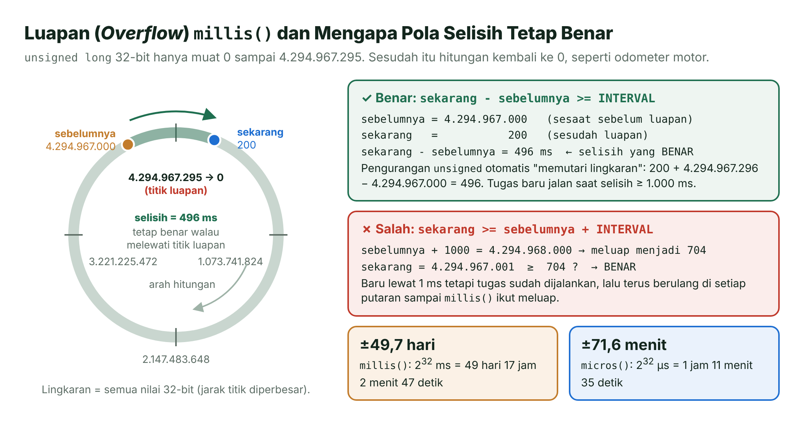

*Gambar 5.3 — Luapan `millis()` dan mengapa pola selisih tetap benar. Sumber: dibuat untuk materi ini.*

Bandingkan dengan cara yang **salah**: `if (sekarang >= sebelumnya + INTERVAL)`. Di sini `sebelumnya + 1000` = 4.294.968.000 ikut meluap menjadi **704**. Akibatnya, baru 1 ms kemudian (`sekarang` = 4.294.967.001), syarat `4.294.967.001 >= 704` sudah terpenuhi. Tugas dijalankan terlalu cepat, lalu terus berulang di setiap putaran sampai `millis()` ikut meluap.

Kamu bisa membuktikannya sendiri di ESP32:

```cpp
unsigned long sebelumnya = 4294967000UL;
unsigned long sekarang   = 200UL;
Serial.println(sekarang - sebelumnya);   // mencetak 496
```

> [!IMPORTANT]
> **Dua kebiasaan wajib.** Pertama, tulis syaratnya sebagai **selisih**: `sekarang - sebelumnya >= INTERVAL`, jangan `sekarang >= sebelumnya + INTERVAL`. Kedua, simpan waktu di `unsigned long`, jangan di `int`. Di ESP32, `int` adalah bilangan bertanda (*signed*) 32 bit yang sudah menjadi negatif setelah ±24,9 hari.

## 4. Banyak Tugas Berkala dalam Satu `loop()`

Kembali ke dapur. Seorang koki bisa menjaga nasi (cek setiap 20 menit), telur (angkat setelah 7 menit), dan sayur (aduk setiap menit), sekaligus membukakan pintu bila ada tamu. Rahasianya: ia **berkeliling terus**, dan setiap pekerjaan hanya butuh sebentar. Tidak ada yang ditunggui.

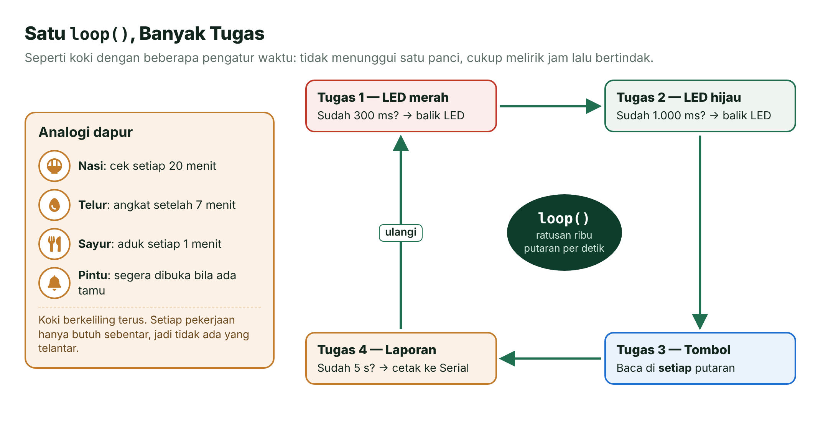

*Gambar 5.4 — Satu `loop()`, banyak tugas. Sumber: dibuat untuk materi ini (ikon Font Awesome Free, CC BY 4.0, dan Material Design Icons, Apache 2.0).*

Di program, setiap tugas punya **variabel waktu sendiri** dan **selang sendiri**. `loop()` memanggil semua tugas bergiliran; setiap tugas hanya mengecek "sudah waktunya belum?" lalu segera selesai. Berikut potongan Praktikum 1:

```cpp
void loop() {
  unsigned long sekarang = millis();   // baca "jam" sekali di awal putaran
  tugasLedMerah(sekarang);             // tiap 300 ms
  tugasLedHijau(sekarang);             // tiap 1.000 ms
  tugasTombol(sekarang);               // di setiap putaran
  tugasLaporan(sekarang);              // tiap 5.000 ms
  jumlahPutaran++;                     // untuk mengukur kecepatan loop()
}

// Tugas 1: balik LED merah setiap INTERVAL_MERAH milidetik
void tugasLedMerah(unsigned long sekarang) {
  if (sekarang - waktuMerah >= INTERVAL_MERAH) {   // pola aman, tahan luapan
    waktuMerah = sekarang;                         // catat waktu pergantian
    ledMerahNyala = !ledMerahNyala;
    digitalWrite(PIN_LED_MERAH, ledMerahNyala ? HIGH : LOW);
  }
}
```

| Tugas | Selang | Variabel waktu |
| --- | --- | --- |
| Membalik LED merah | 300 ms | `waktuMerah` |
| Membalik LED hijau | 1.000 ms | `waktuHijau` |
| Membaca tombol (+ *debounce*) | Setiap putaran | `waktuBerubah` |
| Mencetak laporan | 5.000 ms | `waktuLaporan` |

Cara bergiliran seperti ini disebut ***multitasking* kooperatif**: setiap tugas "bekerja sama" dengan cepat mengembalikan giliran. Syaratnya hanya satu: **tidak ada tugas yang boleh menunggu**. Satu `delay(500)` saja di salah satu tugas akan memperlambat semua tugas lain (buktikan di eksperimen Praktikum 1).

> [!TIP]
> **Mengapa `millis()` dibaca sekali di awal `loop()`?** Supaya semua tugas dalam satu putaran memakai "jam" yang sama, dan kita tidak memanggil fungsi yang sama berulang kali tanpa perlu.

## 5. *Polling* vs Interupsi

Kamu sedang menunggu kurir paket. Ada dua cara:

- **Bolak-balik ke pintu** setiap beberapa menit untuk mengintip apakah kurir sudah datang. Melelahkan, dan kalau kurir datang tepat setelah kamu mengintip, ia harus menunggu.
- **Memasang bel pintu**, lalu mengerjakan hal lain dengan tenang. Saat bel berbunyi, kamu berhenti sebentar, menerima paket, lalu melanjutkan pekerjaan.

Cara pertama disebut ***polling***: program rajin mengecek keadaan, misalnya memanggil `digitalRead()` di setiap putaran (seperti Praktikum 1). Cara kedua adalah **interupsi** (*interrupt*): perangkat keras "membunyikan bel" saat sesuatu terjadi, lalu CPU menunda program utama sejenak untuk menjalankan fungsi khusus bernama **ISR** (*Interrupt Service Routine*, rutin layanan interupsi) [8].

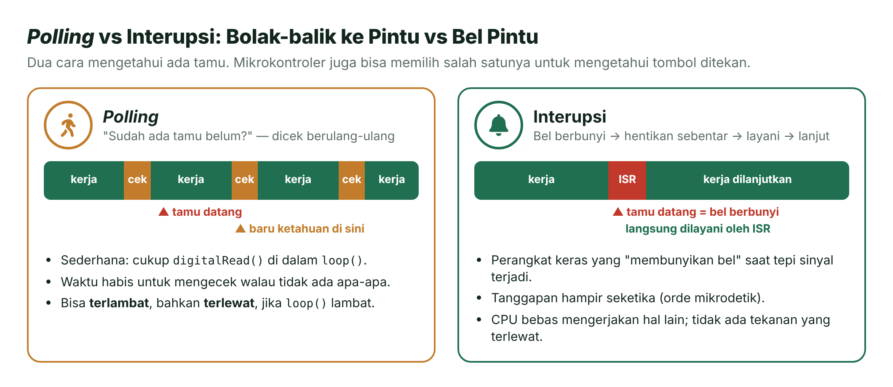

*Gambar 5.5 — Polling vs interupsi. Sumber: dibuat untuk materi ini (ikon Font Awesome Free, CC BY 4.0).*

| Aspek | *Polling* | Interupsi |
| --- | --- | --- |
| Cara kerja | Program rajin mengecek | Perangkat keras memberi tahu |
| Kecepatan tanggap | Bergantung pada kecepatan `loop()`; bisa terlambat | Hampir seketika (orde mikrodetik) |
| Kerumitan | Sangat sederhana | Perlu aturan khusus untuk ISR |
| Cocok untuk | Tombol biasa, sensor yang dibaca berkala | Kejadian singkat atau yang waktunya harus dicatat tepat |

Lalu, apa yang terjadi di dalam CPU saat "bel" berbunyi?

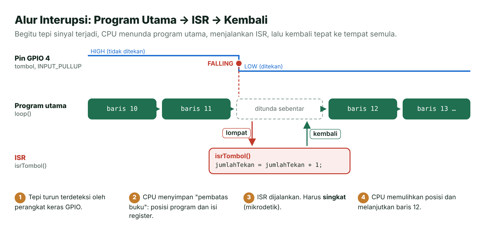

*Gambar 5.6 — Alur interupsi: program utama → ISR → kembali. Sumber: dibuat untuk materi ini.*

1. Perangkat keras GPIO mendeteksi **tepi** sinyal, yaitu perubahan HIGH ↔ LOW.
2. CPU menyimpan "pembatas buku": posisi program dan isi registernya.
3. CPU menjalankan ISR. ISR harus **singkat**, karena selama itu program utama tertunda.
4. CPU memulihkan posisi tadi dan melanjutkan program utama seolah tidak terjadi apa-apa.

> [!NOTE]
> ***Polling* tidak salah.** Untuk tombol yang ditekan manusia, *polling* dengan pola `millis()` sudah cukup cepat (Praktikum 1). Interupsi unggul untuk kejadian yang sangat singkat, sering, atau perlu dicatat waktunya dengan tepat (Praktikum 4).

## 6. Memasang Interupsi: Tepi Naik dan Tepi Turun

Perubahan sinyal digital punya dua arah:

- **Tepi turun** (*falling edge*): sinyal berubah dari HIGH ke LOW.
- **Tepi naik** (*rising edge*): sinyal berubah dari LOW ke HIGH.

Pada tombol dengan `INPUT_PULLUP` (Pertemuan 4), pin bernilai HIGH saat dilepas dan LOW saat ditekan. Jadi, **menekan** tombol menghasilkan tepi turun, sedangkan **melepas** tombol menghasilkan tepi naik.

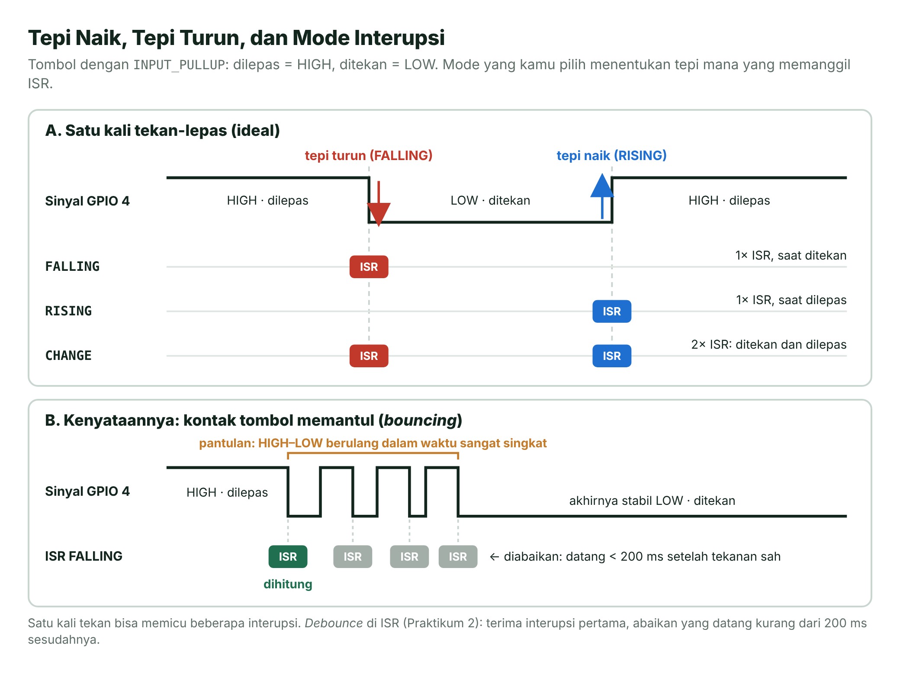

*Gambar 5.7 — Tepi naik, tepi turun, mode interupsi, dan pantulan tombol. Sumber: dibuat untuk materi ini.*

Interupsi dipasang dengan `attachInterrupt()`, cukup sekali di `setup()`:

```cpp
const int PIN_TOMBOL = 4;
volatile unsigned long jumlahTekan = 0;   // dipakai bersama ISR dan loop()

void IRAM_ATTR isrTombol() {              // ISR: dipanggil oleh perangkat keras
  jumlahTekan = jumlahTekan + 1;
}

void setup() {
  pinMode(PIN_TOMBOL, INPUT_PULLUP);
  attachInterrupt(digitalPinToInterrupt(PIN_TOMBOL), isrTombol, FALLING);
}
```

| Bagian | Arti |
| --- | --- |
| `digitalPinToInterrupt(PIN_TOMBOL)` | Mengubah nomor pin menjadi nomor interupsi. Di ESP32 hasilnya sama dengan nomor GPIO, tetapi biasakan menulisnya agar kode mudah dipindah ke *board* lain. |
| `isrTombol` | Nama fungsi ISR, ditulis **tanpa** tanda kurung. ISR tidak menerima parameter dan tidak mengembalikan nilai (`void`). |
| `FALLING` | Mode, yaitu kapan ISR dipanggil (lihat tabel berikut). |

| Mode | ISR dipanggil saat … | Pada tombol `INPUT_PULLUP` |
| --- | --- | --- |
| `FALLING` | Sinyal berubah HIGH → LOW | Tombol ditekan |
| `RISING` | Sinyal berubah LOW → HIGH | Tombol dilepas |
| `CHANGE` | Setiap perubahan | Tombol ditekan **dan** dilepas |

Arduino-ESP32 juga menyediakan mode level seperti `ONLOW` dan `ONHIGH`, tetapi untuk tombol cukup memakai mode tepi [3]. Untuk melepas interupsi, panggil `detachInterrupt(digitalPinToInterrupt(PIN_TOMBOL))`.

### Pantulan Juga Memicu Interupsi

Ingat pantulan (*bouncing*) dari Pertemuan 4? Kontak logam tombol memantul beberapa kali sebelum stabil, sehingga satu kali tekan bisa menghasilkan **beberapa** tepi turun dan memanggil ISR berkali-kali (Gambar 5.7 bagian B). Wokwi pun menyimulasikan pantulan ini secara bawaan [7].

`delay()` tidak boleh dipakai di ISR, jadi kita memakai **waktu**: terima interupsi pertama, lalu abaikan interupsi yang datang kurang dari 200 ms sesudahnya.

```cpp
volatile unsigned long waktuSahTerakhir = 0;

void IRAM_ATTR isrTombol() {
  unsigned long sekarang = millis();
  if (sekarang - waktuSahTerakhir >= 200) {   // pola selisih, tahan luapan
    jumlahTekan = jumlahTekan + 1;            // tekanan sah
    waktuSahTerakhir = sekarang;
  }                                           // selain itu: pantulan, abaikan
}
```

> [!NOTE]
> **Kelemahan *debounce* sederhana ini.** Dokumentasi Wokwi menjelaskan pantulan saat tombol ditekan, dan untuk itu cara di atas bekerja baik. Tombol asli bisa juga memantul saat **dilepas**. Jika tombol ditahan lebih dari 200 ms lalu dilepas, pantulan pelepasan itu bisa terhitung sebagai tekanan baru. Cara yang lebih kokoh menjadi Latihan 3.

## 7. Aturan Menulis ISR

ISR itu seperti mengangkat telepon di tengah rapat: angkat, catat pesan singkat, tutup, lalu kembali ke rapat. Jangan mengobrol satu jam di telepon! Berikut aturan emasnya.

| No | Aturan | Alasan |
| --- | --- | --- |
| 1 | **Singkat**: cukup menaikkan penghitung, mencatat waktu, atau mengubah penanda (*flag*) | Selama ISR berjalan, program utama tertunda. ISR atau bagian kritis yang terlalu lama memicu *interrupt watchdog* (batas 300 ms) yang me-*reset* ESP32. |
| 2 | Beri tanda **`IRAM_ATTR`** | Kode ISR disimpan di IRAM (RAM internal), sehingga bisa langsung dijalankan tanpa menunggu dibaca dari memori *flash*. ISR jadi cepat dan waktunya lebih bisa diperkirakan. |
| 3 | **Tanpa `Serial.print()` dan `delay()`** | Keduanya lambat dan memakai layanan FreeRTOS yang tidak boleh dipanggil dari ISR. Akibatnya ESP32 bisa *crash* (*Guru Meditation Error*) dan me-*reset* sendiri. |
| 4 | Variabel bersama wajib **`volatile`** | Memaksa kompilator selalu membaca nilai terbaru dari memori, bukan salinan lama di register. |
| 5 | Akses bersama di dalam **bagian kritis** | Mencegah ISR mengubah data tepat ketika `loop()` sedang membaca atau mengubahnya. |

Contoh resmi Arduino-ESP32 menandai ISR dengan `ARDUINO_ISR_ATTR`, makro bawaan *framework*. Di materi ini kita konsisten memakai `IRAM_ATTR`, yang selalu menaruh ISR di IRAM.

### `volatile`: Jangan Pakai Salinan Lama

Kompilator suka mengoptimalkan. Jika ia melihat `loop()` tidak pernah mengubah sebuah variabel, ia boleh menyimpan nilainya di register dan tidak membaca ulang dari memori. Padahal ISR bisa mengubahnya kapan saja. Kata kunci **`volatile`** berpesan: "nilai ini bisa berubah diam-diam, selalu baca ulang."

```cpp
volatile bool adaTekan = false;   // diubah ISR, dibaca loop()
```

> [!TIP]
> **Mengapa `x = x + 1`, bukan `x++`?** Standar C++ terbaru menandai `++` dan `--` pada variabel `volatile` sebagai usang (*deprecated*), sehingga kompilator bisa memberi peringatan. Hasilnya sama; kita hanya memilih versi yang bebas peringatan.

### Bagian Kritis: Salin, lalu Nolkan dengan Aman

`volatile` belum cukup. Misalkan `loop()` ingin mengambil jumlah tekanan, lalu mengosongkan penghitung (pola **salin-lalu-nolkan**):

```cpp
unsigned long n = jumlahTekan;   // (1) salin: n = 5
                                 //     <- ISR datang di sini: jumlahTekan = 6
jumlahTekan = 0;                 // (2) nolkan: tekanan ke-6 HILANG!
```

Interupsi bisa datang di antara baris (1) dan (2). Untuk mencegahnya, kedua baris dibungkus **bagian kritis** (*critical section*), yaitu potongan kode yang tidak boleh disela:

```cpp
portMUX_TYPE kunci = portMUX_INITIALIZER_UNLOCKED;   // "kunci" bersama

void IRAM_ATTR isrTombol() {          // di ISR: pakai versi _ISR
  portENTER_CRITICAL_ISR(&kunci);
  jumlahTekan = jumlahTekan + 1;
  portEXIT_CRITICAL_ISR(&kunci);
}

void loop() {                         // di loop(): pakai versi biasa
  portENTER_CRITICAL(&kunci);
  unsigned long n = jumlahTekan;      // salin...
  jumlahTekan = 0;                    // ...lalu nolkan, tanpa disela
  portEXIT_CRITICAL(&kunci);
  Serial.println(n);                  // pekerjaan lambat DI LUAR bagian kritis
}
```

Mengapa perlu "kunci"? ESP32 punya **dua inti** CPU. `portENTER_CRITICAL()` mematikan interupsi di inti yang sedang berjalan **dan** memegang kunci putar (*spinlock*), sehingga inti lain yang ingin masuk dengan kunci yang sama harus menunggu [5]. Di dalam ISR, pakai pasangan `portENTER_CRITICAL_ISR()` dan `portEXIT_CRITICAL_ISR()`. Dokumentasi ESP-IDF menyebutnya `taskENTER_CRITICAL()`; keduanya sama.

> [!WARNING]
> **Bagian kritis harus sangat pendek.** Selama di dalamnya, interupsi di inti itu tertahan. Cukup salin atau ubah beberapa variabel, lalu keluar. Jangan memanggil `Serial.print()`, `delay()`, atau fungsi FreeRTOS di dalamnya.

Dari semua aturan itu lahir satu pola yang dipakai di Praktikum 2–4: **ISR mencatat, `loop()` mengerjakan**. ISR hanya mencatat seperlunya di dalam bagian kritis. `loop()` menyalin data itu di dalam bagian kritis, lalu mengerjakan hal yang lambat (mencetak, menghitung, menyalakan LED) di luarnya.

## 8. *Timer* Perangkat Keras ESP32

Pola `millis()` mirip melirik jam dinding: kamu sendiri yang harus ingat untuk melirik. ***Timer* perangkat keras** (*hardware timer*) lebih mirip **alarm dapur**: kamu memutarnya ke 7 menit, lalu alarm menghitung sendiri dan berbunyi tepat waktu, sesibuk apa pun kamu.

Menurut lembar data (*datasheet*) ESP32, cip ini memiliki **empat *timer* serbaguna 64-bit** dalam dua grup (masing-masing dua *timer*). Setiap *timer* punya pembagi frekuensi (*prescaler*) 16-bit dengan rentang 2–65.536, bisa menghitung naik atau turun, dan bisa **memuat ulang otomatis** (*auto-reload*) saat alarm berbunyi [1].

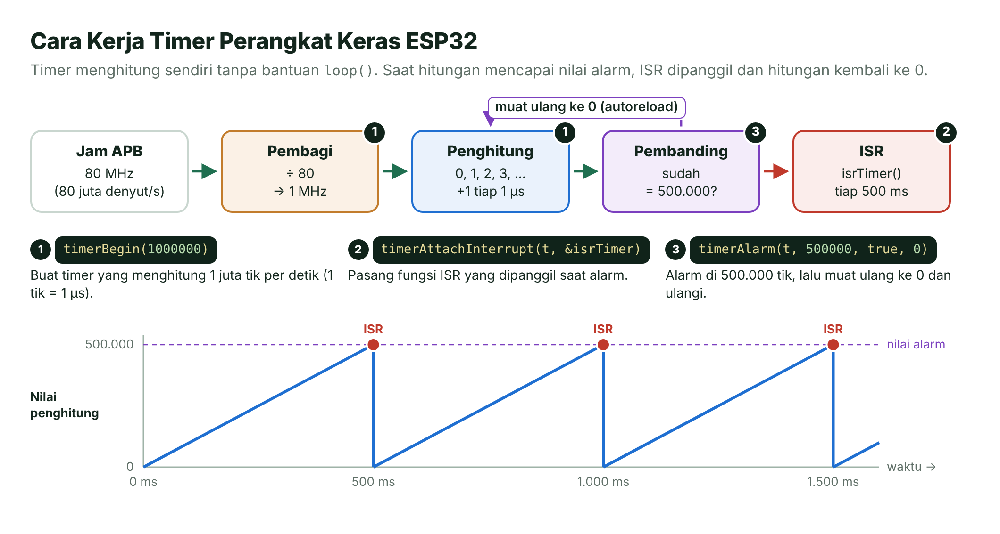

*Gambar 5.8 — Cara kerja timer perangkat keras ESP32. Sumber: dibuat untuk materi ini.*

1. Detak dari jam APB [6], yang di ESP32 umumnya 80 MHz, masuk ke **pembagi**. Dengan pembagi 80, penghitung mendapat 1 MHz: naik satu **tik** setiap 1 µs.
2. **Penghitung** 64-bit naik terus: 0, 1, 2, 3, …
3. **Pembanding** mengecek apakah hitungan sudah sama dengan **nilai alarm**. Jika ya, ISR dipanggil.
4. Dengan *auto-reload*, penghitung kembali ke 0 dan semuanya berulang.

### Tiga Langkah dengan API Arduino-ESP32 3.x

```cpp
hw_timer_t *timerKu = NULL;            // "pegangan" (handle) timer

void IRAM_ATTR isrTimer() {
  // dipanggil setiap alarm berbunyi: singkat saja!
}

void setup() {
  timerKu = timerBegin(1000000);              // 1) timer 1 MHz: 1 tik = 1 µs
  timerAttachInterrupt(timerKu, &isrTimer);   // 2) pasang ISR
  timerAlarm(timerKu, 500000, true, 0);       // 3) alarm tiap 500.000 tik
}
```

| Fungsi | Arti |
| --- | --- |
| `timerBegin(frekuensi)` | Membuat *timer* yang menghitung `frekuensi` tik per detik, lalu langsung mulai menghitung. Mengembalikan `NULL` bila gagal. |
| `timerAttachInterrupt(timer, fungsi)` | Memasang ISR yang dipanggil saat alarm berbunyi. |
| `timerAlarm(timer, nilai, autoreload, reloadCount)` | `nilai` = jumlah tik sampai alarm; `autoreload` = `true` agar berulang; `reloadCount` = berapa kali berulang (`0` = tanpa batas) [2]. |

Rumus nilai alarm sederhana:

**nilai alarm = frekuensi *timer* (Hz) × selang (detik)**

| Frekuensi *timer* | 1 tik | Selang yang diinginkan | Nilai alarm |
| --- | --- | --- | --- |
| 1.000.000 Hz (1 MHz) | 1 µs | 1 detik | 1.000.000 |
| 1.000.000 Hz | 1 µs | 500 ms | 500.000 |
| 1.000.000 Hz | 1 µs | 10 ms | 10.000 |
| 10.000 Hz (10 kHz) | 100 µs | 1 detik | 10.000 |

> [!WARNING]
> **Hati-hati dengan contoh lama.** Banyak contoh di internet ditulis untuk Arduino-ESP32 2.x, misalnya `timerBegin(0, 80, true)` dan `timerAlarmWrite()`. Kode seperti itu gagal dikompilasi di versi 3.x yang kita pakai. Ganti dengan `timerBegin(frekuensi)` dan `timerAlarm()`.

> [!NOTE]
> **Batas frekuensi.** Pembagi hanya bisa 2–65.536 dari jam 80 MHz, jadi frekuensi *timer* yang bisa dipakai kira-kira 1.221 Hz sampai 40 MHz. Di luar itu, `timerBegin()` mengembalikan `NULL`. Artinya `timerBegin(1000)` (1 kHz) **gagal**; pakai misalnya 10 kHz atau 1 MHz.

Kapan memilih yang mana? Pakai pola `millis()` untuk tugas berkala yang boleh meleset beberapa milidetik (berkedip, membaca sensor, mencetak laporan). Pakai *timer* perangkat keras bila irama harus tetap tepat walaupun `loop()` sedang sibuk (Praktikum 3).

---

## 🧪 Praktikum

### Sebelum Mulai: Satu Rangkaian untuk Empat Praktikum

Keempat praktikum memakai rangkaian yang sama. Di Wokwi, isi `diagram.json` keempat *folder* identik; di *board* asli, rakit sekali lalu cukup ganti programnya.

**Jalur A — Simulator Wokwi**

1. Buka <https://wokwi.com/projects/new/esp32>.
2. Salin isi `src/main.cpp` praktikum ke tab **sketch.ino** (hapus isi lama).
3. Salin isi `diagram.json` ke tab **diagram.json**.
4. Klik **▶**. Untuk "menekan" tombol, klik tombol biru di layar.

**Jalur B — *Board* ESP32 asli**

1. Rakit rangkaian seperti Gambar 5.9.
2. VS Code → **File** → **Open Folder...** → pilih *folder* praktikum, misalnya `pertemuan-05-waktu-interupsi/kode/01-dua-led-tanpa-delay`.
3. Klik **Build** (✓), **Upload** (→), lalu **Serial Monitor**. Jika kosong, tekan tombol **EN**.

Langkah lengkapnya ada di [Pertemuan 01](../pertemuan-01-pengenalan/README.md#-praktikum) dan [Panduan Wokwi](../panduan/03-simulasi-wokwi.md). Jika di awal Serial Monitor muncul pesan *boot* ESP32 (misalnya `rst:0x1 (POWERON_RESET)`), abaikan saja.

### Rangkaian

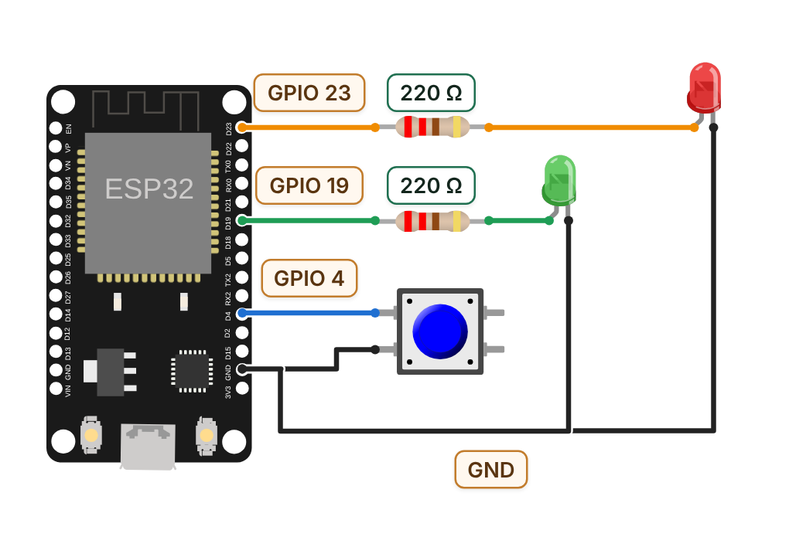

*Gambar 5.9 — Rangkaian bersama Praktikum 1–4. Sumber: dibuat untuk materi ini dengan @wokwi/elements (MIT).*

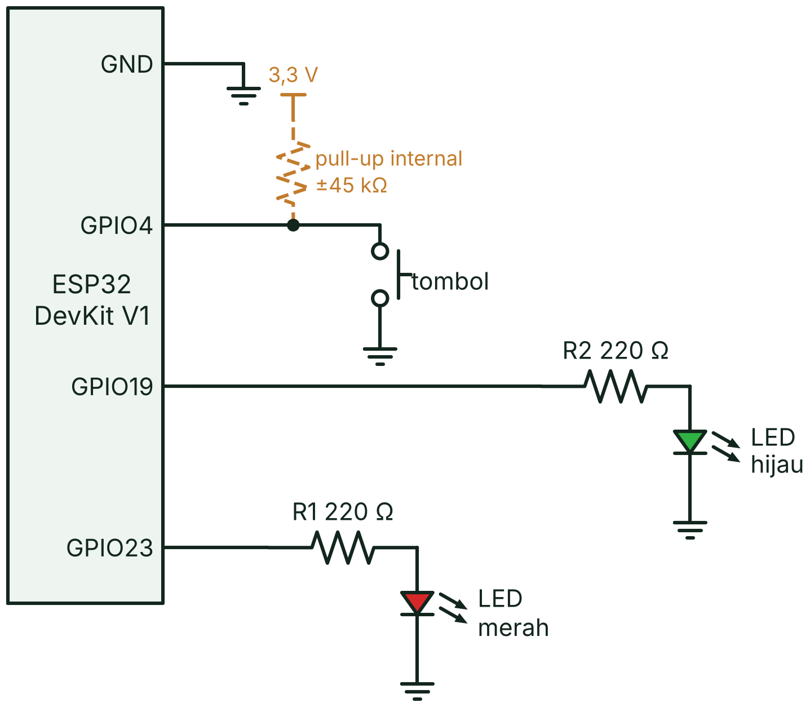

*Gambar 5.10 — Skematik rangkaian. Garis putus-putus menandai resistor pull-up internal ESP32 yang diaktifkan `INPUT_PULLUP`. Sumber: dibuat untuk materi ini.*

| Komponen | Sambungan | Catatan |
| --- | --- | --- |
| LED merah | GPIO 23 → resistor 220 Ω → anoda (kaki panjang); katoda (kaki pendek) → GND | Menyala saat pin HIGH |
| LED hijau | GPIO 19 → resistor 220 Ω → anoda; katoda → GND | Menyala saat pin HIGH |
| Tombol | Satu kaki → GPIO 4; kaki diagonalnya → GND | `INPUT_PULLUP`: dilepas = HIGH, ditekan = LOW |
| LED biru bawaan | GPIO 2, sudah terpasang di *board* | Dipakai Praktikum 1 sebagai penanda tombol |

Resistor 220 Ω membatasi arus LED sekitar 7 mA atau kurang (ingat Hukum Ohm di Pertemuan 3), aman untuk pin ESP32.

> [!TIP]
> **Bingung dengan tombol 4 kaki?** Pakai dua kaki yang **bersilangan (diagonal)**: satu ke GPIO 4, satu ke GND. Pasangan diagonal hanya tersambung saat tombol ditekan, jadi pasti benar ke mana pun arah tombolnya.

---

### Praktikum 1 — Dua LED tanpa `delay()`

📁 *Folder*: [`kode/01-dua-led-tanpa-delay`](kode/01-dua-led-tanpa-delay)

**Tujuan:** menjalankan empat tugas berkala tanpa `delay()` dan membuktikan bahwa tombol tetap ditanggapi seketika.

**Rangkaian:** Gambar 5.9. LED biru bawaan (GPIO 2) menyala selama tombol ditahan.

**Kode** (`src/main.cpp`; `loop()` dan `tugasLedMerah()` sudah kamu lihat di Bagian 4):

```cpp
// Tugas 3: baca tombol di SETIAP putaran (tidak pernah menunggu)
void tugasTombol(unsigned long sekarang) {
  int bacaan = digitalRead(PIN_TOMBOL);

  // LED biru mengikuti tombol seketika: bukti program tidak "membeku"
  digitalWrite(PIN_LED_BAWAAN, bacaan == LOW ? HIGH : LOW);

  if (bacaan != bacaanTerakhir) {      // bacaan berubah (bisa jadi pantulan)
    waktuBerubah = sekarang;
    bacaanTerakhir = bacaan;
  }

  // Terima perubahan hanya jika sudah stabil selama JEDA_DEBOUNCE
  if (sekarang - waktuBerubah >= JEDA_DEBOUNCE && bacaan != statusTombol) {
    statusTombol = bacaan;
    if (statusTombol == LOW) {         // baru saja ditekan
      jumlahTekan++;
      // %lu = tempat untuk mencetak angka bertipe unsigned long
      Serial.printf("[TOMBOL] Ditekan ke-%lu pada t = %lu ms\n", jumlahTekan, sekarang);
    }
  }
}

// Tugas 4: lapor kecepatan loop() setiap 5 detik
void tugasLaporan(unsigned long sekarang) {
  if (sekarang - waktuLaporan >= INTERVAL_LAPORAN) {
    waktuLaporan = sekarang;
    Serial.printf("[INFO] loop() berputar %lu kali dalam 5 detik terakhir\n", jumlahPutaran);
    jumlahPutaran = 0;
  }
}
```

`Serial.printf()` mencetak teks berformat: setiap `%lu` diganti nilai `unsigned long` sesuai urutan, dan `\n` berarti pindah baris. Perhatikan bahwa *debounce* di sini juga memakai pola selisih `millis()` (stabil 50 ms), bukan `delay()`.

**Hasil yang diharapkan:**

- LED merah berganti setiap 0,3 detik dan LED hijau setiap 1 detik; iramanya tidak saling mengganggu.
- LED biru menyala selama tombol ditahan, tanpa jeda.
- Serial Monitor menampilkan pesan berikut. Angka waktu dan jumlah putaran di tempatmu pasti berbeda.

```text
=== Pertemuan 05 · Dua LED tanpa delay() ===
LED merah 300 ms, LED hijau 1000 ms. Tekan tombol kapan saja!
[TOMBOL] Ditekan ke-1 pada t = 3120 ms
[INFO] loop() berputar 1043211 kali dalam 5 detik terakhir
[TOMBOL] Ditekan ke-2 pada t = 6487 ms
[INFO] loop() berputar 1043178 kali dalam 5 detik terakhir
```

Yang penting, jumlah putarannya sangat besar (ratusan ribu kali per detik). Itulah sebabnya tombol selalu terbaca tepat waktu.

**Kalau belum berhasil:**

| Gejala | Coba ini |
| --- | --- |
| LED eksternal tidak menyala | Kaki panjang (anoda) harus ke arah resistor/GPIO dan kaki pendek ke GND. Periksa juga kabel GND. |
| LED biru menyala terus atau tombol tidak terbaca | Tombol terpasang pada pasangan kaki yang salah. Pakai kaki diagonal. |
| Satu tekanan tercatat dua kali | Naikkan `JEDA_DEBOUNCE` dari 50 menjadi 80. |
| Kedipan tersendat | Pastikan tidak ada `delay()` yang tertinggal di program. |

**Eksperimen kecil:**

- Tambahkan `delay(500);` di akhir `loop()`. Apa yang terjadi pada irama LED merah, kecepatan tanggap LED biru, dan angka "loop() berputar"? Mengapa?
- Ubah `INTERVAL_MERAH` menjadi 100 dan `INTERVAL_HIJAU` menjadi 2000. Apakah kedua LED tetap tidak saling mengganggu?

---

### Praktikum 2 — Menghitung Tekanan dengan Interupsi

📁 *Folder*: [`kode/02-interupsi-tombol`](kode/02-interupsi-tombol)

**Tujuan:** menghitung tekanan tombol di dalam ISR, lengkap dengan *debounce* berbasis waktu dan akses variabel bersama yang aman.

**Rangkaian:** Gambar 5.9. Yang dipakai hanya tombol (GPIO 4) dan LED merah (GPIO 23); LED hijau biarkan terpasang.

**Kode** (`src/main.cpp`, bagian penting):

```cpp
volatile unsigned long jumlahTekan      = 0;  // tekanan sah (sudah disaring)
volatile unsigned long jumlahInterupsi  = 0;  // semua interupsi, termasuk pantulan
volatile unsigned long waktuSahTerakhir = 0;  // kapan tekanan sah terakhir (ms)
volatile unsigned long waktuInterupsiTerakhir = 0;
portMUX_TYPE kunci = portMUX_INITIALIZER_UNLOCKED;

// ISR: singkat, tanpa Serial, tanpa delay(), disimpan di IRAM
void IRAM_ATTR isrTombol() {
  unsigned long sekarang = millis();
  portENTER_CRITICAL_ISR(&kunci);
  jumlahInterupsi = jumlahInterupsi + 1;   // volatile: tulis x = x + 1, bukan x++
  waktuInterupsiTerakhir = sekarang;
  if (sekarang - waktuSahTerakhir >= JEDA_DEBOUNCE_MS) {  // debounce sederhana
    jumlahTekan = jumlahTekan + 1;
    waktuSahTerakhir = sekarang;
  }
  portEXIT_CRITICAL_ISR(&kunci);
}

void loop() {
  portENTER_CRITICAL(&kunci);          // salin data bersama dengan aman
  unsigned long tekan      = jumlahTekan;
  unsigned long interupsi  = jumlahInterupsi;
  unsigned long tInterupsi = waktuInterupsiTerakhir;
  portEXIT_CRITICAL(&kunci);

  if (tekan != tekanSebelumnya) {      // ada tekanan sah baru → bereaksi seketika
    tekanSebelumnya = tekan;
    ledNyala = !ledNyala;
    digitalWrite(PIN_LED_MERAH, ledNyala ? HIGH : LOW);
    perluLapor = true;
  }

  // Cetak laporan setelah pantulan reda, supaya hitungan mentahnya lengkap
  if (perluLapor && millis() - tInterupsi >= JEDA_TENANG_MS) {
    perluLapor = false;
    Serial.printf("[DATA] Tekanan sah: %lu | interupsi mentah: %lu\n", tekan, interupsi);
  }
}
```

Program ini menghitung dua hal: **interupsi mentah** (setiap kali ISR dipanggil, termasuk karena pantulan) dan **tekanan sah** (yang lolos saringan 200 ms). Laporan dicetak oleh `loop()` 50 ms setelah interupsi terakhir, ketika pantulan sudah reda. ISR sendiri tidak pernah mencetak apa pun.

**Hasil yang diharapkan:**

- Setiap tekanan langsung membalik LED merah (nyala ↔ padam).
- Serial Monitor menampilkan pesan berikut. Angka interupsi mentah berbeda-beda karena pantulan bersifat acak; satu tekanan bisa menghasilkan beberapa hingga puluhan interupsi.

```text
=== Pertemuan 05 · Interupsi Tombol ===
Tekan tombol di GPIO 4. Penghitung bekerja di dalam ISR.
[DATA] Tekanan sah: 1 | interupsi mentah: 9
[DATA] Tekanan sah: 2 | interupsi mentah: 17
[DATA] Tekanan sah: 3 | interupsi mentah: 26
```

Angka interupsi mentah selalu lebih besar atau sama dengan tekanan sah. Selisihnya adalah pantulan yang berhasil disaring.

**Kalau belum berhasil:**

| Gejala | Coba ini |
| --- | --- |
| Tidak ada laporan sama sekali | Pastikan tombol tersambung ke GPIO 4 dan GND, serta `pinMode(PIN_TOMBOL, INPUT_PULLUP)` dipanggil sebelum `attachInterrupt()`. |
| Satu tekanan terhitung sebagai dua tekanan sah | Itu pantulan saat tombol dilepas (tombol asli). Lepas lebih cepat, atau kerjakan Latihan 3. |
| ESP32 *reset* sendiri atau muncul *Guru Meditation Error* | Ada `Serial.print()` atau `delay()` di dalam ISR. Pindahkan ke `loop()`. |

**Eksperimen kecil:**

- Ubah `FALLING` menjadi `CHANGE`. Tahan tombol sekitar 1 detik, lalu lepas. Mengapa tekanan sah bertambah 2? (Petunjuk: ISR tidak memeriksa arah perubahan.)
- Ubah `JEDA_DEBOUNCE_MS` menjadi 0. Bandingkan tekanan sah dengan interupsi mentah.
- Di Wokwi, tambahkan `"bounce": "0"` pada `attrs` tombol di `diagram.json` untuk mematikan pantulan. Apa yang terjadi pada angka interupsi mentah?

---

### Praktikum 3 — *Timer* Perangkat Keras

📁 *Folder*: [`kode/03-timer-hardware`](kode/03-timer-hardware)

**Tujuan:** memakai *timer* perangkat keras untuk membalik LED hijau tepat setiap 500 ms, bebas dari kesibukan `loop()`.

**Rangkaian:** Gambar 5.9. Yang dipakai hanya LED hijau (GPIO 19).

**Kode** (`src/main.cpp`, bagian penting):

```cpp
const uint32_t FREKUENSI_TIMER = 1000000;  // 1 MHz → 1 tik = 1 mikrodetik
const uint64_t ALARM_TIK       = 500000;   // 500.000 tik × 1 us = 500 ms

// ISR timer: dipanggil perangkat keras setiap 500.000 tik
void IRAM_ATTR isrTimer() {
  unsigned long sekarangUs = micros();
  portENTER_CRITICAL_ISR(&kunci);
  ledNyala = !ledNyala;
  selangUs = sekarangUs - waktuTikUs;
  waktuTikUs = sekarangUs;
  jumlahTik = jumlahTik + 1;
  portEXIT_CRITICAL_ISR(&kunci);
  digitalWrite(PIN_LED_HIJAU, ledNyala ? HIGH : LOW);  // boleh di ISR: cepat
}

void setup() {
  // ... Serial.begin(), pinMode(), dan pesan pembuka ...
  waktuTikUs = micros();
  timerKu = timerBegin(FREKUENSI_TIMER);        // 1) buat timer & mulai menghitung
  if (timerKu == NULL) {
    Serial.println("[PERINGATAN] Timer gagal dibuat!");
    return;
  }
  timerAttachInterrupt(timerKu, &isrTimer);     // 2) pasang ISR
  timerAlarm(timerKu, ALARM_TIK, true, 0);      // 3) alarm 500.000 tik, ulangi terus
}
```

ISR mencatat waktu setiap tik dengan `micros()`, sehingga `loop()` bisa melaporkan **selang** antara dua tik terakhir. `loop()` mencetak laporan hanya bila ada tik baru.

**Hasil yang diharapkan:**

- LED hijau berganti setiap 0,5 detik dengan irama sangat teratur.
- Serial Monitor menampilkan:

```text
=== Pertemuan 05 · Timer Perangkat Keras ===
Timer 1 MHz, alarm tiap 500000 tik (500 ms). LED hijau dibalik oleh ISR.
[TIMER] Tik ke-1 | LED hijau: NYALA | (tik pertama)
[TIMER] Tik ke-2 | LED hijau: PADAM | selang 500000 us
[TIMER] Tik ke-3 | LED hijau: NYALA | selang 500000 us
[TIMER] Tik ke-4 | LED hijau: PADAM | selang 500000 us
```

Angka selang bisa meleset sedikit dari 500.000 karena ISR tidak selalu dimulai pada mikrodetik yang persis sama (*jitter*), terutama di simulator.

**Kalau belum berhasil:**

| Gejala | Coba ini |
| --- | --- |
| Muncul `[PERINGATAN] Timer gagal dibuat!` | Frekuensi di `timerBegin()` di luar jangkauan (±1.221 Hz sampai 40 MHz). Kembalikan ke 1000000. |
| Galat kompilasi pada `timerBegin(0, 80, true)` atau `timerAlarmWrite()` | Itu API lama (Arduino-ESP32 2.x). Pakai API 3.x seperti di atas. |
| Serial berjalan, tetapi LED hijau tidak berkedip | Periksa LED hijau, resistor, dan kabel ke GPIO 19. |

**Eksperimen kecil:**

- Ubah `BEBAN_LOOP_MS` menjadi `1700` untuk meniru `loop()` yang sibuk. Apakah LED hijau tetap berkedip teratur? Perhatikan nomor tik di laporan yang kini melompat (1, 4, 7, 11, …), sementara selangnya tetap ±500.000 µs. Mengapa?
- Ubah `ALARM_TIK` menjadi `100000`. Berapa kali LED hijau berganti dalam 1 detik?
- Ganti `FREKUENSI_TIMER` menjadi `10000` (10 kHz). Berapa `ALARM_TIK` agar selangnya tetap 500 ms?

---

### Praktikum 4 — Gim Waktu Reaksi

📁 *Folder*: [`kode/04-game-reaksi`](kode/04-game-reaksi)

**Tujuan:** memadukan `millis()`, `micros()`, interupsi, dan tahapan program dalam sebuah gim.

**Cara main:** LED merah menyala setelah jeda acak 2–5 detik. Tekan tombol secepat mungkin setelah LED menyala. Waktu reaksimu diukur dengan ketelitian mikrodetik.

| Kejadian | Hasil |
| --- | --- |
| Menekan sebelum LED menyala | **Curang**, ronde diulang |
| Reaksi kurang dari 100 ms | **Curang** (pasti menebak), ronde diulang |
| Reaksi antara 100 ms dan 3 detik | **Sah**: waktu dicatat, LED hijau menyala |
| Lebih dari 3 detik tanpa menekan | Ronde hangus |

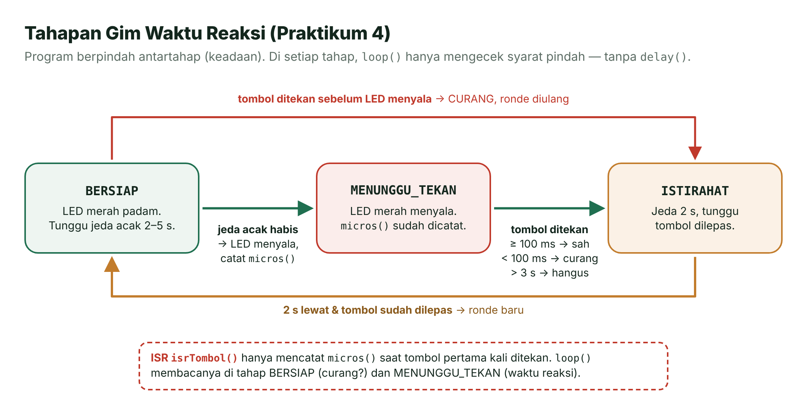

*Gambar 5.11 — Tahapan (keadaan) gim waktu reaksi. Sumber: dibuat untuk materi ini.*

Program berpindah di antara tiga **keadaan** (*state*). Di setiap keadaan, `loop()` hanya mengecek syarat untuk pindah, tanpa `delay()`. Pola ini cikal bakal **mesin keadaan hingga** (*finite state machine*, FSM) yang kita bahas di Pertemuan 11.

**Kode** (`src/main.cpp`, bagian penting):

```cpp
// ISR: cukup catat WAKTU tekanan pertama; pantulan sesudahnya diabaikan
void IRAM_ATTR isrTombol() {
  unsigned long t = micros();
  portENTER_CRITICAL_ISR(&kunci);
  if (!adaTekan) {
    adaTekan = true;
    waktuTekanUs = t;
  }
  portEXIT_CRITICAL_ISR(&kunci);
}

// Potongan loop(): keadaan MENUNGGU_TEKAN
    case MENUNGGU_TEKAN:                     // LED menyala, menunggu reaksi
      if (adaTekanBaru()) {
        long reaksiUs = (long)(tekanUs - waktuNyalaUs);   // selisih aman luapan
        if (reaksiUs < (long)BATAS_MANUSIA_US) {
          // ... cetak [CURANG], ronde diulang ...
        } else {
          catatHasil(reaksiUs);
          masukIstirahat(false);
        }
      } else if (micros() - waktuNyalaUs > BATAS_LAMBAT_US) {
        // ... ronde hangus ...
      }
      break;
```

Beberapa hal yang perlu diperhatikan:

- **Mengapa waktu dicatat di ISR?** Saat tombol ditekan, `loop()` mungkin sedang sibuk mencetak ke Serial. ISR mencatat `micros()` tepat ketika tepi turun terjadi, jadi pengukuran tidak ikut tertunda.
- **Mengapa `micros()`?** Ketelitiannya 1 µs, jauh lebih halus daripada `millis()`. Waktu reaksi juga jauh di bawah 71,6 menit, jadi luapan `micros()` tidak menjadi masalah selama dihitung dengan selisih.
- **Jeda acak** dibuat dengan `random(JEDA_MIN_MS, JEDA_MAKS_MS + 1)`, yang menghasilkan bilangan 2.000 sampai 5.000. Batas atas `random()` tidak ikut terpilih, makanya ditambah 1. Di ESP32, `random()` mengambil bilangan dari pembangkit acak perangkat keras, jadi tidak perlu `randomSeed()`.
- **`(long)(tekanUs - waktuNyalaUs)`** mengubah selisih `unsigned` menjadi bilangan bertanda. Jika tombol ternyata ditekan sesaat sebelum LED menyala, hasilnya negatif dan dianggap curang.

**Hasil yang diharapkan** (contoh satu sesi; waktumu tentu berbeda):

```text
=== Pertemuan 05 · Gim Waktu Reaksi ===
Tekan tombol SETELAH LED merah menyala. Jangan menebak!

[RONDE 1] Bersiap... tunggu LED merah menyala.
[RONDE 1] LED MENYALA! Tekan sekarang!
[HASIL] Waktu reaksi: 287 ms (287412 us)
[SKOR] Rekor: 287 ms | rata-rata: 287 ms | ronde sah: 1

[RONDE 2] Bersiap... tunggu LED merah menyala.
[CURANG] Kamu menekan sebelum LED menyala! Ronde diulang.

[RONDE 2] Bersiap... tunggu LED merah menyala.
[RONDE 2] LED MENYALA! Tekan sekarang!
[HASIL] Waktu reaksi: 254 ms (253871 us)
[SKOR] Rekor: 254 ms | rata-rata: 270 ms | ronde sah: 2
```

Rata-rata memakai pembagian bilangan bulat: (287 + 254) / 2 = 270 (sisanya dibuang).

**Kalau belum berhasil:**

| Gejala | Coba ini |
| --- | --- |
| Selalu "CURANG" padahal belum menekan | GPIO 4 terus LOW karena tombol salah pasang. Pakai kaki diagonal. |
| Ronde berikutnya tidak pernah dimulai | Lepaskan tombol. Ronde baru menunggu tombol dilepas minimal 100 ms. |
| Selalu muncul "Terlalu lama" walau sudah menekan | ISR tidak terpanggil. Periksa `attachInterrupt()` dan sambungan tombol. |

**Eksperimen kecil:**

- Ubah `BATAS_MANUSIA_US` menjadi `150000`. Apakah kamu jadi lebih sering dianggap curang?
- Tantang temanmu: siapa yang rata-ratanya paling kecil setelah lima ronde sah?

---

## 🏋️ Latihan & Tantangan

1. **Lampu lalu lintas tanpa `delay()`.** Pasang LED merah, kuning, dan hijau di GPIO 25, 26, dan 27. Nyalakan merah 5 detik, hijau 4 detik, lalu kuning 1 detik secara berulang dengan pola `millis()`. Tombol penyeberang di GPIO 4 harus tetap tercatat seketika kapan pun ditekan.
2. **Penghitung putaran.** Anggap setiap tekanan tombol sebagai satu putaran roda. Hitung dengan interupsi, lalu setiap 1 detik (pola `millis()`) salin-lalu-nolkan penghitung di dalam bagian kritis dan cetak "putaran per menit" (hitungan × 60).
3. ***Debounce* yang lebih kokoh.** Ubah Praktikum 2: ISR (mode `CHANGE`) hanya mencatat waktu tepi terakhir. `loop()` menganggap tombol berubah bila tidak ada tepi baru selama 30 ms, lalu membaca level pin dengan `digitalRead()`. Uji dengan menahan tombol lama lalu melepasnya.
4. ***Stopwatch* dua tombol.** Tombol GPIO 4 untuk mulai/berhenti dan tombol kedua di GPIO 13 untuk *reset*. Tampilkan waktu dengan ketelitian 0,01 detik memakai `micros()`.
5. **Metronom.** Pakai *timer* perangkat keras untuk mengedipkan LED sesuai tempo dalam ketukan per menit (BPM). Contoh: 120 BPM = 0,5 detik per ketukan = alarm 500.000 tik pada 1 MHz. *Bonus:* terima tempo baru dari Serial Monitor (tambahkan `monitor_echo = yes` dan `monitor_eol = LF` di `platformio.ini`), lalu panggil `timerAlarm()` lagi dengan nilai baru.

## ✅ Cek Pemahaman

1. Mengapa `delay(1000)` di dalam `loop()` bisa membuat tekanan tombol terlewat?
   - A. `delay()` mematikan pin input selama menunggu
   - B. Selama `delay()`, `loop()` berhenti sehingga tombol tidak dibaca
   - C. `delay()` mengubah tombol menjadi output
   - D. ESP32 hanya bisa membaca tombol sekali per detik

2. `sebelumnya` = 4.294.967.000 dan `sekarang` = 200, keduanya `unsigned long` 32-bit. Berapa hasil `sekarang - sebelumnya`?
   - A. −4.294.966.800
   - B. 200
   - C. 496
   - D. 4.294.967.200

3. Tombol memakai `INPUT_PULLUP`. Mode apa yang memanggil ISR **hanya** saat tombol dilepas?
   - A. `FALLING`
   - B. `RISING`
   - C. `CHANGE`
   - D. `ONLOW`

4. Manakah yang **boleh** dilakukan di dalam ISR?
   - A. `Serial.println("Ditekan!");`
   - B. `delay(50);` untuk *debounce*
   - C. Menaikkan penghitung `volatile` dan mencatat `millis()`
   - D. Menunggu tombol dilepas dengan perulangan `while`

5. *Timer* dibuat dengan `timerBegin(1000000)`. Berapa nilai alarm agar ISR dipanggil setiap 250 ms?
   - A. 250
   - B. 2.500
   - C. 25.000
   - D. 250.000

6. Mengapa `loop()` menyalin variabel bersama di antara `portENTER_CRITICAL()` dan `portEXIT_CRITICAL()`?
   - A. Supaya program berjalan lebih cepat
   - B. Supaya ISR tidak mengubah variabel di tengah proses salin-lalu-nolkan
   - C. Supaya variabel tidak perlu `volatile` lagi
   - D. Supaya Serial Monitor tidak macet

<details>
<summary><b>Lihat jawaban</b></summary>

1. **B.** `delay()` menahan `loop()`, sehingga `digitalRead()` tidak dijalankan selama menunggu.
2. **C.** Pengurangan `unsigned` memutari lingkaran: 200 − 4.294.967.000 + 4.294.967.296 = 496.
3. **B.** Melepas tombol mengubah pin dari LOW ke HIGH (tepi naik). `CHANGE` juga terpicu saat ditekan, sedangkan `ONLOW` adalah mode level.
4. **C.** ISR cukup mencatat; mencetak dan menunggu dikerjakan `loop()`.
5. **D.** 1.000.000 tik per detik × 0,25 detik = 250.000 tik.
6. **B.** Bagian kritis mencegah interupsi menyela di antara langkah salin dan nolkan. `volatile` tetap diperlukan.

</details>

## 📌 Rangkuman

- `delay()` **memblokir**: selama menunggu, `loop()` tidak mengerjakan apa pun sehingga input bisa terlewat.
- `millis()` dan `micros()` adalah "jam" sejak ESP32 menyala, bertipe `unsigned long` 32-bit; keduanya meluap setelah ±49,7 hari dan ±71,6 menit.
- Pola `if (sekarang - sebelumnya >= INTERVAL)` tidak memblokir dan **tetap benar saat luapan** berkat pengurangan `unsigned`.
- Banyak tugas berkala = banyak variabel waktu dalam satu `loop()`, tanpa ada tugas yang menunggu (*multitasking* kooperatif).
- ***Polling*** mengecek berulang-ulang; **interupsi** membuat perangkat keras memanggil **ISR** saat terjadi tepi `FALLING`, `RISING`, atau `CHANGE`.
- ISR yang baik: singkat, `IRAM_ATTR`, tanpa `Serial`/`delay()`, variabel `volatile`, akses bersama dalam bagian kritis, dan *debounce* berbasis waktu.
- ESP32 punya empat *timer* serbaguna 64-bit. Di Arduino-ESP32 3.x: `timerBegin()` → `timerAttachInterrupt()` → `timerAlarm()`, dengan nilai alarm = frekuensi × selang.

## 📚 Referensi

1. Espressif Systems. (2025). *ESP32 Series Datasheet* (v5.3), Bagian 4.4.1 *General Purpose Timers*. <https://documentation.espressif.com/esp32_datasheet_en.pdf>
2. Espressif Systems. (2026). *Arduino-ESP32 Documentation: Timer*. <https://docs.espressif.com/projects/arduino-esp32/en/latest/api/timer.html>
3. Espressif Systems. (2026). *Arduino-ESP32 Documentation: GPIO*. <https://docs.espressif.com/projects/arduino-esp32/en/latest/api/gpio.html>
4. Espressif Systems. (2026). *ESP-IDF Programming Guide: General Purpose Timer (GPTimer)*. <https://docs.espressif.com/projects/esp-idf/en/stable/esp32/api-reference/peripherals/gptimer.html>
5. Espressif Systems. (2026). *ESP-IDF Programming Guide: FreeRTOS (IDF), bagian Critical Sections*. <https://docs.espressif.com/projects/esp-idf/en/stable/esp32/api-reference/system/freertos_idf.html>
6. Espressif Systems. (2026). *ESP-IDF Programming Guide: Clock Tree*. <https://docs.espressif.com/projects/esp-idf/en/stable/esp32/api-reference/peripherals/clk_tree.html>
7. CodeMagic LTD. (2026). *Wokwi Docs — wokwi-pushbutton Reference*. <https://docs.wokwi.com/parts/wokwi-pushbutton>
8. Lee, E. A., & Seshia, S. A. (2017). *Introduction to Embedded Systems: A Cyber-Physical Systems Approach* (2nd ed.). MIT Press. <https://ptolemy.berkeley.edu/books/leeseshia/>

## 🖼️ Sumber Gambar

| Gambar | Sumber dan lisensi |
| --- | --- |
| 5.1–5.3, 5.6–5.8, 5.11 | Dibuat untuk materi ini. |
| 5.4 | Dibuat untuk materi ini. Ikon: Font Awesome Free (Fonticons, CC BY 4.0) dan Material Design Icons (Google, Apache 2.0). |
| 5.5 | Dibuat untuk materi ini. Ikon: Font Awesome Free (Fonticons, CC BY 4.0). |
| 5.9 | Dibuat untuk materi ini dari `diagram.json`; gambar komponen dari [@wokwi/elements](https://github.com/wokwi/wokwi-elements) (MIT, © 2020 Uri Shaked). |
| 5.10 | Dibuat untuk materi ini dengan [schemdraw](https://schemdraw.readthedocs.io/) (MIT). |

---

[⬅️ Pertemuan 04: GPIO Input](../pertemuan-04-gpio-input/README.md) · [🏠 Beranda](../README.md) · [Pertemuan 06: Input Analog: ADC ➡️](../pertemuan-06-adc/README.md)
