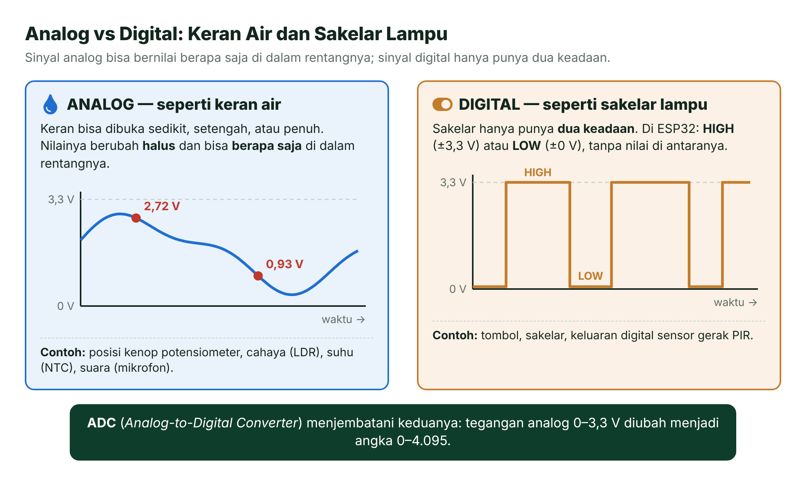
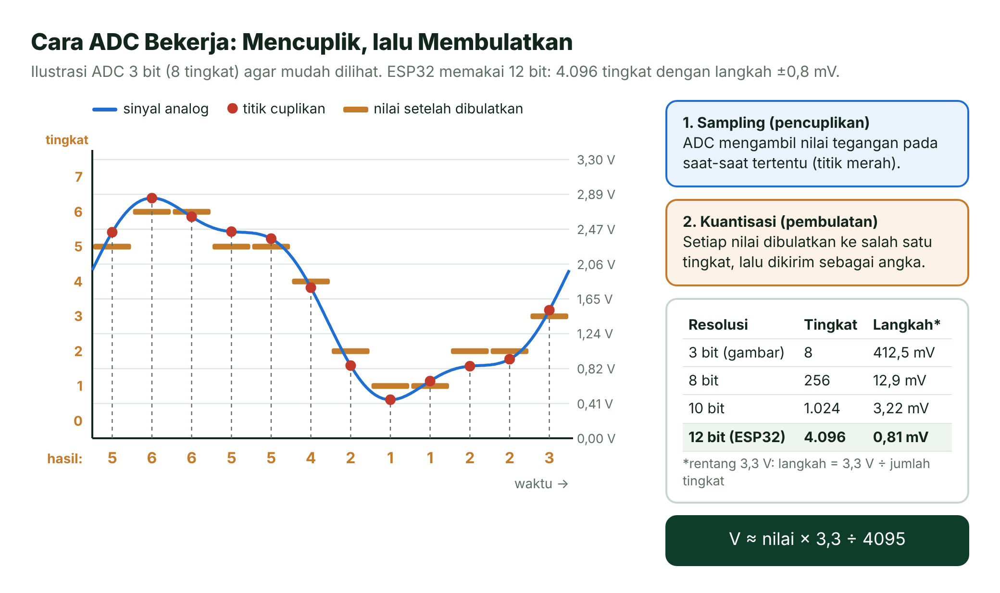
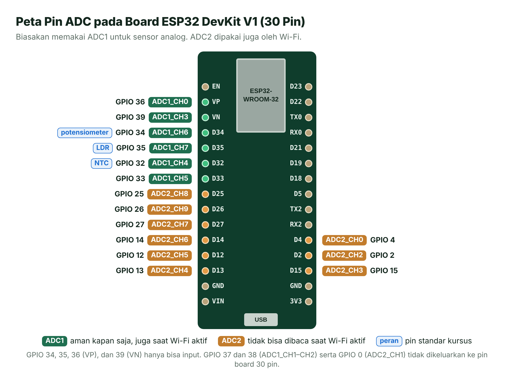
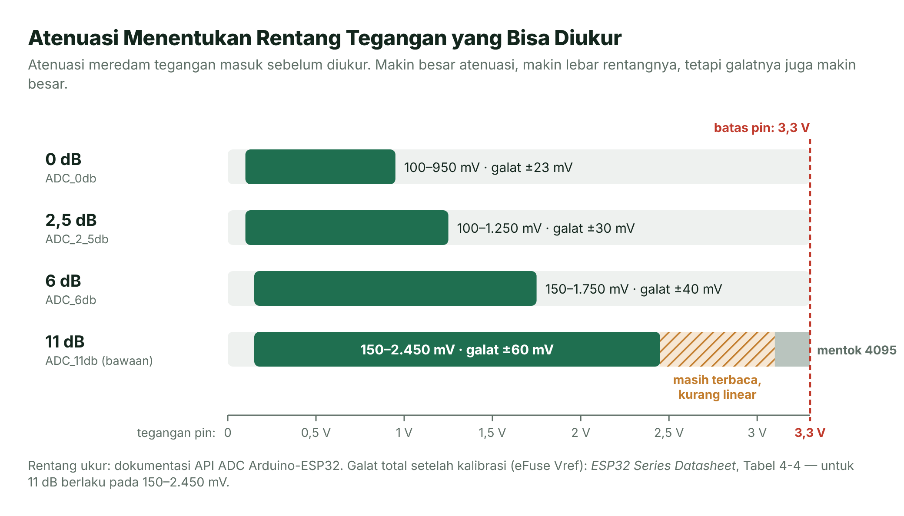
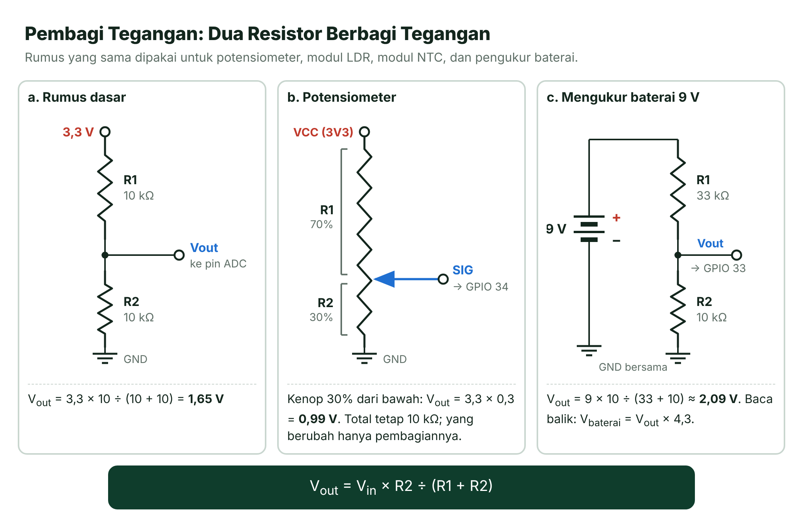
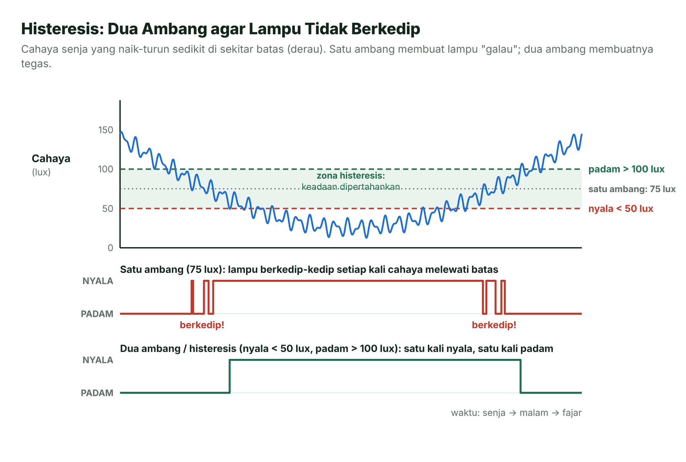
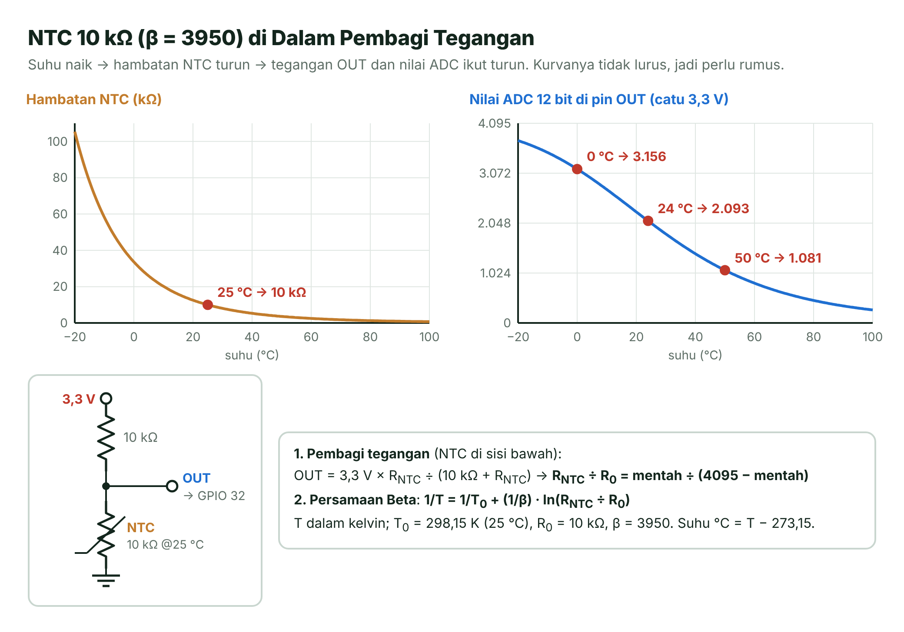
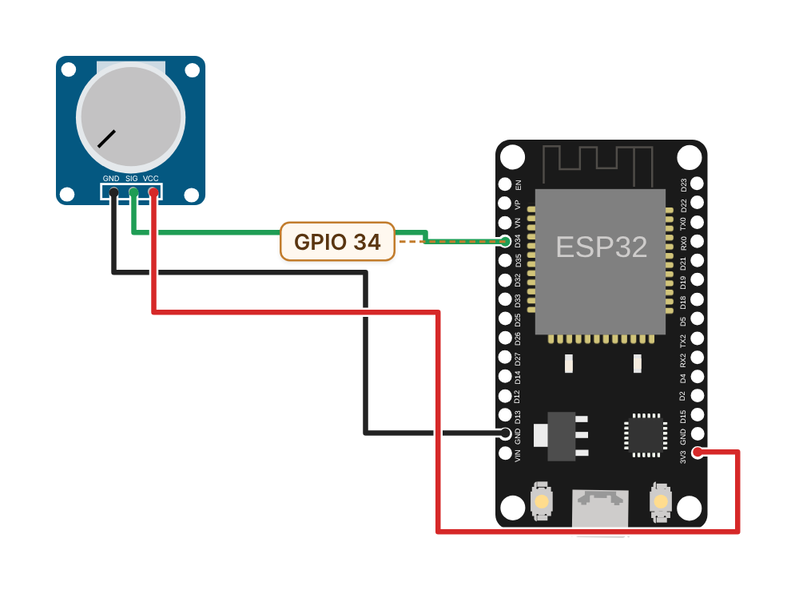
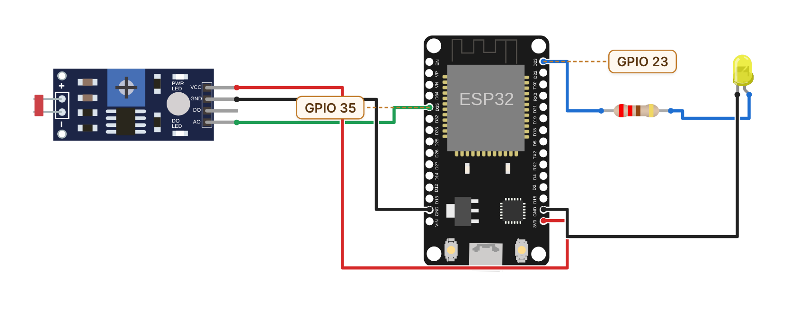
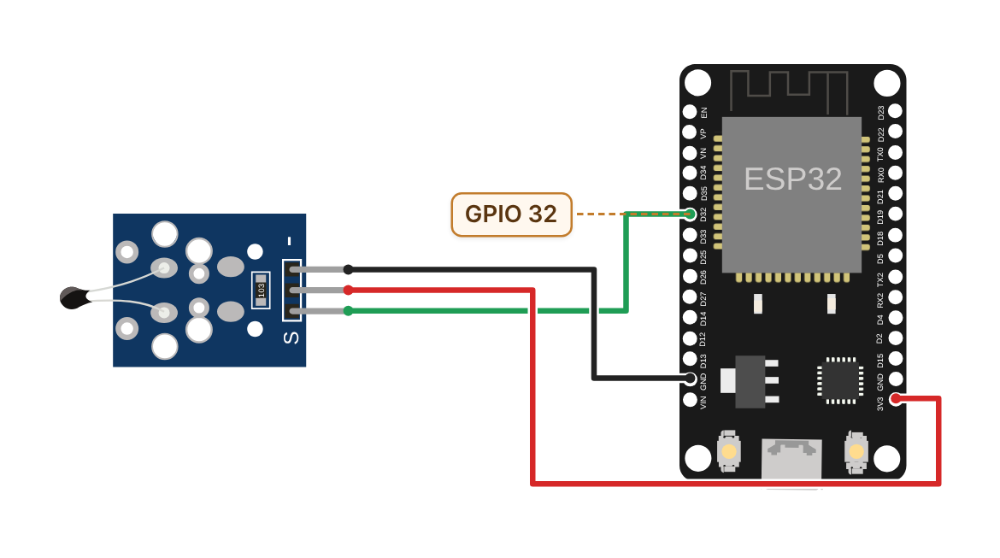

# Pertemuan 06 — Input Analog: ADC

> Dunia nyata tidak hanya mengenal "nyala" dan "padam". Hari ini kamu belajar membuat ESP32 "merasakan" besaran yang berubah halus, seperti posisi kenop, terang cahaya, dan suhu, lewat ADC.

| | |
| --- | --- |
| ⏱️ **Durasi** | 2 × 50 menit teori + 3 × 50 menit praktikum |
| 📋 **Prasyarat** | Pertemuan 03–05: GPIO output, GPIO input, dan pola `millis()` |
| 🧰 **Alat** | Laptop + internet; opsional: ESP32 DevKit V1, potensiometer 10 kΩ, modul sensor cahaya LDR, termistor NTC 10 kΩ, LED, resistor, *breadboard*, kabel jumper, multimeter |
| 📥 **Slide** | [👁️ Lihat di peramban](https://view.officeapps.live.com/op/view.aspx?src=https%3A%2F%2Fraw.githubusercontent.com%2Fantonprafanto%2Fembeddedsystem%2Fmain%2Fslide%2Fpptx%2FP06-Input-Analog-ADC.pptx) · [⬇️ Unduh PDF](https://raw.githubusercontent.com/antonprafanto/embeddedsystem/main/slide/pdf/P06-Input-Analog-ADC.pdf) · [⬇️ Unduh PPTX](https://raw.githubusercontent.com/antonprafanto/embeddedsystem/main/slide/pptx/P06-Input-Analog-ADC.pptx) |
| 📄 **Modul PDF** | [⬇️ Unduh modul ini dalam PDF](https://raw.githubusercontent.com/antonprafanto/embeddedsystem/main/modul-pdf/Modul-P06-Input-Analog-ADC.pdf) — untuk dibaca luring atau dicetak |

## Daftar Isi

- [🎯 Tujuan Pembelajaran](#-tujuan-pembelajaran)
- [🧰 Yang Perlu Disiapkan](#-yang-perlu-disiapkan)
- [1. Analog vs Digital](#1-analog-vs-digital)
- [2. ADC: Penggaris untuk Tegangan](#2-adc-penggaris-untuk-tegangan)
- [3. ADC di ESP32](#3-adc-di-esp32)
- [4. Pembagi Tegangan](#4-pembagi-tegangan)
- [5. Dari Angka ke Besaran: map() vs float](#5-dari-angka-ke-besaran-map-vs-float)
- [6. Derau dan Rata-Rata](#6-derau-dan-rata-rata)
- [7. Sensor Cahaya LDR dan Histeresis](#7-sensor-cahaya-ldr-dan-histeresis)
- [8. Sensor Suhu NTC](#8-sensor-suhu-ntc)
- [🧪 Praktikum](#-praktikum)
- [🏋️ Latihan & Tantangan](#️-latihan--tantangan)
- [✅ Cek Pemahaman](#-cek-pemahaman)
- [📌 Rangkuman](#-rangkuman)
- [📚 Referensi](#-referensi)
- [🖼️ Sumber Gambar](#️-sumber-gambar)

---

## 🎯 Tujuan Pembelajaran

Setelah pertemuan ini, kamu bisa:

1. Membedakan sinyal analog dan digital, lalu menjelaskan cara kerja ADC: resolusi, ukuran langkah, dan kuantisasi.
2. Memilih pin ADC yang tepat di ESP32 (ADC1 vs ADC2) serta mengatur resolusi dan atenuasi.
3. Menghitung pembagi tegangan, termasuk untuk mengukur tegangan di atas 3,3 V dengan aman.
4. Mengubah nilai mentah ADC menjadi besaran fisik (volt, lux, °C) dan meredam derau dengan rata-rata.
5. Membuat keputusan yang stabil dari sensor analog dengan histeresis dua ambang.

## 🧰 Yang Perlu Disiapkan

| Kebutuhan | Keterangan |
| --- | --- |
| Wajib | Laptop dan internet; VS Code + PlatformIO sudah terpasang ([Panduan Instalasi Alat](../panduan/02-instalasi-alat.md)) |
| Cadangan tanpa *board* | Simulator Wokwi di peramban ([panduan Wokwi](../panduan/03-simulasi-wokwi.md)). Semua komponen praktikum hari ini tersedia di Wokwi. |
| Komponen (jalur *board* asli) | ESP32 DevKit V1 + kabel USB data, potensiometer 10 kΩ, modul sensor cahaya LDR 4 pin (VCC, GND, DO, AO) atau LDR + resistor 10 kΩ, termistor NTC 10 kΩ (β ±3950) + resistor 10 kΩ, LED + resistor 220 Ω, *breadboard*, kabel jumper ([daftar komponen](../panduan/04-daftar-komponen.md)) |
| Sangat disarankan | Multimeter untuk membandingkan hasil ADC dengan tegangan sebenarnya |

---

## 1. Analog vs Digital

Bayangkan **keran air** dan **sakelar lampu**. Sakelar hanya punya dua keadaan: nyala atau padam. Keran berbeda. Keran bisa dibuka sedikit, setengah, atau penuh, dan alirannya bisa berapa saja di antara "tertutup" dan "terbuka penuh".

Di Pertemuan 04 kamu membaca tombol dengan `digitalRead()`. Tombol itu seperti sakelar: hasilnya hanya `HIGH` atau `LOW`. Itulah **sinyal digital**.

Banyak besaran di dunia nyata justru berubah halus seperti aliran keran: suhu ruangan, terang cahaya, posisi kenop volume. Sensor untuk besaran seperti ini mengeluarkan **sinyal analog**, yaitu tegangan yang nilainya bisa berapa saja di dalam rentangnya, misalnya 0–3,3 V.



*Gambar 6.1 — Sinyal analog (keran air) vs sinyal digital (sakelar lampu). Sumber: dibuat untuk materi ini (ikon Font Awesome Free, CC BY 4.0).*

Masalahnya, CPU di dalam ESP32 hanya bisa mengolah **angka**. Agar tegangan 1,27 V bisa "dipahami" program, tegangan itu harus diubah dulu menjadi angka. Tugas inilah yang dikerjakan **ADC**.

```cpp
int tombol = digitalRead(4);   // hanya HIGH (1) atau LOW (0)
int kenop  = analogRead(34);   // angka 0–4095, sebanding dengan tegangan di pin
```

> [!NOTE]
> **Bagaimana kalau `digitalRead()` dipakai untuk sinyal analog?** Hasilnya hanya `HIGH` atau `LOW`, bergantung pada apakah tegangan berada di atas atau di bawah ambang logika (Pertemuan 04). Di antara kedua ambang itu, hasilnya bahkan tidak pasti. Informasi "seberapa banyak" hilang sama sekali.

## 2. ADC: Penggaris untuk Tegangan

Ambil penggaris 30 cm. Garis terkecilnya 1 mm, jadi kamu hanya bisa membaca panjang sampai milimeter terdekat. Panjang 12,34 cm terbaca "123 mm". ADC bekerja persis seperti penggaris, hanya saja yang diukur adalah **tegangan**.

**ADC** (*Analog-to-Digital Converter*, pengubah analog ke digital) mengubah tegangan menjadi angka dalam dua langkah:

1. ***Sampling*** **(pencuplikan)**: mengambil nilai tegangan pada satu saat tertentu.
2. **Kuantisasi (pembulatan)**: membulatkan nilai itu ke "garis" terdekat pada penggarisnya, lalu menyerahkannya sebagai bilangan bulat.



*Gambar 6.2 — Sampling dan kuantisasi pada ADC 3 bit (8 tingkat), dibandingkan dengan resolusi lain. Sumber: dibuat untuk materi ini.*

### Resolusi dan Ukuran Langkah

**Resolusi** adalah banyaknya bit yang dipakai untuk menyatakan hasil ADC. ADC *n* bit punya 2<sup>n</sup> tingkat, dari 0 sampai 2<sup>n</sup> − 1. ADC ESP32 memakai **12 bit**, jadi hasilnya 4.096 tingkat: **0–4.095** [1].

**Ukuran langkah** (sering disebut 1 LSB, *least significant bit*) adalah jarak tegangan antara dua tingkat yang bersebelahan. Untuk rentang 3,3 V:

| Resolusi | Jumlah tingkat | Nilai | Ukuran langkah (rentang 3,3 V) |
| --- | --- | --- | --- |
| 8 bit | 256 | 0–255 | 12,9 mV |
| 10 bit | 1.024 | 0–1.023 | 3,22 mV |
| **12 bit (ESP32)** | **4.096** | **0–4.095** | **0,81 mV** |

Contoh kode Wokwi yang akan kita pakai nanti ditulis untuk Arduino Uno yang ADC-nya 10 bit (0–1.023). Di ESP32 angkanya menjadi 0–4.095, jadi rumusnya perlu disesuaikan.

Jika ADC dianggap ideal, nilai mentah bisa diubah menjadi tegangan dengan rumus:

**V ≈ nilai × 3,3 ÷ 4.095**

Contoh: nilai 2.048 → 2.048 × 3,3 ÷ 4.095 ≈ 1,650 V. Karena dibulatkan, selalu ada **galat kuantisasi** paling besar setengah langkah (±0,4 mV di ESP32). Angka ini sangat kecil dibanding galat lain yang akan kita bahas.

> [!NOTE]
> **Tahukah kamu?** ADC di ESP32 berjenis **SAR** (*Successive Approximation Register*) [1]. Cara kerjanya mirip permainan tebak angka: "Lebih dari 2.048?" "Ya." "Lebih dari 3.072?" "Tidak." "Lebih dari 2.560?" … Setiap pertanyaan ya/tidak menghasilkan satu bit, jadi 12 pertanyaan cukup untuk menemukan satu dari 4.096 kemungkinan.

> [!IMPORTANT]
> **Resolusi tinggi belum tentu akurat.** 12 bit berarti garis penggarisnya rapat (±0,8 mV). Namun, penggaris ADC ESP32 sendiri agak "melengkung": *datasheet* mencantumkan ketaklinearan integral (INL) hingga ±12 LSB, dan galat total setelah kalibrasi hingga ±60 mV pada atenuasi 11 dB [1]. Ibarat penggaris bergaris milimeter yang cetakannya sedikit miring.

## 3. ADC di ESP32

### 3.1 ADC1 dan ADC2

ESP32 punya **dua** ADC 12 bit dengan total 18 kanal [1]:

- **ADC1**: 8 kanal di GPIO 32–39.
- **ADC2**: 10 kanal di GPIO 0, 2, 4, 12, 13, 14, 15, 25, 26, dan 27.

Ada satu hal penting: **ADC2 juga dipakai oleh *driver* Wi-Fi**. Selama Wi-Fi aktif, pembacaan pin ADC2 bisa gagal [3]. Karena itu, biasakan menyambung sensor analog ke **pin ADC1**. Dengan begitu, programmu tetap berjalan ketika nanti Wi-Fi ditambahkan di Pertemuan 13.

Di *board* ESP32 DevKit V1 30 pin, pin ADC1 yang tersedia ada enam: GPIO 36 (VP), 39 (VN), 34, 35, 32, dan 33. Kursus ini memakai pin standar: **potensiometer di GPIO 34**, **LDR di GPIO 35**, dan **NTC di GPIO 32**.



*Gambar 6.3 — Peta pin ADC1 dan ADC2 pada ESP32 DevKit V1 (30 pin). Sumber: dibuat untuk materi ini; data kanal dari [1].*

GPIO 34, 35, 36, dan 39 hanya bisa menjadi input dan tidak punya *pull-up/pull-down* internal. Untuk sensor analog, itu bukan masalah, karena sensor analog memang tidak membutuhkannya. Lihat juga [lembar saku pinout](../panduan/05-pinout-esp32.md).

> [!WARNING]
> **Program berjalan baik, lalu pembacaan sensor "rusak" setelah Wi-Fi ditambahkan?** Cek dulu apakah sensor analogmu tersambung ke pin ADC2 (misalnya GPIO 4, 25, atau 26). Pindahkan ke pin ADC1.

### 3.2 Atenuasi: Mengatur Rentang Ukur

Misalkan timbangan dapurmu hanya sanggup menimbang sampai 1 kg, padahal kamu perlu menimbang 3 kg beras. Kamu bisa menimbang sepertiganya, lalu mengalikan hasilnya dengan 3. Atenuasi bekerja mirip seperti itu.

Inti ADC ESP32 membandingkan tegangan masuk dengan **tegangan acuan** internal sekitar 1.100 mV (bervariasi 1.000–1.200 mV antar-cip). Tanpa peredaman (0 dB), ADC hanya bisa mengukur sampai ±950 mV. **Atenuasi** (peredaman) memperkecil tegangan masuk lebih dulu agar muat diukur, sehingga rentangnya melebar [2].

| Atenuasi | Konstanta Arduino | Rentang ukur [2] | Galat total setelah kalibrasi [1] |
| --- | --- | --- | --- |
| 0 dB | `ADC_0db` | 100–950 mV | ±23 mV |
| 2,5 dB | `ADC_2_5db` | 100–1.250 mV | ±30 mV |
| 6 dB | `ADC_6db` | 150–1.750 mV | ±40 mV |
| **11 dB (bawaan)** | `ADC_11db` | **150–3.100 mV** | ±60 mV (berlaku pada 150–2.450 mV) |



*Gambar 6.4 — Rentang ukur tiap atenuasi. Sumber: dibuat untuk materi ini; data dari [1] dan [2].*

Perhatikan **ujung-ujung rentang**. Di bawah ±150 mV, ADC cenderung tetap membaca 0. Di atas ±2.450 mV, kurvanya makin melengkung, lalu mulai sekitar 3.100 mV nilainya mentok di 4.095. Jadi, rancang rangkaian sensormu agar tegangannya berada di sekitar 0,15–2,45 V bila kamu butuh hasil yang akurat.

Pengaturannya cukup ditulis di `setup()`:

```cpp
void setup() {
  analogReadResolution(12);          // ESP32: 9–12 bit, bawaan 12 bit
  analogSetAttenuation(ADC_11db);    // untuk semua pin ADC, bawaan 11 dB
  // analogSetPinAttenuation(34, ADC_6db);   // atau atur satu pin saja
}
```

> [!CAUTION]
> **Jangan pernah memberi tegangan lebih dari 3,3 V (atau tegangan negatif) ke pin ADC.** Atenuasi bukan pelindung; ia hanya mengatur rentang ukur. Keluaran sensor 5 V atau baterai 9 V yang disambung langsung bisa merusak pin, bahkan seluruh cip. Turunkan dulu tegangannya dengan pembagi tegangan (Bagian 4).

### 3.3 analogRead() vs analogReadMilliVolts()

Arduino-ESP32 menyediakan dua cara membaca ADC [2]:

| Fungsi | Hasil | Kapan dipakai |
| --- | --- | --- |
| `analogRead(pin)` | Nilai **mentah** 0–4.095, belum dikoreksi | Membandingkan (lebih terang/lebih gelap) dan memakai ambang |
| `analogReadMilliVolts(pin)` | Tegangan dalam **milivolt** yang sudah dikoreksi | Butuh nilai tegangan sebenarnya, misalnya mengukur baterai |

Mengapa perlu koreksi? Tegangan acuan tiap cip berbeda-beda, sehingga dua cip yang diberi tegangan 1,65 V yang sama bisa menghasilkan nilai mentah yang berbeda. Pabrik mengukur karakter tiap cip dan menyimpannya di **eFuse**, memori kecil di dalam cip yang hanya bisa ditulis sekali. `analogReadMilliVolts()` memakai data itu untuk menghitung milivolt yang lebih mendekati kenyataan [1], [2].

Satu catatan dari kode sumber Arduino-ESP32 3.3: bila data kalibrasi tidak tersedia, `analogReadMilliVolts()` mengembalikan **0** [8]. Program Praktikum 1 akan memberi peringatan bila hal ini terjadi.

> [!NOTE]
> **ADC di Wokwi vs di *board* asli.** Wokwi menyimulasikan ADC ESP32 [6], tetapi secara ideal: hubungan tegangan dan nilai mentah lurus sempurna dari 0 V (0) sampai 3,3 V (4.095), tanpa derau, dan sama untuk semua "cip". ADC *board* asli tidak lurus dan berbeda antar-cip. Jadi, angka yang rapi di Wokwi belum tentu sama di *board*. Di *board* asli, pakai `analogReadMilliVolts()` dan bandingkan hasilnya dengan multimeter.

## 4. Pembagi Tegangan

Bayangkan tangga dari lantai dua ke lantai dasar dengan sebuah bordes (bidang datar) di tengahnya. Kalau anak tangga bagian atas dan bawah sama banyak, bordes tepat berada di setengah ketinggian. Kalau bagian bawah lebih panjang, bordes ikut lebih tinggi. Dua resistor yang disusun seri bekerja persis seperti itu.

**Pembagi tegangan** (*voltage divider*) adalah dua resistor seri yang "berbagi" tegangan sebanding dengan hambatannya. Tegangan di titik tengahnya adalah:

**V<sub>out</sub> = V<sub>in</sub> × R2 ÷ (R1 + R2)**

dengan R1 resistor atas (ke V<sub>in</sub>) dan R2 resistor bawah (ke GND) [9].

- Contoh 1: V<sub>in</sub> = 3,3 V, R1 = R2 = 10 kΩ → V<sub>out</sub> = 3,3 × 10 ÷ 20 = **1,65 V**.
- Contoh 2: V<sub>in</sub> = 3,3 V, R1 = 10 kΩ, R2 = 4,7 kΩ → V<sub>out</sub> = 3,3 × 4,7 ÷ 14,7 ≈ **1,06 V**.



*Gambar 6.5 — Pembagi tegangan: rumus dasar, potensiometer, dan pengukur baterai 9 V. Sumber: dibuat untuk materi ini.*

### Potensiometer = Pembagi yang Bisa Digeser

**Potensiometer** punya tiga kaki. Dua kaki pinggir disambung ke 3V3 dan GND. Kaki tengah (*wiper*) menempel pada jalur resistif dan membaginya menjadi R1 dan R2. Saat kenop diputar, total hambatannya tetap 10 kΩ; yang berubah hanya pembagiannya. Kenop di 30% dari bawah memberi V<sub>out</sub> = 3,3 × 0,3 = 0,99 V. Itulah sebabnya potensiometer di Praktikum 1 menghasilkan 0–3,3 V.

### Mengukur Tegangan di Atas 3,3 V

Misalkan kamu ingin memantau baterai 9 V. Pakai R1 = 33 kΩ dan R2 = 10 kΩ:

- V<sub>out</sub> = 9 × 10 ÷ (33 + 10) ≈ **2,09 V**. Aman, dan masih di rentang paling akurat (150–2.450 mV).
- Baterai baru bisa sedikit di atas 9 V, misalnya 9,6 V → V<sub>out</sub> ≈ 2,23 V. Masih aman.
- Tegangan baterai dihitung balik dengan V<sub>baterai</sub> = V<sub>out</sub> × (R1 + R2) ÷ R2 = V<sub>out</sub> × 4,3.
- Batas: pin mencapai 3,3 V saat V<sub>in</sub> ≈ 14,2 V. Agar tetap di rentang akurat, V<sub>in</sub> sebaiknya ≤ ±10,5 V.
- Pembagi ini terus menarik arus 9 V ÷ 43 kΩ ≈ 0,21 mA dari baterai. Kecil, tetapi berjalan terus.

Mengapa tidak R1 = 20 kΩ dan R2 = 10 kΩ saja? Hasilnya 9 V → 3,0 V, sudah masuk wilayah yang melengkung, dan baterai 9,6 V menjadi 3,2 V, terlalu dekat dengan batas 3,3 V.

```cpp
const int PIN_BATERAI = 33;          // ADC1_CH5
const float R1 = 33000.0;            // resistor atas (ke kutub + baterai)
const float R2 = 10000.0;            // resistor bawah (ke GND)

float bacaTeganganBaterai() {
  uint32_t mvPin = analogReadMilliVolts(PIN_BATERAI);   // tegangan di pin (mV)
  return mvPin / 1000.0 * (R1 + R2) / R2;                // kembalikan ke volt baterai
}
```

Jika pin terbaca 2.093 mV, tegangan baterai = 2,093 × 4,3 ≈ 9,00 V. Resistor biasa punya toleransi ±5%, jadi untuk hasil teliti ukur dulu nilai R1 dan R2 dengan multimeter, lalu masukkan angka sebenarnya ke kode.

> [!CAUTION]
> **Aturan aman memakai pembagi tegangan:**
> - **GND baterai wajib disambung ke GND ESP32** (*ground* bersama). Tanpa itu, hasil pengukuran tidak bisa dipercaya.
> - Rangkai pembaginya, lalu ukur titik tengahnya dengan multimeter **sebelum** menyambungkannya ke pin.
> - Jangan melepas R2 selama R1 masih tersambung ke baterai: pin akan "melihat" tegangan baterai lewat R1.
> - Pembagi tegangan hanya untuk tegangan DC rendah seperti baterai. **Jangan** pernah dipakai untuk listrik PLN 220 V.

## 5. Dari Angka ke Besaran: map() vs float

Mengubah nilai mentah menjadi volt mirip mengubah takaran "sendok" di resep menjadi gram: kamu butuh faktor pengali yang tepat, dan kamu perlu tahu berapa ketelitian yang dibutuhkan.

Fungsi `map(nilai, dariMin, dariMaks, keMin, keMaks)` memetakan satu rentang ke rentang lain. Fungsi ini bekerja dengan **bilangan bulat**, jadi pecahannya dibuang (bukan dibulatkan) [7], [8]:

```cpp
int mentah = 2000;
long mv    = map(mentah, 0, 4095, 0, 3300);  // 1611  (seharusnya 1611,72 → pecahan dibuang)
int persen = map(mentah, 0, 4095, 0, 100);   // 48    (48,84 → 48)
float volt = mentah * 3.3 / 4095.0;          // 1.6117 V (pecahan tetap ada)
```

Hati-hati juga dengan **pembagian bilangan bulat** yang sudah kamu kenal di Pertemuan 02:

```cpp
float salah = mentah / 4095 * 3.3;   // 0.0 !  2000 / 4095 = 0 pada bilangan bulat
float benar = mentah * 3.3 / 4095;   // 1.6117  3.3 bertipe pecahan, jadi hasilnya ikut pecahan
```

| Pakai | Cocok untuk |
| --- | --- |
| `map()` | Persen, posisi, sudut servo, jumlah LED yang menyala: hasil bulat sudah cukup |
| `float` | Volt, lux, suhu: butuh angka di belakang koma |

> [!TIP]
> **`map()` tidak membatasi hasil.** Nilai di luar rentang masukan menghasilkan angka di luar rentang keluaran [7]. Bila perlu, batasi dengan `constrain(hasil, 0, 100)`.

## 6. Derau dan Rata-Rata

Pernahkah kamu menimbang badan dan angka timbangan digitalnya "goyang" 0,1–0,2 kg? Solusi praktisnya: menimbang beberapa kali lalu merata-ratakan hasilnya.

**Derau** (*noise*) adalah gangguan acak kecil yang menumpang pada sinyal. Sumbernya antara lain riak catu daya, aktivitas Wi-Fi, kabel jumper yang panjang, atau sentuhan tangan. Di *board* asli, potensiometer yang diam bisa terbaca naik-turun beberapa angka, misalnya 2.036–2.060. Di Wokwi, derau ini tidak muncul karena ADC-nya ideal.

Ada dua cara meredamnya:

1. **Perangkat keras**: Espressif mengukur karakteristik ADC di *datasheet* dengan kapasitor 100 nF yang dipasang di pin input [1]. Pasang kapasitor keramik 100 nF antara pin ADC dan GND.
2. **Perangkat lunak**: merata-ratakan beberapa pembacaan. Derau acak sebagian saling meniadakan; untuk derau yang benar-benar acak, rata-rata 16 sampel memperkecil simpangannya kira-kira menjadi 1/√16 = 1/4.

### Rata-Rata N Sampel

Baca beberapa kali berturut-turut, jumlahkan, lalu bagi:

```cpp
float bacaRataRata(int pin, int jumlah) {
  long total = 0;                   // long: aman walau jumlahnya besar
  for (int i = 0; i < jumlah; i++) {
    total += analogRead(pin);
  }
  return (float)total / jumlah;     // ubah ke float agar pecahan tidak hilang
}
```

### Rata-Rata Bergerak (*Moving Average*)

Simpan N pembacaan terakhir di sebuah larik (*array*). Setiap pembacaan baru menggantikan yang paling lama, lalu rata-ratanya diperbarui. Cara ini cocok bila `loop()` hanya sempat membaca satu kali per putaran.

```cpp
const int N = 8;
int jendela[N];              // larik penampung 8 bacaan terakhir
int indeks = 0;
long jumlah = 0;
bool penuh = false;

float rataBergerak(int bacaanBaru) {
  jumlah = jumlah - jendela[indeks] + bacaanBaru;  // buang yang terlama, tambah yang terbaru
  jendela[indeks] = bacaanBaru;
  indeks = (indeks + 1) % N;                        // kembali ke 0 setelah ujung larik
  if (indeks == 0) penuh = true;
  return (float)jumlah / (penuh ? N : indeks);      // sebelum penuh, bagi dengan isi yang ada
}
```

| Cara | Kelebihan | Kekurangan |
| --- | --- | --- |
| Rata-rata N sampel | Sederhana; hasilnya langsung halus | Butuh N kali baca setiap kali (lebih lama) |
| Rata-rata bergerak | Cukup satu bacaan per putaran `loop()` | Butuh larik; bereaksi lebih lambat terhadap perubahan cepat |

> [!TIP]
> **Mulailah dari N = 8 atau 16.** Makin besar N, makin halus hasilnya, tetapi makin lambat pula ia mengikuti perubahan yang sebenarnya. Pilih N secukupnya sesuai kebutuhan.

## 7. Sensor Cahaya LDR dan Histeresis

### LDR: Hambatan yang Peka Cahaya

**LDR** (*Light Dependent Resistor*, resistor peka cahaya) adalah resistor yang hambatannya **turun saat cahaya bertambah**. Di tempat gelap hambatannya bisa puluhan kΩ hingga MΩ; di tempat terang tinggal ratusan Ω. ESP32 tidak bisa mengukur hambatan secara langsung, jadi LDR dipasang dalam pembagi tegangan agar perubahan hambatan menjadi perubahan tegangan.

Modul `wokwi-photoresistor-sensor` berisi LDR yang diseri dengan resistor 10 kΩ; pin **AO** tersambung ke titik di antara keduanya [4]. Tabel di dokumentasinya menunjukkan AO **turun saat cahaya bertambah** (4,96 V pada 0,1 lux dan 0,04 V pada 100.000 lux, dengan VCC 5 V). Artinya, LDR berada di sisi bawah pembagi (antara AO dan GND). Modul ini juga punya pin DO yang bernilai HIGH saat gelap [4].

Hambatan LDR di Wokwi mengikuti model R<sub>LDR</sub> = RL10 × (lux ÷ 10)<sup>−γ</sup>, dengan RL10 = 50 kΩ (hambatan pada 10 lux) dan γ (*gamma*) = 0,7 [4]. Jika modul diberi catu 3,3 V, hasilnya:

| Cahaya | R<sub>LDR</sub> | Tegangan AO | Nilai ADC 12 bit |
| --- | --- | --- | --- |
| 1 lux | 250,6 kΩ | 3,17 V | ≈ 3.938 |
| 10 lux | 50,0 kΩ | 2,75 V | ≈ 3.412 |
| 50 lux | 16,2 kΩ | 2,04 V | ≈ 2.532 |
| 100 lux | 9,98 kΩ | 1,65 V | ≈ 2.045 |
| 500 lux | 3,23 kΩ | 0,81 V | ≈ 1.001 |
| 10.000 lux | 397 Ω | 0,13 V | ≈ 156 |

Contoh kode Wokwi untuk Arduino Uno (10 bit, 5 V) adalah `voltage = analogValue / 1024. * 5` lalu `resistance = 2000 * voltage / (1 - voltage / 5)`. Angka `2000` di situ berasal dari 10.000 ÷ 5. Untuk ESP32 (12 bit, 3,3 V), kita turunkan ulang:

1. Tegangan AO: V<sub>AO</sub> = mentah × 3,3 ÷ 4.095.
2. Pembagi (LDR di bawah): V<sub>AO</sub> = 3,3 × R<sub>LDR</sub> ÷ (10 kΩ + R<sub>LDR</sub>), sehingga R<sub>LDR</sub> = 10 kΩ × V<sub>AO</sub> ÷ (3,3 − V<sub>AO</sub>) = **10 kΩ × mentah ÷ (4.095 − mentah)**.
3. Balik modelnya: **lux = 10 × (RL10 ÷ R<sub>LDR</sub>)<sup>1/γ</sup>**.

Saat sangat terang, nilai mentah bisa 0 sehingga R<sub>LDR</sub> = 0 dan hasil lux menjadi tak hingga (`inf`) [4]. Program Praktikum 2 menjaga kasus ini.

### Histeresis: Dua Ambang agar Tidak "Galau"

Bayangkan kipas angin otomatis dengan aturan "nyala jika suhu di atas 30 °C". Saat suhu kamar tepat di sekitar 30 °C dan naik-turun 0,1 °C, kipas akan nyala-padam terus-menerus. Termostat sungguhan memakai dua batas: nyala di atas 30 °C, padam di bawah 28 °C.

**Histeresis** adalah cara mengambil keputusan dengan **dua ambang** yang berbeda, sehingga keputusan bergantung juga pada keadaan sebelumnya. Untuk lampu taman otomatis:

- Lampu sedang PADAM → baru NYALA bila cahaya **< 50 lux**.
- Lampu sedang NYALA → baru PADAM bila cahaya **> 100 lux**.
- Di antara 50–100 lux (zona histeresis), keadaan lampu **dipertahankan**.



*Gambar 6.6 — Satu ambang vs dua ambang (histeresis) pada lampu otomatis. Sumber: dibuat untuk materi ini.*

```cpp
if (!lampuMenyala && lux < LUX_NYALA) {          // sedang padam dan sudah cukup gelap
  lampuMenyala = true;
} else if (lampuMenyala && lux > LUX_PADAM) {    // sedang nyala dan sudah cukup terang
  lampuMenyala = false;
}
digitalWrite(PIN_LAMPU, lampuMenyala ? HIGH : LOW);
```

> [!IMPORTANT]
> **Jarak kedua ambang harus lebih lebar daripada derau.** Kalau derau sensormu ±10 lux, ambang 50/55 masih bisa membuat lampu berkedip. Ide yang sama dipakai di rangkaian elektronik bernama *Schmitt trigger* [9].

## 8. Sensor Suhu NTC

### NTC: Hambatan yang Turun saat Panas

Ingat madu: saat dingin ia kental dan sulit mengalir, saat dihangatkan ia encer dan mudah mengalir. **NTC** (*Negative Temperature Coefficient*) adalah **termistor** (resistor peka suhu) yang hambatannya **turun saat suhu naik**, seperti madu yang makin "lancar" ketika hangat.

Dua angka penting NTC dari lembar data (*datasheet*)-nya:

- **R<sub>0</sub>**: hambatan pada suhu acuan 25 °C, misalnya 10 kΩ.
- **β** (*Beta*): seberapa curam hambatannya berubah terhadap suhu, misalnya 3950.

Hubungan keduanya dinyatakan dengan **persamaan Beta** (T dalam kelvin, K = °C + 273,15):

**1/T = 1/T<sub>0</sub> + (1/β) · ln(R ÷ R<sub>0</sub>)**

Modul `wokwi-ntc-temperature-sensor` berisi NTC 10 kΩ yang diseri dengan resistor 10 kΩ; β bawaannya 3950 dan suhu awalnya 24 °C [5]. Dokumentasinya tidak menyebut posisi NTC secara langsung, tetapi rumus contohnya hanya benar bila **NTC berada di sisi bawah** (antara OUT dan GND). Akibatnya, **suhu naik → OUT turun**.



*Gambar 6.7 — Karakteristik NTC 10 kΩ (β = 3950) di dalam pembagi tegangan. Sumber: dibuat untuk materi ini; kurva dihitung dengan persamaan Beta.*

| Suhu | R<sub>NTC</sub> | Tegangan OUT | Nilai ADC 12 bit |
| --- | --- | --- | --- |
| −20 °C | 105,4 kΩ | 3,01 V | ≈ 3.740 |
| 0 °C | 33,6 kΩ | 2,54 V | ≈ 3.156 |
| 24 °C | 10,46 kΩ | 1,69 V | ≈ 2.093 |
| 25 °C | 10,0 kΩ | 1,65 V | ≈ 2.048 |
| 50 °C | 3,59 kΩ | 0,87 V | ≈ 1.081 |
| 80 °C | 1,27 kΩ | 0,37 V | ≈ 462 |
| 100 °C | 698 Ω | 0,22 V | ≈ 267 |

Di sekitar 25 °C, satu langkah ADC setara ±0,02 °C, jadi resolusinya lebih dari cukup. Pada suhu tinggi, OUT mendekati 0,15 V; di *board* asli, wilayah itu mulai tidak akurat (Bagian 3.2).

### Menurunkan Rumus untuk 12 Bit

Contoh kode Wokwi ditulis untuk Arduino Uno (10 bit) [5]:

```cpp
float celsius = 1 / (log(1 / (1023. / analogValue - 1)) / BETA + 1.0 / 298.15) - 273.15;
```

Yuk, kita turunkan langkah demi langkah agar tahu asal-usulnya:

1. **Pembagi tegangan** (R<sub>0</sub> = 10 kΩ di atas, NTC di bawah): V<sub>OUT</sub> = V<sub>CC</sub> × R<sub>NTC</sub> ÷ (R<sub>0</sub> + R<sub>NTC</sub>).
2. **ADC ideal**: mentah ÷ 4.095 = V<sub>OUT</sub> ÷ V<sub>CC</sub>. V<sub>CC</sub> saling meniadakan karena modul dan ADC sama-sama memakai 3,3 V.
3. Gabungkan keduanya: mentah ÷ 4.095 = R<sub>NTC</sub> ÷ (R<sub>0</sub> + R<sub>NTC</sub>), sehingga **R<sub>NTC</sub> ÷ R<sub>0</sub> = mentah ÷ (4.095 − mentah)**.
4. Bentuk itu sama dengan `1 / (4095. / mentah - 1)`. Inilah bagian rumus Wokwi, dengan `1023` diganti `4095`.
5. Masukkan ke persamaan Beta: 1/T = 1/298,15 + ln(R<sub>NTC</sub> ÷ R<sub>0</sub>) ÷ β, lalu °C = T − 273,15.

Hasilnya, versi ESP32 12 bit:

```cpp
float celsius = 1 / (log(1 / (4095. / analogValue - 1)) / BETA + 1.0 / 298.15) - 273.15;
```

Cek cepat: pada 24 °C nilai mentahnya ≈ 2.093, dan rumus di atas mengembalikan 24,0 °C. Pada 50 °C (≈ 1.081) hasilnya 50,0 °C.

> [!WARNING]
> **Arah pembagi menentukan rumus.** Kalau NTC asli kamu rangkai terbalik (NTC di atas, resistor 10 kΩ di bawah), suhu naik justru membuat OUT naik, dan rasionya berubah menjadi R<sub>NTC</sub> ÷ R<sub>0</sub> = (4.095 − mentah) ÷ mentah. Memakai rumus yang salah arah membuat suhu terbalik: dipanaskan malah turun. Cara cek cepat: pegang NTC; bila nilai mentah turun, NTC berada di sisi bawah.

---

## 🧪 Praktikum

### Sebelum Mulai

Pilih jalur sesuai kondisimu. Kodenya sama persis.

**Jalur A — Simulator Wokwi (tanpa *board*)**

1. Buka <https://wokwi.com/projects/new/esp32>.
2. Salin seluruh isi `src/main.cpp` dari *folder* praktikum ke tab **sketch.ino** (hapus isi lama).
3. Salin seluruh isi `diagram.json` ke tab **diagram.json**.
4. Klik **▶**. Saat simulasi berjalan, **klik komponen sensor** untuk mengubah nilainya: putar kenop potensiometer, atau geser nilai lux/suhu pada modul LDR dan NTC.

**Jalur B — *Board* ESP32 asli (VS Code + PlatformIO)**

1. **Cabut kabel USB**, lalu rangkai komponen di *breadboard* sesuai tabel sambungan.
2. Periksa sekali lagi: kaki catu sensor tersambung ke **3V3**, bukan VIN.
3. Buka *folder* praktikum di VS Code, klik **Build** (✓), lalu **Upload** (→).
4. Buka **Serial Monitor** (115200). Jika kosong, tekan tombol **EN**.

> [!CAUTION]
> **Catu sensor analog dari 3V3, bukan VIN.** Pin VIN membawa ±5 V dari USB. Sensor yang diberi catu 5 V bisa mengeluarkan tegangan di atas 3,3 V dan merusak pin ADC.

---

### Praktikum 1 — Voltmeter Mini dengan Potensiometer

📁 *Folder*: [`kode/01-potensiometer-voltmeter`](kode/01-potensiometer-voltmeter)

**Tujuan:** membaca tegangan potensiometer dengan ADC, lalu membandingkan tiga cara menyatakan hasilnya: nilai mentah, `analogReadMilliVolts()`, dan tegangan hasil hitung.

**Rangkaian:**



*Gambar 6.8 — Rangkaian Praktikum 1. Sumber: dibuat untuk materi ini dari `diagram.json` (gambar komponen @wokwi/elements, MIT).*

| Kaki potensiometer | Sambungkan ke | Keterangan |
| --- | --- | --- |
| VCC (kaki pinggir) | 3V3 | Ujung atas pembagi |
| SIG (kaki tengah) | GPIO 34 (D34) | ADC1_CH6, input saja |
| GND (kaki pinggir lainnya) | GND | Ujung bawah pembagi |

Pada potensiometer asli, dua kaki pinggir boleh ditukar; akibatnya hanya arah putarnya yang terbalik.

**Kode** (`src/main.cpp`, bagian pentingnya):

```cpp
const int PIN_POT = 34;             // Kaki tengah potensiometer → GPIO 34 (ADC1_CH6)
const float TEGANGAN_PENUH = 3.3;   // Anggapan ideal: nilai 4095 setara 3,3 V
const int NILAI_MAKS = 4095;        // ADC 12 bit → nilai 0–4095

void setup() {
  Serial.begin(115200);
  analogReadResolution(12);         // 12 bit (bawaan), ditulis agar jelas
  analogSetAttenuation(ADC_11db);   // Atenuasi 11 dB: rentang ±150–3.100 mV (bawaan)
  Serial.println("Voltmeter mini siap. Putar kenop potensiometer.");
}

void loop() {
  int mentah = analogRead(PIN_POT);                   // Nilai mentah, belum dikoreksi
  uint32_t milivolt = analogReadMilliVolts(PIN_POT);  // Milivolt terkoreksi kalibrasi eFuse
  float teganganHitung = mentah * TEGANGAN_PENUH / NILAI_MAKS;  // Hitung dengan float
  int persen = map(mentah, 0, NILAI_MAKS, 0, 100);    // map() menghasilkan bilangan bulat

  Serial.printf("[DATA] mentah: %4d | mV: %4lu | hitung: %.3f V | ",
                mentah, (unsigned long)milivolt, teganganHitung);
  cetakBar(mentah);
  Serial.printf(" %3d%%\n", persen);
  // ... peringatan sekali bila mV = 0 (data kalibrasi tidak ada)
  delay(JEDA_MS);
}
```

`Serial.printf()` mencetak teks berformat: `%4d` berarti bilangan bulat selebar 4 kolom, `%4lu` bilangan bulat tak bertanda (*unsigned long*), `%.3f` pecahan dengan 3 angka di belakang titik, `%%` tanda persen, dan `\n` pindah baris. Fungsi `cetakBar()` mencetak 20 kotak: `#` untuk bagian terisi dan `-` untuk sisanya.

**Hasil yang diharapkan:**

Di **Wokwi**, ADC-nya ideal, sehingga kolom mentah, hitung, dan bar tampak "sempurna":

| Posisi kenop | `mentah` (kira-kira) | `hitung` (kira-kira) | Bar dan persen |
| --- | --- | --- | --- |
| Paling kiri | `0` | `0.000 V` | `[--------------------]   0%` |
| Seperempat | `1024` | `0.825 V` | `[#####---------------]  25%` |
| Tengah | `2048` | `1.650 V` | `[##########----------]  50%` |
| Paling kanan | `4095` | `3.300 V` | `[####################] 100%` |

Kolom `mV` di Wokwi bisa tidak sama dengan kolom `hitung`, bahkan bisa selalu 0 disertai baris `[PERINGATAN] mV = 0: ...`. Itu wajar: koreksi kalibrasi dirancang untuk cip asli dan bergantung pada data eFuse (Bagian 3.3). Di simulator, yang benar justru kolom `hitung`.

Di ***board* asli**, keluarannya kira-kira seperti ini (ilustrasi dengan karakter ADC yang umum; angka di *board*-mu pasti berbeda):

```text
Voltmeter mini siap. Putar kenop potensiometer.
[DATA] mentah:    0 | mV:  142 | hitung: 0.000 V | [--------------------]   0%
[DATA] mentah:  444 | mV:  500 | hitung: 0.358 V | [##------------------]  10%
[DATA] mentah: 1065 | mV: 1000 | hitung: 0.858 V | [#####---------------]  26%
[DATA] mentah: 1872 | mV: 1650 | hitung: 1.509 V | [#########-----------]  45%
[DATA] mentah: 2679 | mV: 2300 | hitung: 2.159 V | [#############-------]  65%
```

Coba perhatikan tiga hal. Pertama, kolom `mV` paling dekat dengan multimeter, sedangkan kolom `hitung` meleset lebih dari 0,1 V karena memakai rumus ideal. Kedua, di ujung bawah nilai mentah sudah 0 walaupun tegangannya belum benar-benar 0 V, dan `mV` tidak turun di bawah ±140 mV. Ketiga, di ujung atas nilai mentah mentok di 4.095 mulai sekitar 3,1 V.

**Kalau belum berhasil:**

| Gejala | Coba ini |
| --- | --- |
| Nilai selalu 0 | Kaki SIG belum tersambung ke GPIO 34, atau kaki VCC belum ke 3V3. |
| Nilai selalu 4.095 | Kaki GND potensiometer lepas, atau SIG tertukar dengan VCC. |
| Nilai melompat-lompat acak walau kenop diam | Kabel SIG lepas sehingga pin "mengambang". Bila tersambung tetapi tetap goyang beberapa angka, itu derau biasa (Bagian 6). |
| Diputar ke kanan malah turun | Tukar kabel kaki VCC dan GND potensiometer. |
| `mV` selalu 0 | Data kalibrasi eFuse tidak tersedia (wajar di simulator). Pakai kolom `hitung`. |

**Eksperimen kecil:**

- Di *board* asli, ukur kaki tengah potensiometer dengan multimeter di 3–5 posisi kenop. Kolom mana yang lebih dekat: `mV` atau `hitung`?
- Ganti atenuasi menjadi `ADC_0db`, lalu putar kenop pelan-pelan di *board* asli. Mulai tegangan berapa nilai mentah mentok di 4.095? Bandingkan dengan tabel di Bagian 3.2.
- Pakai fungsi `bacaRataRata()` dari Bagian 6 dengan 16 sampel. Apakah kolom mentah di *board* asli menjadi lebih tenang?

---

### Praktikum 2 — Lampu Otomatis dengan LDR dan Histeresis

📁 *Folder*: [`kode/02-lampu-otomatis-ldr`](kode/02-lampu-otomatis-ldr)

**Tujuan:** membuat lampu taman otomatis yang menyala saat gelap, lengkap dengan histeresis agar tidak berkedip di sekitar batas.

**Rangkaian:**



*Gambar 6.9 — Rangkaian Praktikum 2. Sumber: dibuat untuk materi ini dari `diagram.json` (gambar komponen @wokwi/elements, MIT).*

| Dari | Ke | Keterangan |
| --- | --- | --- |
| Modul LDR: VCC | 3V3 | Catu 3,3 V |
| Modul LDR: GND | GND | — |
| Modul LDR: AO | GPIO 35 (D35) | ADC1_CH7, input saja |
| Modul LDR: DO | — | Tidak dipakai |
| GPIO 23 (D23) | Resistor 220 Ω → anoda LED (kaki panjang) | "Lampu taman" |
| Katoda LED (kaki pendek) | GND | — |

Belum punya modul? Rangkai sendiri dengan arah yang sama seperti modul Wokwi: 3V3 → resistor 10 kΩ → titik tengah (ke GPIO 35) → LDR → GND.

**Kode** (`src/main.cpp`, bagian pentingnya):

```cpp
const float LUX_NYALA = 50.0;        // Lebih gelap dari ini → lampu menyala
const float LUX_PADAM = 100.0;       // Lebih terang dari ini → lampu padam

float hitungLux(int mentah) {
  if (mentah <= 0) return 100000.0;      // Sangat terang: dibatasi agar tidak "inf"
  if (mentah >= NILAI_MAKS) return 0.0;  // Sangat gelap
  float hambatanLdr = R_SERI * mentah / (NILAI_MAKS - mentah);   // R_LDR dari pembagi
  return 10.0 * pow(RL10 * 1000.0 / hambatanLdr, 1.0 / GAMMA);  // Balik model LDR
}

void loop() {
  int mentah = analogRead(PIN_LDR);
  float lux = hitungLux(mentah);
  if (!lampuMenyala && lux < LUX_NYALA) {
    lampuMenyala = true;
    digitalWrite(PIN_LAMPU, HIGH);
    Serial.println("[INFO] Gelap  -> lampu NYALA");
  } else if (lampuMenyala && lux > LUX_PADAM) {
    lampuMenyala = false;
    digitalWrite(PIN_LAMPU, LOW);
    Serial.println("[INFO] Terang -> lampu PADAM");
  }
  // ... cetak [DATA] tiap 1 detik dengan pola millis(), lalu delay(50)
}
```

Pencetakan data memakai pola `millis()` dari Pertemuan 05, sehingga pengecekan cahaya tetap berjalan setiap ±50 ms walaupun data hanya dicetak tiap 1 detik.

**Hasil yang diharapkan** (contoh di Wokwi; penggeser lux diubah 500 → 40 → 80 → 150 → 80; baris `[DATA]` sebenarnya muncul tiap detik, di sini diringkas):

```text
Lampu otomatis siap. Ambang: nyala < 50 lux, padam > 100 lux.
[DATA] mentah: 1001 | AO: 0.807 V | cahaya:    499.6 lux | lampu: PADAM
[INFO] Gelap  -> lampu NYALA
[DATA] mentah: 2680 | AO: 2.160 V | cahaya:     40.0 lux | lampu: NYALA
[DATA] mentah: 2205 | AO: 1.777 V | cahaya:     80.0 lux | lampu: NYALA
[INFO] Terang -> lampu PADAM
[DATA] mentah: 1756 | AO: 1.415 V | cahaya:    150.1 lux | lampu: PADAM
[DATA] mentah: 2205 | AO: 1.777 V | cahaya:     80.0 lux | lampu: PADAM
```

Perhatikan dua baris 80 lux: cahayanya sama, tetapi keadaan lampunya berbeda, bergantung pada riwayatnya. Itulah histeresis. Angka di layarmu bisa sedikit berbeda karena posisi penggeser jarang tepat bulat.

**Kalau belum berhasil:**

| Gejala | Coba ini |
| --- | --- |
| LED tidak pernah menyala, padahal `[INFO] ... NYALA` muncul | Cek polaritas LED: kaki panjang (anoda) ke resistor dan GPIO 23. |
| Cahaya selalu `100000.0` | Nilai mentah 0: kabel AO lepas atau salah pin. |
| Lampu terbalik: terang malah menyala | Modul asli punya arah AO berlawanan. Tukar posisi LDR dan resistor, atau ganti rumusnya menjadi `R_SERI * (NILAI_MAKS - mentah) / mentah`. |
| Di *board* asli, lampu tetap berkedip di batas | Derau lebih besar daripada jarak ambang. Lebarkan jaraknya, misalnya 40/120 lux. |

> [!NOTE]
> **Lux di *board* asli hanyalah perkiraan.** Rumus lux memakai model LDR Wokwi (RL10 = 50 kΩ, γ = 0,7). LDR asli punya karakter berbeda. Untuk *board* asli, catat nilai mentah saat "sudah cukup gelap" dan "sudah cukup terang", lalu pakai angka itu sebagai ambang.

**Eksperimen kecil:**

- Ganti histeresis dengan satu ambang: `lampuMenyala = (lux < 75);`. Di Wokwi tidak ada derau, jadi geser penggeser bolak-balik di sekitar 75 lux. Apa bedanya dengan versi dua ambang?
- Sempitkan jarak ambang menjadi 50/55 lux, lalu uji di *board* asli dengan menutup LDR perlahan-lahan.
- Baca juga pin DO dengan `digitalRead()`. Pin itu HIGH saat gelap [4]. Kapan DO sudah cukup, dan kapan kamu butuh AO?

---

### Praktikum 3 — Termometer Digital dengan NTC

📁 *Folder*: [`kode/03-termometer-ntc`](kode/03-termometer-ntc)

**Tujuan:** membuat termometer digital yang membaca NTC, meredam derau dengan rata-rata 16 sampel, lalu menghitung suhu dengan persamaan Beta.

**Rangkaian:**



*Gambar 6.10 — Rangkaian Praktikum 3. Sumber: dibuat untuk materi ini dari `diagram.json` (gambar komponen @wokwi/elements, MIT).*

| Kaki modul NTC | Sambungkan ke | Keterangan |
| --- | --- | --- |
| GND | GND | — |
| VCC | 3V3 | Catu 3,3 V |
| OUT | GPIO 32 (D32) | ADC1_CH4 |

Belum punya modul? Pakai NTC 10 kΩ + resistor 10 kΩ dengan arah yang sama seperti rumus: 3V3 → resistor 10 kΩ → titik tengah (ke GPIO 32) → NTC → GND.

**Kode** (`src/main.cpp`, bagian pentingnya):

```cpp
const float BETA = 3950.0;           // Koefisien Beta NTC (atribut beta Wokwi)
const float R0 = 10000.0;            // Hambatan NTC pada suhu acuan 25 °C (10 kΩ)
const float T0_KELVIN = 298.15;      // Suhu acuan 25 °C dalam kelvin
const int JUMLAH_SAMPEL = 16;        // Banyak sampel yang dirata-rata

float hitungSuhuCelsius(float mentah) {
  float rasio = mentah / (NILAI_MAKS - mentah);       // R/R0 (NTC di sisi bawah pembagi)
  float invT = 1.0 / T0_KELVIN + log(rasio) / BETA;   // 1/T dalam 1/kelvin
  return 1.0 / invT - 273.15;                         // kelvin → derajat Celsius
}

void loop() {
  float mentah = bacaRataRata(PIN_NTC, JUMLAH_SAMPEL);
  if (mentah < 1.0 || mentah > NILAI_MAKS - 1.0) {
    Serial.println("[PERINGATAN] Nilai di ujung skala: periksa kabel modul NTC.");
  } else {
    float hambatan = R0 * mentah / (NILAI_MAKS - mentah);  // R_NTC dari pembagi tegangan
    float suhu = hitungSuhuCelsius(mentah);
    Serial.printf("[DATA] mentah: %7.1f | R_NTC: %6.0f ohm | suhu: %5.1f °C\n",
                  mentah, hambatan, suhu);
  }
  delay(JEDA_MS);
}
```

Fungsi `bacaRataRata()` sama dengan contoh di Bagian 6, ditambah jeda 100 µs antarsampel. Pemeriksaan "ujung skala" mencegah pembagian dengan nol dan logaritma dari nol ketika kabel lepas.

**Hasil yang diharapkan** (Wokwi; penggeser suhu diubah 24 → 50 → 0 °C):

```text
Termometer NTC siap (rata-rata 16 sampel).
[DATA] mentah:  2093.0 | R_NTC:  10455 ohm | suhu:  24.0 °C
[DATA] mentah:  1081.0 | R_NTC:   3587 ohm | suhu:  50.0 °C
[DATA] mentah:  3156.0 | R_NTC:  33610 ohm | suhu:   0.0 °C
```

Di Wokwi, hasil rata-rata 16 sampel selalu bulat karena tidak ada derau. Di *board* asli, angka di belakang titik akan sedikit bergerak.

**Untuk *board* asli: pakai milivolt terkalibrasi.** Rumus rasio di atas menganggap nilai 4.095 setara tepat 3,3 V. Itu benar di Wokwi, tetapi tidak di cip asli (ingat ujung rentang yang melengkung di Bagian 3.2). Hasil yang lebih baik didapat dari `analogReadMilliVolts()`:

```cpp
const float VCC_MV = 3300.0;                  // ukur pin 3V3 dengan multimeter, lalu isi di sini
uint32_t mv = analogReadMilliVolts(PIN_NTC);  // sebaiknya juga dirata-rata beberapa kali
float rasio = mv / (VCC_MV - mv);             // R_NTC / R0, NTC di sisi bawah
```

**Kalau belum berhasil:**

| Gejala | Coba ini |
| --- | --- |
| `[PERINGATAN] Nilai di ujung skala` | OUT belum tersambung ke GPIO 32, atau modul belum diberi catu. |
| Dipanaskan malah turun | Posisi NTC dan resistor tertukar; lihat kotak "Arah pembagi" di Bagian 8. |
| Suhu jauh dari kenyataan (misalnya −30 °C di dalam kamar) | Pin salah, atau `R0`/`BETA` tidak cocok dengan NTC-mu. Cek lembar datanya. |
| Muncul `nan` atau `inf` | Ada pembagian dengan nol. Pastikan pemeriksaan ujung skala tidak terhapus. |

**Eksperimen kecil:**

- Ubah `JUMLAH_SAMPEL` menjadi 1, lalu 64. Di *board* asli, mana yang paling stabil? Ukur juga lamanya dengan `micros()`.
- Tampilkan juga suhu dalam Fahrenheit: F = C × 9 ÷ 5 + 32.
- Ganti `BETA` menjadi `3435` tanpa mengganti sensornya. Berapa selisih suhu yang ditampilkan pada 50 °C? Inilah pentingnya membaca lembar data.

---

## 🏋️ Latihan & Tantangan

1. **Voltmeter baterai.** Rangkai pembagi 33 kΩ/10 kΩ (Bagian 4) ke GPIO 33, lalu tampilkan tegangan baterai 9 V dengan dua angka di belakang koma. Tambahkan pesan `[PERINGATAN] Baterai lemah` bila di bawah 7,0 V. *Petunjuk:* di Wokwi, pakai potensiometer di GPIO 33 untuk menyimulasikan tegangan titik tengah.
2. **Bar LED.** Pakai potensiometer untuk menyalakan 0–5 LED (GPIO 23, 22, 21, 19, 18) sesuai posisi kenop. *Petunjuk:* coba `map(mentah, 0, 4095, 0, 5)`. Mengapa LED kelima hanya menyala saat kenop benar-benar mentok? Bagaimana memperbaikinya?
3. **Termostat kipas.** Kembangkan Praktikum 3: nyalakan LED "kipas" di GPIO 23 saat suhu > 30 °C dan padamkan saat < 28 °C.
4. **Kalibrasi dua titik.** Di *board* asli, ukur dua tegangan (misalnya ±0,5 V dan ±2,0 V) dengan multimeter dan catat nilai mentahnya. Buat sendiri rumus garis lurus V = a × mentah + b, lalu bandingkan hasilnya dengan `analogReadMilliVolts()`.
5. **Seberapa cepat?** Ukur dengan `micros()` berapa lama satu `analogRead()`, satu `analogReadMilliVolts()`, dan satu `bacaRataRata(pin, 16)`.

## ✅ Cek Pemahaman

1. ADC 12 bit pada ESP32 menghasilkan nilai dalam rentang …
   - A. 0–255
   - B. 0–1.023
   - C. 0–4.095
   - D. 0–65.535

2. Mengapa sensor analog sebaiknya disambung ke pin ADC1 (GPIO 32–39)?
   - A. ADC1 lebih cepat daripada ADC2
   - B. ADC2 tidak bisa dibaca saat Wi-Fi aktif
   - C. ADC2 hanya 8 bit
   - D. Pin ADC1 tahan tegangan 5 V

3. Pembagi tegangan dengan R1 = 20 kΩ (atas) dan R2 = 10 kΩ (bawah) diberi 6 V. Berapa V<sub>out</sub>?
   - A. 1 V
   - B. 2 V
   - C. 3 V
   - D. 4 V

4. Apa hasil `map(3000, 0, 4095, 0, 100)`?
   - A. 73
   - B. 73,26
   - C. 74
   - D. 0

5. Lampu taman memakai ambang nyala < 50 lux dan padam > 100 lux. Lampu sedang NYALA, lalu cahaya naik ke 80 lux. Apa yang terjadi?
   - A. Lampu padam
   - B. Lampu tetap menyala
   - C. Lampu berkedip
   - D. ESP32 di-*reset*

6. Pada modul NTC Wokwi (NTC di sisi bawah pembagi), saat suhu naik, nilai `analogRead()` …
   - A. Naik
   - B. Turun
   - C. Tetap
   - D. Selalu 4.095

<details>
<summary><b>Lihat jawaban</b></summary>

1. **C.** 12 bit = 2<sup>12</sup> = 4.096 tingkat, yaitu 0–4.095.
2. **B.** ADC2 juga dipakai *driver* Wi-Fi. Tidak ada pin ESP32 yang tahan 5 V.
3. **B.** 6 × 10 ÷ (20 + 10) = 2 V.
4. **A.** 3.000 × 100 ÷ 4.095 = 73,26, lalu pecahannya dibuang karena `map()` memakai bilangan bulat.
5. **B.** 80 lux berada di zona histeresis (50–100 lux), jadi keadaan lampu dipertahankan.
6. **B.** Hambatan NTC turun, sehingga tegangan OUT dan nilai ADC ikut turun.

</details>

## 📌 Rangkuman

- Sinyal **analog** bernilai kontinu; **ADC** mengubahnya menjadi angka lewat *sampling* dan kuantisasi.
- ADC ESP32 **12 bit (0–4.095)** dengan langkah ±0,8 mV pada 3,3 V. Resolusi tinggi belum tentu akurat.
- Pakai **ADC1 (GPIO 32–39)**; ADC2 tidak bisa dibaca saat Wi-Fi aktif.
- Atenuasi bawaan **11 dB**: rentang ±150–3.100 mV, paling akurat di 150–2.450 mV. **Jangan beri lebih dari 3,3 V ke pin.**
- `analogRead()` memberi nilai mentah; `analogReadMilliVolts()` memberi milivolt terkalibrasi eFuse. Di *board* asli, pakai yang kedua dan bandingkan dengan multimeter.
- **Pembagi tegangan** V<sub>out</sub> = V<sub>in</sub> × R2 ÷ (R1 + R2) adalah dasar potensiometer, LDR, NTC, dan pengukur baterai.
- `map()` menghasilkan bilangan bulat; besaran berpecahan dihitung dengan `float`. Awas pembagian bilangan bulat.
- Derau diredam dengan kapasitor 100 nF dan **rata-rata** (N sampel atau rata-rata bergerak).
- **Histeresis** dua ambang mencegah keputusan berganti-ganti di sekitar batas.
- Hambatan **NTC** turun saat suhu naik; suhu dihitung dengan persamaan Beta, dan arah pembagi harus cocok dengan rumusnya.

## 📚 Referensi

1. Espressif Systems. (2025). *ESP32 Series Datasheet* (v5.x), Bagian 4.9.1 *Analog-to-Digital Converter (ADC)*. <https://documentation.espressif.com/esp32_datasheet_en.pdf>
2. Espressif Systems. (2026). *Arduino-ESP32 Documentation: ADC*. <https://docs.espressif.com/projects/arduino-esp32/en/latest/api/adc.html>
3. Espressif Systems. (2026). *ESP-IDF Programming Guide: ADC Oneshot Mode Driver* (ESP32). <https://docs.espressif.com/projects/esp-idf/en/stable/esp32/api-reference/peripherals/adc_oneshot.html>
4. CodeMagic LTD. (2026). *Wokwi Docs — wokwi-photoresistor-sensor Reference*. <https://docs.wokwi.com/parts/wokwi-photoresistor-sensor>
5. CodeMagic LTD. (2026). *Wokwi Docs — wokwi-ntc-temperature-sensor Reference*. <https://docs.wokwi.com/parts/wokwi-ntc-temperature-sensor>
6. CodeMagic LTD. (2026). *Wokwi Docs — ESP32 Simulation*. <https://docs.wokwi.com/guides/esp32>
7. Arduino. (2026). *map()*. Arduino Language Reference. <https://docs.arduino.cc/language-reference/en/functions/math/map/>
8. Espressif Systems. (2026). *arduino-esp32* (kode sumber v3.3.x: `cores/esp32/esp32-hal-adc.c` dan `WMath.cpp`). GitHub. <https://github.com/espressif/arduino-esp32>
9. Horowitz, P., & Hill, W. (2015). *The Art of Electronics* (3rd ed.). Cambridge University Press.

## 🖼️ Sumber Gambar

| Gambar | Sumber dan lisensi |
| --- | --- |
| 6.1 | Dibuat untuk materi ini. Ikon: Font Awesome Free (Fonticons, CC BY 4.0). |
| 6.2, 6.4–6.7 | Dibuat untuk materi ini; kurva dan angka dihitung dari rumus di modul ini. Data atenuasi dari [1] dan [2]. |
| 6.3 | Dibuat untuk materi ini; data kanal ADC dari [1]. |
| 6.8–6.10 | Dibuat untuk materi ini dari `diagram.json` praktikum; gambar komponen dari [@wokwi/elements](https://github.com/wokwi/wokwi-elements) (MIT, © 2020 Uri Shaked). |

---

[⬅️ Pertemuan 05: Waktu dan Interupsi](../pertemuan-05-waktu-interupsi/README.md) · [🏠 Beranda](../README.md) · [Pertemuan 07: PWM dan Mengendalikan Beban ➡️](../pertemuan-07-pwm-beban/README.md)
