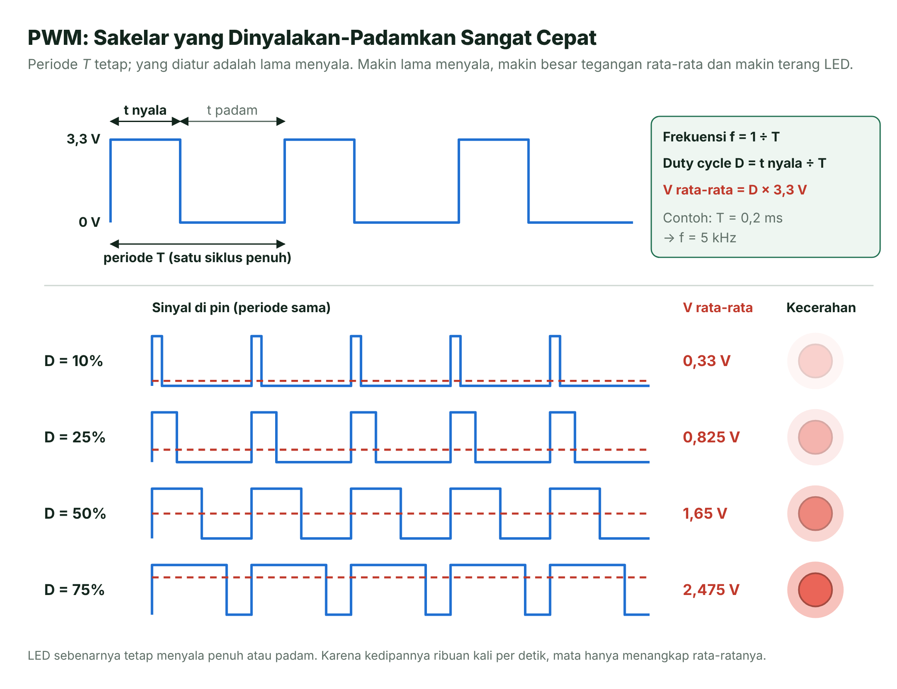
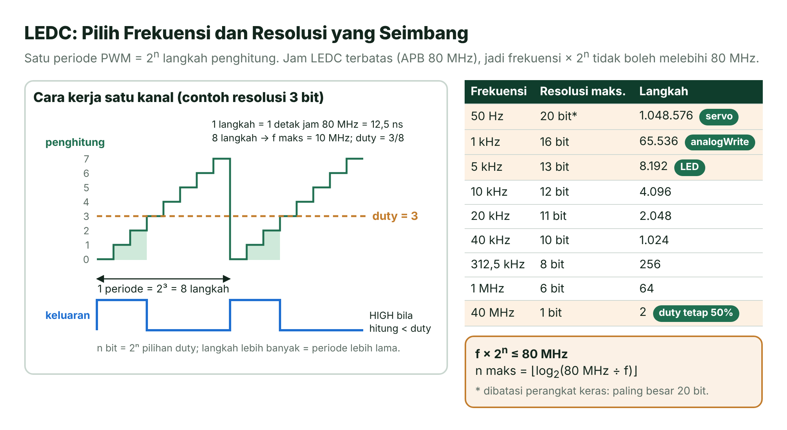
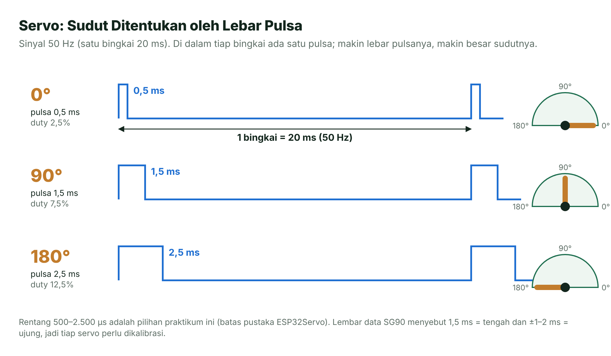
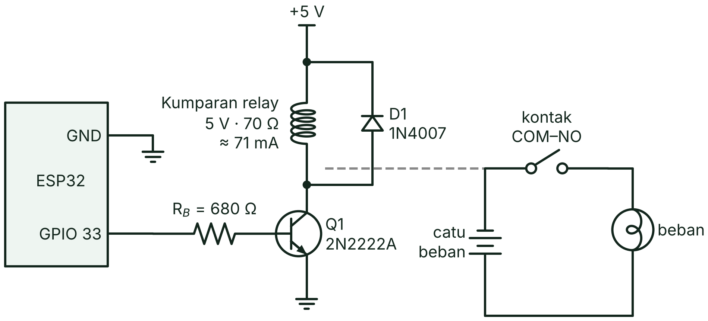
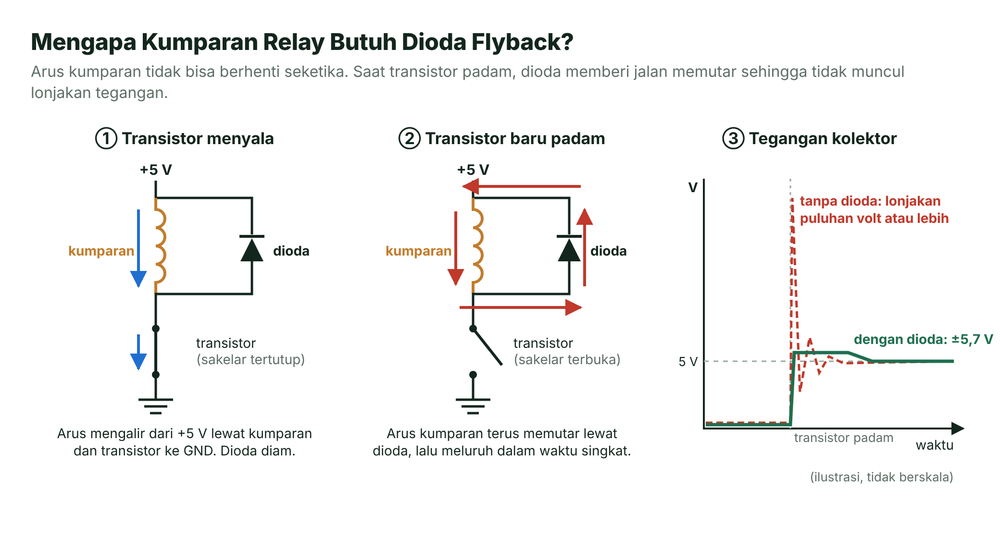
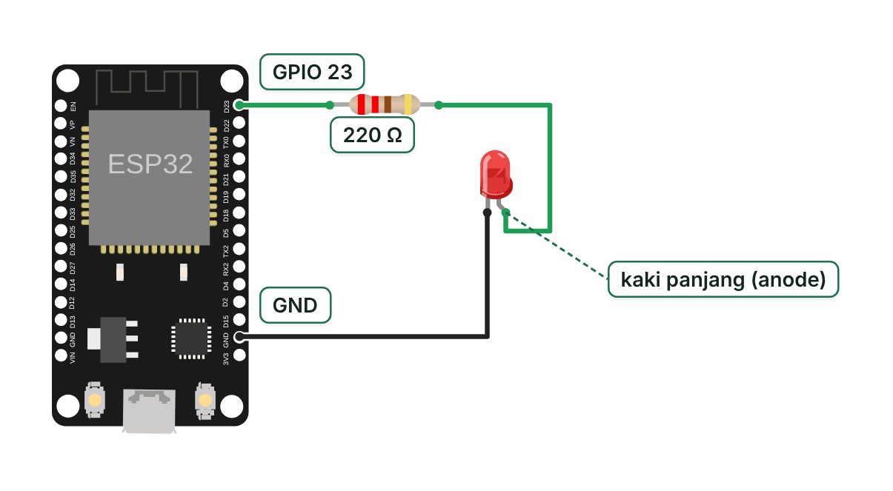
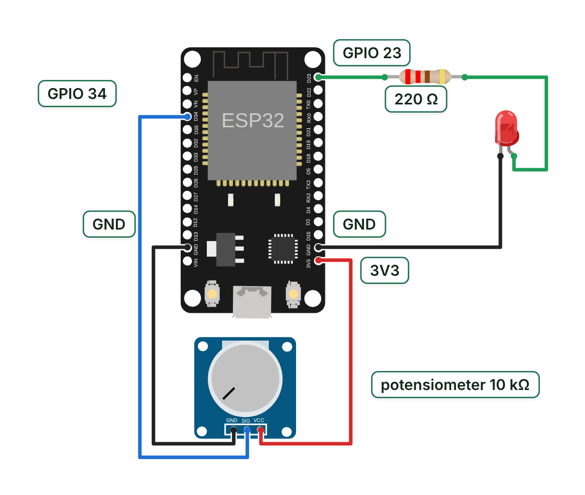
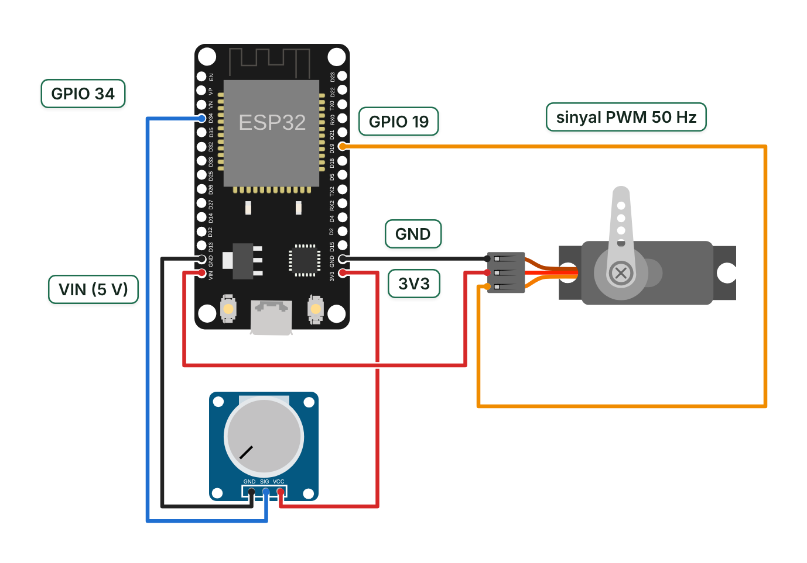
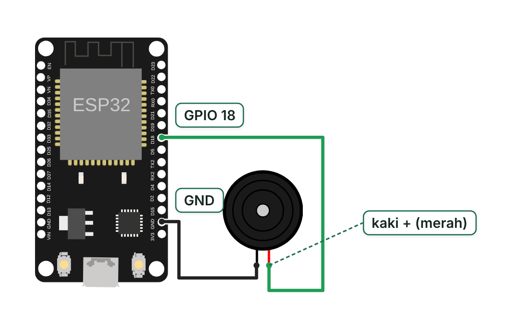
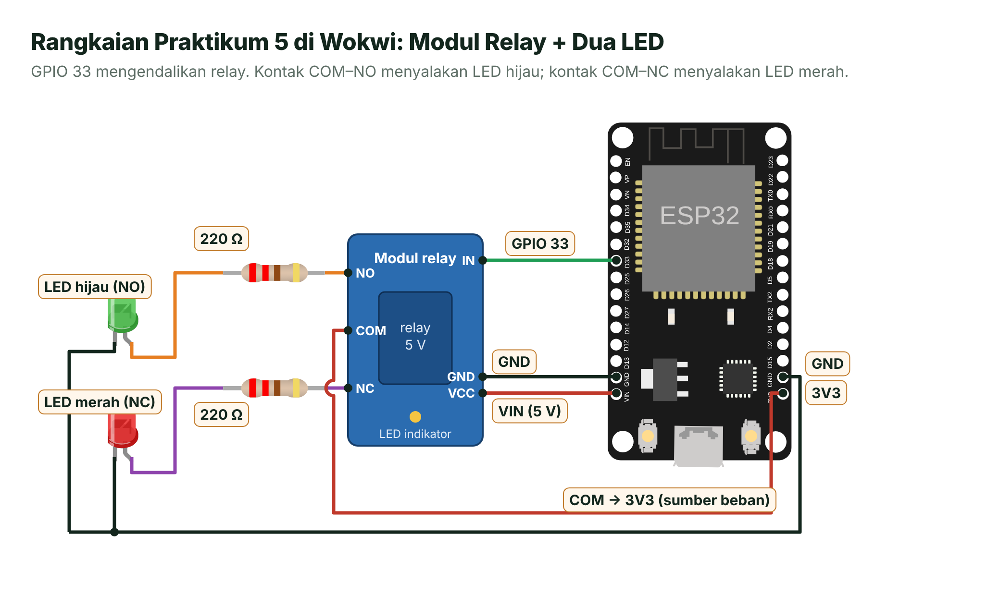

# Pertemuan 07 — PWM dan Mengendalikan Beban

> Hari ini kamu belajar membuat "tegangan setengah" dengan PWM untuk meredupkan LED, menggerakkan servo, dan membunyikan nada, lalu memakai transistor dan *relay* untuk mengendalikan beban yang jauh lebih besar daripada kemampuan pin ESP32.

| | |
| --- | --- |
| ⏱️ **Durasi** | 2 × 50 menit teori + 3 × 50 menit praktikum |
| 📋 **Prasyarat** | [Pertemuan 03](../pertemuan-03-gpio-output/README.md) (GPIO output, resistor LED) dan [Pertemuan 06](../pertemuan-06-adc/README.md) (ADC, potensiometer) |
| 🧰 **Alat** | Laptop + internet (Wokwi); opsional: ESP32 DevKit V1, LED, potensiometer, servo SG90, *buzzer* pasif, modul *relay* 5 V |
| 📥 **Slide** | 👁️ [Lihat di peramban](https://view.officeapps.live.com/op/view.aspx?src=https%3A%2F%2Fraw.githubusercontent.com%2Fantonprafanto%2Fembeddedsystem%2Fmain%2Fslide%2Fpptx%2FP07-PWM-dan-Beban.pptx) · ⬇️ [Unduh PDF](https://raw.githubusercontent.com/antonprafanto/embeddedsystem/main/slide/pdf/P07-PWM-dan-Beban.pdf) · ⬇️ [Unduh PPTX](https://raw.githubusercontent.com/antonprafanto/embeddedsystem/main/slide/pptx/P07-PWM-dan-Beban.pptx) |
| 📄 **Modul PDF** | ⬇️ [Unduh modul ini dalam PDF](https://raw.githubusercontent.com/antonprafanto/embeddedsystem/main/modul-pdf/Modul-P07-PWM-dan-Beban.pdf) — untuk dibaca luring atau dicetak |

## Daftar Isi

- [🎯 Tujuan Pembelajaran](#-tujuan-pembelajaran)
- [🧰 Yang Perlu Disiapkan](#-yang-perlu-disiapkan)
- [1. Mengapa Perlu PWM?](#1-mengapa-perlu-pwm)
- [2. Anatomi Sinyal PWM](#2-anatomi-sinyal-pwm)
- [3. PWM di ESP32: Periferal LEDC](#3-pwm-di-esp32-periferal-ledc)
- [4. Servo: Sudut dari Lebar Pulsa](#4-servo-sudut-dari-lebar-pulsa)
- [5. Buzzer: Membuat Nada](#5-buzzer-membuat-nada)
- [6. Mengendalikan Beban Besar: Transistor dan Relay](#6-mengendalikan-beban-besar-transistor-dan-relay)
- [🧪 Praktikum](#-praktikum)
- [🏋️ Latihan & Tantangan](#️-latihan--tantangan)
- [✅ Cek Pemahaman](#-cek-pemahaman)
- [📌 Rangkuman](#-rangkuman)
- [📚 Referensi](#-referensi)
- [🖼️ Sumber Gambar](#️-sumber-gambar)

---

## 🎯 Tujuan Pembelajaran

Setelah pertemuan ini, kamu bisa:

1. Menjelaskan PWM dengan istilah periode, frekuensi, dan siklus kerja (*duty cycle*), lalu menghitung tegangan rata-ratanya.
2. Membangkitkan PWM di ESP32 dengan `ledcAttach()` dan `ledcWrite()`, serta memilih pasangan frekuensi–resolusi yang mungkin dibuat.
3. Mengatur sudut servo dengan lebar pulsa dan memainkan nada dengan *buzzer* pasif.
4. Menghitung resistor basis transistor NPN untuk menggerakkan kumparan *relay* dan menjelaskan fungsi dioda *flyback*.
5. Menerapkan aturan keselamatan saat bekerja dengan beban besar dan listrik jala-jala 220 V.

## 🧰 Yang Perlu Disiapkan

| Kebutuhan | Keterangan |
| --- | --- |
| Wajib | Laptop + internet untuk Wokwi, dan proyek di *folder* [`kode/`](kode) |
| Komponen (board asli) | LED merah + resistor 220 Ω, potensiometer 10 kΩ, servo SG90, *buzzer* pasif, modul *relay* 5 V satu kanal, *breadboard*, kabel *jumper* |
| Opsional (rangkaian transistor) | *Relay* 5 V (misalnya SRD-05VDC-SL-C), transistor NPN 2N2222A (atau BC547), resistor 680 Ω, dioda 1N4007 |
| Disarankan untuk servo | Sumber 5 V terpisah (misalnya *power bank* atau modul catu daya *breadboard*) yang GND-nya disatukan dengan GND ESP32 |
| Jalur Wokwi | Semua praktikum bisa disimulasikan. Wokwi tidak punya transistor dan dioda diskrit, jadi Praktikum 5 memakai part modul *relay* |
| Bacaan pendukung | [Daftar komponen](../panduan/04-daftar-komponen.md) · [Pinout ESP32](../panduan/05-pinout-esp32.md) · [Simulasi Wokwi](../panduan/03-simulasi-wokwi.md) |

---

## 1. Mengapa Perlu PWM?

Bayangkan kamu ingin membuat lampu tidur yang bisa diredupkan. Di Pertemuan 3 kamu sudah tahu bahwa pin GPIO hanya punya dua keadaan: HIGH (3,3 V) atau LOW (0 V). LED menyala penuh atau padam, tidak ada "setengah terang".

Coba bayangkan sakelar lampu kamar yang ditekan nyala-padam bergantian sangat cepat, misalnya 5.000 kali per detik. Kalau separuh waktu menyala dan separuh waktu padam, mata melihat lampu "setengah terang". Inilah ide **PWM** (*Pulse Width Modulation*, modulasi lebar pulsa): yang diatur adalah **perbandingan lama menyala dan lama padam**, bukan besar tegangannya.

Mengapa tidak memakai DAC saja? ESP32 memang punya DAC 8 bit, tetapi hanya di dua pin, yaitu GPIO 25 dan 26 [3]. PWM bisa dibuat di hampir semua pin output, sehingga lebih praktis untuk banyak keperluan: kecerahan LED, kecepatan motor, posisi servo, sampai nada *buzzer*.

## 2. Anatomi Sinyal PWM



*Gambar 7.1 — Anatomi sinyal PWM dan pengaruh siklus kerja terhadap tegangan rata-rata. Sumber: dibuat untuk materi ini.*

| Istilah | Arti | Rumus/satuan |
| --- | --- | --- |
| **Periode** (*T*) | Lama satu siklus nyala + padam | detik (s), milidetik (ms), mikrodetik (µs) |
| **Frekuensi** (*f*) | Banyaknya siklus dalam satu detik | hertz (Hz); *f* = 1 ÷ *T* |
| **Siklus kerja** (*duty cycle*, *D*) | Persentase waktu menyala dalam satu periode | *D* = *t*<sub>nyala</sub> ÷ *T* × 100% |
| **Tegangan rata-rata** | Nilai rata-rata sinyal dalam satu periode | *V*<sub>rata</sub> = *D* × 3,3 V |

**Contoh hitungan.** PWM 5 kHz punya periode *T* = 1 ÷ 5.000 = 0,2 ms = 200 µs. Dengan *D* = 25%, pin menyala 50 µs dan padam 150 µs pada setiap periode. Tegangan rata-ratanya 0,25 × 3,3 V = 0,825 V. Kalau diukur dengan multimeter mode DC, angkanya mendekati nilai rata-rata ini.

**Mengapa LED tampak meredup?** LED-nya sendiri tetap menyala penuh setiap kali pin HIGH. Yang "merata-ratakan" adalah **mata**: kedipan ribuan kali per detik terlalu cepat untuk dilihat, sehingga yang tertangkap hanya kecerahan rata-ratanya. Pada motor, yang merata-ratakan adalah kelembaman putaran dan kumparan motor itu sendiri.

> [!IMPORTANT]
> **Kecerahan diatur oleh *duty cycle*, bukan oleh frekuensi.** Frekuensi cukup dibuat tinggi agar kedipan tidak terlihat dan sesuai dengan kebutuhan beban. Untuk LED, kita memakai 5 kHz; fungsi `analogWrite()` di Arduino-ESP32 memakai 1 kHz secara bawaan [2].

## 3. PWM di ESP32: Periferal LEDC

Kamu bisa saja membuat PWM dengan `digitalWrite()` dan `delayMicroseconds()` di dalam `loop()`. Masalahnya, CPU jadi sibuk terus-menerus dan kedipannya kacau setiap kali program mengerjakan hal lain. Karena itu ESP32 punya **periferal LEDC** (*LED Control*): modul perangkat keras khusus PWM yang bekerja sendiri. Setelah diatur, sinyal PWM tetap berjalan walaupun CPU sedang menjalankan `delay()`.

LEDC pada ESP32 punya **16 kanal**, **8 pewaktu** (*timer*), dan resolusi hingga **20 bit** [3]. Satu kanal menghasilkan satu sinyal PWM di satu pin. Sebenarnya ESP32 juga punya periferal MCPWM khusus motor, tetapi kita memakai LEDC karena lebih sederhana dan MCPWM tidak disimulasikan Wokwi.

### Cara Kerja: Penghitung dan Pembanding

Setiap kanal punya **penghitung** yang bertambah satu pada setiap detak jam, dari 0 sampai 2<sup>n</sup> − 1, lalu kembali ke 0. Selama nilai penghitung lebih kecil daripada nilai duty, pin dibuat HIGH. Jadi, satu periode PWM = 2<sup>n</sup> langkah, dengan *n* adalah **resolusi** dalam bit.

Sumber jam utamanya APB 80 MHz [1]. Akibatnya, frekuensi dan resolusi saling tarik-menarik: makin tinggi frekuensi, makin sedikit langkah yang muat dalam satu periode.



*Gambar 7.2 — Cara kerja kanal LEDC dan batas frekuensi–resolusi dengan jam 80 MHz. Sumber: dibuat untuk materi ini; angka dihitung dari rumus di bawah dan dicocokkan dengan dokumentasi ESP-IDF [1].*

Aturannya cukup diingat dalam satu baris:

```text
frekuensi × 2^n ≤ 80 MHz     →     n maks = ⌊log2(80 MHz ÷ frekuensi)⌋   (paling besar 20 bit)
```

Contoh yang tercantum di dokumentasi ESP-IDF [1]: 5 kHz bisa memakai resolusi maksimum 13 bit, sedangkan 40 MHz hanya 1 bit (duty terkunci 50%). Permintaan 20 MHz dengan 3 bit ditolak; dengan 2 bit baru bisa. Untuk frekuensi rendah, ESP32 juga punya sumber jam yang lebih lambat (REF_TICK 1 MHz) [1], dan Arduino-ESP32 memilih sumber jam secara otomatis.

### API LEDC di Arduino-ESP32 3.x

| Fungsi | Kegunaan |
| --- | --- |
| `ledcAttach(pin, frek, resolusi)` | Memasang pin ke kanal LEDC yang masih bebas. Hasilnya `true` bila berhasil, `false` bila kombinasi frekuensi–resolusi tidak bisa dibuat |
| `ledcWrite(pin, duty)` | Mengatur duty, dari 0 sampai 2<sup>resolusi</sup> − 1. Nilai maksimum (255 untuk 8 bit) dibuat menyala 100% |
| `ledcFade(pin, dutyAwal, dutyAkhir, lamaMs)` | Memudar otomatis oleh perangkat keras, tanpa membebani CPU |
| `ledcChangeFrequency(pin, frek, resolusi)` | Mengganti frekuensi dan resolusi kanal yang sudah terpasang |
| `ledcWriteTone(pin, frek)` | Gelombang kotak *duty* ±50% pada frekuensi tertentu (untuk nada) |
| `ledcDetach(pin)` | Melepas pin dari LEDC |
| `analogWrite(pin, nilai)` | Jalan pintas: otomatis memasang LEDC 1 kHz, 8 bit (0–255) [2] |

Contoh kecil:

```cpp
const int PIN_LED = 23;

void setup() {
  ledcAttach(PIN_LED, 5000, 8);          // 5 kHz, 8 bit → duty 0–255
  ledcWrite(PIN_LED, 64);                // 64 dari 256 langkah ≈ 25% → LED redup
  delay(2000);
  ledcFade(PIN_LED, 64, 255, 1000);      // naik ke terang penuh dalam ±1 detik
}

void loop() {
}
```

Selama `ledcFade()` berjalan, perangkat keras ESP32 tidak bisa menerima perubahan duty pada kanal itu [1]. Jadi, tunggu sampai pemudaran selesai sebelum memberi perintah baru.

> [!WARNING]
> **Awas tutorial lama.** Banyak contoh di internet masih memakai `ledcSetup()` dan `ledcAttachPin()` dari Arduino-ESP32 versi 2.x. Fungsi itu sudah tidak ada di versi 3.x yang kita pakai, sehingga **Build** gagal dengan pesan `'ledcSetup' was not declared in this scope`. Ganti dengan `ledcAttach(pin, frek, resolusi)` dan tulis duty dengan `ledcWrite(pin, duty)`, yaitu memakai nomor **pin**, bukan nomor kanal.

## 4. Servo: Sudut dari Lebar Pulsa

Servo mirip pengemudi yang selalu menjaga setir di posisi yang diperintahkan. Di dalamnya ada motor DC kecil, roda gigi, potensiometer pembaca posisi poros, dan rangkaian pengendali. Rangkaian itu terus membandingkan posisi poros dengan perintah, lalu memutar motor sampai keduanya sama.

Perintahnya dikirim lewat sinyal PWM **50 Hz** (satu bingkai 20 ms). Yang dibaca servo adalah **lebar pulsa**, bukan tegangan rata-ratanya.



*Gambar 7.3 — Lebar pulsa menentukan sudut servo. Sumber: dibuat untuk materi ini.*

| Sudut | Lebar pulsa (praktikum ini) | Duty pada 50 Hz |
| --- | --- | --- |
| 0° | 500 µs | 2,5% |
| 90° | 1.500 µs | 7,5% |
| 180° | 2.500 µs | 12,5% |

Rumusnya linear: **lebar pulsa = 500 + sudut × (2.000 ÷ 180) µs**, atau kira-kira 500 + 11,1 × sudut. Contoh: 45° → 500 + 500 = 1.000 µs.

**Bandingkan dengan lembar data.** Lembar data SG90 menyebut periode 20 ms, pulsa ±1,5 ms untuk posisi tengah, ±1 ms dan ±2 ms untuk ujung kiri dan kanan, tegangan kerja 4,8 V, serta *dead band* 10 µs [6]. Pustaka ESP32Servo 3.2.1 memakai 50 Hz; bila dipanggil `attach(pin)` tanpa angka, rentang bawaannya **544–2.400 µs**, dan rentang yang boleh kamu berikan dibatasi **500–2.500 µs** [5]. Karena angka-angka itu tidak persis sama dan tiap unit servo sedikit berbeda, rentang pulsa perlu **dikalibrasi**: kalau servo berdengung atau tertahan di ujung, persempit rentangnya.

> [!NOTE]
> **ESP32Servo juga memakai LEDC.** Secara bawaan pustaka ini memakai resolusi 10 bit pada 50 Hz, sehingga satu langkah = 20 ms ÷ 1.024 ≈ 19,5 µs (±1,8° pada rentang 500–2.500 µs) [5]. Untuk SG90 itu sudah cukup. Butuh lebih halus? Panggil `servo.setTimerWidth(16)` sebelum `attach()`.

**Catu daya servo.** Saat mulai bergerak atau tertahan beban, motor servo menarik arus puncak yang besar. Kalau diambil dari board, tegangan bisa anjlok sesaat dan ESP32 ter-*reset* (*brownout*). Di board asli, beri servo **sumber 5 V terpisah**, lalu **satukan GND**-nya dengan GND ESP32. GND bersama wajib, karena pulsa dari GPIO diukur terhadap GND; tanpa GND bersama, servo tidak "melihat" pulsanya dengan benar.

> [!CAUTION]
> **Jangan menyalakan servo dari pin 3V3.** Pin 3V3 berasal dari regulator board yang juga menghidupi ESP32. Lonjakan arus servo bisa membuat ESP32 ter-*reset* berulang dan regulator kepanasan.

## 5. *Buzzer*: Membuat Nada

Ada dua jenis *buzzer* yang sering tertukar:

| | *Buzzer* aktif | *Buzzer* pasif |
| --- | --- | --- |
| Isi | Elemen bunyi + osilator internal | Hanya elemen bunyi |
| Cara membunyikan | Cukup diberi HIGH (tegangan searah) | Harus diberi sinyal bolak-balik, misalnya PWM berfrekuensi suara |
| Nada | Satu nada tetap | Bisa berganti nada (melodi) |
| Cocok untuk | Alarm "tiiit" sederhana | Nada dan melodi |

**Cara mengecek jenisnya:** beri tegangan 3,3 V sebentar. Kalau berbunyi "tiiit" terus, itu *buzzer* aktif. Kalau hanya terdengar "klik", itu *buzzer* pasif.

Tinggi nada ditentukan oleh **frekuensi**. Patokan yang dipakai di seluruh dunia adalah nada A4 = 440 Hz. Setiap naik satu semitone (satu tuts piano, termasuk tuts hitam), frekuensi dikali 2<sup>1/12</sup> ≈ 1,0595. Jadi, untuk nada yang berjarak *n* semitone dari A4:

```text
f = 440 × 2^(n/12)      contoh: C5 (n = 3) → 440 × 2^(3/12) = 440 × 1,1892 ≈ 523,25 Hz
```

| Nada | Solmisasi | *n* | *f* (Hz) | Di kode |
| --- | --- | --- | --- | --- |
| C4 | do | −9 | 261,63 | 262 |
| D4 | re | −7 | 293,66 | 294 |
| E4 | mi | −5 | 329,63 | 330 |
| F4 | fa | −4 | 349,23 | 349 |
| G4 | sol | −2 | 392,00 | 392 |
| A4 | la | 0 | 440,00 | 440 |
| B4 | si | 2 | 493,88 | 494 |
| C5 | do' | 3 | 523,25 | 523 |

**Durasi** nada mengikuti tempo. Pada tempo 120 ketuk per menit, satu ketuk = 60.000 ÷ 120 = 500 ms. Bunyikan nada sekitar 90% dari durasinya, lalu diam 10%, supaya dua nada yang sama (misalnya mi-mi) terdengar terpisah.

```cpp
ledcAttach(PIN_BUZZER, 1000, 10);   // pasang pin ke LEDC (frekuensi awal bebas)
ledcWriteTone(PIN_BUZZER, 440);     // nada A4: gelombang kotak 440 Hz, duty ±50%
delay(450);
ledcWriteTone(PIN_BUZZER, 0);       // frekuensi 0 = diam
```

Ada juga `ledcWriteNote(pin, NOTE_A, 4)` yang menghitung frekuensi nada untuk kamu, serta jalan pintas `tone(pin, frek, lamaMs)` dan `noTone(pin)`. Fungsi `tone()` mengurus LEDC sendiri, jadi jangan dicampur dengan `ledcAttach()` pada pin yang sama [2].

> [!NOTE]
> **Cek arus *buzzer*-mu.** *Buzzer* piezo kecil menarik arus kecil dan aman langsung ke GPIO. Sebagian *buzzer* pasif berjenis elektromagnetik (berkumparan) menarik arus lebih besar. Bila lembar datanya menyebut arus di atas ±10–12 mA, kendalikan lewat transistor seperti di bagian 6. Banyak modul *buzzer* 3 pin sudah membawa transistor sendiri.

## 6. Mengendalikan Beban Besar: Transistor dan *Relay*

Pin GPIO ESP32 dirancang untuk sinyal, bukan untuk daya. Lembar data modul memang menyebut arus keluaran tipikal hingga 40 mA [4], tetapi itu bukan angka untuk dipakai terus-menerus. Praktik amannya **±10–12 mA per pin**. Bandingkan dengan beban berikut:

| Beban | Kebutuhan arus | Langsung ke GPIO? |
| --- | --- | --- |
| LED + resistor 220 Ω | ±6 mA | Ya |
| Kumparan *relay* 5 V (SRD-05VDC-SL-C) | 71,4 mA pada 5 V [7] | Tidak: lewat transistor |
| Motor DC kecil, solenoid | Ratusan mA atau lebih | Tidak: lewat transistor/MOSFET atau *driver* |
| Lampu atau pompa 220 V | Listrik jala-jala | Tidak pernah: lewat *relay* dan hanya dengan pengawasan |

Dua alat bantunya:

- **Transistor** seperti keran kecil yang membuka pintu air besar: arus kecil di basis mengendalikan arus besar di kolektor.
- ***Relay*** adalah sakelar mekanis yang digerakkan elektromagnet. Sisi kendali (kumparan) dan sisi beban (kontak) terpisah secara listrik, sehingga *relay* bisa menyambung beban bertegangan lain, bahkan beban AC.

### 6.1 Transistor NPN sebagai Sakelar

Transistor NPN punya tiga kaki: **basis** (B), **kolektor** (C), dan **emitor** (E). Sebagai sakelar sisi bawah (*low-side*), beban dipasang di antara +5 V dan kolektor, emitor ke GND, dan basis dikendalikan GPIO lewat resistor **R<sub>B</sub>**.

- GPIO LOW → tidak ada arus basis → transistor **padam** (sakelar terbuka).
- GPIO HIGH → arus basis mengalir → transistor **jenuh** (sakelar tertutup), tegangan kolektor–emitor tinggal ±0,2–0,3 V.

Di daerah aktif berlaku *I*<sub>C</sub> = *h*<sub>FE</sub> × *I*<sub>B</sub>, dengan *h*<sub>FE</sub> adalah penguatan arus. Agar transistor **pasti jenuh** walaupun *h*<sub>FE</sub> tiap transistor berbeda, arus basis sengaja dibuat 2–5 kali lebih besar daripada kebutuhan minimum. Kelebihan ini disebut *overdrive*.



*Gambar 7.4 — Transistor NPN sebagai sakelar kumparan relay, lengkap dengan dioda flyback. Sumber: dibuat untuk materi ini (digambar dengan pustaka schemdraw).*

**Contoh menghitung R<sub>B</sub>** untuk *relay* SRD-05VDC-SL-C dan transistor 2N2222A:

| Langkah | Hitungan | Hasil |
| --- | --- | --- |
| 1. Arus kumparan | 5 V ÷ 70 Ω (lembar data: 71,4 mA [7]) | *I*<sub>C</sub> ≈ 71,4 mA |
| 2. *h*<sub>FE</sub> minimum | Lembar data 2N2222A: 50 pada *I*<sub>C</sub> = 150 mA, *V*<sub>CE</sub> = 1 V [8] | *h*<sub>FE</sub> = 50 |
| 3. Arus basis minimum | 71,4 mA ÷ 50 | *I*<sub>B,min</sub> ≈ 1,43 mA |
| 4. Beri *overdrive* 2–3× | 2 × 1,43 sampai 3 × 1,43 | *I*<sub>B</sub> ≈ 2,9–4,3 mA |
| 5. Hitung R<sub>B</sub> | (3,3 V − 0,7 V) ÷ *I*<sub>B</sub> | 600–900 Ω → pilih **680 Ω** |
| 6. Cek ulang | 2,6 V ÷ 680 Ω | *I*<sub>B</sub> ≈ 3,8 mA (*overdrive* ±2,7×) |
| 7. Cek pin dan *relay* | 3,8 mA < 10–12 mA; kumparan mendapat 5 − 0,3 = 4,7 V | Pin aman; 4,7 V > batas tarik 3,75 V [7] |

Angka 0,7 V adalah perkiraan tegangan basis–emitor. Walaupun nyatanya sedikit lebih besar, arus basis masih jauh di atas 1,43 mA. Kalau tidak punya 680 Ω, resistor 470 Ω juga aman (*I*<sub>B</sub> ≈ 5,5 mA). BC547 juga bisa dipakai, tetapi arus kolektor maksimumnya hanya 100 mA [9], sehingga mepet untuk kumparan 71 mA; 2N2222A (maksimum 600 mA [8]) lebih lega.

> [!TIP]
> **Mencari kaki kumparan *relay*.** Ukur pasangan kaki *relay* dengan multimeter mode ohm. Pasangan yang terbaca ±70 Ω adalah kumparan. Urutan kaki transistor (E, B, C) juga berbeda antarjenis dan antarpabrikan, jadi selalu cek lembar data komponen yang kamu pegang.

### 6.2 Dioda Flyback

Pernah mendengar pipa air berbunyi "dug" ketika keran ditutup mendadak? Air yang sedang mengalir tidak bisa berhenti seketika. Kumparan *relay* mirip itu: arus yang sedang mengalir di kumparan "ingin" terus mengalir. Ketika transistor padam mendadak, kumparan membangkitkan tegangan balik yang sangat besar di kolektor (*V* = *L* × Δ*I* ÷ Δ*t*), jauh melebihi 5 V dan bisa melampaui batas 40 V transistor 2N2222A [8].



*Gambar 7.5 — Arah arus kumparan dan peran dioda flyback. Sumber: dibuat untuk materi ini.*

**Dioda *flyback*** (misalnya 1N4007, 1.000 V, 1 A [10]) dipasang paralel dengan kumparan, **katode (bergaris) ke +5 V** dan anode ke kolektor. Saat transistor menyala, dioda tertahan arah balik dan diam. Saat transistor padam, dioda memberi jalan memutar bagi arus kumparan sampai habis, sehingga tegangan kolektor tertahan sekitar 5 V + 0,7 V ≈ 5,7 V. Aturan ini berlaku untuk semua beban berkumparan: *relay*, motor, dan solenoid.

> [!CAUTION]
> **Dioda terbalik = hubung singkat.** Kalau garis dioda dipasang ke arah kolektor, dioda langsung menghantar dari +5 V ke transistor setiap kali transistor menyala. Dioda dan transistor bisa panas lalu rusak. Periksa arah garisnya sebelum menyalakan rangkaian.

### 6.3 Modul *Relay*

Di pasaran banyak dijual **modul *relay*** yang sudah berisi *relay*, transistor, dioda, LED indikator, dan kadang optokopler. Sisi kendalinya punya pin **VCC**, **GND**, dan **IN**; sisi bebannya punya terminal **COM** (bersama), **NO** (*normally open*, tersambung ke COM hanya saat *relay* aktif), dan **NC** (*normally closed*, tersambung ke COM saat *relay* tidak aktif).

| Parameter SRD-05VDC-SL-C [7] | Nilai |
| --- | --- |
| Tegangan dan resistansi kumparan | 5 V DC, 70 Ω ±10% |
| Arus dan daya kumparan | 71,4 mA, ±0,36 W |
| Tegangan tarik maksimum / lepas minimum | 75% (3,75 V) / 10% (0,5 V) |
| Waktu operasi / waktu lepas maksimum | 10 ms / 5 ms |

Dua hal yang perlu dicek pada modul *relay*:

1. **Aktif HIGH atau aktif LOW?** Banyak modul **aktif LOW**: *relay* menyala saat IN diberi LOW. Kode Praktikum 5 menyediakan konstanta `RELAY_AKTIF_LOW` untuk itu.
2. **Cukupkah sinyal 3,3 V?** Pada sebagian modul 5 V yang aktif LOW, HIGH 3,3 V belum tentu memadamkan *relay* dengan sempurna, karena selisih 5 V − 3,3 V = 1,7 V masih bisa menyalakan LED optokoplernya. Pilih modul yang menyebut kompatibel dengan logika 3,3 V, atau pakai rangkaian transistor di atas.

*Relay* hanya untuk nyala-padam yang jarang. Jangan mengendalikannya dengan PWM: kontaknya mekanis dan umurnya terbatas. Untuk mengatur kecepatan motor DC dengan PWM, dipakai transistor atau MOSFET, yang akan kamu temui lagi saat membahas aktuator.

> [!WARNING]
> **Keselamatan listrik jala-jala 220 V.** Listrik PLN bisa mematikan. Jangan merangkai, menyentuh, atau mengukur bagian 220 V tanpa pengawasan dosen atau teknisi. Terminal sekrup dan jalur PCB modul *relay* murah terbuka dan bisa tersentuh. Di mata kuliah ini, semua praktikum *relay* memakai beban tegangan rendah saja (LED atau lampu DC).

---

## 🧪 Praktikum

### Sebelum Mulai

Setiap praktikum bisa dijalankan lewat dua jalur dengan kode yang sama. Langkah rincinya ada di [Pertemuan 01](../pertemuan-01-pengenalan/README.md#-praktikum).

**Jalur A — Wokwi:** buka <https://wokwi.com/projects/new/esp32>, salin `src/main.cpp` ke tab **sketch.ino** dan `diagram.json` ke tab **diagram.json**, lalu klik **▶**. Untuk Praktikum 3, salin juga isi `libraries.txt` ke tab **libraries.txt**.

**Jalur B — Board asli:** buka *folder* praktikum di VS Code (**File** → **Open Folder...**), lalu klik **Build** (✓), **Upload** (→), dan **Serial Monitor**.

> [!IMPORTANT]
> **Cabut dulu, baru merangkai.** Lepaskan kabel USB (dan catu tambahan) setiap kali memasang atau memindah kabel. Sebelum menyalakan, periksa ulang GND bersama dan arah komponen berkutub (LED, dioda).

---

### Praktikum 1 — LED Redup-Terang

📁 *Folder*: [`kode/01-led-redup-terang`](kode/01-led-redup-terang)

**Tujuan:** membangkitkan PWM dengan LEDC dan melihat hubungan nilai duty, tegangan rata-rata, dan kecerahan.

**Rangkaian:**



*Gambar 7.6 — Rangkaian Praktikum 1. Sumber: dibuat untuk materi ini dari `diagram.json`.*

| Dari | Ke |
| --- | --- |
| GPIO 23 | Resistor 220 Ω |
| Resistor 220 Ω | Anode LED (kaki panjang) |
| Katode LED (kaki pendek) | GND |

**Kode** (`src/main.cpp`, bagian penting):

```cpp
const int PIN_LED = 23;
const int FREKUENSI_PWM = 5000;   // 5 kHz: kedipan terlalu cepat untuk terlihat mata
const int RESOLUSI_PWM = 8;       // 8 bit → nilai duty 0–255
const int DUTY_MAKS = 255;

void setup() {
  Serial.begin(115200);
  if (!ledcAttach(PIN_LED, FREKUENSI_PWM, RESOLUSI_PWM)) {
    Serial.println("[PERINGATAN] ledcAttach gagal. Cek pin, frekuensi, dan resolusi.");
    while (true) {
      delay(1000);
    }
  }
}

void loop() {
  for (int duty = 0; duty <= DUTY_MAKS; duty++) {   // redup → terang
    ledcWrite(PIN_LED, duty);
    tampilkanDuty(duty);      // cetak duty dan V rata-rata tiap kelipatan 20%
    delay(JEDA_LANGKAH_MS);   // 4 ms × 255 langkah ≈ 1 detik
  }
  // ... perulangan kedua: duty turun dari 255 ke 0 (terang → redup)
}
```

Jalan pintasnya, `analogWrite(PIN_LED, duty)` tanpa `ledcAttach()`, otomatis memakai 1 kHz dan 8 bit.

**Hasil yang diharapkan:** LED berangsur terang selama ±1 detik, lalu berangsur redup selama ±1 detik, terus berulang. Serial Monitor menampilkan:

```text
[INFO] PWM siap: GPIO 23, 5000 Hz, resolusi 8 bit (duty 0-255)
[INFO] Redup -> terang
[DATA] duty =   0/255 (  0%) -> V rata-rata = 0.00 V
[DATA] duty =  51/255 ( 20%) -> V rata-rata = 0.66 V
[DATA] duty = 102/255 ( 40%) -> V rata-rata = 1.32 V
[DATA] duty = 153/255 ( 60%) -> V rata-rata = 1.98 V
[DATA] duty = 204/255 ( 80%) -> V rata-rata = 2.64 V
[DATA] duty = 255/255 (100%) -> V rata-rata = 3.30 V
[INFO] Terang -> redup
[DATA] duty = 255/255 (100%) -> V rata-rata = 3.30 V
[DATA] duty = 204/255 ( 80%) -> V rata-rata = 2.64 V
[DATA] duty = 153/255 ( 60%) -> V rata-rata = 1.98 V
[DATA] duty = 102/255 ( 40%) -> V rata-rata = 1.32 V
[DATA] duty =  51/255 ( 20%) -> V rata-rata = 0.66 V
[DATA] duty =   0/255 (  0%) -> V rata-rata = 0.00 V
[INFO] Redup -> terang
```

**Kalau belum berhasil:**

| Gejala | Coba ini |
| --- | --- |
| LED tidak menyala sama sekali | Cek arah LED (kaki panjang ke resistor) dan pastikan kabel ada di GPIO 23. |
| Muncul `[PERINGATAN] ledcAttach gagal` | Kombinasi frekuensi–resolusi tidak bisa dibuat. Turunkan resolusi atau frekuensi (lihat Gambar 7.2). |
| Galat `'ledcSetup' was not declared in this scope` | Kode memakai API lama 2.x. Ganti dengan `ledcAttach()`. |
| LED hanya menyala-padam, tidak meredup | Pastikan memakai `ledcWrite()`, bukan `digitalWrite()`. |

**Eksperimen kecil:**

- Ubah `FREKUENSI_PWM` menjadi `20`. Mengapa LED sekarang berkedip, bukan meredup? (Bila muncul peringatan `ledcAttach` gagal, kecilkan resolusinya.)
- Ganti isi `loop()` dengan `ledcFade(PIN_LED, 0, 255, 2000); delay(2100); ledcFade(PIN_LED, 255, 0, 2000); delay(2100);`. Apa bedanya bagi CPU?
- Di antara duty 200 dan 255, apakah perbedaan kecerahan masih terlihat jelas? Bandingkan dengan duty 0 sampai 50.

---

### Praktikum 2 — Dimmer dengan Potensiometer

📁 *Folder*: [`kode/02-dimmer-potensiometer`](kode/02-dimmer-potensiometer)

**Tujuan:** menggabungkan input analog (ADC) dan output PWM, seperti *dimmer* lampu.

**Rangkaian:** LED sama seperti Praktikum 1, ditambah potensiometer seperti Pertemuan 6.



*Gambar 7.7 — Rangkaian Praktikum 2. Sumber: dibuat untuk materi ini dari `diagram.json`.*

| Dari | Ke |
| --- | --- |
| Kaki kiri potensiometer (GND) | GND |
| Kaki tengah (SIG) | GPIO 34 |
| Kaki kanan (VCC) | 3V3 |
| GPIO 23 | Resistor 220 Ω → LED → GND (sama seperti Praktikum 1) |

**Kode** (bagian penting):

```cpp
const int RESOLUSI_PWM = 12;   // 12 bit → duty 0–4095, sama dengan rentang analogRead()

void loop() {
  int nilaiAdc = analogRead(PIN_POT);   // 0–4095
  ledcWrite(PIN_LED, nilaiAdc);         // resolusi sama → nilainya langsung dipakai
  if (abs(nilaiAdc - nilaiTerakhir) >= AMBANG_CETAK) {   // cetak bila berubah ≥ 40
    nilaiTerakhir = nilaiAdc;
    Serial.printf("[DATA] ADC = %4d -> duty = %4d/4095 (%3d%%)\n",
                  nilaiAdc, nilaiAdc, nilaiAdc * 100 / DUTY_MAKS);
  }
  delay(JEDA_BACA_MS);
}
```

Trik kecilnya: resolusi PWM disamakan dengan ADC (12 bit). Pada 5 kHz, resolusi maksimum 13 bit, jadi 12 bit masih boleh. Kalau resolusi PWM 8 bit, ubah dulu dengan `map(nilaiAdc, 0, 4095, 0, 255)`.

**Hasil yang diharapkan:** makin jauh kenop diputar ke kanan, makin terang LED. Contoh keluaran (angkanya bergantung pada posisi kenop):

```text
[INFO] Dimmer siap. Putar potensiometer untuk mengatur kecerahan LED.
[DATA] ADC =    0 -> duty =    0/4095 (  0%)
[DATA] ADC = 1024 -> duty = 1024/4095 ( 25%)
[DATA] ADC = 2048 -> duty = 2048/4095 ( 50%)
[DATA] ADC = 4095 -> duty = 4095/4095 (100%)
```

**Kalau belum berhasil:**

| Gejala | Coba ini |
| --- | --- |
| LED hanya padam atau menyala penuh | Kaki tengah potensiometer harus ke GPIO 34. Kalau yang tersambung kaki pinggir, nilainya hanya 0 atau 4095. |
| Di board asli LED sudah padam/penuh sebelum kenop mentok | Wajar: dengan atenuasi bawaan, ADC hanya mengukur ±150–3.100 mV (Pertemuan 6). |
| Serial Monitor terlalu ramai | Naikkan `AMBANG_CETAK`. |

**Eksperimen kecil:**

- Ganti `ledcWrite(PIN_LED, nilaiAdc);` dengan `ledcWrite(PIN_LED, nilaiAdc * nilaiAdc / 4095);`. Mata lebih peka pada perubahan di daerah redup, sehingga koreksi kuadrat ini membuat putaran kenop terasa lebih merata.
- Ubah resolusi menjadi 8 bit dan pakai `map()`. Adakah bedanya yang terlihat?

---

### Praktikum 3 — Menggerakkan Servo

📁 *Folder*: [`kode/03-servo`](kode/03-servo) · Pustaka: ESP32Servo (`lib_deps` sudah ada di `platformio.ini`; di Wokwi lewat `libraries.txt`)

**Tujuan:** menguji sapuan 0° → 180° → 0°, lalu membuat sudut servo mengikuti potensiometer.



*Gambar 7.8 — Rangkaian Praktikum 3. Sumber: dibuat untuk materi ini dari `diagram.json`.*

| Kabel servo SG90 [6] | Wokwi | Board asli |
| --- | --- | --- |
| Oranye (sinyal PWM) | GPIO 19 | GPIO 19 |
| Merah (V+) | VIN (5 V) | + catu 5 V terpisah |
| Cokelat (GND) | GND | − catu 5 V **dan** GND ESP32 |

Potensiometer disambung sama seperti Praktikum 2 (kaki tengah ke GPIO 34).

**Kode** (bagian penting):

```cpp
#include <ESP32Servo.h>

const int PULSA_MIN_US = 500;     // lebar pulsa untuk 0°
const int PULSA_MAKS_US = 2500;   // lebar pulsa untuk 180°
Servo servo;

void setup() {
  servo.setPeriodHertz(50);                              // 50 Hz → bingkai 20 ms
  servo.attach(PIN_SERVO, PULSA_MIN_US, PULSA_MAKS_US);
  for (int sudut = 0; sudut <= 180; sudut++) {           // uji sapuan 0° → 180°
    gerakDanCetak(sudut);                                // servo.write() + jeda 15 ms
  }
  // ... lalu sapuan balik 179° → 0°
}

void loop() {
  int sudut = map(analogRead(PIN_POT), 0, 4095, 0, 180); // 0–4095 → 0–180°
  if (abs(sudut - sudutTerakhir) >= 2) {                 // abaikan goyangan kecil ADC
    sudutTerakhir = sudut;
    servo.write(sudut);           // ESP32Servo mengubah sudut menjadi lebar pulsa
  }
  delay(20);                      // satu bingkai sinyal servo
}
```

**Hasil yang diharapkan:** servo menyapu 0° → 180° → 0° (±5–6 detik), lalu mengikuti putaran potensiometer. Bagian awal Serial Monitor selalu sama; baris `pot = ...` bergantung pada posisi kenop:

```text
[INFO] Servo siap di GPIO 19 (50 Hz, pulsa 500-2500 us)
[INFO] Uji sapuan 0 -> 180 -> 0 derajat
[DATA] sudut =   0 derajat -> pulsa =  500 us
[DATA] sudut =  90 derajat -> pulsa = 1500 us
[DATA] sudut = 180 derajat -> pulsa = 2500 us
[DATA] sudut =  90 derajat -> pulsa = 1500 us
[DATA] sudut =   0 derajat -> pulsa =  500 us
[INFO] Sapuan selesai. Sekarang putar potensiometer.
[DATA] pot = 2048 -> sudut =  90 derajat -> pulsa = 1500 us
```

**Kalau belum berhasil:**

| Gejala | Coba ini |
| --- | --- |
| Galat `ESP32Servo.h: No such file or directory` | PlatformIO: pastikan `lib_deps` ada, lalu **Build** ulang. Wokwi: isi tab `libraries.txt` dengan `ESP32Servo`. |
| ESP32 ter-*reset* dan muncul `Brownout detector was triggered` | Catu servo kurang kuat. Pakai sumber 5 V terpisah dan satukan GND. |
| Servo berdengung atau tertahan di 0° atau 180° | Rentang pulsa melewati batas mekanis servo-mu. Persempit, misalnya 600–2.400 µs. |
| Servo diam sama sekali | Cek kabel oranye di GPIO 19 dan GND bersama. |

**Eksperimen kecil:**

- Di `loop()`, ganti `servo.write(sudut)` dengan `servo.writeMicroseconds(1500)`. Lalu cari lebar pulsa terkecil dan terbesar yang masih membuat servo-mu bergerak, dengan mengubah angkanya sedikit demi sedikit.
- Di board asli, ubah `JEDA_SAPUAN_MS` menjadi `1`, sehingga sapuan 180° hanya 0,18 detik. Lembar data SG90 menyebut kecepatan ±0,1 detik per 60° [6]. Apa yang terjadi?

---

### Praktikum 4 — Memainkan Nada dengan *Buzzer*

📁 *Folder*: [`kode/04-buzzer-nada`](kode/04-buzzer-nada)

**Tujuan:** mengatur tinggi nada dengan frekuensi dan panjang nada dengan durasi, lalu memainkan tangga nada dan melodi.



*Gambar 7.9 — Rangkaian Praktikum 4. Sumber: dibuat untuk materi ini dari `diagram.json`.*

| Dari | Ke |
| --- | --- |
| Kaki + *buzzer* pasif (merah/kaki panjang) | GPIO 18 |
| Kaki − *buzzer* | GND |

**Kode** (bagian penting):

```cpp
const int KETUK_MS = 500;   // tempo 120 ketuk per menit
const int TANGGA[] = {NADA_C4, NADA_D4, NADA_E4, NADA_F4, NADA_G4, NADA_A4, NADA_B4, NADA_C5};

// "Ode to Joy", Beethoven (1824) — domain publik. Durasi dalam setengah ketuk.
const int MELODI[] = {NADA_E4, NADA_E4, NADA_F4, NADA_G4, NADA_G4, NADA_F4, NADA_E4, NADA_D4, /* ... */};
const int DURASI[] = {2, 2, 2, 2, 2, 2, 2, 2, /* ... */};

void mainkanNada(int frekuensi, int lamaMs) {
  int lamaBunyi = lamaMs * 9 / 10;          // 90% berbunyi
  ledcWriteTone(PIN_BUZZER, frekuensi);     // gelombang kotak pada frekuensi nada
  delay(lamaBunyi);
  ledcWriteTone(PIN_BUZZER, 0);             // 10% diam agar nada sama terdengar terpisah
  delay(lamaMs - lamaBunyi);
}
```

**Hasil yang diharapkan:** terdengar tangga nada do–re–mi–fa–sol–la–si–do, jeda 1 detik, potongan melodi "Ode to Joy" (±16 detik), lalu berulang setelah 3 detik. Serial Monitor menampilkan:

```text
[INFO] Buzzer pasif siap di GPIO 18
[INFO] Tangga nada C mayor:
[NADA] C4 (do)  262 Hz
[NADA] D4 (re)  294 Hz
[NADA] E4 (mi)  330 Hz
[NADA] F4 (fa)  349 Hz
[NADA] G4 (sol) 392 Hz
[NADA] A4 (la)  440 Hz
[NADA] B4 (si)  494 Hz
[NADA] C5 (do') 523 Hz
[INFO] Melodi: Ode to Joy (Beethoven, domain publik)
[INFO] Selesai. Diulang 3 detik lagi.
[INFO] Tangga nada C mayor:
```

**Kalau belum berhasil:**

| Gejala | Coba ini |
| --- | --- |
| Wokwi tidak bersuara | Pastikan tab peramban tidak dibisukan. Atribut `volume` *buzzer* di `diagram.json` (bawaan materi ini `0.2`) bisa dinaikkan sampai `1.0` [11]. |
| Terdengar satu nada "tiiit" yang sama terus | Yang terpasang *buzzer* aktif. Ganti dengan *buzzer* pasif. |
| Board asli diam atau hanya "klik" | Cek kaki + di GPIO 18 dan pastikan `ledcAttach()` dipanggil sebelum `ledcWriteTone()`. |
| Bunyi sangat pelan | Piezo kecil memang pelan; bunyinya paling keras di sekitar frekuensi resonansinya (lihat lembar data). |

**Eksperimen kecil:**

- Ubah `KETUK_MS` menjadi `300`, lalu `800`. Bagaimana karakter lagunya berubah?
- Naikkan satu oktaf dengan mengalikan semua frekuensi dengan 2. Mengapa dikali 2? (Petunjuk: 2<sup>12/12</sup>.)
- Coba `ledcWriteNote(PIN_BUZZER, NOTE_A, 4);` dan bandingkan dengan `ledcWriteTone(PIN_BUZZER, 440);`.

---

### Praktikum 5 — *Relay* sebagai Sakelar Beban

📁 *Folder*: [`kode/05-relay-transistor`](kode/05-relay-transistor)

**Tujuan:** menyalakan dan memadamkan beban lewat *relay* yang dikendalikan GPIO 33.

Praktikum ini punya dua jalur rangkaian dengan kode yang sama:

- **Jalur A (Wokwi):** memakai part `wokwi-relay-module` dengan pin VCC, GND, IN, COM, NO, dan NC. Atribut `"transistor": "npn"` membuatnya aktif HIGH [11]. Wokwi tidak menyediakan transistor dan dioda diskrit, dan modul *relay* di dunia nyata memang sudah berisi keduanya. Bebannya dua LED: hijau di NO dan merah di NC, dengan COM diberi 3V3 sebagai "sumber beban".
- **Jalur B (board asli):** (B1) modul *relay* 5 V dengan beban tegangan rendah, atau (B2) rangkaian transistor pada Gambar 7.4.



*Gambar 7.10 — Rangkaian Praktikum 5 di Wokwi. Sumber: dibuat untuk materi ini.*

| Dari | Ke (Jalur A) |
| --- | --- |
| GPIO 33 | IN modul *relay* |
| VIN (5 V) / GND | VCC / GND modul |
| 3V3 | COM |
| NO | 220 Ω → LED hijau → GND |
| NC | 220 Ω → LED merah → GND |

| Komponen | Sambungan (Jalur B2) |
| --- | --- |
| GPIO 33 | R<sub>B</sub> 680 Ω → basis 2N2222A |
| Emitor | GND (satu GND dengan ESP32) |
| Kolektor | Satu kaki kumparan *relay* |
| Kaki kumparan lainnya | +5 V (pin VIN) |
| Dioda 1N4007 | Paralel kumparan: katode (garis) ke +5 V, anode ke kolektor |
| COM dan NO | Seri dengan beban tegangan rendah dan catunya sendiri |

**Kode** (bagian penting):

```cpp
const int PIN_RELAY = 33;
const bool RELAY_AKTIF_LOW = false;   // ubah jadi true untuk modul aktif LOW

void aturRelay(bool nyala) {          // satu tempat untuk urusan aktif HIGH/LOW
  if (RELAY_AKTIF_LOW) {
    digitalWrite(PIN_RELAY, nyala ? LOW : HIGH);
  } else {
    digitalWrite(PIN_RELAY, nyala ? HIGH : LOW);
  }
}

void loop() {
  jumlahSiklus++;
  aturRelay(true);                    // COM–NO tersambung
  Serial.printf("[INFO] Siklus %d: relay NYALA -> ...\n", jumlahSiklus);
  delay(LAMA_NYALA_MS);
  aturRelay(false);                   // COM–NC tersambung
  delay(LAMA_PADAM_MS);
}
```

**Hasil yang diharapkan:** di Wokwi, LED hijau dan merah menyala bergantian setiap 2 detik; di board asli terdengar bunyi "klik" setiap pergantian. Serial Monitor menampilkan:

```text
[INFO] Relay di GPIO 33, aktif HIGH
[INFO] Siklus 1: relay NYALA -> COM-NO tersambung (beban menyala)
[INFO] Siklus 1: relay PADAM -> COM-NC tersambung (beban padam)
[INFO] Siklus 2: relay NYALA -> COM-NO tersambung (beban menyala)
[INFO] Siklus 2: relay PADAM -> COM-NC tersambung (beban padam)
```

**Kalau belum berhasil:**

| Gejala | Coba ini |
| --- | --- |
| Beban menyala saat Serial Monitor menulis PADAM | Logika modul terbalik (aktif LOW). Ubah `RELAY_AKTIF_LOW` menjadi `true`. |
| Modul aktif LOW tidak mau padam | Sinyal HIGH 3,3 V belum cukup (bagian 6.3). Pakai modul yang kompatibel 3,3 V atau rangkaian transistor. |
| *Relay* berbunyi "klik", tetapi beban tidak menyala | Cek sambungan COM dan NO; uji kontak dengan multimeter. |
| Transistor panas | Cek arah dioda dan nilai R<sub>B</sub>; pastikan kolektor tidak terhubung langsung ke +5 V. |
| ESP32 ter-*reset* setiap *relay* berganti | Pastikan dioda *flyback* terpasang, kabel GND kokoh, dan catu 5 V cukup kuat. |

**Eksperimen kecil:**

- Ubah `LAMA_NYALA_MS` dan `LAMA_PADAM_MS` menjadi `100` (board asli). Dengarkan bunyinya. Mengapa *relay* tidak cocok dikendalikan dengan PWM?
- Tambahkan tombol di GPIO 4 (`INPUT_PULLUP`, Pertemuan 4) sehingga setiap tekanan membalik keadaan *relay*.

---

## 🏋️ Latihan & Tantangan

1. **Lampu bernapas.** Buat LED GPIO 23 terang-redup perlahan dengan `ledcFade()`, lalu diam 0,5 detik di titik paling redup.
2. **Lampu lalu lintas malam.** Pasang LED di GPIO 25, 26, dan 27 dengan frekuensi dan resolusi yang sama. Bila potensiometer diputar ke posisi rendah ("malam"), semua lampu turun ke 30%.
3. **Theremin mini.** Putaran potensiometer GPIO 34 mengatur frekuensi *buzzer* GPIO 18 dari 200 Hz sampai 2.000 Hz. Tampilkan frekuensinya di Serial Monitor.
4. **Hitung sendiri.** *Relay* 12 V berkumparan 400 Ω dikendalikan transistor ber-*h*<sub>FE</sub> minimum 100 dari GPIO 3,3 V. Hitung arus kumparan, arus basis minimum, dan R<sub>B</sub> dengan *overdrive* 3×. *Petunjuk:* hasilnya dibulatkan ke nilai standar 2,7 kΩ.
5. **Jemuran otomatis mini.** Saat tombol GPIO 4 ditekan, *buzzer* berbunyi dua kali, lalu *relay* menyala 5 detik. Gunakan `millis()` (Pertemuan 5), bukan `delay()` panjang.

## ✅ Cek Pemahaman

1. Sinyal PWM 1 kHz dengan *duty cycle* 40%. Berapa lama pin menyala dalam satu periode?
   - A. 0,04 ms
   - B. 0,4 ms
   - C. 4 ms
   - D. 40 ms

2. Tegangan rata-rata PWM 3,3 V dengan *duty cycle* 60% adalah …
   - A. 1,32 V
   - B. 1,98 V
   - C. 2,64 V
   - D. 3,30 V

3. Dengan jam LEDC 80 MHz, kombinasi mana yang **tidak** mungkin dibuat?
   - A. 1 kHz, 16 bit
   - B. 5 kHz, 13 bit
   - C. 20 kHz, 12 bit
   - D. 40 kHz, 10 bit

4. Servo diberi sinyal 50 Hz dengan rentang 500–2.500 µs untuk 0–180°. Pulsa 1.500 µs menghasilkan sudut …
   - A. 0°
   - B. 45°
   - C. 90°
   - D. 180°

5. Apa fungsi dioda *flyback* pada kumparan *relay*?
   - A. Mempercepat *relay* menutup kontaknya
   - B. Memberi jalan bagi arus kumparan saat transistor padam sehingga tidak muncul lonjakan tegangan
   - C. Menaikkan tegangan kumparan agar *relay* lebih kuat
   - D. Membatasi arus basis transistor

6. Mengapa kumparan *relay* 5 V tidak boleh disambung langsung ke GPIO?
   - A. Kumparan butuh ±71 mA, jauh di atas arus aman pin (±10–12 mA)
   - B. Kumparan hanya bekerja dengan PWM
   - C. GPIO ESP32 hanya bisa menjadi input
   - D. Kumparan butuh sinyal analog

<details>
<summary><b>Lihat jawaban</b></summary>

1. **B.** *T* = 1 ÷ 1.000 Hz = 1 ms, jadi 40% × 1 ms = 0,4 ms.
2. **B.** 0,6 × 3,3 V = 1,98 V.
3. **C.** 20.000 × 4.096 = 81,92 MHz, melebihi 80 MHz. Untuk 20 kHz, paling besar 11 bit.
4. **C.** 500 + 90 × (2.000 ÷ 180) = 1.500 µs.
5. **B.** Dioda memberi jalan memutar bagi arus kumparan, sehingga tegangan kolektor tertahan ±5,7 V.
6. **A.** Pakai transistor atau modul *relay* sebagai perantara.

</details>

## 📌 Rangkuman

- **PWM** menyalakan dan memadamkan pin sangat cepat. **Siklus kerja** (*duty cycle*) menentukan tegangan rata-rata *V*<sub>rata</sub> = *D* × 3,3 V; frekuensi cukup dibuat lebih cepat daripada yang bisa dilihat mata.
- ESP32 punya periferal **LEDC**: 16 kanal, 8 pewaktu, resolusi hingga 20 bit, dengan batas frekuensi × 2<sup>n</sup> ≤ 80 MHz.
- API Arduino-ESP32 3.x: `ledcAttach(pin, frek, resolusi)`, `ledcWrite(pin, duty)`, `ledcFade()`, dan `ledcWriteTone()`; jalan pintasnya `analogWrite()` (1 kHz, 8 bit).
- **Servo** membaca lebar pulsa dalam bingkai 20 ms (50 Hz). Praktikum ini memakai 500–2.500 µs untuk 0–180°, dan rentangnya perlu dikalibrasi. Beri servo catu 5 V sendiri dengan GND bersama.
- ***Buzzer* pasif** butuh sinyal berfrekuensi suara: *f* = 440 × 2<sup>n/12</sup>, dibuat dengan `ledcWriteTone()`.
- Beban besar dikendalikan lewat **transistor** (R<sub>B</sub> dihitung dari *h*<sub>FE</sub> minimum dan *overdrive*) atau **modul *relay***. Setiap kumparan wajib diberi **dioda *flyback***.
- Listrik **220 V** hanya boleh dikerjakan dengan pengawasan dosen atau teknisi.

## 📚 Referensi

1. Espressif Systems. (2026). *LED Control (LEDC) — ESP-IDF Programming Guide (ESP32)*. <https://docs.espressif.com/projects/esp-idf/en/stable/esp32/api-reference/peripherals/ledc.html>
2. Espressif Systems. (2026). *Arduino-ESP32: LED Control (LEDC) API*. <https://docs.espressif.com/projects/arduino-esp32/en/latest/api/ledc.html>
3. Espressif Systems. (2025). *ESP32 Series Datasheet* (v5.x). <https://documentation.espressif.com/esp32_datasheet_en.pdf>
4. Espressif Systems. (2025). *ESP32-WROOM-32E & ESP32-WROOM-32UE Datasheet*. <https://documentation.espressif.com/esp32-wroom-32e_esp32-wroom-32ue_datasheet_en.pdf>
5. madhephaestus. (t.t.). *ESP32Servo* (versi 3.2.1) [kode sumber]. GitHub. <https://github.com/madhephaestus/ESP32Servo>
6. TowerPro. (t.t.). *SG90 9 g Micro Servo* [lembar data]. <http://www.ee.ic.ac.uk/pcheung/teaching/DE1_EE/stores/sg90_datasheet.pdf>
7. Songle Relay. (t.t.). *SRD Series Relay* [lembar data, salinan]. <https://www.circuitbasics.com/wp-content/uploads/2015/11/SRD-05VDC-SL-C-Datasheet.pdf>
8. onsemi. (2013). *P2N2222A Amplifier Transistors, NPN Silicon* (Rev. 7). <https://www.onsemi.com/pdf/datasheet/p2n2222a-d.pdf>
9. onsemi. (t.t.). *BC546B, BC547A/B/C, BC548B/C Amplifier Transistors, NPN Silicon* [lembar data]. <https://www.onsemi.com/pdf/datasheet/bc546-d.pdf>
10. onsemi. (t.t.). *1N4001–1N4007 Axial Lead Standard Recovery Rectifiers* [lembar data]. <https://www.onsemi.com/pdf/datasheet/1n4001-d.pdf>
11. CodeMagic LTD. (2026). *Wokwi Docs — Relay Module, Servo, dan Buzzer Reference*. <https://docs.wokwi.com/parts/wokwi-relay-module>

## 🖼️ Sumber Gambar

| Gambar | Sumber dan lisensi |
| --- | --- |
| 7.1–7.3, 7.5 | Dibuat untuk materi ini. |
| 7.4 | Dibuat untuk materi ini dengan pustaka schemdraw. |
| 7.6–7.9 | Dibuat untuk materi ini dari `diagram.json` praktikum; gambar board, LED, resistor, potensiometer, servo, dan *buzzer* dari [@wokwi/elements](https://github.com/wokwi/wokwi-elements) (MIT, © 2020 Uri Shaked). |
| 7.10 | Dibuat untuk materi ini; gambar board, LED, dan resistor dari [@wokwi/elements](https://github.com/wokwi/wokwi-elements) (MIT, © 2020 Uri Shaked); modul *relay* digambar ulang secara sederhana. |

---

[⬅️ Pertemuan 06: Input Analog: ADC](../pertemuan-06-adc/README.md) · [🏠 Beranda](../README.md) · [Pertemuan 08: Ujian Tengah Semester (UTS) ➡️](../pertemuan-08-uts/README.md)
