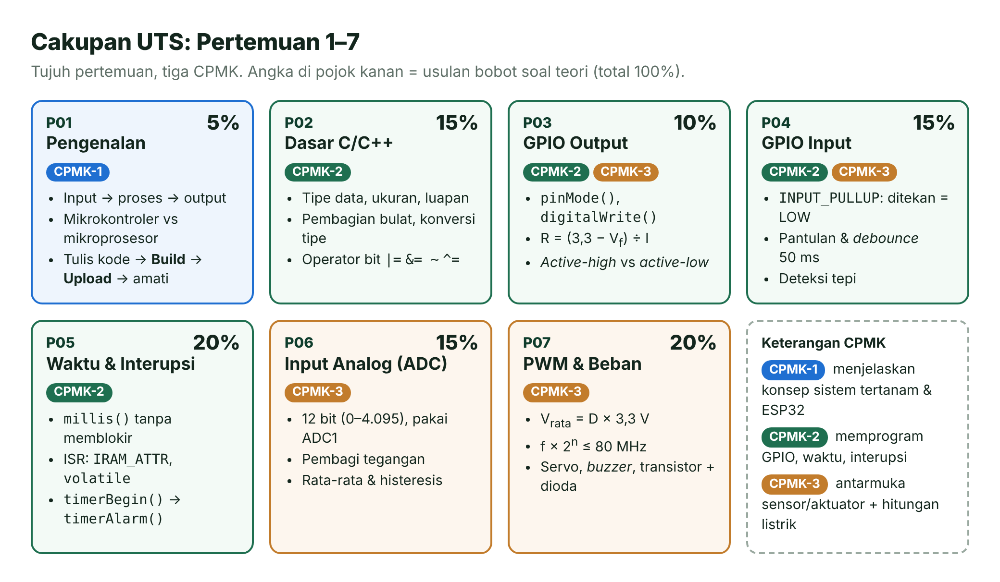
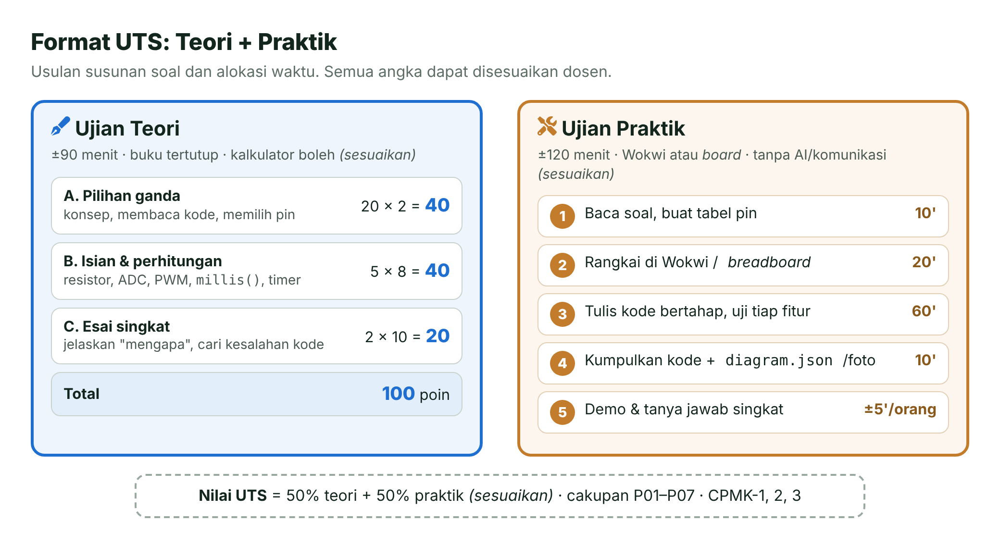
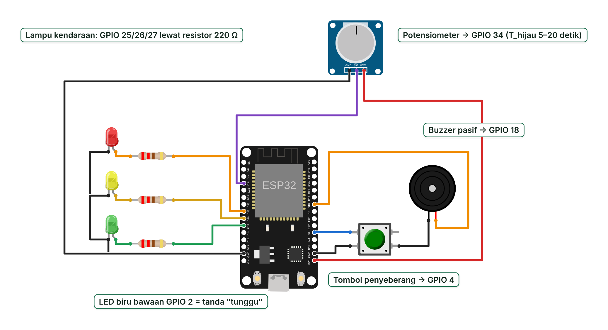
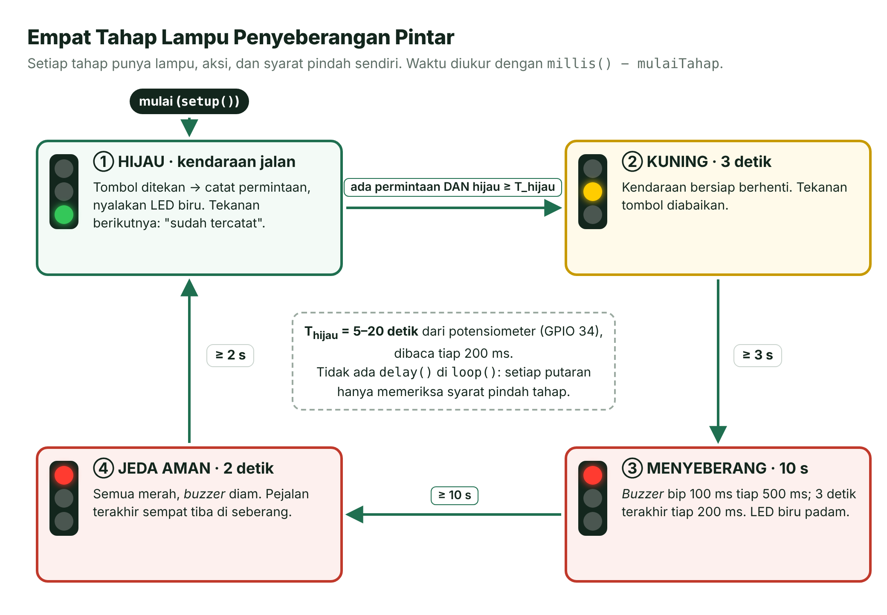
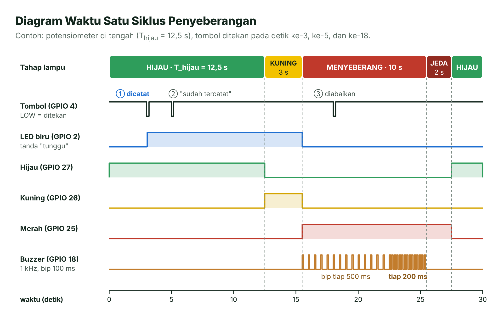

# Pertemuan 08 — Ujian Tengah Semester (UTS)

> Saatnya mengukur seberapa jauh kamu sudah melangkah. Halaman ini memuat informasi ujian, kisi-kisi, lembar ringkas API dan rumus, contoh soal beserta pembahasannya, serta satu latihan proyek mini untuk simulasi ujian praktik.

| | |
| --- | --- |
| ⏱️ **Durasi** | Teori ±90 menit + praktik ±120 menit *(sesuaikan)* |
| 📋 **Cakupan** | Pertemuan 01–07 (CPMK-1, CPMK-2, CPMK-3) |
| 🧰 **Alat** | Alat tulis dan kalkulator; laptop + Wokwi; *board* ESP32 + kit bila ujian praktik memakai *board* |
| 📥 **Slide** | 👁️ [Lihat di peramban](https://view.officeapps.live.com/op/view.aspx?src=https%3A%2F%2Fraw.githubusercontent.com%2Fantonprafanto%2Fembeddedsystem%2Fmain%2Fslide%2Fpptx%2FP08-UTS.pptx) · ⬇️ [Unduh PDF](https://raw.githubusercontent.com/antonprafanto/embeddedsystem/main/slide/pdf/P08-UTS.pdf) · ⬇️ [Unduh PPTX](https://raw.githubusercontent.com/antonprafanto/embeddedsystem/main/slide/pptx/P08-UTS.pptx) |
| 📄 **Modul PDF** | ⬇️ [Unduh modul ini dalam PDF](https://raw.githubusercontent.com/antonprafanto/embeddedsystem/main/modul-pdf/Modul-P08-UTS.pdf) — untuk dibaca luring atau dicetak |

> [!NOTE]
> **Untuk dosen:** semua bagian bertanda *(sesuaikan)*, yaitu waktu, durasi, sifat ujian, komposisi soal, dan bobot, adalah usulan. Silakan ubah sesuai ketentuan program studi sebelum halaman ini dibagikan.

## Daftar Isi

- [🎯 Apa yang Diukur di UTS?](#-apa-yang-diukur-di-uts)
- [📅 Informasi Ujian](#-informasi-ujian)
- [🧭 Cakupan dan Kisi-Kisi](#-cakupan-dan-kisi-kisi)
- [📝 Format Ujian](#-format-ujian)
- [📋 Lembar Ringkas API](#-lembar-ringkas-api)
- [🧮 Rumus Penting](#-rumus-penting)
- [🧠 Contoh Soal Teori](#-contoh-soal-teori)
- [🔧 Contoh Soal Praktik dan Rubrik](#-contoh-soal-praktik-dan-rubrik)
- [🚦 Latihan Proyek Mini: Lampu Penyeberangan Pintar](#-latihan-proyek-mini-lampu-penyeberangan-pintar)
- [💡 Tips Belajar](#-tips-belajar)
- [📏 Tata Tertib Ujian](#-tata-tertib-ujian)
- [🚫 Kesalahan Umum](#-kesalahan-umum)
- [📚 Referensi](#-referensi)
- [🖼️ Sumber Gambar](#️-sumber-gambar)

---

## 🎯 Apa yang Diukur di UTS?

UTS bukan lomba menghafal. Yang diukur adalah kemampuanmu **memahami, menghitung, dan membangun** sistem kecil dengan ESP32. Setelah belajar dengan halaman ini, kamu diharapkan bisa:

1. Menjelaskan konsep sistem tertanam, arsitektur ESP32, dan alur kerja *firmware* (CPMK-1).
2. Menulis program C/C++ yang mengendalikan GPIO, pewaktuan `millis()`, interupsi, dan *timer* tanpa memblokir (CPMK-2).
3. Merangkai dan menghitung antarmuka sederhana: resistor LED, *pull-up*, pembagi tegangan, ADC, PWM, servo, *buzzer*, dan transistor (CPMK-3).
4. Menggabungkan beberapa topik itu dalam satu program yang rapi dalam waktu terbatas, lalu menjelaskannya secara lisan.

## 📅 Informasi Ujian

| Butir | Ketentuan |
| --- | --- |
| Hari, tanggal | Pertemuan 8 — *(sesuaikan)* |
| Waktu | Teori: *(sesuaikan)* · Praktik: *(sesuaikan)* |
| Durasi | Teori ±90 menit · Praktik ±120 menit *(sesuaikan)* |
| Tempat | *(sesuaikan)* |
| Sifat ujian teori | Buku tertutup. Lembar ringkas API dan rumus disediakan pengawas. Kalkulator biasa boleh, ponsel tidak *(sesuaikan)*. |
| Sifat ujian praktik | Buku terbuka terbatas: boleh membuka modul P01–P07 dan dokumentasi resmi. **Tanpa** AI, aplikasi pesan, atau berbagi berkas *(sesuaikan)*. |
| Perangkat praktik | Laptop dengan Wokwi (wajib siap), atau *board* ESP32 + kit bila ditentukan *(sesuaikan)* |
| Bobot | UTS = 25% nilai akhir (lihat [RPS](../RPS.md)); di dalamnya teori 50% + praktik 50% *(sesuaikan)* |

## 🧭 Cakupan dan Kisi-Kisi

UTS mencakup tujuh pertemuan pertama. Gambar berikut merangkum isi tiap pertemuan beserta CPMK dan usulan bobotnya.



*Gambar 8.1 — Peta cakupan UTS: Pertemuan 1–7. Sumber: dibuat untuk materi ini.*

| No | Topik (modul) | CPMK | Indikator yang diukur | Bentuk soal | Bobot teori |
| :---: | --- | :---: | --- | --- | :---: |
| 1 | Sistem tertanam, ESP32, dan alur kerja ([P01](../pertemuan-01-pengenalan/README.md)) | 1 | Menjelaskan pola input–proses–output, membedakan mikrokontroler dengan mikroprosesor, mengenali tahap **Build**/**Upload** beserta galatnya | PG, esai | 5% |
| 2 | Dasar C/C++ ([P02](../pertemuan-02-dasar-pemrograman/README.md)) | 2 | Memilih tipe data, memprediksi luapan dan pembagian bulat, memakai operator bit, membaca alur program | PG, isian | 15% |
| 3 | GPIO output ([P03](../pertemuan-03-gpio-output/README.md)) | 2, 3 | Menghitung resistor LED, membedakan *active-high* dan *active-low*, memilih pin yang aman | PG, perhitungan | 10% |
| 4 | GPIO input ([P04](../pertemuan-04-gpio-input/README.md)) | 2, 3 | Menjelaskan *pull-up*/*pull-down* dan ambang HIGH/LOW, mengatasi pantulan dengan *debouncing*, deteksi tepi | PG, esai | 15% |
| 5 | Waktu dan interupsi ([P05](../pertemuan-05-waktu-interupsi/README.md)) | 2 | Memakai pola `millis()` dan menjelaskan luapan, menulis ISR yang aman, menghitung nilai alarm *timer* | PG, perhitungan, esai | 20% |
| 6 | Input analog: ADC ([P06](../pertemuan-06-adc/README.md)) | 3 | Mengonversi nilai ADC, memilih ADC1/ADC2, menghitung pembagi tegangan, menerapkan rata-rata dan histeresis | PG, perhitungan, esai | 15% |
| 7 | PWM dan beban ([P07](../pertemuan-07-pwm-beban/README.md)) | 3 | Menghitung siklus kerja dan tegangan rata-rata, batas frekuensi–resolusi LEDC, pulsa servo, nada, resistor basis transistor | PG, perhitungan | 20% |
| | | | | **Jumlah** | **100%** |

Ujian praktik mengukur CPMK-2 dan CPMK-3 sekaligus: rangkaian yang benar dan aman, program yang tidak memblokir, serta perpaduan minimal tiga topik (misalnya GPIO, tombol dengan interupsi, `millis()`, ADC, dan PWM).

> [!TIP]
> **Cara memakai kisi-kisi:** untuk setiap baris, buka bagian "Tujuan Pembelajaran" dan "Cek Pemahaman" di modul yang ditautkan. Lalu uji dirimu: bisakah kamu mengerjakan tiap indikator tanpa melihat catatan?

## 📝 Format Ujian



*Gambar 8.2 — Usulan format UTS. Sumber: dibuat untuk materi ini (ikon Font Awesome Free, CC BY 4.0).*

### Ujian Teori

| Bagian | Jumlah soal | Poin | Isi |
| --- | :---: | :---: | --- |
| A. Pilihan ganda | 20 | 20 × 2 = 40 | Konsep, membaca potongan kode, memilih pin dan fungsi |
| B. Isian dan perhitungan | 5 | 5 × 8 = 40 | Resistor, ADC, pembagi tegangan, PWM, `millis()`, *timer*. Tulis rumus, substitusi, hasil, dan satuan. |
| C. Esai singkat | 2 | 2 × 10 = 20 | Menjelaskan "mengapa", mencari dan memperbaiki kesalahan kode |

### Ujian Praktik

Kamu menerima satu soal yang memadukan beberapa topik, mirip [latihan proyek mini](#-latihan-proyek-mini-lampu-penyeberangan-pintar) di bawah. Kerjakan di Wokwi atau di *board* sesuai ketentuan dosen. Di akhir waktu, kumpulkan *folder* proyek dalam satu berkas ZIP, misalnya `UTS_NIM_Nama.zip` *(sesuaikan)*, berisi `src/main.cpp`, `platformio.ini`, dan `diagram.json` atau foto rangkaian. Setelah itu ada demo singkat: tunjukkan fiturnya, jawab satu–dua pertanyaan, lalu lakukan satu perubahan kecil yang diminta penguji (misalnya mengganti durasi atau pin).

> [!IMPORTANT]
> **Nilai parsial itu nyata.** Program yang belum lengkap tetapi berjalan dan rapi tetap mendapat nilai. Simpan salinan versi yang sudah berjalan sebelum menambah fitur baru, supaya kamu selalu punya sesuatu untuk dikumpulkan.

## 📋 Lembar Ringkas API

Semua fungsi di bawah berlaku untuk Arduino-ESP32 3.x (versi 3.3 yang kita pakai). API lama core 2.x seperti `ledcSetup()` dan `ledcAttachPin()` **sudah tidak ada** dan akan menghasilkan galat kompilasi.

### GPIO, Waktu, dan Interupsi

| Fungsi | Kegunaan | Contoh |
| --- | --- | --- |
| `pinMode(pin, mode)` | Mengatur pin: `OUTPUT`, `INPUT`, `INPUT_PULLUP`, `INPUT_PULLDOWN` | `pinMode(4, INPUT_PULLUP);` |
| `digitalWrite(pin, nilai)` | Menulis `HIGH` (≈ 3,3 V) atau `LOW` (0 V) | `digitalWrite(23, HIGH);` |
| `digitalRead(pin)` | Membaca `HIGH`/`LOW`. Dengan *pull-up*, tombol ditekan = `LOW` | `if (digitalRead(4) == LOW) { … }` |
| `millis()` | Milidetik sejak menyala, `unsigned long` 32 bit, meluap setelah ±49,7 hari | `unsigned long t = millis();` |
| `micros()` | Mikrodetik sejak menyala, meluap setelah ±71,6 menit | `unsigned long t0 = micros();` |
| `attachInterrupt(digitalPinToInterrupt(pin), isr, mode)` | Memanggil ISR saat tepi `RISING`, `FALLING`, atau `CHANGE` | `attachInterrupt(digitalPinToInterrupt(4), isrTombol, FALLING);` |
| `portENTER_CRITICAL(&kunci)` dan `portEXIT_CRITICAL(&kunci)` | Bagian kritis di `loop()`; di dalam ISR pakai versi berakhiran `_ISR` | `portMUX_TYPE kunci = portMUX_INITIALIZER_UNLOCKED;` |
| `timerBegin(frekHz)` | Membuat *timer* dengan frekuensi hitung tertentu | `hw_timer_t *t = timerBegin(1000000);` (1 tik = 1 µs) |
| `timerAttachInterrupt(t, isr)` | Memasang ISR *timer* | `timerAttachInterrupt(t, &isrTimer);` |
| `timerAlarm(t, nilai, ulang, jumlah)` | Alarm setiap `nilai` tik; `ulang = true` berarti berulang; `jumlah = 0` tanpa batas | `timerAlarm(t, 500000, true, 0);` (tiap 0,5 s) |

### ADC, PWM, dan Serial

| Fungsi | Kegunaan | Contoh |
| --- | --- | --- |
| `analogRead(pin)` | Nilai mentah 0–4.095 (12 bit) | `int n = analogRead(34);` |
| `analogReadMilliVolts(pin)` | Tegangan dalam mV, terkalibrasi eFuse | `uint32_t mv = analogReadMilliVolts(34);` |
| `analogReadResolution(bit)` dan `analogSetAttenuation(ADC_11db)` | Resolusi dan atenuasi (bawaan: 12 bit, 11 dB) | `analogReadResolution(12);` |
| `ledcAttach(pin, frek, bit)` | Memasang pin ke PWM LEDC; mengembalikan `false` bila gagal | `ledcAttach(23, 5000, 8);` |
| `ledcWrite(pin, duty)` | Siklus kerja 0 sampai 2<sup>n</sup> − 1 | `ledcWrite(23, 128);` (±50% pada 8 bit) |
| `ledcWriteTone(pin, frek)` | Nada dengan siklus kerja 50%; frekuensi 0 = diam | `ledcWriteTone(18, 440);` |
| `Serial.begin(115200)` | Membuka Serial; samakan dengan `monitor_speed` | `Serial.begin(115200);` |
| `Serial.print()`, `println()`, `printf()` | Mencetak teks dan angka; format `%d`, `%lu`, `%.2f`, `%s` | `Serial.printf("%lu ms\n", millis());` |
| `Serial.readStringUntil('\n')` + `trim()` | Membaca satu baris dari Serial Monitor | `String s = Serial.readStringUntil('\n'); s.trim();` |

### Kerangka Program yang Perlu Kamu Kuasai

```cpp
// 1) Tugas berkala TANPA delay(): pola selisih millis()
const unsigned long INTERVAL_MS = 500;
unsigned long sebelumnya = 0;

void loop() {
  unsigned long sekarang = millis();
  if (sekarang - sebelumnya >= INTERVAL_MS) {   // tetap benar walau millis() meluap
    sebelumnya = sekarang;
    // ... kerjakan tugas berkala di sini ...
  }
  // tugas lain tetap berjalan karena tidak ada yang menunggu
}

// 2) ISR tombol yang aman (pin 4, INPUT_PULLUP, tombol ke GND)
volatile bool ditekan = false;
void IRAM_ATTR isrTombol() { ditekan = true; }   // singkat: tanpa Serial, tanpa delay()
// di setup(): attachInterrupt(digitalPinToInterrupt(4), isrTombol, FALLING);

// 3) Timer perangkat keras: ISR setiap 0,5 detik
hw_timer_t *timerKu = nullptr;
volatile bool tik = false;
void IRAM_ATTR isrTimer() { tik = true; }
// di setup(): timerKu = timerBegin(1000000);          // 1 MHz → 1 tik = 1 µs
//             timerAttachInterrupt(timerKu, &isrTimer);
//             timerAlarm(timerKu, 500000, true, 0);     // 500.000 tik = 0,5 s

// 4) PWM dan nada
// ledcAttach(23, 5000, 8);   ledcWrite(23, 128);        // LED ±50%
// ledcAttach(18, 1000, 10);  ledcWriteTone(18, 440);    // nada A4; 0 = diam
```

## 🧮 Rumus Penting

Semua contoh di tabel ini sudah dihitung ulang. Biasakan menulis **rumus → substitusi → hasil + satuan**, karena langkah yang benar tetap dinilai walaupun angka akhirmu meleset.

| Besaran | Rumus | Contoh |
| --- | --- | --- |
| Resistor LED | R = (3,3 V − V<sub>f</sub>) ÷ I | (3,3 − 2,0) ÷ 0,010 = 130 Ω → pilih 220 Ω (I ≈ 5,9 mA) |
| Daya resistor | P = I² × R | (0,0059)² × 220 ≈ 7,7 mW, aman untuk resistor ¼ W |
| Arus *pull-up* saat tombol ditekan | I = 3,3 V ÷ R | 10 kΩ → 0,33 mA; internal ±45 kΩ → ±73 µA |
| Ambang logika (VDD = 3,3 V) | HIGH ≥ 0,75 × VDD; LOW ≤ 0,25 × VDD | HIGH ≥ 2,475 V; LOW ≤ 0,825 V |
| Pembagi tegangan | V<sub>out</sub> = V<sub>in</sub> × R2 ÷ (R1 + R2) | 3,3 × 10 ÷ (10 + 10) = 1,65 V |
| Konversi ADC 12 bit | V ≈ nilai × 3,3 ÷ 4.095; langkah ≈ 0,806 mV | 2.048 → ≈ 1,650 V |
| Siklus kerja dan tegangan rata-rata | D = duty ÷ (2<sup>n</sup> − 1); V<sub>rata</sub> = D × 3,3 V | 8 bit, duty 64 → D ≈ 25,1% → ≈ 0,83 V |
| Batas frekuensi–resolusi LEDC | f × 2<sup>n</sup> ≤ 80 MHz → n<sub>maks</sub> = ⌊log₂(80 MHz ÷ f)⌋ | 1 kHz → 16 bit; 5 kHz → 13 bit; 20 kHz → 11 bit |
| Lebar pulsa servo (rentang praktikum P07) | t = 500 + (sudut ÷ 180) × 2.000 µs, periode 20 ms | 90° → 1.500 µs (7,5% dari 20 ms) |
| Frekuensi nada | f = 440 × 2<sup>n/12</sup>, n = jarak semiton dari A4 | C5 (n = 3) → ≈ 523,3 Hz |
| Resistor basis transistor | I<sub>B</sub> = (I<sub>C</sub> ÷ h<sub>FE,min</sub>) × (2–3); R<sub>B</sub> = (3,3 − 0,7) ÷ I<sub>B</sub> | Lihat Soal 13 |
| *Debounce* | Terima keadaan baru bila sudah stabil ≥ 50 ms | Tombol memantul dalam orde milidetik |
| Selisih waktu | `sekarang - sebelumnya >= INTERVAL` dengan `unsigned long` | Tetap benar saat `millis()` meluap (tiap 2<sup>32</sup> ms ≈ 49,7 hari) |
| Nilai alarm *timer* | alarm = frekuensi *timer* × selang | 1 MHz × 0,5 s = 500.000 tik |

## 🧠 Contoh Soal Teori

Ada 16 contoh soal: 6 pilihan ganda, 7 isian/perhitungan, dan 3 esai singkat. Kerjakan dulu tanpa membuka pembahasan, baru klik **Lihat pembahasan** untuk mencocokkan.

### A. Pilihan Ganda

**Soal 1 (P01 · CPMK-1).** Saat kamu menekan **Build**, PlatformIO menampilkan galat `expected ';' before '}' token`. Pernyataan yang benar adalah …

- A. Galat terjadi saat *upload*, sehingga kabel USB perlu diganti
- B. Galat terjadi saat kompilasi, sehingga `firmware.bin` belum terbentuk dan belum ada yang bisa diunggah
- C. Galat terjadi saat program berjalan di ESP32
- D. Galat terjadi karena *baud rate* Serial Monitor berbeda

<details>
<summary>Lihat pembahasan</summary>

**B.** **Build** berarti mengompilasi kode menjadi `firmware.bin`. Galat sintaksis seperti lupa titik koma menghentikan kompilasi, jadi tahap *upload* belum terjadi sama sekali. Periksa baris yang ditunjuk dan baris di atasnya.

</details>

**Soal 2 (P02 · CPMK-2).** Berapa nilai `x` setelah kode berikut dijalankan?

```cpp
uint8_t x = 250;
x = x + 10;
```

- A. 260
- B. 4
- C. 255
- D. Galat kompilasi

<details>
<summary>Lihat pembahasan</summary>

**B.** `uint8_t` hanya menampung 0–255. Hasil 260 tidak muat, sehingga nilainya "berputar": 260 − 256 = **4**. Inilah luapan (*overflow*). Kompilator tidak memberi galat, jadi kamu yang harus waspada memilih tipe data.

</details>

**Soal 3 (P03 · CPMK-2, 3).** Anoda LED disambung ke 3V3, sedangkan katodenya disambung lewat resistor 220 Ω ke GPIO 23. Perintah untuk **menyalakan** LED adalah …

- A. `digitalWrite(23, HIGH);`
- B. `digitalWrite(23, LOW);`
- C. `pinMode(23, INPUT);`
- D. `analogRead(23);`

<details>
<summary>Lihat pembahasan</summary>

**B.** Ini rangkaian *active-low*. Arus mengalir dari 3V3 ke pin hanya jika pin bertegangan 0 V, sehingga pin berperan sebagai penyerap arus. Dengan `HIGH`, kedua ujung bertegangan 3,3 V dan LED padam.

</details>

**Soal 4 (P04 · CPMK-2, 3).** Sebuah tombol dipasang antara GPIO 34 dan GND dengan `pinMode(34, INPUT_PULLUP);`. Saat tombol **tidak** ditekan, bacaannya acak. Penyebabnya adalah …

- A. GPIO 34 hanya bisa dipakai sebagai output
- B. GPIO 34–39 tidak punya resistor *pull-up* internal, sehingga pin mengambang
- C. Tombol seharusnya disambung ke 5 V
- D. `loop()` kurang `delay(50)`

<details>
<summary>Lihat pembahasan</summary>

**B.** GPIO 34, 35, 36 (VP), dan 39 (VN) adalah pin input saja **tanpa** *pull-up*/*pull-down* internal, sehingga `INPUT_PULLUP` tidak berpengaruh. Pasang resistor 10 kΩ eksternal dari pin ke 3,3 V, atau pindahkan tombol ke pin yang aman seperti GPIO 4 atau 13. Jangan pernah memberi 5 V ke pin ESP32.

</details>

**Soal 5 (P06 · CPMK-3).** Sebuah proyek memakai Wi-Fi dan membaca potensiometer. Pin mana yang paling tepat untuk potensiometer?

- A. GPIO 4
- B. GPIO 25
- C. GPIO 35
- D. GPIO 13

<details>
<summary>Lihat pembahasan</summary>

**C.** GPIO 4, 13, dan 25 termasuk ADC2, yang tidak bisa dibaca saat Wi-Fi aktif. GPIO 35 termasuk ADC1 (GPIO 32–39), sehingga aman dipakai bersama Wi-Fi.

</details>

**Soal 6 (P07 · CPMK-3).** Dengan batas f × 2<sup>n</sup> ≤ 80 MHz, pemanggilan mana yang **tidak mungkin** berhasil?

- A. `ledcAttach(23, 5000, 12);`
- B. `ledcAttach(23, 1000, 16);`
- C. `ledcAttach(23, 40000, 12);`
- D. `ledcAttach(23, 20000, 10);`

<details>
<summary>Lihat pembahasan</summary>

**C.** Hitung f × 2<sup>n</sup> untuk tiap pilihan:

| Pilihan | Hitungan | Hasil |
| --- | --- | --- |
| A | 5.000 × 4.096 | 20,48 MHz (boleh) |
| B | 1.000 × 65.536 | 65,536 MHz (boleh) |
| C | 40.000 × 4.096 | 163,84 MHz (**melebihi** 80 MHz) |
| D | 20.000 × 1.024 | 20,48 MHz (boleh) |

Pada 40 kHz, resolusi terbesar adalah ⌊log₂(80 MHz ÷ 40 kHz)⌋ = ⌊log₂ 2.000⌋ = **10 bit**. Selalu periksa nilai kembali `ledcAttach()`: `false` berarti gagal.

</details>

### B. Isian dan Perhitungan

**Soal 7 (P02 · CPMK-2).** Tuliskan nilai akhir `reg` dalam biner, desimal, dan heksadesimal.

```cpp
uint8_t reg = 0b00010110;
reg |= (1 << 0);
reg &= ~(1 << 4);
reg ^= (1 << 7);
```

<details>
<summary>Lihat pembahasan</summary>

| Langkah | Arti | Nilai `reg` |
| --- | --- | --- |
| Awal | — | `0b00010110` (22) |
| `reg \|= (1 << 0)` | Menyalakan bit 0 | `0b00010111` (23) |
| `reg &= ~(1 << 4)` | Memadamkan bit 4 | `0b00000111` (7) |
| `reg ^= (1 << 7)` | Membalik bit 7 | `0b10000111` (135) |

Jawaban: **`0b10000111` = 135 = `0x87`**.

</details>

**Soal 8 (P03 · CPMK-3).** LED hijau dengan V<sub>f</sub> = 2,1 V akan dinyalakan dari pin 3,3 V dengan target arus 6 mA. Hitung (a) R minimum, (b) nilai standar E12 yang dipilih (sama atau lebih besar), (c) arus sebenarnya, dan (d) daya resistor.

<details>
<summary>Lihat pembahasan</summary>

1. R = (3,3 − 2,1) ÷ 0,006 = 1,2 ÷ 0,006 = **200 Ω**.
2. Deret E12 di sekitarnya: …, 180, **220**, 270 Ω. Pilih **220 Ω** (sama atau lebih besar supaya arus tidak melebihi target).
3. I = 1,2 ÷ 220 ≈ **5,45 mA**, masih di bawah batas praktik aman 10–12 mA per pin.
4. P = I² × R = (0,00545)² × 220 ≈ **6,5 mW**, jauh di bawah 250 mW (resistor ¼ W).

</details>

**Soal 9 (P05 · CPMK-2).** Perhatikan potongan berikut. Variabel `sebelumnya` dicatat sesaat sebelum `millis()` meluap, dan `sekarang` dibaca sesudahnya.

```cpp
unsigned long sebelumnya = 4294967000UL;
unsigned long sekarang   = 200;
if (sekarang - sebelumnya >= 500) { /* tugas berkala */ }
```

(a) Berapa hasil `sekarang - sebelumnya`? (b) Apakah blok `if` dijalankan? (c) Berapa milidetik lagi blok itu dijalankan?

<details>
<summary>Lihat pembahasan</summary>

1. `unsigned long` di ESP32 berukuran 32 bit, jadi pengurangan dihitung modulo 2<sup>32</sup> = 4.294.967.296. Waktu dari 4.294.967.000 sampai luapan adalah 296 ms, ditambah 200 ms sesudahnya: **496 ms**. Hasil ini memang selang waktu yang sebenarnya.
2. **Tidak**, karena 496 < 500.
3. **4 ms** lagi, saat `sekarang` = 204.

Inilah alasan pola selisih tetap benar saat meluap. Sebaliknya, pola `if (millis() >= waktuBerikutnya)` akan keliru di sekitar luapan.

</details>

**Soal 10 (P05 · CPMK-2).** *Timer* dibuat dengan `timerBegin(1000000)`. (a) Berapa nilai alarm agar ISR terpanggil setiap 250 ms? (b) Berapa kali per detik ISR terpanggil? (c) Berapa nilai alarmnya jika *timer* dibuat dengan `timerBegin(10000)`?

<details>
<summary>Lihat pembahasan</summary>

1. 1 MHz berarti 1 tik = 1 µs. Alarm = 1.000.000 × 0,25 = **250.000** tik → `timerAlarm(t, 250000, true, 0);`.
2. 1 ÷ 0,25 s = **4 kali per detik**.
3. 10 kHz berarti 1 tik = 0,1 ms. Alarm = 10.000 × 0,25 = **2.500** tik.

</details>

**Soal 11 (P06 · CPMK-3).** (a) `analogRead()` menghasilkan 1.241. Berapa tegangannya (rumus 3,3 ÷ 4.095)? (b) Tegangan baterai dua sel Li-ion (maksimum 8,4 V) diukur lewat pembagi R1 = 27 kΩ (atas) dan R2 = 10 kΩ (bawah, ke GND). Berapa tegangan maksimum di pin, dan apakah aman? (c) Jika `analogReadMilliVolts()` membaca 1.850 mV, berapa tegangan baterainya?

<details>
<summary>Lihat pembahasan</summary>

1. V ≈ 1.241 × 3,3 ÷ 4.095 ≈ **1,00 V**.
2. V<sub>out</sub> = 8,4 × 10 ÷ (27 + 10) ≈ **2,27 V**. Aman, karena di bawah 3,3 V dan masih di dalam rentang paling akurat atenuasi 11 dB (±150–2.450 mV).
3. Balik rumusnya: V<sub>in</sub> = V<sub>out</sub> × (R1 + R2) ÷ R2 = 1,850 × 37 ÷ 10 ≈ **6,85 V**.

</details>

**Soal 12 (P07 · CPMK-3).** PWM dipasang dengan `ledcAttach(23, 5000, 10);`. (a) Jika `ledcWrite(23, 768);`, berapa siklus kerja dan tegangan rata-ratanya? (b) Berapa nilai duty agar tegangan rata-ratanya ≈ 1,0 V?

<details>
<summary>Lihat pembahasan</summary>

1. Resolusi 10 bit → duty maksimum 2<sup>10</sup> − 1 = 1.023. D = 768 ÷ 1.023 ≈ **75,1%**, sehingga V<sub>rata</sub> = 0,751 × 3,3 ≈ **2,48 V**.
2. D = 1,0 ÷ 3,3 ≈ 30,3%, sehingga duty = 0,303 × 1.023 ≈ **310**.

Periksa juga batasnya: 5.000 × 2<sup>10</sup> = 5,12 MHz, jauh di bawah 80 MHz.

</details>

**Soal 13 (P07 · CPMK-3).** Kumparan *relay* 5 V berhambatan 125 Ω dikendalikan transistor NPN (anggap h<sub>FE</sub> minimum = 100, V<sub>BE</sub> = 0,7 V) dari GPIO 3,3 V dengan *overdrive* 2–3×. Hitung I<sub>C</sub>, rentang I<sub>B</sub>, rentang R<sub>B</sub>, lalu pilih nilai standar. Sebutkan juga komponen pelindung yang wajib dipasang.

<details>
<summary>Lihat pembahasan</summary>

| Langkah | Hitungan | Hasil |
| --- | --- | --- |
| 1. Arus kumparan | I<sub>C</sub> = 5 V ÷ 125 Ω | 40 mA |
| 2. I<sub>B</sub> minimum | 40 mA ÷ 100 | 0,4 mA |
| 3. *Overdrive* 2–3× | 2 × 0,4 sampai 3 × 0,4 | I<sub>B</sub> = 0,8–1,2 mA |
| 4. Rentang R<sub>B</sub> | (3,3 − 0,7) ÷ I<sub>B</sub> | ±2.167–3.250 Ω |
| 5. Pilih nilai standar | 2,2 kΩ | I<sub>B</sub> = 2,6 ÷ 2.200 ≈ 1,18 mA (*overdrive* ±3×) |

Pasang **dioda *flyback*** (misalnya 1N4007) paralel dengan kumparan, katode ke sisi +5 V. Tanpa dioda, lonjakan tegangan saat transistor mati bisa merusak transistor.

</details>

### C. Esai Singkat

**Soal 14 (P04 · CPMK-2).** Seorang mahasiswa membuat *toggle* LED seperti di bawah. Saat tombol ditekan sekali, LED kadang berubah dan kadang tidak. Jelaskan **dua** penyebabnya, lalu tuliskan perbaikannya.

```cpp
void loop() {
  if (digitalRead(PIN_TOMBOL) == LOW) {
    statusLed = !statusLed;
    digitalWrite(PIN_LED, statusLed);
  }
}
```

<details>
<summary>Lihat pembahasan</summary>

**Penyebab 1 — tanpa deteksi tepi.** Satu tekanan berlangsung ±100–300 ms, sedangkan `loop()` berputar ribuan kali selama itu. LED dibalik berkali-kali, jadi keadaan akhirnya acak. Aksi seharusnya hanya terjadi sekali, saat keadaan **berubah** dari HIGH ke LOW.

**Penyebab 2 — pantulan (*bouncing*).** Kontak tombol memantul dalam orde milidetik, sehingga satu tekanan terbaca sebagai beberapa tekanan. Keadaan baru baru boleh dipercaya setelah stabil, misalnya 50 ms.

**Perbaikan** (*debounce* berbasis `millis()` + deteksi tepi):

```cpp
const unsigned long WAKTU_DEBOUNCE_MS = 50;
int keadaanStabil = HIGH;        // keadaan tombol yang sudah dipercaya
int bacaanTerakhir = HIGH;
unsigned long waktuBerubah = 0;

void loop() {
  int bacaan = digitalRead(PIN_TOMBOL);
  if (bacaan != bacaanTerakhir) {          // ada perubahan, mungkin pantulan
    bacaanTerakhir = bacaan;
    waktuBerubah = millis();
  }
  if (millis() - waktuBerubah >= WAKTU_DEBOUNCE_MS && bacaan != keadaanStabil) {
    keadaanStabil = bacaan;                // sudah stabil 50 ms → terima
    if (keadaanStabil == LOW) {            // tepi turun: tombol baru saja ditekan
      statusLed = !statusLed;
      digitalWrite(PIN_LED, statusLed);
    }
  }
}
```

</details>

**Soal 15 (P05 · CPMK-2).** Temukan minimal **empat** kesalahan pada kode berikut (tombol dipasang antara GPIO 4 dan GND), lalu perbaiki.

```cpp
int jumlahTekan = 0;

void isrTombol() {
  jumlahTekan++;
  Serial.println("Tombol ditekan!");
  delay(200);   // debounce
}

void setup() {
  Serial.begin(115200);
  pinMode(4, INPUT);
  attachInterrupt(4, isrTombol, RISING);
}
```

<details>
<summary>Lihat pembahasan</summary>

1. ISR tidak bertanda `IRAM_ATTR`, sehingga kodenya tidak dijamin berada di RAM internal saat interupsi datang.
2. `jumlahTekan` tidak `volatile` dan diakses tanpa bagian kritis, sehingga `loop()` bisa membaca nilai basi.
3. `Serial.println()` dan `delay()` di dalam ISR melanggar aturan ISR: harus singkat dan tidak menunggu. Di ESP32 hal ini dapat membuat program *crash*.
4. `pinMode(4, INPUT)` tanpa *pull-up*: saat tombol dilepas, pin mengambang. Pakai `INPUT_PULLUP`.
5. Dengan *pull-up*, tekanan menghasilkan tepi **turun**. `RISING` justru bereaksi saat tombol dilepas; pakai `FALLING`.
6. Gunakan `digitalPinToInterrupt(4)` agar maksud kode jelas dan mudah dipindahkan.

```cpp
volatile unsigned long jumlahTekan = 0;
volatile unsigned long waktuSahTerakhir = 0;
portMUX_TYPE kunci = portMUX_INITIALIZER_UNLOCKED;

void IRAM_ATTR isrTombol() {
  unsigned long sekarang = millis();
  portENTER_CRITICAL_ISR(&kunci);
  if (sekarang - waktuSahTerakhir >= 200) {     // debounce tanpa delay()
    jumlahTekan = jumlahTekan + 1;              // volatile: tulis x = x + 1, bukan x++
    waktuSahTerakhir = sekarang;
  }
  portEXIT_CRITICAL_ISR(&kunci);
}

void setup() {
  Serial.begin(115200);
  pinMode(4, INPUT_PULLUP);
  attachInterrupt(digitalPinToInterrupt(4), isrTombol, FALLING);
}
// Cetak jumlahTekan di loop(), bukan di dalam ISR.
```

</details>

**Soal 16 (P06 · CPMK-3).** Lampu taman menyala bila nilai sensor cahaya **< 1.000** (gelap) dan padam bila **> 1.200** (terang); di antara keduanya keadaan dipertahankan. Mula-mula lampu padam. Urutan bacaan: 1.300, 1.120, 1.090, 1.110, 1.095, 980, 1.105, 1.210. (a) Tentukan keadaan lampu setelah tiap bacaan. (b) Bandingkan dengan aturan satu ambang "nyala bila < 1.100". (c) Jelaskan mengapa histeresis diperlukan.

<details>
<summary>Lihat pembahasan</summary>

| Bacaan | 1.300 | 1.120 | 1.090 | 1.110 | 1.095 | 980 | 1.105 | 1.210 |
| --- | --- | --- | --- | --- | --- | --- | --- | --- |
| (a) Dua ambang (histeresis) | padam | padam | padam | padam | padam | **nyala** | nyala | **padam** |
| (b) Satu ambang 1.100 | padam | padam | nyala | padam | nyala | nyala | padam | padam |

Dengan histeresis, lampu hanya berganti **2 kali**. Dengan satu ambang, lampu berganti **4 kali** karena cahaya senja dan derau membuat bacaan naik-turun di sekitar 1.100.

(c) Histeresis memberi "zona mati" di antara dua ambang. Bacaan yang bergoyang sedikit tidak cukup untuk mengubah keputusan, sehingga *relay* atau lampu tidak berkedip-kedip dan tidak cepat aus.

</details>

## 🔧 Contoh Soal Praktik dan Rubrik

Tiga contoh berikut mirip soal praktik UTS. Setiap soal memakai rangkaian dari modul P03–P07, jadi kamu bisa berlatih di Wokwi tanpa komponen tambahan. Kerjakan dengan batas waktu, lalu nilai sendiri memakai rubrik di bawah.

### Praktik A — Kedip Dua Kecepatan (±45 menit; P03–P05)

1. LED eksternal di GPIO 23 (lewat 220 Ω) berkedip: nyala 500 ms, padam 500 ms (mode LAMBAT).
2. Setiap tekanan tombol GPIO 4 (`INPUT_PULLUP`) mengganti mode LAMBAT ↔ CEPAT (nyala 100 ms, padam 100 ms).
3. Satu tekanan = satu pergantian: pakai *debounce* 50 ms dan deteksi tepi. Tombol harus tetap tanggap kapan pun ditekan, jadi tanpa `delay()`.
4. Serial mencetak `[INFO] Mode: CEPAT` atau `[INFO] Mode: LAMBAT` setiap kali mode berganti.

<details>
<summary>Lihat petunjuk</summary>

Simpan lama jeda dalam variabel, misalnya `unsigned long jedaMs = 500;`. Kedipan memakai pola selisih `millis()`, sedangkan tombol memakai pola *debounce* dari Soal 14. Saat tepi turun terdeteksi, ganti `jedaMs` antara 500 dan 100, lalu cetak modenya.

</details>

### Praktik B — Peredup dengan Peringatan (±60 menit; P06–P07)

1. Potensiometer di GPIO 34 mengatur kecerahan LED GPIO 23 lewat LEDC 5 kHz, 12 bit.
2. Setiap 500 ms, Serial mencetak tegangan potensiometer dalam mV (`analogReadMilliVolts()`) dan siklus kerja dalam persen, misalnya `[DATA] 1650 mV, duty 50%`.
3. Bila siklus kerja > 90%, LED bawaan GPIO 2 berkedip 2 Hz sebagai peringatan "terlalu terang"; selain itu LED bawaan padam.
4. Tanpa `delay()`.

<details>
<summary>Lihat petunjuk</summary>

Periksa batas LEDC dulu: 5.000 × 2<sup>12</sup> = 20,48 MHz ≤ 80 MHz, jadi aman. Karena ADC dan PWM sama-sama 12 bit (0–4.095), nilai `analogRead()` bisa langsung dipakai sebagai duty. Berkedip 2 Hz berarti membalik LED bawaan setiap 250 ms.

</details>

### Praktik C — Lampu Teras Otomatis (±60 menit; P04–P07)

1. Modul LDR (keluaran AO) di GPIO 35. Ukur dulu nilai ADC saat terang dan saat gelap, lalu tetapkan **dua** ambang (histeresis) dan tulis alasannya di komentar.
2. Saat keadaan berubah menjadi gelap, LED GPIO 23 menyala dan *buzzer* pasif GPIO 18 berbunyi 1.000 Hz selama 200 ms tanpa `delay()`. Saat terang, LED padam.
3. Tombol GPIO 4 (interupsi `FALLING` + *debounce*) mengganti mode: OTOMATIS → SELALU NYALA → SELALU PADAM → OTOMATIS.
4. Setiap 1 detik, Serial mencetak nilai ADC, keadaan (gelap/terang), dan mode.

<details>
<summary>Lihat petunjuk</summary>

Pisahkan tiga pekerjaan: (1) memutuskan gelap/terang dengan histeresis, (2) memutuskan keadaan LED dari mode dan keadaan cahaya, (3) mengatur bunyi *buzzer*. Untuk bunyi 200 ms, catat waktu mulai bunyi, lalu matikan dengan `ledcWriteTone(PIN_BUZZER, 0)` setelah `millis() - mulaiBunyi >= 200`.

</details>

### Rubrik Praktik (Usulan, 100 Poin)

| Aspek | Bobot | Penuh | Sebagian | Minim |
| --- | :---: | --- | --- | --- |
| Rangkaian dan pemilihan pin | 20 | Benar, rapi, resistor tepat, pin aman, tidak ada tegangan > 3,3 V ke pin | Berfungsi tetapi kurang rapi atau ada pin yang kurang tepat | Salah atau berbahaya (LED tanpa resistor, 5 V ke pin) |
| Fungsi sesuai spesifikasi | 35 | Semua butir spesifikasi terpenuhi | Sebagian besar butir terpenuhi | Hanya sebagian kecil yang berjalan |
| Tidak memblokir dan tepat waktu | 15 | Tanpa `delay()` di `loop()`, selisih `millis()` benar | Ada `delay()` pendek yang belum mengganggu | `delay()` panjang membuat tombol terlewat |
| Kualitas kode | 15 | Nama jelas, konstanta pin dan waktu, fungsi pembantu, komentar "mengapa" | Cukup rapi | Sulit dibaca, angka "ajaib" bertebaran |
| Penjelasan lisan dan modifikasi | 15 | Bisa menjelaskan setiap bagian dan langsung melakukan perubahan yang diminta | Menjelaskan sebagian | Tidak bisa menjelaskan kodenya sendiri |

## 🚦 Latihan Proyek Mini: Lampu Penyeberangan Pintar

📁 *Folder*: [`kode/01-latihan-proyek-mini`](kode/01-latihan-proyek-mini)

Latihan ini sengaja dibuat sedikit lebih besar daripada soal praktik UTS. Kalau kamu bisa menyelesaikannya dalam ±100 menit, kamu siap. Kerjakan dulu sendiri, baru buka kunci jawaban di akhir bagian ini.

### Cerita dan Spesifikasi

Di depan kampus ada penyeberangan jalan. Supaya lalu lintas lancar, lampu kendaraan dibiarkan **hijau** dan baru berubah ketika ada pejalan kaki yang menekan tombol. Namun, kendaraan tetap dijamin mendapat lampu hijau minimal beberapa detik. Tugasmu membuat pengendalinya dengan ESP32.

| No | Syarat | Topik |
| :---: | --- | :---: |
| S1 | Lampu kendaraan merah, kuning, dan hijau di GPIO 25, 26, dan 27, masing-masing lewat resistor 220 Ω. Saat mulai, hanya hijau yang menyala. | P03 |
| S2 | Tombol penyeberang di GPIO 4 (`INPUT_PULLUP`) dibaca dengan **interupsi**. Satu tekanan = satu permintaan; pantulan dan saat tombol dilepas tidak boleh terhitung. | P04, P05 |
| S3 | Permintaan hanya dicatat saat lampu hijau. LED biru bawaan (GPIO 2) menyala sebagai tanda "tunggu" sampai penyeberangan dimulai. Tekanan di tahap lain diabaikan dan dilaporkan di Serial. | P03, P05 |
| S4 | Hijau dipertahankan minimal T<sub>hijau</sub> = 5–20 detik, diatur potensiometer GPIO 34 secara langsung. Nilai baru dicetak hanya bila berubah cukup berarti. | P06 |
| S5 | Setelah ada permintaan dan T<sub>hijau</sub> terpenuhi: kuning 3 s → merah 10 s (pejalan menyeberang) → merah 2 s (jeda aman) → hijau. | P03, P05 |
| S6 | Selama menyeberang, *buzzer* pasif GPIO 18 berbunyi 1.000 Hz selama 100 ms setiap 500 ms; pada 3 detik terakhir setiap 200 ms. | P07 |
| S7 | Tidak ada `delay()` di `loop()`. Semua pewaktuan memakai `millis()`. | P05 |
| S8 | Serial Monitor (115200) mencetak T<sub>hijau</sub> dan setiap pergantian tahap. | P02 |

### Rangkaian



*Gambar 8.3 — Rangkaian lampu penyeberangan pintar. Sumber: dibuat untuk materi ini dari `diagram.json`; gambar komponen dari @wokwi/elements (MIT).*

| Komponen | Kaki komponen | Sambung ke |
| --- | --- | --- |
| LED merah | Anoda lewat resistor 220 Ω; katode | GPIO 25; GND |
| LED kuning | Anoda lewat resistor 220 Ω; katode | GPIO 26; GND |
| LED hijau | Anoda lewat resistor 220 Ω; katode | GPIO 27; GND |
| Tombol penyeberang | Dua kaki diagonal | GPIO 4; GND |
| *Buzzer* pasif | Kaki + ; kaki − | GPIO 18; GND |
| Potensiometer 10 kΩ | Kaki tengah (SIG); dua kaki pinggir | GPIO 34; 3V3 dan GND |
| LED biru bawaan | Sudah terpasang di *board* | GPIO 2 |

> [!CAUTION]
> **Potensiometer ke 3V3, bukan ke VIN.** Pin VIN bertegangan ±5 V saat *board* dicatu USB. Jika kaki pinggir potensiometer disambung ke VIN, kaki tengahnya bisa memberi lebih dari 3,3 V ke GPIO 34 dan merusak pin.

### Tahap dan Pewaktuan

Program ini bekerja dalam empat **tahap**. Setiap tahap punya lampu, aksi, dan syarat pindah sendiri. Di setiap putaran, `loop()` hanya memeriksa: "Sudah waktunya pindah tahap?" Karena tidak ada yang menunggu, tombol dan potensiometer tetap terbaca kapan pun. Di Pertemuan 11, pola ini akan kamu pelajari secara resmi sebagai ***finite state machine*** (FSM, mesin keadaan hingga).



*Gambar 8.4 — Empat tahap lampu penyeberangan dan syarat pindahnya. Sumber: dibuat untuk materi ini.*

Perhatikan bahwa T<sub>hijau</sub> dihitung sejak lampu **mulai hijau**, bukan sejak tombol ditekan. Jika pejalan menekan tombol setelah hijau berlangsung lebih lama dari T<sub>hijau</sub>, lampu langsung berganti kuning. Diagram waktu berikut memperlihatkan satu siklus lengkap.



*Gambar 8.5 — Diagram waktu satu siklus (T<sub>hijau</sub> = 12,5 s; tombol ditekan pada detik ke-3, ke-5, dan ke-18). Sumber: dibuat untuk materi ini.*

### Langkah Pengerjaan yang Disarankan

1. **Lampu otomatis dulu.** Buat empat tahap dengan `millis()` dan anggap sementara selalu ada permintaan. Pastikan urutan dan durasinya benar di Serial Monitor.
2. **Tambahkan tombol.** Pasang ISR `FALLING` yang hanya mencatat kejadian, lalu lakukan *debounce* di `loop()`. Catat permintaan dan nyalakan LED biru.
3. **Tambahkan potensiometer.** Baca setiap 200 ms, petakan ke 5.000–20.000 ms, dan cetak hanya bila berubah cukup jauh.
4. **Tambahkan *buzzer*.** Pakai sisa bagi (`%`) dari lama tahap untuk membuat irama bip.
5. **Rapikan.** Ganti angka "ajaib" dengan konstanta, beri komentar "mengapa", dan cek ulang setiap syarat S1–S8.

> [!TIP]
> **Simpan setiap langkah yang berhasil.** Salin `main.cpp` ke berkas cadangan sebelum menambah fitur berikutnya. Saat ujian, kebiasaan ini menyelamatkan nilaimu jika fitur baru membuat program kacau menjelang waktu habis.

### Cara Menjalankan

**Jalur A — Wokwi:** buka <https://wokwi.com/projects/new/esp32>, salin isi `src/main.cpp` ke tab **sketch.ino** dan isi `diagram.json` ke tab **diagram.json**, lalu klik **▶**. Klik tombol hijau untuk menyeberang dan geser kenop potensiometer untuk mengubah T<sub>hijau</sub>.

**Jalur B — *board* asli:** rangkai sesuai Gambar 8.3, buka *folder* `pertemuan-08-uts/kode/01-latihan-proyek-mini` di VS Code, klik **Build**, **Upload**, lalu **Serial Monitor**.

### Hasil yang Diharapkan

Skenario: kenop potensiometer di tengah, tombol ditekan sekitar detik ke-3, ditekan lagi sebelum lampu kuning, dan ditekan sekali saat penyeberangan berlangsung.

```text
[INFO] Lampu penyeberangan pintar siap.
[INFO] Durasi hijau minimum: 12.5 detik
[TAHAP] HIJAU       : kendaraan jalan; tekan tombol untuk menyeberang
[TOMBOL] Permintaan menyeberang tercatat.
[TOMBOL] Permintaan sudah tercatat, harap tunggu.
[TAHAP] KUNING      : kendaraan bersiap berhenti
[TAHAP] MENYEBERANG : kendaraan berhenti, pejalan kaki menyeberang
[TOMBOL] Diabaikan: siklus penyeberangan sedang berjalan.
[INFO] Sisa 3 detik: bip dipercepat
[TAHAP] JEDA AMAN   : semua merah, penyeberangan dikosongkan
[TAHAP] HIJAU       : kendaraan jalan; tekan tombol untuk menyeberang
```

Angka pada baris kedua bergantung pada posisi kenop (5,0–20,0 detik), dan baris baru `[INFO] Durasi hijau minimum: …` muncul setiap kali kenop diputar cukup jauh. Selama tahap MENYEBERANG, *buzzer* berbunyi 14 kali dengan irama lambat lalu 15 kali dengan irama cepat.

### Kalau Belum Berhasil

| Gejala | Coba ini |
| --- | --- |
| Satu tekanan tercatat dua kali ("sudah tercatat" muncul sendiri) | Pantulan atau tepi saat tombol dilepas ikut terhitung. Pastikan tekanan baru diterima setelah tenang 50 ms **dan** tombol masih `LOW`. |
| Tombol tidak bereaksi sama sekali | Cek `INPUT_PULLUP`, mode `FALLING`, dan kaki tombol yang dipakai harus diagonal (tidak sekelompok). |
| T<sub>hijau</sub> tidak berubah saat kenop diputar | Pastikan kaki tengah potensiometer ke GPIO 34 dan kedua kaki pinggir ke 3V3 dan GND. |
| Serial Monitor dibanjiri nilai potensiometer | Cetak hanya bila nilai ADC berubah ≥ 40 (±1%) dari nilai terakhir yang dicetak. |
| *Buzzer* diam | Pastikan *buzzer* **pasif** dan `ledcAttach()` mengembalikan `true`. *Buzzer* aktif hanya berbunyi dengan satu nada bawaannya. |
| Lampu tidak pernah kuning | Periksa syarat pindah: permintaan harus `true` **dan** `millis() - mulaiTahap >= durasiHijauMs`. |

### Rubrik Latihan Proyek Mini (100 Poin)

| Aspek | Poin | Kriteria penuh |
| --- | :---: | --- |
| Rangkaian | 15 | Tiga LED dengan resistor, tombol ke GND dengan `INPUT_PULLUP`, potensiometer ke 3V3, *buzzer* pasif |
| Urutan tahap dan durasi | 20 | Hijau → kuning 3 s → merah 10 s → jeda 2 s → hijau, sesuai syarat S1 dan S5 |
| Tombol | 15 | Interupsi + *debounce*; satu tekanan = satu permintaan; hanya dicatat saat hijau; LED biru benar |
| Potensiometer | 10 | T<sub>hijau</sub> 5–20 s langsung berpengaruh; Serial tidak banjir |
| *Buzzer* berirama | 15 | Dua irama sesuai S6, berhenti tepat di akhir penyeberangan |
| Tidak memblokir | 10 | Tanpa `delay()` di `loop()`; semua pewaktuan dengan selisih `millis()` |
| Kualitas kode dan Serial | 10 | Konstanta, fungsi pembantu, komentar "mengapa", pesan Serial jelas |
| Penjelasan lisan | 5 | Bisa menjelaskan alur tahap, ISR, dan *debounce* |

### Kunci Jawaban

Kode lengkap ada di [`kode/01-latihan-proyek-mini/src/main.cpp`](kode/01-latihan-proyek-mini/src/main.cpp) dan sudah lulus kompilasi dengan Arduino-ESP32 3.3. Buka hanya setelah kamu mencoba sendiri.

<details>
<summary>Lihat kode solusi lengkap</summary>

```cpp
#include <Arduino.h>

// ----- Pin (mengikuti peta pin standar kursus) -----
const int PIN_MERAH  = 25;
const int PIN_KUNING = 26;
const int PIN_HIJAU  = 27;
const int PIN_TOMBOL = 4;
const int PIN_BUZZER = 18;
const int PIN_POT    = 34;   // ADC1, pin input saja
const int PIN_TANDA  = 2;    // LED biru bawaan: "permintaan tercatat, tunggu"

// ----- Pengaturan waktu (milidetik) -----
const unsigned long HIJAU_MIN_MS     = 5000;    // kenop diputar habis ke kiri
const unsigned long HIJAU_MAKS_MS    = 20000;   // kenop diputar habis ke kanan
const unsigned long KUNING_MS        = 3000;
const unsigned long MENYEBERANG_MS   = 10000;
const unsigned long PERINGATAN_MS    = 3000;    // 3 detik terakhir: bip lebih cepat
const unsigned long JEDA_AMAN_MS     = 2000;    // semua merah sebelum hijau lagi
const unsigned long DEBOUNCE_MS      = 50;      // tombol dianggap tenang setelah 50 ms
const unsigned long JEDA_BACA_POT_MS = 200;     // baca potensiometer 5 kali per detik

// ----- Buzzer dan potensiometer -----
const uint32_t NADA_BIP_HZ               = 1000;
const unsigned long LAMA_BIP_MS          = 100;   // lama satu bunyi "bip"
const unsigned long PERIODE_BIP_MS       = 500;   // 2 bip per detik
const unsigned long PERIODE_BIP_CEPAT_MS = 200;   // 5 bip per detik
const int AMBANG_UBAH_POT = 40;   // abaikan perubahan < 40 (±1%) agar derau tidak membanjiri Serial

enum Tahap { TAHAP_HIJAU, TAHAP_KUNING, TAHAP_MENYEBERANG, TAHAP_JEDA_AMAN };

// ----- Variabel bersama ISR dan loop(): wajib volatile -----
volatile bool adaTepiTombol = false;         // ISR: "ada tepi turun"
volatile unsigned long waktuTepiTombol = 0;  // kapan tepi terakhir terjadi (ms)
portMUX_TYPE kunci = portMUX_INITIALIZER_UNLOCKED;

// ----- Keadaan program -----
Tahap tahap = TAHAP_HIJAU;
unsigned long mulaiTahap = 0;               // kapan tahap sekarang dimulai
unsigned long durasiHijauMs = HIJAU_MIN_MS; // T_hijau dari potensiometer
unsigned long waktuBacaPot = 0;
int nilaiPotTerakhir = -1000;               // nilai mustahil → cetakan pertama pasti muncul
bool permintaanMenyeberang = false;
bool peringatanDiumumkan = false;
bool buzzerBunyi = false;

// ----- Prototipe fungsi -----
void isrTombol();                     // IRAM_ATTR cukup ditulis pada definisinya
bool ambilTekananTombol();
void tanganiTombol();
void bacaPotensiometer(unsigned long sekarang);
void perbaruiDurasiHijau();
void masukTahap(Tahap baru, unsigned long sekarang);
void aturLampu(bool merah, bool kuning, bool hijau);
void aturIramaBuzzer(unsigned long lamaTahap);
void bunyikanBuzzer(bool bunyi);

// ISR sesingkat mungkin: hanya mencatat "ada tepi turun" dan kapan terjadinya.
// Setiap pantulan memperbarui waktunya, sehingga loop() bisa menunggu sampai tenang.
void IRAM_ATTR isrTombol() {
  unsigned long sekarang = millis();
  portENTER_CRITICAL_ISR(&kunci);
  adaTepiTombol = true;
  waktuTepiTombol = sekarang;
  portEXIT_CRITICAL_ISR(&kunci);
}

// Mengembalikan true SEKALI untuk setiap tekanan yang sah (debounce berbasis waktu).
bool ambilTekananTombol() {
  portENTER_CRITICAL(&kunci);
  bool ada = adaTepiTombol;
  unsigned long waktuTepi = waktuTepiTombol;
  portEXIT_CRITICAL(&kunci);

  // millis() dibaca SETELAH menyalin waktuTepi, jadi selisihnya tidak pernah "negatif".
  if (!ada || millis() - waktuTepi < DEBOUNCE_MS) {
    return false;                       // belum ada tepi, atau pantulan belum reda
  }
  portENTER_CRITICAL(&kunci);
  adaTepiTombol = false;                // tepi ini sudah diperiksa
  portEXIT_CRITICAL(&kunci);

  // Sah hanya jika tombol MASIH ditekan setelah pantulan reda.
  // Tepi turun palsu saat tombol DILEPAS akan gagal di pemeriksaan ini.
  return digitalRead(PIN_TOMBOL) == LOW;
}

void tanganiTombol() {
  if (tahap != TAHAP_HIJAU) {
    Serial.println("[TOMBOL] Diabaikan: siklus penyeberangan sedang berjalan.");
  } else if (permintaanMenyeberang) {
    Serial.println("[TOMBOL] Permintaan sudah tercatat, harap tunggu.");
  } else {
    permintaanMenyeberang = true;
    digitalWrite(PIN_TANDA, HIGH);      // tanda "tunggu" untuk pejalan kaki
    Serial.println("[TOMBOL] Permintaan menyeberang tercatat.");
  }
}

void bacaPotensiometer(unsigned long sekarang) {
  if (sekarang - waktuBacaPot < JEDA_BACA_POT_MS) {
    return;                             // belum waktunya membaca lagi
  }
  waktuBacaPot = sekarang;
  perbaruiDurasiHijau();
}

void perbaruiDurasiHijau() {
  int nilai = analogRead(PIN_POT);      // 0–4095 (12 bit)
  if (abs(nilai - nilaiPotTerakhir) < AMBANG_UBAH_POT) {
    return;                             // perubahan kecil dianggap derau
  }
  nilaiPotTerakhir = nilai;
  durasiHijauMs = map(nilai, 0, 4095, HIJAU_MIN_MS, HIJAU_MAKS_MS);
  Serial.printf("[INFO] Durasi hijau minimum: %.1f detik\n", durasiHijauMs / 1000.0);
}

void aturLampu(bool merah, bool kuning, bool hijau) {
  digitalWrite(PIN_MERAH, merah ? HIGH : LOW);
  digitalWrite(PIN_KUNING, kuning ? HIGH : LOW);
  digitalWrite(PIN_HIJAU, hijau ? HIGH : LOW);
}

// Semua aksi "sekali saat masuk tahap" dikumpulkan di sini.
void masukTahap(Tahap baru, unsigned long sekarang) {
  tahap = baru;
  mulaiTahap = sekarang;
  switch (baru) {
    case TAHAP_HIJAU:
      aturLampu(false, false, true);
      Serial.println("[TAHAP] HIJAU       : kendaraan jalan; tekan tombol untuk menyeberang");
      break;
    case TAHAP_KUNING:
      aturLampu(false, true, false);
      Serial.println("[TAHAP] KUNING      : kendaraan bersiap berhenti");
      break;
    case TAHAP_MENYEBERANG:
      aturLampu(true, false, false);
      permintaanMenyeberang = false;    // permintaan sedang dilayani
      digitalWrite(PIN_TANDA, LOW);
      peringatanDiumumkan = false;
      Serial.println("[TAHAP] MENYEBERANG : kendaraan berhenti, pejalan kaki menyeberang");
      break;
    case TAHAP_JEDA_AMAN:
      aturLampu(true, false, false);
      bunyikanBuzzer(false);
      Serial.println("[TAHAP] JEDA AMAN   : semua merah, penyeberangan dikosongkan");
      break;
  }
}

void aturIramaBuzzer(unsigned long lamaTahap) {
  unsigned long periode = PERIODE_BIP_MS;
  if (lamaTahap >= MENYEBERANG_MS - PERINGATAN_MS) {
    periode = PERIODE_BIP_CEPAT_MS;     // tanda waktu menyeberang hampir habis
  }
  // Sisa bagi (%) membuat pola berulang: berbunyi di awal setiap periode selama LAMA_BIP_MS.
  bunyikanBuzzer(lamaTahap % periode < LAMA_BIP_MS);
}

void bunyikanBuzzer(bool bunyi) {
  if (bunyi == buzzerBunyi) {
    return;                             // ubah hanya saat perlu: ledcWriteTone() mengatur ulang timer
  }
  buzzerBunyi = bunyi;
  ledcWriteTone(PIN_BUZZER, bunyi ? NADA_BIP_HZ : 0);   // frekuensi 0 = diam
}

void setup() {
  Serial.begin(115200);
  pinMode(PIN_MERAH, OUTPUT);
  pinMode(PIN_KUNING, OUTPUT);
  pinMode(PIN_HIJAU, OUTPUT);
  pinMode(PIN_TANDA, OUTPUT);
  pinMode(PIN_TOMBOL, INPUT_PULLUP);
  analogReadResolution(12);

  if (!ledcAttach(PIN_BUZZER, NADA_BIP_HZ, 10)) {
    Serial.println("[PERINGATAN] Buzzer gagal disiapkan (ledcAttach).");
  }
  ledcWriteTone(PIN_BUZZER, 0);         // mulai dalam keadaan diam
  attachInterrupt(digitalPinToInterrupt(PIN_TOMBOL), isrTombol, FALLING);

  Serial.println("[INFO] Lampu penyeberangan pintar siap.");
  perbaruiDurasiHijau();
  masukTahap(TAHAP_HIJAU, millis());
}

void loop() {
  unsigned long sekarang = millis();
  bacaPotensiometer(sekarang);
  if (ambilTekananTombol()) {
    tanganiTombol();
  }

  unsigned long lamaTahap = sekarang - mulaiTahap;   // aman walau millis() meluap
  switch (tahap) {
    case TAHAP_HIJAU:
      if (permintaanMenyeberang && lamaTahap >= durasiHijauMs) {
        masukTahap(TAHAP_KUNING, sekarang);
      }
      break;
    case TAHAP_KUNING:
      if (lamaTahap >= KUNING_MS) {
        masukTahap(TAHAP_MENYEBERANG, sekarang);
      }
      break;
    case TAHAP_MENYEBERANG:
      if (lamaTahap >= MENYEBERANG_MS) {
        masukTahap(TAHAP_JEDA_AMAN, sekarang);
        break;
      }
      aturIramaBuzzer(lamaTahap);
      if (!peringatanDiumumkan && lamaTahap >= MENYEBERANG_MS - PERINGATAN_MS) {
        peringatanDiumumkan = true;
        Serial.println("[INFO] Sisa 3 detik: bip dipercepat");
      }
      break;
    case TAHAP_JEDA_AMAN:
      if (lamaTahap >= JEDA_AMAN_MS) {
        masukTahap(TAHAP_HIJAU, sekarang);
      }
      break;
  }
}
```

**Tiga keputusan rancangan yang perlu kamu pahami:**

1. **ISR hanya mencatat.** ISR menyimpan "ada tepi" dan waktunya, lalu `loop()` yang memutuskan. Setiap pantulan memperbarui waktu tepi, sehingga pemeriksaan baru dilakukan setelah tombol tenang 50 ms. Tepi palsu saat tombol dilepas ikut tersaring karena saat diperiksa tombol sudah `HIGH`.
2. **Satu fungsi `masukTahap()`.** Semua aksi "sekali saat masuk tahap" (lampu, pesan Serial, mematikan *buzzer*) terkumpul di satu tempat. Ini yang membuat urutan lampu mudah diperiksa dan diubah.
3. **Irama dari sisa bagi.** `lamaTahap % periode < LAMA_BIP_MS` bernilai benar selama 100 ms pertama setiap periode. Tidak perlu variabel waktu tambahan, dan iramanya otomatis sinkron dengan awal tahap.

</details>

### Pengembangan (Opsional)

- Tambahkan lampu pejalan kaki merah dan hijau di GPIO 32 dan 33 (masing-masing lewat 220 Ω) yang menyala berlawanan dengan lampu kendaraan.
- Cetak hitung mundur sisa waktu menyeberang setiap detik di Serial Monitor.
- Tekan-tahan tombol ≥ 2 detik untuk memperpanjang waktu menyeberang 50%, misalnya bagi lansia atau penyandang disabilitas.

## 💡 Tips Belajar

- **Buat lembar ringkasmu sendiri.** Menulis ulang rumus dan API dengan tangan membuatmu lebih ingat, walaupun saat ujian lembar ringkas resmi disediakan.
- **Ulangi praktikum P03–P07 tanpa melihat kode.** Rangkai di Wokwi, tulis dari nol, lalu bandingkan dengan modul. Bagian yang terlupa adalah bahan belajarmu.
- **Latih hitungan dengan kalkulator.** Resistor LED, konversi ADC, pembagi tegangan, siklus kerja, batas LEDC, nilai alarm *timer*, dan selisih `millis()` hampir pasti muncul.
- **Kerjakan ulang "Cek Pemahaman" dan "Latihan & Tantangan"** di setiap modul. Untuk tiap jawaban, tanyakan "mengapa", bukan hanya "apa".
- **Simulasikan ujian praktik.** Kerjakan latihan proyek mini di atas dengan pengatur waktu 100 menit, tanpa membuka kunci jawaban.
- **Biasakan membaca galat kompilasi.** Baca baris pertama galat, buka nomor barisnya, dan periksa juga baris di atasnya.
- **Siapkan alat sehari sebelumnya.** Pastikan Wokwi bisa dibuka, PlatformIO bisa **Build**, serta kabel USB data dan *driver* berfungsi bila memakai *board*.

## 📏 Tata Tertib Ujian

Tata tertib berikut adalah usulan *(sesuaikan)*.

1. Hadir paling lambat 15 menit sebelum ujian dan membawa kartu identitas mahasiswa.
2. Ponsel dimatikan dan disimpan di tas selama ujian teori. Kalkulator biasa boleh dipakai, kalkulator di ponsel tidak.
3. Ujian teori bersifat buku tertutup; hanya lembar ringkas resmi dari pengawas yang boleh ada di meja.
4. Saat ujian praktik, kamu boleh membuka modul P01–P07 dan dokumentasi resmi. Memakai AI, aplikasi pesan, berbagi berkas, atau menyalin kode teman **dilarang**.
5. Simpan pekerjaan secara berkala dan kumpulkan dengan nama berkas sesuai ketentuan, misalnya `UTS_NIM_Nama.zip`.
6. Cabut USB sebelum mengubah rangkaian. Laporkan kepada pengawas bila ada komponen panas, berbau, atau *board* rusak; kamu akan diminta melanjutkan di Wokwi.
7. Pelanggaran integritas akademik ditangani sesuai aturan program studi. Ingat, setiap kode yang kamu kumpulkan harus bisa kamu jelaskan sendiri.

## 🚫 Kesalahan Umum

| Kesalahan | Akibat | Cara menghindari |
| --- | --- | --- |
| LED tanpa resistor atau terpasang terbalik | LED tidak menyala, pin bisa rusak | Hitung R = (3,3 − V<sub>f</sub>) ÷ I; kaki panjang = anoda |
| Tombol dengan `INPUT` biasa tanpa resistor | Bacaan acak (mengambang) | Pakai `INPUT_PULLUP`; ingat ditekan = `LOW` |
| Memakai GPIO 34–39 sebagai output atau dengan `INPUT_PULLUP` | Tidak berfungsi | Pin itu input saja tanpa *pull-up* internal |
| Sensor analog di ADC2 (mis. GPIO 4, 25–27) bersama Wi-Fi | Bacaan gagal | Pakai ADC1: GPIO 32–39 |
| `delay()` panjang di `loop()` | Tombol terlewat, program terasa "beku" | Pola selisih `millis()` |
| `if (millis() >= waktuBerikutnya)` | Salah di sekitar luapan | `if (sekarang - sebelumnya >= INTERVAL)` |
| Menyimpan `millis()` di `int` | Bernilai negatif setelah ±24,9 hari | Pakai `unsigned long` |
| `Serial` atau `delay()` di ISR, variabel bersama tanpa `volatile` | *Crash* atau nilai basi | ISR singkat + `IRAM_ATTR` + `volatile` + bagian kritis |
| Mode `RISING` untuk tombol dengan *pull-up* | Aksi terjadi saat tombol dilepas | Pakai `FALLING` |
| `nilai / 4095 * 3.3` dengan `nilai` bertipe `int` | Selalu 0 karena pembagian bulat | `nilai * 3.3 / 4095` atau `nilai / 4095.0 * 3.3` |
| Memakai `ledcSetup()`/`ledcAttachPin()` | Galat kompilasi di core 3.x | `ledcAttach(pin, frek, bit)` |
| Frekuensi × 2<sup>n</sup> > 80 MHz | `ledcAttach()` gagal, PWM tidak keluar | Turunkan resolusi atau frekuensi |
| Potensiometer atau sensor dicatu 5 V lalu ke pin | ADC jenuh, pin bisa rusak | Catu dari 3V3 atau pakai pembagi tegangan |
| Beban kumparan tanpa dioda *flyback* | Transistor rusak | Dioda paralel kumparan, katode ke +5 V |

## 📚 Referensi

1. Espressif Systems. (2025). *ESP32 Series Datasheet* (v5.x). <https://documentation.espressif.com/esp32_datasheet_en.pdf>
2. Espressif Systems. (2026). *ESP32-WROOM-32E & ESP32-WROOM-32UE Datasheet*. <https://documentation.espressif.com/esp32-wroom-32e_esp32-wroom-32ue_datasheet_en.pdf>
3. Espressif Systems. (2026). *Arduino-ESP32 Documentation: GPIO, ADC, LEDC, dan Timer API*. <https://docs.espressif.com/projects/arduino-esp32/en/latest/>
4. CodeMagic LTD. (2026). *Wokwi Docs*. <https://docs.wokwi.com>
5. Lee, E. A., & Seshia, S. A. (2017). *Introduction to Embedded Systems: A Cyber-Physical Systems Approach* (2nd ed.). MIT Press. <https://ptolemy.berkeley.edu/books/leeseshia/>
6. Modul Pertemuan 01–07 mata kuliah ini, terutama bagian "Rangkuman" setiap modul.

## 🖼️ Sumber Gambar

| Gambar | Sumber dan lisensi |
| --- | --- |
| 8.1, 8.4, 8.5 | Dibuat untuk materi ini. |
| 8.2 | Dibuat untuk materi ini. Ikon: Font Awesome Free (Fonticons, CC BY 4.0). |
| 8.3 | Dibuat untuk materi ini dari `diagram.json`; gambar komponen dari [@wokwi/elements](https://github.com/wokwi/wokwi-elements) (MIT, © 2020 Uri Shaked). |

---

[⬅️ Pertemuan 07: PWM dan Mengendalikan Beban](../pertemuan-07-pwm-beban/README.md) · [🏠 Beranda](../README.md) · [Pertemuan 09: Komunikasi Serial ➡️](../pertemuan-09-komunikasi-serial/README.md)
