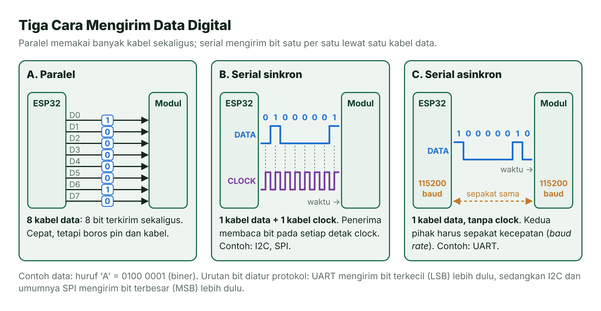
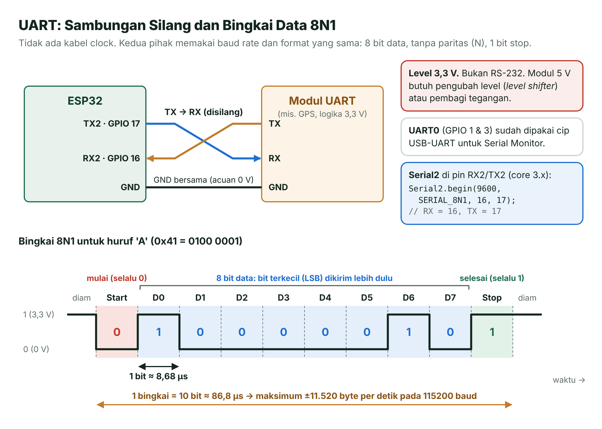
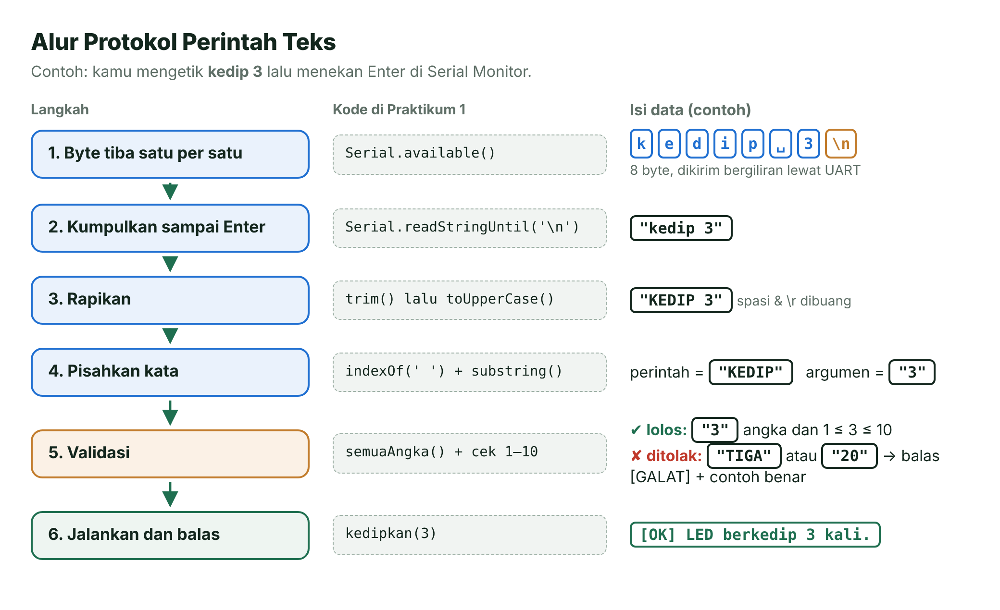
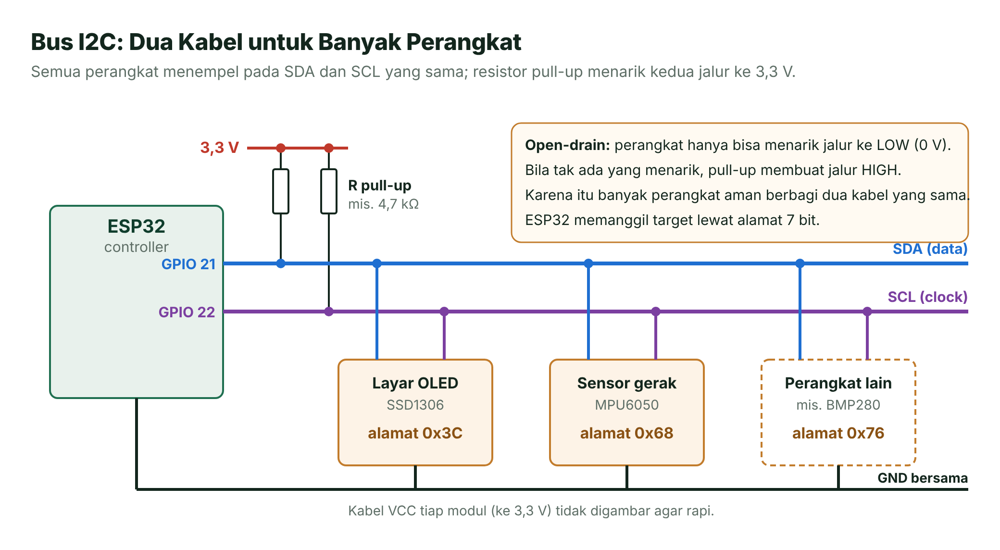
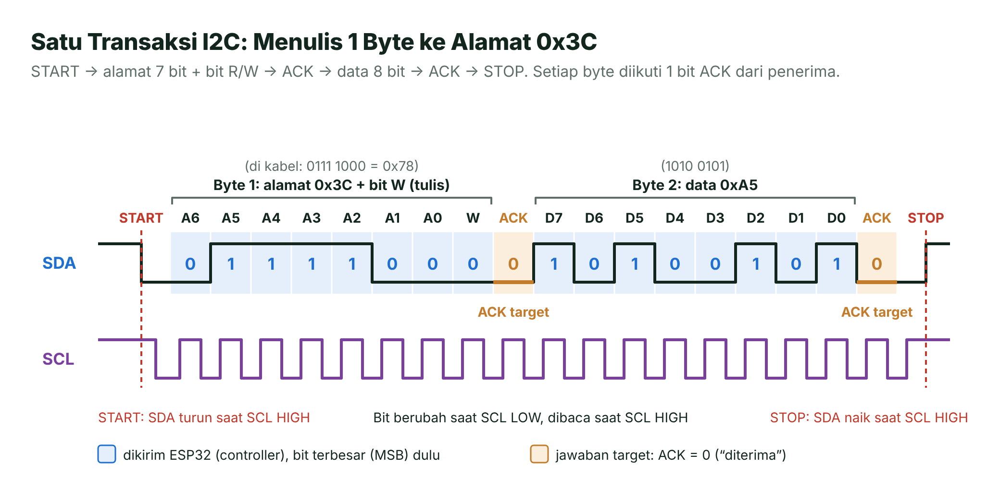
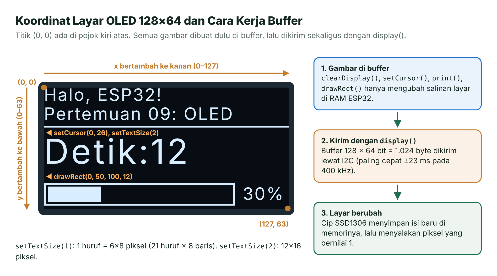
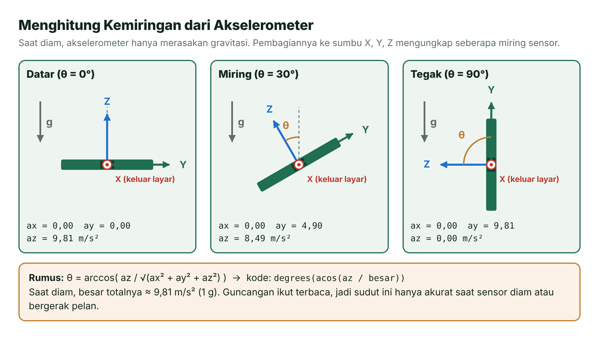
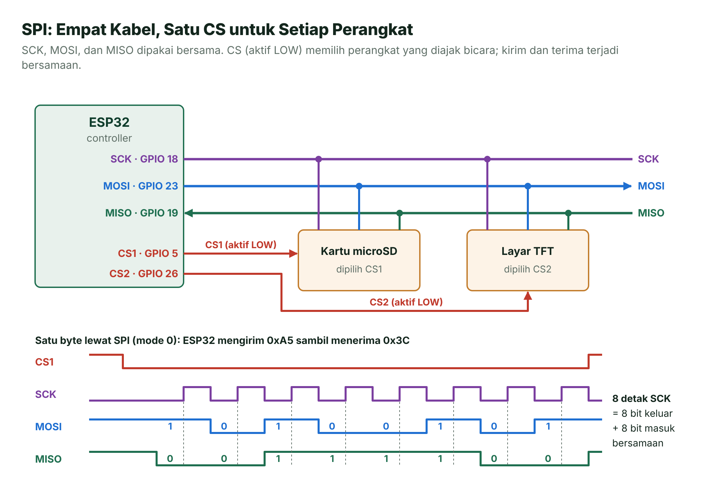
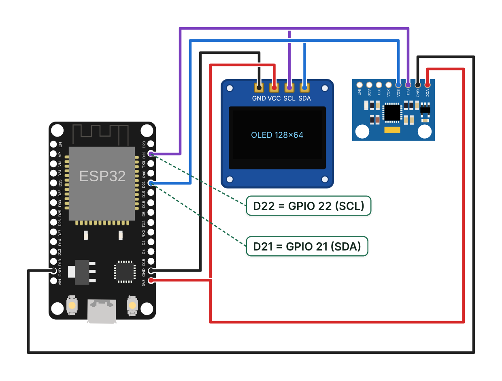
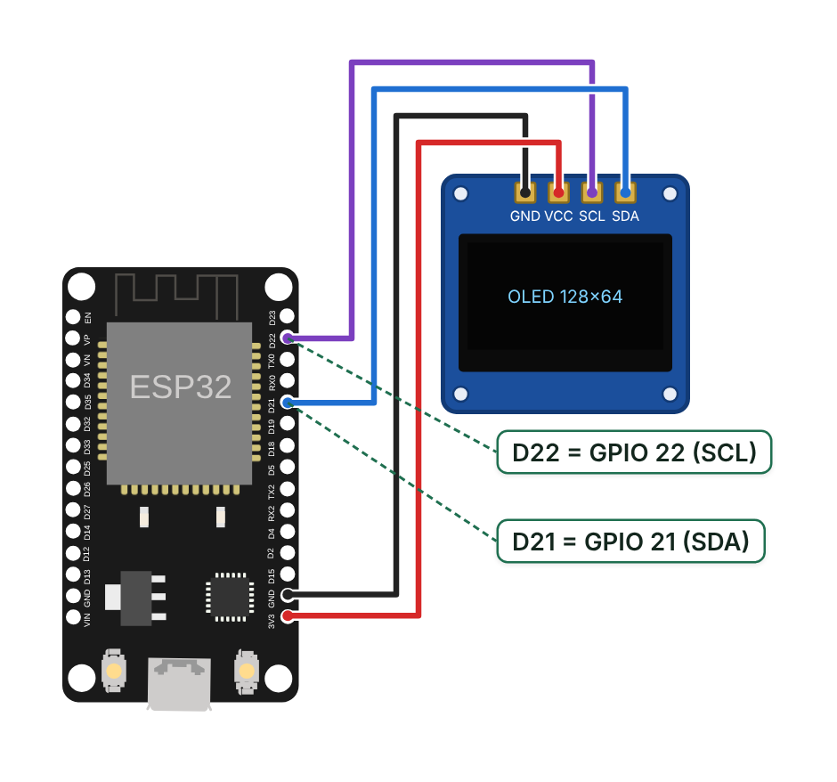

# Pertemuan 09 — Komunikasi Serial: UART, I2C, dan SPI

> Hari ini ESP32-mu belajar "mengobrol": menerima perintah teks dari laptop lewat UART, menyapa layar OLED dan sensor gerak lewat I2C, lalu berkenalan dengan SPI, jalur cepat untuk kartu memori dan layar warna.

| | |
| --- | --- |
| ⏱️ **Durasi** | 2 × 50 menit teori + 3 × 50 menit praktikum |
| 📋 **Prasyarat** | Pertemuan 2 (fungsi dan teks `String`), Pertemuan 3–4 (GPIO), Pertemuan 5 (`millis()`) |
| 🧰 **Alat** | Laptop + internet; opsional: ESP32 DevKit V1, layar OLED SSD1306 128×64 (I2C), modul MPU6050, kabel *jumper*, *breadboard* |
| 📥 **Slide** | [Unduh PDF](../slide/pdf/P09-Komunikasi-Serial.pdf) · [Unduh PPTX](../slide/pptx/P09-Komunikasi-Serial.pptx) |

## Daftar Isi

- [🎯 Tujuan Pembelajaran](#-tujuan-pembelajaran)
- [🧰 Yang Perlu Disiapkan](#-yang-perlu-disiapkan)
- [1. Mengapa ESP32 Perlu Mengobrol?](#1-mengapa-esp32-perlu-mengobrol)
- [2. UART: Mengobrol Berdua tanpa *Clock*](#2-uart-mengobrol-berdua-tanpa-clock)
- [3. Merancang Protokol Perintah Teks](#3-merancang-protokol-perintah-teks)
- [4. I2C: Dua Kabel untuk Banyak Perangkat](#4-i2c-dua-kabel-untuk-banyak-perangkat)
- [5. Layar OLED SSD1306](#5-layar-oled-ssd1306)
- [6. Sensor Gerak MPU6050](#6-sensor-gerak-mpu6050)
- [7. SPI: Jalur Cepat Empat Kabel](#7-spi-jalur-cepat-empat-kabel)
- [8. Memilih UART, I2C, atau SPI](#8-memilih-uart-i2c-atau-spi)
- [🧪 Praktikum](#-praktikum)
- [🏋️ Latihan & Tantangan](#️-latihan--tantangan)
- [✅ Cek Pemahaman](#-cek-pemahaman)
- [📌 Rangkuman](#-rangkuman)
- [📚 Referensi](#-referensi)
- [🖼️ Sumber Gambar](#️-sumber-gambar)

---

## 🎯 Tujuan Pembelajaran

Setelah pertemuan ini, kamu bisa:

1. Membedakan komunikasi paralel dan serial, sinkron dan asinkron, serta *simplex*, *half duplex*, dan *full duplex*.
2. Menjelaskan bingkai UART 8N1 dan menghitung waktu kirim dari *baud rate*.
3. Membuat protokol perintah teks lewat Serial: membaca per baris, mengurai, memvalidasi, dan membalas dengan pesan yang ramah.
4. Menyambungkan beberapa perangkat I2C pada satu bus, memindai alamatnya, lalu menampilkan data sensor MPU6050 di layar OLED.
5. Menjelaskan cara kerja SPI dan memilih protokol yang tepat (UART, I2C, atau SPI) untuk suatu kebutuhan.

## 🧰 Yang Perlu Disiapkan

| Kebutuhan | Keterangan |
| --- | --- |
| Wajib | Laptop, internet, dan simulator [Wokwi](../panduan/03-simulasi-wokwi.md). Keempat praktikum bisa disimulasikan. |
| *Board* asli (opsional) | ESP32 DevKit V1 + kabel USB **data** |
| Komponen Praktikum 2–4 | Layar OLED 0,96 inci SSD1306 128×64 versi **I2C (4 pin)**, modul MPU6050 (sering dijual dengan nama GY-521), 8 kabel *jumper*, *breadboard* |
| Pustaka (*library*) | Adafruit SSD1306, Adafruit GFX Library, Adafruit MPU6050, Adafruit Unified Sensor. PlatformIO mengunduhnya otomatis dari `platformio.ini`; di Wokwi tambahkan sesuai isi `libraries.txt`. |

> [!WARNING]
> **Cek urutan pin modul OLED-mu.** Ada modul yang urutan pinnya GND–VCC–SCL–SDA, ada juga yang VCC–GND–SCL–SDA. Selalu ikuti tulisan pada modul, bukan urutan di gambar.

---

## 1. Mengapa ESP32 Perlu Mengobrol?

Bayangkan seseorang yang sangat pintar, tetapi terkunci sendirian di sebuah kamar. Ia bisa berpikir cepat, tetapi tidak bisa bertanya ke siapa pun dan tidak bisa memberi tahu hasil pikirannya. ESP32 tanpa komunikasi kurang lebih seperti itu.

Sensor sederhana seperti tombol atau potensiometer cukup dibaca lewat satu pin (Pertemuan 4 dan 6). Namun, sensor pintar seperti MPU6050 mengirim belasan angka sekaligus, dan layar OLED butuh ribuan titik. Data sebanyak itu dikirim sebagai deretan **bit** (0 dan 1) lewat kabel. Cara dua perangkat bertukar data disebut **komunikasi data**, sedangkan aturan mainnya disebut **protokol**.

### Paralel vs Serial, Sinkron vs Asinkron



*Gambar 9.1 — Tiga cara mengirim satu byte. Sumber: dibuat untuk materi ini.*

- **Komunikasi paralel** memberi setiap bit kabelnya sendiri. Satu byte (8 bit) terkirim sekaligus, tetapi butuh 8 pin dan 8 kabel. Cara ini dipakai pada jarak sangat pendek, misalnya di dalam cip.
- **Komunikasi serial** mengirim bit bergiliran lewat satu kabel data. Pin jauh lebih hemat, dan kecepatannya dikejar dengan menaikkan laju bit. Hampir semua sambungan antarmodul di sistem tertanam memakai cara ini, termasuk UART, I2C, SPI, dan bahkan USB.

Komunikasi serial sendiri ada dua jenis:

- **Sinkron**: ada kabel ***clock*** (detak) bersama. Setiap detak adalah aba-aba "baca bit sekarang!". Contoh: I2C dan SPI.
- **Asinkron**: tidak ada kabel *clock*. Kedua pihak harus sudah sepakat kecepatannya (*baud rate*) sebelum mulai. Contoh: UART.

Analoginya, komunikasi sinkron mirip baris-berbaris yang mengikuti aba-aba komandan. Komunikasi asinkron mirip dua penyanyi yang sudah sepakat tempo lagu, lalu bernyanyi tanpa dirigen.

### *Simplex*, *Half Duplex*, dan *Full Duplex*

Selain jumlah kabel, protokol juga dibedakan dari **arah** datanya.

| Mode | Arah data | Analogi | Contoh |
| --- | --- | --- | --- |
| *Simplex* | Satu arah saja | Siaran radio FM | *Remote* TV inframerah ke televisi |
| *Half duplex* | Dua arah, bergantian | *Walkie-talkie* ("ganti!") | I2C: satu kabel SDA dipakai bergantian |
| *Full duplex* | Dua arah, bersamaan | Telepon | UART (TX dan RX terpisah), SPI (MOSI dan MISO) |

## 2. UART: Mengobrol Berdua tanpa *Clock*

Bayangkan dua orang yang saling mengirim kode dengan senter dari dua jendela berseberangan. Mereka sudah sepakat: satu kedipan mewakili satu bit, dan setiap bit lamanya sama. Sebelum mengirim satu huruf, pengirim memberi tanda "perhatian, mulai!" supaya penerima siap menghitung. Itulah cara kerja UART.

**UART** (*Universal Asynchronous Receiver-Transmitter*) adalah periferal untuk mengirim dan menerima data serial asinkron. Sebenarnya kamu sudah memakainya sejak Pertemuan 1: `Serial.begin(115200)` dan **Serial Monitor** bekerja lewat UART.



*Gambar 9.2 — Atas: sambungan UART. Bawah: bingkai 8N1 untuk huruf 'A'. Sumber: dibuat untuk materi ini.*

### Sambungan: TX ke RX, dan GND Bersama

- **TX** (*transmit*) adalah kaki pengirim, sedangkan **RX** (*receive*) adalah kaki penerima.
- Sambungannya **disilang**: TX ESP32 ke RX modul, TX modul ke RX ESP32. Menyambung TX ke TX sama seperti dua orang yang saling berbicara ke mulut, bukan ke telinga.
- **GND bersama** wajib ada. Tegangan "3,3 V" baru bermakna kalau kedua pihak memakai titik 0 V yang sama.
- Karena jalur kirim dan terima terpisah, UART bersifat *full duplex*.

### Bingkai 8N1

Saat diam (*idle*), jalur TX bernilai HIGH. Setiap byte dibungkus dalam sebuah **bingkai** (*frame*):

1. **Bit *start*** (selalu 0). Jalur turun ke LOW, tanda bagi penerima bahwa byte baru dimulai. Penerima mulai menghitung waktu dari sini.
2. **8 bit data**. Bit terkecil (**LSB**, *least significant bit*) dikirim lebih dulu. Huruf 'A' = 0x41 = 0100&nbsp;0001, jadi urutan kirimnya 1, 0, 0, 0, 0, 0, 1, 0.
3. **Bit *stop*** (selalu 1). Jalur kembali HIGH dan siap untuk bingkai berikutnya.

Format ini disingkat **8N1**: 8 bit data, *no parity* (tanpa bit paritas), dan 1 bit *stop*. Inilah format bawaan `Serial.begin()` (`SERIAL_8N1`).

### Menghitung dengan *Baud Rate*

***Baud rate*** adalah banyaknya simbol per detik. Pada UART, satu simbol = satu bit, jadi 115200 baud berarti 115.200 bit per detik. Satu byte butuh 10 bit (1 *start* + 8 data + 1 *stop*), sehingga:

- lama 1 bit = 1 ÷ *baud rate*;
- byte per detik maksimum = *baud rate* ÷ 10.

| *Baud rate* | Lama 1 bit | Lama 1 bingkai (10 bit) | Byte per detik (maksimum) |
| --- | --- | --- | --- |
| 9600 | ±104,17 µs | ±1,04 ms | 960 |
| 115200 | ±8,68 µs | ±86,8 µs | 11.520 |

> [!IMPORTANT]
> **Baud rate kedua pihak harus sama.** Tanpa kabel *clock*, penerima hanya mengandalkan hitungan waktunya sendiri. Kalau pengirim memakai 115200 baud tetapi penerima 9600, setiap bit dibaca pada saat yang salah dan muncullah karakter aneh seperti `⸮⸮⸮` (ingat Pertemuan 1).

### UART di ESP32

ESP32 punya tiga UART [2]. Di Arduino-ESP32, ketiganya muncul sebagai objek `Serial`, `Serial1`, dan `Serial2`.

| Objek | UART | Pin bawaan (core 3.x) | Keterangan |
| --- | --- | --- | --- |
| `Serial` | UART0 | TX = GPIO 1, RX = GPIO 3 | Tersambung ke cip USB-UART di *board* → Serial Monitor. Juga dipakai saat *upload*. |
| `Serial1` | UART1 | RX = GPIO 26, TX = GPIO 27 | Bebas dipakai; pin bisa diatur sendiri |
| `Serial2` | UART2 | RX = GPIO 4, TX = GPIO 25 | Pin berlabel RX2/TX2 di *board* adalah GPIO 16/17, jadi tulis pinnya secara eksplisit |

Contoh meneruskan data dari modul UART (misalnya modul GPS 9600 baud) ke Serial Monitor:

```cpp
const int PIN_RX2 = 16;   // pin berlabel RX2 di board
const int PIN_TX2 = 17;   // pin berlabel TX2 di board

void setup() {
  Serial.begin(115200);                                // UART0 → USB → Serial Monitor
  Serial2.begin(9600, SERIAL_8N1, PIN_RX2, PIN_TX2);   // urutan: baud, format, RX, TX
}

void loop() {
  while (Serial2.available() > 0) {   // ada byte dari modul?
    Serial.write(Serial2.read());     // teruskan apa adanya ke Serial Monitor
  }
}
```

> [!IMPORTANT]
> **Jebakan di Arduino-ESP32 3.x.** `Serial2.begin(9600)` tanpa pin memakai RX = GPIO 4 dan TX = GPIO 25, **bukan** GPIO 16/17 seperti di banyak tutorial lama (core 2.x). Kalau modulmu tersambung ke pin berlabel RX2/TX2, tulislah `Serial2.begin(9600, SERIAL_8N1, 16, 17);`.

> [!CAUTION]
> **UART ESP32 bekerja pada 3,3 V.** Jangan menyambungkan TX modul 5 V langsung ke RX ESP32, karena ESP32 dirancang untuk 3,3 V dengan batas mutlak catu daya 3,6 V [2]. Turunkan dulu dengan pembagi tegangan (misalnya 1 kΩ dan 2 kΩ: 5 V × 2/3 ≈ 3,33 V) atau modul pengubah level (*level shifter*). Port RS-232 pada komputer lama dan alat industri memakai tegangan positif-negatif yang jauh lebih tinggi, jadi hanya boleh disambungkan lewat IC pengubah seperti MAX3232.

## 3. Merancang Protokol Perintah Teks

Coba ingat saat memesan di warung: "Mi goreng, dua!" Pelayan langsung paham karena ada pola: nama menu dulu, jumlah kemudian, dan pesanan selesai saat kamu berhenti bicara. Kalau kamu memesan "Mi terbang, seribu!", pelayan yang baik tidak diam saja. Ia menjelaskan apa yang salah dan menyebutkan pilihan yang benar.

UART hanya mengantar byte demi byte. Ia tidak tahu kapan sebuah "kalimat" selesai atau apa artinya. Karena itu, program butuh **protokol**, yaitu kesepakatan format pesan. Protokol di Praktikum 1 sangat sederhana:

| Aturan | Contoh |
| --- | --- |
| Satu perintah per baris, diakhiri Enter (`'\n'`) | `LED ON` lalu Enter |
| Kata pertama = perintah, sisanya = argumen | `KEDIP 3` → perintah `KEDIP`, argumen `3` |
| Huruf besar dan kecil dianggap sama | `led on` sama dengan `LED ON` |
| Balasan selalu diawali tag | `[OK]`, `[GALAT]`, `[STATUS]` |



*Gambar 9.3 — Alur mengubah ketikan menjadi aksi. Sumber: dibuat untuk materi ini.*

Inti kodenya hanya beberapa baris. Proses mengurai teks seperti ini disebut ***parsing*** (penguraian).

```cpp
if (Serial.available() > 0) {                    // ada byte masuk?
  String baris = Serial.readStringUntil('\n');   // kumpulkan sampai Enter
  baris.trim();                                  // buang spasi dan '\r' di ujung
  baris.toUpperCase();                           // "led on" → "LED ON"
  int posisiSpasi = baris.indexOf(' ');          // -1 bila tidak ada spasi
  // ... pisahkan perintah dan argumen, validasi, lalu jalankan
}
```

### Validasi: Jangan Langsung Percaya Masukan

Pengguna bisa salah ketik, dan program yang baik harus tetap tenang. Untuk perintah `KEDIP n`, ada dua lapis pemeriksaan:

1. **Apakah argumennya angka?** Fungsi `toInt()` diam-diam mengubah teks `"TIGA"` menjadi 0. Karena itu, program memeriksa dulu setiap karakternya dengan fungsi `semuaAngka()`.
2. **Apakah angkanya masuk akal?** Jumlah kedip dibatasi 1–10 agar program tidak sibuk berkedip terlalu lama.

> [!TIP]
> **Pesan galat yang ramah memuat tiga hal:** apa yang salah, aturan yang benar, dan contoh. Bandingkan `ERROR 3` dengan `[GALAT] Jumlah kedip harus 1 sampai 10. Contoh: KEDIP 3`. Pesan kedua langsung memberi tahu cara memperbaikinya.

> [!NOTE]
> **Mengapa ada `Serial.setTimeout(5000)`?** `readStringUntil()` menunggu huruf berikutnya paling lama 1 detik (nilai bawaan). Serial Monitor PlatformIO mengirim setiap huruf begitu kamu mengetiknya, sehingga ketikan yang lambat bisa terpotong. Batas 5 detik membuatnya lebih longgar. Serial Monitor Wokwi berbeda: ia mengirim satu baris sekaligus setelah Enter, lalu menambahkan karakter `'\n'` [9].

## 4. I2C: Dua Kabel untuk Banyak Perangkat

Bayangkan rapat RT dengan satu pemimpin rapat. Semua warga duduk di ruangan yang sama, tetapi hanya warga yang namanya dipanggil yang boleh menjawab. Pemimpin rapat juga yang mengatur tempo pembicaraan. Seperti itulah I2C bekerja.

**I2C** (*Inter-Integrated Circuit*, dibaca "I-kuadrat-C" atau "I-two-C") dikembangkan Philips (kini NXP) untuk menghubungkan cip-cip dalam satu papan rangkaian [1]. Protokol ini hanya memakai dua kabel sinyal untuk semua perangkat:

- **SDA** (*Serial Data*): jalur data, dipakai bergantian dua arah (*half duplex*).
- **SCL** (*Serial Clock*): jalur detak yang dibangkitkan oleh *controller*.

### *Controller* dan Target

Pihak yang memulai percakapan dan membangkitkan *clock* disebut ***controller***. Perangkat yang dipanggil disebut **target**. Dokumen lama menyebut keduanya *master* dan *slave*; spesifikasi I2C revisi 7 (2021) menggantinya dengan *controller* dan *target* [1]. Di praktikum ini ESP32 menjadi *controller*, sedangkan OLED dan MPU6050 menjadi target.



*Gambar 9.4 — Topologi bus I2C dengan resistor pull-up. Sumber: dibuat untuk materi ini.*

### *Open-Drain* dan Resistor *Pull-Up*

Setiap perangkat I2C hanya bisa **menarik** jalur ke LOW; ia tidak pernah "mendorong" jalur ke HIGH. Sifat ini disebut ***open-drain***. Lalu, dari mana HIGH berasal? Dari **resistor *pull-up*** yang menghubungkan SDA dan SCL ke 3,3 V.

Keuntungannya besar: kalau dua perangkat tidak sengaja "berbicara" bersamaan, tidak terjadi hubungan pendek. Paling buruk, keduanya sama-sama menarik jalur ke LOW. Modul OLED dan MPU6050 umumnya sudah memasang resistor *pull-up* di papannya. Kalau kamu memakai cip tanpa modul, kamu harus menambahkannya sendiri; nilai beberapa kΩ, misalnya 4,7 kΩ, umum dipakai.

### Alamat 7 Bit

Setiap target punya **alamat 7 bit**. Tujuh bit memberi 128 kombinasi, tetapi alamat 0x00–0x07 dan 0x78–0x7F dicadangkan untuk keperluan khusus. Hasilnya, tersisa **112 alamat** yang bisa dipakai perangkat [1].

| Perangkat | Alamat | Bisa diubah? |
| --- | --- | --- |
| OLED SSD1306 | 0x3C | Sebagian modul memakai 0x3D (dipilih dengan pin SA0 cip) [5] |
| MPU6050 | 0x68 | Pin AD0 ke HIGH → 0x69 [6] |
| BMP280 (sensor tekanan udara) | 0x76 | Pin SDO ke HIGH → 0x77 [11] |
| RTC DS3231 | 0x68 | Tidak bisa, sehingga bentrok dengan MPU6050 yang AD0-nya LOW |

> [!IMPORTANT]
> **Dua perangkat tidak boleh memakai alamat yang sama di satu bus.** Kalau bentrok, ubah alamat salah satunya (misalnya AD0 MPU6050 ke 3,3 V). Bila tidak bisa, pakai bus I2C kedua: ESP32 punya dua pengendali I2C, yaitu `Wire` dan `Wire1` [2].

### Kecepatan dan Jarak

Spesifikasi I2C mengenal beberapa mode kecepatan, antara lain mode standar **100 kbit/s**, mode cepat **400 kbit/s**, mode cepat plus 1 Mbit/s, dan mode kecepatan tinggi 3,4 Mbit/s [1]. Di Arduino-ESP32, `Wire.begin()` memakai **100 kHz** sebagai bawaan; `Wire.setClock(400000)` menaikkannya ke 400 kHz bila semua perangkat di bus mendukungnya. SSD1306 dan MPU6050 sama-sama mendukung 400 kHz [5][6]. Menariknya, pustaka Adafruit SSD1306 otomatis memakai 400 kHz saat mengirim gambar, lalu mengembalikannya ke 100 kHz [8].

I2C dirancang untuk jarak pendek di dalam satu papan atau satu kotak alat. Spesifikasinya membatasi kapasitansi bus maksimal **400 pF** pada mode standar dan mode cepat [1]. Kabel yang panjang menambah kapasitansi, sehingga tepi sinyal melambat dan data bisa rusak.

### Anatomi Satu Transaksi



*Gambar 9.5 — Satu transaksi I2C: ESP32 menulis 1 byte ke alamat 0x3C. Sumber: dibuat untuk materi ini.*

1. **START**: *controller* menurunkan SDA saat SCL masih HIGH. Semua target bersiap mendengar.
2. **Alamat 7 bit + bit R/W**: bit terbesar (**MSB**) dikirim lebih dulu. Bit ke-8 adalah arah: 0 = tulis (*write*), 1 = baca (*read*). Alamat 0x3C + bit tulis menjadi byte **0x78** di kabel. Itulah sebabnya sebagian penjual menulis alamat OLED sebagai 0x78.
3. **ACK** (*acknowledge*): target yang merasa dipanggil menarik SDA ke LOW pada detak ke-9, artinya "saya ada, lanjutkan". Kalau tidak ada yang menjawab, SDA tetap HIGH dan disebut **NACK**.
4. **Data 8 bit + ACK**, diulang sebanyak yang dibutuhkan.
5. **STOP**: SDA naik saat SCL HIGH. Bus kembali bebas.

Di Arduino, transaksi itu ditulis seperti ini:

```cpp
Wire.begin(21, 22);                        // SDA = GPIO 21, SCL = GPIO 22, 100 kHz
Wire.beginTransmission(0x3C);              // siapkan START + alamat 0x3C + bit tulis
Wire.write(0xA5);                          // titipkan 1 byte data
uint8_t hasil = Wire.endTransmission();    // kirim semuanya + STOP; 0 = berhasil (ACK)
```

> [!TIP]
> **Prinsip pemindai I2C.** Kalau `beginTransmission()` langsung diikuti `endTransmission()` tanpa data, ESP32 hanya "mengetuk pintu" sebuah alamat. Hasil 0 berarti ada target yang menjawab ACK. Ulangi untuk alamat 0x08–0x77, dan kamu mendapat daftar semua perangkat di bus. Itulah Praktikum 2.

## 5. Layar OLED SSD1306

**OLED** (*Organic Light-Emitting Diode*) adalah layar yang setiap pikselnya memancarkan cahaya sendiri, jadi tidak butuh lampu latar dan kontrasnya tinggi. Modul yang kita pakai berukuran 0,96 inci, monokrom, dengan resolusi **128×64 piksel**. Isi layar disimpan oleh cip pengendali **SSD1306** di memorinya sendiri sebesar 128 × 64 bit [5].



*Gambar 9.6 — Koordinat layar OLED dan cara kerja buffer. Sumber: dibuat untuk materi ini.*

### Koordinat dan *Buffer*

- Titik **(0, 0) ada di pojok kiri atas**. Nilai x bertambah ke kanan (0–127) dan nilai y bertambah **ke bawah** (0–63). Ini berbeda dengan grafik matematika yang sumbu y-nya ke atas.
- Dengan huruf bawaan, `setTextSize(1)` membuat setiap huruf menempati 6×8 piksel, jadi satu baris muat 21 huruf dan layar muat 8 baris. `setTextSize(2)` membuat huruf 12×16 piksel [7].
- Pustaka Adafruit menyimpan salinan layar berupa ***buffer*** 128 × 64 bit = 8.192 bit = **1.024 byte** di RAM ESP32. Perintah `print()`, `drawRect()`, dan kawan-kawannya hanya menggambar di *buffer*.
- Layar baru berubah setelah `display()` mengirim seluruh *buffer* lewat I2C. Setiap byte butuh 9 detak (8 bit + ACK), jadi 1.024 byte pada 400 kHz memerlukan paling sedikit ±23 ms. Karena itu, panggil `display()` hanya saat isi layar memang berubah.

| Fungsi | Kegunaan |
| --- | --- |
| `oled.begin(SSD1306_SWITCHCAPVCC, 0x3C)` | Menyalakan layar di alamat 0x3C; mengembalikan `false` bila gagal |
| `oled.clearDisplay()` | Mengosongkan *buffer* (semua piksel padam) |
| `oled.setTextSize(n)` | Ukuran huruf: 1 = 6×8 piksel, 2 = 12×16 piksel, dan seterusnya |
| `oled.setTextColor(SSD1306_WHITE)` | Warna teks: piksel menyala |
| `oled.setCursor(x, y)` | Posisi pojok kiri atas huruf berikutnya |
| `oled.print(...)` | Menulis teks atau angka ke *buffer*, mirip `Serial.print()` |
| `oled.drawRect()`, `fillRect()`, `drawCircle()`, `drawLine()` | Menggambar bentuk dasar |
| `oled.display()` | Mengirim *buffer* ke layar |

Contoh menggambar satu tampilan:

```cpp
oled.clearDisplay();                            // 1) kosongkan buffer
oled.setTextSize(2);                            // huruf 12×16 piksel
oled.setCursor(0, 26);                          // x = 0, y = 26
oled.print("Detik:");
oled.print(detik);
oled.drawRect(0, 50, 100, 12, SSD1306_WHITE);   // bingkai bar
oled.display();                                 // 2) kirim buffer ke layar
```

> [!IMPORTANT]
> **Lupa `display()` = layar tetap kosong.** Semua perintah gambar hanya mengubah *buffer* di RAM ESP32. Kalau tampilan tidak berubah padahal tidak ada pesan galat, periksa dulu apakah `display()` sudah dipanggil.

## 6. Sensor Gerak MPU6050

Bayangkan sebutir kelereng di dalam kotak kecil yang ditahan pegas di setiap sisinya. Saat kotak dimiringkan, gravitasi menarik kelereng ke satu arah sehingga pegas di sisi itu tertekan. Dari tekanan pegas, kita tahu ke mana arah "bawah". Kira-kira begitulah cara kerja **akselerometer** (pengukur percepatan).

**MPU6050** menggabungkan akselerometer 3 sumbu, **giroskop** (pengukur kecepatan putar) 3 sumbu, dan sensor suhu dalam satu cip. Komunikasinya lewat I2C hingga 400 kHz dengan alamat 0x68 atau 0x69 [6].

| Besaran | Rentang yang bisa dipilih [6] | Satuan dari pustaka Adafruit |
| --- | --- | --- |
| Percepatan | ±2, ±4, ±8, atau ±16 g | m/s² (1 g = 9,80665 m/s²) |
| Kecepatan sudut | ±250, ±500, ±1.000, atau ±2.000 °/s | rad/s (1 rad/s ≈ 57,3 °/s) |
| Suhu | — | °C |

Rentang ±2 g paling peka untuk gerakan pelan; rentang ±16 g cocok untuk benturan keras.

### Kemiringan dari Akselerometer



*Gambar 9.7 — Membaca kemiringan dari pembagian gravitasi ke sumbu sensor. Sumber: dibuat untuk materi ini.*

Saat diam, akselerometer hanya merasakan gravitasi, yaitu 1 g (±9,81 m/s²) yang terbaca mengarah ke atas. Kalau sensor datar, seluruh nilai itu jatuh di sumbu Z: az ≈ 9,81, sedangkan ax dan ay ≈ 0. Kalau sensor dimiringkan sebesar θ, porsi di sumbu Z mengecil menjadi 9,81 × cos θ. Dari sini kita mendapat rumus:

**θ = arccos( az / √(ax² + ay² + az²) )**

Contoh: ay = 4,90 dan az = 8,49 m/s². Besar totalnya √(4,90² + 8,49²) ≈ 9,80 m/s², sehingga θ = arccos(8,49 / 9,80) ≈ 30°.

```cpp
sensors_event_t aksel, giro, suhu;
mpu.getEvent(&aksel, &giro, &suhu);               // baca semua data sekaligus
float ax = aksel.acceleration.x;                  // satuan m/s²
float ay = aksel.acceleration.y;
float az = aksel.acceleration.z;
float besar = sqrt(ax * ax + ay * ay + az * az);  // ≈ 9,81 saat diam
float sudut = degrees(acos(az / besar));          // 0° = datar
```

> [!NOTE]
> **Keterbatasan cara ini.** Rumus di atas hanya akurat saat sensor diam atau bergerak pelan, karena guncangan ikut terbaca sebagai "miring". Giroskop mengukur kecepatan putar (rad/s), bukan sudut. Menggabungkan keduanya, misalnya dengan *complementary filter*, menghasilkan sudut yang lebih stabil. Itu topik lanjutan yang menarik untuk proyek akhir.

## 7. SPI: Jalur Cepat Empat Kabel

Bayangkan seorang guru di depan kelas. Guru menunjuk satu murid, lalu keduanya bertukar catatan: setiap kali guru menyerahkan selembar kertas, murid itu juga menyerahkan selembar kertas pada saat yang sama. Tidak perlu memanggil nama, cukup ditunjuk. Begitulah SPI.

**SPI** (*Serial Peripheral Interface*) adalah protokol serial sinkron yang memakai empat jenis sinyal:

| Sinyal | Nama lain | Arah | Fungsi |
| --- | --- | --- | --- |
| SCK | SCLK | *controller* → target | *Clock* |
| MOSI | COPI | *controller* → target | Data keluar dari *controller* |
| MISO | CIPO | target → *controller* | Data masuk ke *controller* |
| CS | SS | *controller* → target | Memilih target; **aktif LOW** |



*Gambar 9.8 — Bus SPI dengan dua perangkat dan pertukaran satu byte. Sumber: dibuat untuk materi ini.*

- **Satu CS per perangkat.** SCK, MOSI, dan MISO dipakai bersama, tetapi setiap perangkat butuh kabel CS sendiri. Tiga perangkat berarti 3 + 3 = 6 pin. Tidak ada alamat.
- ***Full duplex*.** Setiap detak SCK mengirim 1 bit lewat MOSI sekaligus menerima 1 bit lewat MISO. Setelah 8 detak, kedua pihak sudah bertukar 1 byte.
- **Cepat dan sederhana.** Tanpa alamat dan tanpa ACK, SPI bisa berjalan pada belasan hingga puluhan MHz. SPI ESP32 bisa mencapai **80 MHz** pada pin IO_MUX, atau 40 MHz bila sinyal lewat matriks GPIO (26,6 MHz untuk *full duplex*) [4]. Kecepatan nyata tetap dibatasi lembar data perangkatnya.
- **Pin bawaan.** ESP32 punya 4 pengendali SPI; SPI0 dan SPI1 dipakai untuk memori *flash*, sedangkan SPI2 dan SPI3 bebas dipakai [2]. Di Arduino-ESP32, `SPI` memakai SCK 18, MISO 19, MOSI 23, dan SS 5, yang merupakan pin IO_MUX untuk SPI3 [4].
- **Mode SPI 0–3** menentukan kapan bit dibaca relatif terhadap tepi *clock*. Mode 0 paling umum; ikuti lembar data perangkatmu.

Contoh perangkat SPI: modul kartu microSD, layar TFT berwarna, memori *flash*, dan modul radio. Pada pertemuan ini SPI cukup dipahami konsepnya. Di Arduino, pertukaran satu byte ditulis seperti ini (setelah `SPI.begin()`):

```cpp
digitalWrite(PIN_CS, LOW);              // pilih perangkat (CS aktif LOW)
uint8_t terima = SPI.transfer(0xA5);    // kirim 8 bit sambil menerima 8 bit
digitalWrite(PIN_CS, HIGH);             // lepaskan perangkat
```

> [!TIP]
> **Mengapa layar warna memakai SPI?** Satu gambar penuh layar TFT 240×320 piksel dengan warna 16 bit berukuran 240 × 320 × 2 = 153.600 byte. Lewat I2C 400 kHz, pengirimannya butuh ±3,5 detik. Lewat SPI 20 MHz, cukup ±61 ms.

## 8. Memilih UART, I2C, atau SPI

| Aspek | UART | I2C | SPI |
| --- | --- | --- | --- |
| Kabel sinyal (selain GND) | 2 (TX, RX) | 2 (SDA, SCL) untuk semua perangkat | 3 bersama + 1 CS per perangkat |
| *Clock* | Tidak ada (asinkron) | Ada (SCL) | Ada (SCK) |
| Arah | *Full duplex* | *Half duplex* | *Full duplex* |
| Cara memilih perangkat | Tidak perlu (hanya dua pihak) | Alamat 7 bit | Kabel CS |
| Kecepatan umum | 9600–115200 baud | 100 atau 400 kHz | Beberapa MHz hingga puluhan MHz |
| Konfirmasi terima | Tidak ada | ACK setiap byte | Tidak ada |
| Pin bawaan Arduino-ESP32 | `Serial2`: RX 4, TX 25 (atur sendiri) | SDA 21, SCL 22 | SCK 18, MISO 19, MOSI 23, SS 5 |
| Contoh perangkat | Laptop, modul GPS, modul Bluetooth | OLED, MPU6050, RTC, sensor suhu dan tekanan | Kartu microSD, layar TFT, memori *flash* |

Tips memilih:

- **Lihat lembar data perangkatnya dulu.** Sering kali pilihanmu sudah ditentukan, karena banyak modul hanya menyediakan satu antarmuka.
- **Banyak sensor lambat dan pin terbatas?** Pilih I2C: dua kabel cukup untuk puluhan perangkat.
- **Butuh data besar dan cepat** (layar warna, kartu SD)? Pilih SPI.
- **Berbicara dengan laptop atau modul yang menerima perintah teks** (GPS, modem)? Pilih UART.

---

## 🧪 Praktikum

### Sebelum Mulai

Pilih jalur sesuai kondisimu. Kodenya sama persis.

**Jalur A — Simulator Wokwi (tanpa *board*)**

1. Buka <https://wokwi.com/projects/new/esp32>.
2. Salin isi `src/main.cpp` praktikum ke tab **sketch.ino**, lalu salin isi `diagram.json` ke tab **diagram.json**.
3. Untuk Praktikum 3 dan 4, tambahkan pustaka lewat **Library Manager** Wokwi sesuai daftar di `libraries.txt`.
4. Klik tombol hijau **▶**. Langkah lengkapnya ada di [panduan Wokwi](../panduan/03-simulasi-wokwi.md).

**Jalur B — *Board* ESP32 asli (VS Code + PlatformIO)**

1. Rangkai komponen dalam keadaan kabel USB **tercabut**.
2. Buka *folder* praktikum di VS Code (**File** → **Open Folder...**).
3. Klik **Build** (✓); pada *build* pertama, PlatformIO mengunduh pustaka dari `lib_deps`.
4. Klik **Upload** (→), lalu **Serial Monitor**.

> [!CAUTION]
> **Sambungkan VCC modul ke pin 3V3, bukan VIN (5 V).** Resistor *pull-up* di modul menarik SDA dan SCL ke tegangan VCC modul. Dengan VCC 3,3 V, jalur I2C tetap aman bagi pin ESP32.

---

### Praktikum 1 — Perintah Teks lewat Serial

📁 *Folder*: [`kode/01-perintah-serial`](kode/01-perintah-serial)

**Tujuan:** membuat protokol perintah teks untuk mengendalikan LED, lengkap dengan validasi dan pesan galat yang ramah.

**Rangkaian:** tidak perlu komponen tambahan. Program memakai LED bawaan di **GPIO 2** dan `Serial` (UART0) yang sudah tersambung ke laptop lewat cip USB-UART.

**Kode** (`src/main.cpp`): `loop()` membaca satu baris persis seperti contoh di Bagian 3, lalu memanggil `jalankanPerintah()`. Di sana, argumen `KEDIP` diperiksa dua lapis:

```cpp
  } else if (perintah == "KEDIP") {
    // Validasi dua lapis: (1) harus angka, (2) harus berada dalam rentang wajar.
    if (!semuaAngka(argumen)) {
      kirimGalat("KEDIP butuh angka bulat. Contoh: KEDIP 3");
      return;
    }
    int kali = argumen.toInt();
    if (kali < KEDIP_MIN || kali > KEDIP_MAKS) {
      kirimGalat("Jumlah kedip harus " + String(KEDIP_MIN) + " sampai " +
                 String(KEDIP_MAKS) + ". Contoh: KEDIP 3");
      return;
    }
    jumlahBerhasil++;
    kedipkan(kali);
    Serial.printf("[OK] LED berkedip %d kali.\n", kali);
```

**Cara menjalankan:**

- **Wokwi:** klik ▶, klik panel Serial Monitor di bagian bawah, ketik perintah, lalu tekan Enter.
- **Board asli:** buka **Serial Monitor**, ketik perintah, lalu tekan Enter. Berkas `platformio.ini` proyek ini sudah berisi `monitor_echo = yes` (huruf yang kamu ketik ikut tampil) dan `monitor_eol = LF` (Enter dikirim sebagai `'\n'`).

**Hasil yang diharapkan** setelah kamu mengetik berturut-turut `BANTUAN`, `led on`, `KEDIP 3`, `KEDIP 20`, `kedip tiga`, `LED MERAH`, `halo`, dan `STATUS`:

```text
=========================================
  Pengendali LED lewat Serial (UART)
=========================================
Ketik BANTUAN lalu tekan Enter.
> BANTUAN
Daftar perintah:
  LED ON   - menyalakan LED bawaan (GPIO 2)
  LED OFF  - memadamkan LED
  KEDIP n  - mengedipkan LED n kali (n = 1 sampai 10)
  STATUS   - menampilkan keadaan LED dan jumlah perintah
  BANTUAN  - menampilkan daftar ini
> LED ON
[OK] LED menyala.
> KEDIP 3
[OK] LED berkedip 3 kali.
> KEDIP 20
[GALAT] Jumlah kedip harus 1 sampai 10. Contoh: KEDIP 3
> KEDIP TIGA
[GALAT] KEDIP butuh angka bulat. Contoh: KEDIP 3
> LED MERAH
[GALAT] Pilihan untuk LED hanya ON atau OFF. Contoh: LED ON
> HALO
[GALAT] Perintah "HALO" tidak dikenal. Ketik BANTUAN.
> STATUS
[STATUS] LED: NYALA | berhasil: 4 | galat: 4
```

LED biru menyala setelah `led on`, berkedip tiga kali setelah `KEDIP 3`, lalu tetap menyala. Di *board* asli, setiap baris yang kamu ketik juga tampil satu kali sebelum baris `>` karena `monitor_echo = yes`.

**Kalau belum berhasil:**

| Gejala | Coba ini |
| --- | --- |
| Tidak ada balasan sama sekali | Pastikan kamu menekan Enter. Di *board* asli, periksa `monitor_eol = LF` di `platformio.ini`; di Wokwi, klik dulu panel Serial Monitor sebelum mengetik. |
| Perintah terpotong, misalnya `Perintah "LE" tidak dikenal` | Ketikanmu terlalu lambat. Naikkan `BATAS_TUNGGU_MS` atau ketik lebih cepat. |
| Muncul karakter aneh `⸮⸮⸮` | Samakan `Serial.begin(115200)` dengan `monitor_speed = 115200`. |
| Balasan `[OK]` muncul, tetapi LED tidak menyala | Sebagian *board* klon tidak punya LED di GPIO 2. Pasang LED + resistor 220 Ω ke GPIO 2 (Pertemuan 3). |

**Eksperimen kecil:**

- Ketik `   led     on   ` (banyak spasi). Mengapa perintah itu tetap berhasil? Petunjuk: lihat `trim()` pada baris dan argumen.
- Ubah `KEDIP_MAKS` menjadi 20, lalu coba `KEDIP 20`. Perhatikan bahwa pesan galatnya ikut berubah sendiri. Mengapa?

---

### Praktikum 2 — Pemindai Alamat I2C

📁 *Folder*: [`kode/02-pemindai-i2c`](kode/02-pemindai-i2c)

**Tujuan:** menemukan semua perangkat di bus I2C beserta alamatnya. Pemindai ini adalah alat pertama yang dipakai setiap kali sebuah perangkat I2C "tidak terdeteksi".

**Rangkaian:** OLED dan MPU6050 berbagi bus yang sama (empat kabel bersama).



*Gambar 9.9 — Rangkaian Praktikum 2 dan 4: OLED dan MPU6050 di satu bus I2C. Sumber: dibuat untuk materi ini dari `diagram.json` (gambar komponen @wokwi/elements, MIT; modul OLED digambar ulang untuk materi ini).*

| Pin modul | OLED SSD1306 | MPU6050 | Pin ESP32 |
| --- | --- | --- | --- |
| VCC | VCC | VCC | 3V3 |
| GND | GND | GND | GND |
| SCL | SCL | SCL | D22 (GPIO 22) |
| SDA | SDA | SDA | D21 (GPIO 21) |

Pin AD0, INT, XDA, dan XCL pada MPU6050 dibiarkan tidak tersambung. AD0 yang tidak tersambung terbaca LOW, sehingga alamatnya 0x68.

**Kode** (`src/main.cpp`, inti pemindaian):

```cpp
for (int baris = 0; baris < 8; baris++) {
  Serial.printf("%02X:", baris * 16);      // label baris: 00, 10, ..., 70
  for (int kolom = 0; kolom < 16; kolom++) {
    uint8_t alamat = baris * 16 + kolom;
    // ... alamat 0x00–0x07 dan 0x78–0x7F dilewati
    Wire.beginTransmission(alamat);        // START + alamat + bit tulis
    uint8_t hasil = Wire.endTransmission();// STOP; 0 = ada yang menjawab ACK
    if (hasil == 0) {
      Serial.printf(" %02X", alamat);      // perangkat ditemukan
    } else {
      Serial.print(" --");                 // tidak ada jawaban (NACK)
    }
  }
  Serial.println();
}
```

**Hasil yang diharapkan** (diulang setiap 5 detik):

```text
=== Pemindai I2C (SDA = GPIO 21, SCL = GPIO 22) ===

Memindai alamat 0x08 sampai 0x77 ...
     0  1  2  3  4  5  6  7  8  9  A  B  C  D  E  F
00:                         -- -- -- -- -- -- -- --
10: -- -- -- -- -- -- -- -- -- -- -- -- -- -- -- --
20: -- -- -- -- -- -- -- -- -- -- -- -- -- -- -- --
30: -- -- -- -- -- -- -- -- -- -- -- -- 3C -- -- --
40: -- -- -- -- -- -- -- -- -- -- -- -- -- -- -- --
50: -- -- -- -- -- -- -- -- -- -- -- -- -- -- -- --
60: -- -- -- -- -- -- -- -- 68 -- -- -- -- -- -- --
70: -- -- -- -- -- -- -- --
Ditemukan 2 perangkat:
  - 0x3C : OLED SSD1306
  - 0x68 : MPU6050 (AD0 = LOW) atau RTC DS1307/DS3231
Pindai ulang dalam 5 detik ...
```

Cara membaca tabel: baris `30:` kolom `C` berarti alamat 0x30 + 0xC = **0x3C**.

**Kalau belum berhasil:**

| Gejala | Coba ini |
| --- | --- |
| `Tidak ada perangkat` | Periksa VCC dan GND modul, lalu pastikan SDA ke GPIO 21 dan SCL ke GPIO 22 (tidak tertukar). |
| OLED muncul di 0x3D | Modulmu memakai alamat alternatif. Ingat angka ini untuk Praktikum 3. |
| MPU6050 muncul di 0x69 | Pin AD0 tersambung ke HIGH. Lepaskan, atau pakai `mpu.begin(0x69)` di Praktikum 4. |
| Alamat muncul-hilang atau acak | Kabel longgar atau terlalu panjang. Pendekkan kabel dan pastikan GND bersama. |

**Eksperimen kecil:**

- Di Wokwi, sambungkan pin **AD0** MPU6050 ke **3V3**, lalu jalankan ulang. Alamat apa yang sekarang muncul?
- Hapus kabel SDA OLED di Wokwi. Perangkat mana yang hilang dari tabel?

---

### Praktikum 3 — Menulis di Layar OLED

📁 *Folder*: [`kode/03-oled-ssd1306`](kode/03-oled-ssd1306)

**Tujuan:** menampilkan teks, angka yang berubah, dan bar sederhana di layar OLED, sambil memahami koordinat dan *buffer*.

**Rangkaian:**



*Gambar 9.10 — Rangkaian Praktikum 3. Sumber: dibuat untuk materi ini dari `diagram.json` (gambar komponen @wokwi/elements, MIT; modul OLED digambar ulang untuk materi ini).*

| Pin OLED | Pin ESP32 |
| --- | --- |
| GND | GND |
| VCC | 3V3 |
| SCL | D22 (GPIO 22) |
| SDA | D21 (GPIO 21) |

**Pustaka:** Adafruit SSD1306 dan Adafruit GFX Library (sudah tercantum di `platformio.ini` dan `libraries.txt`).

**Kode** (`src/main.cpp`, dipotong bagian pentingnya):

```cpp
void loop() {
  unsigned long detik = (millis() - waktuMulai) / 1000;
  if ((long)detik != detikTerakhir) { // gambar ulang hanya saat detik berganti
    detikTerakhir = detik;
    gambarLayar(detik);
  }
}
```

Fungsi `gambarLayar()` memakai pola yang sama dengan contoh di Bagian 5: `clearDisplay()` → tulis dan gambar → `display()`. Perhatikan bahwa `loop()` memakai `millis()` (Pertemuan 5), jadi layar hanya dikirim ulang sekali per detik.

**Hasil yang diharapkan:**

- OLED menampilkan `Halo, ESP32!`, `Pertemuan 09: OLED`, garis pemisah, `Detik:` diikuti angka yang naik setiap detik, dan bar yang bertambah 10% per detik (penuh setiap 10 detik), seperti Gambar 9.6.
- Serial Monitor menampilkan:

```text
[INFO] OLED siap di alamat 0x3C.
[DATA] detik = 0 | bar = 10%
[DATA] detik = 1 | bar = 20%
[DATA] detik = 2 | bar = 30%
```

**Kalau belum berhasil:**

| Gejala | Coba ini |
| --- | --- |
| `[GALAT] OLED tidak ditemukan` | Jalankan pemindai (Praktikum 2). Bila alamatnya 0x3D, ubah `ALAMAT_OLED` menjadi `0x3D`. |
| Galat kompilasi `Adafruit_SSD1306.h: No such file` | Pastikan `lib_deps` di `platformio.ini` utuh, lalu **Build** lagi dengan internet aktif. Di Wokwi, tambahkan pustakanya lewat **Library Manager**. |
| Layar bergaris atau bergeser acak | Kemungkinan layarmu memakai cip SH1106 (sering pada OLED 1,3 inci). Pustaka untuk SH1106 berbeda. |
| Serial Monitor berjalan, layar kosong | Periksa urutan pin VCC/GND modul dan pastikan `display()` dipanggil. |

**Eksperimen kecil:**

- Ganti `setTextSize(2)` menjadi `setTextSize(3)`. Berapa digit angka detik yang masih muat dalam satu baris (lebar 128 piksel)?
- Tambahkan `oled.drawCircle(110, 35, 10, SSD1306_WHITE);` sebelum `display()`. Di mana lingkaran itu muncul?

---

### Praktikum 4 — Waterpas Digital: MPU6050 + OLED

📁 *Folder*: [`kode/04-mpu6050-oled`](kode/04-mpu6050-oled)

**Tujuan:** membaca percepatan tiga sumbu dari MPU6050, menghitung sudut kemiringan, lalu menampilkannya di OLED sebagai waterpas digital. LED bawaan menyala bila sensor terlalu miring (lebih dari 45°).

**Rangkaian:** sama dengan Praktikum 2 (Gambar 9.9). Dua perangkat, satu bus, dua alamat berbeda.

**Pustaka:** Adafruit MPU6050, Adafruit Unified Sensor, Adafruit SSD1306, dan Adafruit GFX Library.

**Kode** (`src/main.cpp`, dipotong bagian pentingnya):

```cpp
void loop() {
  unsigned long sekarang = millis();
  if (sekarang - waktuBacaTerakhir < JEDA_BACA_MS) {
    return;                                 // belum waktunya membaca
  }
  waktuBacaTerakhir = sekarang;

  // ... baca ax, ay, az dengan mpu.getEvent() seperti contoh di Bagian 6
  float sudut = hitungSudutMiring(ax, ay, az);

  digitalWrite(PIN_LED, sudut > BATAS_AWAS ? HIGH : LOW);
  gambarLayar(ax, ay, az, sudut);
  // ... cetak ke Serial setiap 500 ms
}
```

Di layar, sebuah gelembung kecil bergeser di dalam lingkaran ke arah sisi yang **lebih tinggi**, persis seperti gelembung pada waterpas sungguhan.

**Cara menjalankan di Wokwi:** saat simulasi berjalan, klik gambar MPU6050. Akan muncul penggeser (*slider*) untuk percepatan (dalam satuan g), rotasi, dan suhu. Nilai awalnya X = 0, Y = 0, Z = 1 g, yaitu posisi datar [9].

**Hasil yang diharapkan** pada posisi awal (datar), Serial Monitor menampilkan:

```text
[INFO] OLED (0x3C) dan MPU6050 (0x68) siap.
X:  0.00  Y:  0.00  Z:  9.81 m/s^2 | miring  0 derajat | DATAR
X:  0.00  Y:  0.00  Z:  9.81 m/s^2 | miring  0 derajat | DATAR
```

Ubah percepatan Y menjadi 0,5 g dan Z menjadi 0,87 g. Baris berikutnya menjadi:

```text
X:  0.00  Y:  4.90  Z:  8.53 m/s^2 | miring 30 derajat | MIRING
```

OLED menampilkan nilai X, Y, Z, sudut miring, status (`DATAR`, `MIRING`, atau `AWAS!`), dan gelembung yang bergeser ke kanan atas lingkaran sesuai nilai X dan Y. Pada *board* asli, angkanya sedikit bergetar dan Z biasanya tidak tepat 9,81; itu wajar karena derau dan selisih kalibrasi sensor.

**Kalau belum berhasil:**

| Gejala | Coba ini |
| --- | --- |
| `[GALAT] MPU6050 tidak ditemukan di alamat 0x68` | Jalankan pemindai. Bila alamatnya 0x69, ubah menjadi `mpu.begin(0x69)`. |
| Galat kompilasi `Adafruit_Sensor.h` tidak ditemukan | Pastikan keempat pustaka ada di `lib_deps` (*board*) atau di **Library Manager** (Wokwi). |
| Nilai Z sekitar −9,8 | Modul terbalik (muka cip menghadap ke bawah). |
| Gelembung bergerak ke arah yang "salah" | Arah sumbu tergantung cara modul dipasang. Cocokkan dengan tanda X dan Y yang tercetak di modul. |

**Eksperimen kecil:**

- Ubah `BATAS_AWAS` menjadi 20. Pada sudut berapa LED mulai menyala sekarang?
- Cetak juga `giro.gyro.z` ke Serial Monitor. Di Wokwi, ubah rotasi Z menjadi 90 °/s. Berapa nilai yang tercetak dalam rad/s? (Petunjuk: 90 × π / 180.)

---

## 🏋️ Latihan & Tantangan

1. **Perintah baru.** Tambahkan perintah `LED TOGGLE` (membalik keadaan LED) dan `TERANG n` (0–100%) yang mengatur kecerahan LED dengan `ledcAttach()` dan `ledcWrite()` dari Pertemuan 7. Validasi argumennya seperti `KEDIP`.
2. **Hitung waktu kirim.** Berapa lama ESP32 mengirim teks `Halo, ESP32!` beserta `'\n'` (13 byte) pada 9600 baud? Bagaimana pada 115200 baud? Tuliskan langkah hitungnya.
3. **Uji *loopback* Serial2.** Sambungkan GPIO 17 (TX2) ke GPIO 16 (RX2) dengan satu kabel *jumper* (di Wokwi: tarik kabel dari pin TX2 ke RX2). Kirim teks lewat `Serial2` dengan pin eksplisit, baca kembali, lalu cetak ke Serial Monitor. Apa yang terjadi bila kamu menulis `Serial2.begin(9600)` tanpa pin?
4. **Papan pesan.** Gabungkan Praktikum 1 dan 3: perintah `TULIS teks` menampilkan teks itu di OLED. Tolak teks yang lebih dari 21 huruf dengan pesan galat yang ramah.
5. **Roll dan pitch.** Hitung kemiringan per sumbu dengan `atan2(ay, az)` dan `atan2(-ax, sqrt(ay * ay + az * az))`, ubah ke derajat, lalu tampilkan keduanya di OLED.
6. **Tantangan: intip sinyal I2C.** Tambahkan komponen **Logic Analyzer** di Wokwi (D0 → SDA, D1 → SCL, GND → GND). Saat simulasi dihentikan, Wokwi mengunduh berkas `wokwi-logic.vcd` yang bisa dibuka di PulseView. Cari START, alamat 0x3C, dan ACK seperti pada Gambar 9.5. Lihat [panduan Logic Analyzer Wokwi](https://docs.wokwi.com/guides/logic-analyzer) dan [contoh proyeknya](https://wokwi.com/projects/325933824665977428).

## ✅ Cek Pemahaman

1. Pada 115200 baud dengan format 8N1, berapa byte maksimum yang bisa dikirim per detik?
   - A. 115.200
   - B. 14.400
   - C. 11.520
   - D. 1.152

2. Sambungan UART yang benar antara ESP32 dan modul GPS adalah …
   - A. TX–TX, RX–RX, GND–GND
   - B. TX–RX, RX–TX, GND–GND
   - C. TX–RX dan RX–TX, tanpa GND
   - D. Cukup TX–RX saja

3. Mengapa bus I2C membutuhkan resistor *pull-up*?
   - A. Untuk membatasi arus LED
   - B. Karena perangkat I2C hanya bisa menarik jalur ke LOW, sehingga HIGH harus datang dari *pull-up*
   - C. Untuk mempercepat komunikasi UART
   - D. Untuk mengubah 5 V menjadi 3,3 V

4. MPU6050 (AD0 = LOW) dan RTC DS3231 sama-sama beralamat 0x68 dan dipasang di bus yang sama. Solusi termudahnya adalah …
   - A. Menyambungkan AD0 MPU6050 ke 3,3 V sehingga alamatnya menjadi 0x69
   - B. Menukar kabel SDA dan SCL
   - C. Menaikkan kecepatan bus ke 400 kHz
   - D. Tidak ada solusi; salah satu harus dilepas

5. Pada SPI, cara ESP32 memilih perangkat yang diajak bicara adalah …
   - A. Mengirim alamat 7 bit
   - B. Menarik kabel CS perangkat itu ke LOW
   - C. Memakai *baud rate* yang berbeda
   - D. Menunggu bit ACK

6. Program memanggil `oled.print("Halo")`, tidak ada pesan galat, tetapi layar tetap kosong. Penyebab paling mungkin adalah …
   - A. Alamat OLED salah
   - B. Lupa memanggil `oled.display()`
   - C. *Baud rate* Serial Monitor salah
   - D. Ukuran huruf terlalu kecil

<details>
<summary><b>Lihat jawaban</b></summary>

1. **C.** Satu byte butuh 10 bit (1 *start* + 8 data + 1 *stop*), jadi 115.200 ÷ 10 = 11.520 byte per detik. Jawaban B lupa menghitung bit *start* dan *stop*.
2. **B.** TX selalu ke RX lawannya, dan GND harus bersama sebagai acuan 0 V.
3. **B.** Perangkat I2C bersifat *open-drain*: ia hanya bisa menarik jalur ke LOW.
4. **A.** Alamat MPU6050 bisa dipindah ke 0x69 lewat pin AD0, sedangkan alamat DS3231 tetap. Pilihan lain: pakai bus kedua (`Wire1`).
5. **B.** SPI tidak memakai alamat; CS yang LOW menandai perangkat yang dipilih.
6. **B.** Semua perintah gambar hanya mengubah *buffer*; `display()` yang mengirimnya ke layar. Kalau alamatnya salah, `begin()` sudah gagal dan mencetak pesan galat.

</details>

## 📌 Rangkuman

- Komunikasi **serial** mengirim bit bergiliran sehingga hemat pin. **Sinkron** memakai *clock* bersama (I2C, SPI); **asinkron** mengandalkan *baud rate* yang disepakati (UART).
- **UART** memakai TX dan RX yang disilang serta GND bersama. Bingkai **8N1** = bit *start* + 8 bit data (LSB dulu) + bit *stop*; pada 115200 baud, 1 bit ±8,68 µs dan maksimum 11.520 byte per detik.
- Di Arduino-ESP32 3.x, `Serial2` bawaan memakai RX 4/TX 25; untuk pin berlabel RX2/TX2 tulis `Serial2.begin(9600, SERIAL_8N1, 16, 17)`. Pin ESP32 hanya tahan 3,3 V.
- **Protokol perintah teks**: baca per baris, rapikan, pisahkan perintah dan argumen, validasi, lalu balas dengan tag `[OK]` atau `[GALAT]` beserta contoh yang benar.
- **I2C** memakai SDA dan SCL untuk banyak perangkat, *open-drain* dengan resistor *pull-up*, alamat 7 bit (OLED 0x3C, MPU6050 0x68/0x69), dan kecepatan 100 atau 400 kHz. Setiap transaksi: START → alamat + R/W → ACK → data → ACK → STOP.
- **OLED SSD1306**: koordinat (0, 0) di kiri atas, y ke bawah; gambar di *buffer* 1.024 byte, lalu kirim dengan `display()`.
- **MPU6050**: akselerometer (m/s²) dan giroskop (rad/s). Saat diam, kemiringan θ = arccos(az / |a|).
- **SPI**: SCK, MOSI, MISO bersama + satu CS per perangkat, *full duplex*, cepat, tanpa alamat. Pin bawaan ESP32: 18/19/23/5.

## 📚 Referensi

1. NXP Semiconductors. (2021). *UM10204: I2C-bus Specification and User Manual* (Rev. 7.0). <https://www.nxp.com/docs/en/user-guide/UM10204.pdf>
2. Espressif Systems. (2025). *ESP32 Series Datasheet* (v5.x). <https://documentation.espressif.com/esp32_datasheet_en.pdf>
3. Espressif Systems. (2026). *Arduino-ESP32 Documentation: I2C dan SPI*. <https://docs.espressif.com/projects/arduino-esp32/en/latest/api/i2c.html> dan <https://docs.espressif.com/projects/arduino-esp32/en/latest/api/spi.html>
4. Espressif Systems. (2026). *ESP-IDF Programming Guide (ESP32): SPI Master Driver*. <https://docs.espressif.com/projects/esp-idf/en/stable/esp32/api-reference/peripherals/spi_master.html>
5. Solomon Systech. (2008). *SSD1306: 128 x 64 Dot Matrix OLED/PLED Segment/Common Driver with Controller* (Rev. 1.1). <https://cdn-shop.adafruit.com/datasheets/SSD1306.pdf>
6. InvenSense. (2013). *MPU-6000 and MPU-6050 Product Specification* (Rev. 3.4). <https://invensense.tdk.com/wp-content/uploads/2015/02/MPU-6000-Datasheet1.pdf>
7. Adafruit Industries. (2026). *Adafruit GFX Graphics Library*. <https://learn.adafruit.com/adafruit-gfx-graphics-library>
8. Adafruit Industries. (2026). *Adafruit_SSD1306* dan *Adafruit_MPU6050* (kode sumber pustaka). GitHub. <https://github.com/adafruit/Adafruit_SSD1306> dan <https://github.com/adafruit/Adafruit_MPU6050>
9. CodeMagic LTD. (2026). *Wokwi Docs: Serial Monitor, wokwi-mpu6050, board-ssd1306, Logic Analyzer*. <https://docs.wokwi.com/guides/serial-monitor>
10. Arduino. (2026). *Arduino Docs: UART, I2C (Wire), dan SPI*. <https://docs.arduino.cc/learn/communication/uart/>, <https://docs.arduino.cc/learn/communication/wire/>, <https://docs.arduino.cc/learn/communication/spi/>
11. Bosch Sensortec. (2018). *BMP280 Digital Pressure Sensor Datasheet*. <https://www.bosch-sensortec.com/media/boschsensortec/downloads/datasheets/bst-bmp280-ds001.pdf>

## 🖼️ Sumber Gambar

| Gambar | Sumber dan lisensi |
| --- | --- |
| 9.1–9.8 | Dibuat untuk materi ini (diagram HTML/SVG). Angka teknis dari [1], [2], [4], [5], [6]. |
| 9.9, 9.10 | Dibuat untuk materi ini dari `diagram.json` praktikum; gambar *board* ESP32 dan MPU6050 dari [@wokwi/elements](https://github.com/wokwi/wokwi-elements) (MIT, © Uri Shaked); modul OLED digambar ulang untuk materi ini; dengan tambahan label pin. |

---

[⬅️ Pertemuan 08: Ujian Tengah Semester](../pertemuan-08-uts/README.md) · [🏠 Beranda](../README.md) · [Pertemuan 10: Sensor, Aktuator, *Library*, dan *Datasheet* ➡️](../pertemuan-10-sensor-aktuator/README.md)
