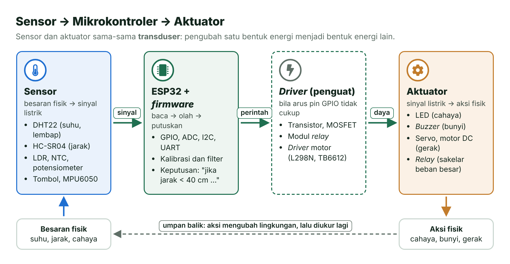
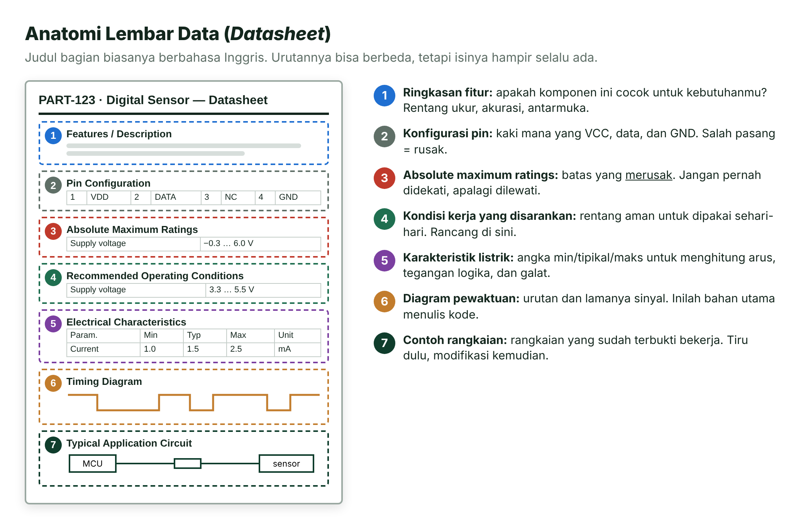
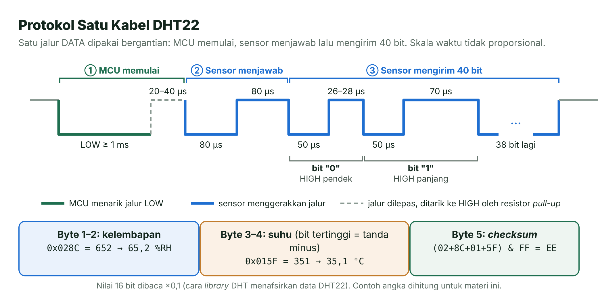
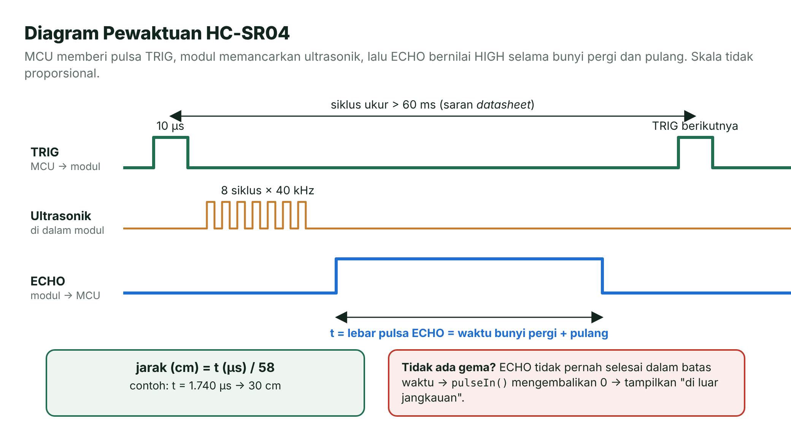
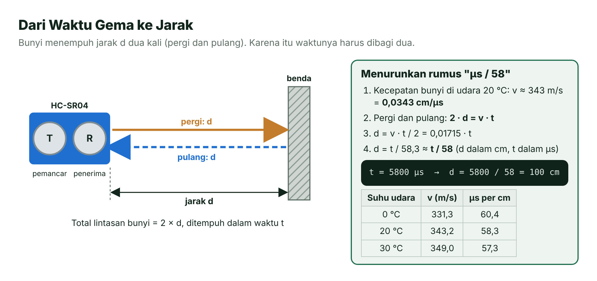
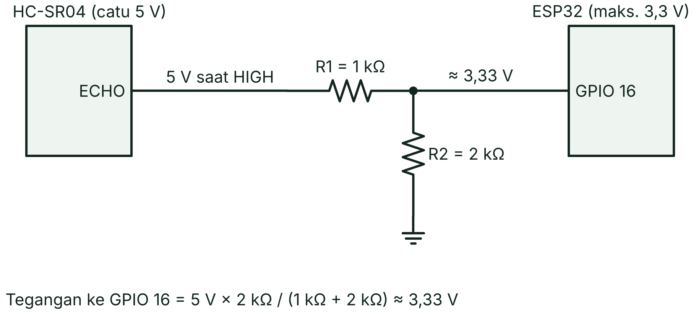
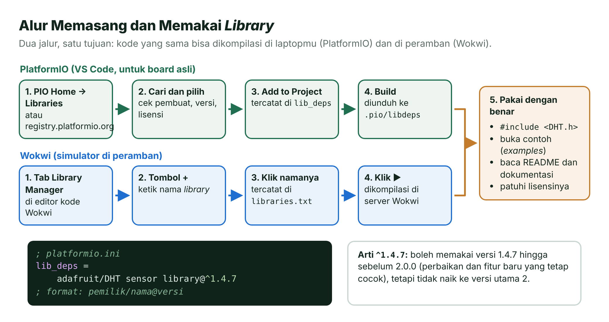
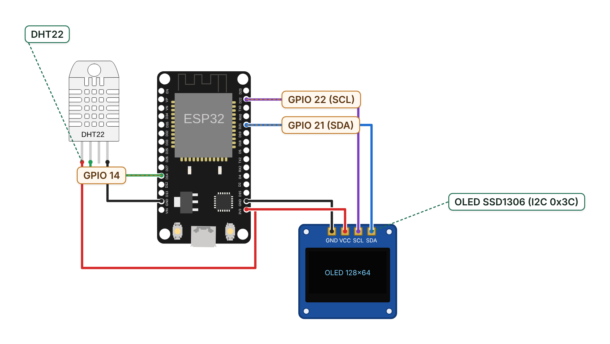
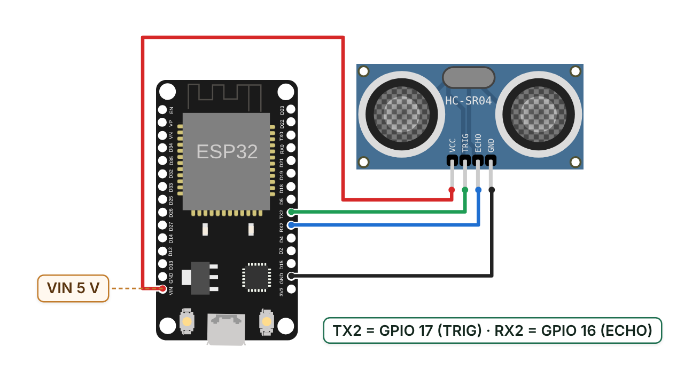
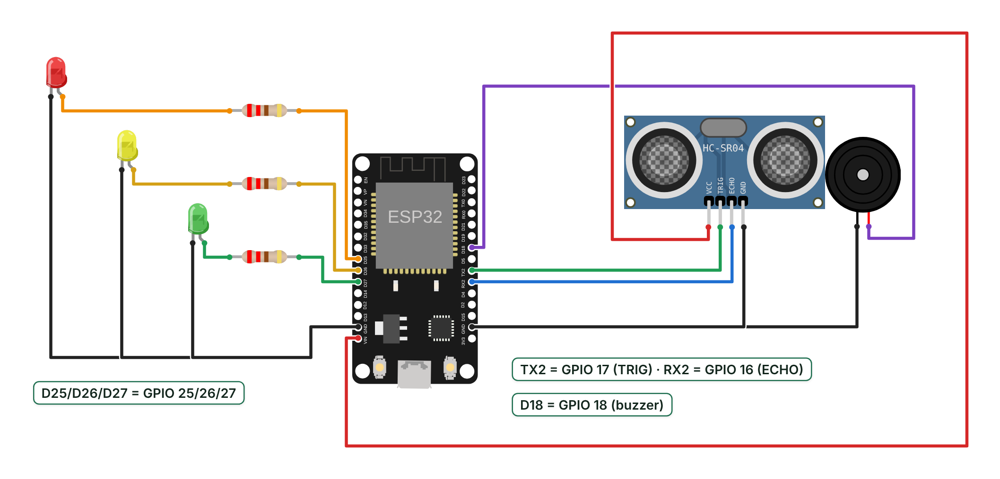

# Pertemuan 10 — Sensor, Aktuator, *Library*, dan *Datasheet*

> Hari ini ESP32-mu mulai "merasakan" dan "bertindak": kamu membaca lembar data sensor seperti seorang insinyur, memasang *library* dengan benar, lalu membangun stasiun cuaca mini dan sensor parkir.

| | |
| --- | --- |
| ⏱️ **Durasi** | 2 × 50 menit teori + 3 × 50 menit praktikum |
| 📋 **Prasyarat** | [Pertemuan 05](../pertemuan-05-waktu-interupsi/README.md) (`millis()`), [Pertemuan 07](../pertemuan-07-pwm-beban/README.md) (PWM dan beban), [Pertemuan 09](../pertemuan-09-komunikasi-serial/README.md) (I2C) |
| 🧰 **Alat** | Laptop + internet; opsional: ESP32 DevKit V1, DHT22, OLED SSD1306 I2C, HC-SR04, *buzzer* pasif, 3 LED, resistor, *breadboard* |
| 📥 **Slide** | [👁️ Lihat di peramban](https://view.officeapps.live.com/op/view.aspx?src=https%3A%2F%2Fraw.githubusercontent.com%2Fantonprafanto%2Fembeddedsystem%2Fmain%2Fslide%2Fpptx%2FP10-Sensor-Aktuator-Datasheet.pptx) · [⬇️ Unduh PDF](https://raw.githubusercontent.com/antonprafanto/embeddedsystem/main/slide/pdf/P10-Sensor-Aktuator-Datasheet.pdf) · [⬇️ Unduh PPTX](https://raw.githubusercontent.com/antonprafanto/embeddedsystem/main/slide/pptx/P10-Sensor-Aktuator-Datasheet.pptx) |
| 📄 **Modul PDF** | [⬇️ Unduh modul ini dalam PDF](https://raw.githubusercontent.com/antonprafanto/embeddedsystem/main/modul-pdf/Modul-P10-Sensor-Aktuator-Datasheet.pdf) — untuk dibaca luring atau dicetak |

## Daftar Isi

- [🎯 Tujuan Pembelajaran](#-tujuan-pembelajaran)
- [🧰 Yang Perlu Disiapkan](#-yang-perlu-disiapkan)
- [1. Sensor, Aktuator, dan Transduser](#1-sensor-aktuator-dan-transduser)
- [2. Membaca Datasheet Langkah demi Langkah](#2-membaca-datasheet-langkah-demi-langkah)
- [3. Studi Kasus: Datasheet DHT22](#3-studi-kasus-datasheet-dht22)
- [4. Studi Kasus: Datasheet HC-SR04](#4-studi-kasus-datasheet-hc-sr04)
- [5. Dari Waktu Gema ke Jarak](#5-dari-waktu-gema-ke-jarak)
- [6. Level Tegangan: ECHO 5 V ke ESP32](#6-level-tegangan-echo-5-v-ke-esp32)
- [7. Library: Memakai Kode Orang Lain dengan Benar](#7-library-memakai-kode-orang-lain-dengan-benar)
- [8. Aktuator Umum dan Cara Menggerakkannya](#8-aktuator-umum-dan-cara-menggerakkannya)
- [🧪 Praktikum](#-praktikum)
- [🏋️ Latihan & Tantangan](#️-latihan--tantangan)
- [✅ Cek Pemahaman](#-cek-pemahaman)
- [📌 Rangkuman](#-rangkuman)
- [📚 Referensi](#-referensi)
- [🖼️ Sumber Gambar](#️-sumber-gambar)

---

## 🎯 Tujuan Pembelajaran

Setelah pertemuan ini, kamu bisa:

1. Membedakan sensor, aktuator, dan transduser, serta menggolongkan sensor menjadi analog/digital dan aktif/pasif.
2. Membaca *datasheet* secara sistematis dan mengambil angka penting (catu, batas, akurasi, pewaktuan) dari *datasheet* DHT22 dan HC-SR04.
3. Mencari, memasang, dan memakai *library* di PlatformIO dan Wokwi, termasuk memahami penulisan versi `^` dan lisensinya.
4. Menurunkan rumus jarak HC-SR04 (µs/58) dan menghitung pembagi tegangan untuk sinyal 5 V.
5. Membuat program sensor–aktuator yang tidak memblokir (*non-blocking*) dan tahan terhadap pembacaan gagal.

## 🧰 Yang Perlu Disiapkan

| Kebutuhan | Keterangan |
| --- | --- |
| Perangkat lunak | VS Code + PlatformIO. **Build** pertama Praktikum 1 mengunduh *library*, jadi pastikan internet menyala. |
| Simulator | [Wokwi](../panduan/03-simulasi-wokwi.md): semua komponen pertemuan ini tersedia dan tidak perlu pembagi tegangan. |
| Komponen (board asli) | Lihat tabel di bawah dan [daftar komponen](../panduan/04-daftar-komponen.md). |

| Komponen | Jumlah | Catatan |
| --- | --- | --- |
| ESP32 DevKit V1 + kabel USB data | 1 | — |
| DHT22 (AM2302) | 1 | Sensor 4 kaki butuh resistor *pull-up* 10 kΩ; modul 3 kaki biasanya sudah punya. |
| OLED SSD1306 0,96" I2C (128 × 64) | 1 | Alamat I2C 0x3C. |
| HC-SR04 | 1 | Dicatu 5 V. |
| *Buzzer* pasif (piezo) | 1 | — |
| LED merah, kuning, hijau + resistor 220 Ω | 3 + 3 | — |
| Resistor 1 kΩ dan 2 kΩ | 1 + 1 | Pembagi tegangan ECHO. Tidak punya 2 kΩ? Serikan dua resistor 1 kΩ. |
| *Breadboard* dan kabel *jumper* | 1 set | — |

---

## 1. Sensor, Aktuator, dan Transduser

Coba perhatikan tubuhmu sendiri. Kulit merasakan panas, otak memutuskan "bahaya!", lalu otot menarik tanganmu dari panci. Sistem tertanam bekerja dengan pola yang sama: **sensor** sebagai indra, **mikrokontroler** sebagai otak, dan **aktuator** sebagai otot.

- **Sensor** adalah perangkat yang mengubah besaran fisik (suhu, jarak, cahaya, tekanan) menjadi sinyal listrik yang bisa dibaca mikrokontroler.
- **Aktuator** adalah kebalikannya: mengubah sinyal listrik menjadi aksi fisik, misalnya gerak, cahaya, bunyi, atau panas.
- **Transduser** (*transducer*) adalah sebutan umum untuk perangkat yang mengubah satu bentuk energi menjadi bentuk energi lain. Sensor adalah transduser di sisi masukan; aktuator adalah transduser di sisi keluaran [1].



*Gambar 10.1 — Alur sensor → mikrokontroler → driver → aktuator. Sumber: dibuat untuk materi ini (ikon Font Awesome Free, CC BY 4.0).*

Contoh sederhana: *speaker* (pengeras suara) mengubah listrik menjadi bunyi, sedangkan mikrofon mengubah bunyi menjadi listrik. Keduanya transduser; yang satu aktuator, yang lain sensor.

| Alat sehari-hari | Sensor (indra) | Aktuator (otot) |
| --- | --- | --- |
| Pintu otomatis di mal | Sensor gerak | Motor penggerak pintu |
| Penanak nasi digital | Sensor suhu | Elemen pemanas |
| Sensor parkir mobil | Sensor ultrasonik | *Buzzer* dan lampu indikator |
| Ponsel | Akselerometer, sensor cahaya | Layar, motor getar |
| AC ruangan | Sensor suhu | Kompresor dan kipas |

### Menggolongkan Sensor

Ada dua cara menggolongkan sensor yang paling sering dipakai.

**Berdasarkan bentuk keluarannya:**

- **Sensor analog** memberi tegangan yang berubah halus mengikuti besaran yang diukur. Kita membacanya dengan ADC (`analogRead()`, [Pertemuan 06](../pertemuan-06-adc/README.md)). Contoh: potensiometer, LDR, NTC.
- **Sensor digital** memberi keluaran HIGH/LOW atau rangkaian bit. Contoh: tombol ([Pertemuan 04](../pertemuan-04-gpio-input/README.md)), DHT22 (protokol satu kabel), HC-SR04 (lebar pulsa), dan sensor I2C/SPI ([Pertemuan 09](../pertemuan-09-komunikasi-serial/README.md)).

**Berdasarkan sumber energinya** [1]:

- **Sensor aktif** butuh catu atau sinyal eksitasi dari luar agar bisa bekerja. Contoh: NTC dan LDR (harus dialiri arus agar perubahan hambatannya terbaca), DHT22, dan HC-SR04.
- **Sensor pasif** menghasilkan sinyal listrik sendiri dari energi yang diukur, tanpa catu. Contoh: termokopel, elemen piezo, dan fotodioda.

| Sensor | Analog/digital | Aktif/pasif | Cara membaca di ESP32 |
| --- | --- | --- | --- |
| Potensiometer, LDR, NTC | Analog | Aktif | `analogRead()` atau `analogReadMilliVolts()` |
| Termokopel | Analog (orde milivolt) | Pasif | Penguat khusus, lalu ADC |
| DHT22 | Digital (satu kabel) | Aktif | *Library* DHT |
| HC-SR04 | Digital (lebar pulsa) | Aktif | `pulseIn()` |
| MPU6050 | Digital (I2C) | Aktif | *Library* lewat I2C |

> [!NOTE]
> **Awas istilah ganda.** Di bidang radar dan sonar, "aktif" berarti sensor memancarkan energinya sendiri lalu menangkap pantulannya (seperti HC-SR04), sedangkan "pasif" hanya menerima (seperti sensor gerak PIR, *passive infrared*). Saat membaca buku atau *datasheet*, perhatikan definisi mana yang dipakai.

> [!TIP]
> **Sensor "pintar".** DHT22 dan MPU6050 sudah berisi pengolah sinyal di dalam kemasannya. Mikrokontroler tinggal "bertanya" lewat protokol, lalu menerima angka yang sudah matang.

## 2. Membaca *Datasheet* Langkah demi Langkah

Sebelum minum obat, kamu membaca brosurnya: dosis, cara pakai, efek samping, dan batas maksimum per hari. **Lembar data** (*datasheet*) adalah "brosur obat" untuk komponen elektronik. Dokumen resmi dari pabrikan ini berisi spesifikasi, batas, dan cara memakai komponen. Angka di tutorial internet bisa keliru atau berlaku untuk versi lain, jadi *datasheet* tetap rujukan utamanya.



*Gambar 10.2 — Anatomi lembar data. Halaman di kiri hanyalah tiruan, bukan datasheet komponen sungguhan. Sumber: dibuat untuk materi ini.*

Langkah membacanya:

1. **Baca ringkasan fitur** (*features*, biasanya di halaman pertama). Cocokkan dengan kebutuhanmu: rentang ukur, akurasi, antarmuka, dan tegangan.
2. **Cari konfigurasi pin.** Tandai kaki catu, GND, dan sinyal. Salah menyambung catu bisa langsung merusak.
3. **Bedakan *absolute maximum ratings* dari *recommended operating conditions*.** Yang pertama adalah batas yang **merusak**; yang kedua adalah rentang kerja normal. Contoh dari ESP32: catu maksimum mutlak 3,6 V, sedangkan kondisi kerja modul ESP32-WROOM-32E adalah 3,0–3,6 V dengan nilai tipikal 3,3 V [5][6].
4. **Baca karakteristik listrik** (*electrical characteristics*). Tabelnya punya kolom Min, Typ (tipikal), dan Max. Rancang dengan nilai terburuk, bukan nilai tipikal. Contoh: ESP32 membaca HIGH bila tegangan masuk ≥ 0,75 × VDD, yaitu ≥ 2,475 V pada catu 3,3 V [6].
5. **Pelajari diagram pewaktuan** (*timing diagram*). Diagram ini menjawab "siapa mengirim apa, kapan, dan berapa lama". Inilah bahan utama menulis kode.
6. **Lihat contoh rangkaian** (*typical application circuit*). Rangkaian ini sudah terbukti bekerja: tiru dulu, modifikasi kemudian.
7. **Periksa catatan kaki dan revisi dokumen.** Syarat penting sering tersembunyi di catatan kecil.

> [!TIP]
> **Tiga pertanyaan wajib** saat membuka *datasheet* sensor: (1) Berapa tegangan catunya, dan apakah sinyalnya aman untuk pin 3,3 V? (2) Bagaimana cara "berbicara" dengannya: analog, digital, pulsa, atau I2C? (3) Seberapa sering ia boleh dibaca?

> [!CAUTION]
> **Absolute maximum bukan target.** Melewati batas ini bisa merusak komponen secara permanen, dan bekerja tepat di batas itu pun tidak dijamin normal. Rancang selalu di dalam *recommended operating conditions*.

## 3. Studi Kasus: *Datasheet* DHT22

DHT22, yang juga bernama **AM2302**, adalah sensor suhu dan kelembapan buatan Aosong Electronics. Berikut angka penting dari *datasheet*-nya [2] dan artinya bagi kita. RH (*relative humidity*) berarti kelembapan relatif.

| Bagian *datasheet* | Nilai | Artinya bagi kita |
| --- | --- | --- |
| Catu daya (*power supply*) | 3,3–6 V DC | Aman dicatu 3,3 V dari ESP32, sehingga sinyal DATA juga 3,3 V. |
| Sinyal keluaran | Digital, *single-bus* (satu kabel) | Butuh protokol khusus, jadi kita pakai *library*. |
| Rentang ukur | Kelembapan 0–100% RH; suhu −40 hingga 80 °C | Cukup untuk ruangan maupun luar ruang. |
| Akurasi | Kelembapan ±2% RH (maks. ±5% RH); suhu < ±0,5 °C | Bacaan 28,5 °C berarti suhu sebenarnya sekitar 28,0–29,0 °C. |
| Resolusi | 0,1% RH; 0,1 °C | Satu angka di belakang koma sudah cukup. |
| Periode baca (*sensing period*) | Rata-rata 2 s | Jangan membaca lebih sering dari 2 detik sekali. |
| Setelah catu menyala | Jangan beri perintah selama 1 s | Pembacaan pertama perlu menunggu sejenak. |
| Pin | VDD, DATA, NULL (tidak dipakai), GND | Bila bisa, pasang kapasitor 100 nF antara VDD dan GND. |

*Datasheet* menggambar resistor *pull-up* pada jalur DATA, dan contoh `DHTtester` dari *library* Adafruit memakai 10 kΩ [11].

### Protokol Satu Kabel milik Aosong

DHT22 hanya memakai **satu jalur data** untuk dua arah. Jalur ini ditarik ke HIGH oleh resistor *pull-up*, lalu ESP32 dan sensor bergantian menariknya ke LOW. Urutannya, menurut diagram pewaktuan *datasheet* [2]:



*Gambar 10.3 — Protokol satu kabel DHT22 dan susunan 40 bit datanya. Sumber: dibuat untuk materi ini berdasarkan datasheet DHT22 [2].*

1. **MCU memulai.** ESP32 menarik jalur ke LOW minimal 1 ms, lalu melepasnya dan menunggu 20–40 µs.
2. **Sensor menjawab.** DHT22 menarik jalur ke LOW selama 80 µs, lalu HIGH selama 80 µs.
3. **Sensor mengirim 40 bit.** Setiap bit diawali LOW 50 µs. Bila HIGH berikutnya 26–28 µs, bitnya "0"; bila 70 µs, bitnya "1".
4. **Isi 40 bit:** 2 byte kelembapan, 2 byte suhu, dan 1 byte *checksum*. *Checksum* adalah 8 bit terbawah dari jumlah empat byte pertama, dipakai untuk memeriksa apakah data rusak di jalan.

Satu kali komunikasi berlangsung sekitar 5 ms. *Library* DHT menafsirkan setiap pasangan byte sebagai bilangan 16 bit lalu mengalikannya dengan 0,1. Bila bit tertinggi byte suhu bernilai 1, suhunya negatif. Contoh: byte kelembapan `0x02 0x8C` = 652, jadi kelembapannya 65,2% RH.

> [!IMPORTANT]
> **Mengapa memakai *library*?** Bit "0" dan "1" hanya berbeda sekitar 40 µs. Mengukur selisih sekecil itu, memeriksa *checksum*, dan menangani kegagalan cukup rumit. *Library* DHT sudah mengerjakan semuanya, jadi kamu cukup memanggil `readTemperature()`. Jika komunikasi gagal, fungsi itu mengembalikan `NaN` (*Not a Number*).

> [!NOTE]
> **Bukan 1-Wire.** Protokol DHT22 berbeda dengan protokol 1-Wire yang dipakai sensor suhu DS18B20. Keduanya sama-sama memakai satu kabel data, tetapi aturan pewaktuannya lain, sehingga *library* keduanya tidak bisa saling menggantikan.

Contoh pemakaian paling ringkas:

```cpp
#include <DHT.h>

DHT dht(14, DHT22);               // pin data 14, tipe sensor DHT22

void setup() {
  Serial.begin(115200);
  dht.begin();
}

void loop() {
  delay(2500);                    // contoh singkat; di praktikum kita pakai millis()
  float suhu = dht.readTemperature();
  if (isnan(suhu)) {
    Serial.println("Gagal membaca DHT22!");
  } else {
    Serial.println(suhu, 1);      // satu angka di belakang koma
  }
}
```

## 4. Studi Kasus: *Datasheet* HC-SR04

Pernahkah kamu berteriak di depan tebing lalu mendengar gema? Makin jauh tebingnya, makin lama gemanya kembali. Kelelawar memakai cara yang sama untuk "melihat" dalam gelap. HC-SR04 meniru kelelawar: ia memancarkan bunyi **ultrasonik** (terlalu tinggi untuk didengar manusia), lalu mengukur berapa lama pantulannya kembali.

Angka penting dari *datasheet* HC-SR04 [3]:

| Bagian *datasheet* | Nilai | Artinya bagi kita |
| --- | --- | --- |
| Tegangan kerja | DC 5 V | Catu dari pin VIN (5 V dari USB), bukan dari 3V3. |
| Arus kerja | 15 mA | Ringan, aman dicatu dari USB. |
| Gelombang ultrasonik | 40 kHz, 8 siklus per pengukuran | Di atas batas pendengaran manusia (sekitar 20 kHz). |
| Jangkauan | 2 cm hingga 4 m | Di luar rentang ini hasilnya tidak sah. |
| Sudut ukur | 15° | Benda harus berada di depan sensor. |
| Sinyal pemicu (TRIG) | Pulsa TTL 10 µs | `digitalWrite()` HIGH selama 10 µs. |
| Sinyal gema (ECHO) | Pulsa TTL yang lebarnya sebanding dengan jarak | Diukur dengan `pulseIn()`. |
| Rumus | µs / 58 = cm; µs / 148 = inci | Akan kita turunkan di bagian 5. |
| Siklus ukur | Disarankan lebih dari 60 ms | Supaya sinyal pemicu tidak bercampur dengan gema. |

Catatan lain dari *datasheet* yang sering dilupakan:

- Luas permukaan benda sebaiknya minimal 0,5 m² dan serata mungkin. Benda kecil, miring, atau lunak (kain, busa) memantulkan bunyi dengan buruk.
- Bila modul dipasang saat rangkaian bertegangan, sambungkan GND lebih dulu.

> [!WARNING]
> ***Datasheet* pun bisa salah ketik.** Tabel spesifikasi HC-SR04 menulis *working frequency* "40Hz", padahal teks dan diagram pewaktuannya menyebut gelombang **40 kHz**. Biasakan mencocokkan beberapa bagian sebelum memakai sebuah angka.

### Diagram Pewaktuan HC-SR04



*Gambar 10.4 — Pewaktuan HC-SR04. Sumber: dibuat untuk materi ini berdasarkan datasheet HC-SR04 [3].*

1. ESP32 memberi pulsa HIGH minimal 10 µs ke pin TRIG.
2. Modul memancarkan 8 siklus ultrasonik 40 kHz.
3. Pin ECHO bernilai HIGH sejak bunyi dipancarkan sampai pantulannya diterima.
4. ESP32 mengukur lebar pulsa ECHO, sebut saja *t*, dalam mikrodetik.

```cpp
digitalWrite(PIN_TRIG, HIGH);
delayMicroseconds(10);                              // pulsa pemicu 10 µs
digitalWrite(PIN_TRIG, LOW);
unsigned long t = pulseIn(PIN_ECHO, HIGH, 30000);   // batas tunggu 30 ms
float jarakCm = t / 58.0;
```

`pulseIn(pin, nilai, batasWaktu)` menunggu pin berubah ke `nilai`, lalu mengukur berapa mikrodetik pin bertahan di nilai itu. Bila tidak ada pulsa utuh sebelum `batasWaktu` habis, hasilnya **0** [13]. Batas bawaannya 1 detik, terlalu lama untuk program kita. Batas 30.000 µs setara dengan 30.000 / 58 ≈ 517 cm, sudah melebihi jangkauan 4 m.

> [!TIP]
> **`pulseIn()` itu memblokir.** Selama menunggu gema, `loop()` berhenti paling lama sepanjang batas waktunya. Karena itu, batas waktu dipilih secukupnya: 30 ms masih aman bagi tugas lain seperti berkedip atau berbunyi.

## 5. Dari Waktu Gema ke Jarak

Sekarang kita turunkan rumus "µs / 58" dari *datasheet*. Bahannya hanya satu fakta fisika: di udara bersuhu 20 °C, bunyi merambat sekitar **343 m/s** [4].



*Gambar 10.5 — Bunyi menempuh jarak d dua kali. Sumber: dibuat untuk materi ini; kecepatan bunyi dari [4].*

1. Ubah satuan kecepatan: 343 m/s = 34.300 cm/s = **0,0343 cm/µs** (karena 1 s = 1.000.000 µs).
2. Bunyi pergi ke benda lalu pulang, jadi lintasannya **2 × d**: 2 × d = v × t.
3. d = v × t / 2 = 0,0343 × t / 2 = **0,01715 × t**.
4. Karena 1 / 0,01715 ≈ 58,3, maka **d (cm) ≈ t (µs) / 58**.

Contoh: lebar pulsa ECHO 5.800 µs memberi d = 5.800 / 58 = **100 cm**. Kalau lupa membagi dua, hasilnya 200 cm, dua kali lipat jarak sebenarnya!

*Datasheet* HC-SR04 sendiri memakai v = 340 m/s [3]. Angka 58 adalah pembulatan yang praktis; selisihnya dengan 58,3 hanya sekitar 0,5%.

### Pengaruh Suhu Udara (Opsional)

Kecepatan bunyi naik sekitar 0,6 m/s untuk setiap kenaikan suhu 1 °C [4].

| Suhu udara | Kecepatan bunyi | µs per cm (pergi-pulang) |
| --- | --- | --- |
| 0 °C | 331,3 m/s | 60,4 |
| 20 °C | 343,2 m/s | 58,3 |
| 30 °C | 349,0 m/s | 57,3 |

Di ruangan bersuhu 30 °C, benda yang sebenarnya berjarak 2 m memantulkan gema setelah 200 × 57,3 ≈ 11.460 µs. Dengan rumus /58, jarak terbaca 11.460 / 58 ≈ 197,6 cm, kurang 2,4 cm. Untuk sensor parkir, selisih ini tidak masalah. Untuk alat ukur yang lebih teliti, kamu bisa memakai suhu dari DHT22 (lihat Latihan 1):

```cpp
float v = 331.3 + 0.6 * suhuC;                 // kecepatan bunyi (m/s), pendekatan
float jarakCm = durasiUs * (v / 10000.0) / 2;  // m/s → cm/µs: dibagi 10.000
```

## 6. Level Tegangan: ECHO 5 V ke ESP32

Bayangkan menyambungkan selang pemadam kebakaran ke keran wastafel: tekanannya terlalu besar untuk pipa kecil. Begitu pula sinyal 5 V bagi pin ESP32.

HC-SR04 dicatu 5 V, sehingga pulsa ECHO-nya juga bertegangan sekitar 5 V. Padahal ESP32 bekerja pada 3,3 V, dan catu cipnya pun dibatasi maksimum mutlak 3,6 V [5]. Memberi 5 V langsung ke GPIO dapat merusak pin, cepat atau lambat.

Solusinya adalah **pembagi tegangan** (*voltage divider*): dua resistor seri yang membagi tegangan sebanding dengan nilai hambatannya.



*Gambar 10.6 — Pembagi tegangan untuk pin ECHO (khusus board asli). Sumber: dibuat untuk materi ini.*

Rumusnya: **V<sub>keluar</sub> = V<sub>masuk</sub> × R2 / (R1 + R2)**. Dengan R1 = 1 kΩ dan R2 = 2 kΩ:

- V<sub>keluar</sub> = 5 V × 2 kΩ / (1 kΩ + 2 kΩ) = 5 × 2/3 ≈ **3,33 V**, praktis setara 3,3 V.
- Nilai ini di atas ambang HIGH ESP32 (≥ 2,475 V) [6], jadi tetap terbaca HIGH.
- Arus yang mengalir hanya 5 V / 3 kΩ ≈ 1,7 mA, kecil dan aman bagi HC-SR04.

> [!TIP]
> **Tidak punya resistor 2 kΩ?** Serikan dua resistor 1 kΩ (1 kΩ + 1 kΩ = 2 kΩ). Pasangan 2,2 kΩ dan 3,3 kΩ juga bisa: 5 × 3,3 / (2,2 + 3,3) = 3,0 V.

Arah sebaliknya lebih mudah. Pin TRIG hanya *menerima* pulsa dari ESP32, jadi tidak ada tegangan 5 V yang masuk ke ESP32 lewat jalur ini. Pulsa 3,3 V dari ESP32 umumnya sudah dikenali sebagai HIGH oleh HC-SR04; bila modulmu sama sekali tidak merespons, periksa dulu catu 5 V-nya. DHT22 dan OLED pada Praktikum 1 dicatu 3,3 V, sehingga sinyalnya aman.

> [!CAUTION]
> **Di board asli, jangan sambungkan ECHO langsung ke GPIO 16.** Di Wokwi pembagi tegangan tidak diperlukan karena simulator tidak memodelkan kerusakan akibat tegangan berlebih. Namun, kebiasaan aman tetap dimulai dari rangkaian yang benar.

## 7. *Library*: Memakai Kode Orang Lain dengan Benar

Saat memasak sayur sop, kamu tidak harus membuat kaldu dari tulang sapi; cukup pakai bumbu jadi. Namun, kamu tetap membaca labelnya: komposisi, cara pakai, dan tanggal kedaluwarsa. **Pustaka** (*library*) adalah "bumbu jadi" dalam pemrograman: kumpulan kode siap pakai untuk tugas tertentu, misalnya berbicara dengan DHT22 atau menggambar di OLED.

Kamu sudah memakai *library* sejak awal: `Arduino.h` (Pertemuan 1) dan `Wire.h` (Pertemuan 9) adalah *library* bawaan. Pada pertemuan ini kita memakai *library* pihak ketiga yang harus dipasang dulu.



*Gambar 10.7 — Alur memasang dan memakai library. Sumber: dibuat untuk materi ini.*

### Memasang di PlatformIO

Cara paling rapi adalah menuliskan kebutuhan *library* di `platformio.ini`. Formatnya `pemilik/nama@versi`, seperti yang disarankan dokumentasi PlatformIO [7]:

```ini
lib_deps =
    adafruit/DHT sensor library@^1.4.7
    adafruit/Adafruit Unified Sensor@^1.1.15
    adafruit/Adafruit SSD1306@^2.5.17
    adafruit/Adafruit GFX Library@^1.12.6
```

Cara lain lewat tampilan grafis: klik ikon PlatformIO → **PIO Home** → **Libraries** → ketik nama *library* → buka hasilnya → **Add to Project** → pilih proyekmu. PlatformIO akan menuliskan baris `lib_deps` untukmu. Saat **Build** pertama, semua *library* diunduh otomatis ke *folder* `.pio/libdeps/`, termasuk *library* lain yang dibutuhkannya. Contohnya, Adafruit SSD1306 ikut menarik **Adafruit BusIO** walaupun tidak kita tulis.

### Arti Tanda `^` pada Versi

Versi *library* memakai pola **MAJOR.MINOR.PATCH** (*semantic versioning*) [8]. Angka PATCH naik untuk perbaikan kecil, MINOR untuk fitur baru yang tetap cocok, dan MAJOR untuk perubahan yang bisa membuat kode lama gagal (*breaking change*).

| Penulisan | Artinya | Versi yang boleh terpasang |
| --- | --- | --- |
| `@1.4.7` | Tepat versi itu | 1.4.7 saja |
| `@^1.4.7` | Versi yang kompatibel (disarankan PlatformIO) | ≥ 1.4.7 dan < 2.0.0, misalnya 1.4.8 atau 1.5.0 |
| `@~1.4.7` | Hanya PATCH yang boleh naik | ≥ 1.4.7 dan < 1.5.0 |
| Tanpa versi | Versi terbaru apa pun | Berisiko: kode bisa rusak saat MAJOR naik |

### Memasang di Wokwi

Wokwi mengompilasi kodemu di servernya, jadi *library*-nya juga dipasang di sana [9]:

1. Di editor kode Wokwi, buka tab **Library Manager**.
2. Klik tombol **+** berwarna biru, lalu ketik nama *library*, misalnya `DHT sensor library`.
3. Klik nama yang tepat. Wokwi otomatis membuat berkas `libraries.txt` berisi satu nama *library* per baris.

Kamu juga bisa langsung menyalin isi `libraries.txt` dari *folder* praktikum. Baris berawalan `#` adalah komentar, dan versi tertentu ditulis `Nama@versi`. Nama di Wokwi memakai nama *library* Arduino, tanpa nama pemilik:

| PlatformIO (`lib_deps`) | Wokwi (`libraries.txt`) |
| --- | --- |
| `adafruit/DHT sensor library@^1.4.7` | `DHT sensor library` |
| `adafruit/Adafruit Unified Sensor@^1.1.15` | `Adafruit Unified Sensor` |
| `adafruit/Adafruit SSD1306@^2.5.17` | `Adafruit SSD1306` |
| `adafruit/Adafruit GFX Library@^1.12.6` | `Adafruit GFX Library` |

### Membaca Contoh dan Dokumentasi

Jangan menebak cara pakai sebuah *library*. Biasakan urutan ini:

1. **Buka contohnya** (*examples*). Hampir setiap *library* punya *folder* `examples/`. Untuk DHT, mulailah dari `DHTtester`. Di PlatformIO, berkasnya ada di `.pio/libdeps/esp32dev/DHT sensor library/examples/`.
2. **Baca README dan berkas *header*** (misalnya `DHT.h`) untuk melihat daftar fungsi beserta parameternya [11][12].
3. **Cari perilaku khusus.** Contoh nyata dari kode *library* DHT: bila kamu membaca lagi kurang dari 2.000 ms sejak pembacaan terakhir, *library* tidak menghubungi sensor, tetapi memberi hasil lama (konstanta `MIN_INTERVAL`). Perilaku ini sejalan dengan periode baca 2 detik di *datasheet*.

Fungsi yang kita pakai di Praktikum 1:

| Fungsi | Kegunaan |
| --- | --- |
| `DHT dht(pin, DHT22);` | Membuat objek sensor. |
| `dht.begin();` | Menyiapkan pin sensor. |
| `dht.readTemperature();` | Suhu dalam °C; `NaN` bila gagal. |
| `dht.readHumidity();` | Kelembapan relatif dalam %; `NaN` bila gagal. |
| `oled.begin(SSD1306_SWITCHCAPVCC, 0x3C);` | Menyalakan OLED; bernilai `false` bila OLED tidak ditemukan. |
| `oled.clearDisplay()`, `setCursor()`, `print()` | Menggambar ke memori layar. |
| `oled.display();` | Mengirim isi memori ke layar. Tanpa perintah ini, layar tidak berubah. |

### Lisensi *Library*

**Lisensi** adalah izin dari pembuat kode tentang cara kodenya boleh dipakai. Sebelum memakai *library* dalam proyek, terutama proyek yang akan dijual, periksa lisensinya. Berikut lisensi *library* pertemuan ini, dicek dari berkas lisensi di dalam paketnya:

| *Library* | Versi | Lisensi |
| --- | --- | --- |
| DHT sensor library | 1.4.7 | MIT |
| Adafruit Unified Sensor | 1.1.15 | Apache 2.0 |
| Adafruit SSD1306 | 2.5.17 | BSD |
| Adafruit GFX Library | 1.12.6 | BSD |
| Adafruit BusIO (ikut terpasang) | 1.17.4 | MIT |

MIT, BSD, dan Apache 2.0 tergolong lisensi **permisif**: kode boleh dipakai dan diubah, bahkan untuk produk komersial, asalkan pemberitahuan hak cipta dan teks lisensinya tetap disertakan. Lisensi seperti GPL bersifat ***copyleft***: bila kamu mendistribusikan karya turunannya, kode sumbernya harus dibuka dengan lisensi yang sama. Bila sebuah *library* tidak mencantumkan lisensi sama sekali, anggap kamu **belum** diberi izin memakainya.

> [!WARNING]
> **Tidak semua *library* cocok untuk ESP32.** Periksa bagian *platforms* atau *architectures* di halaman *library*. *Library* lama yang khusus untuk AVR (misalnya yang memanggil `<avr/io.h>`) tidak bisa dikompilasi untuk ESP32.

## 8. Aktuator Umum dan Cara Menggerakkannya

Aktuator butuh daya jauh lebih besar daripada sensor, sedangkan pin GPIO ESP32 hanya aman untuk arus kecil, sekitar 10–12 mA per pin. Jadi, aturannya: **GPIO memberi perintah, *driver* memberi tenaga.**

| Aktuator | Mengubah listrik menjadi | Cara menggerakkan dari ESP32 | Dibahas di |
| --- | --- | --- | --- |
| LED | Cahaya | GPIO + resistor seri (arus 5–10 mA) | [Pertemuan 03](../pertemuan-03-gpio-output/README.md) |
| *Buzzer* pasif (piezo) | Bunyi | Sinyal PWM: `ledcWriteTone(pin, frekuensi)` | [Pertemuan 07](../pertemuan-07-pwm-beban/README.md), Praktikum 3 |
| *Buzzer* aktif | Bunyi | Cukup HIGH/LOW karena punya osilator sendiri | — |
| Servo | Gerak sudut | Pulsa PWM 50 Hz selebar 500–2.500 µs (*library* ESP32Servo) | [Pertemuan 07](../pertemuan-07-pwm-beban/README.md) |
| Motor DC | Putaran | Transistor/MOSFET atau *driver* motor, plus dioda | [Pertemuan 07](../pertemuan-07-pwm-beban/README.md) |
| *Relay* | Sakelar untuk beban besar | Transistor + dioda *flyback*, atau modul *relay* | [Pertemuan 07](../pertemuan-07-pwm-beban/README.md) |

> [!NOTE]
> ***Buzzer* pasif atau aktif?** *Buzzer* aktif berbunyi sendiri bila diberi tegangan DC. *Buzzer* pasif hanya berbunyi bila diberi sinyal bolak-balik, dan nadanya mengikuti frekuensi sinyal itu. Wokwi menyediakan *buzzer* piezo yang memainkan sinyal yang kita berikan [10], jadi Praktikum 3 memakai PWM.

---

## 🧪 Praktikum

### Sebelum Mulai

**Jalur A — Simulator Wokwi (tanpa board)**

1. Buka <https://wokwi.com/projects/new/esp32>.
2. Salin isi `src/main.cpp` dari *folder* praktikum ke tab **sketch.ino**, dan isi `diagram.json` ke tab **diagram.json**.
3. Khusus Praktikum 1: pasang empat *library* lewat tab **Library Manager** (lihat bagian 7), atau salin isi `libraries.txt`.
4. Klik **▶**. Selama simulasi berjalan, klik sensor untuk mengubah nilainya: DHT22 punya penggeser suhu dan kelembapan, sedangkan HC-SR04 punya penggeser jarak 2–400 cm [10].

**Jalur B — Board ESP32 asli (VS Code + PlatformIO)**

1. Cabut kabel USB sebelum merangkai. Untuk Praktikum 2 dan 3, pasang pembagi tegangan pada ECHO (Gambar 10.6).
2. Buka VS Code → **File** → **Open Folder...** → pilih *folder* praktikum.
3. Klik **Build** (✓). *Build* pertama Praktikum 1 mengunduh *library*, jadi perlu internet.
4. Colokkan board, klik **Upload** (→), lalu buka **Serial Monitor**.

---

### Praktikum 1 — Stasiun Cuaca Mini: DHT22 + OLED

📁 *Folder*: [`kode/01-dht22-oled`](kode/01-dht22-oled)

**Tujuan:** membaca DHT22 lewat *library*, menampilkan hasilnya di OLED dan Serial Monitor tiap 2,5 detik tanpa `delay()`, serta menangani pembacaan yang gagal.

**Rangkaian:**



*Gambar 10.8 — Rangkaian Praktikum 1. Sumber: dibuat untuk materi ini dari diagram.json; gambar komponen dari @wokwi/elements (MIT).*

| Komponen | Pin komponen | Pin ESP32 | Catatan |
| --- | --- | --- | --- |
| DHT22 | VCC (kaki 1) | 3V3 | — |
| DHT22 | DATA (kaki 2; di Wokwi bernama SDA) | GPIO 14 (D14) | Board asli, sensor 4 kaki: resistor 10 kΩ dari DATA ke 3V3 |
| DHT22 | NC (kaki 3) | — | Tidak disambung |
| DHT22 | GND (kaki 4) | GND | — |
| OLED | VCC | 3V3 | — |
| OLED | GND | GND | — |
| OLED | SCL | GPIO 22 (D22) | Pin I2C bawaan |
| OLED | SDA | GPIO 21 (D21) | Pin I2C bawaan |

Walaupun Wokwi menamai kaki data DHT22 "SDA", sensor ini **bukan** perangkat I2C; ia memakai protokol satu kabel dari bagian 3.

**Kode** (`src/main.cpp`, bagian terpenting):

```cpp
const unsigned long INTERVAL_BACA_MS = 2500;   // datasheet: periode baca rata-rata 2 s → beri cadangan

void loop() {
  unsigned long sekarang = millis();

  // Tugas 1: baca sensor tiap INTERVAL_BACA_MS (tanpa delay)
  if (sekarang - waktuBacaTerakhir >= INTERVAL_BACA_MS) {
    waktuBacaTerakhir = sekarang;
    bacaDanTampilkan();
  }

  // Tugas 2: LED detak — bukti loop() tidak "membeku" menunggu sensor
  if (sekarang - waktuDetakTerakhir >= INTERVAL_DETAK_MS) {
    waktuDetakTerakhir = sekarang;
    ledDetakNyala = !ledDetakNyala;
    digitalWrite(PIN_LED_DETAK, ledDetakNyala);
  }
}

void bacaDanTampilkan() {
  float kelembapan = dht.readHumidity();       // kelembapan relatif (% RH)
  float suhu = dht.readTemperature();          // derajat Celsius

  // Library mengembalikan NaN (Not a Number) bila komunikasi dengan sensor gagal
  if (isnan(suhu) || isnan(kelembapan)) {
    jumlahGagal++;
    Serial.print("[PERINGATAN] Gagal membaca DHT22 (");
    Serial.print(jumlahGagal);
    Serial.println("x berturut-turut). Cek kabel data dan pull-up.");
    tampilkanGagal();
    return;                                    // jangan tampilkan angka palsu
  }
  // ... cetak ke Serial, lalu tampilkanData(suhu, kelembapan)
}
```

Hal penting dari kode ini:

- **Mengapa 2.500 ms?** *Datasheet* menyebut periode baca rata-rata 2 detik; kita beri cadangan 0,5 detik. Pembacaan pertama juga baru terjadi 2,5 detik setelah menyala, sehingga syarat "jangan beri perintah selama 1 detik setelah catu menyala" terpenuhi.
- **`isnan()`** memeriksa apakah sebuah `float` bernilai NaN. NaN tidak bisa diperiksa dengan `==`, jadi wajib memakai `isnan()`.
- **Jangan tampilkan angka palsu.** Saat gagal, program menulis peringatan, menghitung kegagalan berturut-turut, lalu keluar dari fungsi (`return`) tanpa menimpa tampilan dengan angka sampah.
- **`oled.begin()` diperiksa.** Bila OLED tidak terpasang, program tetap berjalan dan menampilkan data di Serial saja.
- **Simbol derajat di OLED.** `oled.cp437(true)` mengaktifkan tabel karakter CP437, lalu `oled.write(248)` menggambar simbol °.

**Cara menjalankan:**

- **A. Wokwi:** ikuti langkah "Sebelum Mulai". Diagram sudah mengatur DHT22 pada 28,5 °C dan 65%.
- **B. Board asli:** rangkai sesuai tabel, lalu **Build** → **Upload** → **Serial Monitor**.

**Hasil yang diharapkan** (Wokwi):

```text
[INFO] Stasiun cuaca mini: DHT22 + OLED
[INFO] OLED siap di alamat 0x3C.
[INFO] Membaca DHT22 tiap 2500 ms.
[DATA] Suhu: 28.5 °C | Kelembapan: 65.0 %
[DATA] Suhu: 28.5 °C | Kelembapan: 65.0 %
```

OLED menampilkan judul "Stasiun Cuaca Mini", lalu `Suhu 28.5°C` dan `Lembap 65.0%`. LED biru bawaan berkedip tiap 0,5 detik. Di board asli, angkanya mengikuti suhu dan kelembapan ruanganmu.

**Kalau belum berhasil:**

| Gejala | Coba ini |
| --- | --- |
| `[PERINGATAN] OLED tidak ditemukan` | Cek SDA ke GPIO 21, SCL ke GPIO 22, dan VCC ke 3V3. Sebagian modul memakai alamat 0x3D; cari alamatnya dengan pemindai I2C dari [Pertemuan 09](../pertemuan-09-komunikasi-serial/README.md). |
| `[PERINGATAN] Gagal membaca DHT22` terus-menerus | Cek kabel DATA ke GPIO 14, resistor *pull-up* 10 kΩ, dan catu 3,3 V. Pastikan tipe di kode `DHT22`, bukan `DHT11`. |
| Galat `DHT.h: No such file or directory` | *Library* belum terpasang. Di PlatformIO, cek internet lalu **Build** ulang. Di Wokwi, tambahkan lewat Library Manager. |
| Galat `Adafruit_Sensor.h: No such file or directory` | Tambahkan *library* Adafruit Unified Sensor. |
| Di Wokwi sesekali muncul `[PERINGATAN]` | Program sudah tahan galat: pembacaan berikutnya dicoba lagi. Bila terlalu sering, dokumentasi Wokwi menyarankan *library* "DHT sensor library for ESPx" untuk ESP32 [10]. |
| Simbol ° tampil sebagai huruf aneh | Pastikan `oled.cp437(true)` dipanggil di `setup()`. |

**Eksperimen kecil:**

- Saat simulasi berjalan, klik DHT22 dan geser suhunya ke −10 °C. Bagaimana tanda minus tampil di OLED?
- Hapus kabel data DHT22 di Wokwi (klik kabelnya, lalu tekan **Delete**). Amati Serial Monitor dan OLED, lalu sambungkan lagi.
- Ubah `INTERVAL_BACA_MS` menjadi `1000`, lalu geser suhu di Wokwi. Apakah angkanya ikut berubah tiap detik? Hubungkan jawabanmu dengan `MIN_INTERVAL` di bagian 7.

---

### Praktikum 2 — Sensor Jarak HC-SR04

📁 *Folder*: [`kode/02-sensor-jarak-hcsr04`](kode/02-sensor-jarak-hcsr04)

**Tujuan:** mengukur jarak dengan HC-SR04 langsung mengikuti *datasheet*, tanpa *library*: pulsa pemicu 10 µs, `pulseIn()` dengan batas waktu, dan rumus µs/58.

**Rangkaian:**



*Gambar 10.9 — Rangkaian Praktikum 2 di Wokwi, tanpa pembagi tegangan. Sumber: dibuat untuk materi ini dari diagram.json; gambar komponen dari @wokwi/elements (MIT).*

| Pin HC-SR04 | Wokwi | Board asli |
| --- | --- | --- |
| VCC | VIN | VIN (5 V dari USB) |
| TRIG | GPIO 17 (TX2) | GPIO 17 (TX2), langsung |
| ECHO | GPIO 16 (RX2) | ECHO → R1 1 kΩ → GPIO 16, lalu GPIO 16 → R2 2 kΩ → GND (Gambar 10.6) |
| GND | GND | GND |

> [!NOTE]
> Pada board DevKit V1, pin berlabel **TX2** adalah GPIO 17 dan **RX2** adalah GPIO 16. Di sini keduanya dipakai sebagai GPIO biasa, bukan UART. Cocokkan dengan [lembar saku pinout](../panduan/05-pinout-esp32.md).

**Kode** (`src/main.cpp`, bagian terpenting):

```cpp
const unsigned long BATAS_TUNGGU_US = 30000;   // 30 ms ≈ 517 cm, lebih jauh dari batas 4 m

void loop() {
  if (millis() - waktuUkurTerakhir >= INTERVAL_UKUR_MS) {
    waktuUkurTerakhir = millis();

    unsigned long durasiUs = ukurDurasiEcho();
    float jarakCm = durasiUs / 58.0;           // rumus datasheet: µs / 58 = cm

    Serial.print("[DATA] Durasi ECHO: ");
    Serial.print(durasiUs);
    Serial.print(" us | Jarak: ");
    // durasi 0 berarti tidak ada pulsa sampai batas waktu habis
    if (durasiUs == 0 || jarakCm < JARAK_MIN_CM || jarakCm > JARAK_MAKS_CM) {
      Serial.println("di luar jangkauan");
    } else {
      Serial.print(jarakCm, 1);
      Serial.println(" cm");
    }
  }
}

// ukurDurasiEcho(): pulsa TRIG 10 µs, lalu pulseIn() dengan batas waktu (lihat bagian 4)
```

Hal penting dari kode ini:

- **`58.0`, bukan `58`.** Pembagian dengan `58.0` menghasilkan `float`, sehingga angka di belakang koma tidak hilang.
- **Tiga keadaan "di luar jangkauan":** durasi 0 (tidak ada gema sampai batas waktu habis), jarak di bawah 2 cm, atau jarak di atas 400 cm, sesuai jangkauan *datasheet*.
- **Jeda 500 ms** jauh di atas saran *datasheet* (lebih dari 60 ms), sekaligus membuat Serial Monitor mudah dibaca. Tulisan `us` di Serial Monitor berarti µs.

**Cara menjalankan:**

- **A. Wokwi:** diagram mengatur jarak awal 100 cm. Klik sensor untuk menggesernya.
- **B. Board asli:** rangkai lengkap dengan pembagi tegangan, lalu arahkan sensor ke dinding atau buku besar.

**Hasil yang diharapkan** (Wokwi, jarak 100 cm):

```text
[INFO] Sensor jarak HC-SR04 siap. Mengukur tiap 500 ms.
[DATA] Durasi ECHO: 5800 us | Jarak: 100.0 cm
[DATA] Durasi ECHO: 5800 us | Jarak: 100.0 cm
```

Angka durasi bisa berselisih beberapa mikrodetik. Di board asli, angkanya sedikit bergoyang dari satu pengukuran ke pengukuran berikutnya; itu wajar.

**Kalau belum berhasil:**

| Gejala | Coba ini |
| --- | --- |
| Selalu `di luar jangkauan` | Pastikan TRIG dan ECHO tidak tertukar, VCC benar-benar 5 V (VIN), dan GPIO 16 tersambung ke titik tengah pembagi tegangan. |
| Angka melompat-lompat | Benda terlalu kecil, miring, atau lunak. Pakai permukaan rata yang cukup luas (*datasheet*: minimal 0,5 m²). |
| Terbaca jarak padahal tidak ada benda di depan | Bunyi memantul dari meja atau lantai (sudut ukur 15°). Angkat sensor dan arahkan lurus ke depan. |
| Angka acak atau tidak stabil di board asli | Cek GND bersama: GND HC-SR04, GND pembagi tegangan, dan GND ESP32 harus tersambung. |

**Eksperimen kecil:**

- Geser jarak di Wokwi ke 2, 50, dan 400 cm. Hitung dulu durasi yang kamu harapkan (jarak × 58), lalu bandingkan dengan Serial Monitor.
- Ubah `BATAS_TUNGGU_US` menjadi `10000`, lalu geser jarak ke 200 cm. Mengapa muncul "di luar jangkauan"? Berapa jarak terjauh yang masih terbaca? (Petunjuk: 10.000 / 58.)
- Hapus kabel ECHO di Wokwi. Berapa durasi yang tercetak, dan mengapa?

---

### Praktikum 3 — Sensor Parkir

📁 *Folder*: [`kode/03-sensor-parkir`](kode/03-sensor-parkir)

**Tujuan:** memadukan sensor dan aktuator. Makin dekat benda, makin cepat *buzzer* berbunyi, dan tiga LED menunjukkan zona jarak. Semua tugas berjalan bergantian dengan `millis()` tanpa saling menunggu.

**Zona jarak:**

| Zona | Jarak | LED | *Buzzer* |
| --- | --- | --- | --- |
| AMAN | ≥ 100 cm atau tidak terdeteksi | Hijau | Diam |
| WASPADA | 40–99 cm | Kuning | Bip, periode = jarak × 8 ms (320–792 ms) |
| DEKAT | 10–39 cm | Merah | Bip cepat (80–312 ms) |
| BERHENTI | < 10 cm | Merah | Bunyi terus |

**Rangkaian:**



*Gambar 10.10 — Rangkaian Praktikum 3 di Wokwi. Sumber: dibuat untuk materi ini dari diagram.json; gambar komponen dari @wokwi/elements (MIT).*

| Komponen | Pin ESP32 | Catatan |
| --- | --- | --- |
| HC-SR04 VCC / TRIG / ECHO / GND | VIN / GPIO 17 / GPIO 16 / GND | Board asli: ECHO lewat pembagi tegangan 1 kΩ/2 kΩ |
| *Buzzer* (+) / (−) | GPIO 18 / GND | *Buzzer* pasif (piezo) |
| LED merah (anoda lewat 220 Ω) | GPIO 25 | Katoda ke GND |
| LED kuning (anoda lewat 220 Ω) | GPIO 26 | Katoda ke GND |
| LED hijau (anoda lewat 220 Ω) | GPIO 27 | Katoda ke GND |

Arus tiap LED sekitar (3,3 V − 2 V) / 220 Ω ≈ 6 mA, aman bagi pin GPIO.

**Kode** (`src/main.cpp`, pengatur *buzzer*):

```cpp
void aturBuzzer(unsigned long sekarang) {
  if (zonaAman()) {
    nyalakanBuzzer(false);                     // aman → diam
    return;
  }
  if (jarakCm < BATAS_BERHENTI_CM) {
    nyalakanBuzzer(true);                      // sangat dekat → bunyi terus
    return;
  }
  unsigned long periodeMs = (unsigned long)jarakCm * FAKTOR_PERIODE;  // makin dekat → makin cepat
  if (sekarang - waktuBipTerakhir >= periodeMs) {
    waktuBipTerakhir = sekarang;               // saatnya bip baru
    nyalakanBuzzer(true);
  } else if (sekarang - waktuBipTerakhir >= LAMA_BIP_MS) {
    nyalakanBuzzer(false);                     // bip selesai, diam sampai periode berikutnya
  }
}

void nyalakanBuzzer(bool bunyi) {
  if (bunyi == buzzerBunyi) return;            // keadaan sama → tidak perlu diubah
  buzzerBunyi = bunyi;
  ledcWriteTone(PIN_BUZZER, bunyi ? FREK_BIP_HZ : 0);
}
```

Hal penting dari kode ini:

- **Tiga tugas, satu `loop()`:** ukur jarak tiap 100 ms, atur *buzzer* di setiap putaran, dan lapor ke Serial tiap 1 detik. Masing-masing punya "jam" sendiri (`waktuUkurTerakhir`, `waktuBipTerakhir`, `waktuLaporTerakhir`), seperti di [Pertemuan 05](../pertemuan-05-waktu-interupsi/README.md).
- **Periode sebanding jarak.** Benda 50 cm memberi bip tiap 400 ms; benda 20 cm tiap 160 ms. Setiap bip berbunyi 60 ms.
- **`ledcWriteTone(pin, 0)` membuat *buzzer* diam.** `ledcAttach()` di `setup()` menyiapkan PWM pada GPIO 18 [14], seperti di [Pertemuan 07](../pertemuan-07-pwm-beban/README.md).
- **Jarak di bawah 2 cm tetap dianggap sangat dekat.** Untuk alat keselamatan, lebih baik salah memperingatkan daripada diam.

**Cara menjalankan:**

- **A. Wokwi:** jarak awal diatur 30 cm. Klik HC-SR04 dan geser jaraknya sambil mendengarkan bunyinya.
- **B. Board asli:** rangkai lengkap dengan pembagi tegangan, lalu dekatkan telapak tangan atau buku ke sensor.

**Hasil yang diharapkan** (Wokwi, jarak 30 cm):

```text
[INFO] Sensor parkir siap. Geser jarak HC-SR04 untuk mencoba.
[DATA] Jarak: 30 cm | Zona: DEKAT | Buzzer: bip tiap 240 ms
[DATA] Jarak: 30 cm | Zona: DEKAT | Buzzer: bip tiap 240 ms
```

LED merah menyala dan *buzzer* berbunyi bip cepat. Geser jaraknya, lalu cocokkan:

| Geser jarak ke | Zona | LED | *Buzzer* |
| --- | --- | --- | --- |
| 150 cm | AMAN | Hijau | Diam |
| 80 cm | WASPADA | Kuning | Bip tiap ±640 ms |
| 30 cm | DEKAT | Merah | Bip tiap 240 ms |
| 5 cm | BERHENTI | Merah | Bunyi terus |

**Kalau belum berhasil:**

| Gejala | Coba ini |
| --- | --- |
| *Buzzer* diam padahal LED merah menyala | Cek kutub *buzzer*: (+) ke GPIO 18, (−) ke GND. |
| Memakai *buzzer* aktif dan bunyinya aneh | *Buzzer* aktif cukup diberi HIGH/LOW: ganti `ledcAttach()` dengan `pinMode(PIN_BUZZER, OUTPUT);` dan isi `nyalakanBuzzer()` dengan `digitalWrite(PIN_BUZZER, bunyi);`. |
| LED tidak menyala | Kaki panjang LED (anoda) mengarah ke resistor dan GPIO, kaki pendek (katoda) ke GND. |
| Bip tersendat saat tidak ada benda | `pulseIn()` menunggu hingga 30 ms setiap pengukuran. Coba kecilkan `BATAS_TUNGGU_US` menjadi `15000` (sekitar 2,6 m). |

**Eksperimen kecil:**

- Ubah `FAKTOR_PERIODE` menjadi `5`. Apa bedanya di zona WASPADA?
- Tambahkan tombol *mute* di GPIO 4 (`INPUT_PULLUP`, [Pertemuan 04](../pertemuan-04-gpio-input/README.md)) untuk membungkam *buzzer* sementara tanpa mematikan LED.
- Coba tuliskan logika zona sebagai mesin keadaan (*state machine*). Kita akan membahasnya di [Pertemuan 11](../pertemuan-11-fsm-debugging/README.md).

---

## 🏋️ Latihan & Tantangan

1. **Kompensasi suhu.** Gabungkan Praktikum 1 dan 2: hitung kecepatan bunyi dari suhu DHT22 (v ≈ 331,3 + 0,6 × T), lalu hitung jarak dengan rumus di bagian 5. Simulasi HC-SR04 di Wokwi tidak dipengaruhi suhu, jadi amati saja perubahan hasil hitunganmu saat suhu DHT22 digeser ke 0 °C, 20 °C, dan 40 °C. Di board asli, bandingkan dengan meteran.
2. **Detektif *datasheet*.** Cari *datasheet* resmi satu sensor lain, misalnya MPU6050 atau BMP280. Isi tabel: catu, *absolute maximum*, rentang ukur, akurasi, antarmuka, periode baca, dan alamat I2C. Cantumkan URL sumbernya.
3. **Filter median.** Ambil 5 pengukuran HC-SR04 berturut-turut (jeda ≥ 60 ms), urutkan, lalu pakai nilai tengahnya. Bandingkan kestabilannya dengan satu kali pengukuran.
4. **Alarm suhu.** Tambahkan *buzzer* ke Praktikum 1: bila suhu di atas 30 °C, *buzzer* berbunyi bip dan OLED menampilkan "PANAS!".
5. **Ganti *library*.** Ubah Praktikum 1 agar memakai *library* "DHT sensor library for ESPx" (DHTesp). Cari di PIO Home dan Wokwi, buka contohnya, bandingkan cara pakainya dengan *library* Adafruit, dan catat lisensinya.

## ✅ Cek Pemahaman

1. Manakah yang termasuk **aktuator**?
   - A. DHT22
   - B. HC-SR04
   - C. Motor servo
   - D. LDR

2. Bagian *datasheet* yang berisi batas yang bila dilewati dapat **merusak** komponen adalah …
   - A. *Recommended operating conditions*
   - B. *Absolute maximum ratings*
   - C. *Typical application circuit*
   - D. *Features*

3. Pulsa ECHO HC-SR04 selebar 2.900 µs. Berapa jarak bendanya?
   - A. 25 cm
   - B. 50 cm
   - C. 100 cm
   - D. 168 cm

4. Mengapa rumus jarak HC-SR04 memakai pembagi 58, bukan 29?
   - A. Karena *datasheet* salah ketik
   - B. Karena bunyi menempuh jarak pergi dan pulang
   - C. Karena ESP32 bekerja pada 3,3 V
   - D. Karena `pulseIn()` menghitung dalam milidetik

5. Pembagi tegangan dengan R1 = 1 kΩ (dari ECHO) dan R2 = 2 kΩ (ke GND) diberi 5 V. Tegangan di titik tengahnya …
   - A. 1,67 V
   - B. 2,50 V
   - C. 3,33 V
   - D. 5,00 V

6. Penulisan `adafruit/DHT sensor library@^1.4.7` mengizinkan PlatformIO memasang versi …
   - A. 2.0.0
   - B. 1.5.2
   - C. 1.4.6
   - D. 0.9.9

<details>
<summary><b>Lihat jawaban</b></summary>

1. **C.** Servo mengubah sinyal listrik menjadi gerak; tiga lainnya sensor.
2. **B.** *Absolute maximum ratings* adalah batas yang merusak; rancanglah di dalam *recommended operating conditions*.
3. **B.** 2.900 / 58 = 50 cm.
4. **B.** Waktu ECHO mencakup perjalanan pergi dan pulang, sehingga jaraknya harus dibagi dua: 2 × 29 ≈ 58.
5. **C.** 5 × 2 / (1 + 2) ≈ 3,33 V.
6. **B.** `^1.4.7` berarti ≥ 1.4.7 dan < 2.0.0.

</details>

## 📌 Rangkuman

- **Sensor** mengubah besaran fisik menjadi sinyal listrik, **aktuator** mengubah sinyal listrik menjadi aksi fisik, dan keduanya adalah **transduser**.
- Sensor dapat digolongkan menurut keluarannya (**analog/digital**) dan menurut sumber energinya (**aktif/pasif**).
- Baca *datasheet* berurutan: fitur → pin → *absolute maximum* vs kondisi kerja → karakteristik listrik → pewaktuan → contoh rangkaian.
- **DHT22**: catu 3,3–6 V, akurasi suhu < ±0,5 °C, dibaca paling cepat tiap 2 detik lewat protokol satu kabel 40 bit; pakai *library* dan tangani `NaN`.
- **HC-SR04**: catu 5 V, gelombang 40 kHz, jangkauan 2 cm hingga 4 m, pulsa pemicu 10 µs, siklus ukur lebih dari 60 ms, dan jarak (cm) = µs / 58 karena bunyi pergi-pulang dengan v ≈ 343 m/s.
- Sinyal ECHO 5 V wajib diturunkan dengan **pembagi tegangan** 1 kΩ/2 kΩ (≈ 3,33 V) di board asli.
- *Library* dipasang lewat `lib_deps` (PlatformIO) atau `libraries.txt` (Wokwi); tanda `^` menahan versi MAJOR. Selalu baca contoh, dokumentasi, dan lisensinya.
- GPIO hanya memberi perintah; aktuator yang butuh arus besar digerakkan lewat *driver*.

## 📚 Referensi

1. Fraden, J. (2016). *Handbook of Modern Sensors: Physics, Designs, and Applications* (5th ed.). Springer. <https://doi.org/10.1007/978-3-319-19303-8>
2. Aosong Electronics. (t.t.). *Digital-output relative humidity & temperature sensor/module DHT22 (DHT22 also named as AM2302)*. Diunggah oleh SparkFun Electronics. <https://www.sparkfun.com/datasheets/Sensors/Temperature/DHT22.pdf>
3. Elecfreaks. (t.t.). *Ultrasonic Ranging Module HC-SR04*. Diunggah oleh SparkFun Electronics. <https://cdn.sparkfun.com/datasheets/Sensors/Proximity/HCSR04.pdf>
4. Wikipedia contributors. (2026). *Speed of sound*. Wikipedia. <https://en.wikipedia.org/wiki/Speed_of_sound>
5. Espressif Systems. (2025). *ESP32 Series Datasheet* (v5.x). <https://documentation.espressif.com/esp32_datasheet_en.pdf>
6. Espressif Systems. (2025). *ESP32-WROOM-32E & ESP32-WROOM-32UE Datasheet*. <https://documentation.espressif.com/esp32-wroom-32e_esp32-wroom-32ue_datasheet_en.pdf>
7. PlatformIO Labs. (2026). *lib_deps*. PlatformIO Docs. <https://docs.platformio.org/en/latest/projectconf/sections/env/options/library/lib_deps.html>
8. PlatformIO Labs. (2026). *pio pkg install: Package Specifications*. PlatformIO Docs. <https://docs.platformio.org/en/latest/core/userguide/pkg/cmd_install.html>
9. CodeMagic LTD. (2026). *Arduino Libraries*. Wokwi Docs. <https://docs.wokwi.com/guides/libraries>
10. CodeMagic LTD. (2026). *wokwi-dht22, wokwi-hc-sr04, dan wokwi-buzzer Reference*. Wokwi Docs. <https://docs.wokwi.com/parts/wokwi-dht22>, <https://docs.wokwi.com/parts/wokwi-hc-sr04>, <https://docs.wokwi.com/parts/wokwi-buzzer>
11. Adafruit Industries. (2025). *DHT sensor library* (v1.4.7). GitHub. <https://github.com/adafruit/DHT-sensor-library>
12. Adafruit Industries. (2025). *Adafruit SSD1306* (v2.5.17) dan *Adafruit GFX Library* (v1.12.6). GitHub. <https://github.com/adafruit/Adafruit_SSD1306>, <https://github.com/adafruit/Adafruit-GFX-Library>
13. Arduino. (2026). *pulseIn()*. Arduino Documentation. <https://docs.arduino.cc/language-reference/en/functions/advanced-io/pulseIn/>
14. Espressif Systems. (2026). *LED Control (LEDC)*. Arduino-ESP32 Documentation. <https://docs.espressif.com/projects/arduino-esp32/en/latest/api/ledc.html>

## 🖼️ Sumber Gambar

| Gambar | Sumber dan lisensi |
| --- | --- |
| 10.1 | Dibuat untuk materi ini. Ikon: Font Awesome Free (Fonticons, CC BY 4.0). |
| 10.2 | Dibuat untuk materi ini (halaman *datasheet* tiruan, bukan dokumen asli). |
| 10.3, 10.4 | Dibuat untuk materi ini berdasarkan *datasheet* DHT22 [2] dan HC-SR04 [3]. |
| 10.5, 10.6, 10.7 | Dibuat untuk materi ini. |
| 10.8–10.10 | Dibuat untuk materi ini dari `diagram.json` praktikum; gambar ESP32, DHT22, HC-SR04, LED, resistor, dan *buzzer* dari [@wokwi/elements](https://github.com/wokwi/wokwi-elements) (MIT, © 2020 Uri Shaked); modul OLED digambar sederhana oleh perangkat bantu materi ini. |

---

[⬅️ Pertemuan 09: Komunikasi Serial](../pertemuan-09-komunikasi-serial/README.md) · [🏠 Beranda](../README.md) · [Pertemuan 11: FSM dan Debugging ➡️](../pertemuan-11-fsm-debugging/README.md)
