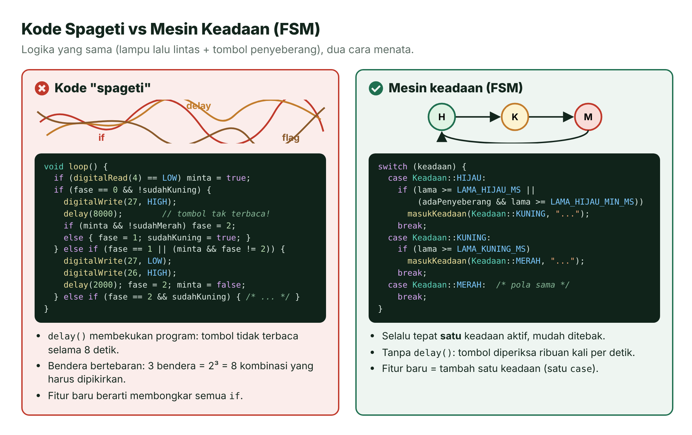
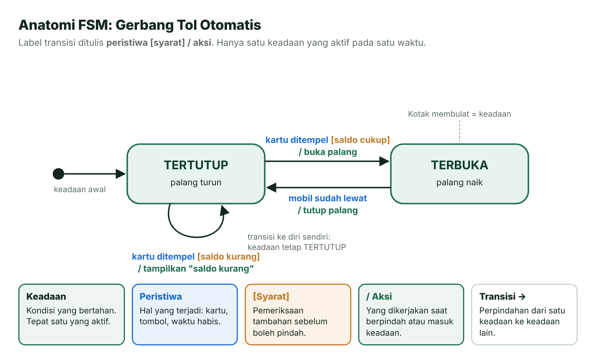
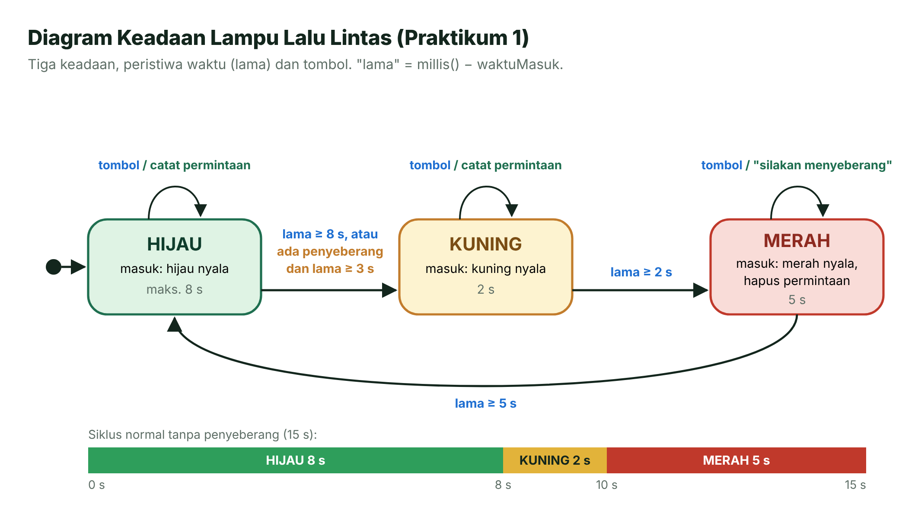
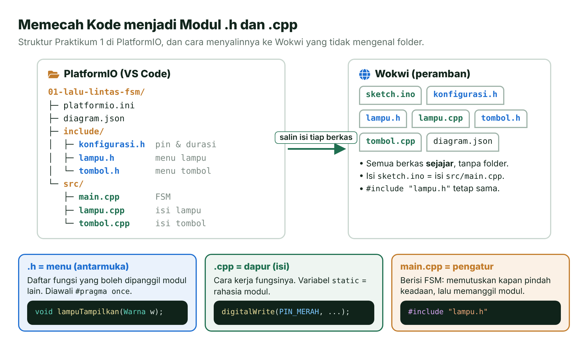
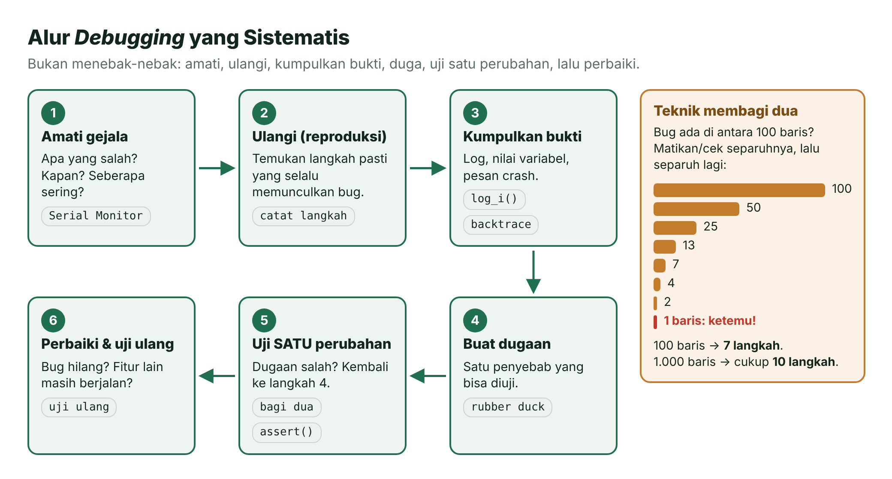
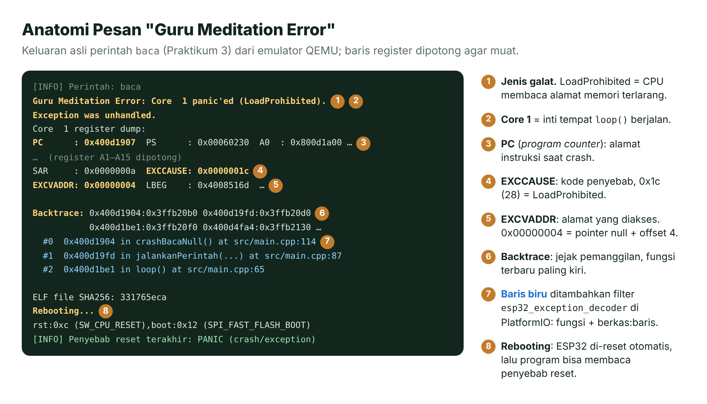
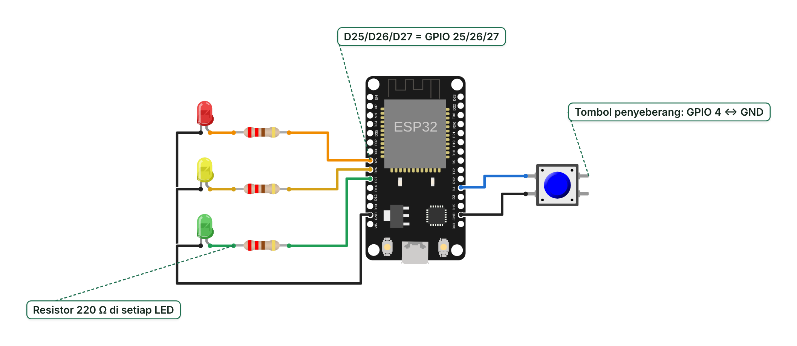
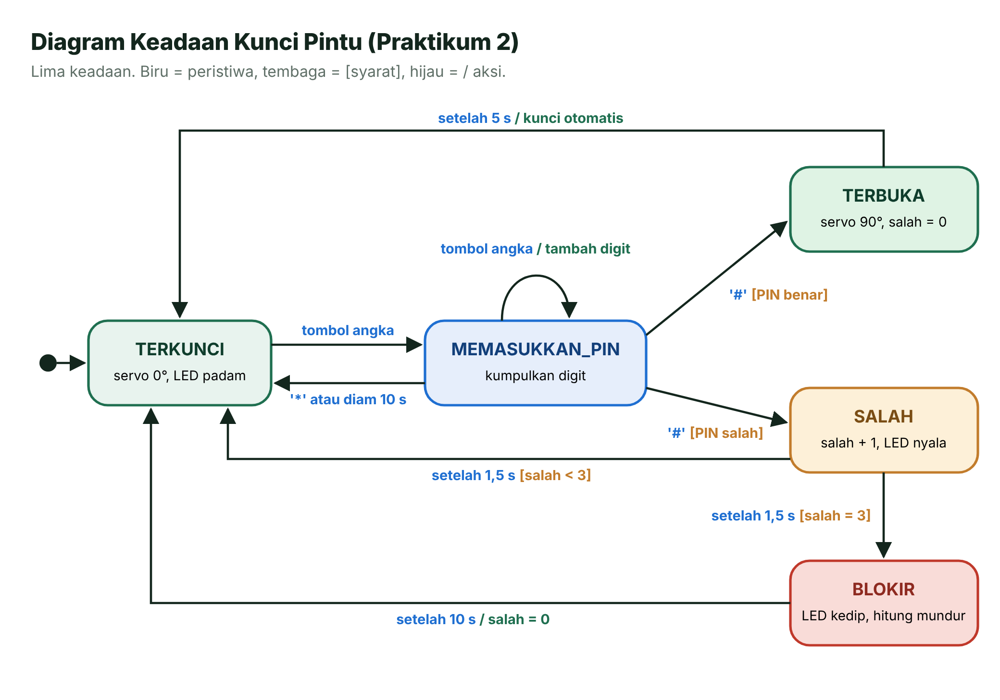
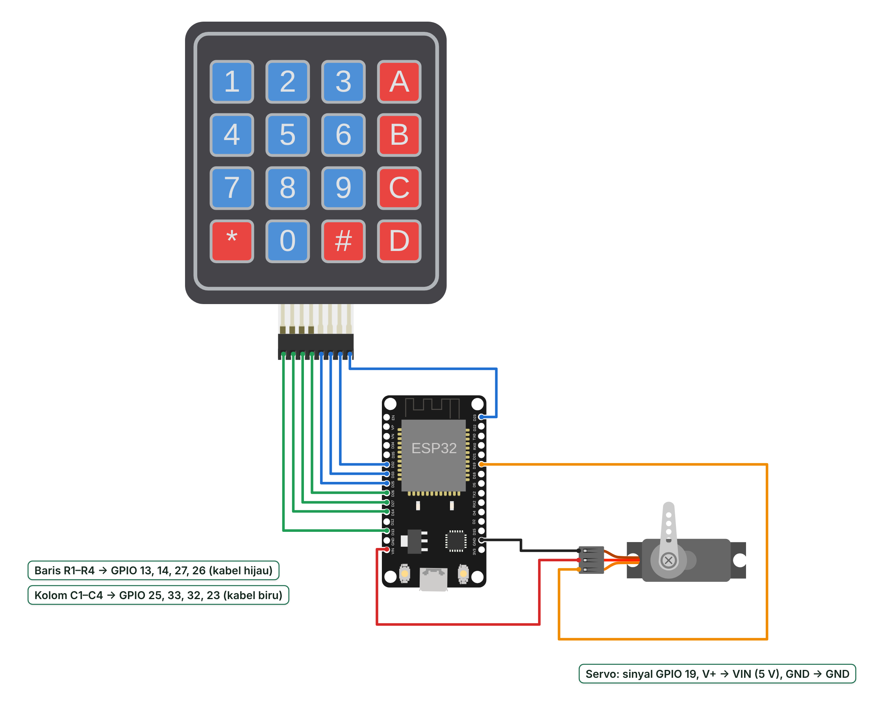

# Pertemuan 11 — Merancang *Firmware* Rapi: FSM dan *Debugging*

> Program yang tumbuh tanpa rencana mudah berubah menjadi benang kusut. Hari ini kamu belajar menata logika dengan mesin keadaan hingga (FSM), memecah kode menjadi modul, lalu memburu *bug* dan membaca pesan *crash* ESP32 seperti seorang detektif.

| | |
| --- | --- |
| ⏱️ **Durasi** | 2 × 50 menit teori + 3 × 50 menit praktikum |
| 📋 **Prasyarat** | [Pertemuan 4](../pertemuan-04-gpio-input/README.md) (tombol, `INPUT_PULLUP`), [Pertemuan 5](../pertemuan-05-waktu-interupsi/README.md) (`millis()` tanpa `delay()`), [Pertemuan 9](../pertemuan-09-komunikasi-serial/README.md) (Serial), [Pertemuan 10](../pertemuan-10-sensor-aktuator/README.md) (*library* dan servo) |
| 🧰 **Alat** | Laptop + internet; opsional: ESP32 DevKit V1, 3 LED + 3 resistor 220 Ω, 1 tombol, *keypad* membran 4×4, servo SG90 |
| 📥 **Slide** | 👁️ [Lihat di peramban](https://view.officeapps.live.com/op/view.aspx?src=https%3A%2F%2Fraw.githubusercontent.com%2Fantonprafanto%2Fembeddedsystem%2Fmain%2Fslide%2Fpptx%2FP11-FSM-dan-Debugging.pptx) · ⬇️ [Unduh PDF](https://raw.githubusercontent.com/antonprafanto/embeddedsystem/main/slide/pdf/P11-FSM-dan-Debugging.pdf) · ⬇️ [Unduh PPTX](https://raw.githubusercontent.com/antonprafanto/embeddedsystem/main/slide/pptx/P11-FSM-dan-Debugging.pptx) |
| 📄 **Modul PDF** | ⬇️ [Unduh modul ini dalam PDF](https://raw.githubusercontent.com/antonprafanto/embeddedsystem/main/modul-pdf/Modul-P11-FSM-dan-Debugging.pdf) — untuk dibaca luring atau dicetak |

## Daftar Isi

- [🎯 Tujuan Pembelajaran](#-tujuan-pembelajaran)
- [🧰 Yang Perlu Disiapkan](#-yang-perlu-disiapkan)
- [1. Mengapa Kode Bisa Menjadi "Spageti"?](#1-mengapa-kode-bisa-menjadi-spageti)
- [2. Mesin Keadaan Hingga (FSM)](#2-mesin-keadaan-hingga-fsm)
- [3. Menulis FSM di C++](#3-menulis-fsm-di-c)
- [4. Merapikan Kode: Modul .h dan .cpp](#4-merapikan-kode-modul-h-dan-cpp)
- [5. Debugging yang Sistematis](#5-debugging-yang-sistematis)
- [6. Membaca Pesan Crash](#6-membaca-pesan-crash)
- [🧪 Praktikum](#-praktikum)
- [🏋️ Latihan & Tantangan](#️-latihan--tantangan)
- [✅ Cek Pemahaman](#-cek-pemahaman)
- [📌 Rangkuman](#-rangkuman)
- [📚 Referensi](#-referensi)
- [🖼️ Sumber Gambar](#️-sumber-gambar)

---

## 🎯 Tujuan Pembelajaran

Setelah pertemuan ini, kamu bisa:

1. Menjelaskan mengapa kode "spageti" sulit dirawat dan bagaimana mesin keadaan hingga (FSM) merapikannya.
2. Merancang FSM: menentukan keadaan, peristiwa, transisi, dan aksi, lalu menuangkannya ke diagram keadaan dan tabel transisi.
3. Menulis FSM *non-blocking* dengan `enum class`, `switch`, dan `millis()`, serta memecah kode menjadi modul `.h` dan `.cpp`.
4. Men-*debug* secara sistematis dengan pesan Serial terstruktur, makro log, `assert()`, teknik membagi dua, dan *rubber duck*.
5. Membaca pesan "Guru Meditation Error" dan *backtrace* untuk menemukan fungsi serta baris penyebab *crash*.

## 🧰 Yang Perlu Disiapkan

| Kebutuhan | Keterangan |
| --- | --- |
| Perangkat lunak | VS Code + PlatformIO ([Panduan Instalasi Alat](../panduan/02-instalasi-alat.md)) atau [Wokwi](../panduan/03-simulasi-wokwi.md) di peramban |
| Praktikum 1 | 3 LED (merah, kuning, hijau), 3 resistor 220 Ω, 1 tombol tekan, kabel jumper, *breadboard* |
| Praktikum 2 | *Keypad* membran 4×4, servo SG90, kabel jumper |
| Praktikum 3 | Tidak perlu komponen tambahan |
| *Library* | `Keypad` (Mark Stanley & Alexander Brevig) dan `ESP32Servo`; diunduh otomatis oleh PlatformIO |

---

## 1. Mengapa Kode Bisa Menjadi "Spageti"?

Coba ingat kabel *charger*, *earphone*, dan kabel data yang dijejalkan begitu saja ke dalam tas. Saat kamu menarik satu kabel, semuanya ikut tertarik. Kode program bisa mengalami hal yang sama: setiap fitur baru ditambal dengan `if` dan variabel "bendera" baru, sampai tidak ada yang berani mengubahnya. Kode seperti ini dijuluki **kode spageti**.

Ambil contoh lampu lalu lintas dengan tombol penyeberang. Versi spageti biasanya punya tiga penyakit:

- **`delay()` membekukan program.** Selama `delay(8000)`, ESP32 tidak membaca tombol sama sekali. Penyeberang menekan tombol, tetapi tidak ada yang "mendengar" (ingat Pertemuan 5).
- **Bendera (*flag*) berlipat ganda.** Variabel seperti `minta`, `sudahKuning`, dan `fase` saling memengaruhi. Tiga bendera *boolean* saja sudah menghasilkan 2³ = 8 kombinasi yang harus kamu pikirkan; lima bendera menjadi 32.
- **Aturan tersebar.** Keputusan "kapan lampu kuning menyala" muncul di beberapa `if` yang berbeda. Mengubah satu aturan berarti memburu semuanya.



*Gambar 11.1 — Logika yang sama ditulis sebagai kode spageti (kiri) dan sebagai FSM (kanan). Sumber: dibuat untuk materi ini (ikon Font Awesome Free, CC BY 4.0).*

> [!TIP]
> **Tanda-tanda kodemu mulai kusut:** ada `delay()` panjang di dalam `loop()`; muncul variabel bernama `sudahX`, `fase2`, atau `flagBaru`; `if` bersarang lebih dari tiga tingkat; dan kamu takut mengubah satu baris karena tidak tahu akibatnya.

## 2. Mesin Keadaan Hingga (FSM)

Perhatikan gerbang tol otomatis. Palangnya hanya punya dua kondisi: **tertutup** atau **terbuka**. Palang berpindah kondisi hanya karena sesuatu terjadi: kartu ditempel, atau mobil sudah lewat. Saat kartu ditempel pun ada pemeriksaan tambahan: saldonya cukup atau tidak.

Cara berpikir seperti ini disebut **mesin keadaan hingga** (*finite state machine*, FSM): sistem dimodelkan sebagai sejumlah **keadaan** yang terbatas ("hingga"), dengan aturan jelas kapan berpindah dari satu keadaan ke keadaan lain [1]. Pada satu waktu, **tepat satu** keadaan yang aktif.

| Istilah | Arti | Contoh pada gerbang tol |
| --- | --- | --- |
| **Keadaan** (*state*) | Kondisi yang bertahan sampai ada alasan untuk berubah | TERTUTUP, TERBUKA |
| **Peristiwa** (*event*) | Sesuatu yang terjadi: input, data masuk, atau waktu habis | Kartu ditempel, mobil sudah lewat |
| **Syarat** (*guard*) | Pemeriksaan tambahan sebelum boleh pindah, ditulis dalam `[ ]` | [saldo cukup] |
| **Aksi** (*action*) | Pekerjaan yang dilakukan saat berpindah atau saat masuk keadaan, ditulis setelah `/` | / buka palang |
| **Transisi** | Perpindahan dari satu keadaan ke keadaan lain | TERTUTUP → TERBUKA |



*Gambar 11.2 — Anatomi FSM pada gerbang tol otomatis. Label transisi ditulis "peristiwa [syarat] / aksi". Sumber: dibuat untuk materi ini.*

### Diagram Keadaan dan Tabel Transisi

FSM biasanya digambar dua kali. **Diagram keadaan** enak dilihat mata: kotak membulat untuk keadaan, panah untuk transisi. **Tabel transisi** enak untuk diperiksa: satu baris untuk setiap kemungkinan. Berikut FSM lampu lalu lintas yang akan kamu buat di Praktikum 1.



*Gambar 11.3 — Diagram keadaan lampu lalu lintas dengan tombol penyeberang. Sumber: dibuat untuk materi ini.*

| Keadaan sekarang | Peristiwa [syarat] | Aksi | Keadaan berikutnya |
| --- | --- | --- | --- |
| HIJAU | lama ≥ 8 detik | nyalakan kuning | KUNING |
| HIJAU | [ada penyeberang] dan lama ≥ 3 detik | nyalakan kuning | KUNING |
| HIJAU atau KUNING | tombol ditekan | catat `adaPenyeberang = true` | (tetap) |
| KUNING | lama ≥ 2 detik | nyalakan merah, hapus permintaan | MERAH |
| MERAH | lama ≥ 5 detik | nyalakan hijau | HIJAU |
| MERAH | tombol ditekan | cetak "silakan menyeberang" | (tetap) |

Kata **lama** berarti sudah berapa lama sistem berada di keadaan sekarang. Variabel `adaPenyeberang` adalah "ingatan" kecil di luar keadaan: ia mencatat bahwa tombol pernah ditekan dan belum dilayani.

> [!NOTE]
> **Tabel transisi sekaligus daftar uji.** Setiap baris adalah satu kasus yang bisa kamu coba. Sel yang tidak bisa kamu isi menandakan keputusan desain yang belum dibuat. Contohnya: apa yang terjadi bila tombol ditekan saat lampu kuning? Di tabel di atas, jawabannya sudah jelas: permintaan dicatat, lalu langsung terlayani ketika lampu merah.

### FSM *Non-Blocking*

FSM di mikrokontroler hampir selalu dibuat ***non-blocking*** (tidak menghalangi): `loop()` tidak pernah menunggu. Setiap putaran hanya memeriksa peristiwa, memutuskan perlu pindah keadaan atau tidak, lalu selesai dalam hitungan mikrodetik. Waktu diukur dengan pola dari Pertemuan 5:

```cpp
unsigned long lama = millis() - waktuMasuk;   // sudah berapa lama di keadaan ini
if (lama >= LAMA_HIJAU_MS) { /* waktunya pindah */ }
```

Pengurangan `unsigned long` ini tetap benar walaupun `millis()` meluap kembali ke 0 setelah ±49,7 hari (2³² milidetik).

## 3. Menulis FSM di C++

Resep FSM di C++ terdiri atas tiga bahan: daftar keadaan, `switch` di dalam `loop()`, dan satu fungsi khusus untuk berpindah keadaan.

**Langkah 1 — Daftar keadaan dengan `enum class`.** `enum class` membuat tipe data baru yang nilainya hanya boleh salah satu dari daftar:

```cpp
enum class Keadaan { HIJAU, KUNING, MERAH };
Keadaan keadaan = Keadaan::HIJAU;   // keadaan yang sedang aktif
unsigned long waktuMasuk = 0;       // kapan masuk keadaan ini
```

Mengapa bukan angka biasa (`int fase = 0;`)? Nama `Keadaan::KUNING` jauh lebih jelas daripada `fase == 1`, dan kompilator menolak kalau kamu tidak sengaja menulis `keadaan = 7;`. Kata `class` membuat namanya "terkurung": `Keadaan::HIJAU` tidak akan bertabrakan dengan `Warna::HIJAU` milik modul lampu.

**Langkah 2 — `switch` berisi aturan transisi.** Satu `case` untuk satu keadaan. Isinya hanya pertanyaan "apakah sudah waktunya pindah?":

```cpp
void loop() {
  unsigned long lama = millis() - waktuMasuk;

  if (tombolDitekan()) adaPenyeberang = true;      // 1) kumpulkan peristiwa

  switch (keadaan) {                                // 2) putuskan transisi
    case Keadaan::HIJAU:
      if (lama >= LAMA_HIJAU_MS) {
        masukKeadaan(Keadaan::KUNING, "waktu hijau habis");
      } else if (adaPenyeberang && lama >= LAMA_HIJAU_MIN_MS) {
        masukKeadaan(Keadaan::KUNING, "ada penyeberang");
      }
      break;
    case Keadaan::KUNING:
      if (lama >= LAMA_KUNING_MS) masukKeadaan(Keadaan::MERAH, "waktu kuning habis");
      break;
    case Keadaan::MERAH:
      if (lama >= LAMA_MERAH_MS) masukKeadaan(Keadaan::HIJAU, "waktu merah habis");
      break;
  }
}
```

**Langkah 3 — Fungsi masuk-keadaan.** Semua yang terjadi **sekali** saat pindah keadaan dikumpulkan di satu fungsi: mencatat waktu masuk, menjalankan aksi masuk (*entry action*), dan mencetak log.

```cpp
void masukKeadaan(Keadaan baru, const char *alasan) {
  keadaan = baru;
  waktuMasuk = millis();              // mulai menghitung "lama" dari nol
  switch (baru) {
    case Keadaan::HIJAU:  lampuTampilkan(Warna::HIJAU);  break;
    case Keadaan::KUNING: lampuTampilkan(Warna::KUNING); break;
    case Keadaan::MERAH:
      lampuTampilkan(Warna::MERAH);
      adaPenyeberang = false;         // permintaan terlayani
      break;
  }
  Serial.printf("KEADAAN -> %s (%s)\n", namaKeadaan(baru), alasan);
}
```

> [!IMPORTANT]
> **Tiga aturan emas FSM:** (1) jangan pernah memanggil `delay()` di dalam `case`; (2) ubah variabel `keadaan` **hanya** lewat `masukKeadaan()`, supaya `waktuMasuk` dan aksi masuk tidak terlupa; (3) akhiri setiap `case` dengan `break`.

### Menambah Fitur = Menambah Keadaan

Misalkan dinas perhubungan meminta **mode malam**: lampu kuning berkedip terus. Dalam kode spageti, permintaan ini berarti membongkar banyak `if`. Dalam FSM, kamu cukup menambah satu keadaan di empat tempat:

```cpp
enum class Keadaan { HIJAU, KUNING, MERAH, KEDIP_MALAM };   // 1) tambah nama

// 2) di switch pada loop(): tambah satu case
    case Keadaan::KEDIP_MALAM:
      // kuning menyala-padam tiap 500 ms, tetap tanpa delay()
      lampuTampilkan((lama / 500) % 2 == 0 ? Warna::KUNING : Warna::PADAM);
      if (adaPenyeberang) masukKeadaan(Keadaan::MERAH, "mode malam selesai");
      break;

// 3) di masukKeadaan(): aksi masuk     4) di namaKeadaan(): nama untuk log
    case Keadaan::KEDIP_MALAM: lampuTampilkan(Warna::KUNING); break;
```

Keadaan HIJAU, KUNING, dan MERAH sama sekali tidak disentuh. Cara masuk ke mode malam (misalnya lewat perintah Serial `malam`) menjadi bahan Latihan 1.

## 4. Merapikan Kode: Modul .h dan .cpp

Bayangkan sebuah restoran. Pelanggan cukup membaca **menu**; mereka tidak perlu masuk ke **dapur** untuk tahu cara memasak. Program yang besar juga dipecah dengan cara serupa:

- **Berkas kepala** (*header*, `.h`) adalah **menu**: daftar fungsi dan tipe data yang boleh dipakai berkas lain.
- **Berkas sumber** (`.cpp`) adalah **dapur**: isi fungsi, beserta data pribadi yang tidak perlu diketahui berkas lain.

Di PlatformIO, berkas `.h` disimpan di *folder* `include/` dan berkas `.cpp` di `src/`. PlatformIO otomatis mengompilasi semua `.cpp` di `src/` dan mencari *header* di `include/`.



*Gambar 11.4 — Struktur Praktikum 1: tiga berkas kepala, tiga berkas sumber, dan cara menyalinnya ke Wokwi. Sumber: dibuat untuk materi ini (ikon Font Awesome Free, CC BY 4.0).*

Contoh "menu" modul lampu (`include/lampu.h`):

```cpp
#pragma once                     // cegah isi berkas ini disertakan dua kali
#include <Arduino.h>

enum class Warna { MERAH, KUNING, HIJAU, PADAM };

void lampuMulai();               // atur ketiga pin lampu sebagai OUTPUT
void lampuTampilkan(Warna w);    // nyalakan SATU warna, padamkan yang lain
```

Beberapa kebiasaan yang membuat kode rapi:

| Kebiasaan | Mengapa | Contoh |
| --- | --- | --- |
| `#pragma once` di setiap `.h` | Mencegah definisi ganda bila satu *header* ikut tersertakan lewat beberapa jalur | Baris pertama `lampu.h` |
| Konstanta bernama | Angka "ajaib" seperti `8000` tidak menjelaskan dirinya; nama `LAMA_HIJAU_MS` menjelaskan | `constexpr unsigned long LAMA_HIJAU_MS = 8000;` di `konfigurasi.h` |
| Nama yang jelas | Kode dibaca jauh lebih sering daripada ditulis | `tombolDitekan()` lebih jelas daripada `cek()` |
| Variabel `static` di `.cpp` | Data pribadi modul tidak bisa diubah berkas lain secara tidak sengaja | `static int levelStabil` di `tombol.cpp` |
| Komentar "mengapa" | "Apa" sudah terbaca dari kodenya; alasannya yang sering hilang | Lihat contoh di bawah |

```cpp
adaPenyeberang = false;   // buruk: set adaPenyeberang menjadi false
adaPenyeberang = false;   // baik : permintaan terlayani, penyeberang jalan saat merah
```

**Cara menambah berkas.** Di VS Code, klik kanan *folder* `include` → **New File** → ketik `lampu.h`; untuk berkas `.cpp`, klik kanan *folder* `src`. Di Wokwi, klik tombol segitiga kecil (▾) di ujung kanan deretan tab berkas → **New file...** → ketik namanya. Wokwi tidak memakai *folder*, jadi semua berkas sejajar dan `#include "lampu.h"` tetap berlaku.

> [!WARNING]
> **Galat yang sering muncul saat memecah kode:**
> `fatal error: lampu.h: No such file or directory` → berkasnya belum dibuat atau namanya salah ketik.
> `undefined reference to 'lampuMulai()'` → berkas `lampu.cpp` belum ada atau tidak berada di `src/`.
> `multiple definition of 'x'` → variabel biasa didefinisikan di `.h` yang disertakan beberapa `.cpp`; pakai `constexpr` untuk konstanta, atau pindahkan variabelnya ke `.cpp`.

## 5. Debugging yang Sistematis

Dokter yang baik tidak langsung memberi obat. Ia mendengar keluhan, memeriksa, membuat dugaan, menguji dugaan itu, baru kemudian mengobati dan meminta pasien kontrol ulang. Men-*debug* (*debugging*, mencari dan memperbaiki *bug* atau galat program) juga begitu: bukan menebak-nebak lalu mengubah kode secara acak.



*Gambar 11.5 — Alur debugging yang sistematis dan teknik membagi dua. Sumber: dibuat untuk materi ini.*

### 5.1 Pesan Serial Terstruktur

Pesan Serial adalah "saksi mata" utamamu. Pesan yang baik mengikuti tiga aturan:

1. **Satu baris untuk satu kejadian**, diawali **tag** yang konsisten seperti `[INFO]`, `[FSM]`, `[KEYPAD]`, `[PERINGATAN]`. Tag membuat pesan mudah dipindai dan dicari.
2. **Sertakan konteks**: waktu, keadaan, dan nilai beserta satuannya, misalnya `[  17.3 s] PERISTIWA: tombol penyeberang ditekan`.
3. **Cetak saat ada perubahan**, bukan di setiap putaran `loop()`.

Aturan ketiga penting karena Serial itu lambat. Pada 115200 *baud*, satu karakter butuh 10 bit (1 *start*, 8 data, 1 *stop*), jadi hanya ±11.520 karakter per detik. Satu baris 60 karakter memakan ±5,2 ms. Kalau baris itu dicetak di setiap putaran, `loop()` yang biasanya berputar ribuan kali per detik tersendat menjadi sekitar 190 kali per detik.

### 5.2 Makro Log Bawaan: `log_e`, `log_w`, `log_i`, `log_d`

Arduino-ESP32 menyediakan makro log yang mencetak pesan beserta waktu, nama berkas, nomor baris, dan nama fungsi secara otomatis. Mana yang tampil diatur oleh satu angka, `CORE_DEBUG_LEVEL`, yang ditulis di `platformio.ini` [4], [5]:

```ini
build_flags = -DCORE_DEBUG_LEVEL=3
```

| Level | Nama | Makro | Dipakai untuk |
| --- | --- | --- | --- |
| 0 | NONE | — | Semua log mati |
| 1 | ERROR | `log_e()` | Galat serius, misalnya sensor tidak menjawab |
| 2 | WARN | `log_w()` | Hal janggal yang belum fatal |
| 3 | INFO | `log_i()` | Informasi penting: program mulai, koneksi berhasil |
| 4 | DEBUG | `log_d()` | Detail untuk men-*debug* |
| 5 | VERBOSE | `log_v()` | Sangat rinci |

Pesan dengan level **lebih kecil atau sama dengan** `CORE_DEBUG_LEVEL` akan tampil. Dengan level 3, `log_e`, `log_w`, dan `log_i` tampil, sedangkan `log_d` tidak. Berikut keluaran asli Praktikum 3:

```text
[  1828][I][main.cpp:53] setup(): contoh log_i (level 3: INFO)
```

Artinya: 1.828 ms sejak menyala, level **I**NFO, berkas `main.cpp` baris 53, di dalam fungsi `setup()`. Kelebihan makro ini: saat produk jadi, kamu cukup mengganti angka levelnya menjadi 0 tanpa menghapus satu baris log pun. Makro yang levelnya tidak aktif tidak ikut dikompilasi.

> [!NOTE]
> **Wokwi versi web tidak membaca `platformio.ini`**, jadi `build_flags` tidak berlaku di sana. Bila baris log di atas tidak muncul di Wokwi, itulah sebabnya. Pesan `Serial.print()` biasa dan pesan *crash* tetap tampil.

### 5.3 `assert()`: Jaring Pengaman

`assert(kondisi)` artinya "aku yakin kondisi ini selalu benar". Bila ternyata salah, program langsung berhenti dan melaporkan berkas, baris, serta kondisinya, lalu ESP32 di-*reset*. Contoh dari Praktikum 3:

```cpp
void cekSuhu(int suhu) {
  // Sensor hanya mampu -40..125 °C. Nilai di luar itu PASTI bug.
  assert(suhu >= -40 && suhu <= 125);
}
```

```text
assert failed: void cekSuhu(int) main.cpp:140 (suhu >= -40 && suhu <= 125)
```

Pakai `assert()` untuk hal yang **mustahil terjadi kalau programnya benar**, bukan untuk kesalahan wajar pengguna. PIN yang salah ketik itu wajar, jadi ditangani FSM, bukan `assert()`. Bila makro `NDEBUG` didefinisikan saat kompilasi, semua `assert()` dihapus.

### 5.4 Teknik Membagi Dua

Satu bohlam putus di rangkaian lampu hias seri membuat semuanya padam. Cara tercepat mencarinya: uji separuh rangkaian, lalu separuh dari bagian yang bermasalah, dan seterusnya. Teknik **membagi dua** (*bisection*) memakai ide yang sama pada kode:

1. Pasang pesan Serial (atau nonaktifkan sebagian kode) di **tengah** bagian yang dicurigai.
2. Jalankan. Bila *bug* sudah muncul sebelum titik itu, cari di separuh pertama; bila belum, di separuh kedua.
3. Ulangi sampai tersisa satu baris atau satu fungsi.

Setiap langkah membuang separuh kemungkinan. *Bug* di antara 100 baris ditemukan paling lama dalam 7 langkah (2⁷ = 128 ≥ 100), dan 1.000 baris cukup 10 langkah. Cara yang sama berlaku untuk versi program: bila versi 5 masih benar dan versi 9 rusak, uji versi 7 dulu.

### 5.5 *Rubber Duck Debugging*

Taruh bebek karet (atau benda apa saja) di samping laptop, lalu jelaskan kodemu kepadanya **baris demi baris**: apa yang seharusnya terjadi dan mengapa. Sering kali, di tengah penjelasan kamu tersadar sendiri, "Lho, `waktuMasuk` kok tidak diperbarui di sini?" Teknik ini dipopulerkan oleh Hunt dan Thomas [9]. Teman sekelas juga bisa menjadi "bebek" yang baik.

> [!TIP]
> **Ubah satu hal setiap kali.** Bila kamu mengubah tiga hal sekaligus lalu *bug*-nya hilang, kamu tidak tahu perubahan mana yang menyelesaikannya, dan dua perubahan lain mungkin menanam *bug* baru.

## 6. Membaca Pesan Crash

Setiap pesawat membawa **kotak hitam** (*flight recorder*) yang merekam detik-detik terakhir sebelum kecelakaan. ESP32 punya mekanisme serupa. Ketika terjadi galat fatal, **penangan panik** (*panic handler*) mencetak pesan "Guru Meditation Error", isi register CPU, dan ***backtrace*** (jejak pemanggilan fungsi), lalu me-*restart* cip [2].



*Gambar 11.6 — Anatomi pesan crash. Keluaran asli perintah `baca` di Praktikum 3, dijalankan di emulator QEMU. Sumber: dibuat untuk materi ini.*

Tiga register yang paling sering kamu baca:

- **PC** (*program counter*): alamat instruksi yang sedang dijalankan saat galat terjadi.
- **EXCCAUSE**: kode penyebab. Contoh dari Praktikum 3: `0x00000006` = IntegerDivideByZero, `0x0000001c` (28) = LoadProhibited.
- **EXCVADDR**: alamat memori yang coba dibaca atau ditulis. Nilai `0x00000000` biasanya berarti *pointer* null; nilai kecil seperti `0x00000004` berarti mengakses anggota sebuah *struct* lewat *pointer* yang null [2].

**Backtrace** berisi pasangan alamat `PC:SP`, dari fungsi terbaru (paling kiri) mundur ke pemanggilnya. Alamat mentah sulit dibaca manusia. Karena itu, `platformio.ini` di setiap proyek kursus ini sudah berisi `monitor_filters = esp32_exception_decoder` [6]. Filter ini menerjemahkan setiap alamat menjadi nama fungsi, berkas, dan nomor baris, kurang lebih seperti ini:

```text
  #0  0x400d1904 in crashBacaNull() at src/main.cpp:114
  #1  0x400d19fd in jalankanPerintah(String const&) at src/main.cpp:87
  #2  0x400d1be1 in loop() at src/main.cpp:65
```

Baca dari atas: *crash* terjadi di `crashBacaNull()` baris 114, yang dipanggil dari baris 87, yang dipanggil dari `loop()`. Menariknya, baris 114 berisi `Serial.printf(...)`, sedangkan pembacaan `sensorAktif->nilai` ada tepat di atasnya (baris 113). Kompilator menggabungkan keduanya saat optimasi, jadi selalu periksa juga baris di sekitar nomor yang ditunjuk. Wokwi juga menampilkan pesan *crash* dan *backtrace* di Serial Monitor-nya.

> [!IMPORTANT]
> **Decoder memakai berkas `firmware.elf` di laptopmu.** Bila kamu mengubah kode setelah *upload*, nomor baris hasil terjemahan menjadi ngawur. Selalu *upload* ulang versi yang sama sebelum membaca *backtrace*. Nomor baris juga bisa meleset satu-dua baris karena optimasi kompilator; periksa juga baris di sekitarnya.

Jenis galat yang paling sering kamu temui [2], [3]:

| Pesan | Arti | Penyebab umum |
| --- | --- | --- |
| `LoadProhibited` / `StoreProhibited` | Membaca/menulis alamat memori terlarang | *Pointer* null (EXCVADDR 0), anggota *struct* lewat *pointer* null (EXCVADDR kecil), *pointer* belum diisi atau rusak |
| `IntegerDivideByZero` | Pembagian bilangan bulat dengan nol | Pembagi berasal dari hitungan atau sensor yang bernilai 0 |
| `InstrFetchProhibited` | CPU mengambil instruksi dari alamat tidak sah | Memanggil *pointer* fungsi yang null atau rusak |
| `IllegalInstruction` | Instruksi yang dijalankan tidak sah | Fungsi *task* FreeRTOS selesai tanpa `vTaskDelete()`, atau pin *flash* (GPIO 6–11) dipakai untuk keperluan lain |
| `LoadStoreAlignment` | Alamat tidak sesuai ukuran akses | Membaca 32 bit dari alamat yang bukan kelipatan 4 |
| `Unhandled debug exception` + `Stack canary watchpoint triggered (nama)` | *Stack* (tumpukan) sebuah *task* meluap | Rekursi tanpa henti, larik lokal terlalu besar |
| `Task watchdog got triggered` | Sebuah *task* yang diawasi tidak "memberi makan" *watchdog* selama 5 detik | Perulangan tanpa jeda |
| `Interrupt wdt timeout on CPU0/1` | Interupsi atau bagian kritis berjalan terlalu lama | ISR yang terlalu panjang |
| `Brownout detector was triggered` | Tegangan catu turun di bawah batas | Catu lemah, servo atau Wi-Fi menarik arus besar, kabel USB buruk |
| `assert failed` / `abort() was called` | `assert()` gagal atau program memanggil `abort()` | *Bug* logika yang tertangkap jaring pengaman |

> [!TIP]
> **Setelah *crash*, tanyakan penyebab *reset*.** Fungsi `esp_reset_reason()` [8] memberi tahu apakah ESP32 baru dinyalakan (`ESP_RST_POWERON`), *crash* (`ESP_RST_PANIC`), atau dihentikan *watchdog* (`ESP_RST_TASK_WDT`). Praktikum 3 mencetaknya setiap kali menyala. Bila pesan *crash* muncul berulang-ulang tanpa henti (*boot loop*), *crash*-nya terjadi di `setup()`: baca *backtrace* pertama dengan teliti.

---

## 🧪 Praktikum

### Sebelum Mulai: Alat Mana yang Dibuka Dulu?

Kode setiap praktikum sama untuk kedua jalur. Langkah lengkapnya ada di [Pertemuan 1](../pertemuan-01-pengenalan/README.md#-praktikum) dan [panduan Wokwi](../panduan/03-simulasi-wokwi.md).

- **Jalur A — Wokwi (tanpa board):** buka <https://wokwi.com/projects/new/esp32>, salin `src/main.cpp` ke tab **sketch.ino**, salin `diagram.json`, lalu klik **▶**. Praktikum 1 butuh berkas tambahan dan Praktikum 2 butuh *library*; caranya dijelaskan di masing-masing praktikum.
- **Jalur B — Board asli:** buka *folder* praktikum di VS Code (**File** → **Open Folder...**), klik **Build** (✓), **Upload** (→), lalu **Serial Monitor**. Bila Serial Monitor kosong, tekan tombol **EN**.

---

### Praktikum 1 — Lampu Lalu Lintas FSM

📁 *Folder*: [`kode/01-lalu-lintas-fsm`](kode/01-lalu-lintas-fsm)

**Tujuan:** membuat lampu lalu lintas dengan tombol penyeberang sebagai FSM *non-blocking*, dengan kode yang dipecah menjadi beberapa modul.

**Rangkaian:**



*Gambar 11.7 — Rangkaian Praktikum 1. Sumber: dibuat untuk materi ini dari `diagram.json` (gambar komponen @wokwi/elements, MIT).*

| Komponen | Kaki | Sambungan |
| --- | --- | --- |
| LED merah | Anoda (kaki panjang) | Resistor 220 Ω → GPIO 25 |
| LED kuning | Anoda | Resistor 220 Ω → GPIO 26 |
| LED hijau | Anoda | Resistor 220 Ω → GPIO 27 |
| Ketiga LED | Katoda (kaki pendek) | GND |
| Tombol penyeberang | Satu sisi | GPIO 4 (`INPUT_PULLUP`) |
| Tombol penyeberang | Sisi lain | GND |

**Kode.** Proyek ini terdiri atas enam berkas (lihat Gambar 11.4). Logika FSM di `src/main.cpp` sudah kamu pelajari di Bagian 3. Yang baru adalah modul tombol, yang membaca tombol sekaligus meredam pantulan (*bouncing*) **tanpa** `delay()`:

```cpp
// src/tombol.cpp (dipotong)
static int levelStabil = HIGH;        // data pribadi modul (static)
static int levelTerakhir = HIGH;
static unsigned long waktuBerubah = 0;

bool tombolDitekan() {
  int level = digitalRead(PIN_TOMBOL);
  if (level != levelTerakhir) {       // masih memantul: catat kapan berubah
    levelTerakhir = level;
    waktuBerubah = millis();
  }
  // Level baru dianggap sah bila sudah stabil selama JEDA_DEBOUNCE_MS
  if (millis() - waktuBerubah >= JEDA_DEBOUNCE_MS && level != levelStabil) {
    levelStabil = level;
    return levelStabil == LOW;        // laporkan hanya peristiwa "baru ditekan"
  }
  return false;
}
```

Semua pin dan durasi dikumpulkan di `include/konfigurasi.h`, misalnya `PIN_MERAH = 25` dan `LAMA_HIJAU_MS = 8000`. Ingin hijau menyala 20 detik? Cukup ubah satu baris di berkas itu.

**Cara menjalankan:**

- **A. Wokwi:** salin `src/main.cpp` ke **sketch.ino**. Lalu buat lima berkas baru lewat tombol **▾** → **New file...**: `konfigurasi.h`, `lampu.h`, `tombol.h` (isinya dari *folder* `include/`), serta `lampu.cpp` dan `tombol.cpp` (dari *folder* `src/`). Semua berkas sejajar, tanpa *folder*. Salin `diagram.json`, lalu klik **▶**.
- **B. Board asli:** rangkai sesuai tabel, buka *folder* proyek, **Build** → **Upload** → **Serial Monitor**.

**Hasil yang diharapkan.** Tanpa menekan tombol, lampu berganti hijau 8 detik → kuning 2 detik → merah 5 detik, dan Serial Monitor menampilkan:

```text
[INFO] Lampu lalu lintas FSM siap. Tekan tombol untuk menyeberang.
[   0.0 s] KEADAAN -> HIJAU  (mulai)
[   8.0 s] KEADAAN -> KUNING (waktu hijau habis)
[  10.0 s] KEADAAN -> MERAH  (waktu kuning habis)
[  15.0 s] KEADAAN -> HIJAU  (waktu merah habis)
```

Bila tombol ditekan saat hijau (contoh di bawah: detik ke-17,3) dan sekali lagi saat merah, lanjutannya seperti ini. Angka waktu peristiwa tombol bergantung pada kapan kamu menekannya:

```text
[  17.3 s] PERISTIWA: tombol penyeberang ditekan
[  18.0 s] KEADAAN -> KUNING (ada penyeberang)
[  20.0 s] KEADAAN -> MERAH  (waktu kuning habis)
[  21.0 s] PERISTIWA: tombol ditekan, lampu sudah merah -> silakan menyeberang
[  25.0 s] KEADAAN -> HIJAU  (waktu merah habis)
```

Perhatikan baris 18,0 detik: hijau baru dimulai pada detik ke-15,0, jadi hijau dipersingkat menjadi tepat 3 detik (`LAMA_HIJAU_MIN_MS`).

**Kalau belum berhasil:**

| Gejala | Coba ini |
| --- | --- |
| `fatal error: lampu.h: No such file or directory` | Di Wokwi, berkas `lampu.h` belum dibuat atau namanya salah ketik. Di PlatformIO, pastikan berkas berada di *folder* `include/`. |
| `undefined reference to 'lampuMulai()'` | Berkas `lampu.cpp` belum dibuat (Wokwi) atau tidak berada di *folder* `src/` (PlatformIO). |
| Tombol tidak berpengaruh | Tekan saat lampu hijau. Pastikan tombol tersambung ke GPIO 4 dan GND. |
| Satu tekanan tercatat dua kali | Pantulan tombol lebih lama dari 50 ms. Perbesar `JEDA_DEBOUNCE_MS` di `konfigurasi.h`. |
| Dua lampu menyala bersamaan | Periksa kabel. Secara program, `lampuTampilkan()` selalu menulis ketiga pin sekaligus. |

**Eksperimen kecil:**

- Ganti `LAMA_HIJAU_MIN_MS` menjadi `0`. Apa yang terjadi bila tombol ditekan tepat setelah lampu berubah hijau? Mengapa nilai minimal itu penting bagi pengendara?
- Hapus baris `adaPenyeberang = false;` di `masukKeadaan()`. Tekan tombol satu kali, lalu amati beberapa siklus berikutnya. *Bug* apa yang muncul?

---

### Praktikum 2 — Kunci Pintu dengan Keypad

📁 *Folder*: [`kode/02-kunci-pintu-keypad`](kode/02-kunci-pintu-keypad)

**Tujuan:** membuat kunci pintu ber-PIN (sandi angka; jangan tertukar dengan pin GPIO) sebagai FSM dengan lima keadaan, termasuk blokir sementara setelah tiga kali salah.



*Gambar 11.8 — Diagram keadaan kunci pintu. Sumber: dibuat untuk materi ini.*

**Rangkaian:**



*Gambar 11.9 — Rangkaian Praktikum 2. Sumber: dibuat untuk materi ini dari `diagram.json` (gambar komponen @wokwi/elements, MIT).*

| *Keypad* | GPIO | | *Keypad* | GPIO |
| --- | --- | --- | --- | --- |
| R1 (baris 1) | 13 | | C1 (kolom 1) | 25 |
| R2 | 14 | | C2 | 33 |
| R3 | 27 | | C3 | 32 |
| R4 | 26 | | C4 | 23 |

Servo: sinyal (oranye) → GPIO 19, V+ (merah) → VIN (5 V), GND (cokelat) → GND. LED bawaan board di GPIO 2 menjadi tanda salah dan blokir, sama seperti LED di Pertemuan 1.

> [!IMPORTANT]
> **Mengapa pin *keypad* dipilih seperti ini?**
> *Library* Keypad memasang `INPUT_PULLUP` pada pin **baris** lalu menjadikan pin **kolom** `OUTPUT` secara bergantian untuk memindai tombol [10]. Jadi semua pin harus GPIO dua arah yang punya *pull-up* internal. GPIO 34–39 hanya bisa input tanpa *pull-up*, sehingga tidak bisa dipakai untuk baris maupun kolom.
> Pin *strapping* (0, 2, 5, 12, 15) dibaca saat *boot* untuk menentukan mode kerja ESP32. Tombol yang kebetulan tertekan saat menyala bisa mengubah levelnya, jadi pin ini dihindari. Itulah sebabnya GPIO 12 dilewati walau letaknya di tengah deretan.
> GPIO 6–11 (*flash*) dan GPIO 1/3 (Serial) terlarang, GPIO 19 sudah dipakai servo, dan GPIO 21/22 sengaja dikosongkan untuk LCD I2C bila kelak dibutuhkan.

> [!CAUTION]
> **Servo menarik arus besar saat bergerak.** Pada board asli, sambungkan V+ ke VIN (5 V dari USB), jangan ke 3V3. Bila ESP32 sering di-*reset* saat servo bergerak (pesan `Brownout detector was triggered`), pakai catu 5 V terpisah untuk servo dan satukan GND-nya.

**Kode** (`src/main.cpp`, dipotong). `keypad.getKey()` tidak pernah menunggu: ia mengembalikan `NO_KEY` bila tidak ada tombol, sehingga cocok untuk FSM.

```cpp
char tombol = keypad.getKey();                  // NO_KEY bila tidak ada tombol

switch (keadaan) {
  case Keadaan::MEMASUKKAN_PIN:
    if (tombol >= '0' && tombol <= '9') {
      tambahDigit(tombol);
    } else if (tombol == '*') {
      masukKeadaan(Keadaan::TERKUNCI, "dibatalkan dengan *");
    } else if (tombol == '#') {
      if (sandiCocok()) masukKeadaan(Keadaan::TERBUKA, "PIN benar");
      else              masukKeadaan(Keadaan::SALAH, "PIN salah");
    } else if (sekarang - waktuTombolTerakhir >= BATAS_DIAM_MS) {
      masukKeadaan(Keadaan::TERKUNCI, "10 s tanpa tombol");
    }
    break;

  case Keadaan::BLOKIR: {
    digitalWrite(PIN_LED, (lama / KEDIP_BLOKIR_MS) % 2 == 0 ? HIGH : LOW);
    if (lama >= LAMA_BLOKIR_MS) { /* kembali ke TERKUNCI */ break; }
    unsigned long sisaDetik = (LAMA_BLOKIR_MS - lama + 999) / 1000;  // bulatkan ke atas
    if (sisaDetik != sisaDetikTerakhir) {        // cetak hanya saat angkanya berubah
      sisaDetikTerakhir = sisaDetik;
      Serial.printf("[BLOKIR] Coba lagi dalam %lu detik\n", sisaDetik);
    }
    break;
  }
  // ... TERKUNCI, TERBUKA, SALAH: lihat berkas lengkap
}
```

Perhatikan tiga hal. Pertama, LED berkedip dan hitung mundur berjalan bersamaan tanpa `delay()`. Kedua, PIN dicetak tersamar (`****`) agar tidak bocor lewat Serial. Ketiga, PIN disimpan di larik `char`, bukan `String`, sehingga tidak ada alokasi memori dinamis.

**Cara menjalankan:**

- **A. Wokwi:** salin `src/main.cpp` dan `diagram.json`. Buka tab **Library Manager**, klik tombol **+**, lalu tambahkan `Keypad` dan `ESP32Servo` [11]. Klik **▶**, lalu klik tombol-tombol *keypad* di layar.
- **B. Board asli:** rangkai sesuai tabel, lalu **Build** → **Upload** → **Serial Monitor**. PlatformIO mengunduh kedua *library* otomatis dari `lib_deps`.

**Hasil yang diharapkan.** Skenario A, PIN benar (tekan `1` `2` `3` `4` `#`): servo berputar 90° selama 5 detik, lalu kembali ke 0°.

```text
[INFO] Kunci pintu siap. Ketik PIN lalu tekan #, tombol * untuk batal.
[FSM] -> TERKUNCI (mulai)
[INFO] Pintu terkunci. Ketik PIN lalu tekan #.
[FSM] -> MEMASUKKAN_PIN (tombol angka)
[KEYPAD] PIN: *
[KEYPAD] PIN: **
[KEYPAD] PIN: ***
[KEYPAD] PIN: ****
[FSM] -> TERBUKA (PIN benar)
[INFO] Pintu terbuka selama 5 detik.
[FSM] -> TERKUNCI (kunci otomatis)
[INFO] Pintu terkunci. Ketik PIN lalu tekan #.
```

Skenario B, salah tiga kali (misalnya `9` `9` `#`, lalu `0` `0` `#`, lalu `5` `#`). Dua percobaan pertama berakhir dengan `PIN salah (1 dari 3)` dan `PIN salah (2 dari 3)`. Percobaan ketiga memicu blokir. Baris `Keypad diblokir, tombol diabaikan` hanya muncul bila kamu menekan tombol selama blokir (di contoh ini saat sisa 7 detik):

```text
[FSM] -> MEMASUKKAN_PIN (tombol angka)
[KEYPAD] PIN: *
[FSM] -> SALAH (PIN salah)
[PERINGATAN] PIN salah (3 dari 3).
[FSM] -> BLOKIR (3 kali salah)
[PERINGATAN] Terlalu banyak salah. Keypad diblokir.
[BLOKIR] Coba lagi dalam 10 detik
[BLOKIR] Coba lagi dalam 9 detik
[BLOKIR] Coba lagi dalam 8 detik
[BLOKIR] Coba lagi dalam 7 detik
[PERINGATAN] Keypad diblokir, tombol diabaikan.
[BLOKIR] Coba lagi dalam 6 detik
[BLOKIR] Coba lagi dalam 5 detik
[BLOKIR] Coba lagi dalam 4 detik
[BLOKIR] Coba lagi dalam 3 detik
[BLOKIR] Coba lagi dalam 2 detik
[BLOKIR] Coba lagi dalam 1 detik
[FSM] -> TERKUNCI (blokir selesai)
[INFO] Pintu terkunci. Ketik PIN lalu tekan #.
```

**Kalau belum berhasil:**

| Gejala | Coba ini |
| --- | --- |
| `Keypad.h: No such file or directory` | Wokwi: tambahkan *library* Keypad lewat **Library Manager**. PlatformIO: periksa `lib_deps` di `platformio.ini`. |
| Tidak ada respons saat tombol ditekan | Periksa urutan kabel R1–R4 dan C1–C4 serta isi `pinBaris`/`pinKolom`. |
| PIN benar tetap dianggap salah | Baris dan kolom mungkin tertukar sehingga tombol terbaca sebagai angka lain. Untuk memeriksa, tambahkan sementara `Serial.printf("[DEBUG] tombol %c\n", tombol);` setelah `getKey()`, lalu hapus lagi agar PIN tidak tercetak. |
| Servo diam | Kabel sinyal harus ke GPIO 19; V+ ke VIN; GND tersambung. |
| ESP32 di-*reset* saat servo bergerak | Lihat kotak peringatan di atas: catu servo terpisah. |

**Eksperimen kecil:**

- Ubah `BATAS_SALAH` menjadi `5` dan `LAMA_BLOKIR_MS` menjadi `30000`. Berapa baris yang perlu kamu ubah? Bandingkan bila angka-angka itu tersebar di dalam `if`.
- Tekan `1` lalu diam saja. Setelah berapa detik FSM kembali ke TERKUNCI, dan baris kode mana yang mengaturnya?

---

### Praktikum 3 — Membaca Crash

📁 *Folder*: [`kode/03-membaca-crash`](kode/03-membaca-crash)

**Tujuan:** sengaja membuat ESP32 *crash* dengan perintah dari Serial Monitor, lalu membaca jenis galat, register, dan *backtrace*-nya.

**Rangkaian:** tidak perlu komponen tambahan.

**Kode.** Program menunggu perintah dari Serial Monitor. Setiap perintah memanggil satu fungsi yang sengaja salah:

| Perintah | Fungsi | Kesalahan yang disengaja |
| --- | --- | --- |
| `bagi0` | `crashBagiNol()` | `100 / pembagi` dengan `pembagi = 0` |
| `null` | `crashTulisNull()` | Menulis ke alamat yang ditunjuk *pointer* null |
| `baca` | `crashBacaNull()` | Membaca `sensorAktif->nilai`, padahal `sensorAktif` masih null |
| `rekursi` | `crashRekursi()` | Fungsi memanggil dirinya sendiri tanpa henti |
| `macet` | `crashMacet()` | `while (true)` tanpa jeda di `loop()` yang diawasi *watchdog* |
| `assert` | `cekSuhu(500)` | `assert()` dengan suhu di luar jangkauan sensor |

Kata kunci `volatile` di beberapa fungsi mencegah kompilator "mengakali" kesalahan yang disengaja (misalnya menghapus pembagian yang hasilnya sudah ia ketahui). Di `setup()` ada `enableLoopWDT()`. Tanpa baris ini, `loop()` tidak diawasi *Task Watchdog*, sehingga perintah `macet` hanya membuat program diam tanpa pesan apa pun [3].

```cpp
void crashBagiNol() {
  volatile int pembagi = 0;   // volatile: paksa pembagian benar-benar dikerjakan CPU
  int hasil = 100 / pembagi;  // baris 103
  Serial.printf("Hasil: %d\n", hasil);
}
```

`platformio.ini` proyek ini berisi `monitor_echo = yes` dan `monitor_eol = LF` (agar perintah yang kamu ketik terlihat dan diakhiri Enter), serta `build_flags = -DCORE_DEBUG_LEVEL=3` untuk makro log.

**Cara menjalankan:**

- **A. Wokwi:** salin `src/main.cpp` ke **sketch.ino**, klik **▶**, lalu ketik perintah di kolom input Serial Monitor Wokwi dan tekan Enter. Pesan *crash* dan *backtrace* tampil di Serial Monitor Wokwi.
- **B. Board asli:** **Build** → **Upload** → **Serial Monitor**, ketik perintah, lalu tekan Enter. Filter `esp32_exception_decoder` menambahkan baris `#0 … in fungsi() at src/main.cpp:baris`.

**Hasil yang diharapkan.** Keluaran di bawah adalah keluaran asli program ini di emulator QEMU (baris kosong dirapatkan, log *bootloader* ROM disingkat dengan `…`). Saat menyala:

```text
=== Praktikum 3: Membaca Crash ===
[INFO] Penyebab reset terakhir: POWERON (baru dinyalakan)
[  1826][E][main.cpp:51] setup(): contoh log_e (level 1: ERROR)
[  1828][W][main.cpp:52] setup(): contoh log_w (level 2: WARN)
[  1828][I][main.cpp:53] setup(): contoh log_i (level 3: INFO)
Ketik perintah lalu Enter:
  bagi0   : bagi bilangan bulat dengan nol
  null    : tulis ke pointer null
  baca    : baca lewat pointer null
  rekursi : rekursi tanpa henti (stack overflow)
  macet   : perulangan tanpa jeda (Task Watchdog)
  assert  : assert() yang gagal
```

`log_d` tidak tampil karena levelnya 4, sedangkan `CORE_DEBUG_LEVEL` = 3. Setelah perintah `bagi0`:

```text
[INFO] Perintah: bagi0
Guru Meditation Error: Core  1 panic'ed (IntegerDivideByZero). Exception was unhandled.

Core  1 register dump:
PC      : 0x400d18e5  PS      : 0x00060230  A0      : 0x800d19d8  A1      : 0x3ffb20a0
A2      : 0x00000001  A3      : 0x3f400303  A4      : 0x3ffb20fc  A5      : 0x3f40c60c
A6      : 0x3ffc23f0  A7      : 0x3ffc1de4  A8      : 0x00000000  A9      : 0x00000000
A10     : 0x00000000  A11     : 0x3f400309  A12     : 0x00000064  A13     : 0x3ffb205c
A14     : 0x3ffc231c  A15     : 0x3ffb201c  SAR     : 0x0000000a  EXCCAUSE: 0x00000006
EXCVADDR: 0x00000000  LBEG    : 0x4008516d  LEND    : 0x4008517d  LCOUNT  : 0xfffffffa

Backtrace: 0x400d18e2:0x3ffb20a0 0x400d19d5:0x3ffb20d0 0x400d1be1:0x3ffb20f0 0x400d4fa4:0x3ffb2130 0x40088105:0x3ffb2150

ELF file SHA256: 331765eca

Rebooting...
ets Jul 29 2019 12:21:46

rst:0xc (SW_CPU_RESET),boot:0x12 (SPI_FAST_FLASH_BOOT)
…
=== Praktikum 3: Membaca Crash ===
[INFO] Penyebab reset terakhir: PANIC (crash/exception)
```

Di Serial Monitor PlatformIO, *backtrace* di atas diterjemahkan filter *decoder* kurang lebih menjadi:

```text
  #0  0x400d18e2 in crashBagiNol() at src/main.cpp:103
  #1  0x400d19d5 in jalankanPerintah(String const&) at src/main.cpp:83
  #2  0x400d1be1 in loop() at src/main.cpp:65
  #3  0x400d4fa4 in loopTask(void*) at …/cores/esp32/main.cpp:82
  #4  0x40088105 in vPortTaskWrapper at …/port.c:143
```

Alamat dan isi register di board-mu bisa berbeda karena bergantung pada hasil kompilasi; yang penting polanya. Ringkasan semua perintah:

| Perintah | Keluaran kunci (asli dari QEMU) | Terjemahan *backtrace* |
| --- | --- | --- |
| `bagi0` | `IntegerDivideByZero`, `EXCCAUSE: 0x00000006` | `#0 crashBagiNol()` baris 103 |
| `baca` | `LoadProhibited`, `EXCCAUSE: 0x0000001c`, `EXCVADDR: 0x00000004` | `#0 crashBacaNull()` baris 114 |
| `assert` | `assert failed: void cekSuhu(int) main.cpp:140 (suhu >= -40 && suhu <= 125)` | `#0`–`#2` fungsi sistem (`panic_abort`, `esp_system_abort`, `__assert_func`), `#3 cekSuhu(int)` baris 140 |
| `macet` | `E (25890) task_wdt: Task watchdog got triggered.` … `- loopTask (CPU 1)`; setelah *reboot*: `Penyebab reset terakhir: TASK_WDT (watchdog tugas)` | `#0 crashMacet()` baris 132 |
| `rekursi` | `kedalaman 10, sisa stack 6172 byte` → `20 … 4412` → `30 … 2652` → `40 … 892 byte`, lalu *crash* | Lihat catatan di bawah |
| `null` | Di QEMU tidak muncul pesan apa pun | Lihat catatan di bawah |

Baris 132 berada di dalam `crashMacet()`, satu-dua baris di atas perulangan `while`. Inilah contoh nomor baris yang sedikit meleset karena optimasi.

> [!NOTE]
> **Emulator tidak sama persis dengan cip asli.** Pada `rekursi`, *stack* berkurang tepat 1.760 byte setiap 10 tingkat, artinya ±176 byte per panggilan, sehingga *stack* `loopTask` sebesar 8.192 byte habis sekitar kedalaman 45. Di QEMU, akhir ceritanya berupa `Cache error`, sedangkan di board asli dokumentasi ESP-IDF menyebut pesan `Unhandled debug exception` dengan alasan `Stack canary watchpoint triggered (loopTask)`, walaupun tidak setiap luapan *stack* dijamin tertangkap [2]. Pada `null`, QEMU tidak menampilkan apa pun, sedangkan di board asli penulisan ke alamat 0 memicu `StoreProhibited` dengan `EXCVADDR: 0x00000000` [2]. Pelajarannya: simulator sangat membantu, tetapi pengujian akhir tetap di perangkat keras.

**Kalau belum berhasil:**

| Gejala | Coba ini |
| --- | --- |
| Perintah tidak dikenali walau diketik benar | Pastikan `monitor_eol = LF` ada di `platformio.ini`. Perintah peka huruf besar-kecil: ketik `bagi0`, bukan `Bagi0`. |
| Tidak ada baris `#0 … in …` | Terjemahan `#0 …` dibuat oleh filter `esp32_exception_decoder` di Serial Monitor PlatformIO. Pastikan kode tidak diubah sejak *upload* terakhir. |
| `macet` tidak memicu apa pun | Baris `enableLoopWDT()` terhapus. Tanpa itu, `loop()` tidak diawasi *watchdog*. |
| Baris log `[E]`, `[W]`, `[I]` tidak muncul | Wajar di Wokwi web. Di PlatformIO, periksa `build_flags = -DCORE_DEBUG_LEVEL=3`. |

**Eksperimen kecil:**

- Ganti `CORE_DEBUG_LEVEL` menjadi `1`, lalu `5`. Baris log mana yang muncul atau hilang?
- Di `crashBagiNol()`, ganti tipe `int` menjadi `float` (termasuk `hasil`, dan cetak dengan `%f`). Apakah ESP32 masih *crash*? Apa yang tercetak?
- Ubah `penampung[128]` di `crashRekursi()` menjadi `penampung[64]`. Pada kedalaman berapa kira-kira *stack* habis sekarang?

---

## 🏋️ Latihan & Tantangan

1. **Mode malam.** Tambahkan keadaan `KEDIP_MALAM` ke Praktikum 1 (lihat Bagian 3). Masuk ke keadaan ini bila Serial menerima perintah `malam`, dan kembali ke MERAH bila tombol ditekan. Jangan lupa `monitor_echo` dan `monitor_eol` di `platformio.ini`. Perbarui juga diagram keadaan dan tabel transisinya.
2. **Hitung mundur penyeberang.** Selama MERAH, cetak `Sisa waktu menyeberang: N detik` sekali setiap detik, memakai pola hitung mundur keadaan BLOKIR di Praktikum 2.
3. **Rapikan Praktikum 2.** Pecah kodenya menjadi `include/konfigurasi.h`, `include/kunci.h` + `src/kunci.cpp` (servo dan LED), serta `src/main.cpp` yang hanya berisi FSM. Pastikan tetap lulus **Build** dan berjalan di Wokwi.
4. **Ganti PIN.** Tambahkan keadaan `PIN_BARU` dan `KONFIRMASI_PIN`: saat TERBUKA, tombol `A` memulai penggantian PIN; PIN baru harus diketik dua kali dan sama. Gambar dulu diagram keadaannya sebelum menulis kode.
5. **Detektif *bug*.** Seorang teman mengubah `case` KUNING menjadi seperti di bawah. Akibatnya, lampu merah hanya menyala 3 detik dan baris log `KEADAAN -> MERAH` tidak pernah muncul. Jelaskan penyebabnya dengan teknik *rubber duck*, lalu perbaiki.

   ```cpp
   case Keadaan::KUNING:
     if (lama >= LAMA_KUNING_MS) {
       keadaan = Keadaan::MERAH;          // langsung diubah, tanpa masukKeadaan()
       lampuTampilkan(Warna::MERAH);
     }
     break;
   ```

6. **Baca *crash*.** Jalankan perintah `baca`. Dengan bantuan Gambar 11.6, jelaskan mengapa `EXCVADDR` bernilai `0x00000004`, bukan `0x00000000`. Lalu ubah urutan anggota `struct Sensor` dan ramalkan nilai `EXCVADDR` yang baru sebelum mencobanya.

## ✅ Cek Pemahaman

1. Pada sebuah FSM, berapa keadaan yang aktif pada satu waktu?
   - A. Tidak ada
   - B. Tepat satu
   - C. Semua keadaan
   - D. Bergantung pada jumlah tombol

2. Mengapa FSM pada praktikum ini memakai `millis()`, bukan `delay()`?
   - A. `millis()` lebih hemat memori
   - B. `delay()` tidak tersedia di ESP32
   - C. Agar `loop()` tidak berhenti menunggu, sehingga tombol tetap terbaca setiap saat
   - D. Agar lampu lebih terang

3. Apa fungsi `#pragma once` di awal berkas `.h`?
   - A. Mempercepat program saat berjalan
   - B. Mencegah isi berkas itu disertakan lebih dari sekali dalam satu kompilasi
   - C. Membuat semua fungsi menjadi `static`
   - D. Menandai berkas sebagai program utama

4. Dengan `build_flags = -DCORE_DEBUG_LEVEL=2`, makro log mana yang tampil?
   - A. `log_e` saja
   - B. `log_e` dan `log_w`
   - C. `log_e`, `log_w`, dan `log_i`
   - D. Semua makro log

5. Pesan `LoadProhibited` dengan `EXCVADDR: 0x00000000` paling mungkin disebabkan oleh …
   - A. Pembagian dengan nol
   - B. Tegangan catu turun
   - C. Membaca data lewat *pointer* null
   - D. Perulangan tanpa jeda

6. *Bug* bersembunyi di antara 64 baris kode. Dengan teknik membagi dua, paling banyak berapa langkah untuk menemukan barisnya?
   - A. 3
   - B. 6
   - C. 32
   - D. 64

<details>
<summary><b>Lihat jawaban</b></summary>

1. **B.** FSM selalu berada di tepat satu keadaan; transisi memindahkannya ke keadaan lain.
2. **C.** `delay()` membekukan `loop()`. Dengan `millis()`, setiap putaran hanya memeriksa "sudah berapa lama", lalu langsung lanjut memeriksa peristiwa lain.
3. **B.** Tanpa `#pragma once`, definisi seperti `enum class Warna` bisa muncul dua kali dan memicu galat kompilasi.
4. **B.** Yang tampil adalah makro dengan level ≤ 2: ERROR (1) dan WARN (2).
5. **C.** EXCVADDR bernilai 0 menandakan akses ke alamat nol, ciri khas *pointer* null.
6. **B.** Setiap langkah membuang separuh: 64 → 32 → 16 → 8 → 4 → 2 → 1, yaitu 6 langkah (2⁶ = 64).

</details>

## 📌 Rangkuman

- **Kode spageti** lahir dari `delay()`, bendera yang berlipat, dan aturan yang tersebar. **FSM** menatanya menjadi keadaan, peristiwa, syarat, aksi, dan transisi, dengan tepat satu keadaan aktif.
- Rancang FSM dengan **diagram keadaan** (untuk dilihat) dan **tabel transisi** (untuk diperiksa dan diuji).
- Pola FSM di C++: `enum class` untuk daftar keadaan, `switch` di `loop()` untuk transisi, `masukKeadaan()` untuk aksi masuk dan pencatatan `waktuMasuk`, serta `millis()` agar *non-blocking*. Fitur baru = keadaan baru.
- Kode rapi dipecah menjadi **`.h` (menu)** dan **`.cpp` (dapur)**, memakai `#pragma once`, konstanta bernama, nama yang jelas, dan komentar yang menjelaskan **mengapa**.
- *Debugging* yang sistematis: amati, ulangi, kumpulkan bukti (Serial terstruktur, `log_e/w/i/d` dengan `CORE_DEBUG_LEVEL`), buat dugaan, uji satu perubahan (membagi dua, `assert()`, *rubber duck*), lalu perbaiki dan uji ulang.
- Pesan **Guru Meditation Error** memberi tahu jenis galat, **PC**, **EXCCAUSE**, **EXCVADDR**, dan ***backtrace***. Filter `esp32_exception_decoder` menerjemahkannya menjadi fungsi dan nomor baris, dan `esp_reset_reason()` memberi tahu penyebab *reset* terakhir.

## 📚 Referensi

1. Lee, E. A., & Seshia, S. A. (2017). *Introduction to Embedded Systems: A Cyber-Physical Systems Approach* (2nd ed.), Bab 3: *Discrete Dynamics*. MIT Press. <https://ptolemy.berkeley.edu/books/leeseshia/>
2. Espressif Systems. (2026). *ESP-IDF Programming Guide: Fatal Errors*. <https://docs.espressif.com/projects/esp-idf/en/stable/esp32/api-guides/fatal-errors.html>
3. Espressif Systems. (2026). *ESP-IDF Programming Guide: Watchdogs*. <https://docs.espressif.com/projects/esp-idf/en/stable/esp32/api-reference/system/wdts.html>
4. Espressif Systems. (2025). *esp32-hal-log.h* (kode sumber Arduino-ESP32). GitHub. <https://github.com/espressif/arduino-esp32/blob/master/cores/esp32/esp32-hal-log.h>
5. PlatformIO Labs. (2026). *build_flags*. PlatformIO Docs. <https://docs.platformio.org/en/latest/projectconf/sections/env/options/build/build_flags.html>
6. PlatformIO Labs. (2026). *monitor_filters*. PlatformIO Docs. <https://docs.platformio.org/en/latest/projectconf/sections/env/options/monitor/monitor_filters.html>
7. CodeMagic LTD. (2026). *wokwi-membrane-keypad Reference*. Wokwi Docs. <https://docs.wokwi.com/parts/wokwi-membrane-keypad>
8. Espressif Systems. (2026). *ESP-IDF Programming Guide: Miscellaneous System APIs* (bagian *Reset Reason*). <https://docs.espressif.com/projects/esp-idf/en/stable/esp32/api-reference/system/misc_system_api.html>
9. Hunt, A., & Thomas, D. (1999). *The Pragmatic Programmer: From Journeyman to Master*. Addison-Wesley.
10. Stanley, M., & Brevig, A. (t.t.). *Keypad Library for Arduino* (v3.1.1). GitHub. <https://github.com/Chris--A/Keypad>
11. CodeMagic LTD. (2026). *Arduino Libraries*. Wokwi Docs. <https://docs.wokwi.com/guides/libraries>

## 🖼️ Sumber Gambar

| Gambar | Sumber dan lisensi |
| --- | --- |
| 11.1, 11.4 | Dibuat untuk materi ini. Ikon: Font Awesome Free (Fonticons, CC BY 4.0). |
| 11.2, 11.3, 11.5, 11.8 | Dibuat untuk materi ini. |
| 11.6 | Dibuat untuk materi ini; memuat keluaran asli program Praktikum 3 yang dijalankan di emulator QEMU (Espressif). |
| 11.7, 11.9 | Dibuat untuk materi ini dari `diagram.json`; gambar komponen dari [@wokwi/elements](https://github.com/wokwi/wokwi-elements) (MIT, © 2020 Uri Shaked). |

---

[⬅️ Pertemuan 10: Sensor, Aktuator, Library, dan Datasheet](../pertemuan-10-sensor-aktuator/README.md) · [🏠 Beranda](../README.md) · [Pertemuan 12: Multitasking dengan FreeRTOS ➡️](../pertemuan-12-freertos/README.md)
