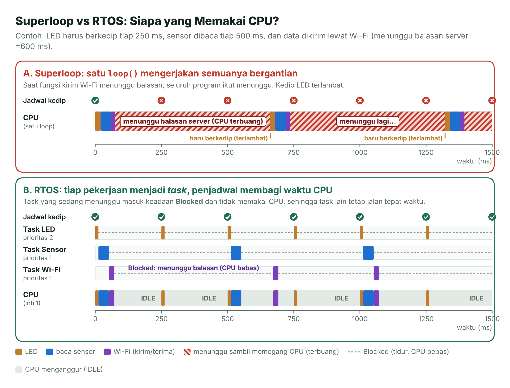
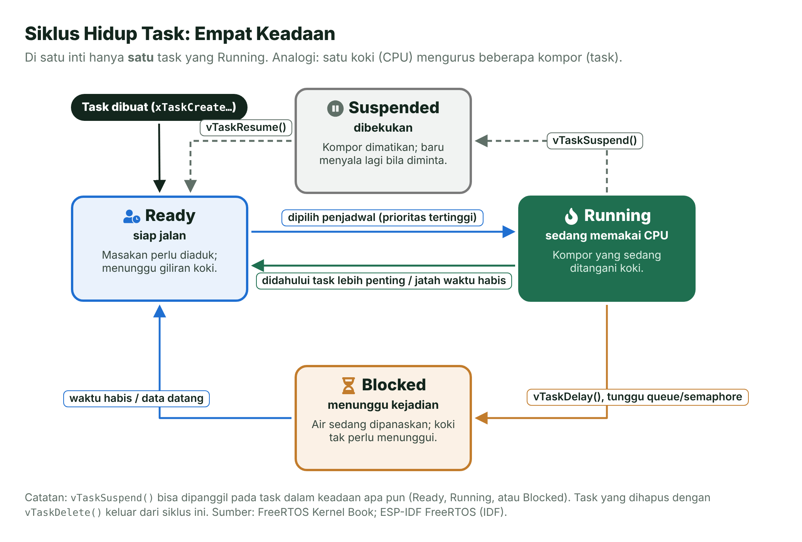
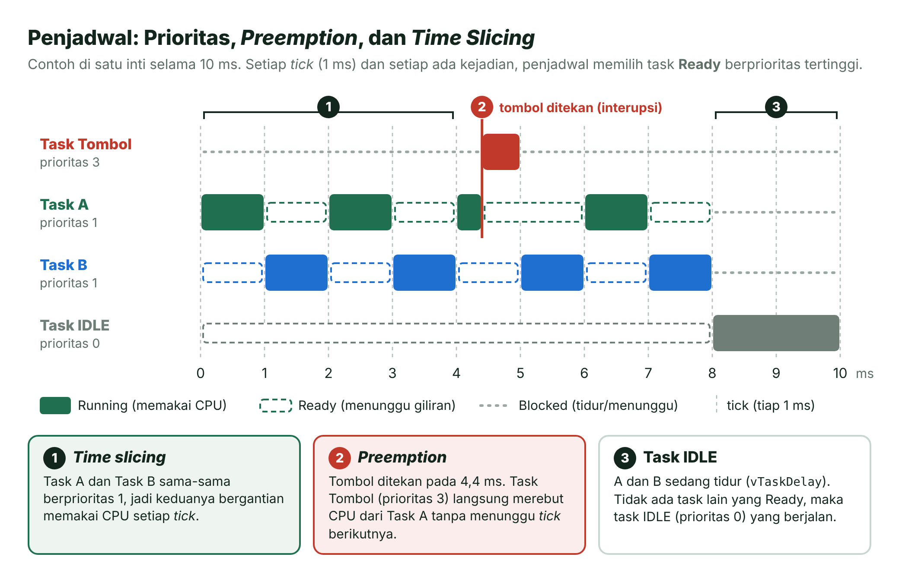
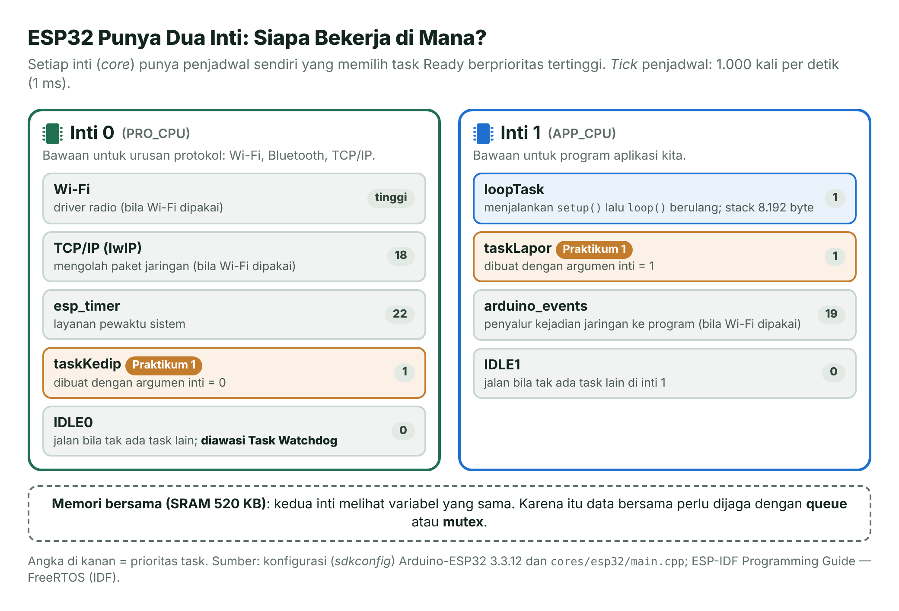
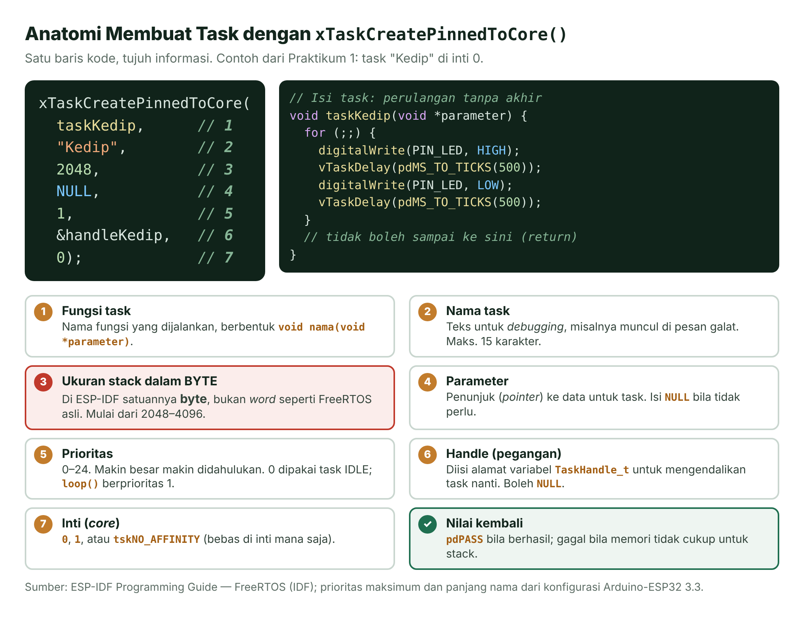
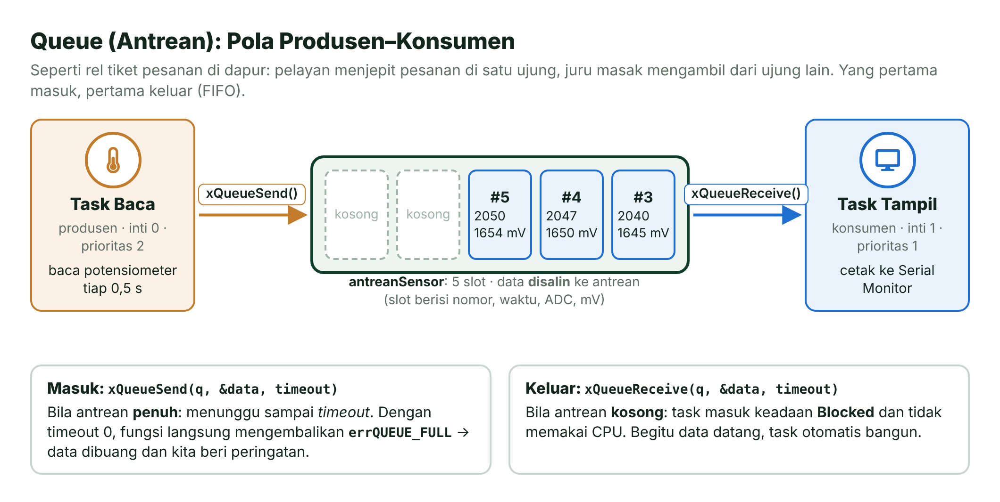
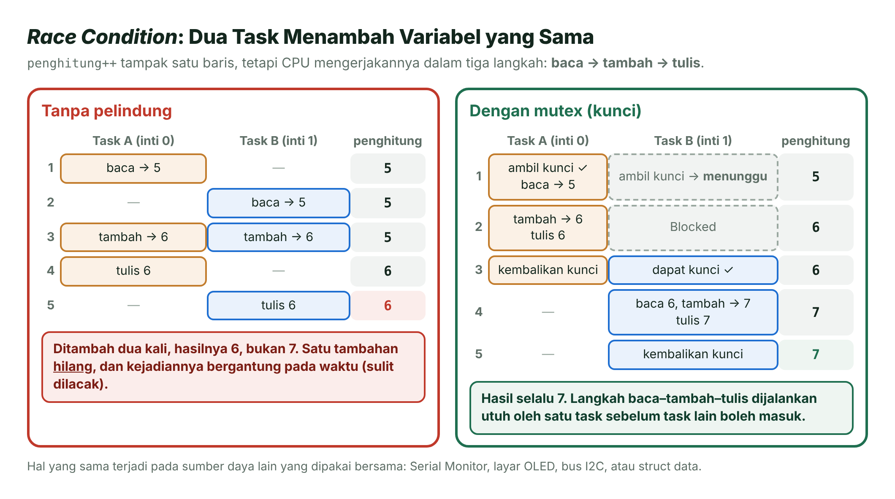
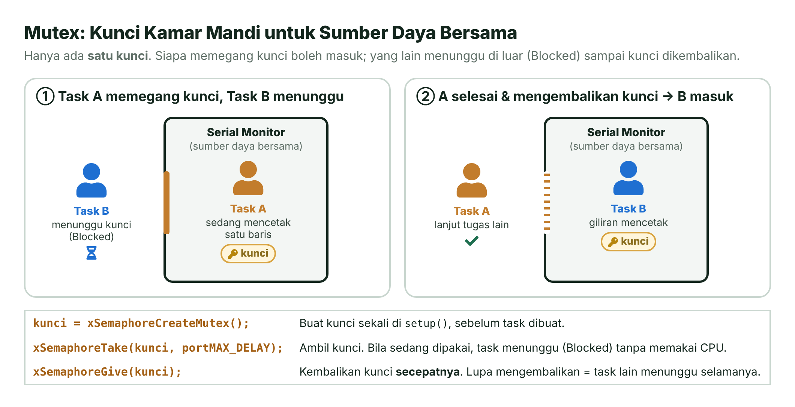
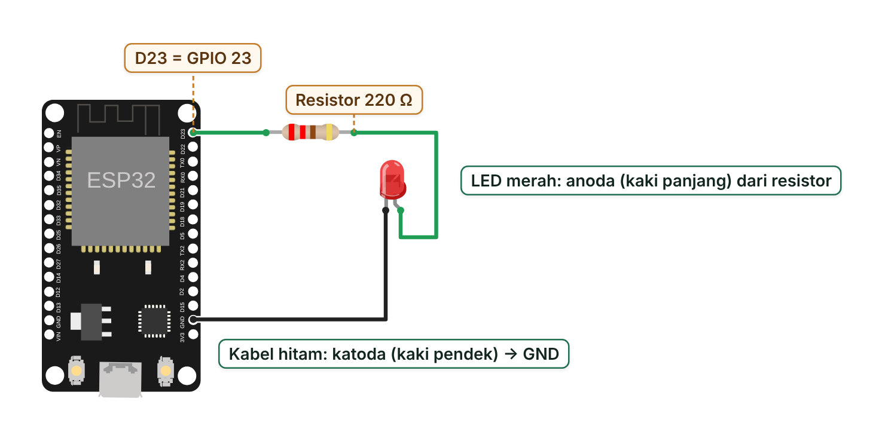
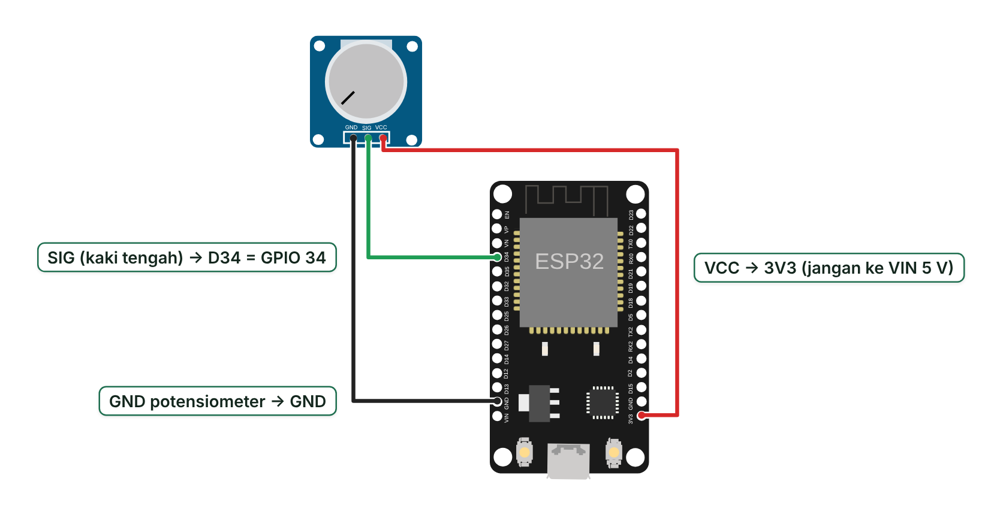

# Pertemuan 12 — *Multitasking* dengan FreeRTOS

> Hari ini kamu belajar membuat ESP32 mengerjakan beberapa pekerjaan sekaligus dengan rapi: mengedipkan LED, membaca sensor, dan mencetak laporan tanpa saling mengganggu.

| | |
| --- | --- |
| ⏱️ **Durasi** | 2 × 50 menit teori + 3 × 50 menit praktikum |
| 📋 **Prasyarat** | Pertemuan 5 (waktu dan interupsi), Pertemuan 6 (ADC), dan Pertemuan 11 (FSM) |
| 🧰 **Alat** | Laptop + internet; opsional: ESP32 DevKit V1, LED merah, resistor 220 Ω, potensiometer 10 kΩ, *breadboard*, kabel jumper |
| 📥 **Slide** | [👁️ Lihat di peramban](https://view.officeapps.live.com/op/view.aspx?src=https%3A%2F%2Fraw.githubusercontent.com%2Fantonprafanto%2Fembeddedsystem%2Fmain%2Fslide%2Fpptx%2FP12-FreeRTOS.pptx) · [⬇️ Unduh PDF](https://raw.githubusercontent.com/antonprafanto/embeddedsystem/main/slide/pdf/P12-FreeRTOS.pdf) · [⬇️ Unduh PPTX](https://raw.githubusercontent.com/antonprafanto/embeddedsystem/main/slide/pptx/P12-FreeRTOS.pptx) |
| 📄 **Modul PDF** | [⬇️ Unduh modul ini dalam PDF](https://raw.githubusercontent.com/antonprafanto/embeddedsystem/main/modul-pdf/Modul-P12-FreeRTOS.pdf) — untuk dibaca luring atau dicetak |

## Daftar Isi

- [🎯 Tujuan Pembelajaran](#-tujuan-pembelajaran)
- [🧰 Yang Perlu Disiapkan](#-yang-perlu-disiapkan)
- [1. Mengapa Butuh RTOS?](#1-mengapa-butuh-rtos)
- [2. Task, Penjadwal, dan Prioritas](#2-task-penjadwal-dan-prioritas)
- [3. Membuat Task dan Memberi Jeda](#3-membuat-task-dan-memberi-jeda)
- [4. Komunikasi Antar-Task dengan Antrean](#4-komunikasi-antar-task-dengan-antrean)
- [5. Race Condition dan Mutex](#5-race-condition-dan-mutex)
- [6. Kesalahan yang Sering Terjadi](#6-kesalahan-yang-sering-terjadi)
- [🧪 Praktikum](#-praktikum)
- [🏋️ Latihan & Tantangan](#️-latihan--tantangan)
- [✅ Cek Pemahaman](#-cek-pemahaman)
- [📌 Rangkuman](#-rangkuman)
- [📚 Referensi](#-referensi)
- [🖼️ Sumber Gambar](#️-sumber-gambar)

---

## 🎯 Tujuan Pembelajaran

Setelah pertemuan ini, kamu bisa:

1. Menjelaskan perbedaan program *super-loop* dengan *multitasking* berbasis RTOS, serta perbedaan waktu nyata keras (*hard real-time*) dan lunak (*soft real-time*).
2. Menjelaskan *task*, empat keadaan *task*, prioritas, dan cara penjadwal FreeRTOS membagi waktu CPU di ESP32 yang punya dua inti.
3. Membuat *task* dengan `xTaskCreatePinnedToCore()`, memberi jeda dengan `vTaskDelay()` atau `xTaskDelayUntil()`, dan mengukur sisa *stack*.
4. Mengirim data antar-*task* dengan antrean (*queue*) dan melindungi sumber daya bersama dengan *mutex*.
5. Mengenali kesalahan umum: *stack* kekecilan, *task* tanpa jeda yang memicu *watchdog*, dan fungsi FreeRTOS biasa yang dipanggil dari ISR.

## 🧰 Yang Perlu Disiapkan

| Kebutuhan | Keterangan |
| --- | --- |
| Perangkat lunak | VS Code + PlatformIO (lihat [Panduan Instalasi Alat](../panduan/02-instalasi-alat.md)) atau simulator [Wokwi](../panduan/03-simulasi-wokwi.md) di peramban |
| Pustaka tambahan | Tidak ada. FreeRTOS sudah termasuk di dalam Arduino-ESP32 |
| Praktikum 1 | 1 LED merah, 1 resistor 220 Ω, kabel jumper |
| Praktikum 2 | 1 potensiometer 10 kΩ, kabel jumper |
| Praktikum 3 | Tidak perlu komponen tambahan |

---

## 1. Mengapa Butuh RTOS?

### Koki dengan Banyak Kompor

Bayangkan seorang **koki** yang mengurus empat kompor sekaligus: merebus air, menggoreng tempe, menanak nasi, dan memanaskan sayur. Koki yang kurang cakap berdiri terpaku di depan panci sampai airnya mendidih, sementara tempe di kompor sebelah gosong. Koki yang cakap tahu bahwa air butuh waktu untuk mendidih. Ia **beralih** ke kompor lain, lalu kembali tepat pada waktunya. Kalau ada yang mendesak, misalnya minyak mulai berasap, ia **mendahulukan** kompor itu.

ESP32 menghadapi situasi yang sama. CPU-nya adalah si koki, sedangkan setiap pekerjaan (mengedipkan LED, membaca sensor, mengirim data) adalah satu kompor.

### *Super-Loop*: Satu `loop()` Mengerjakan Semuanya

Sejauh ini, program kita berbentuk ***super-loop***: satu `loop()` besar yang mengerjakan semua pekerjaan secara bergiliran. Pola ini sederhana dan cukup untuk banyak proyek. Masalahnya muncul saat salah satu pekerjaan harus **menunggu**, misalnya menunggu balasan server. Selama menunggu, seluruh `loop()` ikut tertahan dan pekerjaan lain terlambat.

Di Pertemuan 5 kamu mengakalinya dengan `millis()`, dan di Pertemuan 11 dengan FSM. Cara itu tetap bagus. Namun, makin banyak pekerjaan, makin rumit kodenya, karena kamu sendiri yang harus mengatur giliran setiap pekerjaan.



*Gambar 12.1 — Super-loop vs RTOS. Pada super-loop (A), menunggu balasan server membuat kedipan LED terlambat. Pada RTOS (B), task yang menunggu masuk keadaan Blocked sehingga CPU bebas dipakai task lain. Sumber: dibuat untuk materi ini.*

### RTOS: Penjadwal yang Mengatur Giliran

**RTOS** (*Real-Time Operating System*, sistem operasi waktu nyata) adalah sistem operasi mungil yang tugas utamanya **mengatur giliran** pemakaian CPU. Setiap pekerjaan ditulis sebagai ***task*** (tugas) tersendiri, seolah-olah setiap *task* punya CPU sendiri. Bagian RTOS yang memutuskan *task* mana yang berjalan disebut **penjadwal** (*scheduler*). Kemampuan menjalankan banyak *task* secara bergantian dengan sangat cepat sehingga tampak bersamaan disebut ***multitasking***.

**FreeRTOS** adalah RTOS sumber terbuka yang sangat populer untuk mikrokontroler. Kabar baiknya, Arduino-ESP32 **sudah menjalankan FreeRTOS** sejak ESP32 dinyalakan. ESP-IDF, fondasi Arduino-ESP32, memakai FreeRTOS versi khusus yang berbasis FreeRTOS v10.5.1 dan dimodifikasi untuk dua inti [2]. Jadi, kamu tidak perlu memasang pustaka apa pun.

> [!NOTE]
> **Tanpa sadar kamu sudah memakai FreeRTOS.** Fungsi `setup()` dan `loop()` di ESP32 dijalankan oleh sebuah *task* bernama `loopTask` dengan *stack* 8.192 byte, prioritas 1, di inti 1. Bahkan `delay()` di ESP32 sebenarnya memanggil `vTaskDelay()` milik FreeRTOS [3].

### Waktu Nyata: Keras dan Lunak

"Waktu nyata" (*real-time*) **tidak** berarti "sangat cepat". Artinya, sistem harus memberi tanggapan **sebelum batas waktu** (*deadline*) tertentu, dan perilakunya bisa diperkirakan. Buku FreeRTOS membedakan dua jenis kebutuhan waktu nyata [1]:

| Jenis | Kalau batas waktu terlewati | Contoh |
| --- | --- | --- |
| **Waktu nyata lunak** (*soft real-time*) | Sistem terasa lambat dan menjengkelkan, tetapi masih bisa dipakai | Ketikan *keyboard* yang telat muncul, video yang sesekali tersendat |
| **Waktu nyata keras** (*hard real-time*) | Sistem dianggap **gagal total**, bahkan bisa membahayakan | Kantong udara (*airbag*) mobil yang terlambat mengembang |

RTOS membantu memenuhi batas waktu lewat **prioritas**: pekerjaan yang batas waktunya ketat diberi prioritas lebih tinggi sehingga selalu didahulukan.

---

## 2. *Task*, Penjadwal, dan Prioritas

### Apa Itu *Task*?

Secara kode, *task* hanyalah **fungsi C biasa** dengan dua ciri: berisi perulangan tanpa akhir dan tidak pernah selesai (`return`). Setiap *task* punya ***stack*** sendiri, yaitu memori kecil untuk menyimpan variabel lokal dan alamat kembali fungsi. Karena itu, setiap *task* bisa ditulis seolah-olah tidak ada *task* lain.

```cpp
void taskKedip(void *parameter) {    // bentuk wajib: void nama(void *)
  for (;;) {                         // perulangan tanpa akhir
    digitalWrite(PIN_LED, HIGH);
    vTaskDelay(pdMS_TO_TICKS(500));  // tidur 500 ms; CPU bebas dipakai task lain
    digitalWrite(PIN_LED, LOW);
    vTaskDelay(pdMS_TO_TICKS(500));
  }
  // tidak boleh sampai ke sini
}
```

### Empat Keadaan *Task*

Pada satu inti CPU, hanya **satu** *task* yang benar-benar berjalan pada satu saat. *Task* lainnya berada di salah satu dari tiga keadaan yang lain.



*Gambar 12.2 — Siklus hidup task. Sumber: dibuat untuk materi ini, berdasarkan [1] dan [2].*

| Keadaan | Arti | Analogi dapur |
| --- | --- | --- |
| **Running** | Sedang memakai CPU | Kompor yang sedang ditangani koki |
| **Ready** | Siap jalan, menunggu giliran | Masakan perlu diaduk, menunggu giliran koki |
| **Blocked** | Menunggu kejadian: jeda waktu habis, data datang, atau kunci tersedia. **Tidak memakai CPU** | Air sedang dipanaskan; koki tak perlu menunggui |
| **Suspended** | Dibekukan dengan `vTaskSuspend()`; hanya kembali dengan `vTaskResume()` | Kompor dimatikan sementara |

Kunci efisiensi RTOS ada pada keadaan **Blocked**. *Task* yang sedang menunggu tidak membuang waktu CPU, sehingga *task* lain bisa bekerja.

### Prioritas, *Preemption*, dan *Tick*

Setiap *task* diberi **prioritas** berupa angka. Di Arduino-ESP32, prioritas berkisar **0–24**; angka lebih besar berarti lebih penting. Aturan dasar penjadwal FreeRTOS sederhana: **dari semua *task* yang Ready, jalankan yang prioritasnya paling tinggi** [1].

- ***Preemption*** (perebutan): bila *task* berprioritas lebih tinggi menjadi Ready, misalnya karena tombol ditekan, ia **langsung merebut** CPU dari *task* yang prioritasnya lebih rendah.
- ***Time slicing*** (pembagian waktu): bila ada beberapa *task* Ready dengan prioritas **sama**, mereka bergantian memakai CPU.
- ***Tick*** (detak): penjadwal "berdetak" secara teratur berkat interupsi *timer*. Di Arduino-ESP32, *tick* terjadi **1.000 kali per detik**, jadi **1 *tick* = 1 ms**. Pada setiap *tick*, penjadwal memeriksa *task* mana yang jedanya sudah habis dan siapa yang mendapat giliran.
- ***Task* IDLE** (prioritas 0) dibuat otomatis dan hanya berjalan bila tidak ada *task* lain yang Ready.



*Gambar 12.3 — Prioritas, preemption, dan time slicing pada satu inti. Sumber: dibuat untuk materi ini.*

> [!IMPORTANT]
> **Prioritas tinggi bukan berarti lebih cepat.** Prioritas hanya menentukan siapa yang **didahulukan**. *Task* berprioritas tinggi yang tidak pernah tidur (Blocked) akan memonopoli CPU, sehingga *task* berprioritas lebih rendah tidak pernah kebagian. Keadaan ini disebut ***starvation*** (kelaparan).

### ESP32 Punya Dua Inti

ESP32 punya **dua inti** (*core*) CPU Xtensa LX6 hingga 240 MHz [6]: **inti 0** (PRO_CPU) dan **inti 1** (APP_CPU). Di ESP-IDF, setiap inti punya *task* IDLE sendiri, dan penjadwal memilih *task* untuk masing-masing inti [2]. Jadi, dua *task* benar-benar bisa berjalan **bersamaan** di dua inti yang berbeda.



*Gambar 12.4 — Pembagian task di dua inti ESP32 pada Arduino-ESP32 3.3. Sumber: dibuat untuk materi ini; data dari konfigurasi Arduino-ESP32 3.3.12 [3] dan [2].*

Inti 0 secara bawaan mengurus pekerjaan protokol seperti Wi-Fi dan TCP/IP, sedangkan program Arduino-mu (`loopTask`) berjalan di inti 1. Saat membuat *task* sendiri, kamu boleh memilih intinya, atau membiarkan penjadwal memilih dengan `tskNO_AFFINITY`. Karena kedua inti memakai memori yang sama, data yang dipakai bersama perlu dijaga. Itulah topik Bagian 4 dan 5.

> [!NOTE]
> **Untuk yang penasaran.** FreeRTOS versi ESP-IDF memakai *time slicing* "sebisanya" (*best effort*): *task* berprioritas sama tidak selalu bergiliran dengan urutan serapi FreeRTOS satu inti. Bila urutan bergiliran itu penting, letakkan semua *task* berprioritas sama tersebut di inti yang sama [2].

---

## 3. Membuat *Task* dan Memberi Jeda

### Anatomi `xTaskCreatePinnedToCore()`

Di ESP32, cara paling jelas untuk membuat *task* adalah `xTaskCreatePinnedToCore()`, karena fungsi ini sekaligus menentukan inti tempat *task* berjalan.



*Gambar 12.5 — Tujuh parameter xTaskCreatePinnedToCore(). Sumber: dibuat untuk materi ini, berdasarkan [2].*

```cpp
TaskHandle_t handleKedip = NULL;   // "pegangan" untuk menunjuk task ini nanti

BaseType_t hasil = xTaskCreatePinnedToCore(
    taskKedip,      // 1. fungsi task
    "Kedip",        // 2. nama untuk debugging, maks. 15 karakter
    2048,           // 3. ukuran stack dalam BYTE
    NULL,           // 4. parameter untuk task (tidak ada)
    1,              // 5. prioritas (0-24)
    &handleKedip,   // 6. alamat handle (boleh NULL)
    0);             // 7. inti: 0, 1, atau tskNO_AFFINITY
if (hasil != pdPASS) {
  Serial.println("[GALAT] Task gagal dibuat");   // biasanya memori kurang
}
```

Fungsi ini mengembalikan `pdPASS` bila berhasil. Parameter ke-4 berupa penunjuk (*pointer*) ke data untuk *task*; Praktikum 3 memakainya agar satu fungsi bisa menjadi dua *task* yang berbeda. Parameter ke-6, *handle* (pegangan), dipakai untuk menunjuk *task* itu nanti, misalnya saat menanyakan sisa *stack*-nya. Ada juga `xTaskCreate()` tanpa parameter inti; di ESP-IDF, *task* yang dibuat dengan fungsi itu tidak terikat ke inti tertentu [2].

> [!WARNING]
> **Byte, bukan word.** Di FreeRTOS asli, ukuran *stack* dihitung dalam **word** (pada CPU 32-bit, 1 word = 4 byte). Di ESP-IDF, termasuk Arduino-ESP32, ukurannya dalam **byte** [2]. Contoh FreeRTOS dari internet yang menulis ukuran *stack* `1000` berarti 4.000 byte di FreeRTOS asli, tetapi hanya 1.000 byte di ESP32. Selalu periksa asal contohnya.

### Tiga Cara Menunggu

Cara menunggu di dalam *task* sangat menentukan apakah *task* lain kebagian CPU.

| Cara | Apa yang terjadi | Kapan dipakai |
| --- | --- | --- |
| `vTaskDelay(pdMS_TO_TICKS(500))` | *Task* masuk keadaan Blocked selama 500 ms; CPU bebas dipakai *task* lain | Cara standar memberi jeda di dalam *task* |
| `delay(500)` | Di Arduino-ESP32, `delay(ms)` ditulis sebagai `vTaskDelay(ms / portTICK_PERIOD_MS)` [3], jadi hasilnya sama | Boleh, terutama di `loop()` |
| *Busy-wait*: `while (millis() - mulai < 500) { }` | CPU terus berputar memeriksa waktu; *task* lain di inti yang sama dengan prioritas setara atau lebih rendah tidak kebagian. `delayMicroseconds()` juga termasuk *busy-wait* | Hindari di dalam *task*, kecuali untuk jeda beberapa mikrodetik |

`pdMS_TO_TICKS(ms)` mengubah milidetik menjadi jumlah *tick*. Karena 1 *tick* = 1 ms, `pdMS_TO_TICKS(500)` bernilai 500. Tetap gunakan makro ini agar kode tetap benar bila frekuensi *tick* suatu saat diubah.

### Periode Tetap dengan `xTaskDelayUntil()`

`vTaskDelay(500)` menghitung 500 ms **sejak fungsi itu dipanggil**. Bila pekerjaan sebelumnya memakan waktu 20 ms, satu putaran menjadi 520 ms, dan jadwalnya lama-lama bergeser. Untuk pekerjaan yang harus tepat berkala, misalnya membaca sensor tiap 500 ms, pakai `xTaskDelayUntil()` yang menghitung dari **waktu bangun sebelumnya**:

```cpp
TickType_t waktuBangun = xTaskGetTickCount();          // titik awal
for (;;) {
  bacaSensor();                                        // makan waktu berapa pun...
  xTaskDelayUntil(&waktuBangun, pdMS_TO_TICKS(500));   // ...tetap bangun tiap 500 ms
}
```

Di kode lama kamu mungkin menemukan `vTaskDelayUntil()`. Itu nama lama untuk fungsi yang sama dan masih bisa dipakai.

### Seberapa Besar *Stack*-nya?

*Stack* terlalu kecil membuat *stack* meluap (***stack overflow***) dan program *crash*. *Stack* terlalu besar membuang memori. Ukuran yang pas ditemukan dengan **mengukur** memakai `uxTaskGetStackHighWaterMark()`. Fungsi ini mengembalikan **sisa *stack* paling sedikit** sejak *task* dibuat, dalam byte di ESP-IDF. Makin kecil angkanya, makin dekat *task* itu dengan luapan.

```cpp
UBaseType_t sisa = uxTaskGetStackHighWaterMark(NULL);   // NULL = task ini sendiri
Serial.printf("Sisa stack: %u byte\n", sisa);
```

Di Praktikum 1 kamu akan melihat bahwa satu panggilan `Serial.printf()` saja memakai sekitar 900 byte *stack*. Jadi, jangan terlalu pelit: sisakan cadangan yang lega, setidaknya beberapa ratus byte.

---

## 4. Komunikasi Antar-*Task* dengan Antrean

### Mengapa Tidak Pakai Variabel Global Saja?

Cara termudah berbagi data antar-*task* adalah variabel global. Untuk satu angka 32-bit yang **hanya ditulis oleh satu *task***, cara ini masih aman, seperti variabel `jumlahNyala` di Praktikum 1. Namun, variabel global cepat bermasalah bila:

- Datanya terdiri atas beberapa variabel (misalnya waktu, nilai ADC, dan tegangan), sehingga pembaca bisa mendapat data setengah lama dan setengah baru.
- Ada lebih dari satu *task* yang menulis. Hal ini memicu *race condition* (lihat Bagian 5).
- Penerima harus tahu **kapan** ada data baru, sehingga terpaksa terus memeriksa (*polling*) dan membuang waktu CPU.

### Antrean: Rel Tiket Pesanan di Dapur

FreeRTOS menyediakan **antrean** (*queue*): wadah berisi sejumlah slot dengan aturan **pertama masuk, pertama keluar** (*first in, first out*, FIFO). Bayangkan rel tiket pesanan di dapur: pelayan menjepit pesanan di satu ujung, koki mengambilnya dari ujung lain. *Task* pengirim disebut **produsen**, sedangkan *task* penerima disebut **konsumen**.



*Gambar 12.6 — Pola produsen–konsumen dengan antrean. Sumber: dibuat untuk materi ini.*

Tiga fungsi utamanya:

```cpp
QueueHandle_t antrean = xQueueCreate(5, sizeof(DataSensor));   // 5 slot

// Produsen: kirim SALINAN data; timeout 0 = jangan menunggu bila penuh
if (xQueueSend(antrean, &data, 0) != pdPASS) { /* antrean penuh */ }

// Konsumen: tunggu data; portMAX_DELAY = tunggu selamanya (Blocked)
if (xQueueReceive(antrean, &data, portMAX_DELAY) == pdPASS) { /* olah data */ }
```

| Situasi | Yang terjadi |
| --- | --- |
| Antrean **penuh** saat `xQueueSend()` | Produsen menunggu (Blocked) sampai ada slot kosong atau batas waktu tunggu (*timeout*) habis. Dengan *timeout* 0, fungsi langsung gagal dan mengembalikan `errQUEUE_FULL` |
| Antrean **kosong** saat `xQueueReceive()` | Konsumen menunggu (Blocked) tanpa memakai CPU. Begitu data datang, ia otomatis bangun |
| Menulis batas waktu tunggu | Dalam *tick*: `0` (tidak menunggu), `pdMS_TO_TICKS(100)` (paling lama 100 ms), atau `portMAX_DELAY` (selamanya) |

> [!TIP]
> **Antrean menyimpan salinan, bukan alamat.** `xQueueSend()` menyalin seluruh isi `data` ke dalam slot [1]. Setelah fungsi itu kembali, variabel `data` milik produsen boleh langsung diisi ulang tanpa mengganggu konsumen.

---

## 5. *Race Condition* dan *Mutex*

### Ketika Dua *Task* Berebut

Perintah `penghitung++` tampak seperti satu langkah, padahal CPU mengerjakannya dalam tiga langkah: **baca** nilai dari memori, **tambah** satu, lalu **tulis** kembali. Bila dua *task* melakukannya hampir bersamaan, langkah-langkah itu bisa bersilang dan satu tambahan hilang. Kesalahan yang hasilnya bergantung pada urutan waktu seperti ini disebut ***race condition*** (kondisi balapan). Karena waktunya acak, galat ini sulit dilacak: kadang muncul, kadang tidak.



*Gambar 12.7 — Race condition dan cara mencegahnya. Sumber: dibuat untuk materi ini.*

Sumber daya bersama bukan hanya variabel. Serial Monitor, layar OLED, dan bus I2C juga bisa diperebutkan. Di Praktikum 3 kamu akan melihat dua *task* yang mencetak ke Serial pada waktu bersamaan sehingga hurufnya bercampur.

### *Mutex*: Kunci Kamar Mandi

***Mutex*** (*mutual exclusion*, saling meniadakan) bekerja seperti kunci kamar mandi umum: hanya ada **satu** kunci. Siapa yang memegang kunci boleh masuk, sedangkan yang lain menunggu di luar sampai kunci dikembalikan. Bagian kode yang hanya boleh dimasuki satu *task* pada satu waktu disebut **bagian kritis** (*critical section*).



*Gambar 12.8 — Mutex sebagai kunci sumber daya bersama. Sumber: dibuat untuk materi ini.*

```cpp
SemaphoreHandle_t kunciSerial = xSemaphoreCreateMutex();   // sekali, sebelum task dibuat

void tampilkan(const char *teks) {
  xSemaphoreTake(kunciSerial, portMAX_DELAY);   // ambil kunci (tunggu bila dipakai)
  Serial.println(teks);                         // bagian kritis
  xSemaphoreGive(kunciSerial);                  // kembalikan kunci secepatnya
}
```

Aturan memakai *mutex*:

1. Buat *mutex* **sebelum** *task* yang memakainya dibuat.
2. Buat bagian kritis **sesingkat mungkin**: isi hanya dengan pekerjaan yang benar-benar memakai sumber daya bersama.
3. Setiap `xSemaphoreTake()` yang berhasil **wajib** diikuti `xSemaphoreGive()`. Lupa mengembalikan kunci membuat *task* lain menunggu selamanya.

### *Deadlock* Sekilas

***Deadlock*** (kebuntuan) terjadi bila dua *task* saling menunggu kunci yang dipegang pihak lain. Contohnya, *task* A memegang kunci Serial lalu menunggu kunci I2C, sementara *task* B memegang kunci I2C lalu menunggu kunci Serial. Keduanya menunggu selamanya. Cara menghindarinya: ambil beberapa kunci selalu dengan **urutan yang sama** di semua *task*, atau beri batas waktu tunggu, misalnya `xSemaphoreTake(kunci, pdMS_TO_TICKS(100))`, lalu tangani kegagalannya.

### *Semaphore* Biner vs *Mutex*

FreeRTOS juga punya ***semaphore* biner**. Bentuk fungsinya mirip *mutex*, tetapi kegunaannya berbeda [1], [4]:

| | *Semaphore* biner | *Mutex* |
| --- | --- | --- |
| Kegunaan utama | **Memberi sinyal** bahwa sesuatu telah terjadi, misalnya dari ISR ke *task* | **Mengunci** sumber daya bersama |
| Yang mengembalikan | Boleh *task* atau ISR lain (pemberi sinyal bukan penerima) | *Task* yang mengambil kunci itu sendiri |
| Pewarisan prioritas | Tidak ada | Ada: prioritas pemegang kunci dinaikkan sementara agar cepat selesai bila ada *task* lebih penting yang menunggu |
| Dipakai di ISR | Boleh, dengan `xSemaphoreGiveFromISR()` | Tidak boleh |
| Fungsi pembuat | `xSemaphoreCreateBinary()` | `xSemaphoreCreateMutex()` |

---

## 6. Kesalahan yang Sering Terjadi

| Gejala | Penyebab | Solusi |
| --- | --- | --- |
| Board *restart* dengan pesan `***ERROR*** A stack overflow in task … has been detected.`, muncul *Guru Meditation Error*, atau program macet | *Stack* *task* kekecilan (*stack overflow*) | Perbesar *stack*; ukur dengan `uxTaskGetStackHighWaterMark()` |
| ±5 detik setelah *task* mulai, muncul `task_wdt: Task watchdog got triggered`, lalu board *restart* | Perulangan *busy-wait* tanpa jeda di inti 0 membuat *task* IDLE inti 0 tidak pernah jalan | Beri jeda `vTaskDelay()` di setiap perulangan *task* |
| *Crash* atau perilaku aneh saat interupsi terjadi | Memanggil fungsi FreeRTOS biasa, misalnya `xQueueSend()`, di dalam ISR | Pakai versi `...FromISR`, misalnya `xQueueSendFromISR()` |
| *Task* berprioritas rendah tidak pernah jalan | *Task* berprioritas tinggi tidak pernah Blocked (*starvation*) | Pastikan setiap *task* menunggu sesuatu: jeda, antrean, atau *semaphore* |
| Board *restart* dengan pesan `FreeRTOS Task "…" should not return, Aborting now!` | Fungsi *task* sampai di akhir lalu `return` | Pakai perulangan tanpa akhir, atau akhiri dengan `vTaskDelete(NULL)` |

### *Watchdog* Mengawasi *Task* IDLE

***Task Watchdog Timer*** (TWDT) adalah "satpam" yang memeriksa apakah sistem masih sehat. Di Arduino-ESP32 3.3, TWDT aktif sejak *boot*, batas waktunya **5 detik**, dan yang diawasinya adalah *task* IDLE inti 0. Bila *task* IDLE inti 0 tidak sempat jalan selama 5 detik, berarti ada *task* yang memonopoli inti 0. TWDT lalu mencetak pesan dan, dengan pengaturan bawaan Arduino-ESP32, me-*restart* board [3]. Berikut contoh pesan dari eksperimen Praktikum 1 (angka waktu dan alamat di board-mu akan berbeda):

```text
E (16415) task_wdt: Task watchdog got triggered. The following tasks/users did not reset the watchdog in time:
E (16415) task_wdt:  - IDLE0 (CPU 0)
E (16415) task_wdt: Tasks currently running:
E (16415) task_wdt: CPU 0: Kedip
E (16415) task_wdt: CPU 1: IDLE1
E (16415) task_wdt: Aborting.
E (16415) task_wdt: Print CPU 0 (current core) backtrace
Backtrace: 0x400830cf:0x3ffb9350 0x400830f7:0x3ffb9370 ...
Rebooting...
```

Baca pesannya pelan-pelan: `IDLE0 (CPU 0)` tidak sempat jalan, dan yang sedang memakai CPU 0 adalah `Kedip`. Itulah tersangkanya. Secara bawaan, `loopTask` dan *task* IDLE inti 1 tidak diawasi TWDT. *Busy-wait* di inti 1 memang tidak memicu pesan ini, tetapi tetap membuat *task* lain di inti 1 kelaparan.

### Fungsi FreeRTOS di dalam ISR

ISR (Pertemuan 5) harus singkat dan tidak boleh menunggu. Fungsi FreeRTOS biasa seperti `xQueueSend()` atau `xSemaphoreGive()` dirancang untuk boleh menunggu (Blocked), sehingga **tidak boleh** dipanggil dari ISR. Pakai versi berakhiran `FromISR` [1]:

```cpp
SemaphoreHandle_t sinyalTombol = NULL;   // dibuat di setup(): xSemaphoreCreateBinary()

void IRAM_ATTR isrTombol() {
  BaseType_t adaTaskPentingBangun = pdFALSE;
  xSemaphoreGiveFromISR(sinyalTombol, &adaTaskPentingBangun);   // beri sinyal ke task
  if (adaTaskPentingBangun) {
    portYIELD_FROM_ISR();   // langsung pindah ke task yang baru bangun
  }
}
```

*Task* penerima cukup menunggu dengan `xSemaphoreTake(sinyalTombol, portMAX_DELAY)`. Selama tombol tidak ditekan, *task* itu Blocked dan tidak memakai CPU sama sekali.

---

## 🧪 Praktikum

### Sebelum Mulai

Ketiga praktikum bisa dijalankan di Wokwi maupun di board asli. Langkah lengkapnya sama seperti di [Pertemuan 1](../pertemuan-01-pengenalan/README.md#-praktikum):

- **Jalur A — Wokwi:** buka <https://wokwi.com/projects/new/esp32>, salin isi `src/main.cpp` ke tab **sketch.ino**, salin isi `diagram.json`, lalu klik **▶**.
- **Jalur B — board asli:** rangkai komponen sesuai gambar, buka *folder* proyek di VS Code (**File** → **Open Folder...**), lalu klik **Build** → **Upload** → **Serial Monitor**.

---

### Praktikum 1 — Dua *Task* di Dua Inti

📁 *Folder*: [`kode/01-dua-task`](kode/01-dua-task)

**Tujuan:** membuat dua *task* yang berjalan bersamaan di dua inti, lalu mengamati inti, prioritas, dan sisa *stack*-nya.

**Rangkaian:** LED merah dan resistor 220 Ω di GPIO 23, sesuai peta pin standar kursus.



*Gambar 12.9 — Rangkaian Praktikum 1. Sumber: dibuat untuk materi ini dengan @wokwi/elements (MIT).*

| Dari | Ke | Kabel |
| --- | --- | --- |
| D23 (GPIO 23) | Kaki resistor 220 Ω | Hijau |
| Kaki resistor yang lain | Anoda LED (kaki panjang) | Hijau |
| Katoda LED (kaki pendek) | GND | Hitam |

**Kode** (`src/main.cpp`, dipotong bagian pentingnya):

```cpp
const int PIN_LED = 23;
volatile unsigned long jumlahNyala = 0;   // ditulis Kedip, dibaca Lapor

void setup() {
  // ... Serial.begin(), pinMode(), pesan pembuka
  BaseType_t hasil1 = xTaskCreatePinnedToCore(taskKedip, "Kedip", 2048, NULL, 1, &handleKedip, 0);
  BaseType_t hasil2 = xTaskCreatePinnedToCore(taskLapor, "Lapor", 4096, NULL, 1, &handleLapor, 1);
  // ... periksa hasil1 dan hasil2
}

void loop() {                         // loopTask: menyapa tiap 10 detik
  vTaskDelay(pdMS_TO_TICKS(10000));
  Serial.printf("[loop ] loopTask masih hidup di inti %d, sisa stack %u B\n", ...);
}

void taskLapor(void *parameter) {     // inti 1, laporan tiap 2 detik
  for (;;) {
    UBaseType_t sisaKedip = uxTaskGetStackHighWaterMark(handleKedip);
    UBaseType_t sisaLapor = uxTaskGetStackHighWaterMark(NULL);   // NULL = task ini
    Serial.printf("[Lapor] #%lu | inti %d | LED sudah menyala %lu kali | ...", ...);
    vTaskDelay(pdMS_TO_TICKS(JEDA_LAPOR_MS));
  }
}
```

Fungsi `taskKedip` sama dengan contoh di [Bagian 2](#2-task-penjadwal-dan-prioritas), ditambah baris `jumlahNyala = jumlahNyala + 1;` setiap kali LED menyala. Hanya *task* Kedip yang menulis variabel itu, jadi aman dibaca *task* Lapor.

**Hasil yang diharapkan:** LED berkedip stabil (0,5 detik nyala, 0,5 detik padam), dan Serial Monitor menampilkan:

```text
=== Pertemuan 12 · Dua Task di Dua Inti ===
[INFO] setup() berjalan di task "loopTask", inti 1, prioritas 1
[INFO] Task Kedip (inti 0) dan task Lapor (inti 1) sudah dibuat.
[Lapor] #1 | inti 1 | LED sudah menyala 1 kali | sisa stack: Kedip 1500 B, Lapor 3536 B
[Lapor] #2 | inti 1 | LED sudah menyala 3 kali | sisa stack: Kedip 1500 B, Lapor 2628 B
[Lapor] #3 | inti 1 | LED sudah menyala 5 kali | sisa stack: Kedip 1500 B, Lapor 2628 B
[Lapor] #4 | inti 1 | LED sudah menyala 7 kali | sisa stack: Kedip 1500 B, Lapor 2628 B
[Lapor] #5 | inti 1 | LED sudah menyala 9 kali | sisa stack: Kedip 1500 B, Lapor 2628 B
[loop ] loopTask masih hidup di inti 1, sisa stack 6544 B
[Lapor] #6 | inti 1 | LED sudah menyala 11 kali | sisa stack: Kedip 1500 B, Lapor 2628 B
```

Cara membaca hasilnya:

- Baris kedua membuktikan bahwa `setup()` dijalankan oleh `loopTask` di inti 1 dengan prioritas 1.
- Hitungan nyala naik 2 pada setiap laporan, karena laporan muncul tiap 2 detik sedangkan LED menyala sekali tiap 1 detik. Kedipan tetap teratur walaupun *task* Lapor sibuk mencetak.
- Sisa *stack* Lapor turun dari 3.536 B menjadi 2.628 B setelah laporan pertama. Selisih 908 B itu dipakai oleh `Serial.printf()`. Angka sisa *stack* di board-mu bisa sedikit berbeda.
- Dari 8.192 byte *stack* `loopTask`, masih tersisa 6.544 byte karena `loop()` kita hampir tidak bekerja.

**Kalau belum berhasil:**

| Gejala | Coba ini |
| --- | --- |
| Laporan muncul, tetapi LED tidak menyala | Periksa arah LED (kaki panjang ke resistor) dan pastikan kabel di D23, bukan D22. |
| Muncul `[GALAT] Task gagal dibuat` | Memori tidak cukup. Periksa apakah ada ukuran *stack* yang terlalu besar. |
| Board terus *restart* | Baca pesan galatnya, lalu cocokkan dengan tabel di [Bagian 6](#6-kesalahan-yang-sering-terjadi). |

**Eksperimen kecil:**

- **Jeda yang salah.** Di `taskKedip`, ganti kedua baris `vTaskDelay(pdMS_TO_TICKS(JEDA_KEDIP_MS));` dengan *busy-wait* `{ unsigned long t0 = millis(); while (millis() - t0 < JEDA_KEDIP_MS) { } }`. LED tetap berkedip, tetapi ±5 detik kemudian muncul pesan *watchdog* seperti di [Bagian 6](#6-kesalahan-yang-sering-terjadi) dan ESP32 *restart*. Mengapa *task* Lapor tetap sempat mencetak sebelum itu?
- **Stack kekecilan.** Ubah ukuran *stack* Lapor dari `4096` menjadi `1024`. Program masih jalan, tetapi sisa *stack* Lapor tinggal sekitar 100 B, terlalu mepet. Bila diperkecil lagi, misalnya `768`, ESP32 bisa *restart* dengan pesan *stack overflow*, menampilkan *Guru Meditation Error*, atau macet. Kembalikan ke `4096` setelah selesai.
- **Pindah inti.** Ubah argumen terakhir *task* Kedip dari `0` menjadi `1`. Apakah LED masih berkedip teratur? Mengapa satu inti pun masih cukup untuk tiga *task* ini?

---

### Praktikum 2 — Antrean: dari *Task* Sensor ke *Task* Tampilan

📁 *Folder*: [`kode/02-queue-sensor`](kode/02-queue-sensor)

**Tujuan:** menerapkan pola produsen–konsumen. *Task* Baca (inti 0, prioritas 2) membaca potensiometer **tepat** tiap 0,5 detik dan mengirim datanya ke antrean. *Task* Tampil (inti 1, prioritas 1) menunggu data di antrean lalu menampilkannya.

**Rangkaian:** potensiometer 10 kΩ di GPIO 34 (pin ADC1, sesuai peta pin standar kursus).



*Gambar 12.10 — Rangkaian Praktikum 2. Sumber: dibuat untuk materi ini dengan @wokwi/elements (MIT).*

| Kaki potensiometer | Ke pin ESP32 | Kabel |
| --- | --- | --- |
| SIG (kaki tengah) | D34 (GPIO 34) | Hijau |
| VCC | 3V3 | Merah |
| GND | GND | Hitam |

> [!CAUTION]
> **Sambungkan VCC potensiometer ke 3V3, bukan ke VIN.** Pin VIN bertegangan ±5 V saat board dicolok USB. Tegangan sebesar itu di kaki tengah potensiometer bisa merusak pin ADC ESP32 yang maksimal 3,3 V.

**Kode** (`src/main.cpp`, dipotong bagian pentingnya):

```cpp
struct DataSensor {            // satu "paket" data, disalin utuh ke antrean
  unsigned long nomor;
  unsigned long waktuMs;
  int adc;
  int milivolt;
};
QueueHandle_t antreanSensor = NULL;

// setup(): antreanSensor = xQueueCreate(PANJANG_ANTREAN, sizeof(DataSensor));

void taskBaca(void *parameter) {                   // PRODUSEN
  TickType_t waktuBangun = xTaskGetTickCount();
  for (;;) {
    DataSensor data;
    // ... isi nomor, waktuMs = millis(), adc, milivolt
    if (xQueueSend(antreanSensor, &data, 0) != pdPASS) {
      Serial.printf("[Baca  ] PERINGATAN: antrean penuh, data #%lu dibuang\n", data.nomor);
    }
    xTaskDelayUntil(&waktuBangun, pdMS_TO_TICKS(PERIODE_BACA_MS));   // tepat tiap 500 ms
  }
}

void taskTampil(void *parameter) {                 // KONSUMEN
  DataSensor data;
  for (;;) {
    if (xQueueReceive(antreanSensor, &data, portMAX_DELAY) == pdPASS) {
      // ... cetak nomor, waktu, ADC, mV, batang, dan isi antrean
    }
  }
}
```

**Hasil yang diharapkan:** satu baris setiap 0,5 detik. Angka di bawah hanya contoh saat kenop potensiometer di sekitar tengah; nilai `t`, `ADC`, dan `mV` di layarmu akan berbeda.

```text
=== Pertemuan 12 · Queue Sensor ===
[INFO] Antrean dibuat: 5 slot x 16 byte
[Tampil] #1  t=1043 ms  ADC=2047  1650 mV  [#####.....]  isi antrean: 0
[Tampil] #2  t=1543 ms  ADC=2047  1650 mV  [#####.....]  isi antrean: 0
[Tampil] #3  t=2043 ms  ADC=2047  1650 mV  [#####.....]  isi antrean: 0
```

Yang perlu kamu perhatikan:

- Nilai `t` bertambah **tepat 500 ms** setiap baris berkat `xTaskDelayUntil()`.
- `isi antrean: 0` berarti konsumen selalu sempat mengambil data sebelum data berikutnya datang.
- Saat kenop diputar, nilai ADC dan batang `#####.....` ikut berubah. Di Wokwi, klik potensiometer lalu geser nilainya.

**Kalau belum berhasil:**

| Gejala | Coba ini |
| --- | --- |
| ADC selalu 0 atau selalu 4.095 | Periksa kabel SIG ke D34 serta sambungan VCC dan GND potensiometer. |
| Tidak ada baris `[Tampil]` | Pastikan muncul pesan `[INFO] Antrean dibuat`. Bila muncul `[GALAT]`, memori tidak cukup. |
| Wokwi menampilkan galat kompilasi | Pastikan seluruh isi `main.cpp` tersalin, termasuk `#include <Arduino.h>` di bagian atas. |

**Eksperimen kecil:**

- **Konsumen lambat.** Ubah `JEDA_TAMPIL_MS` dari `0` menjadi `2000`. Setelah beberapa detik, isi antrean mencapai 4–5 dan muncul `PERINGATAN: antrean penuh`. Perhatikan juga nilai `t`: data yang ditampilkan makin "basi" karena sudah lama mengantre.
- **Produsen ikut menunggu.** Tetap dengan `JEDA_TAMPIL_MS = 2000`, ubah *timeout* `xQueueSend(antreanSensor, &data, 0)` menjadi `pdMS_TO_TICKS(3000)`. Peringatan hilang karena produsen menunggu slot kosong (Blocked). Apa akibatnya terhadap periode pembacaan sensor?

---

### Praktikum 3 — *Mutex* untuk Serial Bersama

📁 *Folder*: [`kode/03-mutex-serial`](kode/03-mutex-serial)

**Tujuan:** melihat *race condition* secara langsung, lalu mencegahnya dengan *mutex*.

**Rangkaian:** tidak perlu komponen tambahan.

Dua *task* memakai **fungsi yang sama**, `taskPencetak()`, tetapi menerima parameter berbeda: huruf `A` atau `B` beserta pesannya. Setiap *task* mencetak tiga baris dengan jeda 300 ms. Supaya tabrakan mudah terlihat, fungsi `cetakPelan()` mencetak huruf demi huruf dengan jeda 1 ms, meniru perangkat keluaran yang lambat seperti layar atau printer.

**Kode** (`src/main.cpp`, dipotong bagian pentingnya):

```cpp
const bool PAKAI_MUTEX = false;   // ← ubah ke true, lalu bandingkan hasilnya
SemaphoreHandle_t kunciSerial = NULL;

// setup(): kunciSerial = xSemaphoreCreateMutex();
//          xTaskCreatePinnedToCore(taskPencetak, "PencetakA", 3072, &infoA, 1, NULL, 0);
//          xTaskCreatePinnedToCore(taskPencetak, "PencetakB", 3072, &infoB, 1, NULL, 1);

void tampilkan(const char *teks) {
  if (PAKAI_MUTEX) {
    xSemaphoreTake(kunciSerial, portMAX_DELAY);   // ambil kunci
    cetakPelan(teks);                             // bagian kritis: hanya satu task
    xSemaphoreGive(kunciSerial);                  // kembalikan kunci
  } else {
    cetakPelan(teks);                             // tanpa kunci: bisa bertabrakan
  }
}

void cetakPelan(const char *teks) {   // huruf demi huruf, jeda 1 ms
  for (int i = 0; teks[i] != '\0'; i++) {
    Serial.write(teks[i]);
    vTaskDelay(pdMS_TO_TICKS(1));
  }
  Serial.write('\n');
}
```

Perhatikan juga akhir `taskPencetak()`: setelah selesai mencetak, *task* memanggil `vTaskDelete(NULL)` untuk menghapus dirinya sendiri, karena fungsi *task* tidak boleh sekadar `return`.

**Hasil yang diharapkan.** Dengan `PAKAI_MUTEX = false`, huruf dari kedua *task* bercampur. Pola campurannya berbeda setiap kali dijalankan; contohnya seperti ini:

```text
=== Pertemuan 12 · Mutex Serial ===
[INFO] Mode: TANPA mutex (baris bisa bercampur)
[A0[1] TaBs0k 1A ]m eTlapoArS:K  suBh uM ErLuAaPOngR 2:7 C,  nPoIrNmTaUl. 
GARASI TERKUNCI.
[A02] Task A melapor[: Bs0uh2u]  ruTaAnSg K2 7B C,  MnEoLrAmaPlO.R
: PINTU GARASI TERKUNCI.
[A03] Task A melapor: suhu ruang 27 C, normal.
[B03] TASK B MELAPOR: PINTU GARASI TERKUNCI.
[INFO] Task A selesai.
[INFO] Task B selesai.
```

Ubah menjadi `PAKAI_MUTEX = true`, unggah lagi, dan setiap baris tercetak utuh. Urutan baris A dan B bisa bertukar, tetapi tidak ada lagi huruf yang bercampur:

```text
=== Pertemuan 12 · Mutex Serial ===
[INFO] Mode: DENGAN mutex (setiap baris utuh)
[B01] TASK B MELAPOR: PINTU GARASI TERKUNCI.
[A01] Task A melapor: suhu ruang 27 C, normal.
[B02] TASK B MELAPOR: PINTU GARASI TERKUNCI.
[A02] Task A melapor: suhu ruang 27 C, normal.
[B03] TASK B MELAPOR: PINTU GARASI TERKUNCI.
[A03] Task A melapor: suhu ruang 27 C, normal.
[INFO] Task B selesai.
[INFO] Task A selesai.
```

> [!NOTE]
> **Mengapa harus mencetak huruf demi huruf?** Driver UART Arduino-ESP32 sudah punya kunci internal untuk setiap satu panggilan tulis [3]. Satu panggilan `Serial.printf()` yang pendek karena itu jarang terpotong. Namun, satu baris yang disusun dari banyak panggilan, atau perangkat lain seperti layar OLED dan bus I2C, tidak punya pelindung seperti itu. Di sanalah *mutex* buatanmu dibutuhkan.

**Kalau belum berhasil:**

| Gejala | Coba ini |
| --- | --- |
| Baris tetap bercampur padahal `PAKAI_MUTEX = true` | Pastikan berkas sudah disimpan, lalu unggah ulang. Di Wokwi, hentikan simulasi dan klik **▶** lagi. |
| Hanya satu baris yang muncul, lalu semuanya diam | Ada `xSemaphoreGive()` yang terhapus atau terlewati, sehingga kunci tidak pernah dikembalikan. |

**Eksperimen kecil:**

- **Lupa mengembalikan kunci.** Dengan `PAKAI_MUTEX = true`, jadikan baris `xSemaphoreGive(kunciSerial);` sebagai komentar. Berapa baris yang tercetak? Mengapa *task* pemegang kunci pun ikut macet saat mencoba mengambil kunci untuk kedua kalinya?
- **Jumlah baris.** Ubah `JUMLAH_BARIS` menjadi `6` dan jeda 300 ms menjadi 100 ms. Apakah tabrakan tanpa *mutex* makin sering terjadi?

---

## 🏋️ Latihan & Tantangan

1. **Tiga *task*.** Tambahkan *task* ketiga di Praktikum 1 yang mengedipkan LED bawaan GPIO 2 setiap 100 ms (prioritas 1, inti 0). Pastikan kedua LED berkedip dengan iramanya masing-masing.
2. **Rata-rata bergerak.** Ubah konsumen di Praktikum 2 agar menampilkan rata-rata lima data terakhir. Di mana sebaiknya larik (*array*) penyimpan lima data itu diletakkan: di produsen atau di konsumen? Mengapa?
3. **Perintah lewat antrean.** Buat *task* yang membaca perintah `cepat` atau `lambat` dari Serial Monitor, lalu mengirim lama jeda kedip lewat antrean ke *task* Kedip. *Petunjuk:* baca per baris dengan `Serial.readStringUntil('\n')` lalu `trim()`, dan tambahkan `monitor_echo = yes` serta `monitor_eol = LF` di `platformio.ini`.
4. **Tombol dengan *semaphore*.** Pasang tombol di GPIO 4 (`INPUT_PULLUP`, ke GND). ISR memberi *semaphore* biner dengan `xSemaphoreGiveFromISR()`, lalu *task* Tombol menunggu *semaphore* itu dan mencetak `Tombol ditekan!`. Bandingkan dengan cara *polling* di Pertemuan 4.
5. **Hemat memori.** Untuk setiap *task* di Praktikum 2, cetak sisa *stack* tiap 10 detik. Tentukan ukuran *stack* terkecil yang masih menyisakan cadangan lega, lalu hitung berapa byte yang berhasil kamu hemat.

## ✅ Cek Pemahaman

1. Di Arduino-ESP32, angka `2048` pada parameter ukuran *stack* `xTaskCreatePinnedToCore()` berarti …
   - A. 2.048 word (8.192 byte)
   - B. 2.048 byte
   - C. 2.048 KB
   - D. 2.048 *tick*

2. *Task* yang sedang menjalankan `vTaskDelay(pdMS_TO_TICKS(500))` berada dalam keadaan …
   - A. Running
   - B. Ready
   - C. Blocked
   - D. Suspended

3. *Task* A (prioritas 1) sedang berjalan, lalu *task* B (prioritas 3) di inti yang sama menjadi Ready. Apa yang terjadi?
   - A. B menunggu sampai A selesai seluruhnya
   - B. B langsung merebut CPU dari A (*preemption*)
   - C. A dan B bergantian setiap *tick*
   - D. *Watchdog* me-*restart* ESP32

4. Cara paling tepat mengirim `struct` data sensor dari *task* sensor ke *task* tampilan adalah …
   - A. Variabel global tanpa pelindung
   - B. Antrean dengan `xQueueSend()` dan `xQueueReceive()`
   - C. Memanggil fungsi *task* tampilan langsung dari *task* sensor
   - D. Memperbesar `delay()` di kedua *task*

5. Mengapa *task* berisi `while (millis() - mulai < 500) { }` di inti 0 dapat memicu *Task Watchdog*?
   - A. Karena `millis()` tidak berfungsi di inti 0
   - B. Karena *task* itu tidak pernah Blocked sehingga *task* IDLE inti 0 tidak sempat jalan
   - C. Karena prioritas *task* itu 0
   - D. Karena *stack*-nya terlalu besar

6. Di dalam ISR, fungsi yang benar untuk memberi sinyal ke sebuah *task* adalah …
   - A. `xSemaphoreGive()`
   - B. `xSemaphoreTake()`
   - C. `xSemaphoreGiveFromISR()`
   - D. `vTaskDelay()`

<details>
<summary><b>Lihat jawaban</b></summary>

1. **B.** Di ESP-IDF ukuran *stack* dalam byte. Pilihan A berlaku untuk FreeRTOS asli pada CPU 32-bit.
2. **C.** Selama jeda, *task* Blocked dan tidak memakai CPU.
3. **B.** Penjadwal selalu menjalankan *task* Ready berprioritas tertinggi, jadi B langsung merebut CPU.
4. **B.** Antrean menyalin data utuh dan membangunkan konsumen saat data datang.
5. **B.** *Busy-wait* memonopoli inti 0, sehingga *task* IDLE inti 0 yang diawasi TWDT tidak pernah jalan selama 5 detik.
6. **C.** Di ISR hanya boleh memakai fungsi berakhiran `FromISR`.

</details>

## 📌 Rangkuman

- ***Super-loop*** mengerjakan semua pekerjaan bergiliran dalam satu `loop()`; satu pekerjaan yang menunggu dapat menghambat semuanya. **RTOS** membagi pekerjaan menjadi ***task*** yang dijadwalkan oleh **penjadwal**.
- **Waktu nyata** berarti tepat waktu sebelum batas waktu, bukan sekadar cepat. Pelanggaran batas waktu pada sistem *hard real-time* berarti gagal total.
- Keadaan *task*: **Running**, **Ready**, **Blocked**, dan **Suspended**. *Task* yang Blocked tidak memakai CPU.
- Penjadwal menjalankan *task* Ready **berprioritas tertinggi** (0–24 di ESP32), mendukung ***preemption*** dan ***time slicing***, dengan ***tick*** 1 ms. ESP32 punya **dua inti**; `loopTask` berjalan di inti 1 dengan prioritas 1 dan *stack* 8.192 byte.
- `xTaskCreatePinnedToCore()` memakai ukuran *stack* dalam **byte**. Beri jeda dengan `vTaskDelay()`, buat periode tetap dengan `xTaskDelayUntil()`, dan ukur *stack* dengan `uxTaskGetStackHighWaterMark()`.
- **Antrean** (*queue*) mengirim salinan data antar-*task* dengan aman; **mutex** mencegah *race condition* pada sumber daya bersama. *Semaphore* biner dipakai untuk memberi sinyal, misalnya dari ISR.
- Waspadai *stack* kekecilan, *busy-wait* yang memicu *watchdog*, dan fungsi non-ISR di dalam ISR. Di ISR, pakai versi `...FromISR`.

## 📚 Referensi

1. Barry, R., & The FreeRTOS Team. (t.t.). *Mastering the FreeRTOS™ Real Time Kernel: A Hands-On Tutorial Guide* (Release Version 1.0). GitHub. <https://github.com/FreeRTOS/FreeRTOS-Kernel-Book>
2. Espressif Systems. (2025). *FreeRTOS (IDF) — ESP-IDF Programming Guide v5.5*. <https://docs.espressif.com/projects/esp-idf/en/v5.5/esp32/api-reference/system/freertos_idf.html>
3. Espressif Systems. (2026). *Arduino core for the ESP32* (kode sumber dan konfigurasi versi 3.3.12). GitHub. <https://github.com/espressif/arduino-esp32>
4. FreeRTOS. (2026). *FreeRTOS Kernel Developer Docs — Kernel Features*. <https://www.freertos.org/Documentation/02-Kernel/02-Kernel-features/00-Developer-docs>
5. FreeRTOS. (2026). *FreeRTOS Beginner's Guide*. <https://www.freertos.org/Documentation/01-FreeRTOS-quick-start/01-Beginners-guide/00-Overview>
6. Espressif Systems. (2025). *ESP32 Series Datasheet* (v5.x). <https://documentation.espressif.com/esp32_datasheet_en.pdf>

## 🖼️ Sumber Gambar

| Gambar | Sumber dan lisensi |
| --- | --- |
| 12.1–12.8 | Dibuat untuk materi ini. Sebagian memakai ikon Font Awesome Free (Fonticons, CC BY 4.0). |
| 12.9, 12.10 | Dibuat untuk materi ini; gambar board, LED, resistor, dan potensiometer dari [@wokwi/elements](https://github.com/wokwi/wokwi-elements) (MIT, © 2020 Uri Shaked). |

---

[⬅️ Pertemuan 11: FSM dan *Debugging*](../pertemuan-11-fsm-debugging/README.md) · [🏠 Beranda](../README.md) · [Pertemuan 13: IoT: Wi-Fi dan MQTT ➡️](../pertemuan-13-wifi-mqtt/README.md)
