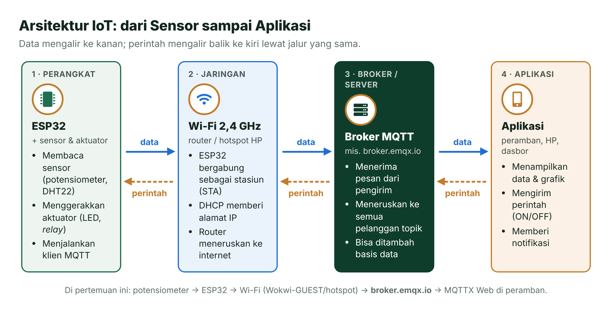
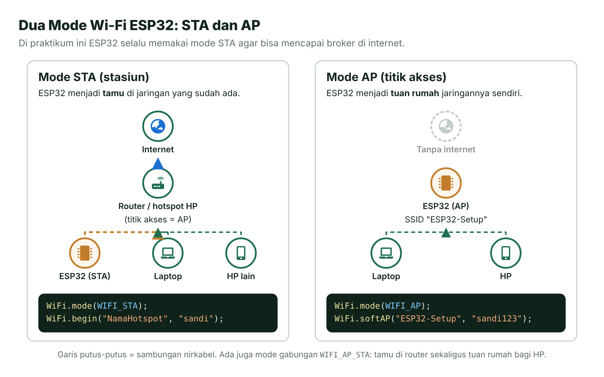
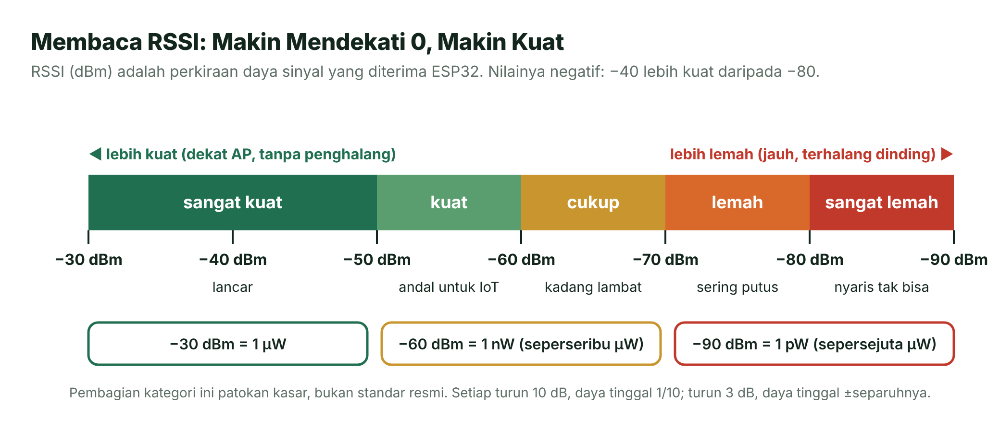
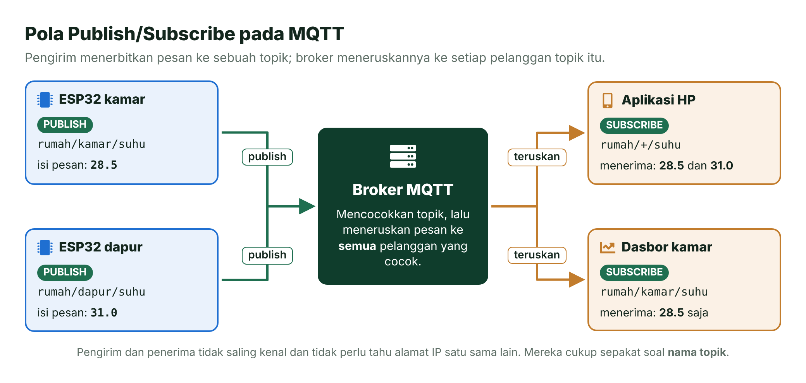
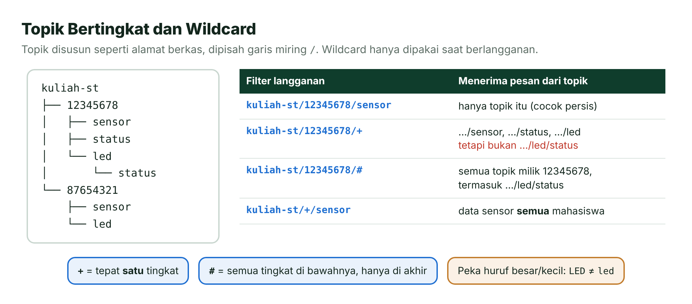
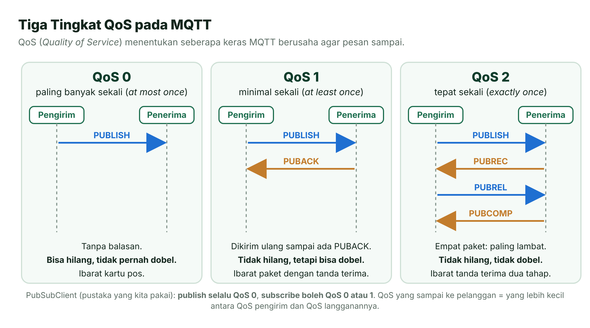
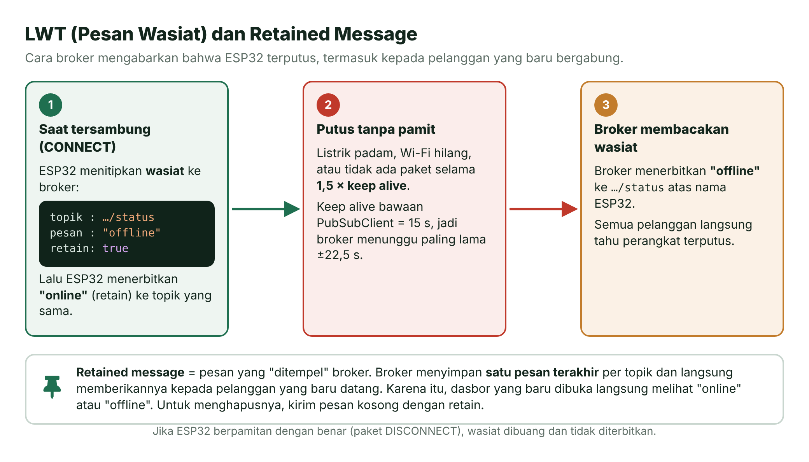
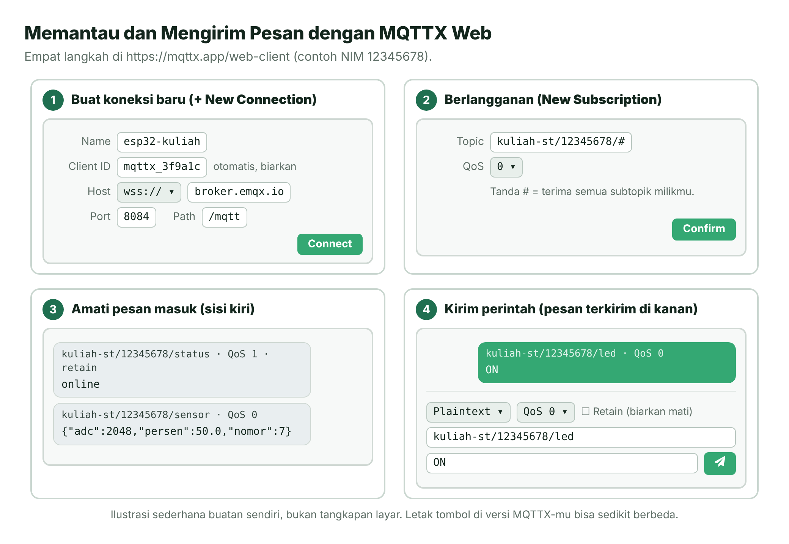
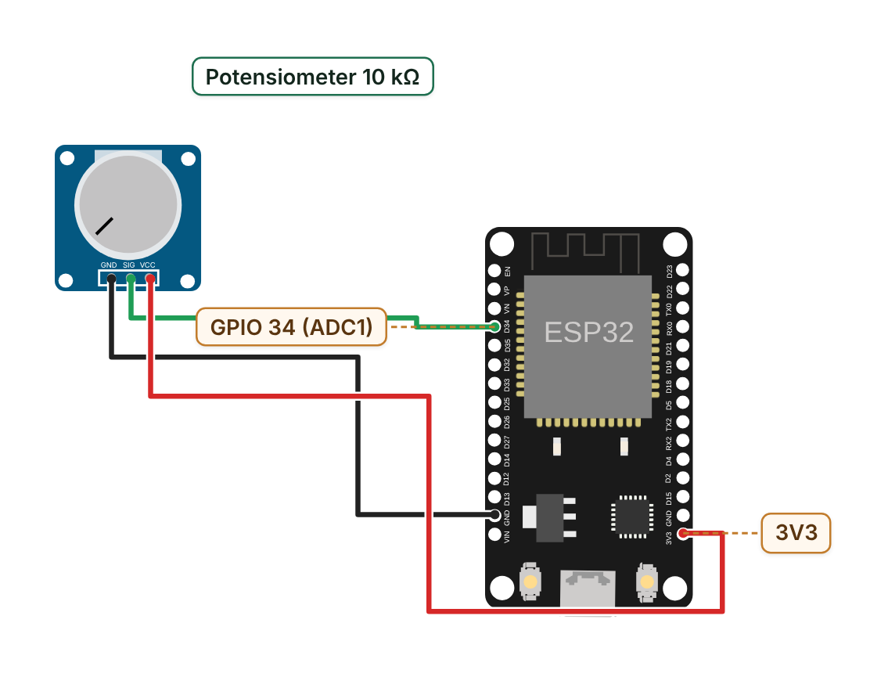
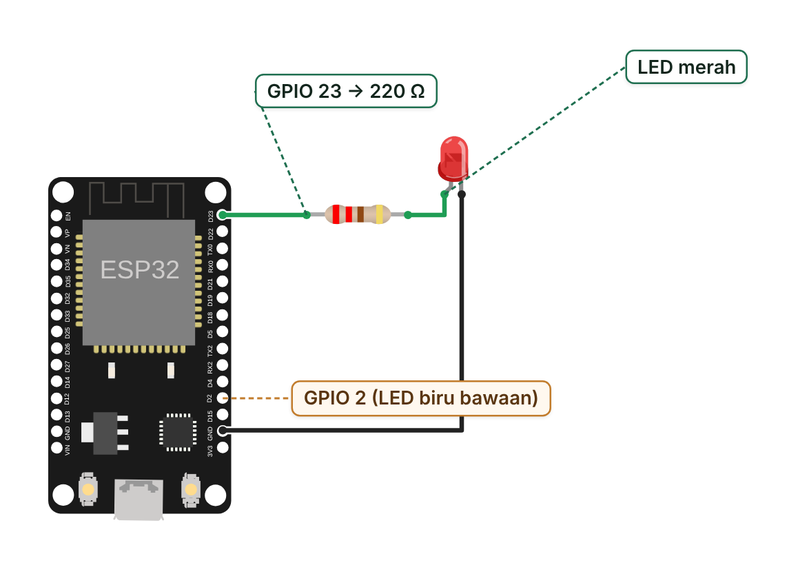

# Pertemuan 13 — IoT: Wi-Fi dan MQTT

> Hari ini ESP32-mu "naik kelas": tersambung ke Wi-Fi, mengirim data sensor ke internet, dan menerima perintah dari peramban memakai protokol MQTT.

| | |
| --- | --- |
| ⏱️ **Durasi** | 2 × 50 menit teori + 3 × 50 menit praktikum |
| 📋 **Prasyarat** | Pertemuan 3 (LED), Pertemuan 5 (`millis()` tanpa `delay()`), dan Pertemuan 6 (ADC) |
| 🧰 **Alat** | Laptop + internet; opsional: ESP32 DevKit V1, potensiometer 10 kΩ, LED merah + resistor 220 Ω, HP untuk *hotspot* 2,4 GHz |
| 📥 **Slide** | [Unduh PDF](../slide/pdf/P13-WiFi-dan-MQTT.pdf) · [Unduh PPTX](../slide/pptx/P13-WiFi-dan-MQTT.pptx) |

## Daftar Isi

- [🎯 Tujuan Pembelajaran](#-tujuan-pembelajaran)
- [🧰 Yang Perlu Disiapkan](#-yang-perlu-disiapkan)
- [1. Apa Itu IoT?](#1-apa-itu-iot)
- [2. Wi-Fi pada ESP32](#2-wi-fi-pada-esp32)
- [3. Wi-Fi di Wokwi vs Board Asli](#3-wi-fi-di-wokwi-vs-board-asli)
- [4. MQTT: Pola Publish/Subscribe](#4-mqtt-pola-publishsubscribe)
- [5. Topik, Wildcard, dan QoS](#5-topik-wildcard-dan-qos)
- [6. Retained Message, LWT, Keep Alive, dan ID Klien](#6-retained-message-lwt-keep-alive-dan-id-klien)
- [7. Broker Publik dan MQTTX Web](#7-broker-publik-dan-mqttx-web)
- [8. JSON sebagai Format Data](#8-json-sebagai-format-data)
- [9. Keamanan Dasar IoT](#9-keamanan-dasar-iot)
- [🧪 Praktikum](#-praktikum)
- [🏋️ Latihan & Tantangan](#️-latihan--tantangan)
- [✅ Cek Pemahaman](#-cek-pemahaman)
- [📌 Rangkuman](#-rangkuman)
- [📚 Referensi](#-referensi)
- [🖼️ Sumber Gambar](#️-sumber-gambar)

---

## 🎯 Tujuan Pembelajaran

Setelah pertemuan ini, kamu bisa:

1. Menjelaskan arsitektur IoT (perangkat → jaringan → *broker*/server → aplikasi) dan peran ESP32 di dalamnya.
2. Memindai jaringan Wi-Fi (SSID, RSSI, kanal, jenis keamanan) lalu menyambungkan ESP32 ke Wi-Fi dalam mode STA.
3. Menjelaskan cara kerja MQTT: *broker*, topik, *wildcard*, QoS, *retained message*, LWT, dan *keep alive*.
4. Mengirim data sensor berformat JSON ke *broker* MQTT dan memantaunya dengan MQTTX Web.
5. Mengendalikan LED dari jarak jauh lewat MQTT dengan sambung ulang yang tidak memblokir program, sambil menerapkan kebiasaan keamanan dasar IoT.

## 🧰 Yang Perlu Disiapkan

| Kebutuhan | Keterangan |
| --- | --- |
| Wajib | Laptop, internet, dan peramban (Chrome, Firefox, atau Edge) untuk Wokwi dan MQTTX Web |
| Jalur Wokwi | Tidak perlu apa-apa lagi. Wokwi menyediakan Wi-Fi virtual `Wokwi-GUEST` yang tersambung ke internet |
| Jalur board asli | ESP32 DevKit V1, kabel USB data, potensiometer 10 kΩ, LED merah, resistor 220 Ω, *breadboard*, kabel *jumper*, dan **HP untuk *hotspot* di pita 2,4 GHz** |
| *Library* | `knolleary/PubSubClient@^2.8` — diunduh otomatis oleh PlatformIO; di Wokwi tambahkan **PubSubClient** lewat **Library Manager** ([caranya](../panduan/03-simulasi-wokwi.md#4-memakai-library-di-wokwi)) |

---

## 1. Apa Itu IoT?

Bayangkan kamu sedang di kampus dan ingin tahu apakah lampu teras kos sudah menyala. Dulu kamu harus pulang untuk mengeceknya. Sekarang, sebuah sensor kecil bisa melapor ke HP-mu lewat internet, dan kamu bisa menyalakan lampu itu dari jauh. Inilah ide dasar IoT.

**IoT** (*Internet of Things*, internet untuk benda) adalah jaringan benda fisik yang dilengkapi sensor, aktuator, dan kemampuan berkomunikasi sehingga bisa bertukar data lewat internet [1]. ESP32 sangat cocok untuk IoT karena Wi-Fi sudah ada di dalam cipnya [2].



*Gambar 13.1 — Arsitektur IoT: data mengalir ke kanan, perintah mengalir balik. Sumber: dibuat untuk materi ini.*

> [!NOTE]
> **Mengapa harus lewat broker?** HP-mu dan ESP32 biasanya berada di jaringan yang berbeda. Router atau *hotspot* umumnya tidak mengizinkan sambungan masuk dari internet ke perangkat di dalamnya. *Broker* di internet menjadi titik temu: ESP32 dan HP cukup membuat sambungan **keluar** ke *broker*, lalu *broker* yang meneruskan pesan di antara keduanya.

## 2. Wi-Fi pada ESP32

ESP32 mendukung Wi-Fi 802.11 b/g/n di pita **2,4 GHz** saja [2]. Artinya, ESP32 tidak bisa melihat jaringan yang hanya memancar di pita 5 GHz. Ini penyebab nomor satu "ESP32 tidak menemukan *hotspot*-ku".

Beberapa istilah yang akan sering muncul:

- **SSID** (*Service Set Identifier*) — nama jaringan Wi-Fi, misalnya `Wokwi-GUEST`.
- **AP** (*access point*, titik akses) — perangkat yang memancarkan jaringan: *router* atau HP yang menyalakan *hotspot*.
- **Kanal** — "jalur" frekuensi di pita 2,4 GHz, diberi nomor (umumnya 1–13). Semua perangkat dalam satu jaringan memakai kanal yang sama.
- **RSSI** (*Received Signal Strength Indicator*) — perkiraan kekuatan sinyal yang diterima, dalam satuan dBm.

### Mode STA dan AP

Analoginya seperti rumah: dalam **mode STA** (*station*, stasiun) ESP32 menjadi **tamu** yang ikut bergabung ke jaringan yang sudah ada. Dalam **mode AP**, ESP32 menjadi **tuan rumah** yang membuat jaringannya sendiri, misalnya untuk halaman pengaturan perangkat. Ada juga mode gabungan `WIFI_AP_STA`.



*Gambar 13.2 — Mode STA dan mode AP. Semua praktikum hari ini memakai mode STA. Sumber: dibuat untuk materi ini.*

### Membaca RSSI

RSSI ditulis dalam **dBm** (desibel relatif terhadap 1 miliwatt) dan hampir selalu bernilai negatif. Aturannya sederhana: **makin mendekati 0, makin kuat**. Jadi −45 dBm jauh lebih kuat daripada −80 dBm.



*Gambar 13.3 — Skala RSSI. Pembagian kategorinya hanya patokan kasar. Sumber: dibuat untuk materi ini.*

Skala dBm bersifat logaritmis: 0 dBm = 1 mW, −30 dBm = 1 µW, dan −60 dBm = 1 nW. Setiap turun 10 dB, daya tinggal sepersepuluhnya. Itulah sebabnya angka RSSI yang "hanya" turun dari −50 ke −80 sebenarnya berarti daya sinyal tinggal seperseribu.

### DHCP dan Alamat IP

Saat ESP32 bergabung ke jaringan, ia membutuhkan **alamat IP** — semacam nomor rumah di jaringan itu. Alamat ini diberikan otomatis oleh **DHCP** (*Dynamic Host Configuration Protocol*) yang berjalan di *router* atau *hotspot*, mirip resepsionis hotel yang membagikan nomor kamar kepada tamu yang datang. Di Wokwi, ESP32 selalu mendapat `10.10.0.2` [3]; di *hotspot* HP, alamatnya bergantung pada HP-mu.

### Fungsi Wi-Fi yang Dipakai

| Fungsi | Kegunaan |
| --- | --- |
| `WiFi.mode(WIFI_STA)` | Memilih mode stasiun |
| `WiFi.scanNetworks()` | Memindai; menghasilkan jumlah jaringan (negatif bila gagal) |
| `WiFi.SSID(i)`, `WiFi.RSSI(i)`, `WiFi.channel(i)`, `WiFi.encryptionType(i)` | Data jaringan ke-`i` hasil pemindaian |
| `WiFi.begin(ssid, sandi, kanal)` | Mulai menyambung (kanal 0 = cari di semua kanal) |
| `WiFi.status()` | `WL_CONNECTED` (3) = tersambung; `WL_NO_SSID_AVAIL` (1) = SSID tidak ditemukan |
| `WiFi.localIP()`, `WiFi.RSSI()` | Alamat IP dari DHCP dan RSSI jaringan yang sedang dipakai |

Contoh paling ringkas untuk menyambung ke Wi-Fi:

```cpp
#include <Arduino.h>
#include <WiFi.h>

void setup() {
  Serial.begin(115200);
  WiFi.mode(WIFI_STA);                     // ESP32 menjadi "tamu"
  WiFi.begin("Wokwi-GUEST", "", 6);        // SSID, sandi (kosong), kanal 6
  while (WiFi.status() != WL_CONNECTED) {  // tunggu sampai tersambung
    delay(500);
    Serial.print(".");
  }
  Serial.print(" IP: ");
  Serial.println(WiFi.localIP());          // di Wokwi: 10.10.0.2
}

void loop() {}
```

> [!IMPORTANT]
> **Wi-Fi aktif = ADC2 tidak bisa dipakai.** Saat Wi-Fi menyala, pin ADC2 (GPIO 0, 2, 4, 12–15, 25–27) tidak bisa membaca analog. Karena itu potensiometer di Praktikum 2 dipasang di **GPIO 34**, salah satu pin ADC1 (GPIO 32–39).

## 3. Wi-Fi di Wokwi vs Board Asli

Kode yang sama bisa berjalan di Wokwi dan di board asli, tetapi jaringannya berbeda.

| Aspek | Wokwi (peramban) | Board asli |
| --- | --- | --- |
| Jaringan | `Wokwi-GUEST`: terbuka, tanpa sandi, kanal 6 | *Hotspot* HP 2,4 GHz (disarankan) atau Wi-Fi rumah |
| Alamat IP | `10.10.0.2` | Dari DHCP *hotspot*/*router* |
| Arah sambungan | Hanya keluar (ESP32 → internet) | Keluar; sambungan masuk hanya dari jaringan lokal |
| Privasi | Lalu lintas lewat *Public Gateway* Wokwi **dipantau** | Bergantung pada jaringanmu |
| Fitur lain | *Ping* (ICMP) tidak didukung | Normal |

*Sumber kolom Wokwi: dokumentasi Wokwi [3].*

Menulis kanal 6 di `WiFi.begin("Wokwi-GUEST", "", 6)` membuat ESP32 melewati tahap pencarian kanal sehingga sambungan sekitar 4 detik lebih cepat [3]. Di board asli, biarkan kanal bernilai 0 agar ESP32 mencarinya sendiri.

Untuk board asli, pakailah **hotspot HP**. Wi-Fi kampus biasanya sulit dipakai karena dua hal:

- **Halaman login** (*captive portal*): kamu harus mengetik nama dan sandi di peramban, sesuatu yang tidak dimiliki ESP32.
- **WPA2-Enterprise** (misalnya eduroam): butuh nama pengguna, sandi, dan sering kali sertifikat. ESP32 sebenarnya mendukungnya, tetapi pengaturannya rumit dan sering tidak diizinkan pengelola jaringan.

> [!TIP]
> **Pastikan *hotspot* memakai 2,4 GHz.** Di Android, cari pengaturan pita (*AP band*) di menu *hotspot*, lalu pilih 2,4 GHz. Di iPhone, aktifkan **Maksimalkan Kompatibilitas** di menu Hotspot Pribadi. Nama menunya bisa sedikit berbeda antarmerek. Pakai SSID tanpa karakter aneh dan sandi minimal 8 karakter.

### Menyimpan SSID dan Sandi dengan Aman

Repositori GitHub mata kuliah ini bersifat publik. Jika sandi *hotspot* tertulis di `main.cpp` lalu ikut di-*commit*, siapa pun bisa membacanya. Lebih buruk lagi, riwayat Git tetap menyimpan sandi itu walaupun barisnya sudah kamu hapus belakangan. Karena itu, kita memisahkan sandi ke berkas tersendiri:

```text
kode/02-mqtt-kirim-data/
├── .gitignore               ← berisi baris "include/rahasia.h"
├── include/
│   ├── rahasia.example.h    ← contoh tanpa sandi asli (ikut di-commit)
│   └── rahasia.h            ← buatanmu sendiri, berisi sandi asli (TIDAK di-commit)
├── platformio.ini
└── src/main.cpp
```

Di `main.cpp`, berkas itu dimuat **hanya jika ada**:

```cpp
#if __has_include("rahasia.h")
#include "rahasia.h"              // board asli: SSID & sandi milikmu
#else
#define WIFI_SSID "Wokwi-GUEST"   // Wokwi: jaringan virtual tanpa sandi
#define WIFI_SANDI ""
#define WIFI_KANAL 6
#endif
```

`__has_include` bertanya kepada kompilator, "apakah berkas ini ada?" pada saat kompilasi. Hasilnya, tiga keadaan tertangani sekaligus:

| Keadaan | `rahasia.h` ada? | Wi-Fi yang dipakai |
| --- | --- | --- |
| Proyek baru diunduh dari GitHub | Tidak | `Wokwi-GUEST` — tetap lulus kompilasi |
| Wokwi web (hanya `sketch.ino`) | Tidak | `Wokwi-GUEST` — salin `main.cpp` apa adanya, *folder* `include` tidak perlu disalin |
| Board asli setelah kamu membuat `rahasia.h` | Ya | *Hotspot*-mu |

Cara membuat `rahasia.h` di VS Code:

1. Di panel **Explorer**, klik kanan *folder* `include` → **New File...** → ketik `rahasia.h`.
2. Salin seluruh isi `rahasia.example.h` ke berkas baru itu.
3. Ganti `NamaHotspotKamu` dan `SandiHotspotKamu` dengan milikmu, lalu simpan (**Ctrl+S**).
4. **Build** ulang. Serial Monitor akan menampilkan `[INFO] Pengaturan Wi-Fi: include/rahasia.h`.

Karena `include/rahasia.h` tercantum di `.gitignore`, Git mengabaikannya. Di VS Code, berkas yang diabaikan Git biasanya tampil lebih pudar.

## 4. MQTT: Pola Publish/Subscribe

Bayangkan sebuah **papan pengumuman** di kampus yang dibagi per rubrik: "Jadwal", "Beasiswa", "Lomba". Siapa pun boleh menempel pengumuman di rubrik tertentu, dan siapa pun boleh "berlangganan" rubrik yang ia minati. Penempel dan pembaca tidak perlu saling kenal; pengelola papanlah yang memastikan setiap pengumuman sampai ke pelanggan rubriknya.

**MQTT** adalah protokol pesan standar OASIS untuk IoT. Protokol ini dirancang sangat ringan dengan pola *publish/subscribe*, cocok untuk perangkat kecil dan jaringan yang lambat atau tidak stabil [4], [5]. Namanya berasal dari *MQ Telemetry Transport*. Unsur-unsurnya:

- ***Broker*** — "pengelola papan": server yang menerima semua pesan lalu meneruskannya, misalnya `broker.emqx.io`.
- **Klien** — perangkat atau aplikasi yang tersambung ke *broker*: ESP32, MQTTX, aplikasi HP. Satu klien boleh mengirim sekaligus menerima.
- **Topik** — "nama rubrik", misalnya `kuliah-st/12345678/sensor`.
- ***Publish*** (menerbitkan) — mengirim pesan ke sebuah topik. Pengirimnya disebut *publisher*.
- ***Subscribe*** (berlangganan) — meminta *broker* meneruskan semua pesan dari topik tertentu. Penerimanya disebut *subscriber* atau pelanggan.
- ***Payload*** — isi pesan, bisa teks biasa (`ON`) atau JSON.



*Gambar 13.4 — Pola publish/subscribe. Sumber: dibuat untuk materi ini.*

MQTT berjalan di atas TCP. *Port* standarnya **1883** (tanpa enkripsi) dan **8883** (dengan TLS) [4]. Peramban tidak bisa membuka TCP mentah, jadi aplikasi web seperti MQTTX memakai MQTT lewat **WebSocket** di *port* lain. Mengapa tidak HTTP saja? Sambungan MQTT dibiarkan terbuka, sehingga *broker* bisa langsung "mendorong" perintah ke ESP32 tanpa ESP32 perlu bertanya berulang-ulang. Kepala paketnya pun kecil, minimal hanya 2 byte [4].

Di Arduino, kita memakai *library* **PubSubClient**:

```cpp
#include <WiFi.h>
#include <PubSubClient.h>

WiFiClient klienTcp;           // "pipa" TCP ke broker
PubSubClient mqtt(klienTcp);   // klien MQTT yang berjalan di atas pipa itu

void setup() {
  // ... sambungkan Wi-Fi terlebih dahulu ...
  mqtt.setServer("broker.emqx.io", 1883);
  if (mqtt.connect("st12345678demo")) {                 // ID klien
    mqtt.publish("kuliah-st/12345678/sensor", "halo");  // terbitkan
    mqtt.subscribe("kuliah-st/12345678/led");           // berlangganan
  }
}

void loop() {
  mqtt.loop();   // WAJIB sering dipanggil
}
```

> [!IMPORTANT]
> **`mqtt.loop()` harus sering dipanggil.** Fungsi inilah yang membaca pesan masuk, memanggil fungsi *callback*, dan mengirim "tanda hidup" (*keep alive*) ke *broker*. Jangan menahan `loop()` terlalu lama dengan `delay()` panjang, atau *broker* akan menganggap ESP32-mu sudah mati.

## 5. Topik, Wildcard, dan QoS

### Topik Bertingkat

Topik disusun bertingkat seperti alamat berkas, dipisah garis miring `/`. Topik **peka huruf besar/kecil** (`LED` ≠ `led`). Hindari spasi dan jangan mengawali topik dengan `/`. Di mata kuliah ini, setiap mahasiswa memakai "rumah" sendiri berdasarkan NIM:

| Topik | Isi |
| --- | --- |
| `kuliah-st/<NIM>/sensor` | Data potensiometer (JSON) |
| `kuliah-st/<NIM>/led` | Perintah `ON`/`OFF` untuk LED |
| `kuliah-st/<NIM>/led/status` | Keadaan LED saat ini |
| `kuliah-st/<NIM>/status` | `online`/`offline` perangkat |

### Wildcard

Saat **berlangganan**, kamu boleh memakai ***wildcard*** (karakter pengganti) [4]:

- `+` mewakili **tepat satu** tingkat.
- `#` mewakili **semua** tingkat di bawahnya dan hanya boleh berada di akhir.

*Wildcard* hanya untuk *subscribe*; topik saat *publish* harus ditulis lengkap.



*Gambar 13.5 — Topik bertingkat dan wildcard. Sumber: dibuat untuk materi ini.*

> [!WARNING]
> **Filter `kuliah-st/+/sensor` menerima data semua mahasiswa.** Ini menunjukkan bahwa di *broker* publik, **siapa pun** bisa membaca topikmu. Jangan pernah mengirim data pribadi ke sana.

### QoS: Seberapa Keras Pesan Diusahakan Sampai

**QoS** (*Quality of Service*) adalah tingkat jaminan pengiriman. Analoginya: QoS 0 seperti kartu pos (dikirim lalu dilupakan), QoS 1 seperti paket dengan tanda terima, dan QoS 2 seperti paket dengan tanda terima dua tahap.



*Gambar 13.6 — Tiga tingkat QoS. Sumber: dibuat untuk materi ini berdasarkan spesifikasi MQTT 3.1.1 [4].*

| QoS | Nama | Jaminan | Paket |
| --- | --- | --- | --- |
| 0 | *At most once* (paling banyak sekali) | Bisa hilang, tidak pernah dobel | 1 |
| 1 | *At least once* (minimal sekali) | Tidak hilang, tetapi bisa dobel | 2 |
| 2 | *Exactly once* (tepat sekali) | Tidak hilang dan tidak dobel | 4 |

QoS berlaku per ruas: dari pengirim ke *broker*, lalu dari *broker* ke pelanggan. QoS yang sampai ke pelanggan adalah **yang lebih kecil** antara QoS saat pesan diterbitkan dan QoS langganannya [4].

> [!NOTE]
> **Batasan PubSubClient.** Pustaka yang kita pakai hanya bisa **menerbitkan dengan QoS 0** dan **berlangganan dengan QoS 0 atau 1**; `subscribe(topik, 2)` akan langsung gagal [6]. Karena QoS 1 bisa membuat pesan datang dua kali, rancang perintah yang aman diulang. `ON` yang diterima dua kali tetap berarti "menyala", sedangkan perintah semacam `TOGGLE` justru akan membatalkan dirinya sendiri.

## 6. Retained Message, LWT, Keep Alive, dan ID Klien

### Retained Message

Biasanya *broker* tidak menyimpan pesan: pelanggan yang baru datang hanya menerima pesan **sesudah** ia berlangganan. Jika pesan diterbitkan dengan tanda ***retain***, *broker* menyimpan **satu pesan terakhir** di topik itu dan langsung memberikannya kepada setiap pelanggan baru [4]. Ini cocok untuk keadaan, misalnya "LED sedang ON" atau "perangkat online". Untuk menghapusnya, terbitkan pesan kosong dengan *retain*.

### LWT: Pesan Wasiat

Bagaimana dasbor tahu bahwa ESP32 mati mendadak, padahal ESP32 yang mati tidak bisa berpamitan? Jawabannya **LWT** (*Last Will and Testament*, pesan wasiat). Saat menyambung (CONNECT), ESP32 menitipkan sebuah pesan ke *broker*. Pesan itu diterbitkan *broker* atas nama ESP32 jika sambungan terputus tanpa paket DISCONNECT, misalnya karena galat jaringan, *keep alive* terlewati, atau sambungan ditutup tanpa pamit [4].



*Gambar 13.7 — LWT dan retained message. Sumber: dibuat untuk materi ini.*

Pola yang dipakai di Praktikum 3: wasiat `offline` (dengan *retain*), lalu segera menerbitkan `online` (juga dengan *retain*) ke topik yang sama.

```cpp
// connect(id, topikWasiat, qosWasiat, retainWasiat, pesanWasiat)
mqtt.connect(idKlien, "kuliah-st/12345678/status", 1, true, "offline");
mqtt.publish("kuliah-st/12345678/status", "online", true);  // true = retain
```

### Keep Alive

***Keep alive*** adalah janji klien untuk mengirim paket paling lambat setiap sekian detik. Bila tidak ada data, klien mengirim paket PINGREQ kecil. Jika *broker* tidak menerima apa pun selama **1,5 kali** *keep alive*, sambungan dianggap putus [4]. *Keep alive* bawaan PubSubClient adalah **15 detik** [6], jadi *broker* paling lama menunggu 1,5 × 15 = **22,5 detik** sebelum menerbitkan wasiat. Nilainya bisa diubah dengan `mqtt.setKeepAlive(detik)`.

### ID Klien

Setiap klien memperkenalkan diri dengan **ID klien** (*client ID*). Jika klien kedua tersambung dengan ID yang sama, *broker* wajib memutus klien pertama [4]. Dua perangkat ber-ID sama akan terus "saling menendang". Spesifikasi hanya menjamin ID sepanjang 1–23 karakter berupa huruf dan angka [4], walaupun banyak *broker* menerima lebih dari itu.

Program praktikum menyusun ID dari NIM, nomor praktikum, dan 4 digit heksadesimal acak, misalnya `st12345678p2c41a` (16 karakter). Jangan memakai alamat MAC saja sebagai ID di Wokwi, karena semua ESP32 simulasi memakai MAC yang sama, `24:0a:c4:00:01:10` [3].

| Pengaturan PubSubClient 2.8 | Nilai bawaan | Cara mengubah |
| --- | --- | --- |
| Versi protokol | MQTT 3.1.1 | — |
| Ukuran *buffer* paket (topik + isi + kepala) | 256 byte | `mqtt.setBufferSize(512)` |
| *Keep alive* | 15 detik | `mqtt.setKeepAlive(detik)` |
| Batas waktu menunggu balasan *broker* | 15 detik | `mqtt.setSocketTimeout(detik)` |
| QoS *publish* / *subscribe* | 0 / 0 atau 1 | `subscribe(topik, 1)` |

*Sumber: berkas `PubSubClient.h` dan `PubSubClient.cpp` versi 2.8 [6].*

Dengan *buffer* 256 byte, isi pesan maksimum = 256 − 5 (kepala) − 2 (panjang topik) − panjang topik. Untuk topik `kuliah-st/12345678/sensor` (25 karakter), isi pesan paling panjang 224 byte. Pesan yang lebih panjang membuat `publish()` mengembalikan `false`.

## 7. Broker Publik dan MQTTX Web

Untuk belajar, kita memakai **broker publik** gratis yang bisa dipakai siapa saja tanpa mendaftar:

| *Broker* | TCP (ESP32) | TLS | WebSocket | WebSocket aman (WSS) |
| --- | --- | --- | --- | --- |
| `broker.emqx.io` | 1883 | 8883 | 8083, *path* `/mqtt` | 8084, *path* `/mqtt` |
| `test.mosquitto.org` | 1883 | 8883 | 8080 | 8081 |

> [!CAUTION]
> **Broker publik = ruang publik.** Tanpa sandi dan tanpa jaminan: siapa pun bisa membaca **dan menulis** ke topikmu, dan layanannya sesekali bisa tidak tersedia. Pakai hanya untuk belajar. **Jangan** mengirim data pribadi, dan **jangan** menghubungkan peralatan berbahaya (pemanas, pompa, kunci pintu, beban listrik PLN) ke *broker* publik.

**MQTTX Web** adalah klien MQTT gratis yang berjalan di peramban [7]. Kita memakainya sebagai "aplikasi" untuk memantau data dan mengirim perintah. Karena halamannya dibuka lewat HTTPS, versi daringnya hanya mengizinkan sambungan `wss://` [7]. Jadi pakailah *port* WSS **8084**.



*Gambar 13.8 — Alur kerja di MQTTX Web. Ilustrasi sederhana, bukan tangkapan layar. Sumber: dibuat untuk materi ini.*

Langkah demi langkah (ganti `12345678` dengan NIM-mu):

1. Buka <https://mqttx.app/web-client> di tab baru.
2. Klik **+ New Connection** (atau ikon **+** di menu kiri).
3. Isi **Name** bebas, misalnya `esp32-kuliah`. Biarkan **Client ID** yang terisi otomatis karena ID itu sudah acak dan unik.
4. Pada **Host**, pilih `wss://` di daftar pilihan protokol, lalu ketik `broker.emqx.io`. Isi **Port** `8084` dan pastikan **Path** berisi `/mqtt`. Kosongkan **Username** dan **Password**.
5. Klik **Connect** di kanan atas, lalu tunggu sampai tersambung.
6. Klik **New Subscription** di kiri bawah. Isi **Topic** `kuliah-st/12345678/#`, biarkan QoS 0, lalu klik **Confirm**.
7. Pesan dari ESP32 akan muncul di **sisi kiri** daftar pesan.
8. Untuk mengirim perintah, isi kotak topik di kanan bawah dengan `kuliah-st/12345678/led`, pilih format **Plaintext**, ketik `ON` di kotak isi pesan, lalu klik tombol kirim (ikon pesawat kertas) atau tekan **Ctrl+Enter**. Pesan yang kamu kirim tampil di **sisi kanan**.

ESP32 masuk lewat "pintu" TCP 1883, sedangkan MQTTX lewat "pintu" WSS 8084. Keduanya tetap bertemu di *broker* yang sama, sehingga pesan bisa saling sampai.

> [!TIP]
> **broker.emqx.io sedang tidak bisa dihubungi?** Ganti `MQTT_BROKER` di kode menjadi `"test.mosquitto.org"` (*port* tetap 1883), lalu di MQTTX pakai *host* `test.mosquitto.org` dengan *port* WSS `8081`. Alternatif klien web lain: [HiveMQ WebSocket Client](https://www.hivemq.com/demos/websocket-client/).

## 8. JSON sebagai Format Data

Jika ESP32 hanya mengirim `2048`, penerima harus menebak artinya. **JSON** (*JavaScript Object Notation*) memberi nama pada setiap nilai sehingga pesan bisa "menjelaskan dirinya sendiri" dan mudah diolah oleh aplikasi web atau dasbor:

```json
{"adc":2048,"persen":50.0,"nomor":7}
```

Untuk pesan sederhana, cukup susun teks JSON dengan `snprintf()`:

```cpp
char payload[80];
int panjang = snprintf(payload, sizeof(payload),
                       "{\"adc\":%d,\"persen\":%.1f,\"nomor\":%lu}",
                       nilaiAdc, persen, nomorPesan);
if (panjang >= (int)sizeof(payload)) {
  // teks terpotong: jangan dikirim!
}
```

- `\"` adalah tanda kutip di dalam string C; JSON mewajibkan nama bidang diapit kutip ganda.
- `%d` untuk bilangan bulat, `%.1f` untuk desimal satu angka di belakang koma, dan `%lu` untuk `unsigned long`.
- `snprintf()` tidak pernah menulis melewati ukuran larik. Nilai kembaliannya adalah panjang teks yang **seharusnya**, sehingga bisa dipakai untuk mendeteksi teks yang terpotong.

> [!IMPORTANT]
> **Desimal JSON memakai titik.** Di teks bahasa Indonesia kita menulis 50,0%, tetapi di JSON (dan di kode) harus `50.0`. Tulisan `50,0` akan dibaca sebagai dua nilai terpisah dan membuat JSON-mu rusak.

Untuk JSON yang lebih rumit, terutama saat **membaca** JSON yang masuk, gunakan *library* **ArduinoJson** (`bblanchon/ArduinoJson@^7.4.3`) [8]:

```cpp
#include <ArduinoJson.h>

JsonDocument dok;
dok["adc"] = nilaiAdc;
dok["persen"] = persen;
char payload[80];
serializeJson(dok, payload);   // menyusun teks JSON ke dalam payload
```

## 9. Keamanan Dasar IoT

Perangkat IoT tersambung ke internet, sehingga kesalahan kecil bisa berakibat besar. Biasakan lima hal ini sejak sekarang:

- **Sandi tidak di-*commit*.** Pakai pola `include/rahasia.h` + `.gitignore` ([bagian 3](#menyimpan-ssid-dan-sandi-dengan-aman)).
- **Enkripsi dengan TLS.** *Port* 1883 mengirim teks polos yang bisa diintip di sepanjang jalur. Produk nyata memakai *port* 8883 dengan `WiFiClientSecure` dan sertifikat CA *broker*.
- **Autentikasi.** *Broker* pribadi (misalnya Mosquitto atau EMQX di server sendiri) memberi nama pengguna, sandi, dan daftar topik yang boleh diakses tiap perangkat; di PubSubClient: `mqtt.connect(id, pengguna, sandi)`.
- **Validasi perintah.** Terima hanya perintah yang dikenal (`ON`/`OFF`) dan abaikan sisanya.
- **Jangan kendalikan alat berbahaya lewat *broker* publik.** Siapa pun bisa menerbitkan `ON` ke topikmu. Beban berbahaya juga butuh pengaman fisik yang tetap bekerja walau jaringan bermasalah.

> [!NOTE]
> **Firmware pun bisa dibaca.** Sandi yang dikompilasi ke dalam *firmware* tersimpan di memori *flash*. Orang yang memegang board-mu bisa membacanya. Untuk produk nyata, Espressif menyediakan fitur enkripsi *flash*. Itu topik lanjutan di luar mata kuliah ini.

---

## 🧪 Praktikum

### Sebelum Mulai: Alat Mana yang Dibuka Dulu?

Pertama, **ganti NIM**. Di Praktikum 2 dan 3, ubah baris `const char *NIM = "GANTI_NIM";` menjadi NIM-mu (huruf dan angka saja). Selama NIM belum diganti, Serial Monitor menampilkan `[PERINGATAN] Konstanta NIM belum diganti!`. Pada contoh di bawah, NIM ditulis `12345678`.

**Jalur A — Simulator Wokwi (tanpa board)**

1. Buka <https://wokwi.com/projects/new/esp32>.
2. Salin seluruh isi `src/main.cpp` praktikum ke tab **sketch.ino**. *Folder* `include` tidak perlu disalin; program otomatis memakai `Wokwi-GUEST`.
3. Salin isi `diagram.json` ke tab **diagram.json**.
4. Praktikum 2 dan 3: tambahkan *library* **PubSubClient** lewat tab **Library Manager**.
5. Klik **▶**. Sambungan Wi-Fi pertama butuh beberapa detik.
6. Praktikum 2 dan 3: buka MQTTX Web di tab lain (lihat [bagian 7](#7-broker-publik-dan-mqttx-web)).

**Jalur B — Board ESP32 asli (VS Code + PlatformIO)**

1. Nyalakan *hotspot* HP di pita 2,4 GHz.
2. Buka *folder* praktikum di VS Code (**File** → **Open Folder...**).
3. Buat `include/rahasia.h` dari `rahasia.example.h`, lalu isi SSID dan sandi *hotspot*-mu.
4. Klik **Build** (✓) → **Upload** (→) → **Serial Monitor**. Jika Serial Monitor kosong, tekan tombol **EN**.

> [!NOTE]
> **Hasil di tempatmu akan sedikit berbeda.** Nilai RSSI, alamat IP, alamat MAC, jumlah titik `.` saat menunggu, 4 digit acak di ID klien, dan nilai ADC bergantung pada jaringan, waktu, dan posisi kenop. Yang harus sama adalah **urutan dan bentuk pesannya**. Wi-Fi tidak bisa dicoba di emulator QEMU, jadi contoh keluaran di bawah disusun dari perilaku program.

---

### Praktikum 1 — Memindai dan Menyambung ke Wi-Fi

📁 *Folder*: [`kode/01-pindai-wifi`](kode/01-pindai-wifi)

**Tujuan:** melihat jaringan Wi-Fi di sekitar seperti yang "dilihat" ESP32, lalu menyambung dan mendapatkan alamat IP.

**Rangkaian:** tidak perlu komponen tambahan. Antena Wi-Fi sudah ada di modul ESP32.

**Kode** (`src/main.cpp`, dipotong bagian pentingnya):

```cpp
void pindaiJaringan() {
  int jumlah = WiFi.scanNetworks();  // menunggu sampai selesai (beberapa detik)
  Serial.printf("[INFO] Ditemukan %d jaringan:\n", jumlah);
  for (int i = 0; i < jumlah; i++) {
    long rssi = WiFi.RSSI(i);
    Serial.printf("%3d | %-20.20s | %4ld | %-12s | %5ld | %s\n", i + 1, WiFi.SSID(i).c_str(), rssi,
                  kategoriSinyal(rssi), (long)WiFi.channel(i), namaKeamanan(WiFi.encryptionType(i)));
  }
  WiFi.scanDelete();  // bebaskan memori hasil pemindaian
}
```

- `%-20.20s` mencetak SSID rata kiri selebar 20 karakter dan memotong SSID yang lebih panjang, sehingga tabel tetap rapi.
- `kategoriSinyal()` menerjemahkan RSSI menjadi kata (mengikuti Gambar 13.3), sedangkan `namaKeamanan()` menerjemahkan jenis keamanan, misalnya `WIFI_AUTH_WPA2_PSK` → `WPA2`.
- `sambungWiFi()` menunggu paling lama 20 detik (`BATAS_TUNGGU_MS`) agar program tidak macet selamanya bila sandi salah.

**Cara menjalankan:** Jalur A atau Jalur B seperti di atas.

**Hasil yang diharapkan** di Wokwi:

```text
=== Praktikum 1: Pindai & Sambung Wi-Fi ===
[INFO] Memindai jaringan Wi-Fi di sekitar...
[INFO] Ditemukan 1 jaringan:
 No | SSID                 | RSSI | Sinyal       | Kanal | Keamanan
  1 | Wokwi-GUEST          |  -58 | kuat         |     6 | terbuka (tanpa sandi)
[INFO] Pengaturan Wi-Fi: bawaan Wokwi (rahasia.h tidak ditemukan)
[INFO] Menyambung ke "Wokwi-GUEST".. Tersambung!
[INFO] Alamat IP  : 10.10.0.2
[INFO] Kanal      : 6
[INFO] Alamat MAC : 24:0A:C4:00:01:10
[DATA] RSSI: -58 dBm (kuat)
[DATA] RSSI: -58 dBm (kuat)
```

Di board asli, tabelnya berisi jaringan di sekitarmu (misalnya *hotspot* `WPA2` atau Wi-Fi kampus `WPA2-Enterprise`), dan baris pengaturannya menjadi `[INFO] Pengaturan Wi-Fi: include/rahasia.h`.

**Kalau belum berhasil:**

| Gejala | Coba ini |
| --- | --- |
| *Hotspot*-mu tidak muncul di tabel | *Hotspot* memakai 5 GHz. Ubah ke 2,4 GHz, lalu dekatkan HP ke board. |
| `Gagal tersambung (status 1)` | Status 1 = `WL_NO_SSID_AVAIL`: SSID tidak ditemukan. Cek ejaan dan huruf besar/kecilnya. |
| `Gagal tersambung` dengan status lain | Umumnya sandi salah atau sinyal terlalu lemah. Periksa `rahasia.h`. |
| Board asli mencoba menyambung ke `Wokwi-GUEST` | `rahasia.h` belum dibuat atau tidak berada di *folder* `include`. |
| Board di-*reset* sendiri, muncul `Brownout detector was triggered` | Saat memancar, modul ESP32 menarik arus rata-rata ±239 mA dengan puncak ±379 mA [10]. Ganti kabel USB atau *port*, hindari *hub* USB. |

**Eksperimen kecil:**

- (Board asli) Jauhkan HP dari board atau halangi dengan tubuhmu. Seberapa jauh RSSI turun?
- (Wokwi) Ubah `WIFI_KANAL` di blok bawaan dari `6` menjadi `0`. Apakah menyambungnya terasa lebih lama?
- (Board asli) Matikan *hotspot* saat tersambung, tunggu beberapa detik, lalu nyalakan lagi. ESP32 menyambung ulang sendiri karena fitur *auto-reconnect* aktif secara bawaan.

---

### Praktikum 2 — Mengirim Data Sensor lewat MQTT

📁 *Folder*: [`kode/02-mqtt-kirim-data`](kode/02-mqtt-kirim-data)

**Tujuan:** membaca potensiometer setiap 5 detik, mengemasnya menjadi JSON, lalu menerbitkannya ke topik `kuliah-st/<NIM>/sensor`.

**Rangkaian:**



*Gambar 13.9 — Rangkaian Praktikum 2. Sumber: dibuat untuk materi ini dengan @wokwi/elements.*

| Kaki potensiometer | Sambung ke ESP32 | Warna kabel |
| --- | --- | --- |
| VCC | 3V3 | Merah |
| SIG (kaki tengah) | GPIO 34 (D34) | Hijau |
| GND | GND | Hitam |

> [!CAUTION]
> **VCC potensiometer ke 3V3, bukan VIN.** VIN bertegangan ±5 V dari USB. Tegangan 5 V di pin GPIO bisa merusak ESP32.

**Kode** (`src/main.cpp`, bagian penting):

```cpp
// ← GANTI dengan NIM-mu (angka/huruf saja) agar topikmu tidak bertabrakan
const char *NIM = "GANTI_NIM";
const char *MQTT_BROKER = "broker.emqx.io";
const uint16_t MQTT_PORT = 1883;

void loop() {
  if (!mqtt.connected()) {
    sambungMqtt();  // versi sederhana: menunggu sampai tersambung
  }
  mqtt.loop();      // memproses paket & menjaga keep alive

  if (millis() - waktuKirimTerakhir >= INTERVAL_KIRIM_MS) {  // tiap 5 detik
    waktuKirimTerakhir = millis();
    kirimData();
  }
}

void kirimData() {
  int nilaiAdc = analogRead(PIN_POT);          // 0–4095
  float persen = nilaiAdc * 100.0f / 4095.0f;  // 0–100 %
  nomorPesan++;
  char payload[80];
  snprintf(payload, sizeof(payload), "{\"adc\":%d,\"persen\":%.1f,\"nomor\":%lu}",
           nilaiAdc, persen, nomorPesan);
  bool terkirim = mqtt.publish(topikSensor, payload);  // QoS 0, tanpa retain
  Serial.printf("[KIRIM] %s -> %s\n", payload, terkirim ? "OK" : "GAGAL");
}
```

- Topik dan ID klien disusun dari NIM dengan `snprintf()` setelah Wi-Fi tersambung.
- `sambungMqtt()` mencoba ulang setiap 5 detik **di dalam `while`**. Cara ini sederhana, tetapi memblokir `loop()`. Praktikum 3 memperbaikinya.
- Bidang `nomor` membantumu melihat pesan yang hilang. Jika di MQTTX nomornya melompat, ada pesan QoS 0 yang tidak sampai.

**Cara menjalankan:**

1. Ganti `NIM`, lalu jalankan lewat Jalur A atau B.
2. Di MQTTX Web, berlangganan `kuliah-st/<NIM>/#`.
3. Putar kenop potensiometer (di Wokwi: klik lalu geser kenopnya) dan amati nilai yang dikirim.

**Hasil yang diharapkan** di Serial Monitor (contoh dengan NIM `12345678`):

```text
=== Praktikum 2: Kirim Data Sensor lewat MQTT ===
[INFO] Pengaturan Wi-Fi: bawaan Wokwi (rahasia.h tidak ditemukan)
[INFO] Menyambung ke Wi-Fi "Wokwi-GUEST".. Tersambung!
[INFO] Alamat IP : 10.10.0.2
[INFO] Topik     : kuliah-st/12345678/sensor
[INFO] ID klien  : st12345678p2c41a
[INFO] Menyambung ke broker broker.emqx.io:1883 ... berhasil!
[KIRIM] {"adc":0,"persen":0.0,"nomor":1} -> OK
[KIRIM] {"adc":2048,"persen":50.0,"nomor":2} -> OK
[KIRIM] {"adc":4095,"persen":100.0,"nomor":3} -> OK
```

Di MQTTX, pesan yang sama muncul di sisi kiri dengan topik `kuliah-st/12345678/sensor` setiap 5 detik.

**Kalau belum berhasil:**

| Gejala | Coba ini |
| --- | --- |
| `gagal (state -2)` berulang | Sambungan TCP gagal: internet mati, *broker* sedang tidak tersedia, atau *port* 1883 diblokir jaringan (sering terjadi di Wi-Fi kantor/kampus). Pakai *hotspot* HP atau coba `test.mosquitto.org`. |
| `gagal (state -4)` | Waktu tunggu habis karena jaringan lambat. Biarkan program mencoba lagi. |
| `gagal (state 2)` | ID klien ditolak. Pastikan NIM hanya berisi huruf dan angka. |
| `[KIRIM] ... -> GAGAL` | Sambungan baru saja putus, atau isi pesan lebih dari 224 byte. |
| MQTTX tidak menampilkan apa pun | Cek topik (huruf kecil, NIM sama persis), pastikan MQTTX tersambung (`wss://`, 8084, `/mqtt`) dan berlangganan `.../#`. |
| ADC selalu 0 atau 4095 | Kabel SIG tidak di GPIO 34, atau VCC/GND tertukar atau lepas. |

**Eksperimen kecil:**

- Ubah `INTERVAL_KIRIM_MS` menjadi `1000`. Apa untung-ruginya mengirim lebih sering?
- Tambahkan bidang `"mv"` berisi `analogReadMilliVolts(PIN_POT)` (ingat Pertemuan 6). Jangan lupa memperbesar larik `payload` bila perlu.
- Di MQTTX, berlangganan `kuliah-st/+/sensor`. Data siapa saja yang terlihat? Apa artinya bagi privasi?

---

### Praktikum 3 — Mengendalikan LED lewat MQTT

📁 *Folder*: [`kode/03-mqtt-kendali-led`](kode/03-mqtt-kendali-led)

**Tujuan:** menyalakan dan memadamkan LED dari peramban, melaporkan keadaannya, memasang LWT, dan menyambung ulang Wi-Fi serta MQTT tanpa membuat `loop()` macet.

**Rangkaian:**



*Gambar 13.10 — Rangkaian Praktikum 3. Sumber: dibuat untuk materi ini dengan @wokwi/elements.*

| Dari | Ke | Warna kabel |
| --- | --- | --- |
| GPIO 23 (D23) | Resistor 220 Ω → anoda LED (kaki panjang) | Hijau |
| Katoda LED (kaki pendek) | GND | Hitam |
| GPIO 2 | LED biru bawaan board (sudah terpasang) | — |

**Topik yang dipakai:**

| Topik | Arah | Isi | *Retain* |
| --- | --- | --- | --- |
| `kuliah-st/<NIM>/led` | MQTTX → ESP32 (*subscribe* QoS 1) | `ON` / `OFF` | Jangan |
| `kuliah-st/<NIM>/led/status` | ESP32 → MQTTX | `ON` / `OFF` | Ya |
| `kuliah-st/<NIM>/status` | ESP32 → MQTTX, juga sebagai LWT | `online` / `offline` | Ya |

**Kode** (`src/main.cpp`, bagian penting):

```cpp
// loop() hanya memanggil: jagaWiFi(); jagaMqtt(); mqtt.loop(); kedipIndikator();
void jagaMqtt() {
  if (WiFi.status() != WL_CONNECTED || mqtt.connected()) return;
  if (waktuCobaMqtt != 0 && millis() - waktuCobaMqtt < JEDA_COBA_MQTT_MS) return;
  waktuCobaMqtt = millis();
  if (mqtt.connect(idKlien, topikStatus, 1, true, "offline")) {  // + LWT
    mqtt.publish(topikStatus, "online", true);
    mqtt.subscribe(topikPerintah, 1);
    laporStatusLed();
  }
}

void pesanMasuk(char *topik, byte *isi, unsigned int panjang) {
  char perintah[16];
  unsigned int n = (panjang < sizeof(perintah) - 1) ? panjang : sizeof(perintah) - 1;
  memcpy(perintah, isi, n);  // payload TIDAK diakhiri '\0'
  perintah[n] = '\0';
  if (strcasecmp(perintah, "ON") == 0) ledMenyala = true;
  else if (strcasecmp(perintah, "OFF") == 0) ledMenyala = false;
  else return;               // perintah lain diabaikan
  digitalWrite(PIN_LED, ledMenyala ? HIGH : LOW);
  perluLaporLed = true;      // publish dilakukan dari loop(), bukan di sini
}
```

Mengapa disusun begini?

- **Tanpa `while`.** `jagaWiFi()` dan `jagaMqtt()` hanya **menjadwalkan** percobaan dengan `millis()`: Wi-Fi paling sering sekali per 10 detik, *broker* sekali per 5 detik. Di antara percobaan, `loop()` terus berputar. LED biru bawaan buktinya: berkedip cepat saat belum tersambung ke *broker*, lambat saat sudah tersambung.
- **Satu percobaan masih bisa menahan sebentar.** `mqtt.connect()` menunggu pembukaan TCP (bawaan Arduino-ESP32: 3 detik) dan balasan *broker* (hingga 15 detik). Jika jeda sependek itu pun tidak boleh, pindahkan urusan jaringan ke *task* FreeRTOS tersendiri seperti di Pertemuan 12.
- **Tidak *publish* di dalam *callback*.** PubSubClient memakai **satu *buffer*** untuk pesan masuk dan keluar [6]. Menerbitkan pesan dari dalam `pesanMasuk()` akan menimpa topik dan *payload* yang sedang dibaca. Karena itu, *callback* hanya memberi tanda `perluLaporLed`, lalu `loop()` yang mengirim.
- **`strcasecmp()`** membandingkan teks tanpa memedulikan huruf besar/kecil, jadi `on` dan `ON` sama-sama diterima.

**Cara menjalankan:**

1. Ganti `NIM`, lalu jalankan lewat Jalur A atau B.
2. Di MQTTX, berlangganan `kuliah-st/<NIM>/#`. Kamu langsung menerima `online` dan `OFF` karena keduanya *retained*.
3. Kirim `ON` ke `kuliah-st/<NIM>/led` (format **Plaintext**, **Retain** jangan dicentang). LED merah menyala.
4. Kirim `OFF`. LED padam.
5. Hentikan simulasi (tombol ■ di Wokwi) atau cabut kabel USB board. Amati MQTTX: dalam beberapa detik, paling lama ±22,5 detik, muncul `offline` di topik `kuliah-st/<NIM>/status`.

**Hasil yang diharapkan** di Serial Monitor (contoh dengan NIM `12345678`, setelah mengirim `ON` lalu `OFF`):

```text
=== Praktikum 3: Kendali LED lewat MQTT ===
[INFO] Topik perintah : kuliah-st/12345678/led
[INFO] Topik status   : kuliah-st/12345678/status
[INFO] Pengaturan Wi-Fi: bawaan Wokwi (rahasia.h tidak ditemukan)
[INFO] Wi-Fi tersambung, IP: 10.10.0.2
[INFO] Menyambung ke broker broker.emqx.io:1883 sebagai st12345678p3b7e2 ... berhasil!
[STATUS] kuliah-st/12345678/status = online (retain)
[INFO] Berlangganan kuliah-st/12345678/led (QoS 1)
[STATUS] kuliah-st/12345678/led/status = OFF (retain)
[PESAN] kuliah-st/12345678/led = ON
[INFO] LED menyala
[STATUS] kuliah-st/12345678/led/status = ON (retain)
[PESAN] kuliah-st/12345678/led = OFF
[INFO] LED padam
[STATUS] kuliah-st/12345678/led/status = OFF (retain)
```

**Kalau belum berhasil:**

| Gejala | Coba ini |
| --- | --- |
| `[PESAN]` muncul, tetapi LED tidak menyala | LED terbalik (kaki panjang harus ke resistor) atau kabel tidak di GPIO 23. |
| `[PESAN]` tidak pernah muncul | Topik harus sama persis (huruf kecil `led`, NIM sama). Pastikan tidak ada spasi atau baris baru setelah `ON`. |
| `Perintah tidak dikenal` | Kirim hanya `ON` atau `OFF`, dengan format **Plaintext**. |
| LED langsung menyala sendiri setiap kali ESP32 tersambung | Ada *retained message* di topik perintah karena **Retain** sempat tercentang. Hapus dengan mengirim pesan kosong + **Retain** ke `kuliah-st/<NIM>/led`. |
| LED biru terus berkedip cepat | Belum tersambung ke *broker*. Baca angka `state` di Serial Monitor (lihat tabel Praktikum 2). |
| ESP32 sering putus-sambung | Ada klien lain dengan ID klien yang sama. Biarkan MQTTX memakai ID otomatisnya. |

**Eksperimen kecil:**

- Catat berapa detik `offline` muncul setelah simulasi dihentikan. Bandingkan dengan perhitungan 1,5 × 15 = 22,5 detik.
- Kirim `ON` dua kali berturut-turut. Mengapa LED tetap menyala dan tidak menjadi kacau?
- (Board asli) Matikan *hotspot* selama 20 detik. Amati pesan `[PERINGATAN] Wi-Fi terputus!`, kedipan cepat LED biru, lalu sambungan ulang otomatis tanpa menekan **EN**.

---

## 🏋️ Latihan & Tantangan

1. **Termometer daring.** Ganti potensiometer di Praktikum 2 dengan DHT22 di GPIO 14 (*library* `adafruit/DHT sensor library@^1.4.7` + `adafruit/Adafruit Unified Sensor@^1.1.15`). Kirim `{"suhu":28.4,"kelembapan":61.0}` setiap 10 detik dan lewati pembacaan yang bernilai `NaN`.
2. **Kendali dua arah.** Tambahkan tombol di GPIO 4 (`INPUT_PULLUP`) pada Praktikum 3. Setiap tekanan menukar keadaan LED dan menerbitkan `led/status`, sehingga MQTTX selalu tahu keadaan terbaru, dari mana pun perintahnya datang.
3. **Kirim saat perlu saja.** Ubah Praktikum 2 agar hanya mengirim bila `persen` berubah lebih dari 5 poin, ditambah satu pesan "tanda hidup" tiap 60 detik. Berapa pesan yang dihemat per jam bila kenop diam?
4. **Perintah JSON.** Terima perintah `{"led":"ON","kecerahan":50}` dengan ArduinoJson (`deserializeJson`), lalu atur kecerahan LED memakai PWM (Pertemuan 7).
5. **Tantangan FreeRTOS.** Pindahkan `jagaWiFi()`, `jagaMqtt()`, dan `mqtt.loop()` ke *task* tersendiri, sementara `loop()` hanya mengurus LED dan tombol. Pastikan PubSubClient hanya diakses dari satu *task*.

## ✅ Cek Pemahaman

1. ESP32 tidak menemukan *hotspot* HP-mu, padahal laptop bisa tersambung. Penyebab yang paling mungkin adalah …
   - A. Sandi *hotspot* terlalu panjang
   - B. *Hotspot* memancar di pita 5 GHz
   - C. *Port* 1883 diblokir
   - D. RSSI terlalu kuat

2. Manakah sinyal Wi-Fi yang **paling kuat**?
   - A. −82 dBm
   - B. −71 dBm
   - C. −67 dBm
   - D. −45 dBm

3. ESP32 berlangganan `kuliah-st/12345678/+`. Pesan dari topik mana yang **tidak** diterimanya?
   - A. `kuliah-st/12345678/led`
   - B. `kuliah-st/12345678/status`
   - C. `kuliah-st/12345678/led/status`
   - D. `kuliah-st/12345678/sensor`

4. ESP32 tiba-tiba kehilangan daya. Bagaimana MQTTX bisa tahu bahwa perangkat itu terputus?
   - A. ESP32 sempat menerbitkan `offline` sebelum mati
   - B. *Broker* menerbitkan pesan LWT yang dititipkan ESP32 saat CONNECT
   - C. MQTTX melakukan *ping* ke alamat IP ESP32
   - D. Tidak mungkin diketahui

5. Mengapa `mqtt.publish()` di Praktikum 2 memakai QoS 0?
   - A. Karena QoS 0 paling andal
   - B. Karena PubSubClient hanya bisa menerbitkan dengan QoS 0
   - C. Karena `broker.emqx.io` menolak QoS 1
   - D. Karena JSON tidak boleh dikirim dengan QoS 1

6. Cara paling aman menyimpan sandi *hotspot* pada proyek yang diunggah ke GitHub publik adalah …
   - A. Menulisnya di `main.cpp`, lalu menghapusnya sebelum *commit*
   - B. Menyimpannya di `include/rahasia.h` yang tercantum di `.gitignore`
   - C. Menuliskannya sebagai komentar
   - D. Menyimpannya di `diagram.json`

<details>
<summary><b>Lihat jawaban</b></summary>

1. **B.** ESP32 hanya mendukung Wi-Fi 2,4 GHz.
2. **D.** Makin mendekati 0, makin kuat. Selisih −45 dBm dan −82 dBm adalah 37 dB, artinya daya sinyalnya ±5.000 kali lebih besar.
3. **C.** `+` hanya mewakili satu tingkat, sedangkan `led/status` terdiri atas dua tingkat. Untuk menerimanya, pakai `#`.
4. **B.** Wasiat (LWT) diterbitkan *broker* paling lama ±1,5 × 15 = 22,5 detik setelah ESP32 diam.
5. **B.** PubSubClient hanya mendukung *publish* QoS 0 (dan *subscribe* QoS 0 atau 1).
6. **B.** Pilihan A berbahaya karena riwayat Git tetap menyimpan sandi yang pernah di-*commit*.

</details>

## 📌 Rangkuman

- **IoT** menghubungkan perangkat → jaringan → *broker*/server → aplikasi. *Broker* menjadi titik temu karena perangkat dan aplikasi cukup membuat sambungan keluar.
- ESP32 hanya mendukung Wi-Fi **2,4 GHz**. Mode **STA** menjadikannya tamu di jaringan, mode **AP** menjadikannya tuan rumah. **RSSI** dalam dBm: makin mendekati 0, makin kuat. **DHCP** memberi alamat IP.
- Di Wokwi pakai `Wokwi-GUEST` (tanpa sandi, kanal 6); di board asli pakai *hotspot* HP 2,4 GHz. Simpan SSID dan sandi di `include/rahasia.h` yang diabaikan Git.
- **MQTT** memakai pola *publish/subscribe* lewat *broker*. Topik bertingkat dengan `/`; *wildcard* `+` (satu tingkat) dan `#` (semua tingkat, di akhir) hanya untuk *subscribe*.
- **QoS** 0/1/2 = paling banyak sekali/minimal sekali/tepat sekali. PubSubClient: *publish* QoS 0, *subscribe* QoS 0 atau 1, *buffer* 256 byte, *keep alive* 15 detik.
- ***Retained message*** menyimpan pesan terakhir per topik; **LWT** diterbitkan *broker* bila klien putus tanpa pamit; **ID klien** harus unik.
- Susun JSON dengan `snprintf()` (desimal pakai titik), panggil `mqtt.loop()` sesering mungkin, dan jadwalkan sambung ulang dengan `millis()`, bukan `while`.
- *Broker* publik hanya untuk belajar: jangan kirim data pribadi dan jangan kendalikan alat berbahaya. Untuk produk nyata, gunakan TLS dan autentikasi.

## 📚 Referensi

1. Marwedel, P. (2021). *Embedded System Design: Embedded Systems Foundations of Cyber-Physical Systems, and the Internet of Things* (4th ed.). Springer. <https://doi.org/10.1007/978-3-030-60910-8>
2. Espressif Systems. (2025). *ESP32 Series Datasheet* (v5.x). <https://documentation.espressif.com/esp32_datasheet_en.pdf>
3. CodeMagic LTD. (2026). *Wokwi Docs — ESP32 WiFi Networking*. <https://docs.wokwi.com/guides/esp32-wifi>
4. OASIS. (2014). *MQTT Version 3.1.1* (OASIS Standard). <https://docs.oasis-open.org/mqtt/mqtt/v3.1.1/os/mqtt-v3.1.1-os.html>
5. MQTT.org. (2026). *MQTT: The Standard for IoT Messaging*. <https://mqtt.org/>
6. O'Leary, N. (2020). *PubSubClient* (v2.8) [Kode sumber dan dokumentasi API]. <https://github.com/knolleary/pubsubclient> · <https://pubsubclient.knolleary.net/api>
7. EMQ Technologies. (2026). *MQTTX Documentation: Get Started* dan *MQTTX Web*. <https://mqttx.app/docs/get-started> · <https://mqttx.app/docs/web>
8. Blanchon, B. (2026). *ArduinoJson*. <https://arduinojson.org/>
9. Espressif Systems. (2026). *Arduino-ESP32 Documentation — Wi-Fi API*. <https://docs.espressif.com/projects/arduino-esp32/en/latest/api/wifi.html>
10. Espressif Systems. (2025). *ESP32-WROOM-32E & ESP32-WROOM-32UE Datasheet*. <https://documentation.espressif.com/esp32-wroom-32e_esp32-wroom-32ue_datasheet_en.pdf>

## 🖼️ Sumber Gambar

| Gambar | Sumber dan lisensi |
| --- | --- |
| 13.1, 13.2, 13.4, 13.7, 13.8 | Dibuat untuk materi ini. Ikon: Font Awesome Free (Fonticons, CC BY 4.0) dan Material Design Icons (Google, Apache 2.0). Gambar 13.8 adalah ilustrasi sederhana tampilan MQTTX Web, bukan tangkapan layar. |
| 13.3, 13.5, 13.6 | Dibuat untuk materi ini. |
| 13.9, 13.10 | Dibuat untuk materi ini dari `diagram.json` praktikum; gambar komponen dari [@wokwi/elements](https://github.com/wokwi/wokwi-elements) (MIT, © 2020 Uri Shaked). |

---

[⬅️ Pertemuan 12: *Multitasking* dengan FreeRTOS](../pertemuan-12-freertos/README.md) · [🏠 Beranda](../README.md) · [Pertemuan 14: Hemat Daya dan Keandalan Sistem ➡️](../pertemuan-14-daya-keandalan/README.md)
