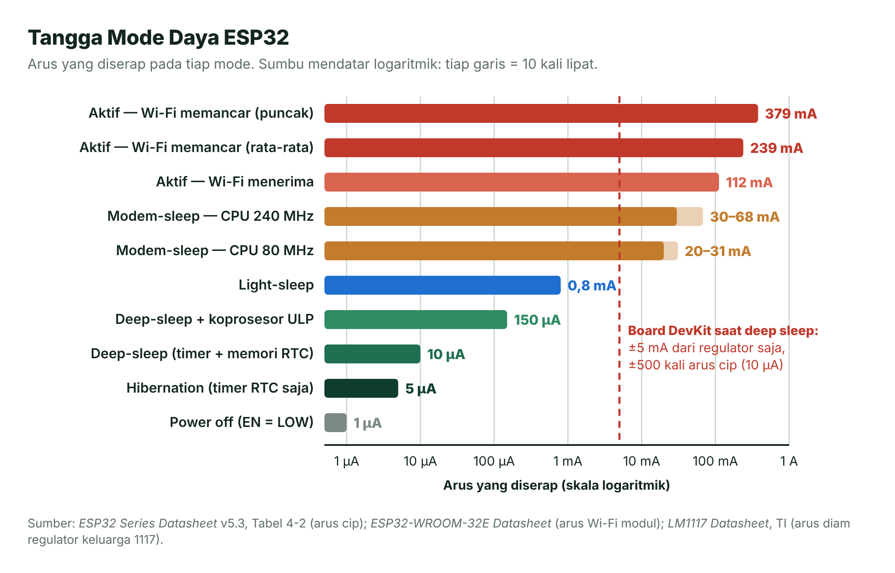
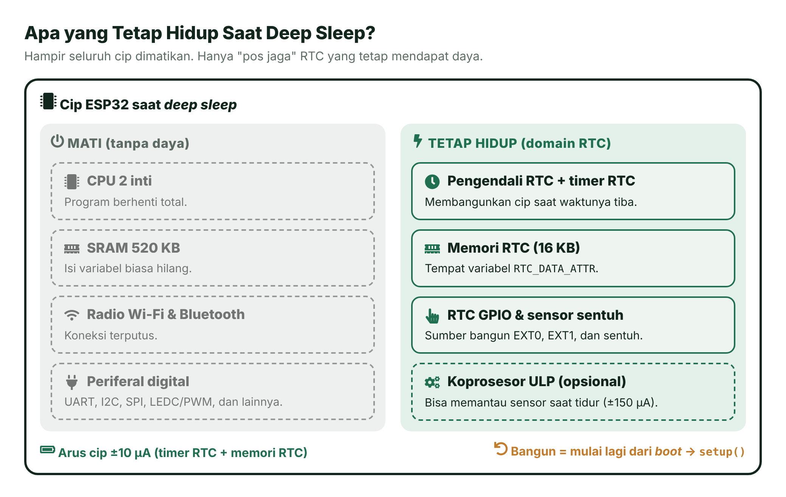
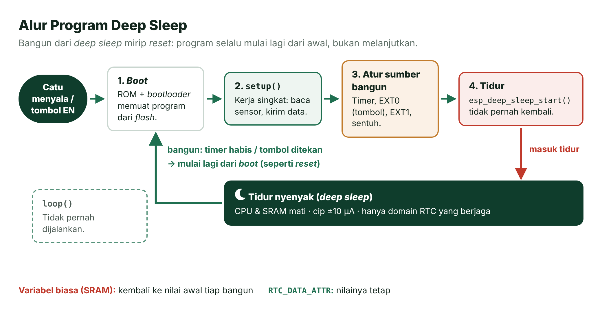
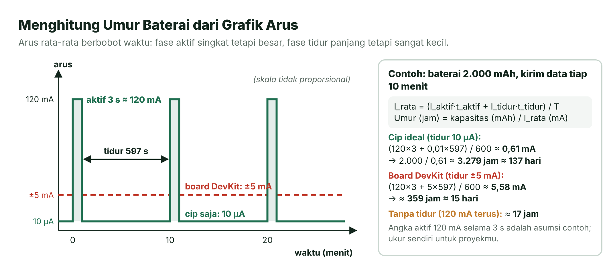
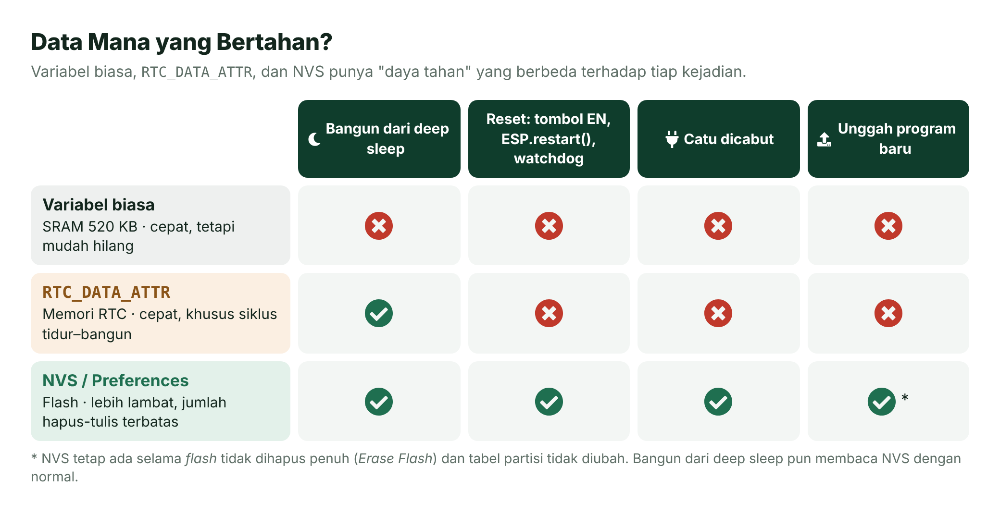
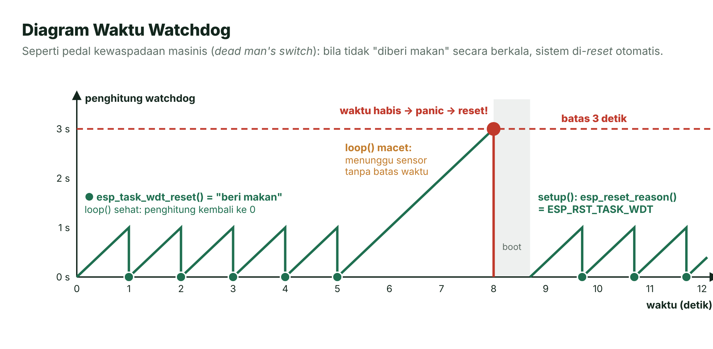
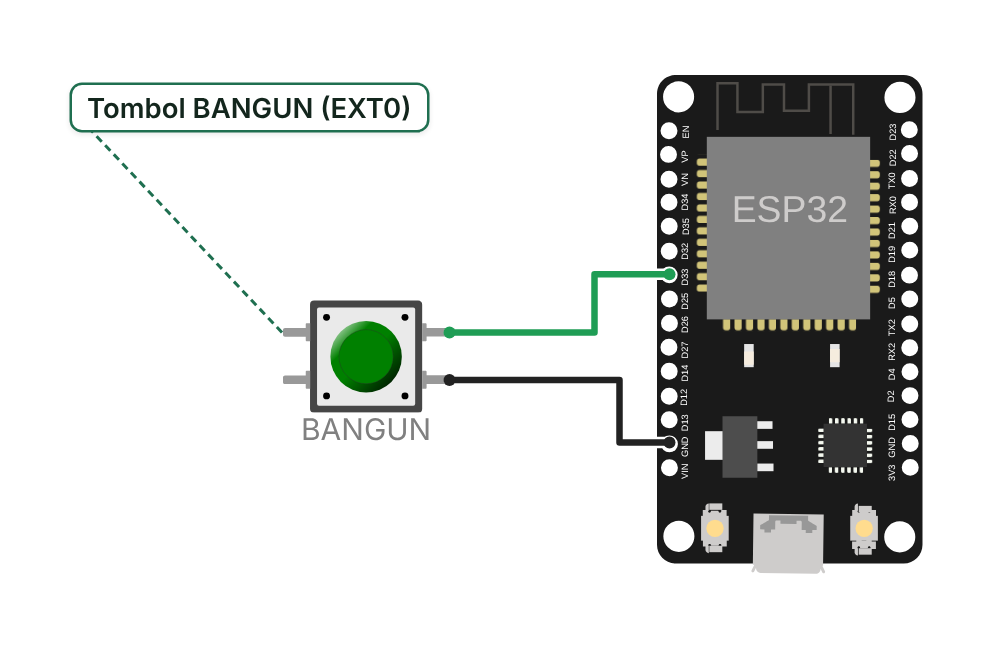
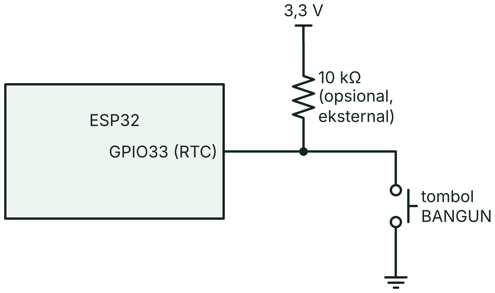
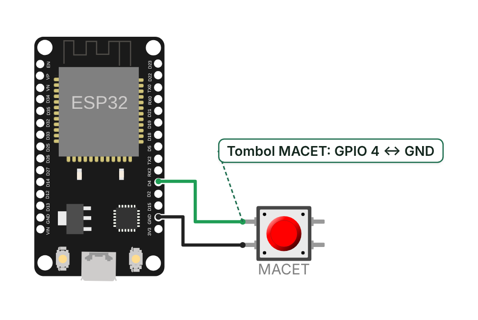

# Pertemuan 14 — Hemat Daya dan Keandalan Sistem

> Hari ini kamu belajar membuat ESP32 awet baterai dengan tidur nyenyak (*deep sleep*), menyimpan pengaturan agar tidak hilang saat listrik padam, dan memasang "anjing penjaga" (*watchdog*) yang otomatis menolong ketika program macet.

| | |
| --- | --- |
| ⏱️ **Durasi** | 2 × 50 menit teori + 3 × 50 menit praktikum |
| 📋 **Prasyarat** | Pertemuan 4 (tombol dan `INPUT_PULLUP`), Pertemuan 5 (`millis()`), Pertemuan 12 (*task* FreeRTOS), Pertemuan 13 (Wi-Fi) |
| 🧰 **Alat** | Laptop + internet; ESP32 DevKit V1 + kabel USB data, 2 tombol tekan, *breadboard*, kabel *jumper*; opsional: resistor 10 kΩ dan multimeter |
| 📥 **Slide** | [Unduh PDF](../slide/pdf/P14-Hemat-Daya-Keandalan.pdf) · [Unduh PPTX](../slide/pptx/P14-Hemat-Daya-Keandalan.pptx) |

## Daftar Isi

- [🎯 Tujuan Pembelajaran](#-tujuan-pembelajaran)
- [🧰 Yang Perlu Disiapkan](#-yang-perlu-disiapkan)
- [1. Mengapa Perlu Hemat Daya?](#1-mengapa-perlu-hemat-daya)
- [2. Mode Daya ESP32](#2-mode-daya-esp32)
- [3. Deep Sleep: Tidur Nyenyak yang Mirip Reset](#3-deep-sleep-tidur-nyenyak-yang-mirip-reset)
- [4. Sumber Bangun](#4-sumber-bangun)
- [5. Menghitung Umur Baterai](#5-menghitung-umur-baterai)
- [6. Menyimpan Data agar Tidak Hilang: NVS](#6-menyimpan-data-agar-tidak-hilang-nvs)
- [7. Keandalan: Watchdog dan Kebiasaan Baik](#7-keandalan-watchdog-dan-kebiasaan-baik)
- [🧪 Praktikum](#-praktikum)
- [🏋️ Latihan & Tantangan](#️-latihan--tantangan)
- [✅ Cek Pemahaman](#-cek-pemahaman)
- [📌 Rangkuman](#-rangkuman)
- [📚 Referensi](#-referensi)
- [🖼️ Sumber Gambar](#️-sumber-gambar)

---

## 🎯 Tujuan Pembelajaran

Setelah pertemuan ini, kamu bisa:

1. Membandingkan mode daya ESP32 (aktif, *modem-sleep*, *light sleep*, *deep sleep*, *hibernation*) beserta besar arusnya.
2. Membuat program *deep sleep* yang bangun oleh timer atau tombol (EXT0) dan menyimpan data antar-tidur di memori RTC.
3. Menghitung perkiraan umur baterai dari arus rata-rata berbobot waktu, termasuk keterbatasan board DevKit.
4. Menyimpan pengaturan di NVS dengan pustaka Preferences tanpa membuat *flash* cepat aus.
5. Menerapkan *watchdog*, `esp_reset_reason()`, validasi input, batas waktu, dan nilai bawaan yang aman agar sistem bisa pulih sendiri.

## 🧰 Yang Perlu Disiapkan

| Kebutuhan | Keterangan |
| --- | --- |
| Wajib | Laptop, internet, VS Code + PlatformIO ([Panduan Instalasi Alat](../panduan/02-instalasi-alat.md)) |
| Komponen | ESP32 DevKit V1 + kabel USB **data**, 2 tombol tekan, *breadboard*, kabel *jumper* ([Daftar Komponen](../panduan/04-daftar-komponen.md)) |
| Opsional | Resistor 10 kΩ (*pull-up* eksternal) dan multimeter dengan rentang mA |
| Cadangan tanpa board | [Wokwi](../panduan/03-simulasi-wokwi.md): Praktikum 3 dan 4 bisa dicoba; Praktikum 1 dan 2 (*deep sleep*) terbatas, baca catatan di bagian Praktikum |

---

## 1. Mengapa Perlu Hemat Daya?

Coba perhatikan **ponselmu**. Saat layar padam, ponsel tidak benar-benar mati. Ia "tertidur ringan", tetapi tetap bisa menerima pesan. Berkat itu, baterainya tahan seharian. Kalau layar dan semua radionya menyala terus, baterai bisa habis dalam beberapa jam.

Sistem tertanam menghadapi masalah yang sama, bahkan lebih berat. Bayangkan **sensor ketinggian air di sungai** atau **stasiun cuaca di tengah sawah**. Di sana tidak ada stopkontak. Alat itu hanya mengandalkan baterai atau panel surya kecil, padahal diharapkan bekerja berbulan-bulan tanpa disentuh.

Kabar baiknya, kebanyakan alat seperti itu **tidak perlu bekerja terus-menerus**. Mengukur suhu lalu mengirimkannya cukup beberapa detik. Setelah itu alat boleh "tidur" sampai jadwal berikutnya, misalnya 10 menit lagi. Prinsipnya: **bekerja sebentar, tidur lama**.

Kapasitas baterai ditulis dalam **mAh** (miliampere-jam). Secara ideal, baterai 2.000 mAh bisa memberi arus 2.000 mA selama 1 jam, atau 1 mA selama 2.000 jam. Jadi, semakin kecil arus rata-rata alatmu, semakin lama baterainya bertahan.

> [!TIP]
> **Dua kunci hemat daya:** perkecil arus saat tidur, dan persingkat waktu bangun. Sepanjang pertemuan ini kamu akan melihat bahwa keduanya sama pentingnya.

## 2. Mode Daya ESP32

ESP32 punya beberapa "tingkat tidur". Makin dalam tidurnya, makin sedikit bagian cip yang menyala dan makin kecil arusnya. Imbalannya, makin lama waktu untuk bangun dan makin banyak yang "terlupa".

| Mode | Apa yang masih menyala | Arus (lembar data) | Setelah bangun |
| --- | --- | --- | --- |
| **Aktif** | CPU dan radio Wi-Fi/Bluetooth (memancar, menerima, mendengar) | Modul WROOM-32E: memancar ±239 mA (puncak ±379 mA), menerima ±112 mA | — |
| ***Modem-sleep*** | CPU berjalan; radio Wi-Fi/Bluetooth mati | 20–31 mA (CPU 80 MHz) hingga 30–68 mA (CPU 240 MHz) | — |
| ***Light sleep*** | CPU dijeda; memori RTC, periferal RTC, dan ULP tetap berjalan | 0,8 mA | Melanjutkan program dari baris berikutnya; isi RAM tetap |
| ***Deep sleep*** | Hanya memori RTC dan periferal RTC (+ ULP bila dipakai) | 10 µA (timer RTC + memori RTC); 150 µA bila ULP aktif | Mulai lagi dari awal (`setup()`) |
| ***Hibernation*** | Hanya satu timer RTC dan beberapa RTC GPIO | 5 µA | Mulai lagi dari awal; memori RTC ikut padam |
| **Mati** (*power off*) | Pin CHIP_PU (tombol EN) ditahan LOW | 1 µA | Seperti baru dinyalakan |

*Sumber: ESP32 Series Datasheet v5.3, Tabel 4-2 [1]; arus Wi-Fi dari ESP32-WROOM-32E Datasheet [2]; perilaku setelah bangun dari dokumentasi Sleep Modes [3].*



*Gambar 14.1 — Tangga mode daya ESP32 pada skala logaritmik. Sumber: dibuat untuk materi ini; angka dari [1], [2], dan [10].*

Perhatikan sumbu mendatarnya: setiap garis berarti **10 kali lipat**. Dari "Wi-Fi menerima" (±112 mA) ke *deep sleep* (10 µA), arusnya turun lebih dari **10.000 kali**. Itulah sebabnya *deep sleep* menjadi senjata utama perangkat bertenaga baterai.

**_Light sleep_ atau _deep sleep_?** *Light sleep* cocok untuk jeda pendek (milidetik sampai beberapa detik) karena program langsung melanjutkan dari baris setelah perintah tidur. *Deep sleep* cocok untuk jeda panjang (detik sampai jam) karena arusnya jauh lebih kecil, walaupun setiap bangun harus melalui proses *boot* lagi.

> [!IMPORTANT]
> **Angka 10 µA adalah arus cip, bukan arus board.** Board DevKit V1 punya regulator, LED daya, dan cip USB-UART yang ikut menyerap arus. Dampaknya kita bahas di [bagian 5](#5-menghitung-umur-baterai).

## 3. Deep Sleep: Tidur Nyenyak yang Mirip Reset

Bayangkan sebuah rumah pada malam hari. Semua penghuni tidur dan lampu dipadamkan. Hanya **satpam di pos jaga** yang tetap terjaga, ditemani jam weker, bel pintu, dan **buku saku** kecil. Saat weker berbunyi atau bel ditekan, satpam membangunkan penghuni. Penghuni bangun dalam keadaan "lupa mimpi", kecuali hal-hal yang sempat dicatat di buku saku satpam.

Begitulah *deep sleep* di ESP32. CPU, sebagian besar RAM, dan semua periferal digital dimatikan. Yang tetap mendapat daya hanyalah **domain RTC** (*Real-Time Clock*): pengendali RTC beserta timernya, koprosesor ULP, serta memori RTC FAST dan SLOW [3]. Domain RTC inilah "satpam" kita, dan memori RTC adalah "buku sakunya".



*Gambar 14.2 — Bagian cip yang mati dan yang tetap hidup saat deep sleep. Sumber: dibuat untuk materi ini berdasarkan [1] dan [3] (ikon Font Awesome Free, CC BY 4.0).*

### Bangun = Mulai dari Awal

Hal terpenting tentang *deep sleep*: **ESP32 tidak melanjutkan program, tetapi memulai ulang**. Setelah bangun, cip menjalani proses *boot* seperti habis di-*reset*, lalu masuk lagi ke `setup()`. Di Serial Monitor, log ROM menampilkan `rst:0x5 (DEEPSLEEP_RESET)`, dan `esp_reset_reason()` mengembalikan `ESP_RST_DEEPSLEEP` [6].

Akibatnya, pola program *deep sleep* berbeda dari biasanya. Semua pekerjaan dilakukan di `setup()`, lalu ESP32 tidur di akhir `setup()`. Fungsi `loop()` tidak pernah tersentuh.



*Gambar 14.3 — Alur program deep sleep: bangun selalu kembali ke boot. Sumber: dibuat untuk materi ini (ikon Font Awesome Free, CC BY 4.0).*

```cpp
#include <Arduino.h>
#include "esp_sleep.h"

RTC_DATA_ATTR int jumlahBoot = 0;    // disimpan di memori RTC

void setup() {
  Serial.begin(115200);
  jumlahBoot++;                      // bertambah tiap kali bangun
  Serial.printf("Boot ke-%d\n", jumlahBoot);
  // ... kerja singkat: baca sensor, kirim data ...
  esp_sleep_enable_timer_wakeup(10ULL * 1000000);  // 10 detik (mikrodetik)
  Serial.flush();                    // tuntaskan pengiriman teks
  esp_deep_sleep_start();            // tidur; tidak pernah kembali
}

void loop() { }                      // tidak pernah dijalankan
```

### Mengingat Data Antar-Tidur: RTC_DATA_ATTR

Variabel biasa tinggal di SRAM, padahal SRAM dimatikan saat *deep sleep*. Untuk menyimpan nilai antar-tidur, tambahkan atribut **`RTC_DATA_ATTR`**. Variabel bertanda ini ditempatkan di memori RTC (seluruh RTC SRAM hanya 16 KB), sehingga nilainya bertahan selama siklus tidur–bangun [7].

Ada satu jebakan. Setiap kali ESP32 di-*reset* **bukan** karena bangun dari *deep sleep* (misalnya tombol EN, `ESP.restart()`, atau *watchdog*), *bootloader* memuat ulang isi memori RTC dari program. Akibatnya, variabel `RTC_DATA_ATTR` kembali ke nilai awalnya [8]. Untuk data yang harus bertahan dari *reset* dan catu dicabut, kita butuh NVS ([bagian 6](#6-menyimpan-data-agar-tidak-hilang-nvs)).

> [!TIP]
> **Selalu panggil `Serial.flush()` sebelum tidur.** `Serial.print()` hanya menitipkan teks ke antrean pengiriman. Tanpa `flush()`, ESP32 bisa tertidur sebelum teks terakhir selesai terkirim.

## 4. Sumber Bangun

Satpam kita bisa dibangunkan dengan beberapa cara: jam weker, bel pintu, sentuhan, atau asisten pintar yang terus berjaga. Di ESP32, cara-cara itu disebut **sumber bangun** (*wakeup source*). Sumber bangun harus diatur **sebelum** memanggil `esp_deep_sleep_start()`, dan boleh lebih dari satu sekaligus [3].

| Sumber | Cara kerja | Fungsi | Catatan |
| --- | --- | --- | --- |
| **Timer** | Timer RTC menghitung mundur | `esp_sleep_enable_timer_wakeup(us)` | Satuan **mikrodetik** |
| **EXT0** | Satu RTC GPIO mencapai level tertentu (HIGH/LOW) | `esp_sleep_enable_ext0_wakeup(pin, level)` | Memakai modul RTC IO, jadi *pull-up/pull-down* internal bisa dipakai |
| **EXT1** | Beberapa RTC GPIO: bangun bila **salah satu HIGH** (`ESP_EXT1_WAKEUP_ANY_HIGH`) atau **semua LOW** (`ESP_EXT1_WAKEUP_ALL_LOW`) | `esp_sleep_enable_ext1_wakeup_io(mask, mode)` | Dikerjakan pengendali RTC; *pull-up* internal hanya bekerja bila domain periferal RTC dipaksa tetap menyala |
| **Sentuh** | Pin sentuh kapasitif disentuh | `touchSleepWakeUpEnable(pin, ambang)` | ESP32 punya 10 kanal sentuh |
| **ULP** | Program kecil di koprosesor ULP memutuskan kapan cip dibangunkan | `esp_sleep_enable_ulp_wakeup()` | Materi lanjutan; arus ±150 µA |

EXT0 dan EXT1 hanya bisa memakai **RTC GPIO**, yaitu GPIO 0, 2, 4, 12–15, 25–27, dan 32–39. Pin lain (misalnya GPIO 21 atau 23) tidak terhubung ke domain RTC, sehingga "tidak terdengar" oleh satpam. Di kursus ini kita memakai **GPIO 33** untuk tombol bangun.

Setelah bangun, ESP32 bisa bertanya "siapa yang membangunkan saya?" dengan `esp_sleep_get_wakeup_cause()`. Hasilnya antara lain `ESP_SLEEP_WAKEUP_TIMER`, `ESP_SLEEP_WAKEUP_EXT0`, `ESP_SLEEP_WAKEUP_EXT1`, `ESP_SLEEP_WAKEUP_TOUCHPAD`, `ESP_SLEEP_WAKEUP_ULP`, atau `ESP_SLEEP_WAKEUP_UNDEFINED` bila ESP32 baru dinyalakan atau di-*reset*.

> [!IMPORTANT]
> **Pull-up harus tetap hidup selama tidur.** Saat *deep sleep*, blok GPIO digital ikut padam dan pin bangun diambil alih modul RTC IO. Dokumentasi ESP-IDF meminta *pull-up/pull-down* untuk EXT0 diatur dengan `rtc_gpio_pullup_en()` dan `rtc_gpio_pulldown_en()`/`rtc_gpio_pulldown_dis()` sebelum `esp_deep_sleep_start()`. Setelah bangun, pin itu masih berstatus RTC IO, jadi panggil `rtc_gpio_deinit()` sebelum memakainya lagi dengan `digitalRead()` [3]. Cara paling andal: pasang resistor *pull-up* eksternal 10 kΩ ke 3V3 (wajib untuk GPIO 34–39 yang tidak punya *pull-up* internal).

## 5. Menghitung Umur Baterai

Pakai analogi uang saku. Misalkan sebulan sekali kamu makan di restoran seharga Rp300.000, dan setiap hari jajan Rp5.000. Pengeluaran rata-rata harianmu bukan Rp300.000, bukan pula Rp5.000, melainkan total pengeluaran dibagi jumlah hari. Arus rata-rata ESP32 dihitung dengan cara yang sama: **rata-rata berbobot waktu**.

```text
I_rata = (I_aktif × t_aktif + I_tidur × t_tidur) / (t_aktif + t_tidur)
Umur baterai (jam) ≈ Kapasitas (mAh) / I_rata (mA)
```



*Gambar 14.4 — Grafik arus terhadap waktu dan perhitungan umur baterai. Sumber: dibuat untuk materi ini.*

**Contoh.** Sebuah stasiun cuaca memakai baterai 2.000 mAh. Setiap 10 menit (600 detik), ESP32 bangun selama 3 detik untuk membaca sensor dan mengirim data lewat Wi-Fi. Kita **anggap** arus rata-rata fase aktif 120 mA (campuran menerima ±112 mA dan memancar ±239 mA [2]). Angka ini asumsi contoh; untuk proyekmu, ukur sendiri.

1. Muatan fase aktif: 120 mA × 3 s = 360 mA·s.
2. Muatan fase tidur (cip ideal): 0,01 mA × 597 s = 5,97 mA·s.
3. Arus rata-rata: (360 + 5,97) / 600 ≈ **0,61 mA**.
4. Umur baterai: 2.000 / 0,61 ≈ **3.279 jam ≈ 137 hari** (sekitar 4,5 bulan).

| Skenario | Arus rata-rata | Perkiraan umur 2.000 mAh |
| --- | --- | --- |
| Cip ideal, kirim tiap 10 menit (tidur 10 µA) | ≈ 0,61 mA | ≈ 3.279 jam ≈ 137 hari |
| Cip ideal, kirim tiap 30 menit | ≈ 0,21 mA | ≈ 9.525 jam ≈ 397 hari |
| Board DevKit, kirim tiap 10 menit (tidur ±5 mA) | ≈ 5,58 mA | ≈ 359 jam ≈ 15 hari |
| Tanpa tidur sama sekali (120 mA terus) | 120 mA | ≈ 17 jam |

Ada dua pelajaran dari tabel ini. Pertama, pada cip ideal, fase tidur hanya menyumbang ±1,6% muatan per siklus; yang dominan justru fase aktif. Jadi, **mempersingkat waktu bangun dan mengurangi frekuensi kirim** memberi hasil terbesar. Kedua, pada board DevKit, arus tidurlah yang mendominasi (±89% muatan), sehingga umur baterai anjlok dari hitungan bulan menjadi hitungan minggu.

> [!WARNING]
> **Catatan jujur tentang board DevKit.** Angka 10 µA hanya milik cip ESP32. Board DevKit V1 juga membawa regulator 3,3 V keluarga 1117 (umumnya AMS1117), LED daya yang menyala terus, dan cip USB-UART. Lembar data regulator sejenis, LM1117 dari Texas Instruments, menyebut **arus diam** (*quiescent current*) tipikal **5 mA** dan maksimum 10 mA [10]. Artinya, saat ESP32 "tidur nyenyak", board-mu masih bisa menyerap beberapa miliampere, ratusan kali lebih besar daripada cipnya. Regulator ini juga butuh selisih tegangan masuk-keluar sekitar 1,1 V (*dropout* pada 100 mA), sehingga kurang cocok untuk satu sel Li-ion 3,7 V. Untuk produk baterai sungguhan, pakai modul ESP32 dengan regulator berarus diam rendah atau board yang memang dirancang hemat daya.

### Ukur Sendiri dengan Multimeter

Angka di atas hanyalah perkiraan. Cara terbaik adalah mengukur langsung:

1. Atur multimeter ke mode arus DC dan mulai dari rentang **mA**, karena saat bangun arusnya bisa ratusan mA.
2. Pasang multimeter **seri** di jalur catu, misalnya antara kutub positif catu 5 V dan pin VIN board. Jangan mencatu lewat USB laptop saat mengukur.
3. Catat arus saat bangun dan saat tidur. Bila ESP32 menjadi sering *reset* ketika rentang multimeter diperkecil, kembalilah ke rentang mA.

### Tips Menurunkan Konsumsi

- **Matikan Wi-Fi saat tidak perlu:** `WiFi.disconnect(true); WiFi.mode(WIFI_OFF);` sebelum mengerjakan hal lain atau sebelum tidur.
- **Turunkan frekuensi CPU:** `setCpuFrequencyMhz(80);`. Pilihan dari PLL pada ESP32 adalah 240, 160, dan 80 MHz (dengan kristal 40 MHz tersedia pula 40, 20, dan 10 MHz). Lembar data mencatat *modem-sleep* 20–31 mA pada 80 MHz, dibanding 30–68 mA pada 240 MHz [1].
- **Kirim data berkala dan berkelompok:** simpan beberapa pembacaan di larik `RTC_DATA_ATTR`, lalu kirim sekaligus tiap beberapa kali bangun. Satu sambungan Wi-Fi untuk lima data jauh lebih hemat daripada lima sambungan.
- **Persingkat fase aktif:** hindari `delay()` panjang dan beri batas waktu saat menyambung Wi-Fi (misalnya menyerah setelah 10 detik, lalu tidur lagi).
- **Padamkan beban luar:** LED indikator dan sensor yang tidak dipakai. Sensor bisa dicatu lewat transistor (Pertemuan 7) agar ikut padam saat tidur.

## 6. Menyimpan Data agar Tidak Hilang: NVS

Bandingkan papan tulis dengan buku catatan. SRAM itu **papan tulis**: cepat ditulis dan dihapus, tetapi bersih total saat kelas usai (catu dicabut). *Flash* itu **buku catatan**: isinya awet bertahun-tahun, tetapi kertasnya lama-lama tipis dan sobek kalau terlalu sering dihapus.

**NVS** (*Non-Volatile Storage*, penyimpanan tak-mudah-hilang) adalah pustaka ESP-IDF yang menyimpan pasangan ***key*–nilai** di sebuah partisi *flash* [4]. Pada tabel partisi bawaan Arduino-ESP32, partisi NVS berukuran 20 KB. Di Arduino, NVS dibungkus pustaka **Preferences** yang mudah dipakai [11].

Data dikelompokkan dalam ***namespace*** (ruang nama), mirip laci. Di setiap laci ada banyak ***key*** (kunci), dan setiap *key* menyimpan satu nilai. Nama *namespace* dan *key* maksimal **15 karakter** [4][11].

| Fungsi | Kegunaan |
| --- | --- |
| `begin("nama", false)` | Membuka *namespace* (`false` = baca-tulis, `true` = hanya baca) |
| `putUInt(key, nilai)` / `getUInt(key, bawaan)` | Menulis/membaca bilangan bulat tak bertanda; bila *key* belum ada, `getUInt()` mengembalikan nilai bawaan |
| `putFloat`/`getFloat`, `putString`/`getString`, `putBool`/`getBool` | Pasangan untuk tipe data lain |
| `isKey(key)` | Mengecek apakah *key* sudah ada |
| `remove(key)` / `clear()` | Menghapus satu *key* / semua *key* di *namespace* itu |
| `end()` | Menutup *namespace* |

```cpp
#include <Preferences.h>
Preferences pengaturan;

void setup() {
  Serial.begin(115200);
  pengaturan.begin("pengaturan", false);                   // maks. 15 karakter
  uint32_t interval = pengaturan.getUInt("interval", 500); // 500 = nilai bawaan
  Serial.printf("Interval: %lu ms\n", (unsigned long)interval);
  pengaturan.putUInt("interval", 250);  // tetap ada walau catu dicabut
  pengaturan.end();
}
```

### Jangan Menulis Flash Terus-Menerus

Setiap sektor *flash* hanya tahan dihapus dan ditulis ulang dalam jumlah terbatas [9]. NVS sudah membantu meratakan keausan: nilai baru ditulis di tempat kosong berikutnya, sedangkan nilai lama sekadar ditandai terhapus, sehingga tulisan tersebar ke banyak tempat [4]. Namun, batas itu tetap ada. Kalau kamu menulis NVS 10 kali per detik di `loop()`, dalam sehari terjadi 864.000 penulisan, dan lama-kelamaan *flash* aus.

Kebiasaan yang aman:

- Tulis **hanya bila nilainya berubah** (bandingkan dulu dengan nilai lama).
- Tulis **saat ada kejadian**: pengguna mengubah pengaturan, tombol ditekan, atau berkala dengan jarak lebar (misalnya tiap jam).
- Untuk data yang berubah tiap siklus tidur, simpan di `RTC_DATA_ATTR`, lalu salin ke NVS sesekali.



*Gambar 14.5 — Daya tahan variabel biasa, RTC_DATA_ATTR, dan NVS terhadap berbagai kejadian. Sumber: dibuat untuk materi ini berdasarkan [4], [7], dan [8] (ikon Font Awesome Free, CC BY 4.0).*

| | `RTC_DATA_ATTR` | NVS/Preferences |
| --- | --- | --- |
| Tempat | Memori RTC (RTC SRAM 16 KB) | Partisi *flash* (20 KB pada tabel partisi bawaan) |
| Kecepatan dan batas tulis | Secepat variabel biasa, tanpa batas | Lebih lambat; jumlah hapus-tulis terbatas |
| Cocok untuk | Penghitung bangun, data sementara antar-tidur | Pengaturan, kalibrasi, catatan kejadian penting |

> [!NOTE]
> **Ada juga `RTC_NOINIT_ATTR`.** Variabel bertanda ini bertahan setelah *restart* maupun *deep sleep* [7], tetapi tidak diberi nilai awal sehingga isinya acak saat ESP32 pertama kali mendapat catu. Pakai hanya bila kamu bisa memeriksa keabsahan isinya.

## 7. Keandalan: Watchdog dan Kebiasaan Baik

Di banyak kereta, masinis harus menekan tombol atau pedal kewaspadaan (*dead man's switch*) secara berkala. Bila masinis pingsan dan tombol itu tidak ditekan dalam waktu tertentu, kereta mengerem otomatis. Sistemnya tidak perlu tahu **mengapa** masinis diam; cukup tahu bahwa ada yang tidak beres.

***Watchdog*** (anjing penjaga) bekerja dengan cara yang sama. Ia adalah penghitung waktu yang terus berjalan. Program yang sehat harus "memberi makan" *watchdog* (mengatur ulang penghitungnya) secara berkala. Bila program macet sehingga batas waktu terlampaui, *watchdog* me-*reset* ESP32. Sistem pun pulih sendiri tanpa perlu ada orang yang menekan tombol.



*Gambar 14.6 — Diagram waktu watchdog: diberi makan berkala, lalu macet, lalu reset otomatis. Sumber: dibuat untuk materi ini.*

ESP-IDF menyediakan dua *watchdog* utama [5]:

| *Watchdog* | Yang diawasi | Pengaturan pada Arduino-ESP32 3.3 |
| --- | --- | --- |
| **Interrupt Watchdog** (IWDT) | Interupsi dan penjadwal FreeRTOS tidak boleh terblokir terlalu lama | Batas 300 ms |
| **Task Watchdog** (TWDT) | *Task* tertentu harus melapor secara berkala | Aktif sejak *boot*, batas 5 detik, hanya mengawasi *idle task* inti 0. *Task* `loop()` (`loopTask`) **tidak** diawasi kecuali didaftarkan. Waktu habis → *panic* → *reset* |

Berikut cara mendaftarkan `loop()` ke Task Watchdog dengan API ESP-IDF 5:

```cpp
#include <esp_task_wdt.h>

void setup() {
  esp_task_wdt_config_t konfigurasi;
  konfigurasi.timeout_ms = 3000;          // batas 3 detik
  konfigurasi.idle_core_mask = 1 << 0;    // tetap awasi idle task inti 0
  konfigurasi.trigger_panic = true;       // waktu habis -> reset
  esp_task_wdt_reconfigure(&konfigurasi); // TWDT sudah aktif sejak boot
  esp_task_wdt_add(NULL);                 // NULL = task ini (loopTask)
}

void loop() {
  esp_task_wdt_reset();                   // "beri makan" tiap putaran
  // ... pekerjaan yang selalu selesai < 3 detik ...
}
```

Ada juga cara singkat ala Arduino: panggil `enableLoopWDT()` di `setup()`. Inti Arduino lalu memberi makan *watchdog* otomatis setiap kali `loop()` akan dijalankan, dengan batas bawaan 5 detik. Bila ada pekerjaan panjang di dalam `loop()`, panggil `feedLoopWDT()` di tengahnya.

> [!WARNING]
> **Jangan memberi makan di tempat yang salah.** Bila `esp_task_wdt_reset()` dipanggil dari interupsi timer atau di dalam perulangan penantian, *watchdog* tetap "kenyang" walaupun program utamanya macet, sehingga ia tidak berguna. Beri makan hanya di titik yang menandakan program benar-benar maju. Jangan pula sekadar memperpanjang batasnya agar tidak *reset*; cari penyebab macetnya.

### Mengetahui Penyebab Reset

Setiap kali menyala, panggil `esp_reset_reason()` untuk mengetahui mengapa ESP32 baru saja dimulai [6]:

| Nilai | Arti |
| --- | --- |
| `ESP_RST_POWERON` | Catu baru tersambung. Pada ESP32, tombol EN (pin CHIP_PU) biasanya juga terbaca di sini karena `ESP_RST_EXT` tidak berlaku untuk ESP32 |
| `ESP_RST_SW` | Program memanggil `ESP.restart()` |
| `ESP_RST_PANIC` | Program *crash* (*exception* atau *panic*) |
| `ESP_RST_INT_WDT` / `ESP_RST_TASK_WDT` | Di-*reset* oleh Interrupt Watchdog / Task Watchdog |
| `ESP_RST_DEEPSLEEP` | Bangun dari *deep sleep* |
| `ESP_RST_BROWNOUT` | Tegangan catu sempat turun di bawah ambang |

**Sekilas tentang *brownout*.** Detektor *brownout* mengawasi tegangan catu. Bila tegangan turun di bawah ambang, ESP32 di-*reset* agar tidak menjalankan program dengan tegangan yang tidak stabil, dan Serial Monitor menampilkan `Brownout detector was triggered`. Penyebab umumnya kabel atau *port* USB yang lemah ketika Wi-Fi memancar (puncak arus modul ±379 mA [2]) atau baterai yang hampir habis. Solusinya: catu yang kuat (lembar data modul menyarankan catu eksternal ≥ 0,5 A), kabel yang pendek dan bagus, serta baterai yang terisi.

### Pertahanan Berlapis

*Watchdog* adalah jaring pengaman terakhir. Sistem yang andal mencegah macet sejak awal dengan kebiasaan berikut:

1. **Validasi input.** Periksa rentang setiap nilai dari Serial, jaringan, sensor, maupun NVS sebelum dipakai. Contoh: interval kedip hanya boleh 100–5.000 ms (Praktikum 3).
2. **Batas waktu (*timeout*) pada setiap penantian.** Jangan pernah menunggu tanpa batas, entah menunggu sensor, Wi-Fi, maupun tombol dilepas (Praktikum 2).
3. **Nilai bawaan yang aman (*fail-safe*).** Bila data tidak ada atau rusak, pakai nilai yang tidak membahayakan, misalnya pompa **mati** dan interval 500 ms.
4. **Catat penyebab *reset*.** Simpan jumlah kejadian penting (misalnya *reset* oleh *watchdog*) di NVS atau kirim ke server, supaya masalah yang jarang terjadi tetap ketahuan (Praktikum 4).

```cpp
unsigned long mulai = millis();
bool berhasil = true;
while (!sensorSiap()) {
  if (millis() - mulai > 2000) {   // menyerah setelah 2 detik
    berhasil = false;
    break;
  }
  delay(10);
}
if (!berhasil) {
  Serial.println("[PERINGATAN] Sensor tidak menjawab, pakai nilai aman.");
}
```

---

## 🧪 Praktikum

### Sebelum Mulai

Langkah membuka alat sama seperti pertemuan sebelumnya:

- **Jalur A — Wokwi:** buka <https://wokwi.com/projects/new/esp32>, salin `src/main.cpp` ke tab **sketch.ino** dan `diagram.json` ke tab **diagram.json**, lalu klik **▶** (lihat [panduan Wokwi](../panduan/03-simulasi-wokwi.md)).
- **Jalur B — Board asli:** buka *folder* praktikum di VS Code, klik **Build** (✓), **Upload** (→), lalu **Serial Monitor**.

> [!NOTE]
> **Wokwi dan deep sleep.** Menurut dokumentasi Wokwi, periferal RTC ESP32 baru disimulasikan sebagian (hanya resistor *pull-up/pull-down* RTC) dan koprosesor ULP tidak disimulasikan, sedangkan *watchdog* disimulasikan [12]. Jadi, Praktikum 3 dan 4 bisa dicoba di Wokwi, tetapi perilaku *deep sleep*, timer bangun, dan EXT0 pada Praktikum 1 dan 2 bisa berbeda dari board asli, misalnya ESP32 tidak bangun lagi. Pakai board asli untuk hasil yang tepercaya.

> [!TIP]
> **Unggah gagal karena ESP32 sedang tidur?** Tahan tombol **BOOT**, tekan lalu lepas **EN**, lepas **BOOT**, kemudian klik **Upload** lagi.

---

### Praktikum 1 — Deep Sleep dengan Timer

📁 *Folder*: [`kode/01-deep-sleep-timer`](kode/01-deep-sleep-timer)

**Tujuan:** membuat ESP32 bekerja 2 detik, tidur 10 detik, lalu bangun dan mengulang, sambil membuktikan bahwa bangun berarti mulai lagi dari `setup()`.

**Rangkaian:** tidak perlu komponen tambahan. LED biru bawaan (GPIO 2) menyala selama ESP32 bangun.

**Kode** (`src/main.cpp`, bagian penting):

```cpp
RTC_DATA_ATTR int jumlahBoot = 0;  // bertahan selama deep sleep
int variabelBiasa = 0;             // di SRAM: hilang tiap tidur

void setup() {
  Serial.begin(115200);
  delay(500);
  pinMode(PIN_LED, OUTPUT);
  digitalWrite(PIN_LED, HIGH);     // LED menyala = sedang bangun
  jumlahBoot++;
  variabelBiasa++;
  Serial.printf("Boot ke-%d\n", jumlahBoot);
  Serial.printf("Variabel biasa (SRAM): %d\n", variabelBiasa);
  tampilkanPenyebabBangun();       // memakai esp_sleep_get_wakeup_cause()

  delay(LAMA_KERJA_MS);            // pura-pura bekerja 2 detik
  esp_sleep_enable_timer_wakeup((uint64_t)LAMA_TIDUR_DETIK * 1000000ULL);
  Serial.flush();
  digitalWrite(PIN_LED, LOW);
  esp_deep_sleep_start();          // tidak pernah kembali
}
```

**Hasil yang diharapkan.** Setelah diunggah (boot pertama):

```text
===== ESP32 bangun =====
Boot ke-1
Variabel biasa (SRAM): 1
Penyebab bangun: bukan dari deep sleep (baru menyala/di-reset)
[INFO] Bekerja 2 detik...
[INFO] Tidur 10 detik. Sampai jumpa!
```

Sekitar 10 detik kemudian muncul beberapa baris log ROM (salah satunya berisi `rst:0x5 (DEEPSLEEP_RESET)`), lalu:

```text
===== ESP32 bangun =====
Boot ke-2
Variabel biasa (SRAM): 1
Penyebab bangun: timer
[INFO] Bekerja 2 detik...
[INFO] Tidur 10 detik. Sampai jumpa!
```

Nomor boot terus bertambah (3, 4, 5, …), sedangkan variabel biasa selalu 1. Itulah bukti bahwa SRAM "lupa" setiap kali tidur, sementara memori RTC "ingat".

**Kalau belum berhasil:**

| Gejala | Coba ini |
| --- | --- |
| Pesan terakhir terpotong | Pastikan ada `Serial.flush()` sebelum `esp_deep_sleep_start()`. |
| Selalu "Boot ke-1" | Pastikan variabel bertanda `RTC_DATA_ATTR`. Ingat, tombol EN mengembalikan memori RTC ke nilai awal. |
| Di Wokwi, ESP32 tidak bangun lagi | Keterbatasan simulator (lihat catatan di atas); coba di board asli. |
| Unggah gagal | Tahan **BOOT**, tekan **EN**, lalu unggah ulang. |

**Eksperimen kecil:**

- Ubah `LAMA_TIDUR_DETIK` menjadi 5, lalu 30. Apakah nomor boot tetap berurutan?
- Hapus kata `RTC_DATA_ATTR`, lalu unggah ulang. Apa yang terjadi pada nomor boot? Mengapa?
- Tekan tombol **EN** saat ESP32 sedang tidur. Penyebab bangun dan nomor boot berapa yang tercetak?

---

### Praktikum 2 — Bangun dengan Tombol (EXT0)

📁 *Folder*: [`kode/02-bangun-tombol`](kode/02-bangun-tombol)

**Tujuan:** membangunkan ESP32 dari *deep sleep* dengan tombol (EXT0), dengan timer 60 detik sebagai cadangan.

**Rangkaian:**



*Gambar 14.7 — Rangkaian tombol bangun pada GPIO 33. Sumber: dibuat untuk materi ini; gambar board dan tombol dari @wokwi/elements (MIT).*

| Komponen | Kaki | Sambung ke |
| --- | --- | --- |
| Tombol BANGUN | Kaki 1 | GPIO 33 (D33) |
| Tombol BANGUN | Kaki 2 (sisi seberang) | GND |
| Resistor 10 kΩ (opsional) | Kedua ujungnya | GPIO 33 dan 3V3 |



*Gambar 14.8 — Skematik tombol bangun. Pull-up bisa memakai resistor RTC internal (±45 kΩ, diaktifkan dengan `rtc_gpio_pullup_en()`) atau resistor 10 kΩ eksternal. Sumber: dibuat untuk materi ini.*

Saat tombol dilepas, *pull-up* menahan GPIO 33 pada HIGH. Saat ditekan, GPIO 33 terhubung ke GND sehingga menjadi LOW. Level LOW inilah yang membangunkan ESP32.

**Kode** (bagian penting):

```cpp
// Setelah bangun, kembalikan pin dari RTC IO ke GPIO biasa
rtc_gpio_deinit(PIN_BANGUN);
pinMode(PIN_BANGUN, INPUT_PULLUP);
// ... cetak penyebab bangun, tunggu tombol dilepas (maks. 3 detik) ...

esp_sleep_enable_timer_wakeup((uint64_t)TIDUR_MAKS_DETIK * 1000000ULL);
if (tombolLepas) {
  rtc_gpio_pullup_en(PIN_BANGUN);    // pull-up versi RTC: tetap aktif saat tidur
  rtc_gpio_pulldown_dis(PIN_BANGUN);
  esp_sleep_enable_ext0_wakeup(PIN_BANGUN, 0);  // 0 = bangun saat LOW
}
Serial.flush();
esp_deep_sleep_start();
```

Mengapa harus menunggu tombol dilepas? Bila ESP32 tidur saat tombol masih ditekan, GPIO 33 sudah LOW, sehingga ESP32 langsung bangun lagi. Penantian itu pun diberi **batas waktu** 3 detik. Bila tombol macet, ESP32 tetap tidur dengan timer saja.

**Hasil yang diharapkan.** Setelah diunggah:

```text
[INFO] Baru menyala/di-reset.
[DATA] Bangun oleh tombol: 0 kali, oleh timer: 0 kali
[INFO] Tidur... tekan tombol GPIO 33 untuk membangunkan.
```

Setelah tombol ditekan (LED berkedip tiga kali):

```text
[INFO] Bangun karena TOMBOL ditekan (EXT0).
[DATA] Bangun oleh tombol: 1 kali, oleh timer: 0 kali
[INFO] Tidur... tekan tombol GPIO 33 untuk membangunkan.
```

Bila tombol tidak ditekan selama 60 detik, ESP32 bangun sendiri dan menampilkan `[INFO] Bangun karena TIMER cadangan.`

**Kalau belum berhasil:**

| Gejala | Coba ini |
| --- | --- |
| ESP32 terus bangun tanpa tombol ditekan | Pin mengambang: periksa `rtc_gpio_pullup_en()` atau pasang 10 kΩ ke 3V3. Pastikan tombol tersambung ke GND, bukan ke 3V3. |
| Tombol tidak membangunkan | Pastikan memakai RTC GPIO (33, bukan 23) dan kaki tombol yang benar; level pada `esp_sleep_enable_ext0_wakeup()` harus `0`. |
| Muncul "Tombol tertahan > 3 detik" | Tombol macet atau kakinya salah sehingga selalu tersambung. Periksa rangkaian. |

**Eksperimen kecil:**

- Ubah `TIDUR_MAKS_DETIK` menjadi 15 dan jangan sentuh tombol. Amati penghitung timer.
- Ganti `PIN_BANGUN` menjadi `GPIO_NUM_23`, lalu cetak nilai kembalian `esp_sleep_enable_ext0_wakeup()`. Apa artinya?
- Ubah kedipan bangun dari tiga kali menjadi satu kali. Berapa milidetik waktu bangun yang dihemat setiap kali tombol ditekan?

---

### Praktikum 3 — Menyimpan Pengaturan di NVS

📁 *Folder*: [`kode/03-simpan-pengaturan-nvs`](kode/03-simpan-pengaturan-nvs)

**Tujuan:** menyimpan interval kedip LED dan penghitung nyala di NVS, lalu membuktikan nilainya tetap ada setelah *restart*, tombol EN, maupun catu dicabut.

**Rangkaian:** tidak perlu komponen tambahan (LED bawaan GPIO 2).

**Kode** (bagian penting):

```cpp
// setup(): buka namespace, muat + validasi, hitung nyala SEKALI per boot
pengaturan.begin(NAMA_RUANG, false);
muatPengaturan();             // nilai di luar 100-5000 ms -> pakai 500 ms
jumlahNyala = pengaturan.getUInt(KUNCI_NYALA, 0) + 1;
pengaturan.putUInt(KUNCI_NYALA, jumlahNyala);

// prosesPerintah(): perintah "interval <ms>"
long nilai = perintah.substring(9).toInt();   // 0 bila bukan angka
if (nilai < (long)INTERVAL_MIN_MS || nilai > (long)INTERVAL_MAKS_MS) {
  Serial.println("[PERINGATAN] Ditolak: interval harus 100 sampai 5000 ms.");
  return;
}
if ((uint32_t)nilai == intervalKedip) return;  // sama: jangan tulis flash
intervalKedip = (uint32_t)nilai;
pengaturan.putUInt(KUNCI_INTERVAL, intervalKedip);
```

LED tetap berkedip dengan pola `millis()` (tanpa `delay()`), sehingga perintah dari Serial Monitor selalu terlayani.

| Perintah | Hasil |
| --- | --- |
| `lihat` | Menampilkan jumlah nyala dan interval kedip |
| `interval 250` | Mengubah interval kedip (100–5.000 ms) dan menyimpannya ke NVS |
| `hapus` | Menghapus semua *key* di *namespace*, kembali ke nilai bawaan |
| `restart` | Memulai ulang ESP32 untuk menguji apakah data tetap ada |

**Hasil yang diharapkan.** Contoh berikut mengetik `lihat`, `interval 250`, `interval 99999`, `halo`, lalu `restart`. Teks yang kamu ketik juga ikut tampil karena `monitor_echo = yes`.

```text
=== Praktikum 3: Pengaturan Tersimpan di NVS ===
[DATA] Jumlah nyala   : 1 kali
[DATA] Interval kedip : 500 ms
Perintah: lihat | interval <100-5000> | hapus | restart
[DATA] Jumlah nyala   : 1 kali
[DATA] Interval kedip : 500 ms
[INFO] Interval 250 ms disimpan ke NVS.
[PERINGATAN] Ditolak: interval harus 100 sampai 5000 ms.
[PERINGATAN] Perintah tidak dikenal: halo
Perintah: lihat | interval <100-5000> | hapus | restart
[INFO] Memulai ulang ESP32...
```

Setelah ESP32 menyala lagi:

```text
=== Praktikum 3: Pengaturan Tersimpan di NVS ===
[DATA] Jumlah nyala   : 2 kali
[DATA] Interval kedip : 250 ms
Perintah: lihat | interval <100-5000> | hapus | restart
```

Angka "Jumlah nyala" di board-mu bisa lebih besar bila program ini pernah dijalankan sebelumnya.

**Kalau belum berhasil:**

| Gejala | Coba ini |
| --- | --- |
| Perintah tidak ditanggapi | Pastikan `monitor_eol = LF` ada di `platformio.ini` (sudah disiapkan); ketik perintah lalu tekan Enter. |
| Interval kembali 500 setelah *restart* | Pastikan muncul `[INFO] Interval ... disimpan ke NVS.` Di Wokwi, uji dengan perintah `restart`, jangan menghentikan simulasi. |
| Muncul "Interval tersimpan tidak wajar" | Data lama di NVS di luar rentang, jadi program memakai nilai bawaan (*fail-safe*). Ketik `hapus`. |

**Eksperimen kecil:**

- Setel `interval 250`, cabut kabel USB selama satu menit, lalu colok lagi. Berapa intervalnya sekarang?
- Ketik `interval 250` dua kali. Pesan apa yang muncul pada ketikan kedua, dan mengapa itu baik untuk *flash*?
- Ubah `NAMA_RUANG` menjadi nama sepanjang 20 karakter. Apa nilai kembalian `pengaturan.begin()`?

---

### Praktikum 4 — Watchdog Penyelamat Program Macet

📁 *Folder*: [`kode/04-watchdog`](kode/04-watchdog)

**Tujuan:** mengawasi `loop()` dengan Task Watchdog berbatas 3 detik, membuat program sengaja macet, lalu melihat ESP32 pulih sendiri dan mencatat penyebab *reset*-nya.

**Rangkaian:**



*Gambar 14.9 — Rangkaian tombol pemicu macet pada GPIO 4. Sumber: dibuat untuk materi ini; gambar board dan tombol dari @wokwi/elements (MIT).*

| Komponen | Kaki | Sambung ke |
| --- | --- | --- |
| Tombol MACET | Kaki 1 | GPIO 4 (D4), memakai `INPUT_PULLUP` |
| Tombol MACET | Kaki 2 (sisi seberang) | GND |

**Kode** (bagian penting):

```cpp
void aktifkanWatchdog() {
  esp_task_wdt_config_t konfigurasi;
  konfigurasi.timeout_ms = BATAS_WDT_MS;   // 3000 ms
  konfigurasi.idle_core_mask = 1 << 0;
  konfigurasi.trigger_panic = true;
  esp_task_wdt_reconfigure(&konfigurasi);
  esp_task_wdt_add(NULL);                  // awasi loopTask
}

void loop() {
  esp_task_wdt_reset();                    // tanda loop() masih sehat
  // ... lapor tiap detik; cek tombol GPIO 4 dan perintah "macet" ...
}

void simulasikanMacet() {
  Serial.println("[PERINGATAN] Menunggu sensor yang tidak pernah menjawab...");
  while (!sensorSiap()) {                  // BUG disengaja: tanpa batas waktu
    delay(10);                             // watchdog tidak diberi makan lagi
  }
}
```

Saat menyala, program membaca `esp_reset_reason()` dan, bila penyebabnya *watchdog*, menambah penghitung `resetWdt` di NVS. Penulisan ini jarang terjadi, jadi aman untuk *flash*.

**Hasil yang diharapkan.** Ketik `macet` (atau tekan tombol) setelah beberapa detik:

```text
=== Praktikum 4: Watchdog ===
[INFO] Penyebab reset terakhir: POWERON (baru mendapat catu / tombol EN)
[DATA] Jumlah reset oleh watchdog (tersimpan di NVS): 0
[INFO] Watchdog aktif: batas 3000 ms, loop() ikut diawasi.
[INFO] Ketik 'macet' atau tekan tombol GPIO 4 untuk membuat program macet.
[INFO] Bekerja normal, detik ke-1
[INFO] Bekerja normal, detik ke-2
[INFO] Bekerja normal, detik ke-3
[INFO] Bekerja normal, detik ke-4
[INFO] Bekerja normal, detik ke-5
[INFO] Bekerja normal, detik ke-6
[PERINGATAN] Menunggu sensor yang tidak pernah menjawab...
E (21871) task_wdt: Task watchdog got triggered. The following tasks/users did not reset the watchdog in time:
E (21871) task_wdt:  - loopTask (CPU 1)
E (21871) task_wdt: Tasks currently running:
E (21871) task_wdt: CPU 0: IDLE0
E (21871) task_wdt: CPU 1: IDLE1
E (21871) task_wdt: Aborting.
E (21871) task_wdt: Print CPU 1 backtrace
Backtrace: 0x400857db:0x3ffc4c60 0x400f35a2:0x3ffc4c80 0x400890f3:0x3ffc4ca0 0x40088105:0x3ffc4cc0
ELF file SHA256: 3002a6dd6
Rebooting...
```

Setelah ESP32 menyala lagi:

```text
=== Praktikum 4: Watchdog ===
[INFO] Penyebab reset terakhir: TASK_WDT (task watchdog: program macet)
[DATA] Jumlah reset oleh watchdog (tersimpan di NVS): 1
[INFO] Watchdog aktif: batas 3000 ms, loop() ikut diawasi.
[INFO] Ketik 'macet' atau tekan tombol GPIO 4 untuk membuat program macet.
[INFO] Bekerja normal, detik ke-1
```

Jumlah baris "Bekerja normal" bergantung pada kapan kamu mengetik `macet`. Angka dalam kurung `E (…)` (waktu sejak *boot* dalam milidetik), alamat `Backtrace`, serta kode `ELF file SHA256` juga bisa berbeda. Perhatikan baris `CPU 1: IDLE1`: saat macet, `loopTask` tidak sedang memakai CPU karena ia menunggu dengan `delay(10)`. Meski begitu, *watchdog* tetap menangkapnya karena `loopTask` berhenti melapor. *Watchdog* menangkap program yang "tersangkut", bukan hanya perulangan yang menghabiskan CPU.

**Kalau belum berhasil:**

| Gejala | Coba ini |
| --- | --- |
| Tidak terjadi *reset* setelah `macet` | Pastikan `esp_task_wdt_add(NULL)` terpanggil dan tidak ada `esp_task_wdt_reset()` di dalam penantian. |
| ESP32 *reset* berulang tanpa `macet` | Ada bagian `loop()` yang lebih lama dari 3 detik (misalnya `delay(5000)`). Perpendek pekerjaannya. |
| Penyebab *reset* tetap POWERON setelah menekan EN | Wajar: tombol EN pada ESP32 terbaca sebagai POWERON. |
| Perintah tidak dikenali | Pastikan `monitor_eol = LF` dan ketik `macet` tanpa spasi tambahan. |

**Eksperimen kecil:**

- Ubah `BATAS_WDT_MS` menjadi 8000, lalu ketik `macet`. Berapa lama sampai ESP32 di-*reset*?
- Perbaiki "bug" di `simulasikanMacet()` dengan batas waktu 2 detik seperti contoh di bagian 7. Apakah ESP32 masih di-*reset*?
- Ganti isi `aktifkanWatchdog()` dengan `enableLoopWDT();` dan hapus `esp_task_wdt_reset()` di `loop()`. Berapa detik sekarang sampai *reset*?

---

## 🏋️ Latihan & Tantangan

1. **Stasiun cuaca hemat daya.** Gabungkan Praktikum 1 dan 2: ESP32 bangun tiap 60 detik (timer) atau saat tombol ditekan. Simpan lima pembacaan terakhir potensiometer (GPIO 34) di larik `RTC_DATA_ATTR`, lalu cetak kelimanya setiap bangun ke-5.
2. **Hitung baterai proyekmu.** Untuk baterai 1.800 mAh dan siklus 5 menit, hitung umur baterai bila aktif 4 detik pada 100 mA. Bandingkan hasil untuk cip ideal (10 µA) dan board DevKit (±5 mA) dalam sebuah tabel.
3. **Riwayat reset lengkap.** Kembangkan Praktikum 4: catat jumlah setiap jenis *reset* (POWERON, SW, PANIC, TASK_WDT, BROWNOUT) di NVS dengan *key* berbeda (maksimal 15 karakter), lalu tambahkan perintah `riwayat` untuk menampilkannya.
4. **Pengaturan kedua yang aman.** Tambahkan pada Praktikum 3 pengaturan `terang` (0–255) untuk LED eksternal di GPIO 23 dengan `analogWrite()`. Terapkan validasi, nilai bawaan, dan penulisan hanya bila nilainya berubah.
5. **Tantangan IoT.** Hubungkan dengan Pertemuan 13: ESP32 bangun tiap 10 menit, menyambung Wi-Fi dengan batas waktu 10 detik, mengirim satu pesan MQTT, lalu tidur lagi. Bila Wi-Fi gagal, ESP32 tetap tidur dan mencoba lagi pada jadwal berikutnya.

## ✅ Cek Pemahaman

1. Setelah bangun dari *deep sleep*, program ESP32 dimulai dari …
   - A. Baris setelah `esp_deep_sleep_start()`
   - B. Awal `loop()`
   - C. Awal `setup()`, seperti setelah *reset*
   - D. Fungsi interupsi terakhir

2. Variabel `RTC_DATA_ATTR int n = 0;` bernilai 7 sebelum ESP32 tidur. Saat ESP32 masih tidur, kamu menekan tombol EN. Berapa nilai `n` ketika `setup()` dimulai?
   - A. 7
   - B. 8
   - C. 0
   - D. Acak

3. Sebuah alat aktif 2 detik pada 100 mA, lalu tidur 58 detik pada 0,05 mA, berulang terus. Arus rata-ratanya kira-kira …
   - A. 0,05 mA
   - B. 3,4 mA
   - C. 50 mA
   - D. 100 mA

4. Mengapa menulis NVS di setiap putaran `loop()` itu buruk?
   - A. NVS hanya bisa menyimpan satu nilai
   - B. *Flash* punya batas jumlah hapus-tulis sehingga lama-lama aus
   - C. NVS terhapus setiap kali *deep sleep*
   - D. Preferences hanya boleh dipanggil di `setup()`

5. Pada Arduino-ESP32 3.3, Task Watchdog secara bawaan …
   - A. Mengawasi `loop()` dengan batas 1 detik
   - B. Aktif sejak *boot* dengan batas 5 detik dan hanya mengawasi *idle task* inti 0
   - C. Tidak aktif sama sekali
   - D. Hanya aktif saat Wi-Fi menyala

6. Pin mana yang bisa dipakai sebagai sumber bangun EXT0?
   - A. GPIO 23
   - B. GPIO 33
   - C. GPIO 21
   - D. GPIO 1 (TX)

<details>
<summary><b>Lihat jawaban</b></summary>

1. **C.** Bangun dari *deep sleep* melewati proses *boot* lagi, lalu masuk ke `setup()`.
2. **C.** Tombol EN adalah *reset* penuh, jadi *bootloader* mengisi ulang memori RTC dengan nilai awal (0). Nilai hanya bertahan bila ESP32 bangun dari *deep sleep*.
3. **B.** (100 × 2 + 0,05 × 58) / 60 = 202,9 / 60 ≈ 3,4 mA.
4. **B.** Sektor *flash* hanya tahan dihapus-tulis dalam jumlah terbatas; NVS meratakan keausan, tetapi tidak menghapus batas itu.
5. **B.** `loopTask` baru diawasi bila didaftarkan dengan `esp_task_wdt_add()` atau `enableLoopWDT()`.
6. **B.** GPIO 33 termasuk RTC GPIO (0, 2, 4, 12–15, 25–27, 32–39).

</details>

## 📌 Rangkuman

- Perangkat baterai bertahan lama dengan prinsip **bekerja sebentar, tidur lama**.
- Mode daya ESP32 (lembar data): aktif dengan Wi-Fi ratusan mA, *modem-sleep* 20–68 mA, *light sleep* 0,8 mA, *deep sleep* 10 µA, *hibernation* 5 µA.
- Saat *deep sleep* hanya domain RTC yang hidup. **Bangun = mulai lagi dari `setup()`**; variabel `RTC_DATA_ATTR` bertahan, variabel biasa hilang.
- Sumber bangun: timer, EXT0, EXT1, sentuh, dan ULP; EXT0/EXT1 hanya untuk RTC GPIO, dan *pull-up* EXT0 diatur dengan `rtc_gpio_pullup_en()`.
- Umur baterai ≈ kapasitas / arus rata-rata berbobot waktu. Board DevKit tidur pada beberapa mA karena regulatornya, jadi **ukur sendiri**.
- **NVS/Preferences** menyimpan data saat catu dicabut (*namespace* dan *key* maks. 15 karakter); tulis hanya bila perlu agar *flash* awet.
- *Watchdog* me-*reset* program yang macet; lengkapi dengan `esp_reset_reason()`, validasi input, batas waktu, nilai bawaan aman, dan catatan penyebab *reset*.

## 📚 Referensi

1. Espressif Systems. (2025). *ESP32 Series Datasheet* (v5.3). <https://documentation.espressif.com/esp32_datasheet_en.pdf>
2. Espressif Systems. (2025). *ESP32-WROOM-32E & ESP32-WROOM-32UE Datasheet*. <https://documentation.espressif.com/esp32-wroom-32e_esp32-wroom-32ue_datasheet_en.pdf>
3. Espressif Systems. (2026). *ESP-IDF Programming Guide v5.5: Sleep Modes*. <https://docs.espressif.com/projects/esp-idf/en/v5.5/esp32/api-reference/system/sleep_modes.html>
4. Espressif Systems. (2026). *ESP-IDF Programming Guide v5.5: Non-Volatile Storage Library*. <https://docs.espressif.com/projects/esp-idf/en/v5.5/esp32/api-reference/storage/nvs_flash.html>
5. Espressif Systems. (2026). *ESP-IDF Programming Guide v5.5: Watchdogs*. <https://docs.espressif.com/projects/esp-idf/en/v5.5/esp32/api-reference/system/wdts.html>
6. Espressif Systems. (2026). *ESP-IDF Programming Guide v5.5: Miscellaneous System APIs*. <https://docs.espressif.com/projects/esp-idf/en/v5.5/esp32/api-reference/system/misc_system_api.html>
7. Espressif Systems. (2026). *esp_attr.h* (ESP-IDF v5.5, kode sumber). GitHub. <https://github.com/espressif/esp-idf/blob/release/v5.5/components/esp_common/include/esp_attr.h>
8. Espressif Systems. (2026). *esp_image_format.c* (ESP-IDF v5.5, kode sumber *bootloader*). GitHub. <https://github.com/espressif/esp-idf/blob/release/v5.5/components/bootloader_support/src/esp_image_format.c>
9. Espressif Systems. (2026). *ESP-IDF Programming Guide v5.5: Wear Levelling API*. <https://docs.espressif.com/projects/esp-idf/en/v5.5/esp32/api-reference/storage/wear-levelling.html>
10. Texas Instruments. (2023). *LM1117 800-mA, Low-Dropout Linear Regulator* (SNOS412Q). <https://www.ti.com/lit/ds/symlink/lm1117.pdf>
11. Espressif Systems. (2026). *Arduino-ESP32 Documentation: Preferences*. <https://docs.espressif.com/projects/arduino-esp32/en/latest/api/preferences.html>
12. CodeMagic LTD. (2026). *Wokwi Docs — ESP32 Simulation*. <https://docs.wokwi.com/guides/esp32>
13. Espressif Systems. (2026). *Contoh program system/deep_sleep* (ESP-IDF v5.5). GitHub. <https://github.com/espressif/esp-idf/tree/release/v5.5/examples/system/deep_sleep>

## 🖼️ Sumber Gambar

| Gambar | Sumber dan lisensi |
| --- | --- |
| 14.1, 14.4, 14.6 | Dibuat untuk materi ini; angka dari [1], [2], dan [10]. |
| 14.2, 14.3, 14.5 | Dibuat untuk materi ini. Ikon: Font Awesome Free (Fonticons, CC BY 4.0). |
| 14.7, 14.9 | Dibuat untuk materi ini; gambar board dan tombol dari [@wokwi/elements](https://github.com/wokwi/wokwi-elements) (MIT, © 2020 Uri Shaked). |
| 14.8 | Skematik dibuat untuk materi ini dengan [schemdraw](https://schemdraw.readthedocs.io/) (MIT). |

---

[⬅️ Pertemuan 13: IoT: Wi-Fi dan MQTT](../pertemuan-13-wifi-mqtt/README.md) · [🏠 Beranda](../README.md) · [Pertemuan 15: Integrasi Sistem ➡️](../pertemuan-15-integrasi-sistem/README.md)
