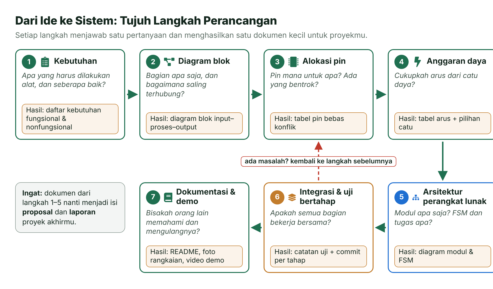
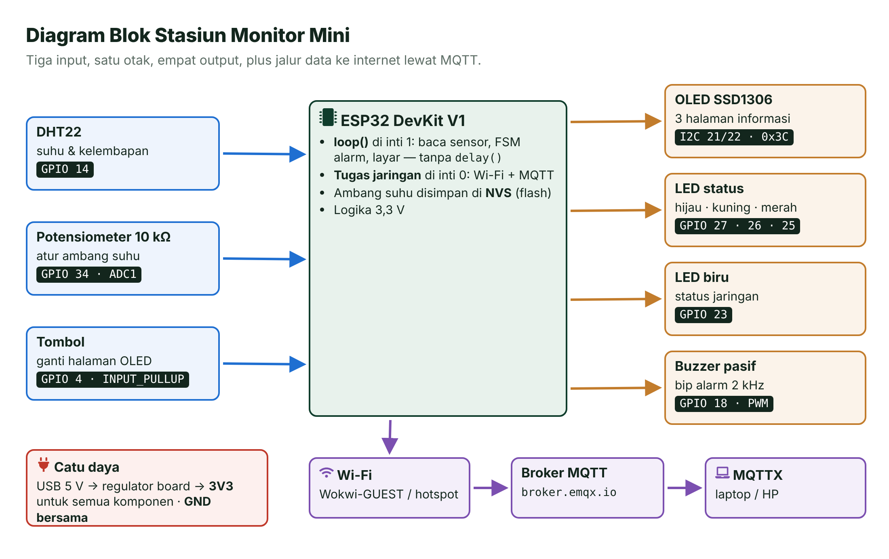
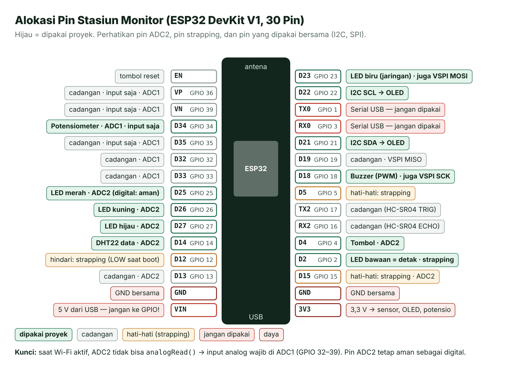
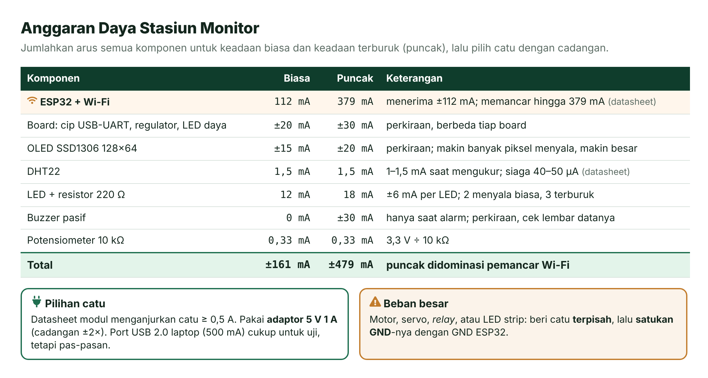
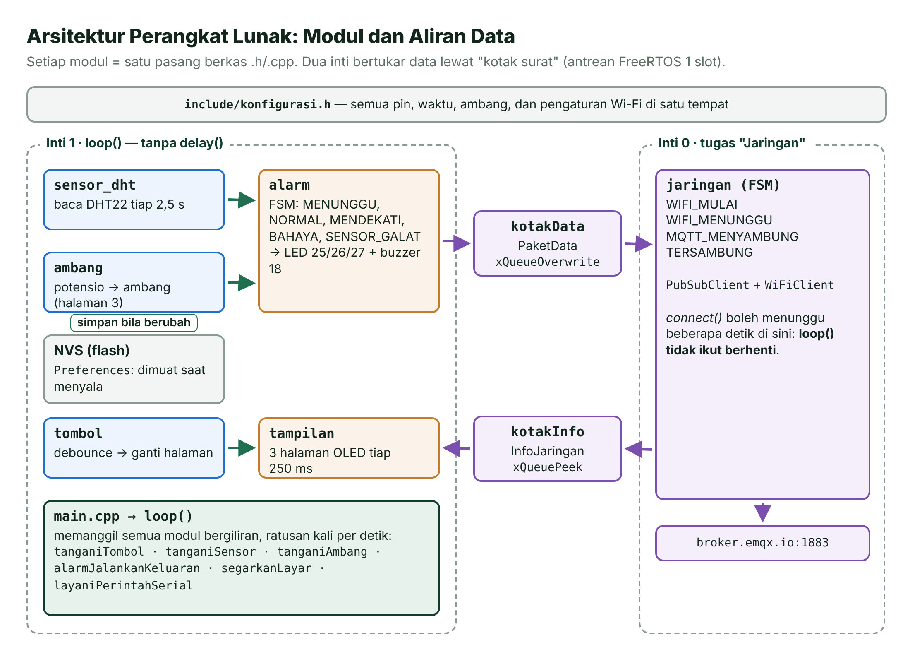
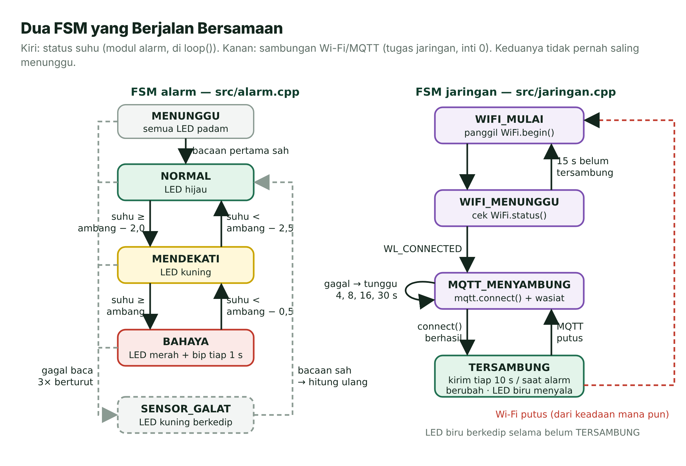
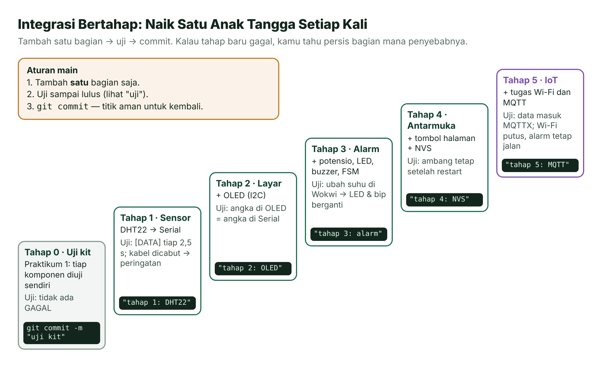
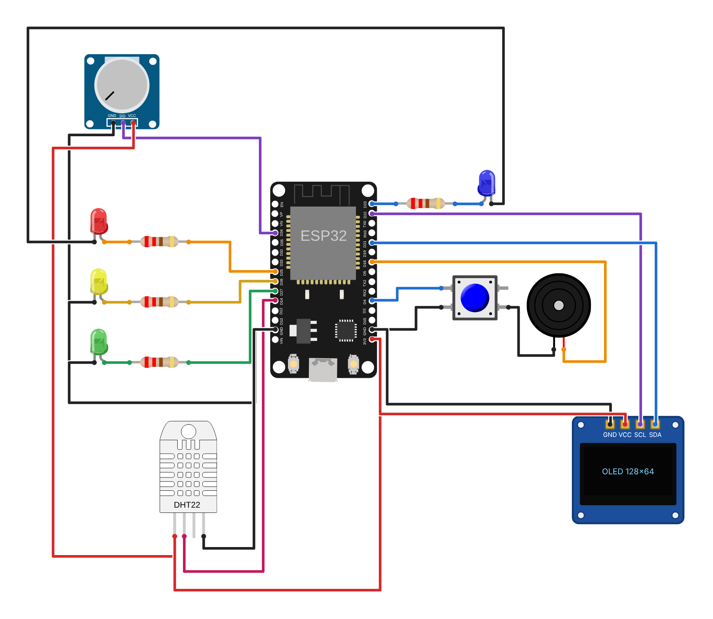
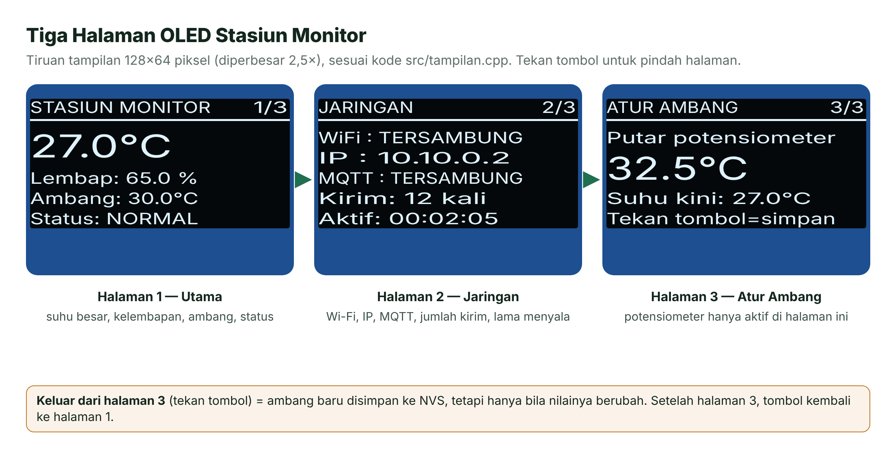
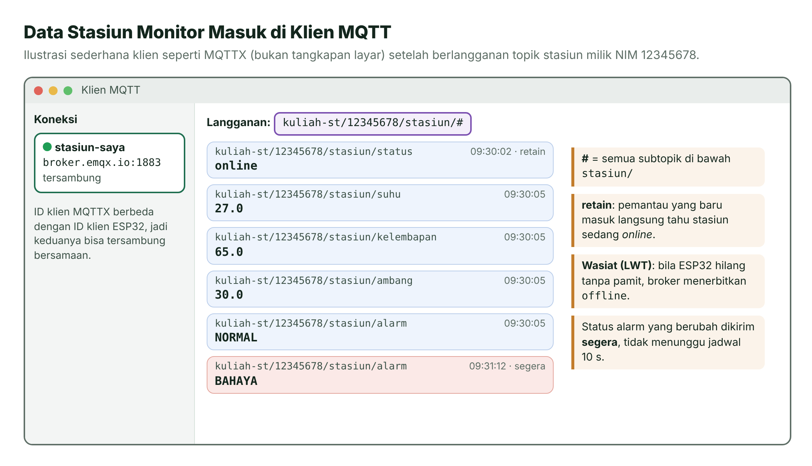

# Pertemuan 15 — Integrasi Sistem dan Persiapan Proyek Akhir

> Satu per satu komponen sudah kamu kuasai. Hari ini kamu belajar merangkainya menjadi satu sistem utuh yang tetap andal, lalu menyiapkan proyek akhirmu dengan cara kerja yang sama.

| | |
| --- | --- |
| ⏱️ **Durasi** | 2 × 50 menit teori + 3 × 50 menit praktikum |
| 📋 **Prasyarat** | Pertemuan 9–13 (I2C, sensor dan *library*, FSM, FreeRTOS, Wi-Fi dan MQTT); disarankan juga Pertemuan 14 |
| 🧰 **Alat** | Laptop + internet (Wokwi); opsional: ESP32 DevKit V1, DHT22, OLED SSD1306, potensiometer 10 kΩ, 4 LED + 4 resistor 220 Ω, *buzzer* pasif, tombol, *breadboard* |
| 📥 **Slide** | 👁️ [Lihat di peramban](https://view.officeapps.live.com/op/view.aspx?src=https%3A%2F%2Fraw.githubusercontent.com%2Fantonprafanto%2Fembeddedsystem%2Fmain%2Fslide%2Fpptx%2FP15-Integrasi-Sistem.pptx) · ⬇️ [Unduh PDF](https://raw.githubusercontent.com/antonprafanto/embeddedsystem/main/slide/pdf/P15-Integrasi-Sistem.pdf) · ⬇️ [Unduh PPTX](https://raw.githubusercontent.com/antonprafanto/embeddedsystem/main/slide/pptx/P15-Integrasi-Sistem.pptx) |
| 📄 **Modul PDF** | ⬇️ [Unduh modul ini dalam PDF](https://raw.githubusercontent.com/antonprafanto/embeddedsystem/main/modul-pdf/Modul-P15-Integrasi-Sistem.pdf) — untuk dibaca luring atau dicetak |

## Daftar Isi

- [🎯 Tujuan Pembelajaran](#-tujuan-pembelajaran)
- [🧰 Yang Perlu Disiapkan](#-yang-perlu-disiapkan)
- [1. Dari Ide ke Sistem](#1-dari-ide-ke-sistem)
- [2. Kebutuhan dan Diagram Blok](#2-kebutuhan-dan-diagram-blok)
- [3. Alokasi Pin Tanpa Konflik](#3-alokasi-pin-tanpa-konflik)
- [4. Anggaran Daya](#4-anggaran-daya)
- [5. Arsitektur Perangkat Lunak](#5-arsitektur-perangkat-lunak)
- [6. Integrasi Bertahap, Git, dan Dokumentasi](#6-integrasi-bertahap-git-dan-dokumentasi)
- [7. Masalah Integrasi yang Sering Muncul](#7-masalah-integrasi-yang-sering-muncul)
- [8. Persiapan Proyek Akhir](#8-persiapan-proyek-akhir)
- [🧪 Praktikum](#-praktikum)
- [🏋️ Latihan & Tantangan](#️-latihan--tantangan)
- [✅ Cek Pemahaman](#-cek-pemahaman)
- [📌 Rangkuman](#-rangkuman)
- [📚 Referensi](#-referensi)
- [🖼️ Sumber Gambar](#️-sumber-gambar)

---

## 🎯 Tujuan Pembelajaran

Setelah pertemuan ini, kamu bisa:

1. Menurunkan kebutuhan fungsional dan nonfungsional sebuah alat menjadi diagram blok, tabel alokasi pin, dan anggaran daya.
2. Memilih pin yang bebas konflik: ADC2 vs Wi-Fi, pin *strapping*, bus I2C bersama, dan pin SPI bawaan.
3. Menyusun *firmware* modular (`include/*.h` + `src/*.cpp`) dengan FSM dan tugas FreeRTOS yang tidak saling memblokir.
4. Mengintegrasikan komponen secara bertahap, menguji setiap tahap, dan mencatatnya dengan Git.
5. Mendiagnosis masalah integrasi yang umum dan menyiapkan konsultasi kemajuan proyek akhir.

## 🧰 Yang Perlu Disiapkan

| Kebutuhan | Keterangan |
| --- | --- |
| Perangkat lunak | VS Code + PlatformIO ([Panduan Instalasi Alat](../panduan/02-instalasi-alat.md)) atau [Wokwi](../panduan/03-simulasi-wokwi.md) di peramban |
| Pemantau MQTT | [MQTTX](https://mqttx.app) versi desktop atau [MQTTX Web](https://mqttx.app/web-client) (sudah dipakai di [Pertemuan 13](../pertemuan-13-wifi-mqtt/README.md)) |
| Komponen (board asli) | Lihat kolom **Alat** di atas, plus kabel *jumper*. Daftar lengkap ada di [Daftar Komponen](../panduan/04-daftar-komponen.md). |
| Jalur Wokwi | Kedua praktikum bisa dijalankan penuh di Wokwi, termasuk Wi-Fi (`Wokwi-GUEST`) dan MQTT. |
| Git (opsional) | Untuk mencoba *commit* per tahap di bagian 6. Unduh di <https://git-scm.com>. |

---

## 1. Dari Ide ke Sistem

Bayangkan kamu membangun rumah. Kamu tidak membeli bata dulu lalu berpikir bentuk rumahnya belakangan. Ada denah, ada hitungan daya listrik, lalu rumah dibangun ruang demi ruang sambil diperiksa. Kalau lampu dapur mati, kamu langsung tahu harus mencari di mana.

Sejauh ini, setiap pertemuan fokus pada **satu** hal: LED, tombol, ADC, OLED, FSM, MQTT. Proyek akhir menggabungkan lima sampai delapan komponen sekaligus. Pengalaman menunjukkan, masalah jarang muncul di dalam komponen yang sudah teruji. Masalah muncul di **sambungan antarbagian**: dua bagian berebut pin, satu bagian membuat bagian lain menunggu, atau catu daya tidak sanggup melayani semuanya.

**Integrasi sistem** adalah proses menggabungkan bagian-bagian yang sudah teruji menjadi satu sistem yang bekerja **bersama-sama** sesuai kebutuhan. Agar tidak menebak-nebak, kita memakai tujuh langkah berikut.



*Gambar 15.1 — Tujuh langkah dari ide ke sistem. Sumber: dibuat untuk materi ini (ikon Font Awesome Free, CC BY 4.0).*

Sepanjang modul ini kita memakai satu contoh nyata: **Stasiun Monitor Mini**. Alat ini membaca suhu dan kelembapan, membunyikan alarm bila suhu melewati ambang, menampilkan data di OLED, dan mengirimnya ke internet lewat MQTT. Kamu akan merakit dan menjalankannya di Praktikum 2.

> [!TIP]
> **Rancang dulu di kertas.** Langkah 1–5 cukup dikerjakan dengan kertas, tabel, dan kalkulator. Satu jam merancang hampir selalu lebih murah daripada berjam-jam mencari kabel yang salah pasang.

## 2. Kebutuhan dan Diagram Blok

Ada dua jenis kebutuhan. **Kebutuhan fungsional** menjawab "alat ini harus **melakukan** apa?". **Kebutuhan nonfungsional** menjawab "seberapa **baik**?": seberapa cepat, seberapa andal, seberapa hemat, seberapa mudah dirawat.

Kebutuhan yang baik bisa **diuji**. Kalimat "alarm harus cepat" sulit dibuktikan. Kalimat "alarm bereaksi paling lambat 3 detik setelah suhu melewati ambang" bisa diuji dengan stopwatch. Berikut kebutuhan Stasiun Monitor Mini beserta cara mengujinya.

| Kode | Kebutuhan | Jenis | Cara menguji |
| --- | --- | --- | --- |
| F1 | Mengukur suhu dan kelembapan setiap 2,5 detik | Fungsional | Baris `[DATA]` muncul tiap 2,5 detik |
| F2 | Menampilkan data di OLED dalam tiga halaman, berganti dengan tombol | Fungsional | Tekan tombol tiga kali |
| F3 | Alarm tiga tingkat: hijau (normal), kuning (mendekati), merah + bunyi (melewati ambang) | Fungsional | Ubah suhu DHT22 di Wokwi |
| F4 | Ambang diatur dengan potensiometer dan tetap tersimpan walau listrik padam | Fungsional | Ubah ambang, lalu *restart* |
| F5 | Mengirim data ke *broker* MQTT tiap 10 detik dan **segera** saat status alarm berubah | Fungsional | Pantau di MQTTX |
| N1 | Alarm bereaksi ≤ 3 detik setelah suhu melewati ambang | Nonfungsional (waktu) | Bacaan tiap 2,5 detik, keputusan langsung |
| N2 | Wi-Fi atau *broker* putus **tidak boleh** menghentikan sensor dan alarm | Nonfungsional (keandalan) | Ganti alamat *broker* dengan yang salah |
| N3 | Arus puncak total di bawah kemampuan catu | Nonfungsional (daya) | Anggaran daya di bagian 4 |
| N4 | Pin dan angka penting bisa diubah di satu berkas | Nonfungsional (rawatan) | Semua ada di `konfigurasi.h` |

Dari daftar itu, gambarlah **diagram blok**: kotak untuk setiap bagian dan panah untuk aliran sinyal. Pola input → proses → output dari Pertemuan 1 tetap berlaku, ditambah blok catu daya dan komunikasi.



*Gambar 15.2 — Diagram blok Stasiun Monitor Mini. Sumber: dibuat untuk materi ini (ikon Font Awesome Free, CC BY 4.0).*

> [!IMPORTANT]
> **Kebutuhan nonfungsional sering dilupakan, padahal paling sering membuat demo gagal.** Contohnya N2: tanpa kebutuhan itu, wajar bila programmer menaruh `mqtt.connect()` di `loop()`. Hasilnya, saat *broker* lambat, alarm ikut "membeku" beberapa detik.

## 3. Alokasi Pin Tanpa Konflik

Alokasi pin mirip denah tempat duduk pesta pernikahan. Ada kursi yang sudah dipesan untuk keluarga inti (pin *flash* dan pin Serial USB), ada kursi dekat pelaminan yang perannya khusus (pin *strapping*), dan satu kursi tidak bisa diduduki dua tamu. Bus I2C seperti satu meja panjang: banyak tamu boleh duduk bersama, asalkan papan namanya (alamat) berbeda.



*Gambar 15.3 — Alokasi pin Stasiun Monitor Mini. Sumber: dibuat untuk materi ini; data pin dari [1] dan [3].*

| Fungsi | Pin | Alasan pemilihan |
| --- | --- | --- |
| Potensiometer (ambang) | GPIO 34 | ADC1, tetap bisa dibaca saat Wi-Fi aktif; pin input saja memang cocok untuk analog |
| DHT22 | GPIO 14 | Pin digital biasa; sama dengan peta pin kursus |
| LED merah, kuning, hijau | GPIO 25, 26, 27 | Dipakai sebagai **digital**, jadi aman walau termasuk ADC2 |
| LED biru (status jaringan) | GPIO 23 | Pin output biasa |
| *Buzzer* pasif | GPIO 18 | PWM (LEDC) tersedia di hampir semua pin output |
| Tombol | GPIO 4 | Punya *pull-up* internal (`INPUT_PULLUP`) |
| OLED (I2C) | SDA 21, SCL 22 | Pin I2C bawaan Arduino-ESP32 |
| LED bawaan (detak) | GPIO 2 | Sudah terpasang di board; aman sebagai output LED |

Enam jebakan yang wajib kamu periksa setiap kali menyusun tabel pin:

1. **ADC2 vs Wi-Fi.** Saat Wi-Fi aktif, ADC2 dipakai oleh *driver* Wi-Fi, sehingga `analogRead()` di pin ADC2 (GPIO 0, 2, 4, 12–15, 25–27) tidak bisa dipakai [1][4]. Semua input analog proyek IoT harus di **ADC1 (GPIO 32–39)**. Pin ADC2 tetap aman untuk fungsi digital.
2. **Pin *strapping*** (GPIO 0, 2, 5, 12, 15) dibaca **sekali** saat ESP32 menyala untuk menentukan mode *boot* [1]. GPIO 12 bahkan menentukan tegangan memori *flash*, jadi harus LOW saat *boot*. Jangan pasang komponen yang memaksa level pin ini saat menyala, misalnya resistor *pull-up* di GPIO 12.
3. **Pin input saja** (GPIO 34, 35, 36, 39) tidak bisa menjadi output dan tidak punya *pull-up/pull-down* internal. Tombol di pin ini butuh resistor luar.
4. **Pin terlarang**: GPIO 6–11 terhubung ke *flash* internal, sedangkan GPIO 1 dan 3 dipakai Serial USB untuk *upload* dan Serial Monitor.
5. **Bus I2C bersama.** Banyak modul boleh berbagi SDA/SCL asalkan **alamatnya berbeda**: OLED 0x3C atau 0x3D, MPU6050 0x68 atau 0x69 (dipilih lewat kaki AD0) [6][7]. Bila dua modul beralamat sama dan tidak bisa diubah, pakai pengendali I2C kedua (`Wire1`) di pin lain.
6. **Pin bawaan SPI.** GPIO 18, 19, 23, dan 5 adalah pin VSPI bawaan (SCK, MISO, MOSI, SS). Proyek ini memakai GPIO 18 dan 23 untuk *buzzer* dan LED. Bila kamu menambah modul SPI (misalnya kartu SD), pindahkan dulu keduanya.

Ada satu jebakan I2C yang jarang disadari: **resistor *pull-up* yang terlalu banyak**. Hampir setiap modul I2C membawa *pull-up* sendiri (umumnya 4,7 kΩ atau 10 kΩ), dan semuanya tersambung paralel. Spesifikasi I2C membatasi arus yang harus ditarik ke LOW sebesar 3 mA pada tegangan LOW maksimum 0,4 V, sehingga *pull-up* total minimum adalah [5]:

```text
R_min = (VDD − V_OL,maks) / I_OL = (3,3 V − 0,4 V) / 3 mA ≈ 967 Ω
3 modul × 4,7 kΩ paralel = 1,57 kΩ → arus 2,1 mA  (masih aman)
5 modul × 4,7 kΩ paralel = 0,94 kΩ → arus 3,5 mA  (terlalu kuat, lepas sebagian pull-up)
```

Kabel I2C juga sebaiknya pendek, karena kapasitansi bus dibatasi 400 pF untuk mode standar dan cepat [5].

Semua keputusan pin itu dikumpulkan di satu berkas, sehingga mengganti pin cukup mengubah satu baris:

```cpp
// include/konfigurasi.h (potongan)
const int PIN_DHT        = 14;    // data DHT22
const int PIN_POT        = 34;    // potensiometer → ADC1 (aman saat Wi-Fi aktif)
const int PIN_TOMBOL     = 4;     // tombol ke GND, INPUT_PULLUP
const int PIN_LED_MERAH  = 25;    // status: melewati ambang
const int PIN_BUZZER     = 18;    // buzzer pasif (PWM)
const int PIN_SDA        = 21;    // bus I2C (OLED)
const int PIN_SCL        = 22;
```

> [!WARNING]
> **Gejala konflik pin sering tidak langsung terlihat.** Potensiometer di GPIO 26 bekerja normal di program uji tanpa Wi-Fi, lalu "rusak" begitu Wi-Fi dinyalakan. Selalu uji ulang input analog **setelah** Wi-Fi aktif.

## 4. Anggaran Daya

Rumah dengan daya PLN 900 VA akan "jeglek" bila penanak nasi, setrika, dan pompa air dinyalakan bersamaan. Sistem tertanam juga begitu. Jumlahkan arus semua komponen, lalu bandingkan dengan kemampuan catu daya. Hitung dua keadaan: keadaan **biasa** dan keadaan **terburuk** (puncak), yaitu saat semua beban menyala bersamaan.



*Gambar 15.4 — Anggaran daya Stasiun Monitor Mini. Sumber: dibuat untuk materi ini; data ESP32 dari [2], DHT22 dari [8]; nilai bertanda ± adalah perkiraan.*

Langkahnya:

1. **Daftar semua beban** dan cari arusnya di lembar data. Untuk ESP32-WROOM-32E, Wi-Fi menerima menarik ±112 mA, sedangkan saat memancar (802.11b, 19,5 dBm) rata-ratanya 239 mA dengan puncak 379 mA [2].
2. **Jumlahkan.** Total biasa ±161 mA, total puncak ±479 mA. Potensiometer hanya 3,3 V ÷ 10 kΩ = 0,33 mA, jadi pengaruhnya kecil.
3. **Pilih catu dengan cadangan.** Datasheet modul menganjurkan catu minimal 0,5 A [2]. Adaptor 5 V 1 A memberi cadangan sekitar dua kali lipat. Port USB 2.0 laptop umumnya dibatasi 500 mA: cukup untuk uji, tetapi pas-pasan saat Wi-Fi memancar.
4. **Periksa batas per pin.** Praktik aman yang kita pakai sejak Pertemuan 3 adalah ±10–12 mA per pin, jauh di bawah kemampuan maksimum di lembar data [2]. LED dengan resistor 220 Ω (±6 mA) aman, tetapi *buzzer* magnetik atau *relay* harus lewat transistor atau modul *driver* (Pertemuan 7).
5. **Pisahkan beban besar.** Motor, servo, dan *relay* diberi catu sendiri, lalu **GND-nya disatukan** dengan GND ESP32.

Anggaran daya juga dipakai untuk memperkirakan umur baterai. Kapasitas *power bank* biasanya ditulis pada tegangan sel ±3,7 V. Pada keluaran 5 V, kapasitas 5.000 mAh setara dengan 5.000 × 3,7 ÷ 5 ≈ 3.700 mAh. Dengan beban rata-rata 161 mA, alat bertahan sekitar 3.700 ÷ 161 ≈ 23 jam, dan kenyataannya lebih singkat karena ada rugi konversi. Cara memperpanjangnya dibahas di [Pertemuan 14](../pertemuan-14-daya-keandalan/README.md).

> [!CAUTION]
> **Jangan menyalakan motor atau servo dari pin 3V3 board.** Arus lonjakannya bisa membuat tegangan ESP32 turun sesaat. Akibatnya ESP32 di-*reset* dengan pesan `Brownout detector was triggered`, atau regulator board menjadi panas.

## 5. Arsitektur Perangkat Lunak

Bayangkan dapur restoran. Ada juru masak di setiap meja kerja: satu menggoreng, satu memotong sayur, satu menata piring. Kepala dapur memanggil mereka bergiliran, dan tidak ada yang boleh berhenti terlalu lama. Pelayan yang mengantar pesanan ke luar bekerja terpisah, sehingga dapur tetap memasak walau pelayan sedang menunggu tamu memilih menu.

*Firmware* Stasiun Monitor disusun persis seperti itu:

- **Modul** = meja kerja. Setiap modul punya satu berkas `.h` (menu: *apa* yang bisa dilakukan) dan satu berkas `.cpp` (resep: *bagaimana* melakukannya), seperti di [Pertemuan 11](../pertemuan-11-fsm-debugging/README.md).
- **`loop()`** = kepala dapur. Ia memanggil setiap modul bergiliran, dan setiap modul selesai dalam hitungan milidetik karena tidak ada `delay()`.
- **Tugas jaringan** = pelayan. Wi-Fi dan MQTT diurus tugas FreeRTOS terpisah di inti 0, sehingga proses menyambung yang lambat tidak menghentikan sensor dan alarm.



*Gambar 15.5 — Modul dan aliran data Stasiun Monitor Mini. Sumber: dibuat untuk materi ini.*

| Modul (berkas) | Tanggung jawab | Fungsi utama |
| --- | --- | --- |
| `konfigurasi.h` | Semua pin, waktu, ambang, dan pengaturan Wi-Fi | (hanya konstanta) |
| `tombol` | Membaca tombol dengan *debounce* tanpa `delay()` | `tombolDitekan()` |
| `sensor_dht` | Membaca DHT22 tiap 2,5 detik dan menghitung kegagalan berturut-turut | `sensorPerbarui()` |
| `ambang` | Membaca potensiometer dan menyimpan ambang di NVS | `ambangAturDariPot()`, `ambangSimpanBilaBerubah()` |
| `alarm` | FSM status suhu, LED status, dan pola bunyi *buzzer* | `alarmPerbarui()`, `alarmJalankanKeluaran()` |
| `tampilan` | Menggambar tiga halaman OLED | `tampilanGambar()` |
| `jaringan` | FSM Wi-Fi/MQTT di tugas terpisah dan kotak surat data | `jaringanKirim()`, `jaringanInfo()` |
| `main.cpp` | Merangkai semua modul di `setup()` dan `loop()` | `loop()` |

Inilah `loop()` lengkapnya. Bacalah seperti daftar tugas: setiap baris hanya memeriksa apakah ada pekerjaan, mengerjakannya sebentar, lalu lanjut.

```cpp
void loop() {
  unsigned long mulai = micros();

  tanganiTombol();          // input : tombol → ganti halaman (+ simpan ambang)
  tanganiSensor();          // input : DHT22 tiap 2,5 s → alarm → jaringan
  tanganiAmbang();          // input : potensiometer, hanya di halaman ATUR
  alarmJalankanKeluaran();  // output: LED status + pola bunyi buzzer
  ledJaringan();            // output: LED biru status MQTT
  segarkanLayar();          // output: OLED tiap 250 ms
  kedipDetak();             // diagnosis: LED bawaan berkedip = loop() sehat
  layaniPerintahSerial();   // servis : status, restart, bantuan

  unsigned long durasi = micros() - mulai;
  if (durasi > loopTerlamaUs) loopTerlamaUs = durasi;
}
```

Dua baris terakhir mengukur **durasi `loop()` terlama**. Angka ini alat diagnosis yang ampuh: bila ada kode yang memblokir, angkanya melonjak (lihat bagian 7).

### Dua FSM yang Berjalan Bersamaan

Status alarm dan status sambungan jaringan masing-masing adalah FSM. Keduanya berjalan bersamaan tanpa saling menunggu.



*Gambar 15.6 — FSM alarm (kiri) dan FSM jaringan (kanan). Sumber: dibuat untuk materi ini.*

Perhatikan bahwa batas **naik** dan batas **turun** pada FSM alarm berbeda. Ini disebut **histeresis** (*hysteresis*). Tanpa histeresis, suhu yang bergoyang antara 29,9 °C dan 30,0 °C membuat status berganti NORMAL–BAHAYA terus-menerus, dan *buzzer* berbunyi putus-putus. Dengan histeresis 0,5 °C, status BAHAYA baru dilepas setelah suhu turun di bawah 29,5 °C.

### Mengapa Jaringan Diberi Tugas Sendiri?

Di [Pertemuan 13](../pertemuan-13-wifi-mqtt/README.md), penyambungan ulang sudah diberi jeda antarpercobaan agar tidak terus-menerus. Namun, **satu** panggilan `mqtt.connect()` tetap bisa menunggu beberapa detik: mencari alamat *broker* (DNS), membuka sambungan TCP, lalu menunggu jawaban *broker*. Batas tunggu bawaan PubSubClient untuk jawaban itu 15 detik [11]. Untuk lampu yang dikendalikan dari jauh, jeda seperti itu tidak masalah. Untuk alarm suhu, jeda itu melanggar kebutuhan N2.

Solusinya: pindahkan semua urusan jaringan ke **tugas FreeRTOS terpisah** di inti 0, tempat tumpukan Wi-Fi bekerja, sementara `loop()` tetap di inti 1 [10]. Kedua sisi bertukar data lewat **kotak surat** (*mailbox*), yaitu antrean dengan panjang **satu**. `xQueueOverwrite()` selalu menimpa isi lama dengan data terbaru tanpa pernah menunggu, sedangkan `xQueuePeek()` mengintip isinya tanpa mengambil [9].

```cpp
// src/jaringan.cpp (potongan)
void jaringanMulai() {
  kotakData = xQueueCreate(1, sizeof(PaketData));      // loop() → tugas
  kotakInfo = xQueueCreate(1, sizeof(InfoJaringan));   // tugas → loop()
  // ... (ID klien dibuat dari NIM + angka acak)
  xTaskCreatePinnedToCore(tugasJaringan, "Jaringan", 8192, nullptr, 1, &tugas, 0);
}

void jaringanKirim(const PaketData &paket) {
  if (kotakData) xQueueOverwrite(kotakData, &paket);   // timpa isi lama, tidak pernah menunggu
}

InfoJaringan jaringanInfo() {
  InfoJaringan salinan = {KeadaanJaringan::WIFI_MULAI, 0, "-"};
  if (kotakInfo) xQueuePeek(kotakInfo, &salinan, 0);   // intip tanpa mengambil
  return salinan;
}
```

> [!IMPORTANT]
> **Satu perangkat keras, satu pemilik.** Hanya tugas jaringan yang menyentuh `WiFi` dan `PubSubClient`; hanya `loop()` yang menyentuh OLED, LED, dan *buzzer*. Dengan aturan ini, dua tugas tidak mungkin berebut bus I2C. Satu-satunya yang dipakai bersama adalah `Serial`, dan setiap baris dicetak dengan satu panggilan `Serial.printf()` agar tidak tercampur.

## 6. Integrasi Bertahap, Git, dan Dokumentasi

Ada dua cara menggabungkan komponen. Cara **"sekali jadi"** (*big bang*): rakit semua, tulis semua kode, lalu nyalakan sekaligus. Bila gagal, penyebabnya bisa di mana saja: kabel, pin, *library*, catu, atau logika. Cara **bertahap**: tambahkan satu bagian, uji sampai lulus, simpan, baru tambahkan bagian berikutnya. Bila tahap baru gagal, penyebabnya hampir pasti ada di bagian yang baru ditambahkan.



*Gambar 15.7 — Integrasi bertahap Stasiun Monitor Mini. Sumber: dibuat untuk materi ini.*

Tahap 0 adalah Praktikum 1: setiap komponen diuji sendiri-sendiri sebelum dirakit menjadi proyek. Setelah itu:

**Tahap 1 — Sensor ke Serial.** Mulailah dari data. Versi paling awal `loop()` hanya membaca DHT22 dan mencetaknya.

```cpp
// versi tahap 1 (sementara)
void loop() {
  if (sensorPerbarui(dataSensor) && dataSensor.valid) {
    Serial.printf("[DATA] Suhu %.1f °C | Kelembapan %.1f %%\n",
                  dataSensor.suhu, dataSensor.kelembapan);
  }
}
```

*Uji:* baris `[DATA]` muncul tiap 2,5 detik. Cabut kabel data DHT22 (di Wokwi: hapus kabelnya), lalu pastikan program tidak mencetak angka palsu.

**Tahap 2 — Tambah OLED.** Tambahkan `tampilanMulai()` di `setup()` dan `segarkanLayar()` di `loop()`. *Uji:* angka di OLED sama dengan angka di Serial. Bila OLED kosong, jalankan lagi pemindai I2C di Praktikum 1.

**Tahap 3 — Tambah potensiometer, LED, *buzzer*, dan FSM alarm.** Inti keputusan alarm ada di satu fungsi kecil:

```cpp
// src/alarm.cpp
static StatusAlarm hitungStatus(float suhu, float ambang) {
  bool sedangBahaya = (status == StatusAlarm::BAHAYA);
  bool sedangWaspada = sedangBahaya || (status == StatusAlarm::MENDEKATI);
  float batasBahaya = sedangBahaya ? ambang - HISTERESIS : ambang;
  float batasWaspada = sedangWaspada ? ambang - JARAK_WASPADA - HISTERESIS
                                     : ambang - JARAK_WASPADA;
  if (suhu >= batasBahaya) return StatusAlarm::BAHAYA;
  if (suhu >= batasWaspada) return StatusAlarm::MENDEKATI;
  return StatusAlarm::NORMAL;
}
```

*Uji:* klik DHT22 di Wokwi dan ubah suhunya: 28,5 °C → kuning, 30,5 °C → merah + bip, 29,0 °C → kembali kuning, 27,0 °C → hijau.

**Tahap 4 — Tambah tombol halaman dan NVS.** Ambang disimpan di **NVS** (*Non-Volatile Storage*), bagian memori *flash* yang isinya tetap ada walau listrik padam, lewat pustaka `Preferences` [14]. Penyimpanan hanya dilakukan saat pengguna **keluar** dari halaman atur ambang dan hanya bila nilainya berubah, karena memori *flash* punya batas jumlah tulis-hapus.

```cpp
// src/main.cpp
void tanganiTombol() {
  if (!tombolDitekan()) return;
  if (halaman == Halaman::ATUR_AMBANG) ambangSimpanBilaBerubah();   // keluar halaman ATUR = simpan
  halaman = static_cast<Halaman>((static_cast<int>(halaman) + 1) % JUMLAH_HALAMAN);
  Serial.printf("[INFO] Halaman %d/%d\n", static_cast<int>(halaman) + 1, JUMLAH_HALAMAN);
  waktuLayar = 0;           // paksa layar segera digambar ulang
}
```

*Uji:* ubah ambang, keluar dari halaman 3, lalu mulai ulang ESP32. Pesan `[INFO] Ambang ... dimuat dari NVS.` harus muncul.

**Tahap 5 — Tambah tugas Wi-Fi dan MQTT.** Bagian ini paling rawan karena bergantung pada dunia luar. Perhatikan cara FSM jaringan menunda percobaan ulang secara berlipat (***exponential backoff***): 4, 8, 16, lalu 30 detik. Cara ini tidak membanjiri *broker* yang sedang bermasalah.

```cpp
// src/jaringan.cpp — keadaan MQTT_MENYAMBUNG (potongan)
if (mqtt.connect(idKlien, TOPIK_STATUS, 1, true, "offline")) {
  mqtt.publish(TOPIK_STATUS, "online", true);  // retain: pemantau baru langsung tahu
  // ... (cetak pesan tersambung)
  jedaCoba = JEDA_COBA_AWAL_MS;
  kirimSegera = true;
  ubahKeadaan(KeadaanJaringan::TERSAMBUNG);
} else {
  jedaCoba = min(jedaCoba * 2, JEDA_COBA_MAKS_MS);   // gagal lagi → tunggu lebih lama
  waktuCobaMqtt = millis();
  // ... (cetak "Gagal (rc=...). Coba lagi dalam ... s.")
}
```

*Uji:* data masuk ke MQTTX. Lalu uji kebutuhan N2: ganti `MQTT_BROKER` dengan alamat yang salah. Serial menampilkan percobaan ulang, tetapi LED status, *buzzer*, dan OLED tetap bereaksi terhadap suhu.

### Catat Setiap Tahap dengan Git

**Git** adalah alat pencatat versi (*version control*). Setiap ***commit*** adalah "foto" seluruh proyek yang bisa kamu kunjungi lagi kapan saja [15]. Lima perintah ini cukup untuk mulai:

```bash
git init                                    # sekali saja, di folder proyek
git add .                                   # tandai semua perubahan
git commit -m "tahap 1: baca DHT22 tiap 2,5 s"
git log --oneline                           # lihat daftar tahap yang sudah tersimpan
git restore .                               # buang perubahan yang belum di-commit
```

Biasakan satu *commit* untuk setiap tahap yang **sudah lulus uji**, dengan pesan yang menjelaskan apa yang ditambahkan. Folder `.pio/` (hasil *build*) dan `include/rahasia.h` (sandi Wi-Fi) jangan ikut di-*commit*; keduanya sudah tercantum di berkas `.gitignore` Praktikum 2.

> [!TIP]
> **Kerja kelompok? Pakai satu repositori bersama**, misalnya di GitHub. Setiap anggota bisa melihat riwayat perubahan, dan dosen bisa melihat kemajuan dari daftar *commit*.

### Dokumentasi yang Cukup

Dokumentasi tidak harus tebal, tetapi harus membuat orang lain bisa **mengulang** hasilmu:

- **README proyek**: tujuan alat, daftar komponen, tabel sambungan, gambar rangkaian, cara menjalankan, dan hasil uji.
- **Komentar kode** yang menjelaskan *mengapa*, bukan sekadar *apa*. Contoh: `// ADC1: tetap bisa dibaca walau Wi-Fi aktif`.
- **Catatan harian** singkat: tanggal, apa yang dicoba, dan apa hasilnya. Catatan ini sangat membantu saat menulis laporan.

## 7. Masalah Integrasi yang Sering Muncul

Saat bagian-bagian digabung, gejalanya sering membingungkan: sesuatu yang tadinya jalan tiba-tiba "rusak". Tabel berikut merangkum penyebab yang paling sering beserta cara memeriksanya.

| Masalah | Gejala | Cara mendiagnosis | Perbaikan |
| --- | --- | --- | --- |
| Konflik pin | `analogRead()` bernilai 0 atau acak setelah Wi-Fi menyala; board gagal *boot* setelah modul ditambah | Cocokkan dengan tabel pin; cabut modul baru, lalu coba lagi | Pindah ke ADC1; jauhi pin *strapping* |
| Kode memblokir | Tombol terasa telat, LED detak tidak teratur, alarm terlambat | Ketik `status` dan lihat `loop() terlama`; cari `delay()`, `while` yang menunggu, `readStringUntil()`, `connect()` | `millis()`, FSM, atau pindahkan ke tugas terpisah |
| *Library* bentrok | Galat `multiple definition`; dua *library* memakai *timer*, kanal LEDC, atau pin yang sama | Baca baris galat pertama; periksa `lib_deps` dan pin yang dipakai setiap *library* | Kunci versi di `lib_deps` [17]; pisahkan sumber dayanya |
| Catu kurang | ESP32 *reset* acak dengan pesan `Brownout detector was triggered`, OLED berkedip saat Wi-Fi menyambung | Ganti kabel USB; ukur tegangan 5 V dan 3,3 V dengan multimeter | Kabel data pendek, adaptor 5 V 1 A, catu terpisah untuk beban besar |
| GND tidak bersama | Bacaan sensor ngawur; servo bergetar padahal kode benar | Ukur kontinuitas GND antarcatu dengan multimeter | Sambungkan semua GND |
| Kabel longgar | Nilai kadang benar, kadang tidak; berubah saat kabel disentuh | Goyangkan kabel satu per satu; jalankan Praktikum 1 | Kabel lebih pendek, tekan penuh ke *breadboard*, solder untuk versi akhir |
| *Stack* tugas habis | `***ERROR*** A stack overflow in task Jaringan has been detected.` | Ketik `status` dan lihat sisa *stack* tugas jaringan | Perbesar ukuran *stack* di `xTaskCreatePinnedToCore()` |

Pesan *brownout* dan *stack overflow* di atas adalah pesan bawaan ESP-IDF [16].

Strategi diagnosis yang paling ampuh adalah **membelah dua**. Matikan separuh modul, misalnya dengan memberi komentar pada `tanganiAmbang()` dan `segarkanLayar()`, lalu uji lagi. Bila masalah hilang, penyebabnya ada di separuh yang dimatikan. Ulangi sampai tinggal satu tersangka. Inilah keuntungan kode modular: setiap modul bisa dimatikan tanpa merusak yang lain.

Praktikum 2 menyediakan perintah `status` di Serial Monitor untuk diagnosis cepat. Contoh keluarannya (angka di board-mu akan berbeda):

```text
------------- STATUS -------------
Aktif           : 64 s
Ambang          : 30.0 °C
Alarm           : NORMAL
Jaringan        : TERSAMBUNG, IP 10.10.0.2
Paket terkirim  : 7
loop() terlama  : 27.4 ms
Heap bebas      : 214532 byte
Sisa stack tugas jaringan: 4688 byte
----------------------------------
```

Durasi `loop()` terlama beberapa puluh milidetik itu wajar. Sebagian besar dipakai untuk mengirim 1.024 byte isi layar OLED lewat I2C 400 kHz: 1.024 × 9 bit ÷ 400.000 bit/s ≈ 23 ms [18]. Bila angkanya ratusan atau ribuan milidetik, ada kode yang memblokir.

> [!NOTE]
> **Coba buktikan sendiri.** Tambahkan `delay(3000);` di akhir `loop()`, lalu ketik `status`. Angka `loop() terlama` melonjak menjadi ±3.000 ms, LED detak tidak lagi berkedip teratur, dan tombol sering tidak terbaca. Hapus lagi baris itu setelah selesai.

## 8. Persiapan Proyek Akhir

Semua langkah di atas langsung kamu pakai untuk proyek akhir. Ketentuan lengkap, contoh ide, templat proposal, dan rubrik penilaian ada di halaman [Proyek Akhir](../proyek-akhir/README.md).

| Pertemuan | Kegiatan | Yang dibawa |
| --- | --- | --- |
| 14 | Pengumpulan proposal | Proposal sesuai templat: judul, kebutuhan, diagram blok, daftar komponen, pembagian tugas |
| 15 (hari ini) | Konsultasi kemajuan | Daftar periksa di bawah, rangkaian yang sudah berjalan (board asli atau Wokwi), repositori Git |
| 16 | Demo dan presentasi (UAS) | Alat yang berjalan, slide, laporan, video demo |

Tips kerja kelompok:

- **Bagi peran, bukan bagi pemahaman.** Misalnya satu orang fokus perangkat keras, satu orang *firmware*, satu orang IoT dan dokumentasi. Namun, setiap anggota harus bisa menjelaskan seluruh sistem saat demo.
- **Tentukan versi minimum yang sudah berguna**, lalu tambahkan fitur bila waktu masih ada. Tiga fitur yang mantap lebih baik daripada enam fitur setengah jadi.
- **Beli komponen lebih awal** dan siapkan cadangan. Siapkan juga versi Wokwi sebagai rencana darurat bila ada komponen yang rusak.
- **Integrasikan sedikit demi sedikit setiap pekan.** Hindari "integrasi semalam sebelum demo".
- **Catat keputusan dan kendala** di catatan harian atau di daftar *issue* GitHub, lengkap dengan siapa yang menanganinya.

### Daftar Periksa Sebelum Konsultasi Kemajuan

- [ ] Kebutuhan fungsional dan nonfungsional sudah tertulis dan bisa diuji.
- [ ] Diagram blok final sudah dibuat.
- [ ] Tabel alokasi pin bebas konflik (ADC2, *strapping*, alamat I2C, pin SPI).
- [ ] Anggaran daya selesai dan catu sudah dipilih.
- [ ] Program uji perangkat keras untuk komponen kelompokmu sudah tidak menampilkan GAGAL.
- [ ] Minimal tahap 1–3 integrasi berjalan di board asli atau di Wokwi.
- [ ] Repositori Git berisi *commit* per tahap dan README singkat.
- [ ] Pembagian tugas jelas, dan semua anggota memahami sistemnya.
- [ ] Daftar kendala dan rencana kerja sampai Pertemuan 16 sudah disiapkan.

---

## 🧪 Praktikum

### Sebelum Mulai

Kode setiap praktikum sama untuk kedua jalur. Langkah dasarnya ada di [Pertemuan 1](../pertemuan-01-pengenalan/README.md#-praktikum) dan [panduan Wokwi](../panduan/03-simulasi-wokwi.md). Kedua praktikum memakai **rangkaian yang sama persis** (`diagram.json`-nya identik): rakit sekali, uji dengan Praktikum 1, lalu jalankan Praktikum 2 tanpa mengubah kabel.

- **Jalur A — Wokwi (tanpa board):** buka <https://wokwi.com/projects/new/esp32>, salin `src/main.cpp` ke tab **sketch.ino**, lalu salin `diagram.json` dan `libraries.txt`. Praktikum 2 butuh berkas tambahan; caranya dijelaskan di bawah.
- **Jalur B — Board asli (VS Code + PlatformIO):** **Open Folder** ke *folder* praktikum, lalu **Build** → **Upload** → **Serial Monitor**.

---

### Praktikum 1 — Uji Perangkat Keras Sebelum Merakit Proyek

📁 *Folder*: [`kode/01-uji-perangkat-keras`](kode/01-uji-perangkat-keras)

**Tujuan:** memastikan setiap komponen kit bekerja **sebelum** digabung, sehingga masalah perangkat keras tidak tertukar dengan masalah kode.

**Rangkaian:**



*Gambar 15.8 — Rangkaian kit yang dipakai Praktikum 1 dan 2. Sumber: dibuat untuk materi ini dari `diagram.json` (gambar komponen @wokwi/elements, MIT).*

| Komponen | Kaki komponen | Sambung ke |
| --- | --- | --- |
| LED merah, kuning, hijau, biru | Anode (kaki panjang) lewat resistor 220 Ω | GPIO 25, 26, 27, 23 |
| Keempat LED | Katode (kaki pendek) | GND |
| *Buzzer* pasif | + (pin 2 di Wokwi) / − (pin 1) | GPIO 18 / GND |
| Tombol | Satu kaki / kaki di seberangnya | GPIO 4 / GND |
| Potensiometer 10 kΩ | GND / SIG / VCC | GND / GPIO 34 / 3V3 |
| OLED SSD1306 | GND / VCC / SCL / SDA | GND / 3V3 / GPIO 22 / GPIO 21 |
| DHT22 | VCC / DATA (SDA di Wokwi) / NC / GND | 3V3 / GPIO 14 / tidak dipakai / GND |

Di board asli, DHT22 tanpa modul (4 kaki) butuh resistor *pull-up* 10 kΩ dari DATA ke 3V3 (Pertemuan 10).

**Kode** (`src/main.cpp`): program menjalankan enam uji bergiliran. Setiap uji menghasilkan salah satu dari tiga label:

| Label | Arti |
| --- | --- |
| **LULUS** | Terbukti bekerja, dicek otomatis oleh program |
| **GAGAL** | Terbukti bermasalah; program mencetak petunjuk perbaikan |
| **PERIKSA** | Butuh mata atau telingamu (program tidak bisa melihat LED atau mendengar *buzzer*), atau langkahnya belum kamu lakukan dalam batas waktu |

Contoh uji yang cerdik adalah uji I2C. Sebelum memindai, program memeriksa apakah jalur SDA dan SCL dalam keadaan diam bernilai HIGH. Bila salah satunya tertahan LOW, pemindaian pasti gagal, jadi program langsung memberi petunjuk yang lebih tepat.

```cpp
// Saat diam, kedua jalur I2C harus HIGH (ditarik resistor pull-up).
pinMode(PIN_SDA, INPUT_PULLUP);
pinMode(PIN_SCL, INPUT_PULLUP);
delay(5);
if (digitalRead(PIN_SDA) == LOW || digitalRead(PIN_SCL) == LOW) {
  u.hasil = GAGAL;
  u.catatan = "SDA/SCL tertahan LOW";
  // ... (cetak petunjuk, lalu keluar)
}
Wire.begin(PIN_SDA, PIN_SCL);
for (uint8_t alamat = 0x08; alamat <= 0x77; alamat++) {
  Wire.beginTransmission(alamat);
  if (Wire.endTransmission() == 0) {          // 0 = ada yang menjawab ACK
    // ... (catat alamat; 0x3C/0x3D = OLED)
  }
}
```

Uji potensiometer juga punya trik. Pin input analog yang kabelnya lepas akan **mengambang** dan nilainya melompat-lompat. Bila nilai berubah lebih dari 1.500 dalam 20 ms sebanyak lima kali, program menyimpulkan kabel SIG lepas, karena tangan manusia tidak memutar knop secepat itu.

**Cara menjalankan:**

- **A. Wokwi:** salin `src/main.cpp`, `diagram.json`, dan `libraries.txt`, lalu klik **▶**. Saat diminta, klik tombol biru dan seret knop potensiometer dari ujung ke ujung.
- **B. Board asli:** **Build** → **Upload** → **Serial Monitor**, lalu ikuti petunjuk bertanda `>>`.

**Hasil yang diharapkan** di Serial Monitor (nilai `ADC = ...` bergantung pada gerakan tanganmu):

```text
===============================================
  UJI PERANGKAT KERAS — Kit Stasiun Monitor
===============================================
Ikuti petunjuk bertanda >> di setiap langkah.

[1/6] LED biru 23, merah 25, kuning 26, hijau 27
  >> Perhatikan LED: masing-masing berkedip 2 kali, bergiliran.
     LED biru 23
     LED merah 25
     LED kuning 26
     LED hijau 27
  Hasil: PERIKSA (pastikan keempat LED tadi menyala)
     Petunjuk: ada yang padam? Kaki panjang (anode) ke resistor/GPIO, kaki pendek ke GND.

[2/6] Buzzer pasif di GPIO 18
  >> Dengarkan: tiga bunyi bip.
  Hasil: PERIKSA (pastikan tiga bip terdengar)
     Petunjuk: tidak berbunyi? Cek kaki + ke GPIO 18 dan kaki - ke GND. Di Wokwi, cek suara peramban.

[3/6] Tombol di GPIO 4 (INPUT_PULLUP)
  >> Tekan lalu lepaskan tombol dalam 10 detik...
     Terbaca: DITEKAN
     Terbaca: DILEPAS
  Hasil: LULUS (ditekan dan dilepas terbaca)

[4/6] Potensiometer di GPIO 34 (ADC1)
  >> Putar knop pelan-pelan dari ujung ke ujung dalam 10 detik...
     ADC =    0
     ADC =  937
     ADC = 2476
     ADC = 4095
     ADC = 4095
  Hasil: LULUS (min 0, maks 4095)

[5/6] Bus I2C: SDA 21, SCL 22
     Ditemukan perangkat di 0x3C (kemungkinan OLED SSD1306)
  Hasil: LULUS (1 perangkat, termasuk OLED)

[6/6] Sensor DHT22 di GPIO 14
     Membaca sensor (butuh sekitar 2 detik)...
  Hasil: LULUS (27.0 °C, 65.0 %)

================ RINGKASAN UJI ================
  No  Komponen           Hasil    Keterangan
  1   LED 23/25/26/27    PERIKSA  pastikan keempat LED tadi menyala
  2   Buzzer 18          PERIKSA  pastikan tiga bip terdengar
  3   Tombol 4           LULUS    ditekan dan dilepas terbaca
  4   Potensiometer 34   LULUS    min 0, maks 4095
  5   I2C 21/22          LULUS    1 perangkat, termasuk OLED
  6   DHT22 14           LULUS    27.0 °C, 65.0 %
-----------------------------------------------
  LULUS 4 · GAGAL 0 · PERIKSA 2
  Tidak ada yang GAGAL. Pastikan butir PERIKSA sudah kamu cek
  dengan mata dan telinga, lalu lanjutkan ke Praktikum 2.
  Tekan tombol (GPIO 4) atau EN untuk mengulang uji.
===============================================
```

Program uji ini sengaja memakai `delay()` karena urutannya memang langkah demi langkah dan menunggu tindakanmu. Program proyek sesungguhnya (Praktikum 2) tidak boleh begitu.

**Kalau belum berhasil:**

| Gejala | Coba ini |
| --- | --- |
| Tombol langsung `GAGAL (terbaca ditekan terus)` | Tombol di *breadboard* terpasang terputar 90°. Pasang melintang celah tengah *breadboard*. |
| I2C `GAGAL (tidak ada perangkat yang menjawab)` | Periksa VCC dan GND OLED, lalu pastikan SDA ke GPIO 21 dan SCL ke GPIO 22 tidak tertukar. |
| DHT22 `GAGAL (tidak ada jawaban (NaN))` | Periksa kabel DATA ke GPIO 14 dan resistor *pull-up* 10 kΩ (sensor tanpa modul). |
| Potensiometer `PERIKSA (min ..., maks ...)` | Rentang terlalu sempit. Putar sampai mentok di kedua ujung, lalu tekan tombol untuk mengulang. |
| `Petunjuk: nilai melompat-lompat` | Kaki tengah (SIG) potensiometer lepas, jadi GPIO 34 mengambang. |

**Eksperimen kecil:**

- Di Wokwi, hapus kabel SDA OLED, lalu jalankan ulang. Label apa yang muncul di uji 5?
- Tukar kabel SDA dan SCL. Apakah hasilnya sama dengan kabel yang lepas?
- Atur suhu DHT22 di Wokwi ke nilai ekstrem, lalu ulangi uji. Mengapa program masih memberi LULUS selama nilainya di dalam jangkauan −40 sampai 80 °C?

---

### Praktikum 2 — Stasiun Monitor Mini (Contoh Integrasi)

📁 *Folder*: [`kode/02-stasiun-monitor-mini`](kode/02-stasiun-monitor-mini)

**Tujuan:** menjalankan contoh integrasi lengkap yang memenuhi kebutuhan F1–F5 dan N1–N4 di bagian 2.

**Rangkaian:** sama dengan Praktikum 1 (Gambar 15.8). Semua pin tercatat di `include/konfigurasi.h`.

**Struktur berkas:**

```text
02-stasiun-monitor-mini/
├── .gitignore            ← .pio/ dan include/rahasia.h tidak ikut di-commit
├── diagram.json, libraries.txt, platformio.ini, wokwi.toml
├── include/
│   ├── konfigurasi.h     ← semua pin, waktu, ambang, NIM, dan Wi-Fi
│   ├── rahasia.example.h ← contoh berkas sandi Wi-Fi (khusus board asli)
│   ├── tombol.h, sensor_dht.h, ambang.h
│   └── alarm.h, tampilan.h, jaringan.h
└── src/
    ├── main.cpp          ← setup() dan loop() saja
    ├── tombol.cpp, sensor_dht.cpp, ambang.cpp
    └── alarm.cpp, tampilan.cpp, jaringan.cpp
```

**Kode:** potongan pentingnya sudah dibahas di bagian 5 dan 6. Hal yang wajib kamu ubah hanya NIM di `include/konfigurasi.h`. Topik MQTT disusun otomatis dari NIM itu saat kompilasi.

```cpp
#define NIM "GANTI_NIM"     // ← GANTI dengan NIM-mu (angka/huruf saja)
// ...
#define TOPIK_DASAR "kuliah-st/" NIM "/stasiun/"
```

| Topik | Isi | Kapan dikirim |
| --- | --- | --- |
| `kuliah-st/<NIM>/stasiun/suhu` | Suhu, misalnya `27.0` | Tiap 10 detik, hanya bila bacaan sah |
| `kuliah-st/<NIM>/stasiun/kelembapan` | Kelembapan, misalnya `65.0` | Tiap 10 detik, hanya bila bacaan sah |
| `kuliah-st/<NIM>/stasiun/ambang` | Ambang, misalnya `30.0` | Tiap 10 detik |
| `kuliah-st/<NIM>/stasiun/alarm` | `MENUNGGU`, `NORMAL`, `MENDEKATI`, `BAHAYA`, atau `SENSOR_GALAT` | Tiap 10 detik dan **segera** saat berubah |
| `kuliah-st/<NIM>/stasiun/status` | `online` (*retain*) atau `offline` (pesan wasiat/LWT) | Saat tersambung; `offline` diterbitkan *broker* bila ESP32 hilang tanpa pamit [12] |

**Cara menjalankan:**

- **A. Wokwi:**
  1. Buka proyek ESP32 baru, lalu salin `src/main.cpp` ke **sketch.ino**.
  2. Buat 13 berkas baru lewat tombol **▾** → **New file...**: tujuh berkas `.h` dari *folder* `include/` (kecuali `rahasia.example.h`) dan enam berkas `.cpp` dari *folder* `src/` (selain `main.cpp`). Semua berkas sejajar, tanpa *folder*.
  3. Salin `diagram.json` dan `libraries.txt`, lalu ganti NIM di tab `konfigurasi.h`.
  4. Klik **▶**. Karena `rahasia.h` tidak ada, program otomatis memakai `Wokwi-GUEST` [13].
- **B. Board asli:** ganti NIM, salin `include/rahasia.example.h` menjadi `include/rahasia.h`, isi SSID dan sandi hotspot 2,4 GHz-mu, lalu **Build** → **Upload** → **Serial Monitor**.
- **Pantau datanya:** di MQTTX desktop, sambungkan ke `broker.emqx.io` port 1883. Di [MQTTX Web](https://mqttx.app/web-client), pakai port 8084 dengan jalur `/mqtt` dan SSL/TLS aktif. Lalu berlangganan topik `kuliah-st/<NIM>/stasiun/#` [17].

**Hasil yang diharapkan.** Serial Monitor menampilkan kira-kira seperti berikut (contoh dengan NIM `12345678`; urutan baris `[JARINGAN]` bisa sedikit berbeda karena tugas jaringan berjalan bersamaan, dan empat digit akhir ID klien acak):

```text
=== Stasiun Monitor Mini — Pertemuan 15 ===
[INFO] NVS masih kosong. Pakai ambang bawaan 30.0 °C.
[INFO] Siap. Tekan tombol untuk ganti halaman. Ketik 'bantuan' di Serial.
[JARINGAN] Menyambung ke Wi-Fi "Wokwi-GUEST" (bawaan Wokwi)...
[JARINGAN] Wi-Fi tersambung. IP: 10.10.0.2
[JARINGAN] Menyambung ke broker broker.emqx.io:1883...
[JARINGAN] MQTT tersambung sebagai st12345678p15a3f1
[JARINGAN] Pantau topik kuliah-st/12345678/stasiun/#
[ALARM] MENUNGGU → NORMAL
[DATA] Suhu 27.0 °C | Kelembapan 65.0 % | Ambang 30.0 °C | NORMAL
[MQTT] Kirim #1: 27.0 °C, 65.0 %, ambang 30.0 °C, NORMAL
[DATA] Suhu 27.0 °C | Kelembapan 65.0 % | Ambang 30.0 °C | NORMAL
```

Lalu klik DHT22 di Wokwi dan ubah suhunya ke 28,5 °C, kemudian 30,5 °C. Perubahan status langsung dikirim tanpa menunggu jadwal 10 detik:

```text
[ALARM] NORMAL → MENDEKATI
[DATA] Suhu 28.5 °C | Kelembapan 65.0 % | Ambang 30.0 °C | MENDEKATI
[MQTT] Kirim #3: 28.5 °C, 65.0 %, ambang 30.0 °C, MENDEKATI
[ALARM] MENDEKATI → BAHAYA
[DATA] Suhu 30.5 °C | Kelembapan 65.0 % | Ambang 30.0 °C | BAHAYA
[MQTT] Kirim #4: 30.5 °C, 65.0 %, ambang 30.0 °C, BAHAYA
```

Perilaku keluaran untuk setiap keadaan:

| Keadaan | LED status | *Buzzer* |
| --- | --- | --- |
| MENUNGGU (2,5 detik pertama) | Semua padam | Diam |
| NORMAL | Hijau | Diam |
| MENDEKATI | Kuning | Diam |
| BAHAYA | Merah | Bip 0,2 detik setiap 1 detik |
| SENSOR_GALAT (gagal baca 3× berturut-turut) | Kuning berkedip 2 Hz | Diam |

LED biru berkedip selama menyambung dan menyala tetap saat MQTT tersambung. LED bawaan board (GPIO 2) berkedip singkat setiap detik sebagai tanda `loop()` sehat. Tiga halaman OLED tampak seperti berikut.



*Gambar 15.9 — Tiga halaman OLED Stasiun Monitor Mini. Sumber: dibuat untuk materi ini (tiruan sesuai kode `src/tampilan.cpp`).*

Di MQTTX, data masuk ke topik masing-masing:



*Gambar 15.10 — Ilustrasi data stasiun monitor di klien MQTT. Sumber: dibuat untuk materi ini (ilustrasi sederhana, bukan tangkapan layar).*

**Uji skenario** (tuliskan hasilnya di catatanmu):

1. **Ambang dan NVS.** Tekan tombol dua kali sampai halaman 3, putar potensiometer, lalu tekan tombol lagi. Muncul `[INFO] Ambang ... °C disimpan ke NVS.` Ketik `restart` di Serial Monitor; setelah menyala ulang, muncul `[INFO] Ambang ... °C dimuat dari NVS.` Di board asli, kamu juga bisa mencabut lalu mencolok kabel USB.
2. **Diagnosis.** Ketik `status`, lalu catat `loop() terlama` dan sisa *stack* tugas jaringan.
3. **Keandalan (N2).** Ganti `MQTT_BROKER` dengan `"broker.salah.contoh"`, lalu jalankan ulang. Serial menampilkan `Gagal (rc=-2)` dengan jeda 4, 8, 16, dan 30 detik, tetapi alarm tetap bereaksi saat suhu DHT22 diubah.

**Kalau belum berhasil:**

| Gejala | Coba ini |
| --- | --- |
| `fatal error: konfigurasi.h: No such file or directory` | Di Wokwi, berkas belum dibuat atau namanya salah ketik. Di PlatformIO, berkas `.h` harus di *folder* `include/`. |
| `undefined reference to 'jaringanMulai()'` | Berkas `.cpp` pasangannya belum dibuat (Wokwi) atau tidak berada di *folder* `src/` (PlatformIO). |
| `[PERINGATAN] NIM belum diganti di konfigurasi.h.` | Ganti `GANTI_NIM` dengan NIM-mu, lalu jalankan ulang. |
| `[JARINGAN] Gagal (rc=-2)` terus-menerus | Sambungan TCP ke *broker* gagal. Periksa nama dan port *broker*; di board asli pastikan hotspot 2,4 GHz tersambung ke internet [11]. |
| MQTT tersambung, lalu terputus berulang kali | Ada perangkat lain dengan ID klien yang sama. Pastikan NIM sudah diganti dan tidak dipakai bersama temanmu. |
| MQTTX tidak menerima apa pun | Topik peka huruf besar-kecil. Cocokkan NIM dan pastikan MQTTX tersambung ke *broker* yang sama. |
| OLED gelap, padahal Serial normal | Jalankan Praktikum 1: OLED harus terdeteksi di 0x3C. |
| Board asli *reset* tepat saat Wi-Fi menyambung | Catu kurang. Lihat bagian 4: ganti kabel atau pakai adaptor 5 V 1 A. |

**Eksperimen kecil:**

- Ubah `HISTERESIS` menjadi `0.0` di `konfigurasi.h`, lalu geser suhu DHT22 bolak-balik antara 29,9 °C dan 30,0 °C. Berapa pesan `[ALARM]` yang muncul? Bandingkan dengan histeresis 0,5 °C.
- Tambahkan `delay(3000);` di akhir `loop()` seperti catatan di bagian 7. Perhatikan LED detak, tombol, dan pola bunyi *buzzer*.
- Ubah `INTERVAL_KIRIM_MS` menjadi `5000`. Apa dampaknya terhadap jumlah pesan di MQTTX dan terhadap kebutuhan N1?

---

## 🏋️ Latihan & Tantangan

1. **Bisukan alarm.** Tambahkan "tekan lama" (≥ 1 detik) pada modul `tombol` untuk membisukan *buzzer* sampai status alarm berubah. Tekan singkat tetap untuk ganti halaman. Gambar dulu perubahan FSM-nya.
2. **Atur ambang dari jauh.** Berlangganan topik `kuliah-st/<NIM>/stasiun/ambang/set` (pola *callback* dari Pertemuan 13). Ingat: *callback* berjalan di tugas jaringan, jadi kirim nilainya ke `loop()` lewat kotak surat ketiga, validasi rentangnya, lalu simpan di NVS.
3. **Sensor I2C kedua.** Tambahkan MPU6050 (0x68) di bus yang sama dengan OLED. Perbarui tabel pin, anggaran daya, dan pastikan pemindai di Praktikum 1 menemukan dua alamat.
4. **Satu pesan JSON.** Gabungkan semua data ke satu topik `kuliah-st/<NIM>/stasiun/data` memakai ArduinoJson (Pertemuan 13).
5. **Dokumen proyekmu.** Isi lima dokumen perancangan (kebutuhan, diagram blok, tabel pin, anggaran daya, arsitektur) untuk proyek akhir kelompokmu, lalu bawa saat konsultasi.

## ✅ Cek Pemahaman

1. Pada proyek yang memakai Wi-Fi, potensiometer sebaiknya dipasang di …
   - A. GPIO 26
   - B. GPIO 34
   - C. GPIO 12
   - D. GPIO 1

2. Anggaran daya sebuah alat menunjukkan arus puncak ±479 mA. Catu mana yang paling tepat?
   - A. Baterai koin 3 V
   - B. Adaptor 5 V 1 A
   - C. Pin 3V3 dari board ESP32 lain
   - D. Satu pin GPIO yang diberi HIGH

3. Mengapa `mqtt.connect()` di Praktikum 2 dipanggil dari tugas FreeRTOS terpisah?
   - A. Agar pesan MQTT lebih kecil
   - B. Karena `connect()` bisa menunggu beberapa detik dan akan menghentikan alarm bila dipanggil di `loop()`
   - C. Karena `loop()` tidak bisa memakai Wi-Fi
   - D. Agar ESP32 lebih hemat daya

4. Apa fungsi histeresis pada FSM alarm?
   - A. Mempercepat pembacaan DHT22
   - B. Mencegah status berganti-ganti saat suhu bergoyang di sekitar batas
   - C. Menyimpan ambang di NVS
   - D. Mengurangi arus *buzzer*

5. Dua modul I2C sama-sama beralamat 0x68. Solusi yang benar adalah …
   - A. Tetap dipasang di SDA/SCL yang sama
   - B. Mengubah alamat salah satunya (misalnya lewat kaki AD0) atau memakai bus I2C kedua
   - C. Menaikkan *baud rate* Serial
   - D. Menambah resistor *pull-up* sebanyak mungkin

6. Tahap integrasi baru gagal, padahal tahap sebelumnya lulus uji. Langkah pertama yang paling tepat adalah …
   - A. Menulis ulang seluruh kode
   - B. Memeriksa bagian yang baru ditambahkan, atau kembali ke *commit* terakhir yang lulus
   - C. Mengganti ESP32
   - D. Menambahkan `delay()` di mana-mana

<details>
<summary><b>Lihat jawaban</b></summary>

1. **B.** GPIO 34 adalah ADC1. Pin ADC2 (seperti GPIO 26 dan 12) tidak bisa dibaca dengan `analogRead()` saat Wi-Fi aktif, dan GPIO 1 dipakai Serial USB.
2. **B.** Datasheet modul menganjurkan catu minimal 0,5 A; adaptor 1 A memberi cadangan sekitar dua kali lipat.
3. **B.** Satu panggilan `connect()` bisa menunggu hingga batas waktu *socket*. Di tugas terpisah, penantian itu tidak menghentikan sensor dan alarm.
4. **B.** Batas naik dan batas turun dibuat berbeda, jadi status tidak berkedip-kedip.
5. **B.** Setiap perangkat di satu bus I2C harus punya alamat unik.
6. **B.** Itulah gunanya integrasi bertahap: tersangkanya hanya bagian yang baru.

</details>

## 📌 Rangkuman

- **Integrasi sistem** menggabungkan bagian yang sudah teruji menjadi satu sistem. Masalahnya biasanya muncul di sambungan antarbagian, bukan di dalam komponen.
- Tujuh langkah perancangan: **kebutuhan → diagram blok → alokasi pin → anggaran daya → arsitektur perangkat lunak → integrasi bertahap → dokumentasi**.
- Kebutuhan nonfungsional harus bisa diuji, misalnya "alarm bereaksi ≤ 3 detik" dan "Wi-Fi putus tidak menghentikan alarm".
- Alokasi pin: analog di **ADC1** bila memakai Wi-Fi, jauhi pin *strapping*, alamat I2C harus unik, dan waspadai pin SPI bawaan.
- Anggaran daya: jumlahkan arus biasa dan puncak, lalu pilih catu dengan cadangan (Stasiun Monitor: puncak ±479 mA → adaptor 5 V 1 A).
- Arsitektur: modul `.h/.cpp`, `loop()` tanpa `delay()`, FSM dengan histeresis, dan jaringan di tugas terpisah yang berkomunikasi lewat kotak surat.
- Integrasikan **satu bagian per tahap**: uji, lalu *commit*. Diagnosis masalah dengan program uji, perintah `status`, dan strategi membelah dua.

## 📚 Referensi

1. Espressif Systems. (2025). *ESP32 Series Datasheet* (v5.x). <https://documentation.espressif.com/esp32_datasheet_en.pdf>
2. Espressif Systems. (2025). *ESP32-WROOM-32E & ESP32-WROOM-32UE Datasheet*. <https://documentation.espressif.com/esp32-wroom-32e_esp32-wroom-32ue_datasheet_en.pdf>
3. Espressif Systems. (2026). *Arduino-ESP32 Documentation — Libraries* (ADC, I2C, SPI, LEDC, Wi-Fi). <https://docs.espressif.com/projects/arduino-esp32/en/latest/libraries.html>
4. Espressif Systems. (2026). *ESP-IDF Programming Guide: Analog to Digital Converter (ADC) Oneshot Mode Driver*. <https://docs.espressif.com/projects/esp-idf/en/stable/esp32/api-reference/peripherals/adc_oneshot.html>
5. NXP Semiconductors. (2021). *UM10204: I2C-bus Specification and User Manual* (Rev. 7.0). <https://www.nxp.com/docs/en/user-guide/UM10204.pdf>
6. Solomon Systech. (2008). *SSD1306: 128 x 64 Dot Matrix OLED/PLED Segment/Common Driver with Controller* (Rev. 1.1). <https://cdn-shop.adafruit.com/datasheets/SSD1306.pdf>
7. InvenSense. (2013). *MPU-6000 and MPU-6050 Product Specification* (Rev. 3.4). <https://invensense.tdk.com/wp-content/uploads/2015/02/MPU-6000-Datasheet1.pdf>
8. Aosong Electronics. (t.t.). *Digital-output relative humidity & temperature sensor/module DHT22 (DHT22 also named as AM2302)*. Diunggah oleh SparkFun Electronics. <https://www.sparkfun.com/datasheets/Sensors/Temperature/DHT22.pdf>
9. Barry, R., & The FreeRTOS Team. (t.t.). *Mastering the FreeRTOS™ Real Time Kernel: A Hands-On Tutorial Guide* (bab *Queue Management*). GitHub. <https://github.com/FreeRTOS/FreeRTOS-Kernel-Book>
10. Espressif Systems. (2025). *FreeRTOS (IDF) — ESP-IDF Programming Guide v5.5*. <https://docs.espressif.com/projects/esp-idf/en/v5.5/esp32/api-reference/system/freertos_idf.html>
11. O'Leary, N. (2020). *PubSubClient* (v2.8) [Kode sumber dan dokumentasi API]. <https://github.com/knolleary/pubsubclient> · <https://pubsubclient.knolleary.net/api>
12. OASIS. (2014). *MQTT Version 3.1.1* (OASIS Standard). <https://docs.oasis-open.org/mqtt/mqtt/v3.1.1/os/mqtt-v3.1.1-os.html>
13. CodeMagic LTD. (2026). *Wokwi Docs — ESP32 WiFi Networking*. <https://docs.wokwi.com/guides/esp32-wifi>
14. Espressif Systems. (2026). *Arduino-ESP32 Documentation — Preferences*. <https://docs.espressif.com/projects/arduino-esp32/en/latest/api/preferences.html>
15. Chacon, S., & Straub, B. (2014). *Pro Git* (2nd ed.). Apress. <https://git-scm.com/book/en/v2>
16. Espressif Systems. (2026). *ESP-IDF Programming Guide: Fatal Errors*. <https://docs.espressif.com/projects/esp-idf/en/stable/esp32/api-guides/fatal-errors.html>
17. PlatformIO Labs. (2026). *lib_deps*. PlatformIO Docs. <https://docs.platformio.org/en/latest/projectconf/sections/env/options/library/lib_deps.html> · EMQ Technologies. (2026). *MQTTX Documentation*. <https://mqttx.app/docs/get-started>
18. Adafruit Industries. (2025). *Adafruit SSD1306* (v2.5.17) [kode sumber pustaka]. GitHub. <https://github.com/adafruit/Adafruit_SSD1306>

## 🖼️ Sumber Gambar

| Gambar | Sumber dan lisensi |
| --- | --- |
| 15.1, 15.2, 15.4 | Dibuat untuk materi ini. Ikon: Font Awesome Free (Fonticons, CC BY 4.0). |
| 15.3, 15.5, 15.6, 15.7 | Dibuat untuk materi ini. |
| 15.8 | Dibuat untuk materi ini dari `diagram.json`; gambar komponen dari [@wokwi/elements](https://github.com/wokwi/wokwi-elements) (MIT, © 2020 Uri Shaked). |
| 15.9 | Dibuat untuk materi ini (tiruan tampilan sesuai kode `src/tampilan.cpp`). |
| 15.10 | Ilustrasi sederhana dibuat untuk materi ini, terinspirasi tata letak klien MQTT seperti MQTTX; bukan tangkapan layar. |

---

[⬅️ Pertemuan 14: Hemat Daya dan Keandalan Sistem](../pertemuan-14-daya-keandalan/README.md) · [🏠 Beranda](../README.md) · [Pertemuan 16: UAS — Demo dan Presentasi Proyek Akhir ➡️](../pertemuan-16-uas/README.md)
