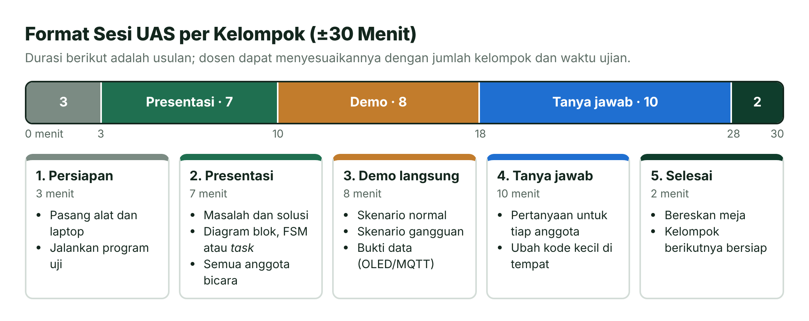
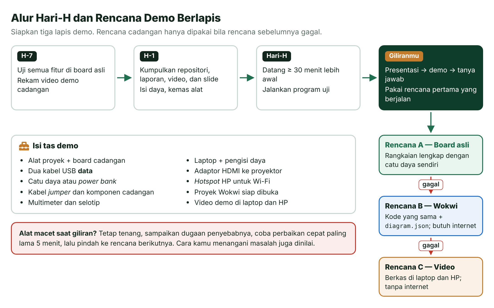
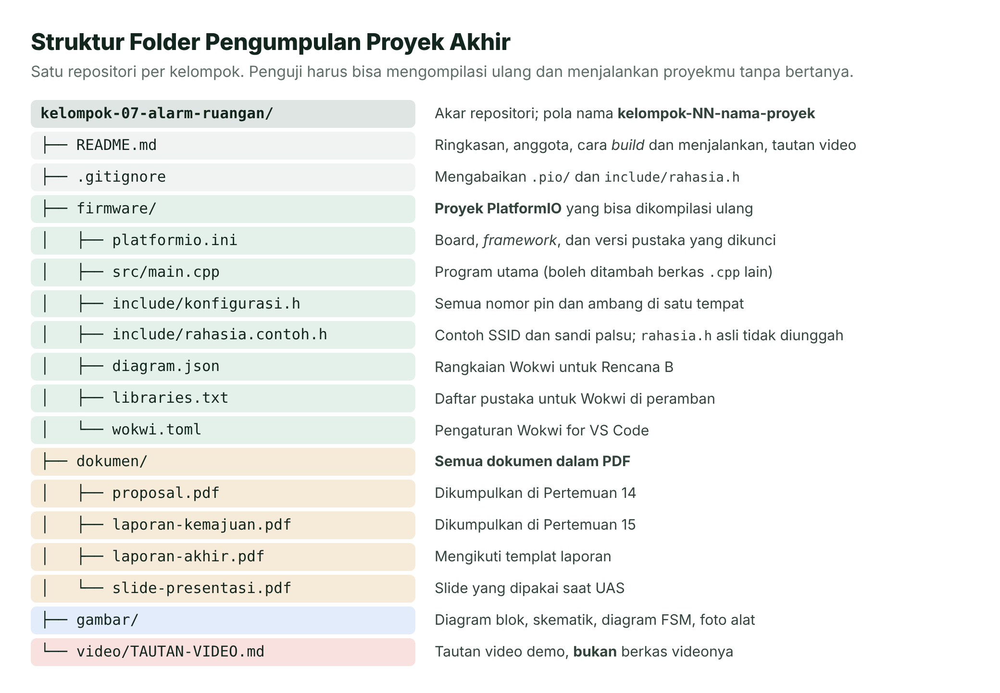

# Pertemuan 16 — UAS: Demo dan Presentasi Proyek Akhir

> Inilah garis finis semester: kamu menunjukkan alat yang benar-benar bekerja, menjelaskan cara kerjanya, dan membuktikan bahwa kamu memahami setiap baris kodenya.

| | |
| --- | --- |
| ⏱️ **Durasi** | ±30 menit per kelompok, mengikuti jadwal UAS *(sesuaikan)* |
| 📋 **Prasyarat** | Proposal (Pertemuan 14) dan laporan kemajuan (Pertemuan 15) sudah dikumpulkan |
| 🧰 **Alat** | Alat proyek + catu daya, laptop, proyek Wokwi, dan video demo cadangan |
| 🔗 **Ketentuan proyek** | [Proyek Akhir](../proyek-akhir/README.md): ketentuan teknis, ide, templat proposal dan laporan |
| 📥 **Slide** | [Unduh PDF](../slide/pdf/P16-UAS-Proyek-Akhir.pdf) · [Unduh PPTX](../slide/pptx/P16-UAS-Proyek-Akhir.pptx) |

## Daftar Isi

- [🎯 Apa yang Diukur di UAS?](#-apa-yang-diukur-di-uas)
- [📅 Informasi UAS](#-informasi-uas)
- [🎤 Format Demo dan Presentasi](#-format-demo-dan-presentasi)
- [✅ Daftar Periksa Hari-H](#-daftar-periksa-hari-h)
- [📊 Rubrik Penilaian](#-rubrik-penilaian)
- [❓ Contoh Pertanyaan Penguji](#-contoh-pertanyaan-penguji)
- [📦 Ketentuan Pengumpulan](#-ketentuan-pengumpulan)
- [📜 Integritas Akademik dan Penggunaan AI](#-integritas-akademik-dan-penggunaan-ai)
- [🚫 Kesalahan yang Sering Terjadi](#-kesalahan-yang-sering-terjadi)
- [🎓 Penutup Semester](#-penutup-semester)
- [📚 Referensi](#-referensi)
- [🖼️ Sumber Gambar](#️-sumber-gambar)

---

## 🎯 Apa yang Diukur di UAS?

UAS mata kuliah ini bukan ujian tertulis. Kamu dan kelompokmu menampilkan **proyek akhir**: sistem tertanam utuh yang kalian rancang, rakit, program, uji, dan dokumentasikan sendiri. Pada UAS ini kamu menunjukkan bahwa kamu bisa:

1. Mendemonstrasikan sistem yang berjalan di board ESP32 asli, termasuk saat menghadapi kondisi tidak normal.
2. Menjelaskan rancangan sistem: kebutuhan, diagram blok, alokasi pin, anggaran daya, dan arsitektur *firmware* (FSM atau FreeRTOS).
3. Menunjukkan kode yang rapi, *non-blocking*, dan bisa dikompilasi ulang dari repositori.
4. Membuktikan bahwa sistem sudah diuji, lengkap dengan data hasil pengujian.
5. Menjawab pertanyaan penguji dan mengubah sebagian kode di tempat.

Kelima kemampuan ini merangkum seluruh capaian mata kuliah (CPMK-1 sampai CPMK-6) di [RPS](../RPS.md). Ketentuan teknis, contoh ide, dan templat dokumennya ada di halaman [Proyek Akhir](../proyek-akhir/README.md).

## 📅 Informasi UAS

| Hal | Ketentuan *(sesuaikan)* |
| --- | --- |
| Bentuk | Demo alat, presentasi, dan tanya jawab per kelompok |
| Waktu dan tempat | Mengikuti jadwal UAS program studi; urutan tampil diumumkan paling lambat H-3 |
| Durasi | ±30 menit per kelompok (Gambar 16.1) |
| Pengumpulan berkas | Paling lambat H-1 pukul 23.59: repositori atau ZIP, laporan akhir, video demo, dan slide |
| Penguji | Dosen pengampu, dapat dibantu asisten |
| Bobot | Proyek akhir = 35% nilai akhir; rinciannya di [Rubrik Penilaian](#-rubrik-penilaian) |
| Kehadiran | Seluruh anggota wajib hadir. Anggota yang tidak hadir tanpa alasan sah tidak mendapat nilai kriteria presentasi dan tanya jawab |

## 🎤 Format Demo dan Presentasi



*Gambar 16.1 — Format sesi UAS per kelompok. Sumber: dibuat untuk materi ini.*

Setiap kelompok menjalani lima bagian berikut secara berurutan:

1. **Persiapan (3 menit).** Pasang alat, sambungkan laptop ke proyektor, lalu jalankan program uji singkat. Waktu ini bukan untuk merakit ulang rangkaian.
2. **Presentasi (7 menit).** Ceritakan masalah, solusi, dan rancangan sistem. Setiap anggota membawakan minimal satu bagian.
3. **Demo langsung (8 menit).** Tunjukkan skenario normal, lalu satu atau dua skenario gangguan, misalnya sensor ditutup, Wi-Fi diputus, atau tombol ditekan berkali-kali dengan cepat.
4. **Tanya jawab (10 menit).** Penguji bertanya kepada anggota tertentu. Penguji juga dapat meminta perubahan kecil pada kode, lalu meminta kode itu dikompilasi dan diunggah ulang.
5. **Selesai (2 menit).** Bereskan meja agar kelompok berikutnya bisa bersiap.

### Isi Slide Presentasi

Cukup 8–10 slide. Penguji lebih tertarik pada alatmu daripada animasi slide.

| No | Slide | Isi |
| :---: | --- | --- |
| 1 | Judul | Nama proyek, nomor kelompok, anggota dan perannya |
| 2 | Masalah | Siapa penggunanya dan masalah apa yang diselesaikan |
| 3 | Kebutuhan | Tiga sampai lima kebutuhan fungsional dan nonfungsional yang bisa diuji |
| 4 | Diagram blok | Sensor, ESP32, aktuator, tampilan atau komunikasi, serta catu daya |
| 5 | Rangkaian dan pin | Skematik atau tabel alokasi pin |
| 6 | Arsitektur *firmware* | Diagram FSM atau daftar *task* FreeRTOS beserta antreannya |
| 7 | Pengujian | Tabel uji dan data, misalnya grafik, waktu respons, atau konsumsi arus |
| 8 | Kendala dan pelajaran | Masalah terbesar dan cara kalian mengatasinya |
| 9 | Penutup | Keterbatasan sistem dan rencana pengembangan |

Beberapa tips agar presentasimu lancar:

- Latih presentasi dengan *stopwatch* minimal dua kali. Tujuh menit terasa singkat.
- Pakai huruf besar (minimal 24 pt) dan gambar yang jelas. Hindari paragraf panjang di slide.
- Tampilkan kode hanya pada potongan penting (maksimal ±15 baris) dengan huruf yang diperbesar.
- Buka Serial Monitor atau MQTTX sebelum giliranmu, lalu perbesar hurufnya agar terbaca dari belakang ruangan.

> [!TIP]
> **Mulai dengan bukti.** Bila urutannya bebas, tampilkan alatmu bekerja selama 10–15 detik di awal presentasi. Penguji langsung tahu apa yang kalian bangun, dan sisa presentasi terasa lebih hidup.

## ✅ Daftar Periksa Hari-H

Alat yang berjalan di rumah belum tentu berjalan di ruang ujian. Kabel bisa longgar selama perjalanan, Wi-Fi kampus bisa menolak perangkat baru, dan *power bank* bisa mati di tengah demo. Karena itu, siapkan **tiga lapis demo** dan bawa perlengkapan cadangan.



*Gambar 16.2 — Alur hari-H dan rencana demo berlapis. Sumber: dibuat untuk materi ini (ikon Font Awesome Free, CC BY 4.0).*

| Rencana | Kapan dipakai | Yang harus siap |
| --- | --- | --- |
| **A — Board asli** | Selalu menjadi pilihan pertama | Rangkaian lengkap, catu daya sendiri, *hotspot* HP bila memakai Wi-Fi |
| **B — Simulasi Wokwi** | Alat rusak dan tidak pulih dalam 5 menit | Proyek Wokwi dengan kode **yang sama**, sudah terbuka di peramban sebelum giliranmu |
| **C — Video cadangan** | Alat dan Wokwi sama-sama tidak bisa dipakai | Video demo 3–5 menit tersimpan di laptop **dan** HP, sehingga tidak bergantung pada internet |

> [!IMPORTANT]
> **Rencana B dan C tetap dinilai, tetapi skor kriteria "Fungsi dan demo" paling tinggi level 2 (Cukup)**, kecuali kerusakan terjadi di luar kendali kelompok dan video membuktikan alat asli sudah bekerja. Rencana cadangan menyelamatkan nilai, bukan menggantikan demo asli. *(usulan, sesuaikan)*

### Perangkat

- [ ] Alat terakit kokoh; kabel *jumper* ditempel selotip atau diikat agar tidak lepas di perjalanan.
- [ ] Board ESP32 cadangan yang sudah berisi *firmware* terbaru.
- [ ] Dua kabel USB **data** (bukan kabel yang hanya bisa mengisi daya).
- [ ] Komponen cadangan untuk bagian yang paling rawan: sensor, kabel *jumper*, resistor, dan transistor.
- [ ] Multimeter untuk memeriksa tegangan dan sambungan bila ada masalah mendadak.
- [ ] Laptop terisi penuh, pengisi dayanya, dan adaptor HDMI ke proyektor.
- [ ] Proyek sudah pernah di-*build* dan diunggah dari laptop yang dibawa, sehingga pustaka dan *toolchain* sudah terunduh.

### Cadangan Simulasi dan Video

- [ ] Proyek Wokwi berisi `sketch.ino`, `diagram.json`, dan `libraries.txt` yang sama dengan repositori; tautannya tersimpan.
- [ ] Bagian yang tidak bisa disimulasikan Wokwi (misalnya Bluetooth) sudah diketahui dan siap dijelaskan.
- [ ] Video demo tersimpan di laptop dan HP, dan sudah diputar sekali untuk memastikan berkasnya tidak rusak.
- [ ] Bila memakai Wi-Fi: *hotspot* HP sudah dicoba, dan *broker* cadangan disiapkan (misalnya `test.mosquitto.org` bila `broker.emqx.io` sedang tidak bisa diakses).

> [!TIP]
> **Satu kode untuk board asli dan Wokwi.** Di Wokwi, ESP32 tersambung ke internet lewat SSID `Wokwi-GUEST` tanpa sandi [6]. Simpan SSID dan sandi di berkas `rahasia.h` (lihat [Ketentuan Pengumpulan](#-ketentuan-pengumpulan)), sehingga yang berbeda antara board asli dan Wokwi hanya isi berkas itu.

### Catu Daya

- [ ] Catu daya sesuai anggaran daya dari Pertemuan 15: arus maksimum adaptor lebih besar daripada kebutuhan puncak sistem.
- [ ] Servo, motor, dan *relay* tidak mengambil daya dari pin 3,3 V board.
- [ ] Bila memakai *power bank*, sudah dicoba minimal 30 menit; beberapa *power bank* mati otomatis bila arus bebannya terlalu kecil.
- [ ] Bila memakai baterai, baterai terisi penuh dan ada cadangannya.
- [ ] Semua GND tersambung menjadi satu (*ground* bersama).

### Berkas dan Presentasi

- [ ] Semua berkas sudah dikumpulkan sebelum tenggat (lihat [Ketentuan Pengumpulan](#-ketentuan-pengumpulan)).
- [ ] Slide tersimpan dalam PDF di laptop dan di *flashdisk* atau penyimpanan awan.
- [ ] Pembagian bicara jelas, dan presentasi sudah dilatih dengan *stopwatch*.
- [ ] Setiap anggota sudah membaca **seluruh** kode, bukan hanya bagiannya sendiri.

## 📊 Rubrik Penilaian

Rubrik berikut sama dengan rubrik di halaman [Proyek Akhir](../proyek-akhir/README.md#-rubrik-penilaian). Pakailah untuk menilai proyekmu sendiri sepekan sebelum UAS, lalu perbaiki kriteria yang skornya masih rendah.

### Komposisi Nilai Proyek Akhir *(usulan, sesuaikan)*

Proyek akhir bernilai **35%** dari nilai akhir mata kuliah. Nilai proyek (skala 0–100) dikumpulkan bertahap sehingga kerja yang konsisten sejak awal ikut dihargai.

| Tahap | Waktu | Bobot dalam nilai proyek |
| --- | --- | :---: |
| Proposal | Pertemuan 14 | 10% |
| Laporan kemajuan dan konsultasi | Pertemuan 15 | 10% |
| UAS: demo, presentasi, tanya jawab, dan laporan akhir (rubrik di bawah) | Pertemuan 16 | 80% |

### Enam Kriteria UAS

Setiap kriteria diberi skor **1–4**. Pakai deskriptor berikut untuk menilai proyekmu sendiri sebelum hari-H.

| Kriteria (bobot) | 4 — Sangat baik | 3 — Baik | 2 — Cukup | 1 — Kurang |
| --- | --- | --- | --- | --- |
| **1. Fungsi dan demo** (25%) | Semua fitur di proposal berjalan stabil di board asli. Kondisi tidak normal ditangani dengan wajar, dan demo bisa diulang atas permintaan penguji. | Fitur utama berjalan di board asli. Satu fitur tambahan belum sempurna atau sesekali perlu di-*reset*. | Hanya sebagian fitur utama yang berjalan, atau demo memakai Rencana B/C (Wokwi atau video). | Sistem tidak berjalan atau masih berupa potongan program yang belum terintegrasi. |
| **2. Kedalaman teknis** (20%) | Minimal tiga topik kuliah dipakai dengan tepat dan saling terkait. Keputusan desain (pin, periode pembacaan, prioritas *task*, anggaran daya) didukung perhitungan atau data uji. | Minimal tiga topik dipakai dengan benar. Sebagian keputusan desain dijelaskan, tetapi data pendukungnya belum lengkap. | Hanya dua topik, atau pemakaiannya dangkal (contoh praktikum disalin hampir tanpa perubahan). | Hanya mengulang satu praktikum dengan sedikit perubahan. |
| **3. Kualitas kode** (15%) | *Non-blocking*, tersusun sebagai FSM atau *task* FreeRTOS, dan modular (`.h`/`.cpp`). Pin dan ambang berupa konstanta bernama, komentar menjelaskan "mengapa", kompilasi tanpa peringatan, dan riwayat *commit* rapi. | Sebagian besar *non-blocking* dan terstruktur, tetapi masih ada angka ajaib (*magic number*) atau fungsi yang terlalu panjang. | Berjalan, tetapi bergantung pada `delay()`, memakai banyak variabel global tanpa aturan, dan minim komentar. | Sulit dibaca, berisi kode salinan yang tidak dipahami, atau tidak bisa dikompilasi ulang dari repositori. |
| **4. Dokumentasi dan laporan** (15%) | Laporan lengkap sesuai templat, berisi data pengujian dan analisisnya. README repositori cukup jelas untuk mengompilasi dan menjalankan ulang proyek, termasuk versi Wokwi. | Lengkap, tetapi analisis pengujian masih dangkal atau sebagian gambar kurang jelas. | Ada bagian penting yang hilang, misalnya hasil pengujian atau skematik. | Sangat minim atau tidak dikumpulkan tepat waktu. |
| **5. Presentasi dan tanya jawab** (15%, per individu) | Runtut dan tepat waktu. Mampu menjelaskan bagian mana pun dari sistem, termasuk bagian anggota lain, dengan alasan teknis. Perubahan kode di tempat berhasil. | Runtut; jawaban umumnya benar, tetapi kadang perlu dipancing. | Melebihi waktu atau kurang runtut; hanya bisa menjelaskan bagiannya sendiri. | Tidak bisa menjelaskan kode yang dikumpulkan. |
| **6. Kerja tim dan manajemen proyek** (10%) | Pembagian tugas jelas dan seimbang, tampak di riwayat *commit* dan catatan kerja. Semua tahap tepat waktu, dan penilaian sejawat baik. | Pembagian tugas cukup jelas; ada sedikit keterlambatan. | Beban kerja timpang atau jadwal sering meleset. | Proyek bergantung pada satu orang; tidak ada bukti kerja sama. |

**Cara menghitung.** Nilai UAS = jumlah dari (bobot × skor ÷ 4). Misalnya, skor 4, 3, 3, 3, 4, dan 3 untuk kriteria 1–6 menghasilkan 25 + 15 + 11,25 + 11,25 + 15 + 7,5 = **85**. Bila proposal bernilai 80 dan laporan kemajuan 90, nilai proyeknya 10% × 80 + 10% × 90 + 80% × 85 = 8 + 9 + 68 = **85**.

**Nilai tambah.** Penguji dapat memberi tambahan hingga **5 poin** pada nilai UAS (nilai tetap maksimal 100) untuk fitur IoT yang stabil (MQTT dengan dasbor, kendali dua arah, LWT), penghematan daya yang diukur (arus nyata dan perkiraan umur baterai), fitur keandalan (*watchdog*, NVS, pulih sendiri setelah Wi-Fi putus), atau perangkat yang rapi (kotak, papan lubang, atau PCB).

**Nilai individu.** Kriteria 1–4 dinilai per kelompok, kriteria 5 per orang, dan kriteria 6 memakai penilaian sejawat (setiap anggota membagi 100% kontribusi secara rahasia) serta riwayat *commit*. Anggota yang kontribusinya jauh di bawah anggota lain dapat menerima nilai lebih rendah daripada nilai kelompok.

## ❓ Contoh Pertanyaan Penguji

Penguji tidak mencari jawaban hafalan. Mereka ingin tahu apakah kamu memahami **mengapa** sistemmu dibuat seperti itu. Latih pertanyaan berikut bersama kelompokmu, dan biasakan menjawab sambil menunjuk kode, rangkaian, atau data pengujian.

**Rancangan dan perangkat keras**

1. Mengapa sensor analogmu dipasang di GPIO 32–39 (ADC1), bukan di pin ADC2?
2. Berapa arus total sistem saat semua aktuator bekerja? Bagaimana kamu tahu catu dayanya cukup?
3. Mengapa *relay* atau motor tidak boleh digerakkan langsung dari pin GPIO? Apa fungsi dioda di dekatnya?
4. Apakah rangkaianmu memakai pin *strapping* (GPIO 0, 2, 5, 12, 15)? Apa risikonya saat board dinyalakan?
5. Bila memakai HC-SR04 yang bekerja pada 5 V, bagaimana kamu melindungi pin ESP32 dari sinyal ECHO?

***Firmware***

6. Tunjukkan bagian kode yang membaca sensor. Seberapa sering sensor dibaca, dan mengapa periode itu yang dipilih?
7. Gambarkan FSM sistemmu. Apa yang memicu perpindahan dari satu keadaan ke keadaan lain?
8. Mengapa bagian ini memakai `millis()` (atau `vTaskDelay()`) dan bukan `delay()`?
9. Variabel mana yang dipakai bersama oleh ISR dan program utama? Mengapa variabel itu harus `volatile`?
10. Berapa prioritas dan ukuran *stack* setiap *task*? Bagaimana kamu tahu ukurannya cukup?
11. Lewat apa data dikirim antar-*task*? Apa yang terjadi bila antreannya penuh?

**Pengujian dan keandalan**

12. Bagaimana kamu membuktikan bahwa kebutuhan F-2 sudah terpenuhi? Tunjukkan datanya.
13. Apa yang terjadi bila kabel sensor dicabut saat sistem berjalan? Coba tunjukkan sekarang.
14. Apa yang terjadi bila Wi-Fi putus selama lima menit lalu tersambung kembali?
15. Pengaturan apa yang tetap tersimpan setelah listrik padam, dan di mana menyimpannya?

**IoT (bila dipakai)**

16. Mengapa topik MQTT-mu disusun seperti itu? QoS berapa yang dipakai, dan mengapa?
17. Apa fungsi pesan *Last Will and Testament* (LWT) di sistemmu?

**Pemahaman dan integritas**

18. "Tolong ubah ambang suhu menjadi 30 °C dan tambahkan bunyi *buzzer* dua kali, lalu unggah ulang." *(dikerjakan di tempat, ±5 menit)*
19. Bagian mana yang ditulis sendiri, dan bagian mana yang dibantu AI atau diambil dari sumber lain? Jelaskan baris ini.
20. Bila sistem ini akan dijual sebagai produk, apa tiga hal pertama yang harus diubah?

> [!TIP]
> **Tidak tahu jawabannya?** Katakan terus terang, lalu jelaskan cara kamu akan mencari tahu, misalnya "Saya akan mengecek lembar data bagian karakteristik listrik" atau "Saya akan mengukur tegangan di titik ini dengan multimeter". Jawaban jujur yang runtut lebih dihargai daripada tebakan.

## 📦 Ketentuan Pengumpulan

Semua berkas dikumpulkan **sebelum** demo agar penguji bisa membaca kodenya lebih dulu. Penguji menilai versi yang terkumpul saat tenggat, bukan versi di laptopmu.

| Berkas | Ketentuan *(sesuaikan)* |
| --- | --- |
| Repositori GitHub | Publik, atau privat dengan akses untuk akun dosen. Nama: `kelompok-NN-nama-proyek` |
| Berkas ZIP (alternatif) | Bila tidak memakai GitHub. Nama: `kelompok-NN-nama-proyek.zip`, isinya sama dengan struktur di bawah, **tanpa** *folder* `.pio/` |
| Laporan akhir | PDF sesuai [templat laporan](../proyek-akhir/templat-laporan.md), ±15–25 halaman di luar lampiran |
| Video demo | 3–5 menit; tautannya ditulis di `video/TAUTAN-VIDEO.md` |
| Slide presentasi | PDF, disimpan di *folder* `dokumen/` |
| Tenggat | H-1 sebelum demo pukul 23.59. Untuk GitHub, yang dinilai adalah *commit* terakhir sebelum tenggat |

### Struktur Folder



*Gambar 16.3 — Struktur folder pengumpulan. Sumber: dibuat untuk materi ini.*

Versi teks yang bisa kamu salin:

```text
kelompok-NN-nama-proyek/
├── README.md
├── .gitignore
├── firmware/
│   ├── platformio.ini
│   ├── src/main.cpp
│   ├── include/konfigurasi.h
│   ├── include/rahasia.contoh.h
│   ├── diagram.json
│   ├── libraries.txt
│   └── wokwi.toml
├── dokumen/
│   ├── proposal.pdf
│   ├── laporan-kemajuan.pdf
│   ├── laporan-akhir.pdf
│   └── slide-presentasi.pdf
├── gambar/
└── video/TAUTAN-VIDEO.md
```

`README.md` repositori minimal berisi:

- Nama proyek dan deskripsi satu paragraf, beserta foto alat.
- Anggota kelompok dan perannya.
- Cara *build* dan *upload* dengan PlatformIO, termasuk pustaka beserta versinya yang tertulis di `platformio.ini` [5].
- Cara menjalankan proyek di Wokwi.
- Tautan video demo.
- Status fitur: mana yang sudah berjalan dan mana yang belum.

### Menjaga Rahasia dan Ukuran Repositori

Kata sandi Wi-Fi atau akun *broker* tidak boleh ikut terunggah ke repositori publik. Simpan di `include/rahasia.h`, masukkan berkas itu ke `.gitignore`, lalu unggah contoh kosongnya sebagai `include/rahasia.contoh.h`:

```cpp
// include/rahasia.contoh.h
// Salin berkas ini menjadi rahasia.h, lalu isi dengan data aslimu.
// rahasia.h tercantum di .gitignore sehingga tidak ikut diunggah.
#pragma once
#define WIFI_SSID  "nama-wifi"   // di Wokwi: "Wokwi-GUEST"
#define WIFI_SANDI "sandi-wifi"  // di Wokwi: "" (kosong)
```

Isi `.gitignore` minimal:

```text
.pio/
.vscode/
include/rahasia.h
```

*Folder* `.pio/` berisi hasil kompilasi yang besar dan selalu bisa dibuat ulang, jadi tidak perlu diunggah. Video juga **jangan** disimpan di repositori: Git memberi peringatan untuk berkas di atas 50 MiB, GitHub menolak berkas di atas 100 MiB, dan unggahan lewat peramban dibatasi 25 MiB [3].

### Ketentuan Video Demo

- Durasi 3–5 menit, resolusi minimal 720p, dengan narasi suara yang jelas.
- Tampilkan **alat asli** yang bekerja, bukan hanya simulasi atau slide.
- Urutan yang disarankan: perkenalan singkat (maksimal 20 detik), fitur utama satu per satu, satu skenario gangguan, lalu bukti data di OLED, Serial Monitor, atau MQTTX.
- Video tidak boleh direkayasa, misalnya dipercepat atau disunting agar fitur yang gagal tampak berhasil.
- Unggah ke YouTube dengan visibilitas **Tidak publik**, atau ke Google Drive dengan akses "siapa saja yang memiliki link". Coba buka tautannya dari mode samaran (*incognito*) peramban sebelum dikumpulkan.

### Ketentuan Laporan

Laporan akhir mengikuti [templat laporan](../proyek-akhir/templat-laporan.md). Bagian yang paling sering kurang, padahal paling menentukan nilai, adalah:

- **Pengujian dengan data**: tabel uji untuk setiap kebutuhan, ditambah hasil pengukuran (misalnya pembacaan sensor dibandingkan dengan alat ukur lain).
- **Pembahasan**: mengapa hasilnya seperti itu, apa keterbatasannya, dan apa yang akan diubah.
- **Pembagian kerja**: siapa mengerjakan apa, didukung riwayat *commit*.
- **Pernyataan penggunaan AI dan sumber kode** (lihat bagian berikut).
- **Pernyataan keaslian** yang ditandatangani semua anggota.

## 📜 Integritas Akademik dan Penggunaan AI

Alat AI seperti asisten percakapan atau pelengkap kode otomatis boleh dipakai, sama seperti kamu boleh membaca dokumentasi dan bertanya kepada teman. Syaratnya satu dan tidak bisa ditawar: **kamu wajib memahami dan mampu menjelaskan seluruh kode yang kamu kumpulkan.** Sesuai kebijakan kelas di [RPS](../RPS.md), kode yang tidak bisa dijelaskan dianggap bukan karya sendiri.

| Boleh | Tidak boleh |
| --- | --- |
| Bertanya kepada AI untuk memahami konsep, pesan galat, atau isi lembar data | Mengumpulkan kode yang tidak bisa kamu jelaskan |
| Meminta draf kode dari AI, **lalu** membaca, menguji, dan mengubahnya sampai paham | Menyalin proyek kelompok lain atau proyek dari internet tanpa atribusi |
| Memakai contoh kode pustaka, dokumentasi resmi, atau tutorial dengan menyebut sumbernya | Meminta orang lain atau jasa berbayar mengerjakan proyek |
| Berdiskusi dengan kelompok lain tentang masalah umum, misalnya cara memasang pustaka | Memalsukan data pengujian, foto, atau video demo |
| Meminta AI memeriksa ejaan laporan | Menyalin teks laporan dari AI tanpa memeriksa kebenarannya, termasuk referensi yang ternyata tidak ada |

**Wajib dicantumkan.** Setiap pemakaian AI ditulis di laporan, pada bagian "Pernyataan Penggunaan AI dan Sumber Kode", dengan format seperti ini:

| Alat | Dipakai untuk | Bagian yang terdampak | Cara kami memverifikasi |
| --- | --- | --- | --- |
| *(nama asisten AI)* | Menjelaskan pesan *crash* `Guru Meditation Error` | `taskMqtt` di `src/mqtt.cpp` | Membaca dokumentasi resmi, lalu menguji ulang di board |
| *(nama pelengkap kode)* | Melengkapi fungsi pembacaan HX711 | `bacaBerat()` di `src/sensor.cpp` | Membandingkan dengan contoh pustaka; menguji dengan anak timbangan |

Kode dari sumber lain juga wajib diberi atribusi langsung di kodenya, misalnya:

```cpp
// Diadaptasi dari contoh pustaka Adafruit SSD1306 (lisensi BSD)
// https://github.com/adafruit/Adafruit_SSD1306
```

> [!WARNING]
> **AI bisa salah dengan sangat meyakinkan.** Banyak contoh di internet, dan karena itu juga jawaban AI, masih memakai Arduino-ESP32 versi 2.x. Fungsi seperti `ledcSetup()` dan `ledcAttachPin()` sudah tidak ada di versi 3.x yang kita pakai (penggantinya `ledcAttach()`), sehingga kode seperti itu gagal dikompilasi [1], [2]. AI juga bisa mengarang nomor pin, nilai di lembar data, atau referensi. Selalu cocokkan dengan dokumentasi resmi dan uji di board.

> [!IMPORTANT]
> **Uji pemahaman bisa terjadi kapan saja.** Penguji boleh menunjuk baris mana pun dan meminta anggota mana pun menjelaskan atau mengubahnya. Bagian yang tidak bisa dijelaskan oleh anggota yang mengerjakannya dapat dinilai nol, dan pelanggaran berat diproses sesuai aturan program studi. *(sesuaikan)*

## 🚫 Kesalahan yang Sering Terjadi

| Kesalahan | Akibat | Cara mencegah |
| --- | --- | --- |
| Menggabungkan semua bagian pada malam terakhir | Galat menumpuk dan tidak sempat diuji | Integrasi bertahap setiap pekan, seperti di Pertemuan 15 |
| Hanya satu anggota yang memahami kode | Nilai tanya jawab anggota lain rendah | Saling menjelaskan kode sebelum UAS |
| Bergantung pada Wi-Fi kampus | MQTT gagal tersambung saat demo | Pakai *hotspot* HP yang sudah dicoba |
| Servo atau *relay* mengambil daya dari pin 3,3 V | ESP32 ter-*reset* sendiri karena tegangan turun (*brownout*) | Catu 5 V terpisah dengan GND bersama |
| Video baru direkam pada hari-H | Tidak ada cadangan saat alat gagal | Rekam video paling lambat H-7 |
| Kode di laptop berbeda dengan di repositori | Penguji menilai versi lama | *Commit* dan *push* versi final, lalu beri *tag* `v1.0` |
| Slide penuh teks dan kode panjang | Penguji kehilangan alur cerita | Pakai gambar dan potongan kode pendek |

## 🎓 Penutup Semester

Selamat, kamu sudah sampai di pertemuan terakhir! Coba lihat lagi perjalananmu: dari LED yang berkedip di Pertemuan 1, sekarang kamu bisa membangun sistem yang membaca sensor, mengambil keputusan, menggerakkan aktuator, dan berkomunikasi lewat internet.

| Tahap | Pertemuan | Yang sudah kamu kuasai |
| --- | :---: | --- |
| Fondasi | 1–4 | ESP32, C/C++, GPIO output dan input, *debouncing* |
| Waktu dan sinyal | 5–7 | `millis()`, interupsi, *timer*, ADC, PWM, servo, *relay* |
| Berkomunikasi | 9–10 | UART, I2C, SPI, sensor, aktuator, pustaka, lembar data |
| Merancang sistem | 11–15 | FSM, *debugging*, FreeRTOS, Wi-Fi dan MQTT, hemat daya, keandalan, integrasi |

Beberapa langkah yang bisa kamu ambil setelah semester ini:

- **Rapikan portofolio.** Repositori proyek akhir yang rapi (README, foto, video) adalah bukti kemampuan yang bisa kamu tunjukkan saat melamar magang atau pekerjaan.
- **Pelajari ESP-IDF**, kerangka kerja resmi Espressif yang menjadi dasar Arduino-ESP32, untuk kendali yang lebih rinci atas periferal dan FreeRTOS [4].
- **Coba merancang PCB** agar proyekmu tidak lagi bergantung pada *breadboard* dan kabel *jumper*.
- **Perdalam keamanan IoT**: koneksi terenkripsi (TLS), autentikasi *broker*, dan pembaruan *firmware* lewat Wi-Fi (OTA).
- **Ikut komunitas dan lomba** untuk menguji kemampuanmu di luar kelas.

Terima kasih atas kerja kerasmu selama satu semester. Ingat, setiap ahli sistem tertanam juga pernah memulai dari satu LED yang berkedip.

> [!NOTE]
> **Bantu kami memperbaiki materi ini.** Isi kuesioner evaluasi perkuliahan *(sesuaikan)*, atau laporkan salah ketik dan tautan rusak lewat *issue* di repositori GitHub mata kuliah.

## 📚 Referensi

1. Espressif Systems. (2026). *Arduino-ESP32 Documentation*. <https://docs.espressif.com/projects/arduino-esp32/en/latest/>
2. Espressif Systems. (2026). *Migration from 2.x to 3.0*. Arduino-ESP32 Documentation. <https://docs.espressif.com/projects/arduino-esp32/en/latest/migration_guides/2.x_to_3.0.html>
3. GitHub. (2026). *About large files on GitHub*. GitHub Docs. <https://docs.github.com/en/repositories/working-with-files/managing-large-files/about-large-files-on-github>
4. Espressif Systems. (2026). *ESP-IDF Programming Guide (ESP32)*. <https://docs.espressif.com/projects/esp-idf/en/latest/esp32/>
5. PlatformIO Labs. (2026). *"platformio.ini" (Project Configuration File)*. <https://docs.platformio.org/en/latest/projectconf/index.html>
6. CodeMagic LTD. (2026). *Wokwi Docs — ESP32 WiFi Networking*. <https://docs.wokwi.com/guides/esp32-wifi>

## 🖼️ Sumber Gambar

| Gambar | Sumber dan lisensi |
| --- | --- |
| 16.1, 16.3 | Dibuat untuk materi ini. |
| 16.2 | Dibuat untuk materi ini. Ikon: Font Awesome Free (Fonticons, CC BY 4.0). |

---

[⬅️ Pertemuan 15: Integrasi Sistem](../pertemuan-15-integrasi-sistem/README.md) · [🏠 Beranda](../README.md)
