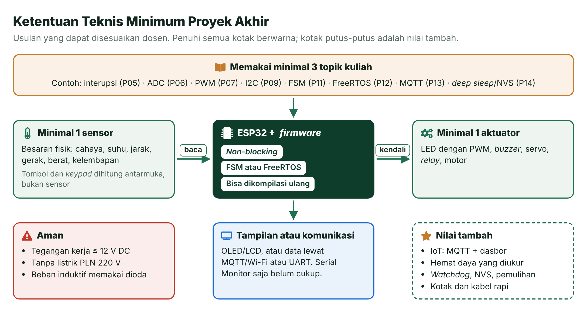
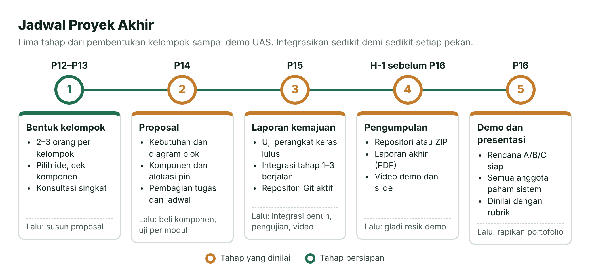
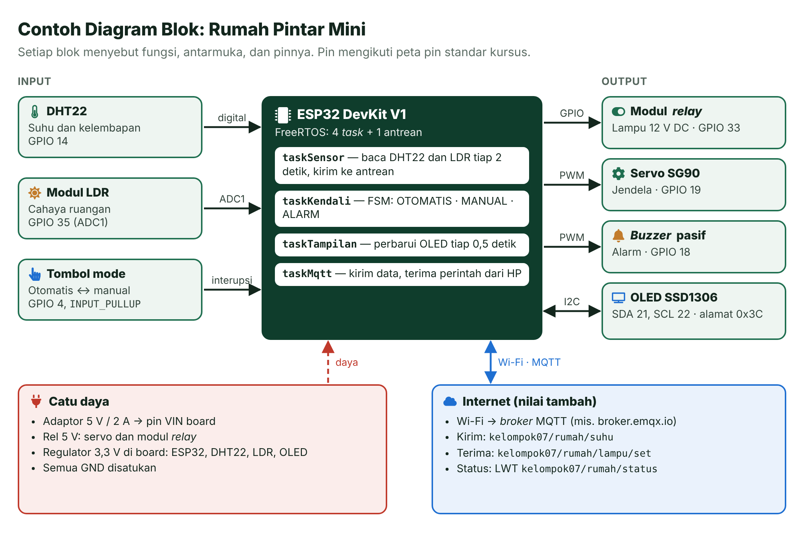

# Proyek Akhir — Sistem Tertanam Terintegrasi

> Saatnya merangkai semua yang sudah kamu pelajari menjadi satu alat yang berguna: dirancang, dirakit, diprogram, diuji, lalu didemonstrasikan bersama kelompokmu.

| | |
| --- | --- |
| 👥 **Kelompok** | 2–3 orang *(sesuaikan)* |
| 📅 **Jadwal** | Proposal di Pertemuan 14 · kemajuan di Pertemuan 15 · demo di Pertemuan 16 (UAS) |
| ⚖️ **Bobot** | 35% nilai akhir mata kuliah (lihat [RPS](../RPS.md)) |
| 📄 **Templat** | [Proposal](templat-proposal.md) · [Laporan akhir](templat-laporan.md) |
| 🎤 **Hari-H** | [Pertemuan 16: UAS — Demo dan Presentasi Proyek Akhir](../pertemuan-16-uas/README.md) |

## Daftar Isi

- [🎯 Tujuan Proyek](#-tujuan-proyek)
- [📐 Ketentuan Teknis Minimum](#-ketentuan-teknis-minimum)
- [👥 Kelompok dan Peran](#-kelompok-dan-peran)
- [📅 Jadwal dan Tahapan](#-jadwal-dan-tahapan)
- [💡 Ide Proyek](#-ide-proyek)
- [🧩 Contoh Diagram Blok](#-contoh-diagram-blok)
- [📊 Rubrik Penilaian](#-rubrik-penilaian)
- [🚀 Tips Sukses](#-tips-sukses)
- [❔ Pertanyaan yang Sering Diajukan](#-pertanyaan-yang-sering-diajukan)
- [📚 Referensi](#-referensi)
- [🖼️ Sumber Gambar](#️-sumber-gambar)

---

## 🎯 Tujuan Proyek

Satu praktikum biasanya melatih satu topik. Proyek akhir melatih hal yang lebih sulit sekaligus paling dicari di dunia kerja: **menggabungkan banyak bagian menjadi satu sistem yang andal**. Setelah menyelesaikan proyek ini, kamu bisa:

1. Mengubah masalah nyata menjadi kebutuhan sistem yang terukur dan bisa diuji.
2. Merancang perangkat keras (diagram blok, alokasi pin, anggaran daya) dan *firmware* yang terstruktur (FSM atau FreeRTOS).
3. Mengintegrasikan sensor, aktuator, tampilan, dan komunikasi secara bertahap.
4. Menguji sistem secara sistematis dan melaporkan hasilnya dengan data.
5. Bekerja dalam tim dengan Git, lalu mempresentasikan dan mempertahankan hasil kerja di depan penguji.

## 📐 Ketentuan Teknis Minimum

Ketentuan berikut adalah **usulan** yang dapat disesuaikan dosen. Tujuannya agar setiap proyek cukup menantang, tetapi tetap bisa diselesaikan dalam sisa waktu semester.

*Gambar 1 — Ketentuan teknis minimum proyek akhir. Sumber: dibuat untuk materi ini (ikon Font Awesome Free, CC BY 4.0).*

| No | Ketentuan | Penjelasan |
| :---: | --- | --- |
| 1 | Minimal **1 sensor** besaran fisik | Cahaya, suhu, kelembapan, jarak, gerak, berat, dan sebagainya. Tombol dan *keypad* dihitung sebagai antarmuka pengguna, bukan sensor. |
| 2 | Minimal **1 aktuator** | LED yang diatur dengan PWM, *buzzer*, servo, *relay*, atau motor. |
| 3 | **Tampilan atau komunikasi** | Layar OLED/LCD, atau pengiriman data (MQTT lewat Wi-Fi, UART antarperangkat). Serial Monitor saja belum cukup. |
| 4 | ***Non-blocking*** | Alur utama tidak tertahan oleh `delay()` yang panjang. Pakai pola `millis()` (Pertemuan 5) atau `vTaskDelay()` di dalam *task* (Pertemuan 12). |
| 5 | **FSM atau FreeRTOS** | Logika utama disusun sebagai mesin keadaan (Pertemuan 11) atau beberapa *task* FreeRTOS (Pertemuan 12) [5], lengkap dengan diagramnya. |
| 6 | Minimal **3 topik kuliah** | Misalnya interupsi, ADC, PWM, I2C, FSM, FreeRTOS, MQTT, *deep sleep*, NVS, atau *watchdog*. |
| 7 | **Bisa dibangun ulang** | Proyek PlatformIO lengkap ada di repositori, versi pustaka ditulis di `platformio.ini` [3], dan ada `diagram.json` Wokwi bila memungkinkan. |
| 8 | **Aman** | Tegangan kerja maksimal 12 V DC. Tidak memakai listrik PLN 220 V. |

**Nilai tambah** (tidak wajib, tetapi dihargai): fitur IoT yang stabil (MQTT dengan dasbor dan kendali dua arah), penghematan daya yang diukur, fitur keandalan (*watchdog*, NVS, pulih sendiri setelah gangguan), serta perangkat yang rapi di dalam kotak. Proyek tanpa IoT tetap bisa meraih nilai sangat baik bila tuntas dan teruji.

> [!CAUTION]
> **Listrik PLN 220 V berbahaya dan bisa merusak alat.** Untuk memperagakan lampu, pompa, atau kipas, pakai versi tegangan rendah: lampu LED 12 V DC, pompa mini 5 V, atau kipas 5 V. Modul *relay* boleh dipakai, tetapi bebannya tetap bertegangan rendah.

## 👥 Kelompok dan Peran

- Satu kelompok terdiri atas **2–3 orang** *(sesuaikan)*. Proyek perorangan boleh dengan persetujuan dosen. Kelompok 4 orang hanya dibentuk bila jumlah mahasiswa tidak habis dibagi, dengan cakupan proyek yang lebih besar.
- Kelompok dan calon ide didaftarkan ke dosen paling lambat **Pertemuan 13** *(sesuaikan)*.

Pembagian peran yang disarankan:

| Peran | Tanggung jawab utama |
| --- | --- |
| Perangkat keras | Rangkaian, alokasi pin, catu daya, kerapian kabel, pengukuran |
| *Firmware* | Arsitektur FSM atau *task*, pembacaan sensor, kendali aktuator |
| Integrasi dan dokumentasi | IoT/MQTT, pengujian, repositori Git, laporan, video |

> [!IMPORTANT]
> **Bagi peran, bukan bagi pemahaman.** Saat UAS, penguji boleh bertanya kepada siapa saja tentang bagian mana saja. Biasakan saling menjelaskan kode setiap kali ada bagian baru yang digabungkan.

## 📅 Jadwal dan Tahapan

*Gambar 2 — Jadwal proyek akhir. Sumber: dibuat untuk materi ini.*

| Tahap | Waktu | Yang dikumpulkan atau ditunjukkan | Penilaian |
| --- | --- | --- | --- |
| 1. Bentuk kelompok | Paling lambat Pertemuan 13 | Nama anggota dan 1–2 calon ide | — |
| 2. Proposal | Pertemuan 14 | Dokumen sesuai [templat proposal](templat-proposal.md) | 10% nilai proyek |
| 3. Kemajuan | Pertemuan 15 | Laporan kemajuan singkat, rangkaian yang sudah berjalan, dan repositori Git | 10% nilai proyek |
| 4. Pengumpulan | H-1 sebelum Pertemuan 16 | Repositori atau ZIP, laporan akhir, video demo, dan slide | Bagian dari nilai UAS |
| 5. Demo dan presentasi | Pertemuan 16 | Alat yang berjalan, presentasi, dan tanya jawab | 80% nilai proyek (bersama tahap 4) |

**Laporan kemajuan** cukup 1–2 halaman dan berisi:

1. Daftar kebutuhan dari proposal beserta statusnya: selesai, sedang dikerjakan, atau belum.
2. Hasil program uji perangkat keras untuk setiap komponen.
3. Tahap integrasi yang sudah berjalan, dengan bukti berupa foto, video pendek, atau tautan *commit*.
4. Kendala yang dihadapi dan cara mengatasinya.
5. Rencana kerja sampai Pertemuan 16, termasuk perubahan dari proposal bila ada.

Gunakan juga daftar periksa konsultasi kemajuan di bagian 8 [Pertemuan 15](../pertemuan-15-integrasi-sistem/README.md).

## 💡 Ide Proyek

Berikut 15 ide dalam tiga tingkat kesulitan. Komponen tanpa tanda ada di kit wajib ([Daftar Komponen](../panduan/04-daftar-komponen.md)); komponen bertanda † mudah dibeli secara terpisah. Kolom **Wokwi** menunjukkan apakah rangkaiannya bisa disimulasikan: **Ya** berarti seluruhnya, sedangkan **Sebagian** berarti ada komponen yang harus diwakili komponen lain atau ada efek fisik yang tidak tersimulasi [4].

> [!TIP]
> **Tingkat kesulitan tidak membatasi nilai.** Ide dasar yang dikerjakan tuntas, diuji dengan data, dan dijelaskan dengan baik bisa meraih nilai sangat baik. Sebaliknya, ide lanjut yang setengah jadi akan sulit mendapat nilai tinggi. Ide sendiri juga sangat dianjurkan, asalkan memenuhi ketentuan minimum.

### ★ Tingkat Dasar

| No | Ide dan fitur utama | Komponen | Topik (Pertemuan) | Wokwi |
| :---: | --- | --- | --- | --- |
| 1 | **Lampu Penyeberangan Pintar.** Tombol penyeberang memicu urutan lampu yang aman, *buzzer* berbunyi berirama selama penyeberang boleh lewat, dan saat malam (LDR gelap) lampu berpindah ke mode kuning berkedip. | LED merah, kuning, hijau; tombol; *buzzer*; LDR; OLED | Interupsi (5), ADC (6), PWM (7), I2C (9), FSM (11) | Ya |
| 2 | **Kipas Angin Otomatis.** Kipas menyala bila suhu melewati ambang dan mati kembali dengan histeresis. Ambang diatur dengan potensiometer; suhu dan status tampil di OLED. | DHT22 atau modul NTC†, potensiometer, *relay* atau transistor, kipas 5 V†, OLED | ADC (6), transistor dan *relay* (7), I2C (9), lembar data (10), FSM (11) | Ya, kipas diwakili LED |
| 3 | **Pengukur Tinggi Badan.** HC-SR04 dipasang di atas kepala; tinggi badan = tinggi pemasangan − jarak terukur. Tinggi pemasangan dikalibrasi dengan tombol dan disimpan di NVS. *Buzzer* berbunyi saat hasil sudah stabil. | HC-SR04, tombol, *buzzer*, OLED | Tombol (4), PWM (7), I2C (9), HC-SR04 (10), FSM (11), NVS (14) | Ya |
| 4 | **Pengatur Waktu Belajar Pomodoro.** Balikkan alat (dideteksi MPU6050) untuk memulai sesi fokus 25 menit, dan balikkan lagi untuk jeda. OLED menampilkan hitung mundur, *buzzer* berbunyi saat sesi berakhir, dan jumlah sesi harian tersimpan di NVS. | MPU6050, OLED, LED, *buzzer*, tombol | PWM (7), I2C (9), pustaka (10), FSM (11), NVS (14) | Ya |
| 5 | **Lampu Belajar Hemat Energi.** Kecerahan LED menyesuaikan cahaya ruangan dan bisa dikoreksi dengan potensiometer. HC-SR04 mendeteksi ada tidaknya orang; lampu meredup lalu padam bila meja kosong selama beberapa menit. | LDR, potensiometer, HC-SR04, LED (PWM), OLED | ADC (6), PWM (7), I2C (9), HC-SR04 (10), FSM (11) | Ya |

### ★★ Tingkat Menengah

| No | Ide dan fitur utama | Komponen | Topik (Pertemuan) | Wokwi |
| :---: | --- | --- | --- | --- |
| 6 | **Kunci Pintu *Keypad* dan Servo.** PIN yang benar membuat servo membuka palang. Tiga kali salah membuat sistem terkunci 30 detik dengan alarm. PIN bisa diganti dan tersimpan di NVS; layar menyala saat HC-SR04 mendeteksi orang mendekat. | *Keypad* 4×4, servo, *buzzer*, HC-SR04, OLED | PWM servo (7), I2C (9), HC-SR04 (10), FSM dan *keypad* (11), NVS (14) | Ya |
| 7 | **Alarm Keamanan Ruangan.** Sistem disiagakan dan dinonaktifkan dengan PIN. Saat siaga, gerakan memicu jeda masuk; bila PIN tidak dimasukkan, alarm berbunyi dan notifikasi dikirim lewat MQTT. | Sensor gerak PIR† atau HC-SR04, *keypad*, *buzzer*, LED, OLED | Interupsi (5), PWM (7), FSM (11), MQTT (13), NVS (14) | Ya |
| 8 | **Waterpass Digital.** MPU6050 mengukur kemiringan dua sumbu; OLED menampilkan "gelembung" digital beserta sudutnya. *Buzzer* berbunyi saat bidang datar. Tombol kalibrasi nol menyimpan *offset* ke NVS. | MPU6050, OLED, *buzzer*, tombol | I2C (9), pustaka dan lembar data (10), FSM (11), FreeRTOS (12), NVS (14) | Ya |
| 9 | **Penyiram Tanaman Otomatis.** Pompa menyala bila tanah kering dan berhenti setelah tanah cukup lembap atau batas waktu tercapai. Data kelembapan, suhu, dan riwayat penyiraman dikirim lewat MQTT; ESP32 tidur di antara pengecekan. | Sensor kelembapan tanah kapasitif†, pompa mini 5 V† dengan *relay* atau transistor, DHT22, OLED | ADC (6), *relay* (7), FSM (11), MQTT (13), *deep sleep* (14) | Sebagian: sensor tanah diwakili potensiometer, pompa diwakili LED |
| 10 | **Penghitung Pengunjung Ruangan.** Dua sensor jarak di pintu menentukan arah orang: masuk atau keluar. Jumlah orang tampil di OLED; LED merah dan *buzzer* menyala bila ruangan penuh; jumlahnya dikirim lewat MQTT. Picu kedua sensor bergantian agar tidak saling mengganggu. | 2 × HC-SR04 (1 tambahan†), OLED, LED, *buzzer* | HC-SR04 (10), FSM (11), FreeRTOS (12), MQTT (13) | Ya |

### ★★★ Tingkat Lanjut

| No | Ide dan fitur utama | Komponen | Topik (Pertemuan) | Wokwi |
| :---: | --- | --- | --- | --- |
| 11 | **Rumah Pintar Mini.** Pantau suhu, kelembapan, dan cahaya; kendalikan lampu dan jendela dari HP lewat MQTT. Status memakai *retained message*, perangkat mengumumkan dirinya *offline* lewat LWT [6], dan sistem tetap bekerja otomatis saat Wi-Fi putus. Lihat [contoh diagram bloknya](#-contoh-diagram-blok). | DHT22, LDR, tombol, *relay*, servo, *buzzer*, OLED | ADC (6), PWM (7), I2C (9), FreeRTOS (12), MQTT (13), *watchdog* (14) | Ya |
| 12 | **Penstabil Sudut Satu Sumbu.** Servo memutar papan kecil agar tetap datar walaupun alasnya dimiringkan. Sudut dari MPU6050 dikendalikan dengan kendali proporsional (P) atau PI di *task* berperiode tetap; potensiometer mengatur sudut target. Data sudut dicetak sebagai CSV untuk dibuat grafiknya. | MPU6050, servo, potensiometer, OLED | ADC (6), PWM servo (7), I2C (9), FreeRTOS dengan periode tetap (12) | Sebagian: logika bisa diuji, umpan balik fisik hanya di board asli |
| 13 | **Pencatat Data Hemat Daya.** Setiap 5 menit ESP32 bangun dari *deep sleep*, membaca sensor, menyimpan data di memori RTC, lalu tidur lagi. Setiap 6 kali bangun, data dikirim sekaligus lewat MQTT dalam format JSON. Konsumsi arus diukur, umur baterai dihitung, lalu dibandingkan dengan lembar data. | DHT22, LDR, LED status, baterai dan modul pengisi†, multimeter | ADC (6), lembar data (10), FSM (11), MQTT dan JSON (13), *deep sleep* dan umur baterai (14) | Sebagian: arus hanya bisa diukur di board asli |
| 14 | **Timbangan Digital Pintar.** Sel beban (*load cell*) dengan penguat HX711 mengukur berat. Tombol tara mengenolkan timbangan, faktor kalibrasi tersimpan di NVS, *buzzer* berbunyi bila berat melewati batas, dan hasilnya dikirim lewat MQTT. | *Load cell* dan modul HX711†, tombol, *buzzer*, OLED | Tombol (4), I2C (9), pustaka dan lembar data (10), FSM (11), MQTT (13), NVS (14) | Ya |
| 15 | **Pemberi Pakan Ikan Terjadwal.** Servo membuka wadah pakan pada jam tertentu (waktu diambil dari internet lewat NTP). Jadwal bisa diubah lewat MQTT dan tersimpan di NVS. Suhu air dipantau, dan peringatan dikirim bila suhunya di luar rentang aman. | Servo, tombol, *buzzer*, OLED, sensor suhu tahan air DS18B20† | PWM servo (7), I2C (9), FreeRTOS (12), Wi-Fi, NTP, dan MQTT (13), NVS (14) | Ya |

## 🧩 Contoh Diagram Blok

*Gambar 3 — Contoh diagram blok untuk ide nomor 11, Rumah Pintar Mini. Sumber: dibuat untuk materi ini (ikon Font Awesome Free, CC BY 4.0).*

Diagram blok adalah "peta" sistemmu. Penguji biasanya memakainya untuk mengajukan pertanyaan pertama, jadi pastikan diagrammu memuat:

- **Semua blok input dan output** beserta jenis antarmukanya: digital, ADC, interupsi, PWM, I2C, UART, atau Wi-Fi.
- **Nomor pin** untuk setiap sambungan, sesuai tabel alokasi pin di proposal.
- **Catu daya**: sumber, tegangan setiap rel, dan pembagian beban. Jangan lupa GND bersama.
- **Blok perangkat lunak utama**: daftar *task* FreeRTOS atau keadaan FSM, serta cara data mengalir di antaranya.
- **Komunikasi keluar** bila ada: *broker*, topik, dan aplikasi di sisi pengguna.

Pilih pin dengan bantuan [lembar saku pinout](../panduan/05-pinout-esp32.md): hindari GPIO 6–11, dan pasang sensor analog di ADC1 (GPIO 32–39) karena ADC2 tidak bisa dipakai saat Wi-Fi aktif [1], [2]. Cara menyusun kebutuhan dan diagram blok langkah demi langkah dibahas di bagian 2 [Pertemuan 15](../pertemuan-15-integrasi-sistem/README.md).

> [!NOTE]
> **Mengapa servo dan *relay* memakai rel 5 V?** Servo bisa menarik arus besar saat mulai bergerak. Bila dayanya diambil dari regulator 3,3 V board, tegangan bisa turun sesaat dan ESP32 ter-*reset*. Pemisahan rel daya seperti ini adalah inti dari anggaran daya di Pertemuan 15.

## 📊 Rubrik Penilaian

Rubrik ini sama dengan rubrik yang dipakai penguji di [Pertemuan 16](../pertemuan-16-uas/README.md#-rubrik-penilaian). Contoh pertanyaan penguji dan daftar periksa hari-H juga ada di halaman itu.

### Komposisi Nilai Proyek Akhir *(usulan, sesuaikan)*

Proyek akhir bernilai **35%** dari nilai akhir mata kuliah. Nilai proyek (skala 0–100) dikumpulkan bertahap sehingga kerja yang konsisten sejak awal ikut dihargai.

| Tahap | Waktu | Bobot dalam nilai proyek |
| --- | --- | :---: |
| Proposal | Pertemuan 14 | 10% |
| Laporan kemajuan dan konsultasi | Pertemuan 15 | 10% |
| UAS: demo, presentasi, tanya jawab, dan laporan akhir (rubrik di bawah) | Pertemuan 16 | 80% |

### Enam Kriteria UAS

Setiap kriteria diberi skor **1–4**. Pakai deskriptor berikut untuk menilai proyekmu sendiri sebelum hari-H.

| Kriteria (bobot) | 4 — Sangat baik | 3 — Baik | 2 — Cukup | 1 — Kurang |
| --- | --- | --- | --- | --- |
| **1. Fungsi dan demo** (25%) | Semua fitur di proposal berjalan stabil di board asli. Kondisi tidak normal ditangani dengan wajar, dan demo bisa diulang atas permintaan penguji. | Fitur utama berjalan di board asli. Satu fitur tambahan belum sempurna atau sesekali perlu di-*reset*. | Hanya sebagian fitur utama yang berjalan, atau demo memakai Rencana B/C (Wokwi atau video). | Sistem tidak berjalan atau masih berupa potongan program yang belum terintegrasi. |
| **2. Kedalaman teknis** (20%) | Minimal tiga topik kuliah dipakai dengan tepat dan saling terkait. Keputusan desain (pin, periode pembacaan, prioritas *task*, anggaran daya) didukung perhitungan atau data uji. | Minimal tiga topik dipakai dengan benar. Sebagian keputusan desain dijelaskan, tetapi data pendukungnya belum lengkap. | Hanya dua topik, atau pemakaiannya dangkal (contoh praktikum disalin hampir tanpa perubahan). | Hanya mengulang satu praktikum dengan sedikit perubahan. |
| **3. Kualitas kode** (15%) | *Non-blocking*, tersusun sebagai FSM atau *task* FreeRTOS, dan modular (`.h`/`.cpp`). Pin dan ambang berupa konstanta bernama, komentar menjelaskan "mengapa", kompilasi tanpa peringatan, dan riwayat *commit* rapi. | Sebagian besar *non-blocking* dan terstruktur, tetapi masih ada angka ajaib (*magic number*) atau fungsi yang terlalu panjang. | Berjalan, tetapi bergantung pada `delay()`, memakai banyak variabel global tanpa aturan, dan minim komentar. | Sulit dibaca, berisi kode salinan yang tidak dipahami, atau tidak bisa dikompilasi ulang dari repositori. |
| **4. Dokumentasi dan laporan** (15%) | Laporan lengkap sesuai templat, berisi data pengujian dan analisisnya. README repositori cukup jelas untuk mengompilasi dan menjalankan ulang proyek, termasuk versi Wokwi. | Lengkap, tetapi analisis pengujian masih dangkal atau sebagian gambar kurang jelas. | Ada bagian penting yang hilang, misalnya hasil pengujian atau skematik. | Sangat minim atau tidak dikumpulkan tepat waktu. |
| **5. Presentasi dan tanya jawab** (15%, per individu) | Runtut dan tepat waktu. Mampu menjelaskan bagian mana pun dari sistem, termasuk bagian anggota lain, dengan alasan teknis. Perubahan kode di tempat berhasil. | Runtut; jawaban umumnya benar, tetapi kadang perlu dipancing. | Melebihi waktu atau kurang runtut; hanya bisa menjelaskan bagiannya sendiri. | Tidak bisa menjelaskan kode yang dikumpulkan. |
| **6. Kerja tim dan manajemen proyek** (10%) | Pembagian tugas jelas dan seimbang, tampak di riwayat *commit* dan catatan kerja. Semua tahap tepat waktu, dan penilaian sejawat baik. | Pembagian tugas cukup jelas; ada sedikit keterlambatan. | Beban kerja timpang atau jadwal sering meleset. | Proyek bergantung pada satu orang; tidak ada bukti kerja sama. |

**Cara menghitung.** Nilai UAS = jumlah dari (bobot × skor ÷ 4). Misalnya, skor 4, 3, 3, 3, 4, dan 3 untuk kriteria 1–6 menghasilkan 25 + 15 + 11,25 + 11,25 + 15 + 7,5 = **85**. Bila proposal bernilai 80 dan laporan kemajuan 90, nilai proyeknya 10% × 80 + 10% × 90 + 80% × 85 = 8 + 9 + 68 = **85**.

**Nilai tambah.** Penguji dapat memberi tambahan hingga **5 poin** pada nilai UAS (nilai tetap maksimal 100) untuk fitur IoT yang stabil (MQTT dengan dasbor, kendali dua arah, LWT), penghematan daya yang diukur (arus nyata dan perkiraan umur baterai), fitur keandalan (*watchdog*, NVS, pulih sendiri setelah Wi-Fi putus), atau perangkat yang rapi (kotak, papan lubang, atau PCB).

**Nilai individu.** Kriteria 1–4 dinilai per kelompok, kriteria 5 per orang, dan kriteria 6 memakai penilaian sejawat (setiap anggota membagi 100% kontribusi secara rahasia) serta riwayat *commit*. Anggota yang kontribusinya jauh di bawah anggota lain dapat menerima nilai lebih rendah daripada nilai kelompok.

## 🚀 Tips Sukses

1. **Mulai dari versi minimum yang sudah berguna.** Tiga fitur yang mantap lebih baik daripada enam fitur setengah jadi. Tambahkan fitur bila versi minimum sudah stabil.
2. **Uji setiap komponen sendiri-sendiri dulu** dengan program uji perangkat keras (Pertemuan 15) sebelum digabungkan.
3. **Integrasikan satu bagian setiap langkah, lalu *commit*.** Bila ada yang rusak, kamu tahu langkah mana penyebabnya.
4. **Tulis cara menguji sejak proposal.** Setiap kebutuhan harus punya cara pembuktian yang jelas.
5. **Beli komponen lebih awal dan siapkan cadangan.** Pengiriman dari toko daring bisa memakan beberapa hari.
6. **Simpan semuanya di Git**, termasuk diagram dan catatan kendala, bukan hanya di laptop satu orang.
7. **Rekam video demo paling lambat H-7.** Perekaman itu sekaligus menjadi gladi resik.
8. **Konsultasi lebih awal.** Masalah kecil jauh lebih mudah diselesaikan daripada masalah yang menumpuk menjelang UAS.

## ❔ Pertanyaan yang Sering Diajukan

**Bolehkah memakai komponen di luar kit?** Boleh, selama aman, dibeli sendiri, dan tercantum di proposal. Pilih komponen yang punya pustaka dan dokumentasi yang jelas, dan sebaiknya tersedia di Wokwi agar ada rencana cadangan.

**Bolehkah memakai Arduino IDE, MicroPython, atau ESP-IDF?** Standar mata kuliah ini adalah PlatformIO dengan Arduino-ESP32 agar penguji bisa mengompilasi ulang proyekmu dengan cara yang sama. Alat lain hanya boleh dengan persetujuan dosen *(sesuaikan)*.

**Bolehkah proyeknya hanya di Wokwi?** Tidak. Demo utama memakai board asli; Wokwi adalah alat bantu pengembangan dan rencana cadangan. Bila ada kendala biaya perangkat, bicarakan dengan dosen sejak awal.

**Apakah IoT wajib?** Tidak. IoT adalah nilai tambah. Proyek luring yang andal dan teruji tetap bisa meraih nilai sangat baik.

**Bolehkah melanjutkan proyek lama atau proyek dari mata kuliah lain?** Boleh bila dinyatakan terbuka di proposal dan bagian baru yang dikerjakan untuk mata kuliah ini jelas *(sesuaikan)*.

**Bolehkah mengubah ide setelah proposal?** Perubahan kecil boleh dan dicatat di laporan kemajuan. Perubahan besar perlu persetujuan dosen paling lambat Pertemuan 15.

**Bagaimana jika komponen rusak menjelang demo?** Laporkan ke dosen sesegera mungkin, lalu siapkan Rencana B (Wokwi) dan Rencana C (video) seperti dijelaskan di [Daftar Periksa Hari-H](../pertemuan-16-uas/README.md#-daftar-periksa-hari-h).

**Bolehkah memakai AI?** Boleh untuk membantu belajar dan membuat draf, asalkan dicantumkan di laporan dan setiap anggota memahami seluruh kodenya. Baca [Integritas Akademik dan Penggunaan AI](../pertemuan-16-uas/README.md#-integritas-akademik-dan-penggunaan-ai).

**Bagaimana jika ada anggota yang tidak berkontribusi?** Catat pembagian tugas dan kemajuan sejak awal lewat riwayat *commit* dan catatan rapat. Sampaikan ke dosen sebelum Pertemuan 15, jangan menunggu hari-H. Penilaian sejawat dipakai untuk menyesuaikan nilai individu.

## 📚 Referensi

1. Espressif Systems. (2025). *ESP32 Series Datasheet* (v5.x). <https://documentation.espressif.com/esp32_datasheet_en.pdf>
2. Espressif Systems. (2026). *Arduino-ESP32 Documentation*. <https://docs.espressif.com/projects/arduino-esp32/en/latest/>
3. PlatformIO Labs. (2026). *"platformio.ini" (Project Configuration File)*. <https://docs.platformio.org/en/latest/projectconf/index.html>
4. CodeMagic LTD. (2026). *Supported Hardware*. Wokwi Docs. <https://docs.wokwi.com/getting-started/supported-hardware>
5. Barry, R. (2016, diperbarui daring). *Mastering the FreeRTOS™ Real Time Kernel: A Hands-On Tutorial Guide* (FreeRTOS Kernel Book). <https://github.com/FreeRTOS/FreeRTOS-Kernel-Book>
6. OASIS. (2019). *MQTT Version 5.0*. OASIS Standard. <https://docs.oasis-open.org/mqtt/mqtt/v5.0/mqtt-v5.0.html>

## 🖼️ Sumber Gambar

| Gambar | Sumber dan lisensi |
| --- | --- |
| 1, 3 | Dibuat untuk materi ini. Ikon: Font Awesome Free (Fonticons, CC BY 4.0). |
| 2 | Dibuat untuk materi ini. |

---

[⬅️ Pertemuan 15: Integrasi Sistem](../pertemuan-15-integrasi-sistem/README.md) · [🏠 Beranda](../README.md) · [Pertemuan 16: UAS — Demo dan Presentasi Proyek Akhir ➡️](../pertemuan-16-uas/README.md)
